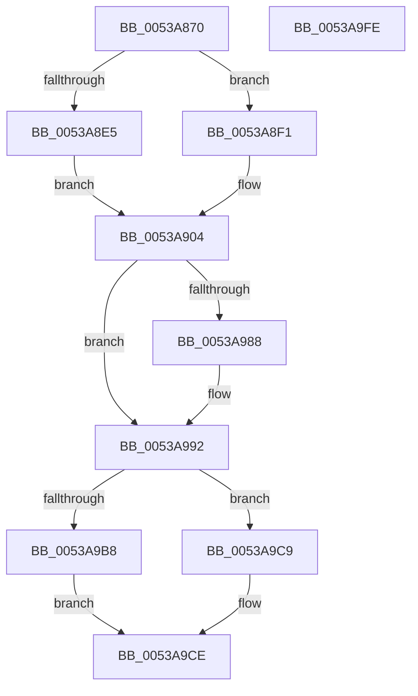

# SymCryptMontgomeryFillScratchSpaces

- RVA: `0x0053A870`–`0x0053A9FF` (길이 `399` bytes)
- VA: `0x000000014053A870`
- 실행 섹션: `.text`
- PDB 이름 있음: `예`; PDB Function 태그: `아니요`
- unwind 정보 RVA: `0x00075C18`
- 디코드: `117`개 명령, `399/399` bytes 표시
- 미해석 바이트: `0` (있으면 어셈블리에 `.byte`로 보존)

> 이 문서는 커널 이미지의 기계어와 PDB 기호를 분석해 생성했습니다. 4번과 5번은 함수 원형과 자료형을 바이너리 사용 방식에서 추정한 C 해석이며 원본 소스 복구 결과는 아닙니다.

## 1. Dependencies

- 직접 호출 지점: **14**; 고유 호출 대상: **6**
- 직접 호출자로 확인된 함수: **0**
- RIP 상대 이미지 참조: **0**

### Outgoing calls
- `0x0053A892` → [SymCryptDigitsFromBits](../52/SymCryptDigitsFromBits_function_0052544C.md) (function, `0x0052544C`)
- `0x0053A8A1` → [SymCryptSizeofModElementFromModulus](../52/SymCryptSizeofModElementFromModulus_function_00525D3C.md) (function, `0x00525D3C`)
- `0x0053A8CF` → [SymCryptSizeofIntFromDigits](../52/SymCryptSizeofIntFromDigits_function_00525D24.md) (function, `0x00525D24`)
- `0x0053A8E8` → [SymCryptSizeofIntFromDigits](../52/SymCryptSizeofIntFromDigits_function_00525D24.md) (function, `0x00525D24`)
- `0x0053A913` → [SymCryptSizeofIntFromDigits](../52/SymCryptSizeofIntFromDigits_function_00525D24.md) (function, `0x00525D24`)
- `0x0053A945` → [SymCryptSizeofEcpointEx](../52/SymCryptSizeofEcpointEx_function_0052CED4.md) (function, `0x0052CED4`)
- `0x0053A97F` → [SymCryptSizeofIntFromDigits](../52/SymCryptSizeofIntFromDigits_function_00525D24.md) (function, `0x00525D24`)
- `0x0053A98B` → [SymCryptSizeofIntFromDigits](../52/SymCryptSizeofIntFromDigits_function_00525D24.md) (function, `0x00525D24`)
- `0x0053A999` → [SymCryptEcurveDigitsofScalarMultiplier](../52/SymCryptEcurveDigitsofScalarMultiplier_function_0052415C.md) (function, `0x0052415C`)
- `0x0053A9A0` → [SymCryptSizeofIntFromDigits](../52/SymCryptSizeofIntFromDigits_function_00525D24.md) (function, `0x00525D24`)
- `0x0053A9AC` → [SymCryptSizeofEcpointFromCurve](../52/SymCryptSizeofEcpointFromCurve_function_0052CEF0.md) (function, `0x0052CEF0`)
- `0x0053A9B8` → [SymCryptEcurveDigitsofScalarMultiplier](../52/SymCryptEcurveDigitsofScalarMultiplier_function_0052415C.md) (function, `0x0052415C`)
- `0x0053A9BF` → [SymCryptSizeofIntFromDigits](../52/SymCryptSizeofIntFromDigits_function_00525D24.md) (function, `0x00525D24`)
- `0x0053A9C9` → [SymCryptSizeofEcpointFromCurve](../52/SymCryptSizeofEcpointFromCurve_function_0052CEF0.md) (function, `0x0052CEF0`)

### Direct callers
- 이 함수 시작 RVA로 연결되는 직접 call은 확인되지 않았습니다. 간접 호출은 완전히 역산할 수 없습니다.

### Static image references
- 디코드된 RIP-relative 메모리 참조가 없습니다.

## 2. Other-region calls and transfers

- 다른 실행 섹션으로 향하는 call: **0**
- 별도 외부 분기/꼬리 이동을 확인하지 못했습니다.

## 3. Assembly (complete function range)

```asm
0053A870  48 89 5C 24 08                  mov qword ptr [rsp + 8], rbx
0053A875  48 89 6C 24 10                  mov qword ptr [rsp + 0x10], rbp
0053A87A  48 89 74 24 18                  mov qword ptr [rsp + 0x18], rsi
0053A87F  57                              push rdi
0053A880  41 54                           push r12
0053A882  41 55                           push r13
0053A884  41 56                           push r14
0053A886  41 57                           push r15
0053A888  48 83 EC 20                     sub rsp, 0x20
0053A88C  4C 8B F1                        mov r14, rcx
0053A88F  8B 49 0C                        mov ecx, dword ptr [rcx + 0xc]
0053A892  E8 B5 AB FE FF                  call 0x14052544c
0053A897  49 8B 8E 68 02 00 00            mov rcx, qword ptr [r14 + 0x268]
0053A89E  44 8B F8                        mov r15d, eax
0053A8A1  E8 96 B4 FE FF                  call 0x140525d3c
0053A8A6  41 8B D7                        mov edx, r15d
0053A8A9  45 8B C7                        mov r8d, r15d
0053A8AC  C1 E2 08                        shl edx, 8
0053A8AF  44 8B E8                        mov r13d, eax
0053A8B2  41 C1 E0 06                     shl r8d, 6
0053A8B6  49 83 C0 40                     add r8, 0x40
0053A8BA  8B FA                           mov edi, edx
0053A8BC  8D 6A 40                        lea ebp, [rdx + 0x40]
0053A8BF  8B F5                           mov esi, ebp
0053A8C1  49 8D 0C 28                     lea rcx, [r8 + rbp]
0053A8C5  4A 8D 04 41                     lea rax, [rcx + r8*2]
0053A8C9  41 8B CF                        mov ecx, r15d
0053A8CC  48 03 F8                        add rdi, rax
0053A8CF  E8 50 B4 FE FF                  call 0x140525d24
0053A8D4  8B C8                           mov ecx, eax
0053A8D6  48 3B F7                        cmp rsi, rdi
0053A8D9  48 8B C7                        mov rax, rdi
0053A8DC  48 0F 47 C6                     cmova rax, rsi
0053A8E0  48 3B C8                        cmp rcx, rax
0053A8E3  76 0C                           jbe 0x14053a8f1
0053A8E5  41 8B CF                        mov ecx, r15d
0053A8E8  E8 37 B4 FE FF                  call 0x140525d24
0053A8ED  8B D8                           mov ebx, eax
0053A8EF  EB 13                           jmp 0x14053a904
0053A8F1  41 69 DF C0 02 00 00            imul ebx, r15d, 0x2c0
0053A8F8  81 C3 00 01 00 00               add ebx, 0x100
0053A8FE  48 3B F7                        cmp rsi, rdi
0053A901  0F 47 DD                        cmova ebx, ebp
0053A904  45 8B 66 24                     mov r12d, dword ptr [r14 + 0x24]
0053A908  41 8B CF                        mov ecx, r15d
0053A90B  41 8B 6E 10                     mov ebp, dword ptr [r14 + 0x10]
0053A90F  41 89 5E 2C                     mov dword ptr [r14 + 0x2c], ebx
0053A913  E8 0C B4 FE FF                  call 0x140525d24
0053A918  41 83 66 34 00                  and dword ptr [r14 + 0x34], 0
0053A91D  42 8D 0C 6D 00 00 00 00         lea ecx, [r13*2]
0053A925  03 C3                           add eax, ebx
0053A927  41 03 CD                        add ecx, r13d
0053A92A  BA 04 00 00 00                  mov edx, 4
0053A92F  8D 0C 48                        lea ecx, [rax + rcx*2]
0053A932  8B C5                           mov eax, ebp
0053A934  C1 E0 08                        shl eax, 8
0053A937  41 89 4E 30                     mov dword ptr [r14 + 0x30], ecx
0053A93B  41 8B CC                        mov ecx, r12d
0053A93E  8B F8                           mov edi, eax
0053A940  8D 70 40                        lea esi, [rax + 0x40]
0053A943  8B DE                           mov ebx, esi
0053A945  E8 8A 25 FF FF                  call 0x14052ced4
0053A94A  8B D5                           mov edx, ebp
0053A94C  C1 E2 06                        shl edx, 6
0053A94F  48 83 C2 40                     add rdx, 0x40
0053A953  48 8D 0C 16                     lea rcx, [rsi + rdx]
0053A957  48 8D 0C 51                     lea rcx, [rcx + rdx*2]
0053A95B  48 03 F9                        add rdi, rcx
0053A95E  69 CD C0 02 00 00               imul ecx, ebp, 0x2c0
0053A964  81 C1 00 01 00 00               add ecx, 0x100
0053A96A  48 3B DF                        cmp rbx, rdi
0053A96D  0F 47 CE                        cmova ecx, esi
0053A970  03 C1                           add eax, ecx
0053A972  41 8B CF                        mov ecx, r15d
0053A975  42 8D 04 60                     lea eax, [rax + r12*2]
0053A979  41 89 46 38                     mov dword ptr [r14 + 0x38], eax
0053A97D  8B D8                           mov ebx, eax
0053A97F  E8 A0 B3 FE FF                  call 0x140525d24
0053A984  3B D8                           cmp ebx, eax
0053A986  77 0A                           ja 0x14053a992
0053A988  41 8B CF                        mov ecx, r15d
0053A98B  E8 94 B3 FE FF                  call 0x140525d24
0053A990  8B D8                           mov ebx, eax
0053A992  49 8B CE                        mov rcx, r14
0053A995  41 89 5E 38                     mov dword ptr [r14 + 0x38], ebx
0053A999  E8 BE 97 FE FF                  call 0x14052415c
0053A99E  8B C8                           mov ecx, eax
0053A9A0  E8 7F B3 FE FF                  call 0x140525d24
0053A9A5  49 8B CE                        mov rcx, r14
0053A9A8  41 8D 1C 04                     lea ebx, [r12 + rax]
0053A9AC  E8 3F 25 FF FF                  call 0x14052cef0
0053A9B1  49 8B CE                        mov rcx, r14
0053A9B4  3B D8                           cmp ebx, eax
0053A9B6  76 11                           jbe 0x14053a9c9
0053A9B8  E8 9F 97 FE FF                  call 0x14052415c
0053A9BD  8B C8                           mov ecx, eax
0053A9BF  E8 60 B3 FE FF                  call 0x140525d24
0053A9C4  41 03 C4                        add eax, r12d
0053A9C7  EB 05                           jmp 0x14053a9ce
0053A9C9  E8 22 25 FF FF                  call 0x14052cef0
0053A9CE  41 8B 56 30                     mov edx, dword ptr [r14 + 0x30]
0053A9D2  41 8B 4E 38                     mov ecx, dword ptr [r14 + 0x38]
0053A9D6  3B D1                           cmp edx, ecx
0053A9D8  48 8B 5C 24 50                  mov rbx, qword ptr [rsp + 0x50]
0053A9DD  48 8B 6C 24 58                  mov rbp, qword ptr [rsp + 0x58]
0053A9E2  0F 46 D1                        cmovbe edx, ecx
0053A9E5  48 8B 74 24 60                  mov rsi, qword ptr [rsp + 0x60]
0053A9EA  03 D0                           add edx, eax
0053A9EC  41 89 56 3C                     mov dword ptr [r14 + 0x3c], edx
0053A9F0  48 83 C4 20                     add rsp, 0x20
0053A9F4  41 5F                           pop r15
0053A9F6  41 5E                           pop r14
0053A9F8  41 5D                           pop r13
0053A9FA  41 5C                           pop r12
0053A9FC  5F                              pop rdi
0053A9FD  C3                              ret
0053A9FE  CC                              int3
```

## 4. C-style interpretation (structured pseudocode)

```c
__int64 __fastcall SymCryptMontgomeryFillScratchSpaces(__int64 a1)
{
    __int64 result;
    __int64 v_rbx;
    __int64 v_rdi;
    __int64 v_rsp;
    unsigned __int64 v_stack_p10;
    unsigned __int64 v_stack_p18;
    unsigned __int64 v_stack_p8;

    v_stack_p8 = v_rbx;
    v_stack_p10 = v_rbp;
    v_stack_p18 = v_rsi;
    v_rsp = (v_rsp) - (32);
    result = SymCryptDigitsFromBits((unsigned int)(*(unsigned int *)(a1 + 12)), a2, a3, a4);
    result = SymCryptSizeofModElementFromModulus(*(unsigned __int64 *)(a1 + 616), a2, a3, a4);
    a2 = (unsigned int)(((unsigned int)((unsigned int)((unsigned int)((unsigned int)(result))))) << (8));
    a3 = (unsigned int)(((unsigned int)((unsigned int)((unsigned int)((unsigned int)(result))))) << (6));
    a3 = (a3) + (64);
    v_rdi = ((unsigned int)((unsigned int)(a2))) + (a3 + a2 + 64 * 1 + a3 * 2);
    result = SymCryptSizeofIntFromDigits((unsigned int)((unsigned int)((unsigned int)((unsigned int)(result)))), a2, a3, a4);
    result = v_rdi;
    if (((unsigned int)((unsigned int)(a2 + 64))) > v_rdi) { result = (unsigned int)((unsigned int)(a2 + 64)); }
    if (((unsigned int)((unsigned int)(result))) <= result) goto loc_0053A8F1;
    result = SymCryptSizeofIntFromDigits((unsigned int)((unsigned int)((unsigned int)((unsigned int)(result)))), a2, a3, a4);
    goto loc_0053A904;
loc_0053A8F1:
    v_rbx = (unsigned int)(((unsigned int)((unsigned int)(result))) * ((unsigned int)((unsigned int)((unsigned int)(result)))));
    v_rbx = (unsigned int)((v_rbx) + (256));
    if (((unsigned int)((unsigned int)(a2 + 64))) > v_rdi) { v_rbx = (unsigned int)(a2 + 64); }
loc_0053A904:
    *(unsigned int *)(a1 + 44) = (unsigned int)(v_rbx);
    result = SymCryptSizeofIntFromDigits((unsigned int)((unsigned int)((unsigned int)((unsigned int)(result)))), a2, a3, a4);
    result = (unsigned int)((result) + ((unsigned int)(v_rbx)));
    a1 = (unsigned int)(((unsigned int)((unsigned int)(result)) * 2) + ((unsigned int)((unsigned int)((unsigned int)(result)))));
    result = (unsigned int)(((unsigned int)((unsigned int)((unsigned int)(*(unsigned int *)(a1 + 16))))) << (8));
    *(unsigned int *)(a1 + 48) = (unsigned int)(result + a1 * 2);
    result = SymCryptSizeofEcpointEx((unsigned int)((unsigned int)((unsigned int)(*(unsigned int *)(a1 + 36)))), 4, a3, a4);
    a2 = (unsigned int)(((unsigned int)((unsigned int)((unsigned int)(*(unsigned int *)(a1 + 16))))) << (6));
    a2 = (a2) + (64);
    v_rdi = ((unsigned int)((unsigned int)(result))) + (result + 64 + a2 * 1 + a2 * 2);
    a1 = (unsigned int)((result + 64 + a2 * 1 + a2 * 2) * ((unsigned int)((unsigned int)(*(unsigned int *)(a1 + 16)))));
    a1 = (unsigned int)((a1) + (256));
    if (((unsigned int)((unsigned int)(result + 64))) > v_rdi) { a1 = (unsigned int)(result + 64); }
    result = (unsigned int)((result) + ((unsigned int)(a1)));
    *(unsigned int *)(a1 + 56) = (unsigned int)(result + (unsigned int)(*(unsigned int *)(a1 + 36)) * 2);
    result = SymCryptSizeofIntFromDigits((unsigned int)((unsigned int)((unsigned int)((unsigned int)(result)))), a2, a3, a4);
    v_rbx = (unsigned int)((unsigned int)(result + (unsigned int)(*(unsigned int *)(a1 + 36)) * 2));
    if (((unsigned int)((unsigned int)((unsigned int)(result + (unsigned int)(*(unsigned int *)(a1 + 36)) * 2)))) <= ((unsigned int)(result))) {
        a1 = (unsigned int)((unsigned int)((unsigned int)(result)));
        result = SymCryptSizeofIntFromDigits(a1, a2, a3, a4);
        v_rbx = (unsigned int)(result);
    }
    *(unsigned int *)(a1 + 56) = (unsigned int)(v_rbx);
    result = SymCryptEcurveDigitsofScalarMultiplier(a1, a2, a3, a4);
    result = SymCryptSizeofIntFromDigits((unsigned int)((unsigned int)(result)), a2, a3, a4);
    result = SymCryptSizeofEcpointFromCurve(a1, a2, a3, a4);
    if (((unsigned int)((unsigned int)(*(unsigned int *)(a1 + 36)) + result * 1)) <= ((unsigned int)(result))) goto loc_0053A9C9;
    result = SymCryptEcurveDigitsofScalarMultiplier(a1, a2, a3, a4);
    result = SymCryptSizeofIntFromDigits((unsigned int)((unsigned int)(result)), a2, a3, a4);
    result = (unsigned int)((result) + ((unsigned int)((unsigned int)(*(unsigned int *)(a1 + 36)))));
    goto loc_0053A9CE;
loc_0053A9C9:
    result = SymCryptSizeofEcpointFromCurve((unsigned int)((unsigned int)(result)), a2, a3, a4);
loc_0053A9CE:
    a2 = (unsigned int)(*(unsigned int *)(a1 + 48));
    if (((unsigned int)((unsigned int)(*(unsigned int *)(a1 + 48)))) <= ((unsigned int)((unsigned int)(*(unsigned int *)(a1 + 56))))) { a2 = (unsigned int)((unsigned int)(*(unsigned int *)(a1 + 56))); }
    a2 = (unsigned int)((a2) + ((unsigned int)(result)));
    *(unsigned int *)(a1 + 60) = (unsigned int)(a2);
    v_rsp = (v_rsp) + (32);
    return result;
}
```

## 5. (Beta) C Style

```c
int64_t SymCryptMontgomeryFillScratchSpaces(void *Arg1)
{
    uint8_t *arg1 = (uint8_t *)Arg1;

    int64_t result;
    int64_t local_rbx;
    int64_t local_rdi;
    int64_t local_rsp;
    uint64_t v_stack_p10;
    uint64_t v_stack_p18;
    uint64_t v_stack_p8;

    v_stack_p8 = local_rbx;
    v_stack_p10 = local_rbp;
    v_stack_p18 = local_rsi;
    local_rsp = (local_rsp) - (32);
    result = SymCryptDigitsFromBits((uint32_t)(*(uint32_t *)(arg1 + 0xC)), a2, a3, a4);
    result = SymCryptSizeofModElementFromModulus(*(uint64_t *)(arg1 + 0x268), a2, a3, a4);
    a2 = (uint32_t)(((uint32_t)((uint32_t)((uint32_t)((uint32_t)(result))))) << (8));
    a3 = (uint32_t)(((uint32_t)((uint32_t)((uint32_t)((uint32_t)(result))))) << (6));
    a3 = (a3) + (64);
    local_rdi = ((uint32_t)((uint32_t)(a2))) + (a3 + a2 + 64 * 1 + a3 * 2);
    result = SymCryptSizeofIntFromDigits((uint32_t)((uint32_t)((uint32_t)((uint32_t)(result)))), a2, a3, a4);
    result = local_rdi;
    if (((uint32_t)((uint32_t)(a2 + 64))) > local_rdi) { result = (uint32_t)((uint32_t)(a2 + 64)); }
    if (((uint32_t)((uint32_t)(result))) <= result) goto loc_0053A8F1;
    result = SymCryptSizeofIntFromDigits((uint32_t)((uint32_t)((uint32_t)((uint32_t)(result)))), a2, a3, a4);
    goto loc_0053A904;
loc_0053A8F1:
    local_rbx = (uint32_t)(((uint32_t)((uint32_t)(result))) * ((uint32_t)((uint32_t)((uint32_t)(result)))));
    local_rbx = (uint32_t)((local_rbx) + (256));
    if (((uint32_t)((uint32_t)(a2 + 64))) > local_rdi) { local_rbx = (uint32_t)(a2 + 64); }
loc_0053A904:
    *(uint32_t *)(arg1 + 0x2C) = (uint32_t)(local_rbx);
    result = SymCryptSizeofIntFromDigits((uint32_t)((uint32_t)((uint32_t)((uint32_t)(result)))), a2, a3, a4);
    result = (uint32_t)((result) + ((uint32_t)(local_rbx)));
    Arg1 = (uint32_t)(((uint32_t)((uint32_t)(result)) * 2) + ((uint32_t)((uint32_t)((uint32_t)(result)))));
    result = (uint32_t)(((uint32_t)((uint32_t)((uint32_t)(*(uint32_t *)(arg1 + 0x10))))) << (8));
    *(uint32_t *)(arg1 + 0x30) = (uint32_t)(result + Arg1 * 2);
    result = SymCryptSizeofEcpointEx((uint32_t)((uint32_t)((uint32_t)(*(uint32_t *)(arg1 + 0x24)))), 4, a3, a4);
    a2 = (uint32_t)(((uint32_t)((uint32_t)((uint32_t)(*(uint32_t *)(arg1 + 0x10))))) << (6));
    a2 = (a2) + (64);
    local_rdi = ((uint32_t)((uint32_t)(result))) + (result + 64 + a2 * 1 + a2 * 2);
    Arg1 = (uint32_t)((result + 64 + a2 * 1 + a2 * 2) * ((uint32_t)((uint32_t)(*(uint32_t *)(arg1 + 0x10)))));
    Arg1 = (uint32_t)((Arg1) + (256));
    if (((uint32_t)((uint32_t)(result + 64))) > local_rdi) { Arg1 = (uint32_t)(result + 64); }
    result = (uint32_t)((result) + ((uint32_t)(Arg1)));
    *(uint32_t *)(arg1 + 0x38) = (uint32_t)(result + (uint32_t)(*(uint32_t *)(arg1 + 0x24)) * 2);
    result = SymCryptSizeofIntFromDigits((uint32_t)((uint32_t)((uint32_t)((uint32_t)(result)))), a2, a3, a4);
    local_rbx = (uint32_t)((uint32_t)(result + (uint32_t)(*(uint32_t *)(arg1 + 0x24)) * 2));
    if (((uint32_t)((uint32_t)((uint32_t)(result + (uint32_t)(*(uint32_t *)(arg1 + 0x24)) * 2)))) <= ((uint32_t)(result))) {
        Arg1 = (uint32_t)((uint32_t)((uint32_t)(result)));
        result = SymCryptSizeofIntFromDigits(Arg1, a2, a3, a4);
        local_rbx = (uint32_t)(result);
    }
    *(uint32_t *)(arg1 + 0x38) = (uint32_t)(local_rbx);
    result = SymCryptEcurveDigitsofScalarMultiplier(Arg1, a2, a3, a4);
    result = SymCryptSizeofIntFromDigits((uint32_t)((uint32_t)(result)), a2, a3, a4);
    result = SymCryptSizeofEcpointFromCurve(Arg1, a2, a3, a4);
    if (((uint32_t)((uint32_t)(*(uint32_t *)(arg1 + 0x24)) + result * 1)) <= ((uint32_t)(result))) goto loc_0053A9C9;
    result = SymCryptEcurveDigitsofScalarMultiplier(Arg1, a2, a3, a4);
    result = SymCryptSizeofIntFromDigits((uint32_t)((uint32_t)(result)), a2, a3, a4);
    result = (uint32_t)((result) + ((uint32_t)((uint32_t)(*(uint32_t *)(arg1 + 0x24)))));
    goto loc_0053A9CE;
loc_0053A9C9:
    result = SymCryptSizeofEcpointFromCurve((uint32_t)((uint32_t)(result)), a2, a3, a4);
loc_0053A9CE:
    a2 = (uint32_t)(*(uint32_t *)(arg1 + 0x30));
    if (((uint32_t)((uint32_t)(*(uint32_t *)(arg1 + 0x30)))) <= ((uint32_t)((uint32_t)(*(uint32_t *)(arg1 + 0x38))))) { a2 = (uint32_t)((uint32_t)(*(uint32_t *)(arg1 + 0x38))); }
    a2 = (uint32_t)((a2) + ((uint32_t)(result)));
    *(uint32_t *)(arg1 + 0x3C) = (uint32_t)(a2);
    local_rsp = (local_rsp) + (32);
    return result;
}
```

### 관측된 메모리 오프셋

구조체 형식이 확인되지 않은 접근은 인자 기준의 오프셋으로만 기록했습니다.

| 기준 인자 | 오프셋 표현 | 폭 (bit) | 접근 |
|---|---:|---:|---|
| `Arg1` | `+ 0xC` | `32` | `R` |
| `Arg1` | `+ 0x10` | `32` | `R` |
| `Arg1` | `+ 0x24` | `32` | `R` |
| `Arg1` | `+ 0x2C` | `32` | `W` |
| `Arg1` | `+ 0x30` | `32` | `R` |
| `Arg1` | `+ 0x30` | `32` | `W` |
| `Arg1` | `+ 0x34` | `32` | `R/W` |
| `Arg1` | `+ 0x38` | `32` | `R` |
| `Arg1` | `+ 0x38` | `32` | `W` |
| `Arg1` | `+ 0x3C` | `32` | `W` |
| `Arg1` | `+ 0x268` | `64` | `R` |

## 6. Execution-region graph

[열기: 2D/3D 그래프와 함수 탐색 컨트롤 패널](../../../control-panel.html?section=text&rva=0x0053A870&view=graph)

- 2D 그래프는 위에서 아래로 흐르고, 3D 그래프는 빈 공간을 드래그해 회전합니다. Shift+드래그는 이동, 휠은 확대·축소, 함수 노드 선택은 대상 보고서 이동입니다.

### Static fallback


