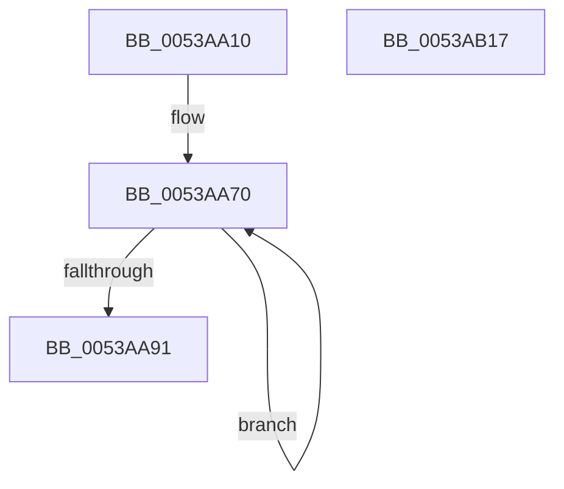

# SymCryptMontgomeryIsEqual

- RVA: `0x0053AA10`–`0x0053AB18` (길이 `264` bytes)
- VA: `0x000000014053AA10`
- 실행 섹션: `.text`
- PDB 이름 있음: `예`; PDB Function 태그: `아니요`
- unwind 정보 RVA: `0x000C368C`
- 디코드: `70`개 명령, `264/264` bytes 표시
- 미해석 바이트: `0` (있으면 어셈블리에 `.byte`로 보존)

> 이 문서는 커널 이미지의 기계어와 PDB 기호를 분석해 생성했습니다. 4번과 5번은 함수 원형과 자료형을 바이너리 사용 방식에서 추정한 C 해석이며 원본 소스 복구 결과는 아닙니다.

## 1. Dependencies

- 직접 호출 지점: **6**; 고유 호출 대상: **5**
- 직접 호출자로 확인된 함수: **0**
- RIP 상대 이미지 참조: **1**

### Outgoing calls
- `0x0053AA56` → [SymCryptSizeofModElementFromModulus](../52/SymCryptSizeofModElementFromModulus_function_00525D3C.md) (function, `0x00525D3C`)
- `0x0053AA79` → [SymCryptModElementCreate](../52/SymCryptModElementCreate_function_00525900.md) (function, `0x00525900`)
- `0x0053AAB8` → [SymCryptModMul](../52/SymCryptModMul_function_00525BA8.md) (function, `0x00525BA8`)
- `0x0053AADB` → [SymCryptModMul](../52/SymCryptModMul_function_00525BA8.md) (function, `0x00525BA8`)
- `0x0053AAED` → [SymCryptModElementIsEqual](../52/SymCryptModElementIsEqual_function_0052594C.md) (function, `0x0052594C`)
- `0x0053AAFA` → [_security_check_cookie](../6A/_security_check_cookie_function_006AC640.md) (function, `0x006AC640`)

### Direct callers
- 이 함수 시작 RVA로 연결되는 직접 call은 확인되지 않았습니다. 간접 호출은 완전히 역산할 수 없습니다.

### Static image references
- `0x0053AA24` → RVA `0x00E0A740` (`.data`; read)

## 2. Other-region calls and transfers

- 다른 실행 섹션으로 향하는 call: **0**
- 별도 외부 분기/꼬리 이동을 확인하지 못했습니다.

## 3. Assembly (complete function range)

```asm
0053AA10  48 89 5C 24 20                  mov qword ptr [rsp + 0x20], rbx
0053AA15  55                              push rbp
0053AA16  56                              push rsi
0053AA17  57                              push rdi
0053AA18  41 54                           push r12
0053AA1A  41 55                           push r13
0053AA1C  41 56                           push r14
0053AA1E  41 57                           push r15
0053AA20  48 83 EC 50                     sub rsp, 0x50
0053AA24  48 8B 05 15 FD 8C 00            mov rax, qword ptr [rip + 0x8cfd15]
0053AA2B  48 33 C4                        xor rax, rsp
0053AA2E  48 89 44 24 48                  mov qword ptr [rsp + 0x48], rax
0053AA33  48 8B A9 68 02 00 00            mov rbp, qword ptr [rcx + 0x268]
0053AA3A  4C 8B E9                        mov r13, rcx
0053AA3D  48 83 64 24 40 00               and qword ptr [rsp + 0x40], 0
0053AA43  48 8B CD                        mov rcx, rbp
0053AA46  48 8B BC 24 B0 00 00 00         mov rdi, qword ptr [rsp + 0xb0]
0053AA4E  4C 8B E2                        mov r12, rdx
0053AA51  4C 89 44 24 30                  mov qword ptr [rsp + 0x30], r8
0053AA56  E8 E1 B2 FE FF                  call 0x140525d3c
0053AA5B  4C 8B B4 24 B8 00 00 00         mov r14, qword ptr [rsp + 0xb8]
0053AA63  48 8D 74 24 38                  lea rsi, [rsp + 0x38]
0053AA68  8B D8                           mov ebx, eax
0053AA6A  41 BF 02 00 00 00               mov r15d, 2
0053AA70  4C 8B C5                        mov r8, rbp
0053AA73  48 8B D3                        mov rdx, rbx
0053AA76  48 8B CF                        mov rcx, rdi
0053AA79  E8 82 AE FE FF                  call 0x140525900
0053AA7E  48 03 FB                        add rdi, rbx
0053AA81  48 89 06                        mov qword ptr [rsi], rax
0053AA84  4C 2B F3                        sub r14, rbx
0053AA87  48 8D 76 08                     lea rsi, [rsi + 8]
0053AA8B  49 83 EF 01                     sub r15, 1
0053AA8F  75 DF                           jne 0x14053aa70
0053AA91  41 8B 5D 24                     mov ebx, dword ptr [r13 + 0x24]
0053AA95  49 8D 54 24 20                  lea rdx, [r12 + 0x20]
0053AA9A  48 8B 74 24 30                  mov rsi, qword ptr [rsp + 0x30]
0053AA9F  48 8B CD                        mov rcx, rbp
0053AAA2  4C 8B 4C 24 38                  mov r9, qword ptr [rsp + 0x38]
0053AAA7  4C 89 74 24 28                  mov qword ptr [rsp + 0x28], r14
0053AAAC  48 89 7C 24 20                  mov qword ptr [rsp + 0x20], rdi
0053AAB1  4C 8D 46 20                     lea r8, [rsi + 0x20]
0053AAB5  4C 03 C3                        add r8, rbx
0053AAB8  E8 EB B0 FE FF                  call 0x140525ba8
0053AABD  4C 8B 4C 24 40                  mov r9, qword ptr [rsp + 0x40]
0053AAC2  4D 8D 44 24 20                  lea r8, [r12 + 0x20]
0053AAC7  4C 03 C3                        add r8, rbx
0053AACA  4C 89 74 24 28                  mov qword ptr [rsp + 0x28], r14
0053AACF  48 8D 56 20                     lea rdx, [rsi + 0x20]
0053AAD3  48 89 7C 24 20                  mov qword ptr [rsp + 0x20], rdi
0053AAD8  48 8B CD                        mov rcx, rbp
0053AADB  E8 C8 B0 FE FF                  call 0x140525ba8
0053AAE0  4C 8B 44 24 40                  mov r8, qword ptr [rsp + 0x40]
0053AAE5  48 8B CD                        mov rcx, rbp
0053AAE8  48 8B 54 24 38                  mov rdx, qword ptr [rsp + 0x38]
0053AAED  E8 5A AE FE FF                  call 0x14052594c
0053AAF2  48 8B 4C 24 48                  mov rcx, qword ptr [rsp + 0x48]
0053AAF7  48 33 CC                        xor rcx, rsp
0053AAFA  E8 41 1B 17 00                  call 0x1406ac640
0053AAFF  48 8B 9C 24 A8 00 00 00         mov rbx, qword ptr [rsp + 0xa8]
0053AB07  48 83 C4 50                     add rsp, 0x50
0053AB0B  41 5F                           pop r15
0053AB0D  41 5E                           pop r14
0053AB0F  41 5D                           pop r13
0053AB11  41 5C                           pop r12
0053AB13  5F                              pop rdi
0053AB14  5E                              pop rsi
0053AB15  5D                              pop rbp
0053AB16  C3                              ret
0053AB17  CC                              int3
```

## 4. C-style interpretation (structured pseudocode)

```c
__int64 __fastcall SymCryptMontgomeryIsEqual(__int64 a1, __int64 a2, __int64 a3, __int64 a4, __int64 a5, __int64 a6)
{
    __int64 result;
    __int64 v_r14;
    __int64 v_r15;
    __int64 v_rdi;
    __int64 v_rsp;
    unsigned __int64 v_stack_m40;
    unsigned __int64 v_stack_m48;
    unsigned __int64 v_stack_m50;
    unsigned __int64 v_stack_m58;
    unsigned __int64 v_stack_m60;
    unsigned __int64 v_stack_m68;
    unsigned __int64 v_stack_p20;

    v_stack_p20 = v_rbx;
    v_rsp = (v_rsp) - (80);
    result = (*(unsigned __int64 *)(v_rip + 9239829)) ^ (v_rsp);
    v_stack_m40 = result;
    v_stack_m58 = a3;
    result = SymCryptSizeofModElementFromModulus(*(unsigned __int64 *)(a1 + 616), a2, a3, a4);
loc_0053AA70:
    result = SymCryptModElementCreate(a5, (unsigned int)((unsigned int)(result)), *(unsigned __int64 *)(a1 + 616), a4);
    v_rdi = (a5) + ((unsigned int)((unsigned int)(result)));
    *(unsigned __int64 *)(v_stack_m50) = result;
    v_r14 = (a6) - ((unsigned int)((unsigned int)(result)));
    v_r15 = (2) - (1);
    if (condition_is_not_equal) goto loc_0053AA70;
    v_stack_m60 = v_r14;
    v_stack_m68 = v_rdi;
    a3 = (v_stack_m58 + 32) + ((unsigned int)(*(unsigned int *)(a1 + 36)));
    result = SymCryptModMul(*(unsigned __int64 *)(a1 + 616), a2 + 32, a3, v_stack_m50);
    a3 = (a2 + 32) + ((unsigned int)(*(unsigned int *)(a1 + 36)));
    v_stack_m60 = v_r14;
    v_stack_m68 = v_rdi;
    result = SymCryptModMul(*(unsigned __int64 *)(a1 + 616), v_stack_m58 + 32, a3, v_stack_m48);
    result = SymCryptModElementIsEqual(*(unsigned __int64 *)(a1 + 616), v_stack_m50, v_stack_m48, v_stack_m48);
    a1 = (v_stack_m40) ^ (v_rsp);
    result = _security_check_cookie(a1, v_stack_m50, v_stack_m48, v_stack_m48);
    v_rsp = (v_rsp) + (80);
    return result;
}
```

## 5. (Beta) C Style

```c
int64_t SymCryptMontgomeryIsEqual(void *Arg1, void *Arg2, int64_t Arg3, int64_t Arg4, int64_t Arg5, int64_t Arg6)
{
    uint8_t *arg1 = (uint8_t *)Arg1;
    uint8_t *arg2 = (uint8_t *)Arg2;

    int64_t result;
    int64_t local_r14;
    int64_t local_r15;
    int64_t local_rdi;
    int64_t local_rsp;
    uint64_t v_stack_m40;
    uint64_t v_stack_m48;
    uint64_t v_stack_m50;
    uint64_t v_stack_m58;
    uint64_t v_stack_m60;
    uint64_t v_stack_m68;
    uint64_t v_stack_p20;

    v_stack_p20 = local_rbx;
    local_rsp = (local_rsp) - (80);
    result = (*(uint64_t *)(v_rip + 0x8CFD15)) ^ (local_rsp);
    v_stack_m40 = result;
    v_stack_m58 = Arg3;
    result = SymCryptSizeofModElementFromModulus(*(uint64_t *)(arg1 + 0x268), Arg2, Arg3, Arg4);
loc_0053AA70:
    result = SymCryptModElementCreate(Arg5, (uint32_t)((uint32_t)(result)), *(uint64_t *)(arg1 + 0x268), Arg4);
    local_rdi = (Arg5) + ((uint32_t)((uint32_t)(result)));
    *(uint64_t *)(v_stack_m50) = result;
    local_r14 = (Arg6) - ((uint32_t)((uint32_t)(result)));
    local_r15 = (2) - (1);
    if (condition_is_not_equal) goto loc_0053AA70;
    v_stack_m60 = local_r14;
    v_stack_m68 = local_rdi;
    Arg3 = (v_stack_m58 + 32) + ((uint32_t)(*(uint32_t *)(arg1 + 0x24)));
    result = SymCryptModMul(*(uint64_t *)(arg1 + 0x268), Arg2 + 32, Arg3, v_stack_m50);
    Arg3 = (Arg2 + 32) + ((uint32_t)(*(uint32_t *)(arg1 + 0x24)));
    v_stack_m60 = local_r14;
    v_stack_m68 = local_rdi;
    result = SymCryptModMul(*(uint64_t *)(arg1 + 0x268), v_stack_m58 + 32, Arg3, v_stack_m48);
    result = SymCryptModElementIsEqual(*(uint64_t *)(arg1 + 0x268), v_stack_m50, v_stack_m48, v_stack_m48);
    Arg1 = (v_stack_m40) ^ (local_rsp);
    result = _security_check_cookie(Arg1, v_stack_m50, v_stack_m48, v_stack_m48);
    local_rsp = (local_rsp) + (80);
    return result;
}
```

### 관측된 메모리 오프셋

구조체 형식이 확인되지 않은 접근은 인자 기준의 오프셋으로만 기록했습니다.

| 기준 인자 | 오프셋 표현 | 폭 (bit) | 접근 |
|---|---:|---:|---|
| `Arg1` | `+ 0x24` | `32` | `R` |
| `Arg1` | `+ 0x268` | `64` | `R` |
| `Arg2` | `+ 0x20` | `64` | `R` |

## 6. Execution-region graph

[열기: 2D/3D 그래프와 함수 탐색 컨트롤 패널](../../../control-panel.html?section=text&rva=0x0053AA10&view=graph)

- 2D 그래프는 위에서 아래로 흐르고, 3D 그래프는 빈 공간을 드래그해 회전합니다. Shift+드래그는 이동, 휠은 확대·축소, 함수 노드 선택은 대상 보고서 이동입니다.

### Static fallback


