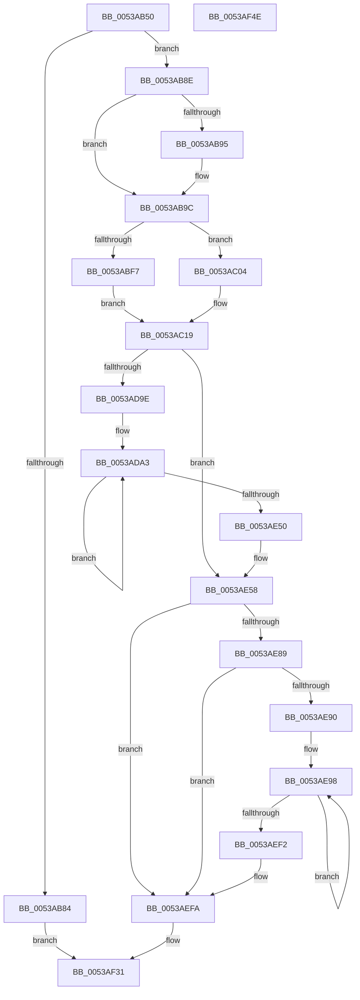

# SymCryptMontgomeryPointScalarMul

- RVA: `0x0053AB50`–`0x0053AF4F` (길이 `1,023` bytes)
- VA: `0x000000014053AB50`
- 실행 섹션: `.text`
- PDB 이름 있음: `예`; PDB Function 태그: `아니요`
- unwind 정보 RVA: `0x000C366C`
- 디코드: `243`개 명령, `1,023/1,023` bytes 표시
- 미해석 바이트: `0` (있으면 어셈블리에 `.byte`로 보존)

> 이 문서는 커널 이미지의 기계어와 PDB 기호를 분석해 생성했습니다. 4번과 5번은 함수 원형과 자료형을 바이너리 사용 방식에서 추정한 C 해석이며 원본 소스 복구 결과는 아닙니다.

## 1. Dependencies

- 직접 호출 지점: **23**; 고유 호출 대상: **9**
- 직접 호출자로 확인된 함수: **0**
- RIP 상대 이미지 참조: **0**

### Outgoing calls
- `0x0053ABA6` → [SymCryptDigitsFromBits](../52/SymCryptDigitsFromBits_function_0052544C.md) (function, `0x0052544C`)
- `0x0053ABB1` → [SymCryptSizeofModElementFromModulus](../52/SymCryptSizeofModElementFromModulus_function_00525D3C.md) (function, `0x00525D3C`)
- `0x0053ABE1` → [SymCryptSizeofIntFromDigits](../52/SymCryptSizeofIntFromDigits_function_00525D24.md) (function, `0x00525D24`)
- `0x0053ABFA` → [SymCryptSizeofIntFromDigits](../52/SymCryptSizeofIntFromDigits_function_00525D24.md) (function, `0x00525D24`)
- `0x0053AC2D` → [SymCryptModElementCreate](../52/SymCryptModElementCreate_function_00525900.md) (function, `0x00525900`)
- `0x0053AC48` → [SymCryptModElementCreate](../52/SymCryptModElementCreate_function_00525900.md) (function, `0x00525900`)
- `0x0053AC6B` → [SymCryptModElementCreate](../52/SymCryptModElementCreate_function_00525900.md) (function, `0x00525900`)
- `0x0053AC90` → [SymCryptModElementCreate](../52/SymCryptModElementCreate_function_00525900.md) (function, `0x00525900`)
- `0x0053ACB5` → [SymCryptModElementCreate](../52/SymCryptModElementCreate_function_00525900.md) (function, `0x00525900`)
- `0x0053ACDD` → [SymCryptModElementCreate](../52/SymCryptModElementCreate_function_00525900.md) (function, `0x00525900`)
- `0x0053AD37` → [SymCryptModElementSetValueUint32](../52/SymCryptModElementSetValueUint32_function_00525A40.md) (function, `0x00525A40`)
- `0x0053AD51` → [SymCryptModElementSetValueUint32](../52/SymCryptModElementSetValueUint32_function_00525A40.md) (function, `0x00525A40`)
- `0x0053AD62` → [SymCryptModElementCopy](../52/SymCryptModElementCopy_function_005258E8.md) (function, `0x005258E8`)
- `0x0053AD72` → [SymCryptModElementCopy](../52/SymCryptModElementCopy_function_005258E8.md) (function, `0x005258E8`)
- `0x0053ADB3` → [SymCryptIntGetBit](../52/SymCryptIntGetBit_function_00525620.md) (function, `0x00525620`)
- `0x0053ADC9` → [SymCryptModElementConditionalSwap](../52/SymCryptModElementConditionalSwap_function_005258D0.md) (function, `0x005258D0`)
- `0x0053ADDA` → [SymCryptModElementConditionalSwap](../52/SymCryptModElementConditionalSwap_function_005258D0.md) (function, `0x005258D0`)
- `0x0053AE3F` → [SymCryptMontgomeryDoubleAndAdd](SymCryptMontgomeryDoubleAndAdd_function_0053A5AC.md) (function, `0x0053A5AC`)
- `0x0053AE64` → [SymCryptModElementConditionalSwap](../52/SymCryptModElementConditionalSwap_function_005258D0.md) (function, `0x005258D0`)
- `0x0053AE7A` → [SymCryptModElementConditionalSwap](../52/SymCryptModElementConditionalSwap_function_005258D0.md) (function, `0x005258D0`)
- `0x0053AEE8` → [SymCryptMontgomeryDoubleAndAdd](SymCryptMontgomeryDoubleAndAdd_function_0053A5AC.md) (function, `0x0053A5AC`)
- `0x0053AF10` → [SymCryptModElementCopy](../52/SymCryptModElementCopy_function_005258E8.md) (function, `0x005258E8`)
- `0x0053AF29` → [SymCryptModElementCopy](../52/SymCryptModElementCopy_function_005258E8.md) (function, `0x005258E8`)

### Direct callers
- 이 함수 시작 RVA로 연결되는 직접 call은 확인되지 않았습니다. 간접 호출은 완전히 역산할 수 없습니다.

### Static image references
- 디코드된 RIP-relative 메모리 참조가 없습니다.

## 2. Other-region calls and transfers

- 다른 실행 섹션으로 향하는 call: **0**
- 별도 외부 분기/꼬리 이동을 확인하지 못했습니다.

## 3. Assembly (complete function range)

```asm
0053AB50  48 8B C4                        mov rax, rsp
0053AB53  48 89 58 18                     mov qword ptr [rax + 0x18], rbx
0053AB57  44 89 48 20                     mov dword ptr [rax + 0x20], r9d
0053AB5B  48 89 50 10                     mov qword ptr [rax + 0x10], rdx
0053AB5F  48 89 48 08                     mov qword ptr [rax + 8], rcx
0053AB63  55                              push rbp
0053AB64  56                              push rsi
0053AB65  57                              push rdi
0053AB66  41 54                           push r12
0053AB68  41 55                           push r13
0053AB6A  41 56                           push r14
0053AB6C  41 57                           push r15
0053AB6E  48 81 EC A0 00 00 00            sub rsp, 0xa0
0053AB75  4D 8B E8                        mov r13, r8
0053AB78  48 8B F1                        mov rsi, rcx
0053AB7B  41 F7 C1 DF FF FF FF            test r9d, 0xffffffdf
0053AB82  74 0A                           je 0x14053ab8e
0053AB84  BF 0E 80 00 00                  mov edi, 0x800e
0053AB89  E9 A3 03 00 00                  jmp 0x14053af31
0053AB8E  33 FF                           xor edi, edi
0053AB90  4D 85 C0                        test r8, r8
0053AB93  75 07                           jne 0x14053ab9c
0053AB95  4C 8B A9 88 02 00 00            mov r13, qword ptr [rcx + 0x288]
0053AB9C  48 8B A9 68 02 00 00            mov rbp, qword ptr [rcx + 0x268]
0053ABA3  8B 49 0C                        mov ecx, dword ptr [rcx + 0xc]
0053ABA6  E8 A1 A8 FE FF                  call 0x14052544c
0053ABAB  48 8B CD                        mov rcx, rbp
0053ABAE  44 8B F0                        mov r14d, eax
0053ABB1  E8 86 B1 FE FF                  call 0x140525d3c
0053ABB6  89 44 24 60                     mov dword ptr [rsp + 0x60], eax
0053ABBA  41 8B CE                        mov ecx, r14d
0053ABBD  C1 E1 06                        shl ecx, 6
0053ABC0  41 8B C6                        mov eax, r14d
0053ABC3  C1 E0 08                        shl eax, 8
0053ABC6  48 83 C1 40                     add rcx, 0x40
0053ABCA  8B D8                           mov ebx, eax
0053ABCC  44 8D 60 40                     lea r12d, [rax + 0x40]
0053ABD0  49 8D 04 0C                     lea rax, [r12 + rcx]
0053ABD4  45 8B FC                        mov r15d, r12d
0053ABD7  48 8D 04 48                     lea rax, [rax + rcx*2]
0053ABDB  41 8B CE                        mov ecx, r14d
0053ABDE  48 03 D8                        add rbx, rax
0053ABE1  E8 3E B1 FE FF                  call 0x140525d24
0053ABE6  8B C8                           mov ecx, eax
0053ABE8  4C 3B FB                        cmp r15, rbx
0053ABEB  48 8B C3                        mov rax, rbx
0053ABEE  49 0F 47 C7                     cmova rax, r15
0053ABF2  48 3B C8                        cmp rcx, rax
0053ABF5  76 0D                           jbe 0x14053ac04
0053ABF7  41 8B CE                        mov ecx, r14d
0053ABFA  E8 25 B1 FE FF                  call 0x140525d24
0053ABFF  44 8B F0                        mov r14d, eax
0053AC02  EB 15                           jmp 0x14053ac19
0053AC04  45 69 F6 C0 02 00 00            imul r14d, r14d, 0x2c0
0053AC0B  41 81 C6 00 01 00 00            add r14d, 0x100
0053AC12  4C 3B FB                        cmp r15, rbx
0053AC15  45 0F 47 F4                     cmova r14d, r12d
0053AC19  8B 5C 24 60                     mov ebx, dword ptr [rsp + 0x60]
0053AC1D  4C 8B C5                        mov r8, rbp
0053AC20  4C 8B A4 24 08 01 00 00         mov r12, qword ptr [rsp + 0x108]
0053AC28  8B D3                           mov edx, ebx
0053AC2A  49 8B CC                        mov rcx, r12
0053AC2D  E8 CE AC FE FF                  call 0x140525900
0053AC32  4C 03 E3                        add r12, rbx
0053AC35  4C 8B C5                        mov r8, rbp
0053AC38  49 8B CC                        mov rcx, r12
0053AC3B  4C 89 A4 24 08 01 00 00         mov qword ptr [rsp + 0x108], r12
0053AC43  8B D3                           mov edx, ebx
0053AC45  4C 8B F8                        mov r15, rax
0053AC48  E8 B3 AC FE FF                  call 0x140525900
0053AC4D  4C 8B E0                        mov r12, rax
0053AC50  4C 8B C5                        mov r8, rbp
0053AC53  48 8B 84 24 08 01 00 00         mov rax, qword ptr [rsp + 0x108]
0053AC5B  8B D3                           mov edx, ebx
0053AC5D  48 03 C3                        add rax, rbx
0053AC60  48 8B C8                        mov rcx, rax
0053AC63  48 89 84 24 08 01 00 00         mov qword ptr [rsp + 0x108], rax
0053AC6B  E8 90 AC FE FF                  call 0x140525900
0053AC70  48 89 44 24 60                  mov qword ptr [rsp + 0x60], rax
0053AC75  4C 8B C5                        mov r8, rbp
0053AC78  48 8B 84 24 08 01 00 00         mov rax, qword ptr [rsp + 0x108]
0053AC80  8B D3                           mov edx, ebx
0053AC82  48 03 C3                        add rax, rbx
0053AC85  48 8B C8                        mov rcx, rax
0053AC88  48 89 84 24 08 01 00 00         mov qword ptr [rsp + 0x108], rax
0053AC90  E8 6B AC FE FF                  call 0x140525900
0053AC95  48 89 44 24 68                  mov qword ptr [rsp + 0x68], rax
0053AC9A  4C 8B C5                        mov r8, rbp
0053AC9D  48 8B 84 24 08 01 00 00         mov rax, qword ptr [rsp + 0x108]
0053ACA5  8B D3                           mov edx, ebx
0053ACA7  48 03 C3                        add rax, rbx
0053ACAA  48 8B C8                        mov rcx, rax
0053ACAD  48 89 84 24 08 01 00 00         mov qword ptr [rsp + 0x108], rax
0053ACB5  E8 46 AC FE FF                  call 0x140525900
0053ACBA  48 89 84 24 80 00 00 00         mov qword ptr [rsp + 0x80], rax
0053ACC2  4C 8B C5                        mov r8, rbp
0053ACC5  48 8B 84 24 08 01 00 00         mov rax, qword ptr [rsp + 0x108]
0053ACCD  8B D3                           mov edx, ebx
0053ACCF  48 03 C3                        add rax, rbx
0053ACD2  48 8B C8                        mov rcx, rax
0053ACD5  48 89 84 24 08 01 00 00         mov qword ptr [rsp + 0x108], rax
0053ACDD  E8 1E AC FE FF                  call 0x140525900
0053ACE2  48 8B 8C 24 08 01 00 00         mov rcx, qword ptr [rsp + 0x108]
0053ACEA  4D 8B C7                        mov r8, r15
0053ACED  48 03 CB                        add rcx, rbx
0053ACF0  48 89 44 24 78                  mov qword ptr [rsp + 0x78], rax
0053ACF5  48 8B 86 78 02 00 00            mov rax, qword ptr [rsi + 0x278]
0053ACFC  4C 8B C9                        mov r9, rcx
0053ACFF  8B 5E 24                        mov ebx, dword ptr [rsi + 0x24]
0053AD02  48 8B D5                        mov rdx, rbp
0053AD05  48 89 84 24 88 00 00 00         mov qword ptr [rsp + 0x88], rax
0053AD0D  48 83 C3 20                     add rbx, 0x20
0053AD11  48 89 8C 24 08 01 00 00         mov qword ptr [rsp + 0x108], rcx
0053AD19  49 8D 45 20                     lea rax, [r13 + 0x20]
0053AD1D  B9 01 00 00 00                  mov ecx, 1
0053AD22  4C 89 74 24 70                  mov qword ptr [rsp + 0x70], r14
0053AD27  49 03 DD                        add rbx, r13
0053AD2A  48 89 84 24 90 00 00 00         mov qword ptr [rsp + 0x90], rax
0053AD32  4C 89 74 24 20                  mov qword ptr [rsp + 0x20], r14
0053AD37  E8 04 AD FE FF                  call 0x140525a40
0053AD3C  4C 8B 8C 24 08 01 00 00         mov r9, qword ptr [rsp + 0x108]
0053AD44  4D 8B C4                        mov r8, r12
0053AD47  48 8B D5                        mov rdx, rbp
0053AD4A  4C 89 74 24 20                  mov qword ptr [rsp + 0x20], r14
0053AD4F  33 C9                           xor ecx, ecx
0053AD51  E8 EA AC FE FF                  call 0x140525a40
0053AD56  4C 8B 44 24 60                  mov r8, qword ptr [rsp + 0x60]
0053AD5B  49 8D 55 20                     lea rdx, [r13 + 0x20]
0053AD5F  48 8B CD                        mov rcx, rbp
0053AD62  E8 81 AB FE FF                  call 0x1405258e8
0053AD67  4C 8B 44 24 68                  mov r8, qword ptr [rsp + 0x68]
0053AD6C  48 8B D3                        mov rdx, rbx
0053AD6F  48 8B CD                        mov rcx, rbp
0053AD72  E8 71 AB FE FF                  call 0x1405258e8
0053AD77  41 38 7D 00                     cmp byte ptr [r13], dil
0053AD7B  48 8B C7                        mov rax, rdi
0053AD7E  48 0F 44 C3                     cmove rax, rbx
0053AD82  48 89 84 24 98 00 00 00         mov qword ptr [rsp + 0x98], rax
0053AD8A  8B 46 18                        mov eax, dword ptr [rsi + 0x18]
0053AD8D  44 8B F7                        mov r14d, edi
0053AD90  4C 8B 6C 24 60                  mov r13, qword ptr [rsp + 0x60]
0053AD95  03 46 40                        add eax, dword ptr [rsi + 0x40]
0053AD98  0F 84 BA 00 00 00               je 0x14053ae58
0053AD9E  48 8B 74 24 68                  mov rsi, qword ptr [rsp + 0x68]
0053ADA3  48 8B 8C 24 E8 00 00 00         mov rcx, qword ptr [rsp + 0xe8]
0053ADAB  FF C8                           dec eax
0053ADAD  8B D0                           mov edx, eax
0053ADAF  89 44 24 60                     mov dword ptr [rsp + 0x60], eax
0053ADB3  E8 68 A8 FE FF                  call 0x140525620
0053ADB8  44 33 F0                        xor r14d, eax
0053ADBB  4D 8B C5                        mov r8, r13
0053ADBE  45 8B CE                        mov r9d, r14d
0053ADC1  49 8B D7                        mov rdx, r15
0053ADC4  48 8B CD                        mov rcx, rbp
0053ADC7  8B D8                           mov ebx, eax
0053ADC9  E8 02 AB FE FF                  call 0x1405258d0
0053ADCE  45 8B CE                        mov r9d, r14d
0053ADD1  4C 8B C6                        mov r8, rsi
0053ADD4  49 8B D4                        mov rdx, r12
0053ADD7  48 8B CD                        mov rcx, rbp
0053ADDA  E8 F1 AA FE FF                  call 0x1405258d0
0053ADDF  48 8B 44 24 70                  mov rax, qword ptr [rsp + 0x70]
0053ADE4  48 8B CD                        mov rcx, rbp
0053ADE7  4C 8B 8C 24 88 00 00 00         mov r9, qword ptr [rsp + 0x88]
0053ADEF  44 8B F3                        mov r14d, ebx
0053ADF2  4C 8B 84 24 98 00 00 00         mov r8, qword ptr [rsp + 0x98]
0053ADFA  48 8B 94 24 90 00 00 00         mov rdx, qword ptr [rsp + 0x90]
0053AE02  48 89 44 24 58                  mov qword ptr [rsp + 0x58], rax
0053AE07  48 8B 84 24 08 01 00 00         mov rax, qword ptr [rsp + 0x108]
0053AE0F  48 89 44 24 50                  mov qword ptr [rsp + 0x50], rax
0053AE14  48 8B 44 24 78                  mov rax, qword ptr [rsp + 0x78]
0053AE19  48 89 44 24 48                  mov qword ptr [rsp + 0x48], rax
0053AE1E  48 8B 84 24 80 00 00 00         mov rax, qword ptr [rsp + 0x80]
0053AE26  48 89 44 24 40                  mov qword ptr [rsp + 0x40], rax
0053AE2B  48 89 74 24 38                  mov qword ptr [rsp + 0x38], rsi
0053AE30  4C 89 6C 24 30                  mov qword ptr [rsp + 0x30], r13
0053AE35  4C 89 64 24 28                  mov qword ptr [rsp + 0x28], r12
0053AE3A  4C 89 7C 24 20                  mov qword ptr [rsp + 0x20], r15
0053AE3F  E8 68 F7 FF FF                  call 0x14053a5ac
0053AE44  8B 44 24 60                     mov eax, dword ptr [rsp + 0x60]
0053AE48  85 C0                           test eax, eax
0053AE4A  0F 85 53 FF FF FF               jne 0x14053ada3
0053AE50  48 8B B4 24 E0 00 00 00         mov rsi, qword ptr [rsp + 0xe0]
0053AE58  45 8B CE                        mov r9d, r14d
0053AE5B  4D 8B C5                        mov r8, r13
0053AE5E  49 8B D7                        mov rdx, r15
0053AE61  48 8B CD                        mov rcx, rbp
0053AE64  E8 67 AA FE FF                  call 0x1405258d0
0053AE69  45 8B CE                        mov r9d, r14d
0053AE6C  49 8B D4                        mov rdx, r12
0053AE6F  4C 8B 74 24 68                  mov r14, qword ptr [rsp + 0x68]
0053AE74  48 8B CD                        mov rcx, rbp
0053AE77  4D 8B C6                        mov r8, r14
0053AE7A  E8 51 AA FE FF                  call 0x1405258d0
0053AE7F  F6 84 24 F8 00 00 00 20         test byte ptr [rsp + 0xf8], 0x20
0053AE87  74 71                           je 0x14053aefa
0053AE89  8B 5E 40                        mov ebx, dword ptr [rsi + 0x40]
0053AE8C  85 DB                           test ebx, ebx
0053AE8E  74 6A                           je 0x14053aefa
0053AE90  48 8B B4 24 08 01 00 00         mov rsi, qword ptr [rsp + 0x108]
0053AE98  48 8B 44 24 70                  mov rax, qword ptr [rsp + 0x70]
0053AE9D  45 33 C0                        xor r8d, r8d
0053AEA0  4C 8B 8C 24 88 00 00 00         mov r9, qword ptr [rsp + 0x88]
0053AEA8  48 8B CD                        mov rcx, rbp
0053AEAB  48 8B 94 24 90 00 00 00         mov rdx, qword ptr [rsp + 0x90]
0053AEB3  48 89 44 24 58                  mov qword ptr [rsp + 0x58], rax
0053AEB8  48 8B 44 24 78                  mov rax, qword ptr [rsp + 0x78]
0053AEBD  48 89 74 24 50                  mov qword ptr [rsp + 0x50], rsi
0053AEC2  48 89 44 24 48                  mov qword ptr [rsp + 0x48], rax
0053AEC7  48 8B 84 24 80 00 00 00         mov rax, qword ptr [rsp + 0x80]
0053AECF  48 89 44 24 40                  mov qword ptr [rsp + 0x40], rax
0053AED4  4C 89 74 24 38                  mov qword ptr [rsp + 0x38], r14
0053AED9  4C 89 6C 24 30                  mov qword ptr [rsp + 0x30], r13
0053AEDE  4C 89 64 24 28                  mov qword ptr [rsp + 0x28], r12
0053AEE3  4C 89 7C 24 20                  mov qword ptr [rsp + 0x20], r15
0053AEE8  E8 BF F6 FF FF                  call 0x14053a5ac
0053AEED  83 C3 FF                        add ebx, -1
0053AEF0  75 A6                           jne 0x14053ae98
0053AEF2  48 8B B4 24 E0 00 00 00         mov rsi, qword ptr [rsp + 0xe0]
0053AEFA  48 8B 9C 24 00 01 00 00         mov rbx, qword ptr [rsp + 0x100]
0053AF02  49 8B D7                        mov rdx, r15
0053AF05  48 8B 8E 68 02 00 00            mov rcx, qword ptr [rsi + 0x268]
0053AF0C  4C 8D 43 20                     lea r8, [rbx + 0x20]
0053AF10  E8 D3 A9 FE FF                  call 0x1405258e8
0053AF15  8B 4E 24                        mov ecx, dword ptr [rsi + 0x24]
0053AF18  4C 8D 43 20                     lea r8, [rbx + 0x20]
0053AF1C  4C 03 C1                        add r8, rcx
0053AF1F  49 8B D4                        mov rdx, r12
0053AF22  48 8B 8E 68 02 00 00            mov rcx, qword ptr [rsi + 0x268]
0053AF29  E8 BA A9 FE FF                  call 0x1405258e8
0053AF2E  40 88 3B                        mov byte ptr [rbx], dil
0053AF31  48 8B 9C 24 F0 00 00 00         mov rbx, qword ptr [rsp + 0xf0]
0053AF39  8B C7                           mov eax, edi
0053AF3B  48 81 C4 A0 00 00 00            add rsp, 0xa0
0053AF42  41 5F                           pop r15
0053AF44  41 5E                           pop r14
0053AF46  41 5D                           pop r13
0053AF48  41 5C                           pop r12
0053AF4A  5F                              pop rdi
0053AF4B  5E                              pop rsi
0053AF4C  5D                              pop rbp
0053AF4D  C3                              ret
0053AF4E  CC                              int3
```

## 4. C-style interpretation (structured pseudocode)

```c
__int64 __fastcall SymCryptMontgomeryPointScalarMul(__int64 a1, __int64 a2, __int64 a3, int a4, __int64 a5, __int64 a6)
{
    __int64 result;
    __int64 v_r12;
    __int64 v_r13;
    __int64 v_r14;
    __int64 v_rbx;
    __int64 v_rdi;
    __int64 v_rsp;
    unsigned __int64 v_stack_m40;
    unsigned __int64 v_stack_m48;
    unsigned __int64 v_stack_m50;
    unsigned __int64 v_stack_m58;
    unsigned __int64 v_stack_m60;
    unsigned __int64 v_stack_m68;
    unsigned __int64 v_stack_m70;
    unsigned int v_stack_m78;
    unsigned __int64 v_stack_m80;
    unsigned __int64 v_stack_m88;
    unsigned __int64 v_stack_m90;
    unsigned __int64 v_stack_m98;
    unsigned __int64 v_stack_mA0;
    unsigned __int64 v_stack_mA8;
    unsigned __int64 v_stack_mB0;
    unsigned __int64 v_stack_mB8;
    unsigned __int64 v_stack_p10;
    unsigned __int64 v_stack_p18;
    unsigned __int8 v_stack_p20;
    unsigned __int64 v_stack_p30;
    unsigned __int64 v_stack_p8;

    *(unsigned __int64 *)(v_rsp + 24) = v_rbx;
    *(unsigned int *)(v_rsp + 32) = a4;
    *(unsigned __int64 *)(v_rsp + 16) = a2;
    *(unsigned __int64 *)(v_rsp + 8) = a1;
    v_rsp = (v_rsp) - (160);
    if (((a4) & (0xFFFFFFDFULL)) == 0) goto loc_0053AB8E;
    goto loc_0053AF31;
loc_0053AB8E:
    v_rdi = 0;
    v_r13 = a3;
    if (a3 == 0) {
        v_r13 = *(unsigned __int64 *)(a1 + 648);
    }
    result = SymCryptDigitsFromBits((unsigned int)(*(unsigned int *)(a1 + 12)), a2, a3, a4);
    result = SymCryptSizeofModElementFromModulus(*(unsigned __int64 *)(a1 + 616), a2, a3, a4);
    v_stack_m78 = (unsigned int)(result);
    a1 = (unsigned int)(((unsigned int)((unsigned int)((unsigned int)((unsigned int)(result))))) << (6));
    result = (unsigned int)(((unsigned int)((unsigned int)((unsigned int)((unsigned int)(result))))) << (8));
    a1 = (a1) + (64);
    v_rbx = ((unsigned int)((unsigned int)(result))) + (result + 64 + a1 * 1 + a1 * 2);
    result = SymCryptSizeofIntFromDigits((unsigned int)((unsigned int)((unsigned int)((unsigned int)(result)))), a2, a3, a4);
    result = v_rbx;
    if (((unsigned int)((unsigned int)(result + 64))) > v_rbx) { result = (unsigned int)((unsigned int)(result + 64)); }
    if (((unsigned int)((unsigned int)(result))) <= result) goto loc_0053AC04;
    result = SymCryptSizeofIntFromDigits((unsigned int)((unsigned int)((unsigned int)((unsigned int)(result)))), a2, a3, a4);
    goto loc_0053AC19;
loc_0053AC04:
    v_r14 = (unsigned int)(((unsigned int)((unsigned int)(result))) * ((unsigned int)((unsigned int)((unsigned int)(result)))));
    v_r14 = (unsigned int)((v_r14) + (256));
    if (((unsigned int)((unsigned int)(result + 64))) > v_rbx) { v_r14 = (unsigned int)(result + 64); }
loc_0053AC19:
    result = SymCryptModElementCreate(a6, (unsigned int)((unsigned int)((unsigned int)(v_stack_m78))), *(unsigned __int64 *)(a1 + 616), a4);
    v_r12 = (a6) + ((unsigned int)(v_stack_m78));
    v_stack_p30 = v_r12;
    result = SymCryptModElementCreate(v_r12, (unsigned int)((unsigned int)((unsigned int)(v_stack_m78))), *(unsigned __int64 *)(a1 + 616), a4);
    result = (a6) + ((unsigned int)(v_stack_m78));
    v_stack_p30 = result;
    result = SymCryptModElementCreate(result, (unsigned int)((unsigned int)((unsigned int)(v_stack_m78))), *(unsigned __int64 *)(a1 + 616), a4);
    v_stack_m78 = result;
    result = (a6) + ((unsigned int)(v_stack_m78));
    v_stack_p30 = result;
    result = SymCryptModElementCreate(result, (unsigned int)((unsigned int)((unsigned int)(v_stack_m78))), *(unsigned __int64 *)(a1 + 616), a4);
    v_stack_m70 = result;
    result = (a6) + ((unsigned int)(v_stack_m78));
    v_stack_p30 = result;
    result = SymCryptModElementCreate(result, (unsigned int)((unsigned int)((unsigned int)(v_stack_m78))), *(unsigned __int64 *)(a1 + 616), a4);
    v_stack_m58 = result;
    result = (a6) + ((unsigned int)(v_stack_m78));
    v_stack_p30 = result;
    result = SymCryptModElementCreate(result, (unsigned int)((unsigned int)((unsigned int)(v_stack_m78))), *(unsigned __int64 *)(a1 + 616), a4);
    a1 = (a6) + ((unsigned int)(v_stack_m78));
    v_stack_m60 = result;
    v_stack_m50 = *(unsigned __int64 *)(a1 + 632);
    v_rbx = ((unsigned int)(*(unsigned int *)(a1 + 36))) + (32);
    v_stack_p30 = a1;
    v_stack_m68 = v_r14;
    v_rbx = (v_rbx) + (v_r13);
    v_stack_m48 = v_r13 + 32;
    v_stack_mB8 = v_r14;
    result = SymCryptModElementSetValueUint32(1, *(unsigned __int64 *)(a1 + 616), result, a1);
    v_stack_mB8 = v_r14;
    a1 = 0;
    result = SymCryptModElementSetValueUint32(a1, *(unsigned __int64 *)(a1 + 616), result, a6);
    result = SymCryptModElementCopy(*(unsigned __int64 *)(a1 + 616), v_r13 + 32, v_stack_m78, a6);
    result = SymCryptModElementCopy(*(unsigned __int64 *)(a1 + 616), v_rbx, v_stack_m70, a6);
    result = 0;
    if ((*(unsigned __int8 *)(v_r13)) == 0) { result = v_rbx; }
    v_stack_m40 = result;
    result = (unsigned int)(((unsigned int)(*(unsigned int *)(a1 + 24))) + (*(unsigned int *)(a1 + 64)));
    if (condition_is_equal) goto loc_0053AE58;
loc_0053ADA3:
    result = (unsigned int)((result) - 1);
    v_stack_m78 = (unsigned int)(result);
    result = SymCryptIntGetBit(v_stack_p10, (unsigned int)((unsigned int)(result)), v_stack_m70, a6);
    v_r14 = (unsigned int)((0) ^ ((unsigned int)(result)));
    result = SymCryptModElementConditionalSwap(*(unsigned __int64 *)(a1 + 616), result, v_stack_m78, (unsigned int)((unsigned int)(v_r14)));
    result = SymCryptModElementConditionalSwap(*(unsigned __int64 *)(a1 + 616), result, v_stack_m70, (unsigned int)((unsigned int)(v_r14)));
    v_stack_m80 = v_stack_m68;
    v_stack_m88 = a6;
    v_stack_m90 = v_stack_m60;
    v_stack_m98 = v_stack_m58;
    v_stack_mA0 = v_stack_m70;
    v_stack_mA8 = v_stack_m78;
    v_stack_mB0 = result;
    v_stack_mB8 = result;
    result = SymCryptMontgomeryDoubleAndAdd(*(unsigned __int64 *)(a1 + 616), v_stack_m48, v_stack_m40, v_stack_m50);
    if ((unsigned int)((unsigned int)(v_stack_m78)) != 0) goto loc_0053ADA3;
loc_0053AE58:
    result = SymCryptModElementConditionalSwap(*(unsigned __int64 *)(a1 + 616), result, v_stack_m78, (unsigned int)((unsigned int)((unsigned int)((unsigned int)((unsigned int)((unsigned int)(result)))))));
    result = SymCryptModElementConditionalSwap(*(unsigned __int64 *)(a1 + 616), result, v_stack_m70, (unsigned int)((unsigned int)((unsigned int)((unsigned int)((unsigned int)((unsigned int)(result)))))));
    if (((v_stack_p20) & (32)) == 0) goto loc_0053AEFA;
    if ((unsigned int)((unsigned int)(*(unsigned int *)(v_stack_p8 + 64))) == 0) goto loc_0053AEFA;
loc_0053AE98:
    a3 = 0;
    v_stack_m80 = v_stack_m68;
    v_stack_m88 = a6;
    v_stack_m90 = v_stack_m60;
    v_stack_m98 = v_stack_m58;
    v_stack_mA0 = v_stack_m70;
    v_stack_mA8 = v_stack_m78;
    v_stack_mB0 = result;
    v_stack_mB8 = result;
    result = SymCryptMontgomeryDoubleAndAdd(*(unsigned __int64 *)(a1 + 616), v_stack_m48, a3, v_stack_m50);
    v_rbx = (unsigned int)(((unsigned int)(*(unsigned int *)(v_stack_p8 + 64))) + (-1));
    if (condition_is_not_equal) goto loc_0053AE98;
loc_0053AEFA:
    result = SymCryptModElementCopy(*(unsigned __int64 *)(v_stack_p8 + 616), result, a5 + 32, v_stack_m50);
    a3 = (a5 + 32) + ((unsigned int)(*(unsigned int *)(v_stack_p8 + 36)));
    result = SymCryptModElementCopy(*(unsigned __int64 *)(v_stack_p8 + 616), result, a3, v_stack_m50);
    *(unsigned __int8 *)(a5) = 0;
loc_0053AF31:
    v_rsp = (v_rsp) + (160);
    return 0;
}
```

## 5. (Beta) C Style

```c
int64_t SymCryptMontgomeryPointScalarMul(void *Arg1, int64_t Arg2, int64_t Arg3, int32_t Arg4, void *Arg5, int64_t Arg6)
{
    uint8_t *arg1 = (uint8_t *)Arg1;
    uint8_t *arg5 = (uint8_t *)Arg5;

    int64_t result;
    int64_t local_r12;
    int64_t local_r13;
    int64_t local_r14;
    int64_t local_rbx;
    int64_t local_rdi;
    int64_t local_rsp;
    uint64_t v_stack_m40;
    uint64_t v_stack_m48;
    uint64_t v_stack_m50;
    uint64_t v_stack_m58;
    uint64_t v_stack_m60;
    uint64_t v_stack_m68;
    uint64_t v_stack_m70;
    uint32_t v_stack_m78;
    uint64_t v_stack_m80;
    uint64_t v_stack_m88;
    uint64_t v_stack_m90;
    uint64_t v_stack_m98;
    uint64_t v_stack_mA0;
    uint64_t v_stack_mA8;
    uint64_t v_stack_mB0;
    uint64_t v_stack_mB8;
    uint64_t v_stack_p10;
    uint64_t v_stack_p18;
    uint8_t v_stack_p20;
    uint64_t v_stack_p30;
    uint64_t v_stack_p8;

    *(uint64_t *)(local_rsp + 0x18) = local_rbx;
    *(uint32_t *)(local_rsp + 0x20) = Arg4;
    *(uint64_t *)(local_rsp + 0x10) = Arg2;
    *(void **)(local_rsp + 0x8) = Arg1;
    local_rsp = (local_rsp) - (160);
    if (((Arg4) & (0xFFFFFFDFULL)) == 0) goto loc_0053AB8E;
    goto loc_0053AF31;
loc_0053AB8E:
    local_rdi = 0;
    local_r13 = Arg3;
    if (Arg3 == 0) {
        local_r13 = *(uint64_t *)(arg1 + 0x288);
    }
    result = SymCryptDigitsFromBits((uint32_t)(*(uint32_t *)(arg1 + 0xC)), Arg2, Arg3, Arg4);
    result = SymCryptSizeofModElementFromModulus(*(uint64_t *)(arg1 + 0x268), Arg2, Arg3, Arg4);
    v_stack_m78 = (uint32_t)(result);
    Arg1 = (uint32_t)(((uint32_t)((uint32_t)((uint32_t)((uint32_t)(result))))) << (6));
    result = (uint32_t)(((uint32_t)((uint32_t)((uint32_t)((uint32_t)(result))))) << (8));
    Arg1 = (Arg1) + (64);
    local_rbx = ((uint32_t)((uint32_t)(result))) + (result + 64 + Arg1 * 1 + Arg1 * 2);
    result = SymCryptSizeofIntFromDigits((uint32_t)((uint32_t)((uint32_t)((uint32_t)(result)))), Arg2, Arg3, Arg4);
    result = local_rbx;
    if (((uint32_t)((uint32_t)(result + 64))) > local_rbx) { result = (uint32_t)((uint32_t)(result + 64)); }
    if (((uint32_t)((uint32_t)(result))) <= result) goto loc_0053AC04;
    result = SymCryptSizeofIntFromDigits((uint32_t)((uint32_t)((uint32_t)((uint32_t)(result)))), Arg2, Arg3, Arg4);
    goto loc_0053AC19;
loc_0053AC04:
    local_r14 = (uint32_t)(((uint32_t)((uint32_t)(result))) * ((uint32_t)((uint32_t)((uint32_t)(result)))));
    local_r14 = (uint32_t)((local_r14) + (256));
    if (((uint32_t)((uint32_t)(result + 64))) > local_rbx) { local_r14 = (uint32_t)(result + 64); }
loc_0053AC19:
    result = SymCryptModElementCreate(Arg6, (uint32_t)((uint32_t)((uint32_t)(v_stack_m78))), *(uint64_t *)(arg1 + 0x268), Arg4);
    local_r12 = (Arg6) + ((uint32_t)(v_stack_m78));
    v_stack_p30 = local_r12;
    result = SymCryptModElementCreate(local_r12, (uint32_t)((uint32_t)((uint32_t)(v_stack_m78))), *(uint64_t *)(arg1 + 0x268), Arg4);
    result = (Arg6) + ((uint32_t)(v_stack_m78));
    v_stack_p30 = result;
    result = SymCryptModElementCreate(result, (uint32_t)((uint32_t)((uint32_t)(v_stack_m78))), *(uint64_t *)(arg1 + 0x268), Arg4);
    v_stack_m78 = result;
    result = (Arg6) + ((uint32_t)(v_stack_m78));
    v_stack_p30 = result;
    result = SymCryptModElementCreate(result, (uint32_t)((uint32_t)((uint32_t)(v_stack_m78))), *(uint64_t *)(arg1 + 0x268), Arg4);
    v_stack_m70 = result;
    result = (Arg6) + ((uint32_t)(v_stack_m78));
    v_stack_p30 = result;
    result = SymCryptModElementCreate(result, (uint32_t)((uint32_t)((uint32_t)(v_stack_m78))), *(uint64_t *)(arg1 + 0x268), Arg4);
    v_stack_m58 = result;
    result = (Arg6) + ((uint32_t)(v_stack_m78));
    v_stack_p30 = result;
    result = SymCryptModElementCreate(result, (uint32_t)((uint32_t)((uint32_t)(v_stack_m78))), *(uint64_t *)(arg1 + 0x268), Arg4);
    Arg1 = (Arg6) + ((uint32_t)(v_stack_m78));
    v_stack_m60 = result;
    v_stack_m50 = *(uint64_t *)(arg1 + 0x278);
    local_rbx = ((uint32_t)(*(uint32_t *)(arg1 + 0x24))) + (32);
    v_stack_p30 = Arg1;
    v_stack_m68 = local_r14;
    local_rbx = (local_rbx) + (local_r13);
    v_stack_m48 = local_r13 + 32;
    v_stack_mB8 = local_r14;
    result = SymCryptModElementSetValueUint32(1, *(uint64_t *)(arg1 + 0x268), result, Arg1);
    v_stack_mB8 = local_r14;
    Arg1 = 0;
    result = SymCryptModElementSetValueUint32(Arg1, *(uint64_t *)(arg1 + 0x268), result, Arg6);
    result = SymCryptModElementCopy(*(uint64_t *)(arg1 + 0x268), local_r13 + 32, v_stack_m78, Arg6);
    result = SymCryptModElementCopy(*(uint64_t *)(arg1 + 0x268), local_rbx, v_stack_m70, Arg6);
    result = 0;
    if ((*(uint8_t *)(local_r13)) == 0) { result = local_rbx; }
    v_stack_m40 = result;
    result = (uint32_t)(((uint32_t)(*(uint32_t *)(arg1 + 0x18))) + (*(uint32_t *)(arg1 + 0x40)));
    if (condition_is_equal) goto loc_0053AE58;
loc_0053ADA3:
    result = (uint32_t)((result) - 1);
    v_stack_m78 = (uint32_t)(result);
    result = SymCryptIntGetBit(v_stack_p10, (uint32_t)((uint32_t)(result)), v_stack_m70, Arg6);
    local_r14 = (uint32_t)((0) ^ ((uint32_t)(result)));
    result = SymCryptModElementConditionalSwap(*(uint64_t *)(arg1 + 0x268), result, v_stack_m78, (uint32_t)((uint32_t)(local_r14)));
    result = SymCryptModElementConditionalSwap(*(uint64_t *)(arg1 + 0x268), result, v_stack_m70, (uint32_t)((uint32_t)(local_r14)));
    v_stack_m80 = v_stack_m68;
    v_stack_m88 = Arg6;
    v_stack_m90 = v_stack_m60;
    v_stack_m98 = v_stack_m58;
    v_stack_mA0 = v_stack_m70;
    v_stack_mA8 = v_stack_m78;
    v_stack_mB0 = result;
    v_stack_mB8 = result;
    result = SymCryptMontgomeryDoubleAndAdd(*(uint64_t *)(arg1 + 0x268), v_stack_m48, v_stack_m40, v_stack_m50);
    if ((uint32_t)((uint32_t)(v_stack_m78)) != 0) goto loc_0053ADA3;
loc_0053AE58:
    result = SymCryptModElementConditionalSwap(*(uint64_t *)(arg1 + 0x268), result, v_stack_m78, (uint32_t)((uint32_t)((uint32_t)((uint32_t)((uint32_t)((uint32_t)(result)))))));
    result = SymCryptModElementConditionalSwap(*(uint64_t *)(arg1 + 0x268), result, v_stack_m70, (uint32_t)((uint32_t)((uint32_t)((uint32_t)((uint32_t)((uint32_t)(result)))))));
    if (((v_stack_p20) & (32)) == 0) goto loc_0053AEFA;
    if ((uint32_t)((uint32_t)(*(uint32_t *)(v_stack_p8 + 0x40))) == 0) goto loc_0053AEFA;
loc_0053AE98:
    Arg3 = 0;
    v_stack_m80 = v_stack_m68;
    v_stack_m88 = Arg6;
    v_stack_m90 = v_stack_m60;
    v_stack_m98 = v_stack_m58;
    v_stack_mA0 = v_stack_m70;
    v_stack_mA8 = v_stack_m78;
    v_stack_mB0 = result;
    v_stack_mB8 = result;
    result = SymCryptMontgomeryDoubleAndAdd(*(uint64_t *)(arg1 + 0x268), v_stack_m48, Arg3, v_stack_m50);
    local_rbx = (uint32_t)(((uint32_t)(*(uint32_t *)(v_stack_p8 + 0x40))) + (-1));
    if (condition_is_not_equal) goto loc_0053AE98;
loc_0053AEFA:
    result = SymCryptModElementCopy(*(uint64_t *)(v_stack_p8 + 0x268), result, Arg5 + 32, v_stack_m50);
    Arg3 = (Arg5 + 32) + ((uint32_t)(*(uint32_t *)(v_stack_p8 + 0x24)));
    result = SymCryptModElementCopy(*(uint64_t *)(v_stack_p8 + 0x268), result, Arg3, v_stack_m50);
    *(uint8_t *)(arg5) = 0;
loc_0053AF31:
    local_rsp = (local_rsp) + (160);
    return 0;
}
```

### 관측된 메모리 오프셋

구조체 형식이 확인되지 않은 접근은 인자 기준의 오프셋으로만 기록했습니다.

| 기준 인자 | 오프셋 표현 | 폭 (bit) | 접근 |
|---|---:|---:|---|
| `Arg1` | `+ 0xC` | `32` | `R` |
| `Arg1` | `+ 0x18` | `32` | `R` |
| `Arg1` | `+ 0x24` | `32` | `R` |
| `Arg1` | `+ 0x40` | `32` | `R` |
| `Arg1` | `+ 0x268` | `64` | `R` |
| `Arg1` | `+ 0x278` | `64` | `R` |
| `Arg1` | `+ 0x288` | `64` | `R` |
| `Arg5` | `+ 0x0` | `8` | `W` |
| `Arg5` | `+ 0x20` | `64` | `R` |

## 6. Execution-region graph

[열기: 2D/3D 그래프와 함수 탐색 컨트롤 패널](../../../control-panel.html?section=text&rva=0x0053AB50&view=graph)

- 2D 그래프는 위에서 아래로 흐르고, 3D 그래프는 빈 공간을 드래그해 회전합니다. Shift+드래그는 이동, 휠은 확대·축소, 함수 노드 선택은 대상 보고서 이동입니다.

### Static fallback


