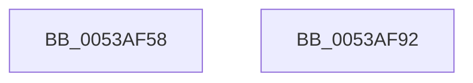

# SymCryptScsTableInit

- RVA: `0x0053AF58`–`0x0053AF93` (길이 `59` bytes)
- VA: `0x000000014053AF58`
- 실행 섹션: `.text`
- PDB 이름 있음: `예`; PDB Function 태그: `아니요`
- unwind 정보 RVA: `0x000DB714`
- 디코드: `17`개 명령, `59/59` bytes 표시
- 미해석 바이트: `0` (있으면 어셈블리에 `.byte`로 보존)

> 이 문서는 커널 이미지의 기계어와 PDB 기호를 분석해 생성했습니다. 4번과 5번은 함수 원형과 자료형을 바이너리 사용 방식에서 추정한 C 해석이며 원본 소스 복구 결과는 아닙니다.

## 1. Dependencies

- 직접 호출 지점: **0**; 고유 호출 대상: **0**
- 직접 호출자로 확인된 함수: **1**
- RIP 상대 이미지 참조: **0**

### Outgoing calls
- 직접 디코드된 call 명령이 없습니다.

### Direct callers
- [SymCryptModExpWindowed](SymCryptModExpWindowed_function_00536188.md) at `0x00536247`

### Static image references
- 디코드된 RIP-relative 메모리 참조가 없습니다.

## 2. Other-region calls and transfers

- 다른 실행 섹션으로 향하는 call: **0**
- 별도 외부 분기/꼬리 이동을 확인하지 못했습니다.

## 3. Assembly (complete function range)

```asm
0053AF58  41 B9 01 00 00 00               mov r9d, 1
0053AF5E  89 51 08                        mov dword ptr [rcx + 8], edx
0053AF61  8B C2                           mov eax, edx
0053AF63  44 89 41 0C                     mov dword ptr [rcx + 0xc], r8d
0053AF67  41 0F AF C0                     imul eax, r8d
0053AF6B  45 8D 51 7F                     lea r10d, [r9 + 0x7f]
0053AF6F  45 3B C2                        cmp r8d, r10d
0053AF72  45 8D 59 03                     lea r11d, [r9 + 3]
0053AF76  45 0F 45 CB                     cmovne r9d, r11d
0053AF7A  89 41 18                        mov dword ptr [rcx + 0x18], eax
0053AF7D  44 89 09                        mov dword ptr [rcx], r9d
0053AF80  45 8D 4B 1C                     lea r9d, [r11 + 0x1c]
0053AF84  45 0F 45 D1                     cmovne r10d, r9d
0053AF88  48 83 61 10 00                  and qword ptr [rcx + 0x10], 0
0053AF8D  44 89 51 04                     mov dword ptr [rcx + 4], r10d
0053AF91  C3                              ret
0053AF92  CC                              int3
```

## 4. C-style interpretation (structured pseudocode)

```c
__int64 __fastcall SymCryptScsTableInit(__int64 a1, int a2, int a3)
{
    __int64 result;
    __int64 v_r10;

    *(unsigned int *)(a1 + 8) = a2;
    *(unsigned int *)(a1 + 12) = a3;
    result = (unsigned int)(((unsigned int)(a2)) * (a3));
    a4 = 1;
    if (a3 != ((unsigned int)(1 + 127))) { a4 = (unsigned int)(1 + 3); }
    *(unsigned int *)(a1 + 24) = (unsigned int)(result);
    *(unsigned int *)(a1) = (unsigned int)(a4);
    v_r10 = 1 + 127;
    if (a3 != ((unsigned int)(1 + 127))) { v_r10 = (unsigned int)(1 + 3 + 28); }
    *(unsigned int *)(a1 + 4) = (unsigned int)(v_r10);
    return result;
}
```

## 5. (Beta) C Style

```c
int64_t SymCryptScsTableInit(void *Arg1, int32_t Arg2, int32_t Arg3)
{
    uint8_t *arg1 = (uint8_t *)Arg1;

    int64_t result;
    int64_t local_r10;

    *(uint32_t *)(arg1 + 0x8) = Arg2;
    *(uint32_t *)(arg1 + 0xC) = Arg3;
    result = (uint32_t)(((uint32_t)(Arg2)) * (Arg3));
    a4 = 1;
    if (Arg3 != ((uint32_t)(1 + 127))) { a4 = (uint32_t)(1 + 3); }
    *(uint32_t *)(arg1 + 0x18) = (uint32_t)(result);
    *(uint32_t *)(arg1) = (uint32_t)(a4);
    local_r10 = 1 + 127;
    if (Arg3 != ((uint32_t)(1 + 127))) { local_r10 = (uint32_t)(1 + 3 + 28); }
    *(uint32_t *)(arg1 + 0x4) = (uint32_t)(local_r10);
    return result;
}
```

### 관측된 메모리 오프셋

구조체 형식이 확인되지 않은 접근은 인자 기준의 오프셋으로만 기록했습니다.

| 기준 인자 | 오프셋 표현 | 폭 (bit) | 접근 |
|---|---:|---:|---|
| `Arg1` | `+ 0x0` | `32` | `W` |
| `Arg1` | `+ 0x4` | `32` | `W` |
| `Arg1` | `+ 0x8` | `32` | `W` |
| `Arg1` | `+ 0xC` | `32` | `W` |
| `Arg1` | `+ 0x10` | `64` | `R/W` |
| `Arg1` | `+ 0x18` | `32` | `W` |

## 6. Execution-region graph

[열기: 2D/3D 그래프와 함수 탐색 컨트롤 패널](../../../control-panel.html?section=text&rva=0x0053AF58&view=graph)

- 2D 그래프는 위에서 아래로 흐르고, 3D 그래프는 빈 공간을 드래그해 회전합니다. Shift+드래그는 이동, 휠은 확대·축소, 함수 노드 선택은 대상 보고서 이동입니다.

### Static fallback


