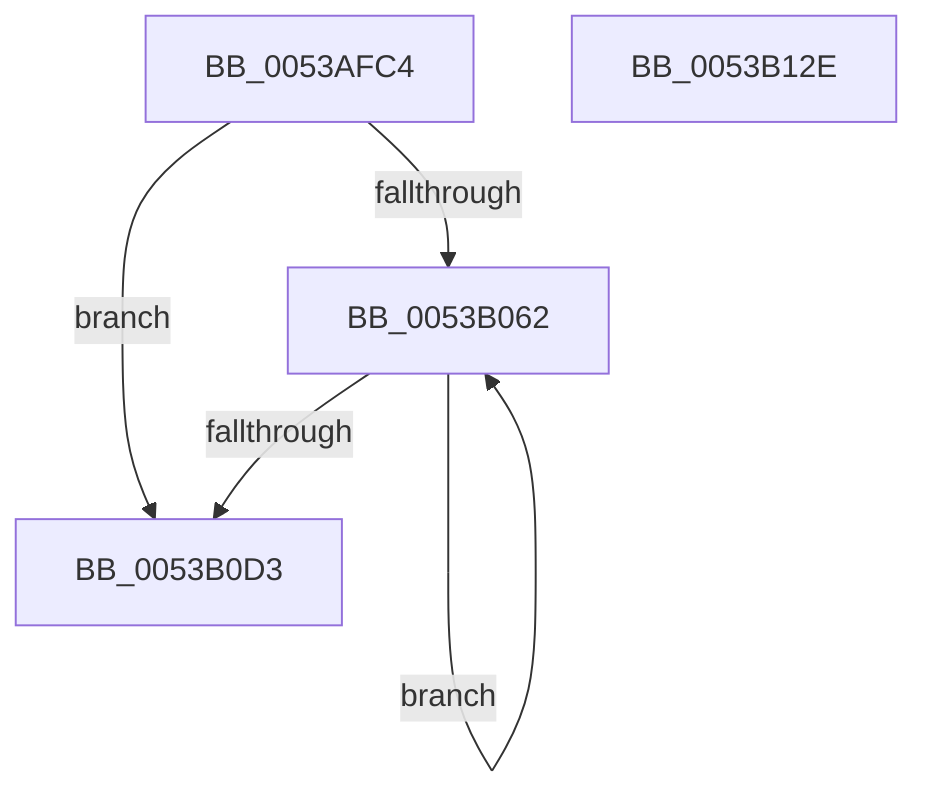

# SymCryptScsTableLoad128Xmm

- RVA: `0x0053AFC4`–`0x0053B12F` (길이 `363` bytes)
- VA: `0x000000014053AFC4`
- 실행 섹션: `.text`
- PDB 이름 있음: `예`; PDB Function 태그: `아니요`
- unwind 정보 RVA: `0x000C36B0`
- 디코드: `84`개 명령, `363/363` bytes 표시
- 미해석 바이트: `0` (있으면 어셈블리에 `.byte`로 보존)

> 이 문서는 커널 이미지의 기계어와 PDB 기호를 분석해 생성했습니다. 4번과 5번은 함수 원형과 자료형을 바이너리 사용 방식에서 추정한 C 해석이며 원본 소스 복구 결과는 아닙니다.

## 1. Dependencies

- 직접 호출 지점: **0**; 고유 호출 대상: **0**
- 직접 호출자로 확인된 함수: **1**
- RIP 상대 이미지 참조: **1**

### Outgoing calls
- 직접 디코드된 call 명령이 없습니다.

### Direct callers
- [SymCryptScsTableLoad](SymCryptScsTableLoad_function_0053AF9C.md) at `0x0053AFA9`

### Static image references
- `0x0053B00C` → RVA `0x0001A380` (`.rdata`; read)

## 2. Other-region calls and transfers

- 다른 실행 섹션으로 향하는 call: **0**
- 별도 외부 분기/꼬리 이동을 확인하지 못했습니다.

## 3. Assembly (complete function range)

```asm
0053AFC4  48 8B C4                        mov rax, rsp
0053AFC7  48 83 EC 78                     sub rsp, 0x78
0053AFCB  0F 29 70 E8                     movaps xmmword ptr [rax - 0x18], xmm6
0053AFCF  0F 57 C0                        xorps xmm0, xmm0
0053AFD2  0F 29 78 D8                     movaps xmmword ptr [rax - 0x28], xmm7
0053AFD6  41 B9 80 00 00 00               mov r9d, 0x80
0053AFDC  44 0F 29 40 C8                  movaps xmmword ptr [rax - 0x38], xmm8
0053AFE1  44 0F 29 48 B8                  movaps xmmword ptr [rax - 0x48], xmm9
0053AFE6  44 0F 29 50 A8                  movaps xmmword ptr [rax - 0x58], xmm10
0053AFEB  44 0F 29 58 98                  movaps xmmword ptr [rax - 0x68], xmm11
0053AFF0  48 8B 41 10                     mov rax, qword ptr [rcx + 0x10]
0053AFF4  66 44 0F 6E DA                  movd xmm11, edx
0053AFF9  8B 51 08                        mov edx, dword ptr [rcx + 8]
0053AFFC  66 45 0F 70 DB 00               pshufd xmm11, xmm11, 0
0053B002  66 41 0F 6F DB                  movdqa xmm3, xmm11
0053B007  44 0F 29 24 24                  movaps xmmword ptr [rsp], xmm12
0053B00C  66 44 0F 6F 25 6B F3 AD FF      movdqa xmm12, xmmword ptr [rip - 0x520c95]
0053B015  66 0F 76 D8                     pcmpeqd xmm3, xmm0
0053B019  66 0F 6F E3                     movdqa xmm4, xmm3
0053B01D  66 0F 6F EB                     movdqa xmm5, xmm3
0053B021  0F 54 20                        andps xmm4, xmmword ptr [rax]
0053B024  66 0F 6F F3                     movdqa xmm6, xmm3
0053B028  0F 54 68 10                     andps xmm5, xmmword ptr [rax + 0x10]
0053B02C  66 0F 6F FB                     movdqa xmm7, xmm3
0053B030  0F 54 70 20                     andps xmm6, xmmword ptr [rax + 0x20]
0053B034  66 44 0F 6F C3                  movdqa xmm8, xmm3
0053B039  0F 54 78 30                     andps xmm7, xmmword ptr [rax + 0x30]
0053B03D  66 44 0F 6F CB                  movdqa xmm9, xmm3
0053B042  44 0F 54 40 40                  andps xmm8, xmmword ptr [rax + 0x40]
0053B047  66 44 0F 6F D3                  movdqa xmm10, xmm3
0053B04C  44 0F 54 48 50                  andps xmm9, xmmword ptr [rax + 0x50]
0053B051  44 0F 54 50 60                  andps xmm10, xmmword ptr [rax + 0x60]
0053B056  0F 54 58 70                     andps xmm3, xmmword ptr [rax + 0x70]
0053B05A  49 03 C1                        add rax, r9
0053B05D  83 EA 01                        sub edx, 1
0053B060  74 71                           je 0x14053b0d3
0053B062  66 41 0F 6F D3                  movdqa xmm2, xmm11
0053B067  66 41 0F 76 D4                  pcmpeqd xmm2, xmm12
0053B06C  66 44 0F FE 25 0B F3 AD FF      paddd xmm12, xmmword ptr [rip - 0x520cf5]
0053B075  66 0F 6F CA                     movdqa xmm1, xmm2
0053B079  66 0F 6F C2                     movdqa xmm0, xmm2
0053B07D  0F 54 08                        andps xmm1, xmmword ptr [rax]
0053B080  0F 54 40 10                     andps xmm0, xmmword ptr [rax + 0x10]
0053B084  0F 56 E1                        orps xmm4, xmm1
0053B087  0F 56 E8                        orps xmm5, xmm0
0053B08A  66 0F 6F CA                     movdqa xmm1, xmm2
0053B08E  0F 54 48 20                     andps xmm1, xmmword ptr [rax + 0x20]
0053B092  66 0F 6F C2                     movdqa xmm0, xmm2
0053B096  0F 54 40 30                     andps xmm0, xmmword ptr [rax + 0x30]
0053B09A  0F 56 F1                        orps xmm6, xmm1
0053B09D  66 0F 6F CA                     movdqa xmm1, xmm2
0053B0A1  0F 56 F8                        orps xmm7, xmm0
0053B0A4  0F 54 48 40                     andps xmm1, xmmword ptr [rax + 0x40]
0053B0A8  66 0F 6F C2                     movdqa xmm0, xmm2
0053B0AC  0F 54 40 50                     andps xmm0, xmmword ptr [rax + 0x50]
0053B0B0  44 0F 56 C1                     orps xmm8, xmm1
0053B0B4  66 0F 6F CA                     movdqa xmm1, xmm2
0053B0B8  44 0F 56 C8                     orps xmm9, xmm0
0053B0BC  0F 54 48 60                     andps xmm1, xmmword ptr [rax + 0x60]
0053B0C0  0F 54 50 70                     andps xmm2, xmmword ptr [rax + 0x70]
0053B0C4  44 0F 56 D1                     orps xmm10, xmm1
0053B0C8  49 03 C1                        add rax, r9
0053B0CB  0F 56 DA                        orps xmm3, xmm2
0053B0CE  83 C2 FF                        add edx, -1
0053B0D1  75 8F                           jne 0x14053b062
0053B0D3  4C 8D 5C 24 78                  lea r11, [rsp + 0x78]
0053B0D8  F3 41 0F 7F 70 20               movdqu xmmword ptr [r8 + 0x20], xmm6
0053B0DE  45 0F 28 5B 98                  movaps xmm11, xmmword ptr [r11 - 0x68]
0053B0E3  45 0F 28 63 88                  movaps xmm12, xmmword ptr [r11 - 0x78]
0053B0E8  0F 28 74 24 60                  movaps xmm6, xmmword ptr [rsp + 0x60]
0053B0ED  F3 41 0F 7F 78 30               movdqu xmmword ptr [r8 + 0x30], xmm7
0053B0F3  0F 28 7C 24 50                  movaps xmm7, xmmword ptr [rsp + 0x50]
0053B0F8  F3 45 0F 7F 40 40               movdqu xmmword ptr [r8 + 0x40], xmm8
0053B0FE  45 0F 28 43 C8                  movaps xmm8, xmmword ptr [r11 - 0x38]
0053B103  F3 45 0F 7F 48 50               movdqu xmmword ptr [r8 + 0x50], xmm9
0053B109  45 0F 28 4B B8                  movaps xmm9, xmmword ptr [r11 - 0x48]
0053B10E  F3 45 0F 7F 50 60               movdqu xmmword ptr [r8 + 0x60], xmm10
0053B114  45 0F 28 53 A8                  movaps xmm10, xmmword ptr [r11 - 0x58]
0053B119  F3 41 0F 7F 20                  movdqu xmmword ptr [r8], xmm4
0053B11E  F3 41 0F 7F 68 10               movdqu xmmword ptr [r8 + 0x10], xmm5
0053B124  F3 41 0F 7F 58 70               movdqu xmmword ptr [r8 + 0x70], xmm3
0053B12A  49 8B E3                        mov rsp, r11
0053B12D  C3                              ret
0053B12E  CC                              int3
```

## 4. C-style interpretation (structured pseudocode)

```c
__int64 __fastcall SymCryptScsTableLoad128Xmm(__int64 a1, int a2, __int64 a3)
{
    __int64 result;
    __int64 v_rsp;
    unsigned __int64 v_stack_m18;
    unsigned __int64 v_stack_m28;
    unsigned __int64 v_stack_m78;
    unsigned __int64 v_stack_p0;

    v_rsp = (v_rsp) - (120);
    *(unsigned __int64 *)(v_rsp - 24) = v_xmm6;
    *(unsigned __int64 *)(v_rsp - 40) = v_xmm7;
    *(unsigned __int64 *)(v_rsp - 56) = v_xmm8;
    *(unsigned __int64 *)(v_rsp - 72) = v_xmm9;
    *(unsigned __int64 *)(v_rsp - 88) = v_xmm10;
    *(unsigned __int64 *)(v_rsp - 104) = v_xmm11;
    v_stack_m78 = v_xmm12;
    result = (*(unsigned __int64 *)(a1 + 16)) + (128);
    a2 = (unsigned int)(((unsigned int)(*(unsigned int *)(a1 + 8))) - (1));
    if (condition_is_equal) goto loc_0053B0D3;
loc_0053B062:
    result = (result) + (128);
    a2 = (unsigned int)((a2) + (-1));
    if (condition_is_not_equal) goto loc_0053B062;
loc_0053B0D3:
    *(unsigned __int64 *)(a3 + 32) = v_xmm6;
    *(unsigned __int64 *)(a3 + 48) = v_xmm7;
    *(unsigned __int64 *)(a3 + 64) = v_xmm8;
    *(unsigned __int64 *)(a3 + 80) = v_xmm9;
    *(unsigned __int64 *)(a3 + 96) = v_xmm10;
    *(unsigned __int64 *)(a3) = v_xmm4;
    *(unsigned __int64 *)(a3 + 16) = v_xmm5;
    *(unsigned __int64 *)(a3 + 112) = v_xmm3;
    return result;
}
```

## 5. (Beta) C Style

```c
int64_t SymCryptScsTableLoad128Xmm(void *Arg1, int32_t Arg2, void *Arg3)
{
    uint8_t *arg1 = (uint8_t *)Arg1;
    uint8_t *arg3 = (uint8_t *)Arg3;

    int64_t result;
    int64_t local_rsp;
    uint64_t v_stack_m18;
    uint64_t v_stack_m28;
    uint64_t v_stack_m78;
    uint64_t v_stack_p0;

    local_rsp = (local_rsp) - (120);
    *(uint64_t *)(local_rsp - 0x18) = v_xmm6;
    *(uint64_t *)(local_rsp - 0x28) = v_xmm7;
    *(uint64_t *)(local_rsp - 0x38) = v_xmm8;
    *(uint64_t *)(local_rsp - 0x48) = v_xmm9;
    *(uint64_t *)(local_rsp - 0x58) = v_xmm10;
    *(uint64_t *)(local_rsp - 0x68) = v_xmm11;
    v_stack_m78 = v_xmm12;
    result = (*(uint64_t *)(arg1 + 0x10)) + (128);
    Arg2 = (uint32_t)(((uint32_t)(*(uint32_t *)(arg1 + 0x8))) - (1));
    if (condition_is_equal) goto loc_0053B0D3;
loc_0053B062:
    result = (result) + (128);
    Arg2 = (uint32_t)((Arg2) + (-1));
    if (condition_is_not_equal) goto loc_0053B062;
loc_0053B0D3:
    *(uint64_t *)(arg3 + 0x20) = v_xmm6;
    *(uint64_t *)(arg3 + 0x30) = v_xmm7;
    *(uint64_t *)(arg3 + 0x40) = v_xmm8;
    *(uint64_t *)(arg3 + 0x50) = v_xmm9;
    *(uint64_t *)(arg3 + 0x60) = v_xmm10;
    *(uint64_t *)(arg3) = v_xmm4;
    *(uint64_t *)(arg3 + 0x10) = v_xmm5;
    *(uint64_t *)(arg3 + 0x70) = v_xmm3;
    return result;
}
```

### 관측된 메모리 오프셋

구조체 형식이 확인되지 않은 접근은 인자 기준의 오프셋으로만 기록했습니다.

| 기준 인자 | 오프셋 표현 | 폭 (bit) | 접근 |
|---|---:|---:|---|
| `Arg1` | `+ 0x8` | `32` | `R` |
| `Arg1` | `+ 0x10` | `64` | `R` |
| `Arg3` | `+ 0x0` | `128` | `W` |
| `Arg3` | `+ 0x10` | `128` | `W` |
| `Arg3` | `+ 0x20` | `128` | `W` |
| `Arg3` | `+ 0x30` | `128` | `W` |
| `Arg3` | `+ 0x40` | `128` | `W` |
| `Arg3` | `+ 0x50` | `128` | `W` |
| `Arg3` | `+ 0x60` | `128` | `W` |
| `Arg3` | `+ 0x70` | `128` | `W` |

## 6. Execution-region graph

[열기: 2D/3D 그래프와 함수 탐색 컨트롤 패널](../../../control-panel.html?section=text&rva=0x0053AFC4&view=graph)

- 2D 그래프는 위에서 아래로 흐르고, 3D 그래프는 빈 공간을 드래그해 회전합니다. Shift+드래그는 이동, 휠은 확대·축소, 함수 노드 선택은 대상 보고서 이동입니다.

### Static fallback


