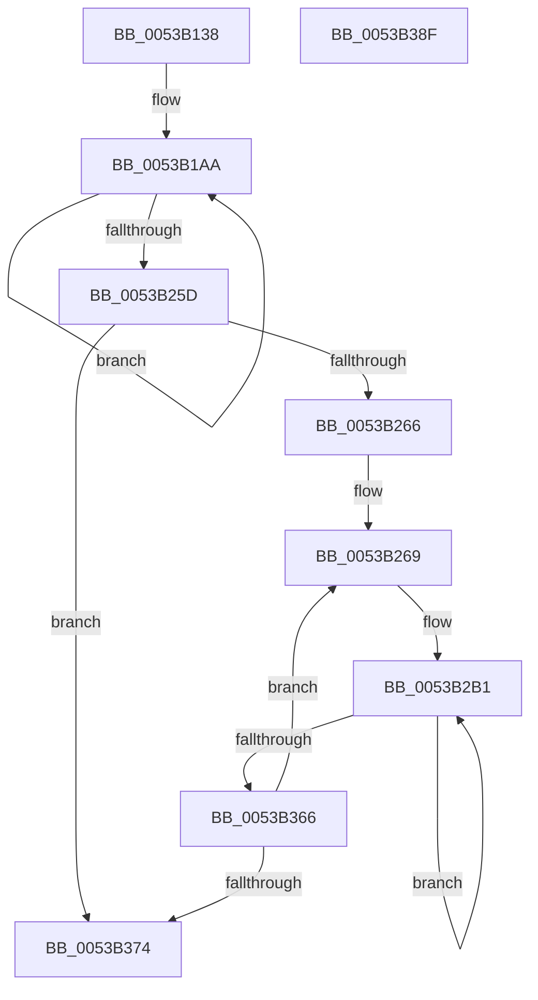

# SymCryptScsTableLoadC

- RVA: `0x0053B138`–`0x0053B390` (길이 `600` bytes)
- VA: `0x000000014053B138`
- 실행 섹션: `.text`
- PDB 이름 있음: `예`; PDB Function 태그: `아니요`
- unwind 정보 RVA: `0x000D0D58`
- 디코드: `177`개 명령, `600/600` bytes 표시
- 미해석 바이트: `0` (있으면 어셈블리에 `.byte`로 보존)

> 이 문서는 커널 이미지의 기계어와 PDB 기호를 분석해 생성했습니다. 4번과 5번은 함수 원형과 자료형을 바이너리 사용 방식에서 추정한 C 해석이며 원본 소스 복구 결과는 아닙니다.

## 1. Dependencies

- 직접 호출 지점: **0**; 고유 호출 대상: **0**
- 직접 호출자로 확인된 함수: **1**
- RIP 상대 이미지 참조: **0**

### Outgoing calls
- 직접 디코드된 call 명령이 없습니다.

### Direct callers
- [SymCryptScsTableLoad](SymCryptScsTableLoad_function_0053AF9C.md) at `0x0053AFB0`

### Static image references
- 디코드된 RIP-relative 메모리 참조가 없습니다.

## 2. Other-region calls and transfers

- 다른 실행 섹션으로 향하는 call: **0**
- 별도 외부 분기/꼬리 이동을 확인하지 못했습니다.

## 3. Assembly (complete function range)

```asm
0053B138  48 8B C4                        mov rax, rsp
0053B13B  48 89 58 08                     mov qword ptr [rax + 8], rbx
0053B13F  48 89 68 10                     mov qword ptr [rax + 0x10], rbp
0053B143  48 89 70 18                     mov qword ptr [rax + 0x18], rsi
0053B147  48 89 78 20                     mov qword ptr [rax + 0x20], rdi
0053B14B  41 54                           push r12
0053B14D  41 56                           push r14
0053B14F  41 57                           push r15
0053B151  44 8B 71 0C                     mov r14d, dword ptr [rcx + 0xc]
0053B155  4D 8D 60 10                     lea r12, [r8 + 0x10]
0053B159  8B 79 08                        mov edi, dword ptr [rcx + 8]
0053B15C  4D 8B C4                        mov r8, r12
0053B15F  4C 8B 49 10                     mov r9, qword ptr [rcx + 0x10]
0053B163  8B F2                           mov esi, edx
0053B165  44 8B D2                        mov r10d, edx
0053B168  44 8B DE                        mov r11d, esi
0053B16B  8B DA                           mov ebx, edx
0053B16D  49 83 F3 02                     xor r11, 2
0053B171  8B D2                           mov edx, edx
0053B173  49 F7 DB                        neg r11
0053B176  48 83 F2 01                     xor rdx, 1
0053B17A  49 C1 FB 20                     sar r11, 0x20
0053B17E  48 F7 DB                        neg rbx
0053B181  41 C1 EE 05                     shr r14d, 5
0053B185  48 F7 DA                        neg rdx
0053B188  48 C1 FB 20                     sar rbx, 0x20
0053B18C  49 83 F2 03                     xor r10, 3
0053B190  48 C1 FA 20                     sar rdx, 0x20
0053B194  49 F7 DA                        neg r10
0053B197  48 F7 D3                        not rbx
0053B19A  49 C1 FA 20                     sar r10, 0x20
0053B19E  48 F7 D2                        not rdx
0053B1A1  49 F7 D2                        not r10
0053B1A4  49 F7 D3                        not r11
0053B1A7  41 8B EE                        mov ebp, r14d
0053B1AA  49 8B 49 60                     mov rcx, qword ptr [r9 + 0x60]
0053B1AE  49 8B 41 40                     mov rax, qword ptr [r9 + 0x40]
0053B1B2  49 23 CA                        and rcx, r10
0053B1B5  49 23 C3                        and rax, r11
0053B1B8  48 0B C8                        or rcx, rax
0053B1BB  49 8B 41 20                     mov rax, qword ptr [r9 + 0x20]
0053B1BF  48 23 C2                        and rax, rdx
0053B1C2  48 0B C8                        or rcx, rax
0053B1C5  49 8B 01                        mov rax, qword ptr [r9]
0053B1C8  48 23 C3                        and rax, rbx
0053B1CB  48 0B C8                        or rcx, rax
0053B1CE  49 89 48 F0                     mov qword ptr [r8 - 0x10], rcx
0053B1D2  49 8B 49 68                     mov rcx, qword ptr [r9 + 0x68]
0053B1D6  49 8B 41 48                     mov rax, qword ptr [r9 + 0x48]
0053B1DA  49 23 CA                        and rcx, r10
0053B1DD  49 23 C3                        and rax, r11
0053B1E0  48 0B C8                        or rcx, rax
0053B1E3  49 8B 41 28                     mov rax, qword ptr [r9 + 0x28]
0053B1E7  48 23 C2                        and rax, rdx
0053B1EA  48 0B C8                        or rcx, rax
0053B1ED  49 8B 41 08                     mov rax, qword ptr [r9 + 8]
0053B1F1  48 23 C3                        and rax, rbx
0053B1F4  48 0B C8                        or rcx, rax
0053B1F7  49 89 48 F8                     mov qword ptr [r8 - 8], rcx
0053B1FB  49 8B 49 70                     mov rcx, qword ptr [r9 + 0x70]
0053B1FF  49 8B 41 50                     mov rax, qword ptr [r9 + 0x50]
0053B203  49 23 CA                        and rcx, r10
0053B206  49 23 C3                        and rax, r11
0053B209  48 0B C8                        or rcx, rax
0053B20C  49 8B 41 30                     mov rax, qword ptr [r9 + 0x30]
0053B210  48 23 C2                        and rax, rdx
0053B213  48 0B C8                        or rcx, rax
0053B216  49 8B 41 10                     mov rax, qword ptr [r9 + 0x10]
0053B21A  48 23 C3                        and rax, rbx
0053B21D  48 0B C8                        or rcx, rax
0053B220  49 89 08                        mov qword ptr [r8], rcx
0053B223  4D 8D 40 20                     lea r8, [r8 + 0x20]
0053B227  49 8B 49 78                     mov rcx, qword ptr [r9 + 0x78]
0053B22B  49 8B 41 58                     mov rax, qword ptr [r9 + 0x58]
0053B22F  49 23 CA                        and rcx, r10
0053B232  49 23 C3                        and rax, r11
0053B235  48 0B C8                        or rcx, rax
0053B238  49 8B 41 38                     mov rax, qword ptr [r9 + 0x38]
0053B23C  48 23 C2                        and rax, rdx
0053B23F  48 0B C8                        or rcx, rax
0053B242  49 8B 41 18                     mov rax, qword ptr [r9 + 0x18]
0053B246  48 23 C3                        and rax, rbx
0053B249  49 83 E9 80                     sub r9, -0x80
0053B24D  48 0B C8                        or rcx, rax
0053B250  49 89 48 E8                     mov qword ptr [r8 - 0x18], rcx
0053B254  83 C5 FF                        add ebp, -1
0053B257  0F 85 4D FF FF FF               jne 0x14053b1aa
0053B25D  83 FF 08                        cmp edi, 8
0053B260  0F 82 0E 01 00 00               jb 0x14053b374
0053B266  8D 55 06                        lea edx, [rbp + 6]
0053B269  44 8D 42 FE                     lea r8d, [rdx - 2]
0053B26D  44 8B DA                        mov r11d, edx
0053B270  4C 33 C6                        xor r8, rsi
0053B273  44 8D 52 FF                     lea r10d, [rdx - 1]
0053B277  4C 33 D6                        xor r10, rsi
0053B27A  8D 5A 01                        lea ebx, [rdx + 1]
0053B27D  4C 33 DE                        xor r11, rsi
0053B280  49 F7 D8                        neg r8
0053B283  49 F7 DA                        neg r10
0053B286  49 C1 F8 20                     sar r8, 0x20
0053B28A  49 F7 DB                        neg r11
0053B28D  49 C1 FA 20                     sar r10, 0x20
0053B291  48 33 DE                        xor rbx, rsi
0053B294  49 C1 FB 20                     sar r11, 0x20
0053B298  48 F7 DB                        neg rbx
0053B29B  49 F7 D0                        not r8
0053B29E  48 C1 FB 20                     sar rbx, 0x20
0053B2A2  49 F7 D2                        not r10
0053B2A5  48 F7 D3                        not rbx
0053B2A8  49 F7 D3                        not r11
0053B2AB  45 8B FE                        mov r15d, r14d
0053B2AE  49 8B EC                        mov rbp, r12
0053B2B1  49 8B 49 60                     mov rcx, qword ptr [r9 + 0x60]
0053B2B5  49 8B 41 40                     mov rax, qword ptr [r9 + 0x40]
0053B2B9  48 23 CB                        and rcx, rbx
0053B2BC  49 23 C3                        and rax, r11
0053B2BF  48 0B C8                        or rcx, rax
0053B2C2  49 8B 41 20                     mov rax, qword ptr [r9 + 0x20]
0053B2C6  49 23 C2                        and rax, r10
0053B2C9  48 0B C8                        or rcx, rax
0053B2CC  49 8B 01                        mov rax, qword ptr [r9]
0053B2CF  49 23 C0                        and rax, r8
0053B2D2  48 0B C8                        or rcx, rax
0053B2D5  48 09 4D F0                     or qword ptr [rbp - 0x10], rcx
0053B2D9  49 8B 49 68                     mov rcx, qword ptr [r9 + 0x68]
0053B2DD  49 8B 41 48                     mov rax, qword ptr [r9 + 0x48]
0053B2E1  48 23 CB                        and rcx, rbx
0053B2E4  49 23 C3                        and rax, r11
0053B2E7  48 0B C8                        or rcx, rax
0053B2EA  49 8B 41 28                     mov rax, qword ptr [r9 + 0x28]
0053B2EE  49 23 C2                        and rax, r10
0053B2F1  48 0B C8                        or rcx, rax
0053B2F4  49 8B 41 08                     mov rax, qword ptr [r9 + 8]
0053B2F8  49 23 C0                        and rax, r8
0053B2FB  48 0B C8                        or rcx, rax
0053B2FE  48 09 4D F8                     or qword ptr [rbp - 8], rcx
0053B302  49 8B 49 70                     mov rcx, qword ptr [r9 + 0x70]
0053B306  49 8B 41 50                     mov rax, qword ptr [r9 + 0x50]
0053B30A  48 23 CB                        and rcx, rbx
0053B30D  49 23 C3                        and rax, r11
0053B310  48 0B C8                        or rcx, rax
0053B313  49 8B 41 30                     mov rax, qword ptr [r9 + 0x30]
0053B317  49 23 C2                        and rax, r10
0053B31A  48 0B C8                        or rcx, rax
0053B31D  49 8B 41 10                     mov rax, qword ptr [r9 + 0x10]
0053B321  49 23 C0                        and rax, r8
0053B324  48 0B C8                        or rcx, rax
0053B327  48 09 4D 00                     or qword ptr [rbp], rcx
0053B32B  48 8D 6D 20                     lea rbp, [rbp + 0x20]
0053B32F  49 8B 49 78                     mov rcx, qword ptr [r9 + 0x78]
0053B333  49 8B 41 58                     mov rax, qword ptr [r9 + 0x58]
0053B337  48 23 CB                        and rcx, rbx
0053B33A  49 23 C3                        and rax, r11
0053B33D  48 0B C8                        or rcx, rax
0053B340  49 8B 41 38                     mov rax, qword ptr [r9 + 0x38]
0053B344  49 23 C2                        and rax, r10
0053B347  48 0B C8                        or rcx, rax
0053B34A  49 8B 41 18                     mov rax, qword ptr [r9 + 0x18]
0053B34E  49 23 C0                        and rax, r8
0053B351  49 83 E9 80                     sub r9, -0x80
0053B355  48 0B C8                        or rcx, rax
0053B358  48 09 4D E8                     or qword ptr [rbp - 0x18], rcx
0053B35C  41 83 C7 FF                     add r15d, -1
0053B360  0F 85 4B FF FF FF               jne 0x14053b2b1
0053B366  83 C2 04                        add edx, 4
0053B369  8D 42 02                        lea eax, [rdx + 2]
0053B36C  3B C7                           cmp eax, edi
0053B36E  0F 86 F5 FE FF FF               jbe 0x14053b269
0053B374  48 8B 5C 24 20                  mov rbx, qword ptr [rsp + 0x20]
0053B379  48 8B 6C 24 28                  mov rbp, qword ptr [rsp + 0x28]
0053B37E  48 8B 74 24 30                  mov rsi, qword ptr [rsp + 0x30]
0053B383  48 8B 7C 24 38                  mov rdi, qword ptr [rsp + 0x38]
0053B388  41 5F                           pop r15
0053B38A  41 5E                           pop r14
0053B38C  41 5C                           pop r12
0053B38E  C3                              ret
0053B38F  CC                              int3
```

## 4. C-style interpretation (structured pseudocode)

```c
__int64 __fastcall SymCryptScsTableLoadC(__int64 a1, int a2, __int64 a3)
{
    __int64 result;
    __int64 v_r10;
    __int64 v_r11;
    __int64 v_r14;
    __int64 v_r15;
    __int64 v_rbp;
    __int64 v_rbx;
    unsigned __int64 v_stack_p10;
    unsigned __int64 v_stack_p18;
    unsigned __int64 v_stack_p20;
    unsigned __int64 v_stack_p8;

    *(unsigned __int64 *)(v_rsp + 8) = v_rbx;
    *(unsigned __int64 *)(v_rsp + 16) = v_rbp;
    *(unsigned __int64 *)(v_rsp + 24) = v_rsi;
    *(unsigned __int64 *)(v_rsp + 32) = v_rdi;
    v_r11 = ((unsigned int)((unsigned int)((unsigned int)(a2)))) ^ (2);
    v_r11 = -(v_r11);
    a2 = ((unsigned int)(a2)) ^ (1);
    v_r11 = (v_r11) >> (32);
    v_rbx = -((unsigned int)(a2));
    v_r14 = (unsigned int)(((unsigned int)(*(unsigned int *)(a1 + 12))) >> (5));
    a2 = -(a2);
    v_rbx = (v_rbx) >> (32);
    v_r10 = ((unsigned int)(a2)) ^ (3);
    a2 = (a2) >> (32);
    v_r10 = -(v_r10);
    v_rbx = ~(v_rbx);
    v_r10 = (v_r10) >> (32);
    a2 = ~(a2);
    v_r10 = ~(v_r10);
    v_r11 = ~(v_r11);
loc_0053B1AA:
    a1 = (*(unsigned __int64 *)(*(unsigned __int64 *)(a1 + 16) + 96)) & (v_r10);
    result = (*(unsigned __int64 *)(*(unsigned __int64 *)(a1 + 16) + 64)) & (v_r11);
    a1 = (a1) | (result);
    result = (*(unsigned __int64 *)(*(unsigned __int64 *)(a1 + 16) + 32)) & (a2);
    a1 = (a1) | (result);
    result = (*(unsigned __int64 *)(*(unsigned __int64 *)(a1 + 16))) & (v_rbx);
    a1 = (a1) | (result);
    *(unsigned __int64 *)(a3 + 16 - 16) = a1;
    a1 = (*(unsigned __int64 *)(*(unsigned __int64 *)(a1 + 16) + 104)) & (v_r10);
    result = (*(unsigned __int64 *)(*(unsigned __int64 *)(a1 + 16) + 72)) & (v_r11);
    a1 = (a1) | (result);
    result = (*(unsigned __int64 *)(*(unsigned __int64 *)(a1 + 16) + 40)) & (a2);
    a1 = (a1) | (result);
    result = (*(unsigned __int64 *)(*(unsigned __int64 *)(a1 + 16) + 8)) & (v_rbx);
    a1 = (a1) | (result);
    *(unsigned __int64 *)(a3 + 16 - 8) = a1;
    a1 = (*(unsigned __int64 *)(*(unsigned __int64 *)(a1 + 16) + 112)) & (v_r10);
    result = (*(unsigned __int64 *)(*(unsigned __int64 *)(a1 + 16) + 80)) & (v_r11);
    a1 = (a1) | (result);
    result = (*(unsigned __int64 *)(*(unsigned __int64 *)(a1 + 16) + 48)) & (a2);
    a1 = (a1) | (result);
    result = (*(unsigned __int64 *)(*(unsigned __int64 *)(a1 + 16) + 16)) & (v_rbx);
    a1 = (a1) | (result);
    *(unsigned __int64 *)(a3 + 16) = a1;
    a1 = (*(unsigned __int64 *)(*(unsigned __int64 *)(a1 + 16) + 120)) & (v_r10);
    result = (*(unsigned __int64 *)(*(unsigned __int64 *)(a1 + 16) + 88)) & (v_r11);
    a1 = (a1) | (result);
    result = (*(unsigned __int64 *)(*(unsigned __int64 *)(a1 + 16) + 56)) & (a2);
    a1 = (a1) | (result);
    result = (*(unsigned __int64 *)(*(unsigned __int64 *)(a1 + 16) + 24)) & (v_rbx);
    a4 = (*(unsigned __int64 *)(a1 + 16)) - (-128);
    a1 = (a1) | (result);
    *(unsigned __int64 *)(a3 + 16 + 32 - 24) = a1;
    v_rbp = (unsigned int)(((unsigned int)((unsigned int)(v_r14))) + (-1));
    if (condition_is_not_equal) goto loc_0053B1AA;
    if (((unsigned int)((unsigned int)(*(unsigned int *)(a1 + 8)))) < 8) goto loc_0053B374;
loc_0053B269:
    a3 = (v_rbp + 6 - 2) ^ ((unsigned int)(a2));
    v_r10 = (v_rbp + 6 - 1) ^ ((unsigned int)(a2));
    v_r11 = ((unsigned int)((unsigned int)(v_rbp + 6))) ^ ((unsigned int)(a2));
    a3 = -(a3);
    v_r10 = -(v_r10);
    a3 = (a3) >> (32);
    v_r11 = -(v_r11);
    v_r10 = (v_r10) >> (32);
    v_rbx = (v_rbp + 6 + 1) ^ ((unsigned int)(a2));
    v_r11 = (v_r11) >> (32);
    v_rbx = -(v_rbx);
    a3 = ~(a3);
    v_rbx = (v_rbx) >> (32);
    v_r10 = ~(v_r10);
    v_rbx = ~(v_rbx);
    v_r11 = ~(v_r11);
loc_0053B2B1:
    a1 = (*(unsigned __int64 *)(a4 + 96)) & (v_rbx);
    result = (*(unsigned __int64 *)(a4 + 64)) & (v_r11);
    a1 = (a1) | (result);
    result = (*(unsigned __int64 *)(a4 + 32)) & (v_r10);
    a1 = (a1) | (result);
    result = (*(unsigned __int64 *)(a4)) & (a3);
    a1 = (a1) | (result);
    a1 = (*(unsigned __int64 *)(a4 + 104)) & (v_rbx);
    result = (*(unsigned __int64 *)(a4 + 72)) & (v_r11);
    a1 = (a1) | (result);
    result = (*(unsigned __int64 *)(a4 + 40)) & (v_r10);
    a1 = (a1) | (result);
    result = (*(unsigned __int64 *)(a4 + 8)) & (a3);
    a1 = (a1) | (result);
    a1 = (*(unsigned __int64 *)(a4 + 112)) & (v_rbx);
    result = (*(unsigned __int64 *)(a4 + 80)) & (v_r11);
    a1 = (a1) | (result);
    result = (*(unsigned __int64 *)(a4 + 48)) & (v_r10);
    a1 = (a1) | (result);
    result = (*(unsigned __int64 *)(a4 + 16)) & (a3);
    a1 = (a1) | (result);
    a1 = (*(unsigned __int64 *)(a4 + 120)) & (v_rbx);
    result = (*(unsigned __int64 *)(a4 + 88)) & (v_r11);
    a1 = (a1) | (result);
    result = (*(unsigned __int64 *)(a4 + 56)) & (v_r10);
    a1 = (a1) | (result);
    result = (*(unsigned __int64 *)(a4 + 24)) & (a3);
    a4 = (a4) - (-128);
    a1 = (a1) | (result);
    v_r15 = (unsigned int)(((unsigned int)((unsigned int)(v_r14))) + (-1));
    if (condition_is_not_equal) goto loc_0053B2B1;
    a2 = (unsigned int)((v_rbp + 6) + (4));
    if (((unsigned int)(a2 + 2)) <= ((unsigned int)((unsigned int)(*(unsigned int *)(a1 + 8))))) goto loc_0053B269;
loc_0053B374:
    return a2 + 2;
}
```

## 5. (Beta) C Style

```c
int64_t SymCryptScsTableLoadC(void *Arg1, int32_t Arg2, void *Arg3)
{
    uint8_t *arg1 = (uint8_t *)Arg1;
    uint8_t *arg3 = (uint8_t *)Arg3;

    int64_t result;
    int64_t local_r10;
    int64_t local_r11;
    int64_t local_r14;
    int64_t local_r15;
    int64_t local_rbp;
    int64_t local_rbx;
    uint64_t v_stack_p10;
    uint64_t v_stack_p18;
    uint64_t v_stack_p20;
    uint64_t v_stack_p8;

    *(uint64_t *)(local_rsp + 0x8) = local_rbx;
    *(uint64_t *)(local_rsp + 0x10) = local_rbp;
    *(uint64_t *)(local_rsp + 0x18) = local_rsi;
    *(uint64_t *)(local_rsp + 0x20) = local_rdi;
    local_r11 = ((uint32_t)((uint32_t)((uint32_t)(Arg2)))) ^ (2);
    local_r11 = -(local_r11);
    Arg2 = ((uint32_t)(Arg2)) ^ (1);
    local_r11 = (local_r11) >> (32);
    local_rbx = -((uint32_t)(Arg2));
    local_r14 = (uint32_t)(((uint32_t)(*(uint32_t *)(arg1 + 0xC))) >> (5));
    Arg2 = -(Arg2);
    local_rbx = (local_rbx) >> (32);
    local_r10 = ((uint32_t)(Arg2)) ^ (3);
    Arg2 = (Arg2) >> (32);
    local_r10 = -(local_r10);
    local_rbx = ~(local_rbx);
    local_r10 = (local_r10) >> (32);
    Arg2 = ~(Arg2);
    local_r10 = ~(local_r10);
    local_r11 = ~(local_r11);
loc_0053B1AA:
    Arg1 = (*(uint64_t *)(*(uint64_t *)(arg1 + 0x10) + 0x60)) & (local_r10);
    result = (*(uint64_t *)(*(uint64_t *)(arg1 + 0x10) + 0x40)) & (local_r11);
    Arg1 = (Arg1) | (result);
    result = (*(uint64_t *)(*(uint64_t *)(arg1 + 0x10) + 0x20)) & (Arg2);
    Arg1 = (Arg1) | (result);
    result = (*(uint64_t *)(*(uint64_t *)(arg1 + 0x10))) & (local_rbx);
    Arg1 = (Arg1) | (result);
    *(void **)(arg3 + 0x10 - 0x10) = Arg1;
    Arg1 = (*(uint64_t *)(*(uint64_t *)(arg1 + 0x10) + 0x68)) & (local_r10);
    result = (*(uint64_t *)(*(uint64_t *)(arg1 + 0x10) + 0x48)) & (local_r11);
    Arg1 = (Arg1) | (result);
    result = (*(uint64_t *)(*(uint64_t *)(arg1 + 0x10) + 0x28)) & (Arg2);
    Arg1 = (Arg1) | (result);
    result = (*(uint64_t *)(*(uint64_t *)(arg1 + 0x10) + 0x8)) & (local_rbx);
    Arg1 = (Arg1) | (result);
    *(void **)(arg3 + 0x10 - 0x8) = Arg1;
    Arg1 = (*(uint64_t *)(*(uint64_t *)(arg1 + 0x10) + 0x70)) & (local_r10);
    result = (*(uint64_t *)(*(uint64_t *)(arg1 + 0x10) + 0x50)) & (local_r11);
    Arg1 = (Arg1) | (result);
    result = (*(uint64_t *)(*(uint64_t *)(arg1 + 0x10) + 0x30)) & (Arg2);
    Arg1 = (Arg1) | (result);
    result = (*(uint64_t *)(*(uint64_t *)(arg1 + 0x10) + 0x10)) & (local_rbx);
    Arg1 = (Arg1) | (result);
    *(void **)(arg3 + 0x10) = Arg1;
    Arg1 = (*(uint64_t *)(*(uint64_t *)(arg1 + 0x10) + 0x78)) & (local_r10);
    result = (*(uint64_t *)(*(uint64_t *)(arg1 + 0x10) + 0x58)) & (local_r11);
    Arg1 = (Arg1) | (result);
    result = (*(uint64_t *)(*(uint64_t *)(arg1 + 0x10) + 0x38)) & (Arg2);
    Arg1 = (Arg1) | (result);
    result = (*(uint64_t *)(*(uint64_t *)(arg1 + 0x10) + 0x18)) & (local_rbx);
    a4 = (*(uint64_t *)(arg1 + 0x10)) - (-128);
    Arg1 = (Arg1) | (result);
    *(void **)(arg3 + 0x10 + 0x20 - 0x18) = Arg1;
    local_rbp = (uint32_t)(((uint32_t)((uint32_t)(local_r14))) + (-1));
    if (condition_is_not_equal) goto loc_0053B1AA;
    if (((uint32_t)((uint32_t)(*(uint32_t *)(arg1 + 0x8)))) < 8) goto loc_0053B374;
loc_0053B269:
    Arg3 = (local_rbp + 6 - 2) ^ ((uint32_t)(Arg2));
    local_r10 = (local_rbp + 6 - 1) ^ ((uint32_t)(Arg2));
    local_r11 = ((uint32_t)((uint32_t)(local_rbp + 6))) ^ ((uint32_t)(Arg2));
    Arg3 = -(Arg3);
    local_r10 = -(local_r10);
    Arg3 = (Arg3) >> (32);
    local_r11 = -(local_r11);
    local_r10 = (local_r10) >> (32);
    local_rbx = (local_rbp + 6 + 1) ^ ((uint32_t)(Arg2));
    local_r11 = (local_r11) >> (32);
    local_rbx = -(local_rbx);
    Arg3 = ~(Arg3);
    local_rbx = (local_rbx) >> (32);
    local_r10 = ~(local_r10);
    local_rbx = ~(local_rbx);
    local_r11 = ~(local_r11);
loc_0053B2B1:
    Arg1 = (*(uint64_t *)(a4 + 0x60)) & (local_rbx);
    result = (*(uint64_t *)(a4 + 0x40)) & (local_r11);
    Arg1 = (Arg1) | (result);
    result = (*(uint64_t *)(a4 + 0x20)) & (local_r10);
    Arg1 = (Arg1) | (result);
    result = (*(uint64_t *)(a4)) & (Arg3);
    Arg1 = (Arg1) | (result);
    Arg1 = (*(uint64_t *)(a4 + 0x68)) & (local_rbx);
    result = (*(uint64_t *)(a4 + 0x48)) & (local_r11);
    Arg1 = (Arg1) | (result);
    result = (*(uint64_t *)(a4 + 0x28)) & (local_r10);
    Arg1 = (Arg1) | (result);
    result = (*(uint64_t *)(a4 + 0x8)) & (Arg3);
    Arg1 = (Arg1) | (result);
    Arg1 = (*(uint64_t *)(a4 + 0x70)) & (local_rbx);
    result = (*(uint64_t *)(a4 + 0x50)) & (local_r11);
    Arg1 = (Arg1) | (result);
    result = (*(uint64_t *)(a4 + 0x30)) & (local_r10);
    Arg1 = (Arg1) | (result);
    result = (*(uint64_t *)(a4 + 0x10)) & (Arg3);
    Arg1 = (Arg1) | (result);
    Arg1 = (*(uint64_t *)(a4 + 0x78)) & (local_rbx);
    result = (*(uint64_t *)(a4 + 0x58)) & (local_r11);
    Arg1 = (Arg1) | (result);
    result = (*(uint64_t *)(a4 + 0x38)) & (local_r10);
    Arg1 = (Arg1) | (result);
    result = (*(uint64_t *)(a4 + 0x18)) & (Arg3);
    a4 = (a4) - (-128);
    Arg1 = (Arg1) | (result);
    local_r15 = (uint32_t)(((uint32_t)((uint32_t)(local_r14))) + (-1));
    if (condition_is_not_equal) goto loc_0053B2B1;
    Arg2 = (uint32_t)((local_rbp + 6) + (4));
    if (((uint32_t)(Arg2 + 2)) <= ((uint32_t)((uint32_t)(*(uint32_t *)(arg1 + 0x8))))) goto loc_0053B269;
loc_0053B374:
    return Arg2 + 2;
}
```

### 관측된 메모리 오프셋

구조체 형식이 확인되지 않은 접근은 인자 기준의 오프셋으로만 기록했습니다.

| 기준 인자 | 오프셋 표현 | 폭 (bit) | 접근 |
|---|---:|---:|---|
| `Arg1` | `+ 0x8` | `32` | `R` |
| `Arg1` | `+ 0xC` | `32` | `R` |
| `Arg1` | `+ 0x10` | `64` | `R` |
| `Arg3` | `- 0x18` | `64` | `R/W` |
| `Arg3` | `- 0x18` | `64` | `W` |
| `Arg3` | `- 0x10` | `64` | `R/W` |
| `Arg3` | `- 0x10` | `64` | `W` |
| `Arg3` | `- 0x8` | `64` | `R/W` |
| `Arg3` | `- 0x8` | `64` | `W` |
| `Arg3` | `+ 0x0` | `64` | `R/W` |
| `Arg3` | `+ 0x0` | `64` | `W` |
| `Arg3` | `+ 0x10` | `64` | `R` |
| `Arg3` | `+ 0x20` | `64` | `R` |

## 6. Execution-region graph

[열기: 2D/3D 그래프와 함수 탐색 컨트롤 패널](../../../control-panel.html?section=text&rva=0x0053B138&view=graph)

- 2D 그래프는 위에서 아래로 흐르고, 3D 그래프는 빈 공간을 드래그해 회전합니다. Shift+드래그는 이동, 휠은 확대·축소, 함수 노드 선택은 대상 보고서 이동입니다.

### Static fallback


