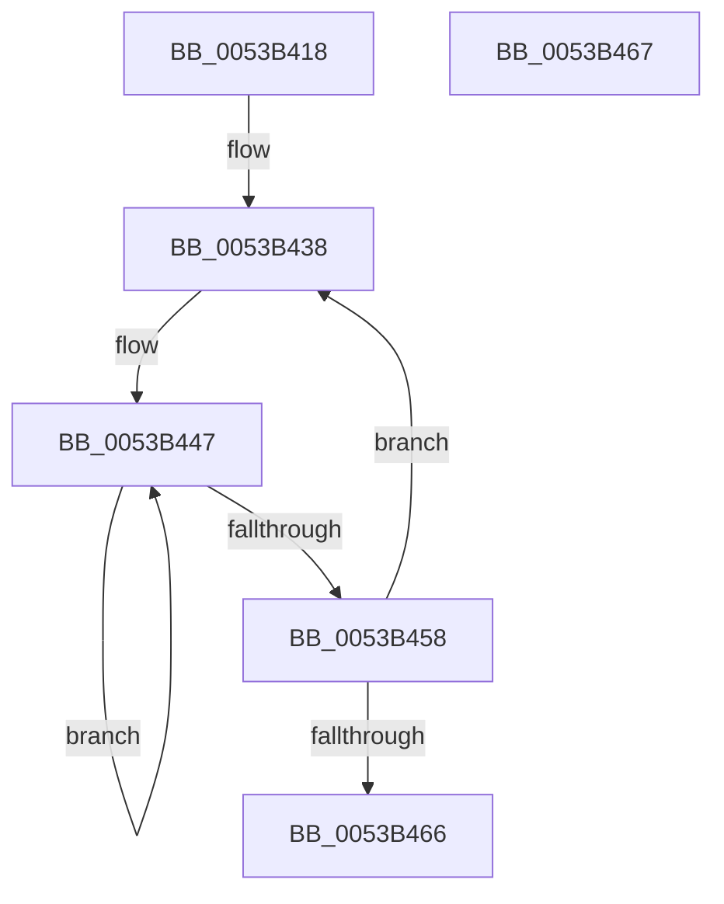

# SymCryptScsTableStoreC

- RVA: `0x0053B418`–`0x0053B468` (길이 `80` bytes)
- VA: `0x000000014053B418`
- 실행 섹션: `.text`
- PDB 이름 있음: `예`; PDB Function 태그: `아니요`
- unwind 정보 RVA: `0x000DB714`
- 디코드: `25`개 명령, `80/80` bytes 표시
- 미해석 바이트: `0` (있으면 어셈블리에 `.byte`로 보존)

> 이 문서는 커널 이미지의 기계어와 PDB 기호를 분석해 생성했습니다. 4번과 5번은 함수 원형과 자료형을 바이너리 사용 방식에서 추정한 C 해석이며 원본 소스 복구 결과는 아닙니다.

## 1. Dependencies

- 직접 호출 지점: **0**; 고유 호출 대상: **0**
- 직접 호출자로 확인된 함수: **1**
- RIP 상대 이미지 참조: **0**

### Outgoing calls
- 직접 디코드된 call 명령이 없습니다.

### Direct callers
- [SymCryptScsTableStore](SymCryptScsTableStore_function_0053B398.md) at `0x0053B406`

### Static image references
- 디코드된 RIP-relative 메모리 참조가 없습니다.

## 2. Other-region calls and transfers

- 다른 실행 섹션으로 향하는 call: **0**
- 별도 외부 분기/꼬리 이동을 확인하지 못했습니다.

## 3. Assembly (complete function range)

```asm
0053B418  44 8B 51 0C                     mov r10d, dword ptr [rcx + 0xc]
0053B41C  8B C2                           mov eax, edx
0053B41E  83 E0 03                        and eax, 3
0053B421  2B D0                           sub edx, eax
0053B423  C1 E0 05                        shl eax, 5
0053B426  41 0F AF D2                     imul edx, r10d
0053B42A  44 8B CA                        mov r9d, edx
0053B42D  4C 03 C8                        add r9, rax
0053B430  4C 03 49 10                     add r9, qword ptr [rcx + 0x10]
0053B434  41 C1 EA 05                     shr r10d, 5
0053B438  49 8B D0                        mov rdx, r8
0053B43B  49 8B C9                        mov rcx, r9
0053B43E  49 2B D1                        sub rdx, r9
0053B441  41 BB 04 00 00 00               mov r11d, 4
0053B447  48 8B 04 0A                     mov rax, qword ptr [rdx + rcx]
0053B44B  48 89 01                        mov qword ptr [rcx], rax
0053B44E  48 8D 49 08                     lea rcx, [rcx + 8]
0053B452  49 83 EB 01                     sub r11, 1
0053B456  75 EF                           jne 0x14053b447
0053B458  49 83 E9 80                     sub r9, -0x80
0053B45C  49 83 C0 20                     add r8, 0x20
0053B460  41 83 C2 FF                     add r10d, -1
0053B464  75 D2                           jne 0x14053b438
0053B466  C3                              ret
0053B467  CC                              int3
```

## 4. C-style interpretation (structured pseudocode)

```c
__int64 __fastcall SymCryptScsTableStoreC(__int64 a1, int a2, __int64 a3)
{
    __int64 result;
    __int64 v_r10;
    __int64 v_r11;

    result = (unsigned int)(((unsigned int)(a2)) & (3));
    a2 = (unsigned int)((a2) - ((unsigned int)(result)));
    result = (unsigned int)((result) << (5));
    a2 = (unsigned int)((a2) * ((unsigned int)((unsigned int)(*(unsigned int *)(a1 + 12)))));
    a4 = ((unsigned int)(a2)) + (result);
    a4 = (a4) + (*(unsigned __int64 *)(a1 + 16));
    v_r10 = (unsigned int)(((unsigned int)(*(unsigned int *)(a1 + 12))) >> (5));
loc_0053B438:
    a2 = (a3) - (a4);
loc_0053B447:
    *(unsigned __int64 *)(a4) = *(unsigned __int64 *)(a2 + a4 * 1);
    v_r11 = (4) - (1);
    if (condition_is_not_equal) goto loc_0053B447;
    a4 = (a4) - (-128);
    a3 = (a3) + (32);
    v_r10 = (unsigned int)((v_r10) + (-1));
    if (condition_is_not_equal) goto loc_0053B438;
    return *(unsigned __int64 *)(a2 + a4 * 1);
}
```

## 5. (Beta) C Style

```c
int64_t SymCryptScsTableStoreC(void *Arg1, void *Arg2, void *Arg3)
{
    uint8_t *arg1 = (uint8_t *)Arg1;
    uint8_t *arg2 = (uint8_t *)Arg2;
    uint8_t *arg3 = (uint8_t *)Arg3;

    int64_t result;
    int64_t local_r10;
    int64_t local_r11;

    result = (uint32_t)(((uint32_t)(Arg2)) & (3));
    Arg2 = (uint32_t)((Arg2) - ((uint32_t)(result)));
    result = (uint32_t)((result) << (5));
    Arg2 = (uint32_t)((Arg2) * ((uint32_t)((uint32_t)(*(uint32_t *)(arg1 + 0xC)))));
    a4 = ((uint32_t)(Arg2)) + (result);
    a4 = (a4) + (*(uint64_t *)(arg1 + 0x10));
    local_r10 = (uint32_t)(((uint32_t)(*(uint32_t *)(arg1 + 0xC))) >> (5));
loc_0053B438:
    Arg2 = (Arg3) - (a4);
loc_0053B447:
    *(uint64_t *)(a4) = *(uint64_t *)(arg2 + a4 * 1);
    local_r11 = (4) - (1);
    if (condition_is_not_equal) goto loc_0053B447;
    a4 = (a4) - (-128);
    Arg3 = (Arg3) + (32);
    local_r10 = (uint32_t)((local_r10) + (-1));
    if (condition_is_not_equal) goto loc_0053B438;
    return *(uint64_t *)(arg2 + a4 * 1);
}
```

### 관측된 메모리 오프셋

구조체 형식이 확인되지 않은 접근은 인자 기준의 오프셋으로만 기록했습니다.

| 기준 인자 | 오프셋 표현 | 폭 (bit) | 접근 |
|---|---:|---:|---|
| `Arg1` | `+ 0xC` | `32` | `R` |
| `Arg1` | `+ 0x10` | `64` | `R` |
| `Arg2` | `+ 0x0` | `64` | `W` |
| `Arg2` | `+ 0x8` | `64` | `R` |
| `Arg3` | `+ 0x0 + rcx*1` | `64` | `R` |

## 6. Execution-region graph

[열기: 2D/3D 그래프와 함수 탐색 컨트롤 패널](../../../control-panel.html?section=text&rva=0x0053B418&view=graph)

- 2D 그래프는 위에서 아래로 흐르고, 3D 그래프는 빈 공간을 드래그해 회전합니다. Shift+드래그는 이동, 휠은 확대·축소, 함수 노드 선택은 대상 보고서 이동입니다.

### Static fallback


