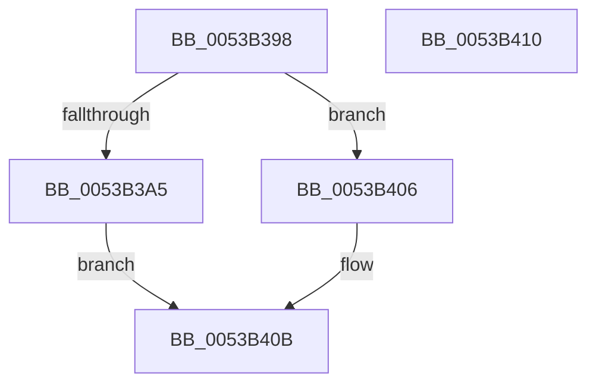

# SymCryptScsTableStore

- RVA: `0x0053B398`–`0x0053B411` (길이 `121` bytes)
- VA: `0x000000014053B398`
- 실행 섹션: `.text`
- PDB 이름 있음: `예`; PDB Function 태그: `아니요`
- unwind 정보 RVA: `0x0005C788`
- 디코드: `27`개 명령, `121/121` bytes 표시
- 미해석 바이트: `0` (있으면 어셈블리에 `.byte`로 보존)

> 이 문서는 커널 이미지의 기계어와 PDB 기호를 분석해 생성했습니다. 4번과 5번은 함수 원형과 자료형을 바이너리 사용 방식에서 추정한 C 해석이며 원본 소스 복구 결과는 아닙니다.

## 1. Dependencies

- 직접 호출 지점: **1**; 고유 호출 대상: **1**
- 직접 호출자로 확인된 함수: **1**
- RIP 상대 이미지 참조: **0**

### Outgoing calls
- `0x0053B406` → [SymCryptScsTableStoreC](SymCryptScsTableStoreC_function_0053B418.md) (function, `0x0053B418`)

### Direct callers
- [SymCryptModExpWindowed](SymCryptModExpWindowed_function_00536188.md) at `0x005362D1`
- [SymCryptModExpWindowed](SymCryptModExpWindowed_function_00536188.md) at `0x005362F6`
- [SymCryptModExpWindowed](SymCryptModExpWindowed_function_00536188.md) at `0x0053633F`

### Static image references
- 디코드된 RIP-relative 메모리 참조가 없습니다.

## 2. Other-region calls and transfers

- 다른 실행 섹션으로 향하는 call: **0**
- 별도 외부 분기/꼬리 이동을 확인하지 못했습니다.

## 3. Assembly (complete function range)

```asm
0053B398  48 83 EC 28                     sub rsp, 0x28
0053B39C  81 79 0C 80 00 00 00            cmp dword ptr [rcx + 0xc], 0x80
0053B3A3  75 61                           jne 0x14053b406
0053B3A5  F3 41 0F 6F 00                  movdqu xmm0, xmmword ptr [r8]
0053B3AA  C1 E2 07                        shl edx, 7
0053B3AD  8B C2                           mov eax, edx
0053B3AF  48 03 41 10                     add rax, qword ptr [rcx + 0x10]
0053B3B3  F3 0F 7F 00                     movdqu xmmword ptr [rax], xmm0
0053B3B7  F3 41 0F 6F 48 10               movdqu xmm1, xmmword ptr [r8 + 0x10]
0053B3BD  F3 0F 7F 48 10                  movdqu xmmword ptr [rax + 0x10], xmm1
0053B3C2  F3 41 0F 6F 40 20               movdqu xmm0, xmmword ptr [r8 + 0x20]
0053B3C8  F3 0F 7F 40 20                  movdqu xmmword ptr [rax + 0x20], xmm0
0053B3CD  F3 41 0F 6F 48 30               movdqu xmm1, xmmword ptr [r8 + 0x30]
0053B3D3  F3 0F 7F 48 30                  movdqu xmmword ptr [rax + 0x30], xmm1
0053B3D8  F3 41 0F 6F 40 40               movdqu xmm0, xmmword ptr [r8 + 0x40]
0053B3DE  F3 0F 7F 40 40                  movdqu xmmword ptr [rax + 0x40], xmm0
0053B3E3  F3 41 0F 6F 48 50               movdqu xmm1, xmmword ptr [r8 + 0x50]
0053B3E9  F3 0F 7F 48 50                  movdqu xmmword ptr [rax + 0x50], xmm1
0053B3EE  F3 41 0F 6F 40 60               movdqu xmm0, xmmword ptr [r8 + 0x60]
0053B3F4  F3 0F 7F 40 60                  movdqu xmmword ptr [rax + 0x60], xmm0
0053B3F9  F3 41 0F 6F 48 70               movdqu xmm1, xmmword ptr [r8 + 0x70]
0053B3FF  F3 0F 7F 48 70                  movdqu xmmword ptr [rax + 0x70], xmm1
0053B404  EB 05                           jmp 0x14053b40b
0053B406  E8 0D 00 00 00                  call 0x14053b418
0053B40B  48 83 C4 28                     add rsp, 0x28
0053B40F  C3                              ret
0053B410  CC                              int3
```

## 4. C-style interpretation (structured pseudocode)

```c
__int64 __fastcall SymCryptScsTableStore(__int64 a1, int a2, __int64 a3)
{
    __int64 result;
    __int64 v_rsp;

    v_rsp = (v_rsp) - (40);
    if ((*(unsigned int *)(a1 + 12)) != 128) goto loc_0053B406;
    a2 = (unsigned int)((a2) << (7));
    result = ((unsigned int)(a2)) + (*(unsigned __int64 *)(a1 + 16));
    *(unsigned __int64 *)(result) = v_xmm0;
    *(unsigned __int64 *)(result + 16) = v_xmm1;
    *(unsigned __int64 *)(result + 32) = v_xmm0;
    *(unsigned __int64 *)(result + 48) = v_xmm1;
    *(unsigned __int64 *)(result + 64) = v_xmm0;
    *(unsigned __int64 *)(result + 80) = v_xmm1;
    *(unsigned __int64 *)(result + 96) = v_xmm0;
    *(unsigned __int64 *)(result + 112) = v_xmm1;
    goto loc_0053B40B;
loc_0053B406:
    result = SymCryptScsTableStoreC(a1, a2, a3, a4);
loc_0053B40B:
    v_rsp = (v_rsp) + (40);
    return result;
}
```

## 5. (Beta) C Style

```c
int64_t SymCryptScsTableStore(void *Arg1, int32_t Arg2, void *Arg3)
{
    uint8_t *arg1 = (uint8_t *)Arg1;
    uint8_t *arg3 = (uint8_t *)Arg3;

    int64_t result;
    int64_t local_rsp;

    local_rsp = (local_rsp) - (40);
    if ((*(uint32_t *)(arg1 + 0xC)) != 128) goto loc_0053B406;
    Arg2 = (uint32_t)((Arg2) << (7));
    result = ((uint32_t)(Arg2)) + (*(uint64_t *)(arg1 + 0x10));
    *(uint64_t *)(result) = v_xmm0;
    *(uint64_t *)(result + 0x10) = v_xmm1;
    *(uint64_t *)(result + 0x20) = v_xmm0;
    *(uint64_t *)(result + 0x30) = v_xmm1;
    *(uint64_t *)(result + 0x40) = v_xmm0;
    *(uint64_t *)(result + 0x50) = v_xmm1;
    *(uint64_t *)(result + 0x60) = v_xmm0;
    *(uint64_t *)(result + 0x70) = v_xmm1;
    goto loc_0053B40B;
loc_0053B406:
    result = SymCryptScsTableStoreC(Arg1, Arg2, Arg3, a4);
loc_0053B40B:
    local_rsp = (local_rsp) + (40);
    return result;
}
```

### 관측된 메모리 오프셋

구조체 형식이 확인되지 않은 접근은 인자 기준의 오프셋으로만 기록했습니다.

| 기준 인자 | 오프셋 표현 | 폭 (bit) | 접근 |
|---|---:|---:|---|
| `Arg1` | `+ 0xC` | `32` | `R` |
| `Arg1` | `+ 0x10` | `64` | `R` |
| `Arg3` | `+ 0x0` | `128` | `R` |
| `Arg3` | `+ 0x10` | `128` | `R` |
| `Arg3` | `+ 0x20` | `128` | `R` |
| `Arg3` | `+ 0x30` | `128` | `R` |
| `Arg3` | `+ 0x40` | `128` | `R` |
| `Arg3` | `+ 0x50` | `128` | `R` |
| `Arg3` | `+ 0x60` | `128` | `R` |
| `Arg3` | `+ 0x70` | `128` | `R` |

## 6. Execution-region graph

[열기: 2D/3D 그래프와 함수 탐색 컨트롤 패널](../../../control-panel.html?section=text&rva=0x0053B398&view=graph)

- 2D 그래프는 위에서 아래로 흐르고, 3D 그래프는 빈 공간을 드래그해 회전합니다. Shift+드래그는 이동, 휠은 확대·축소, 함수 노드 선택은 대상 보고서 이동입니다.

### Static fallback


