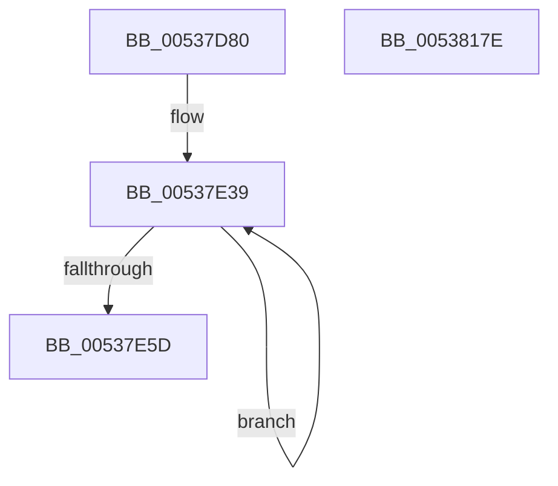

# SymCryptShortWeierstrassAddDiffNonZero

- RVA: `0x00537D80`–`0x0053817F` (길이 `1,023` bytes)
- VA: `0x0000000140537D80`
- 실행 섹션: `.text`
- PDB 이름 있음: `예`; PDB Function 태그: `아니요`
- unwind 정보 RVA: `0x000C35B4`
- 디코드: `265`개 명령, `1,023/1,023` bytes 표시
- 미해석 바이트: `0` (있으면 어셈블리에 `.byte`로 보존)

> 이 문서는 커널 이미지의 기계어와 PDB 기호를 분석해 생성했습니다. 4번과 5번은 함수 원형과 자료형을 바이너리 사용 방식에서 추정한 C 해석이며 원본 소스 복구 결과는 아닙니다.

## 1. Dependencies

- 직접 호출 지점: **28**; 고유 호출 대상: **6**
- 직접 호출자로 확인된 함수: **1**
- RIP 상대 이미지 참조: **1**

### Outgoing calls
- `0x00537E42` → [SymCryptModElementCreate](../52/SymCryptModElementCreate_function_00525900.md) (function, `0x00525900`)
- `0x00537E7C` → [SymCryptModSquare](../52/SymCryptModSquare_function_00525C84.md) (function, `0x00525C84`)
- `0x00537E98` → [SymCryptModMul](../52/SymCryptModMul_function_00525BA8.md) (function, `0x00525BA8`)
- `0x00537EB4` → [SymCryptModSquare](../52/SymCryptModSquare_function_00525C84.md) (function, `0x00525C84`)
- `0x00537ED4` → [SymCryptModMul](../52/SymCryptModMul_function_00525BA8.md) (function, `0x00525BA8`)
- `0x00537EF9` → [SymCryptModMul](../52/SymCryptModMul_function_00525BA8.md) (function, `0x00525BA8`)
- `0x00537F18` → [SymCryptModSub](../52/SymCryptModSub_function_00525CB8.md) (function, `0x00525CB8`)
- `0x00537F33` → [SymCryptModAdd](../52/SymCryptModAdd_function_00525868.md) (function, `0x00525868`)
- `0x00537F57` → [SymCryptModMul](../52/SymCryptModMul_function_00525BA8.md) (function, `0x00525BA8`)
- `0x00537F76` → [SymCryptModMul](../52/SymCryptModMul_function_00525BA8.md) (function, `0x00525BA8`)
- `0x00537F94` → [SymCryptModMul](../52/SymCryptModMul_function_00525BA8.md) (function, `0x00525BA8`)
- `0x00537FB2` → [SymCryptModMul](../52/SymCryptModMul_function_00525BA8.md) (function, `0x00525BA8`)
- `0x00537FD1` → [SymCryptModMul](../52/SymCryptModMul_function_00525BA8.md) (function, `0x00525BA8`)
- `0x00537FEE` → [SymCryptModSub](../52/SymCryptModSub_function_00525CB8.md) (function, `0x00525CB8`)
- `0x0053800B` → [SymCryptModAdd](../52/SymCryptModAdd_function_00525868.md) (function, `0x00525868`)
- `0x00538023` → [SymCryptModSquare](../52/SymCryptModSquare_function_00525C84.md) (function, `0x00525C84`)
- `0x00538040` → [SymCryptModMul](../52/SymCryptModMul_function_00525BA8.md) (function, `0x00525BA8`)
- `0x0053805D` → [SymCryptModMul](../52/SymCryptModMul_function_00525BA8.md) (function, `0x00525BA8`)
- `0x00538075` → [SymCryptModSquare](../52/SymCryptModSquare_function_00525C84.md) (function, `0x00525C84`)
- `0x00538092` → [SymCryptModSub](../52/SymCryptModSub_function_00525CB8.md) (function, `0x00525CB8`)
- `0x005380AF` → [SymCryptModSub](../52/SymCryptModSub_function_00525CB8.md) (function, `0x00525CB8`)
- `0x005380D0` → [SymCryptModSub](../52/SymCryptModSub_function_00525CB8.md) (function, `0x00525CB8`)
- `0x005380EC` → [SymCryptModSub](../52/SymCryptModSub_function_00525CB8.md) (function, `0x00525CB8`)
- `0x00538107` → [SymCryptModMul](../52/SymCryptModMul_function_00525BA8.md) (function, `0x00525BA8`)
- `0x00538122` → [SymCryptModMul](../52/SymCryptModMul_function_00525BA8.md) (function, `0x00525BA8`)
- `0x0053813D` → [SymCryptModAdd](../52/SymCryptModAdd_function_00525868.md) (function, `0x00525868`)
- `0x00538159` → [SymCryptModSub](../52/SymCryptModSub_function_00525CB8.md) (function, `0x00525CB8`)
- `0x00538165` → [_security_check_cookie](../6A/_security_check_cookie_function_006AC640.md) (function, `0x006AC640`)

### Direct callers
- [SymCryptShortWeierstrassAdd](SymCryptShortWeierstrassAdd_function_00537BC0.md) at `0x00537CEA`

### Static image references
- `0x00537D99` → RVA `0x00E0A740` (`.data`; read)

## 2. Other-region calls and transfers

- 다른 실행 섹션으로 향하는 call: **0**
- 별도 외부 분기/꼬리 이동을 확인하지 못했습니다.

## 3. Assembly (complete function range)

```asm
00537D80  40 55                           push rbp
00537D82  53                              push rbx
00537D83  56                              push rsi
00537D84  57                              push rdi
00537D85  41 54                           push r12
00537D87  41 55                           push r13
00537D89  41 56                           push r14
00537D8B  41 57                           push r15
00537D8D  48 8D 6C 24 F1                  lea rbp, [rsp - 0xf]
00537D92  48 81 EC C8 00 00 00            sub rsp, 0xc8
00537D99  48 8B 05 A0 29 8D 00            mov rax, qword ptr [rip + 0x8d29a0]
00537DA0  48 33 C4                        xor rax, rsp
00537DA3  48 89 45 FF                     mov qword ptr [rbp - 1], rax
00537DA7  44 8B 51 24                     mov r10d, dword ptr [rcx + 0x24]
00537DAB  48 8D 42 20                     lea rax, [rdx + 0x20]
00537DAF  4C 8B B1 68 02 00 00            mov r14, qword ptr [rcx + 0x268]
00537DB6  4C 8D 7A 20                     lea r15, [rdx + 0x20]
00537DBA  4C 8B 6D 77                     mov r13, qword ptr [rbp + 0x77]
00537DBE  48 8D 5D C7                     lea rbx, [rbp - 0x39]
00537DC2  48 89 45 8F                     mov qword ptr [rbp - 0x71], rax
00537DC6  0F 57 C0                        xorps xmm0, xmm0
00537DC9  48 8D 42 20                     lea rax, [rdx + 0x20]
00537DCD  4C 89 74 24 30                  mov qword ptr [rsp + 0x30], r14
00537DD2  49 03 C2                        add rax, r10
00537DD5  48 8B F9                        mov rdi, rcx
00537DD8  48 89 45 AF                     mov qword ptr [rbp - 0x51], rax
00537DDC  43 8D 0C 12                     lea ecx, [r10 + r10]
00537DE0  49 8D 40 20                     lea rax, [r8 + 0x20]
00537DE4  4C 03 F9                        add r15, rcx
00537DE7  48 89 45 97                     mov qword ptr [rbp - 0x69], rax
00537DEB  49 8D 40 20                     lea rax, [r8 + 0x20]
00537DEF  49 03 C2                        add rax, r10
00537DF2  4C 89 7D 9F                     mov qword ptr [rbp - 0x61], r15
00537DF6  48 89 45 B7                     mov qword ptr [rbp - 0x49], rax
00537DFA  49 8D 40 20                     lea rax, [r8 + 0x20]
00537DFE  48 03 C1                        add rax, rcx
00537E01  48 89 44 24 38                  mov qword ptr [rsp + 0x38], rax
00537E06  49 8D 41 20                     lea rax, [r9 + 0x20]
00537E0A  48 89 45 87                     mov qword ptr [rbp - 0x79], rax
00537E0E  49 8D 41 20                     lea rax, [r9 + 0x20]
00537E12  49 03 C2                        add rax, r10
00537E15  48 89 45 BF                     mov qword ptr [rbp - 0x41], rax
00537E19  49 8D 41 20                     lea rax, [r9 + 0x20]
00537E1D  48 03 C1                        add rax, rcx
00537E20  48 89 45 A7                     mov qword ptr [rbp - 0x59], rax
00537E24  33 C0                           xor eax, eax
00537E26  0F 11 45 C7                     movups xmmword ptr [rbp - 0x39], xmm0
00537E2A  48 89 45 F7                     mov qword ptr [rbp - 9], rax
00537E2E  0F 11 45 D7                     movups xmmword ptr [rbp - 0x29], xmm0
00537E32  8D 70 07                        lea esi, [rax + 7]
00537E35  0F 11 45 E7                     movups xmmword ptr [rbp - 0x19], xmm0
00537E39  41 8B D2                        mov edx, r10d
00537E3C  4D 8B C6                        mov r8, r14
00537E3F  49 8B CD                        mov rcx, r13
00537E42  E8 B9 DA FE FF                  call 0x140525900
00537E47  48 89 03                        mov qword ptr [rbx], rax
00537E4A  48 8D 5B 08                     lea rbx, [rbx + 8]
00537E4E  8B 47 24                        mov eax, dword ptr [rdi + 0x24]
00537E51  4C 03 E8                        add r13, rax
00537E54  44 8B D0                        mov r10d, eax
00537E57  48 83 EE 01                     sub rsi, 1
00537E5B  75 DC                           jne 0x140537e39
00537E5D  4C 8B 65 7F                     mov r12, qword ptr [rbp + 0x7f]
00537E61  4D 8B CD                        mov r9, r13
00537E64  48 8B 5D C7                     mov rbx, qword ptr [rbp - 0x39]
00537E68  49 8B D7                        mov rdx, r15
00537E6B  6B C8 07                        imul ecx, eax, 7
00537E6E  4C 8B C3                        mov r8, rbx
00537E71  4C 2B E1                        sub r12, rcx
00537E74  49 8B CE                        mov rcx, r14
00537E77  4C 89 64 24 20                  mov qword ptr [rsp + 0x20], r12
00537E7C  E8 03 DE FE FF                  call 0x140525c84
00537E81  4C 8B 4D CF                     mov r9, qword ptr [rbp - 0x31]
00537E85  4C 8B C3                        mov r8, rbx
00537E88  49 8B D7                        mov rdx, r15
00537E8B  4C 89 64 24 28                  mov qword ptr [rsp + 0x28], r12
00537E90  49 8B CE                        mov rcx, r14
00537E93  4C 89 6C 24 20                  mov qword ptr [rsp + 0x20], r13
00537E98  E8 0B DD FE FF                  call 0x140525ba8
00537E9D  4C 8B 7D F7                     mov r15, qword ptr [rbp - 9]
00537EA1  4D 8B CD                        mov r9, r13
00537EA4  48 8B 54 24 38                  mov rdx, qword ptr [rsp + 0x38]
00537EA9  4D 8B C7                        mov r8, r15
00537EAC  49 8B CE                        mov rcx, r14
00537EAF  4C 89 64 24 20                  mov qword ptr [rsp + 0x20], r12
00537EB4  E8 CB DD FE FF                  call 0x140525c84
00537EB9  48 8B 7D D7                     mov rdi, qword ptr [rbp - 0x29]
00537EBD  4D 8B C7                        mov r8, r15
00537EC0  48 8B 55 8F                     mov rdx, qword ptr [rbp - 0x71]
00537EC4  4C 8B CF                        mov r9, rdi
00537EC7  4C 89 64 24 28                  mov qword ptr [rsp + 0x28], r12
00537ECC  49 8B CE                        mov rcx, r14
00537ECF  4C 89 6C 24 20                  mov qword ptr [rsp + 0x20], r13
00537ED4  E8 CF DC FE FF                  call 0x140525ba8
00537ED9  4C 8B 75 DF                     mov r14, qword ptr [rbp - 0x21]
00537EDD  4C 8B C3                        mov r8, rbx
00537EE0  48 8B 5C 24 30                  mov rbx, qword ptr [rsp + 0x30]
00537EE5  4D 8B CE                        mov r9, r14
00537EE8  48 8B 55 97                     mov rdx, qword ptr [rbp - 0x69]
00537EEC  48 8B CB                        mov rcx, rbx
00537EEF  4C 89 64 24 28                  mov qword ptr [rsp + 0x28], r12
00537EF4  4C 89 6C 24 20                  mov qword ptr [rsp + 0x20], r13
00537EF9  E8 AA DC FE FF                  call 0x140525ba8
00537EFE  48 8B 75 EF                     mov rsi, qword ptr [rbp - 0x11]
00537F02  4C 8B C7                        mov r8, rdi
00537F05  4C 8B CE                        mov r9, rsi
00537F08  4C 89 64 24 28                  mov qword ptr [rsp + 0x28], r12
00537F0D  49 8B D6                        mov rdx, r14
00537F10  4C 89 6C 24 20                  mov qword ptr [rsp + 0x20], r13
00537F15  48 8B CB                        mov rcx, rbx
00537F18  E8 9B DD FE FF                  call 0x140525cb8
00537F1D  4D 8B CE                        mov r9, r14
00537F20  4C 89 64 24 28                  mov qword ptr [rsp + 0x28], r12
00537F25  4C 8B C6                        mov r8, rsi
00537F28  4C 89 6C 24 20                  mov qword ptr [rsp + 0x20], r13
00537F2D  48 8B D6                        mov rdx, rsi
00537F30  48 8B CB                        mov rcx, rbx
00537F33  E8 30 D9 FE FF                  call 0x140525868
00537F38  48 8B 5D E7                     mov rbx, qword ptr [rbp - 0x19]
00537F3C  4C 8B 44 24 38                  mov r8, qword ptr [rsp + 0x38]
00537F41  4C 8B CB                        mov r9, rbx
00537F44  48 8B 55 9F                     mov rdx, qword ptr [rbp - 0x61]
00537F48  48 8B 4C 24 30                  mov rcx, qword ptr [rsp + 0x30]
00537F4D  4C 89 64 24 28                  mov qword ptr [rsp + 0x28], r12
00537F52  4C 89 6C 24 20                  mov qword ptr [rsp + 0x20], r13
00537F57  E8 4C DC FE FF                  call 0x140525ba8
00537F5C  48 8B 54 24 38                  mov rdx, qword ptr [rsp + 0x38]
00537F61  4D 8B CF                        mov r9, r15
00537F64  48 8B 4C 24 30                  mov rcx, qword ptr [rsp + 0x30]
00537F69  4D 8B C7                        mov r8, r15
00537F6C  4C 89 64 24 28                  mov qword ptr [rsp + 0x28], r12
00537F71  4C 89 6C 24 20                  mov qword ptr [rsp + 0x20], r13
00537F76  E8 2D DC FE FF                  call 0x140525ba8
00537F7B  4C 8B 4D A7                     mov r9, qword ptr [rbp - 0x59]
00537F7F  4D 8B C6                        mov r8, r14
00537F82  48 8B 4C 24 30                  mov rcx, qword ptr [rsp + 0x30]
00537F87  48 8B D3                        mov rdx, rbx
00537F8A  4C 89 64 24 28                  mov qword ptr [rsp + 0x28], r12
00537F8F  4C 89 6C 24 20                  mov qword ptr [rsp + 0x20], r13
00537F94  E8 0F DC FE FF                  call 0x140525ba8
00537F99  4C 89 64 24 28                  mov qword ptr [rsp + 0x28], r12
00537F9E  4D 8B CF                        mov r9, r15
00537FA1  4C 89 6C 24 20                  mov qword ptr [rsp + 0x20], r13
00537FA6  48 8B 55 AF                     mov rdx, qword ptr [rbp - 0x51]
00537FAA  4D 8B C7                        mov r8, r15
00537FAD  48 8B 4C 24 30                  mov rcx, qword ptr [rsp + 0x30]
00537FB2  E8 F1 DB FE FF                  call 0x140525ba8
00537FB7  4C 8B 45 CF                     mov r8, qword ptr [rbp - 0x31]
00537FBB  4C 8B CB                        mov r9, rbx
00537FBE  48 8B 55 B7                     mov rdx, qword ptr [rbp - 0x49]
00537FC2  48 8B 4C 24 30                  mov rcx, qword ptr [rsp + 0x30]
00537FC7  4C 89 64 24 28                  mov qword ptr [rsp + 0x28], r12
00537FCC  4C 89 6C 24 20                  mov qword ptr [rsp + 0x20], r13
00537FD1  E8 D2 DB FE FF                  call 0x140525ba8
00537FD6  48 8B 4C 24 30                  mov rcx, qword ptr [rsp + 0x30]
00537FDB  4C 8B CB                        mov r9, rbx
00537FDE  4D 8B C7                        mov r8, r15
00537FE1  4C 89 64 24 28                  mov qword ptr [rsp + 0x28], r12
00537FE6  48 8B D3                        mov rdx, rbx
00537FE9  4C 89 6C 24 20                  mov qword ptr [rsp + 0x20], r13
00537FEE  E8 C5 DC FE FF                  call 0x140525cb8
00537FF3  48 8B 4C 24 30                  mov rcx, qword ptr [rsp + 0x30]
00537FF8  4C 8B CB                        mov r9, rbx
00537FFB  4C 8B C3                        mov r8, rbx
00537FFE  4C 89 64 24 28                  mov qword ptr [rsp + 0x28], r12
00538003  48 8B D3                        mov rdx, rbx
00538006  4C 89 6C 24 20                  mov qword ptr [rsp + 0x20], r13
0053800B  E8 58 D8 FE FF                  call 0x140525868
00538010  48 8B 4C 24 30                  mov rcx, qword ptr [rsp + 0x30]
00538015  4D 8B CD                        mov r9, r13
00538018  4D 8B C6                        mov r8, r14
0053801B  4C 89 64 24 20                  mov qword ptr [rsp + 0x20], r12
00538020  49 8B D6                        mov rdx, r14
00538023  E8 5C DC FE FF                  call 0x140525c84
00538028  48 8B 4C 24 30                  mov rcx, qword ptr [rsp + 0x30]
0053802D  4C 8B CE                        mov r9, rsi
00538030  4C 8B C6                        mov r8, rsi
00538033  4C 89 64 24 28                  mov qword ptr [rsp + 0x28], r12
00538038  49 8B D6                        mov rdx, r14
0053803B  4C 89 6C 24 20                  mov qword ptr [rsp + 0x20], r13
00538040  E8 63 DB FE FF                  call 0x140525ba8
00538045  48 8B 4C 24 30                  mov rcx, qword ptr [rsp + 0x30]
0053804A  4D 8B CE                        mov r9, r14
0053804D  4D 8B C6                        mov r8, r14
00538050  4C 89 64 24 28                  mov qword ptr [rsp + 0x28], r12
00538055  48 8B D7                        mov rdx, rdi
00538058  4C 89 6C 24 20                  mov qword ptr [rsp + 0x20], r13
0053805D  E8 46 DB FE FF                  call 0x140525ba8
00538062  48 8B 4C 24 30                  mov rcx, qword ptr [rsp + 0x30]
00538067  4D 8B CD                        mov r9, r13
0053806A  4C 8B C7                        mov r8, rdi
0053806D  4C 89 64 24 20                  mov qword ptr [rsp + 0x20], r12
00538072  48 8B D3                        mov rdx, rbx
00538075  E8 0A DC FE FF                  call 0x140525c84
0053807A  48 8B 4C 24 30                  mov rcx, qword ptr [rsp + 0x30]
0053807F  4C 8B CF                        mov r9, rdi
00538082  4C 8B C6                        mov r8, rsi
00538085  4C 89 64 24 28                  mov qword ptr [rsp + 0x28], r12
0053808A  48 8B D7                        mov rdx, rdi
0053808D  4C 89 6C 24 20                  mov qword ptr [rsp + 0x20], r13
00538092  E8 21 DC FE FF                  call 0x140525cb8
00538097  48 8B 4C 24 30                  mov rcx, qword ptr [rsp + 0x30]
0053809C  4C 8B CF                        mov r9, rdi
0053809F  4D 8B C6                        mov r8, r14
005380A2  4C 89 64 24 28                  mov qword ptr [rsp + 0x28], r12
005380A7  48 8B D7                        mov rdx, rdi
005380AA  4C 89 6C 24 20                  mov qword ptr [rsp + 0x20], r13
005380AF  E8 04 DC FE FF                  call 0x140525cb8
005380B4  4C 8B 4D 87                     mov r9, qword ptr [rbp - 0x79]
005380B8  48 8B D7                        mov rdx, rdi
005380BB  48 8B 7C 24 30                  mov rdi, qword ptr [rsp + 0x30]
005380C0  4D 8B C6                        mov r8, r14
005380C3  48 8B CF                        mov rcx, rdi
005380C6  4C 89 64 24 28                  mov qword ptr [rsp + 0x28], r12
005380CB  4C 89 6C 24 20                  mov qword ptr [rsp + 0x20], r13
005380D0  E8 E3 DB FE FF                  call 0x140525cb8
005380D5  4C 8B 45 87                     mov r8, qword ptr [rbp - 0x79]
005380D9  4D 8B CE                        mov r9, r14
005380DC  49 8B D6                        mov rdx, r14
005380DF  4C 89 64 24 28                  mov qword ptr [rsp + 0x28], r12
005380E4  48 8B CF                        mov rcx, rdi
005380E7  4C 89 6C 24 20                  mov qword ptr [rsp + 0x20], r13
005380EC  E8 C7 DB FE FF                  call 0x140525cb8
005380F1  4C 89 64 24 28                  mov qword ptr [rsp + 0x28], r12
005380F6  4D 8B CE                        mov r9, r14
005380F9  4C 89 6C 24 20                  mov qword ptr [rsp + 0x20], r13
005380FE  4C 8B C3                        mov r8, rbx
00538101  49 8B D6                        mov rdx, r14
00538104  48 8B CF                        mov rcx, rdi
00538107  E8 9C DA FE FF                  call 0x140525ba8
0053810C  4D 8B CF                        mov r9, r15
0053810F  4C 89 64 24 28                  mov qword ptr [rsp + 0x28], r12
00538114  4C 8B C6                        mov r8, rsi
00538117  4C 89 6C 24 20                  mov qword ptr [rsp + 0x20], r13
0053811C  49 8B D7                        mov rdx, r15
0053811F  48 8B CF                        mov rcx, rdi
00538122  E8 81 DA FE FF                  call 0x140525ba8
00538127  4D 8B CF                        mov r9, r15
0053812A  4C 89 64 24 28                  mov qword ptr [rsp + 0x28], r12
0053812F  4D 8B C7                        mov r8, r15
00538132  4C 89 6C 24 20                  mov qword ptr [rsp + 0x20], r13
00538137  49 8B D7                        mov rdx, r15
0053813A  48 8B CF                        mov rcx, rdi
0053813D  E8 26 D7 FE FF                  call 0x140525868
00538142  4C 8B 4D BF                     mov r9, qword ptr [rbp - 0x41]
00538146  4D 8B C7                        mov r8, r15
00538149  49 8B D6                        mov rdx, r14
0053814C  4C 89 64 24 28                  mov qword ptr [rsp + 0x28], r12
00538151  48 8B CF                        mov rcx, rdi
00538154  4C 89 6C 24 20                  mov qword ptr [rsp + 0x20], r13
00538159  E8 5A DB FE FF                  call 0x140525cb8
0053815E  48 8B 4D FF                     mov rcx, qword ptr [rbp - 1]
00538162  48 33 CC                        xor rcx, rsp
00538165  E8 D6 44 17 00                  call 0x1406ac640
0053816A  48 81 C4 C8 00 00 00            add rsp, 0xc8
00538171  41 5F                           pop r15
00538173  41 5E                           pop r14
00538175  41 5D                           pop r13
00538177  41 5C                           pop r12
00538179  5F                              pop rdi
0053817A  5E                              pop rsi
0053817B  5B                              pop rbx
0053817C  5D                              pop rbp
0053817D  C3                              ret
0053817E  CC                              int3
```

## 4. C-style interpretation (structured pseudocode)

```c
__int64 __fastcall SymCryptShortWeierstrassAddDiffNonZero(__int64 a1, __int64 a2, __int64 a3, __int64 a4, __int64 a5, __int64 a6)
{
    __int64 result;
    __int64 v_r12;
    __int64 v_r13;
    __int64 v_r15;
    __int64 v_rsi;
    __int64 v_rsp;
    unsigned __int64 v_stack_m4F;
    unsigned __int64 v_stack_m50;
    unsigned __int64 v_stack_m58;
    unsigned __int64 v_stack_m60;
    unsigned __int64 v_stack_m68;
    unsigned __int64 v_stack_m70;
    unsigned __int64 v_stack_m78;
    unsigned __int64 v_stack_m80;
    unsigned __int64 v_stack_m88;
    unsigned __int64 v_stack_m90;
    unsigned __int64 v_stack_m98;
    unsigned __int64 v_stack_mA0;
    unsigned __int64 v_stack_mA8;
    unsigned __int64 v_stack_mB0;
    unsigned __int64 v_stack_mB8;
    unsigned __int64 v_stack_mC0;
    unsigned __int64 v_stack_mC8;
    unsigned __int64 v_stack_mD0;
    unsigned __int64 v_stack_mD8;
    unsigned __int64 v_stack_mE0;
    unsigned __int64 v_stack_mE8;

    v_rsp = (v_rsp) - (200);
    result = (*(unsigned __int64 *)(v_rip + 9251232)) ^ (v_rsp);
    v_stack_m50 = result;
    v_stack_mC0 = a2 + 32;
    v_stack_mD8 = *(unsigned __int64 *)(a1 + 616);
    result = (a2 + 32) + ((unsigned int)(*(unsigned int *)(a1 + 36)));
    v_stack_mA0 = result;
    v_r15 = (a2 + 32) + ((unsigned int)(*(unsigned int *)(a1 + 36)) + (unsigned int)(*(unsigned int *)(a1 + 36)) * 1);
    v_stack_mB8 = a3 + 32;
    result = (a3 + 32) + ((unsigned int)(*(unsigned int *)(a1 + 36)));
    v_stack_mB0 = v_r15;
    v_stack_m98 = result;
    result = (a3 + 32) + ((unsigned int)(*(unsigned int *)(a1 + 36)) + (unsigned int)(*(unsigned int *)(a1 + 36)) * 1);
    v_stack_mD0 = result;
    v_stack_mC8 = a4 + 32;
    result = (a4 + 32) + ((unsigned int)(*(unsigned int *)(a1 + 36)));
    v_stack_m90 = result;
    result = (a4 + 32) + ((unsigned int)(*(unsigned int *)(a1 + 36)) + (unsigned int)(*(unsigned int *)(a1 + 36)) * 1);
    v_stack_mA8 = result;
    result = 0;
    v_stack_m88 = v_xmm0;
    v_stack_m58 = 0;
    v_stack_m78 = v_xmm0;
    v_stack_m68 = v_xmm0;
loc_00537E39:
    result = SymCryptModElementCreate(a5, (unsigned int)((unsigned int)((unsigned int)(*(unsigned int *)(a1 + 36)))), *(unsigned __int64 *)(a1 + 616), a4);
    *(unsigned __int64 *)(v_stack_m88) = result;
    v_r13 = (a5) + ((unsigned int)(*(unsigned int *)(a1 + 36)));
    v_rsi = (result + 7) - (1);
    if (condition_is_not_equal) goto loc_00537E39;
    a1 = (unsigned int)((a5) * ((unsigned int)((unsigned int)(*(unsigned int *)(a1 + 36)))));
    v_r12 = (a6) - (a1);
    v_stack_mE8 = v_r12;
    result = SymCryptModSquare(*(unsigned __int64 *)(a1 + 616), v_r15, v_stack_m88, v_r13);
    v_stack_mE0 = v_r12;
    v_stack_mE8 = v_r13;
    result = SymCryptModMul(*(unsigned __int64 *)(a1 + 616), v_r15, v_stack_m88, v_stack_m80);
    v_stack_mE8 = v_r12;
    result = SymCryptModSquare(*(unsigned __int64 *)(a1 + 616), v_stack_mD0, v_stack_m58, v_r13);
    v_stack_mE0 = v_r12;
    v_stack_mE8 = v_r13;
    result = SymCryptModMul(*(unsigned __int64 *)(a1 + 616), v_stack_mC0, v_stack_m58, v_stack_m78);
    v_stack_mE0 = v_r12;
    v_stack_mE8 = v_r13;
    result = SymCryptModMul(v_stack_mD8, v_stack_mB8, v_stack_m88, v_stack_m70);
    v_stack_mE0 = v_r12;
    v_stack_mE8 = v_r13;
    result = SymCryptModSub(v_stack_mD8, v_stack_m70, v_stack_m78, v_stack_m60);
    v_stack_mE0 = v_r12;
    v_stack_mE8 = v_r13;
    result = SymCryptModAdd(v_stack_mD8, v_stack_m60, v_stack_m60, v_stack_m70);
    v_stack_mE0 = v_r12;
    v_stack_mE8 = v_r13;
    result = SymCryptModMul(v_stack_mD8, v_stack_mB0, v_stack_mD0, v_stack_m68);
    v_stack_mE0 = v_r12;
    v_stack_mE8 = v_r13;
    result = SymCryptModMul(v_stack_mD8, v_stack_mD0, v_stack_m58, v_stack_m58);
    v_stack_mE0 = v_r12;
    v_stack_mE8 = v_r13;
    result = SymCryptModMul(v_stack_mD8, v_stack_m68, v_stack_m70, v_stack_mA8);
    v_stack_mE0 = v_r12;
    v_stack_mE8 = v_r13;
    result = SymCryptModMul(v_stack_mD8, v_stack_mA0, v_stack_m58, v_stack_m58);
    v_stack_mE0 = v_r12;
    v_stack_mE8 = v_r13;
    result = SymCryptModMul(v_stack_mD8, v_stack_m98, v_stack_m80, v_stack_m68);
    v_stack_mE0 = v_r12;
    v_stack_mE8 = v_r13;
    result = SymCryptModSub(v_stack_mD8, v_stack_m68, v_stack_m58, v_stack_m68);
    v_stack_mE0 = v_r12;
    v_stack_mE8 = v_r13;
    result = SymCryptModAdd(v_stack_mD8, v_stack_m68, v_stack_m68, v_stack_m68);
    v_stack_mE8 = v_r12;
    result = SymCryptModSquare(v_stack_mD8, v_stack_m70, v_stack_m70, v_r13);
    v_stack_mE0 = v_r12;
    v_stack_mE8 = v_r13;
    result = SymCryptModMul(v_stack_mD8, v_stack_m70, v_stack_m60, v_stack_m60);
    v_stack_mE0 = v_r12;
    v_stack_mE8 = v_r13;
    result = SymCryptModMul(v_stack_mD8, v_stack_m78, v_stack_m70, v_stack_m70);
    v_stack_mE8 = v_r12;
    result = SymCryptModSquare(v_stack_mD8, v_stack_m68, v_stack_m78, v_r13);
    v_stack_mE0 = v_r12;
    v_stack_mE8 = v_r13;
    result = SymCryptModSub(v_stack_mD8, v_stack_m78, v_stack_m60, v_stack_m78);
    v_stack_mE0 = v_r12;
    v_stack_mE8 = v_r13;
    result = SymCryptModSub(v_stack_mD8, v_stack_m78, v_stack_m70, v_stack_m78);
    v_stack_mE0 = v_r12;
    v_stack_mE8 = v_r13;
    result = SymCryptModSub(v_stack_mD8, v_stack_m78, v_stack_m70, v_stack_mC8);
    v_stack_mE0 = v_r12;
    v_stack_mE8 = v_r13;
    result = SymCryptModSub(v_stack_mD8, v_stack_m70, v_stack_mC8, v_stack_m70);
    v_stack_mE0 = v_r12;
    v_stack_mE8 = v_r13;
    result = SymCryptModMul(v_stack_mD8, v_stack_m70, v_stack_m68, v_stack_m70);
    v_stack_mE0 = v_r12;
    v_stack_mE8 = v_r13;
    result = SymCryptModMul(v_stack_mD8, v_stack_m58, v_stack_m60, v_stack_m58);
    v_stack_mE0 = v_r12;
    v_stack_mE8 = v_r13;
    result = SymCryptModAdd(v_stack_mD8, v_stack_m58, v_stack_m58, v_stack_m58);
    v_stack_mE0 = v_r12;
    v_stack_mE8 = v_r13;
    result = SymCryptModSub(v_stack_mD8, v_stack_m70, v_stack_m58, v_stack_m90);
    a1 = (v_stack_m50) ^ (v_rsp);
    result = _security_check_cookie(a1, v_stack_m70, v_stack_m58, v_stack_m90);
    v_rsp = (v_rsp) + (200);
    return result;
}
```

## 5. (Beta) C Style

```c
int64_t SymCryptShortWeierstrassAddDiffNonZero(void *Arg1, void *Arg2, void *Arg3, void *Arg4, int64_t Arg5, int64_t Arg6)
{
    uint8_t *arg1 = (uint8_t *)Arg1;
    uint8_t *arg2 = (uint8_t *)Arg2;
    uint8_t *arg3 = (uint8_t *)Arg3;
    uint8_t *arg4 = (uint8_t *)Arg4;

    int64_t result;
    int64_t local_r12;
    int64_t local_r13;
    int64_t local_r15;
    int64_t local_rsi;
    int64_t local_rsp;
    uint64_t v_stack_m4F;
    uint64_t v_stack_m50;
    uint64_t v_stack_m58;
    uint64_t v_stack_m60;
    uint64_t v_stack_m68;
    uint64_t v_stack_m70;
    uint64_t v_stack_m78;
    uint64_t v_stack_m80;
    uint64_t v_stack_m88;
    uint64_t v_stack_m90;
    uint64_t v_stack_m98;
    uint64_t v_stack_mA0;
    uint64_t v_stack_mA8;
    uint64_t v_stack_mB0;
    uint64_t v_stack_mB8;
    uint64_t v_stack_mC0;
    uint64_t v_stack_mC8;
    uint64_t v_stack_mD0;
    uint64_t v_stack_mD8;
    uint64_t v_stack_mE0;
    uint64_t v_stack_mE8;

    local_rsp = (local_rsp) - (200);
    result = (*(uint64_t *)(v_rip + 0x8D29A0)) ^ (local_rsp);
    v_stack_m50 = result;
    v_stack_mC0 = Arg2 + 32;
    v_stack_mD8 = *(uint64_t *)(arg1 + 0x268);
    result = (Arg2 + 32) + ((uint32_t)(*(uint32_t *)(arg1 + 0x24)));
    v_stack_mA0 = result;
    local_r15 = (Arg2 + 32) + ((uint32_t)(*(uint32_t *)(arg1 + 0x24)) + (uint32_t)(*(uint32_t *)(arg1 + 0x24)) * 1);
    v_stack_mB8 = Arg3 + 32;
    result = (Arg3 + 32) + ((uint32_t)(*(uint32_t *)(arg1 + 0x24)));
    v_stack_mB0 = local_r15;
    v_stack_m98 = result;
    result = (Arg3 + 32) + ((uint32_t)(*(uint32_t *)(arg1 + 0x24)) + (uint32_t)(*(uint32_t *)(arg1 + 0x24)) * 1);
    v_stack_mD0 = result;
    v_stack_mC8 = Arg4 + 32;
    result = (Arg4 + 32) + ((uint32_t)(*(uint32_t *)(arg1 + 0x24)));
    v_stack_m90 = result;
    result = (Arg4 + 32) + ((uint32_t)(*(uint32_t *)(arg1 + 0x24)) + (uint32_t)(*(uint32_t *)(arg1 + 0x24)) * 1);
    v_stack_mA8 = result;
    result = 0;
    v_stack_m88 = v_xmm0;
    v_stack_m58 = 0;
    v_stack_m78 = v_xmm0;
    v_stack_m68 = v_xmm0;
loc_00537E39:
    result = SymCryptModElementCreate(Arg5, (uint32_t)((uint32_t)((uint32_t)(*(uint32_t *)(arg1 + 0x24)))), *(uint64_t *)(arg1 + 0x268), Arg4);
    *(uint64_t *)(v_stack_m88) = result;
    local_r13 = (Arg5) + ((uint32_t)(*(uint32_t *)(arg1 + 0x24)));
    local_rsi = (result + 7) - (1);
    if (condition_is_not_equal) goto loc_00537E39;
    Arg1 = (uint32_t)((Arg5) * ((uint32_t)((uint32_t)(*(uint32_t *)(arg1 + 0x24)))));
    local_r12 = (Arg6) - (Arg1);
    v_stack_mE8 = local_r12;
    result = SymCryptModSquare(*(uint64_t *)(arg1 + 0x268), local_r15, v_stack_m88, local_r13);
    v_stack_mE0 = local_r12;
    v_stack_mE8 = local_r13;
    result = SymCryptModMul(*(uint64_t *)(arg1 + 0x268), local_r15, v_stack_m88, v_stack_m80);
    v_stack_mE8 = local_r12;
    result = SymCryptModSquare(*(uint64_t *)(arg1 + 0x268), v_stack_mD0, v_stack_m58, local_r13);
    v_stack_mE0 = local_r12;
    v_stack_mE8 = local_r13;
    result = SymCryptModMul(*(uint64_t *)(arg1 + 0x268), v_stack_mC0, v_stack_m58, v_stack_m78);
    v_stack_mE0 = local_r12;
    v_stack_mE8 = local_r13;
    result = SymCryptModMul(v_stack_mD8, v_stack_mB8, v_stack_m88, v_stack_m70);
    v_stack_mE0 = local_r12;
    v_stack_mE8 = local_r13;
    result = SymCryptModSub(v_stack_mD8, v_stack_m70, v_stack_m78, v_stack_m60);
    v_stack_mE0 = local_r12;
    v_stack_mE8 = local_r13;
    result = SymCryptModAdd(v_stack_mD8, v_stack_m60, v_stack_m60, v_stack_m70);
    v_stack_mE0 = local_r12;
    v_stack_mE8 = local_r13;
    result = SymCryptModMul(v_stack_mD8, v_stack_mB0, v_stack_mD0, v_stack_m68);
    v_stack_mE0 = local_r12;
    v_stack_mE8 = local_r13;
    result = SymCryptModMul(v_stack_mD8, v_stack_mD0, v_stack_m58, v_stack_m58);
    v_stack_mE0 = local_r12;
    v_stack_mE8 = local_r13;
    result = SymCryptModMul(v_stack_mD8, v_stack_m68, v_stack_m70, v_stack_mA8);
    v_stack_mE0 = local_r12;
    v_stack_mE8 = local_r13;
    result = SymCryptModMul(v_stack_mD8, v_stack_mA0, v_stack_m58, v_stack_m58);
    v_stack_mE0 = local_r12;
    v_stack_mE8 = local_r13;
    result = SymCryptModMul(v_stack_mD8, v_stack_m98, v_stack_m80, v_stack_m68);
    v_stack_mE0 = local_r12;
    v_stack_mE8 = local_r13;
    result = SymCryptModSub(v_stack_mD8, v_stack_m68, v_stack_m58, v_stack_m68);
    v_stack_mE0 = local_r12;
    v_stack_mE8 = local_r13;
    result = SymCryptModAdd(v_stack_mD8, v_stack_m68, v_stack_m68, v_stack_m68);
    v_stack_mE8 = local_r12;
    result = SymCryptModSquare(v_stack_mD8, v_stack_m70, v_stack_m70, local_r13);
    v_stack_mE0 = local_r12;
    v_stack_mE8 = local_r13;
    result = SymCryptModMul(v_stack_mD8, v_stack_m70, v_stack_m60, v_stack_m60);
    v_stack_mE0 = local_r12;
    v_stack_mE8 = local_r13;
    result = SymCryptModMul(v_stack_mD8, v_stack_m78, v_stack_m70, v_stack_m70);
    v_stack_mE8 = local_r12;
    result = SymCryptModSquare(v_stack_mD8, v_stack_m68, v_stack_m78, local_r13);
    v_stack_mE0 = local_r12;
    v_stack_mE8 = local_r13;
    result = SymCryptModSub(v_stack_mD8, v_stack_m78, v_stack_m60, v_stack_m78);
    v_stack_mE0 = local_r12;
    v_stack_mE8 = local_r13;
    result = SymCryptModSub(v_stack_mD8, v_stack_m78, v_stack_m70, v_stack_m78);
    v_stack_mE0 = local_r12;
    v_stack_mE8 = local_r13;
    result = SymCryptModSub(v_stack_mD8, v_stack_m78, v_stack_m70, v_stack_mC8);
    v_stack_mE0 = local_r12;
    v_stack_mE8 = local_r13;
    result = SymCryptModSub(v_stack_mD8, v_stack_m70, v_stack_mC8, v_stack_m70);
    v_stack_mE0 = local_r12;
    v_stack_mE8 = local_r13;
    result = SymCryptModMul(v_stack_mD8, v_stack_m70, v_stack_m68, v_stack_m70);
    v_stack_mE0 = local_r12;
    v_stack_mE8 = local_r13;
    result = SymCryptModMul(v_stack_mD8, v_stack_m58, v_stack_m60, v_stack_m58);
    v_stack_mE0 = local_r12;
    v_stack_mE8 = local_r13;
    result = SymCryptModAdd(v_stack_mD8, v_stack_m58, v_stack_m58, v_stack_m58);
    v_stack_mE0 = local_r12;
    v_stack_mE8 = local_r13;
    result = SymCryptModSub(v_stack_mD8, v_stack_m70, v_stack_m58, v_stack_m90);
    Arg1 = (v_stack_m50) ^ (local_rsp);
    result = _security_check_cookie(Arg1, v_stack_m70, v_stack_m58, v_stack_m90);
    local_rsp = (local_rsp) + (200);
    return result;
}
```

### 관측된 메모리 오프셋

구조체 형식이 확인되지 않은 접근은 인자 기준의 오프셋으로만 기록했습니다.

| 기준 인자 | 오프셋 표현 | 폭 (bit) | 접근 |
|---|---:|---:|---|
| `Arg1` | `+ 0x24` | `32` | `R` |
| `Arg1` | `+ 0x268` | `64` | `R` |
| `Arg2` | `+ 0x20` | `64` | `R` |
| `Arg3` | `+ 0x20` | `64` | `R` |
| `Arg4` | `+ 0x20` | `64` | `R` |

## 6. Execution-region graph

[열기: 2D/3D 그래프와 함수 탐색 컨트롤 패널](../../../control-panel.html?section=text&rva=0x00537D80&view=graph)

- 2D 그래프는 위에서 아래로 흐르고, 3D 그래프는 빈 공간을 드래그해 회전합니다. Shift+드래그는 이동, 휠은 확대·축소, 함수 노드 선택은 대상 보고서 이동입니다.

### Static fallback


