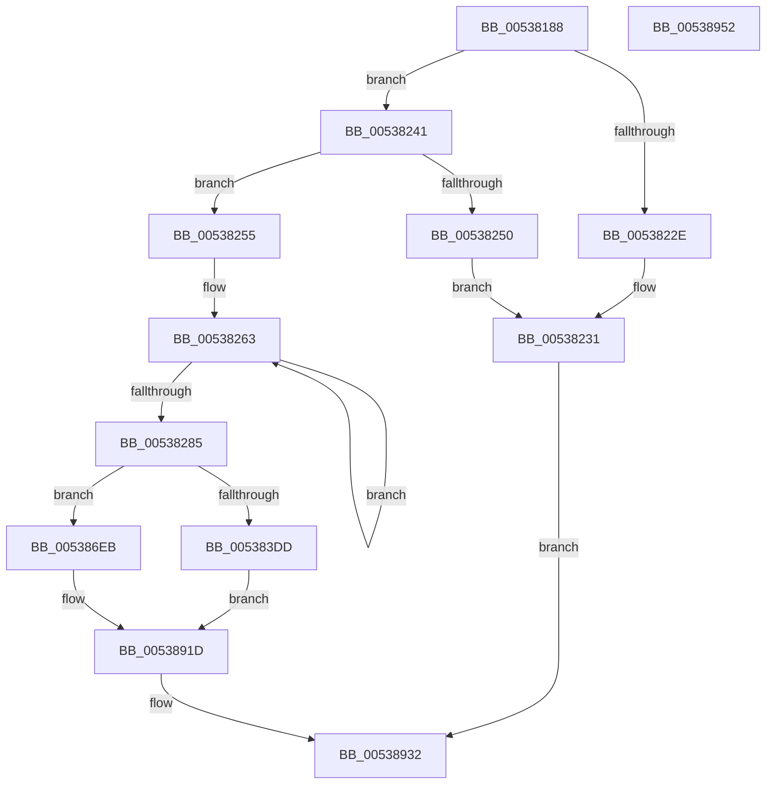

# SymCryptShortWeierstrassAddSideChannelUnsafe

- RVA: `0x00538188`–`0x00538953` (길이 `1,995` bytes)
- VA: `0x0000000140538188`
- 실행 섹션: `.text`
- PDB 이름 있음: `예`; PDB Function 태그: `아니요`
- unwind 정보 RVA: `0x000BBBE4`
- 디코드: `517`개 명령, `1,995/1,995` bytes 표시
- 미해석 바이트: `0` (있으면 어셈블리에 `.byte`로 보존)

> 이 문서는 커널 이미지의 기계어와 PDB 기호를 분석해 생성했습니다. 4번과 5번은 함수 원형과 자료형을 바이너리 사용 방식에서 추정한 C 해석이며 원본 소스 복구 결과는 아닙니다.

## 1. Dependencies

- 직접 호출 지점: **69**; 고유 호출 대상: **10**
- 직접 호출자로 확인된 함수: **1**
- RIP 상대 이미지 참조: **1**

### Outgoing calls
- `0x00538218` → [memset](../6C/memset_function_006C6C40.md) (function, `0x006C6C40`)
- `0x00538225` → [SymCryptModElementIsZero](../52/SymCryptModElementIsZero_function_00525964.md) (function, `0x00525964`)
- `0x00538237` → [SymCryptEcpointCopy](../52/SymCryptEcpointCopy_function_0052C564.md) (function, `0x0052C564`)
- `0x00538247` → [SymCryptModElementIsZero](../52/SymCryptModElementIsZero_function_00525964.md) (function, `0x00525964`)
- `0x0053826C` → [SymCryptModElementCreate](../52/SymCryptModElementCreate_function_00525900.md) (function, `0x00525900`)
- `0x005382A5` → [SymCryptModSquare](../52/SymCryptModSquare_function_00525C84.md) (function, `0x00525C84`)
- `0x005382C7` → [SymCryptModMul](../52/SymCryptModMul_function_00525BA8.md) (function, `0x00525BA8`)
- `0x005382DE` → [SymCryptModSquare](../52/SymCryptModSquare_function_00525C84.md) (function, `0x00525C84`)
- `0x00538300` → [SymCryptModMul](../52/SymCryptModMul_function_00525BA8.md) (function, `0x00525BA8`)
- `0x00538321` → [SymCryptModMul](../52/SymCryptModMul_function_00525BA8.md) (function, `0x00525BA8`)
- `0x0053833D` → [SymCryptModSub](../52/SymCryptModSub_function_00525CB8.md) (function, `0x00525CB8`)
- `0x0053835A` → [SymCryptModMul](../52/SymCryptModMul_function_00525BA8.md) (function, `0x00525BA8`)
- `0x00538377` → [SymCryptModMul](../52/SymCryptModMul_function_00525BA8.md) (function, `0x00525BA8`)
- `0x00538393` → [SymCryptModMul](../52/SymCryptModMul_function_00525BA8.md) (function, `0x00525BA8`)
- `0x005383AF` → [SymCryptModSub](../52/SymCryptModSub_function_00525CB8.md) (function, `0x00525CB8`)
- `0x005383BB` → [SymCryptModElementIsZero](../52/SymCryptModElementIsZero_function_00525964.md) (function, `0x00525964`)
- `0x005383C9` → [SymCryptModElementIsZero](../52/SymCryptModElementIsZero_function_00525964.md) (function, `0x00525964`)
- `0x005383E4` → [SymCryptModElementCopy](../52/SymCryptModElementCopy_function_005258E8.md) (function, `0x005258E8`)
- `0x005383FD` → [SymCryptModSquare](../52/SymCryptModSquare_function_00525C84.md) (function, `0x00525C84`)
- `0x00538414` → [SymCryptModSquare](../52/SymCryptModSquare_function_00525C84.md) (function, `0x00525C84`)
- `0x0053842B` → [SymCryptModSquare](../52/SymCryptModSquare_function_00525C84.md) (function, `0x00525C84`)
- `0x00538449` → [SymCryptModAdd](../52/SymCryptModAdd_function_00525868.md) (function, `0x00525868`)
- `0x00538460` → [SymCryptModSquare](../52/SymCryptModSquare_function_00525C84.md) (function, `0x00525C84`)
- `0x0053847D` → [SymCryptModSub](../52/SymCryptModSub_function_00525CB8.md) (function, `0x00525CB8`)
- `0x0053849A` → [SymCryptModSub](../52/SymCryptModSub_function_00525CB8.md) (function, `0x00525CB8`)
- `0x005384B9` → [SymCryptModAdd](../52/SymCryptModAdd_function_00525868.md) (function, `0x00525868`)
- `0x005384CF` → [SymCryptModSquare](../52/SymCryptModSquare_function_00525C84.md) (function, `0x00525C84`)
- `0x005384EE` → [SymCryptModMul](../52/SymCryptModMul_function_00525BA8.md) (function, `0x00525BA8`)
- `0x0053850A` → [SymCryptModAdd](../52/SymCryptModAdd_function_00525868.md) (function, `0x00525868`)
- `0x00538529` → [SymCryptModAdd](../52/SymCryptModAdd_function_00525868.md) (function, `0x00525868`)
- `0x00538545` → [SymCryptModAdd](../52/SymCryptModAdd_function_00525868.md) (function, `0x00525868`)
- `0x0053855C` → [SymCryptModSquare](../52/SymCryptModSquare_function_00525C84.md) (function, `0x00525C84`)
- `0x00538579` → [SymCryptModSub](../52/SymCryptModSub_function_00525CB8.md) (function, `0x00525CB8`)
- `0x00538596` → [SymCryptModSub](../52/SymCryptModSub_function_00525CB8.md) (function, `0x00525CB8`)
- `0x005385B3` → [SymCryptModSub](../52/SymCryptModSub_function_00525CB8.md) (function, `0x00525CB8`)
- `0x005385CF` → [SymCryptModMul](../52/SymCryptModMul_function_00525BA8.md) (function, `0x00525BA8`)
- `0x005385EE` → [SymCryptModAdd](../52/SymCryptModAdd_function_00525868.md) (function, `0x00525868`)
- `0x0053860D` → [SymCryptModAdd](../52/SymCryptModAdd_function_00525868.md) (function, `0x00525868`)
- `0x0053862C` → [SymCryptModAdd](../52/SymCryptModAdd_function_00525868.md) (function, `0x00525868`)
- `0x00538649` → [SymCryptModSub](../52/SymCryptModSub_function_00525CB8.md) (function, `0x00525CB8`)
- `0x00538667` → [SymCryptModAdd](../52/SymCryptModAdd_function_00525868.md) (function, `0x00525868`)
- `0x0053867D` → [SymCryptModSquare](../52/SymCryptModSquare_function_00525C84.md) (function, `0x00525C84`)
- `0x00538698` → [SymCryptModSub](../52/SymCryptModSub_function_00525CB8.md) (function, `0x00525CB8`)
- `0x005386B3` → [SymCryptModSub](../52/SymCryptModSub_function_00525CB8.md) (function, `0x00525CB8`)
- `0x005386C7` → [SymCryptModElementCopy](../52/SymCryptModElementCopy_function_005258E8.md) (function, `0x005258E8`)
- `0x005386DE` → [SymCryptModElementCopy](../52/SymCryptModElementCopy_function_005258E8.md) (function, `0x005258E8`)
- `0x00538701` → [SymCryptModAdd](../52/SymCryptModAdd_function_00525868.md) (function, `0x00525868`)
- `0x00538717` → [SymCryptModSquare](../52/SymCryptModSquare_function_00525C84.md) (function, `0x00525C84`)
- `0x00538733` → [SymCryptModSub](../52/SymCryptModSub_function_00525CB8.md) (function, `0x00525CB8`)
- `0x0053874F` → [SymCryptModSub](../52/SymCryptModSub_function_00525CB8.md) (function, `0x00525CB8`)
- `0x0053876B` → [SymCryptModMul](../52/SymCryptModMul_function_00525BA8.md) (function, `0x00525BA8`)
- `0x0053878A` → [SymCryptModAdd](../52/SymCryptModAdd_function_00525868.md) (function, `0x00525868`)
- `0x005387A6` → [SymCryptModAdd](../52/SymCryptModAdd_function_00525868.md) (function, `0x00525868`)
- `0x005387BC` → [SymCryptModSquare](../52/SymCryptModSquare_function_00525C84.md) (function, `0x00525C84`)
- `0x005387D8` → [SymCryptModMul](../52/SymCryptModMul_function_00525BA8.md) (function, `0x00525BA8`)
- `0x005387F3` → [SymCryptModMul](../52/SymCryptModMul_function_00525BA8.md) (function, `0x00525BA8`)
- `0x0053880A` → [SymCryptModSquare](../52/SymCryptModSquare_function_00525C84.md) (function, `0x00525C84`)
- `0x00538826` → [SymCryptModSub](../52/SymCryptModSub_function_00525CB8.md) (function, `0x00525CB8`)
- `0x00538841` → [SymCryptModSub](../52/SymCryptModSub_function_00525CB8.md) (function, `0x00525CB8`)
- `0x0053885C` → [SymCryptModSub](../52/SymCryptModSub_function_00525CB8.md) (function, `0x00525CB8`)
- `0x00538877` → [SymCryptModSub](../52/SymCryptModSub_function_00525CB8.md) (function, `0x00525CB8`)
- `0x00538893` → [SymCryptModMul](../52/SymCryptModMul_function_00525BA8.md) (function, `0x00525BA8`)
- `0x005388B1` → [SymCryptModMul](../52/SymCryptModMul_function_00525BA8.md) (function, `0x00525BA8`)
- `0x005388D0` → [SymCryptModAdd](../52/SymCryptModAdd_function_00525868.md) (function, `0x00525868`)
- `0x005388EC` → [SymCryptModSub](../52/SymCryptModSub_function_00525CB8.md) (function, `0x00525CB8`)
- `0x005388FF` → [SymCryptModElementCopy](../52/SymCryptModElementCopy_function_005258E8.md) (function, `0x005258E8`)
- `0x00538915` → [SymCryptModElementCopy](../52/SymCryptModElementCopy_function_005258E8.md) (function, `0x005258E8`)
- `0x0053892D` → [SymCryptModElementCopy](../52/SymCryptModElementCopy_function_005258E8.md) (function, `0x005258E8`)
- `0x00538939` → [_security_check_cookie](../6A/_security_check_cookie_function_006AC640.md) (function, `0x006AC640`)

### Direct callers
- [SymCryptShortWeierstrassAdd](SymCryptShortWeierstrassAdd_function_00537BC0.md) at `0x00537C25`

### Static image references
- `0x005381A1` → RVA `0x00E0A740` (`.data`; read)

## 2. Other-region calls and transfers

- 다른 실행 섹션으로 향하는 call: **0**
- 별도 외부 분기/꼬리 이동을 확인하지 못했습니다.

## 3. Assembly (complete function range)

```asm
00538188  40 55                           push rbp
0053818A  53                              push rbx
0053818B  56                              push rsi
0053818C  57                              push rdi
0053818D  41 54                           push r12
0053818F  41 55                           push r13
00538191  41 56                           push r14
00538193  41 57                           push r15
00538195  48 8D 6C 24 F1                  lea rbp, [rsp - 0xf]
0053819A  48 81 EC C8 00 00 00            sub rsp, 0xc8
005381A1  48 8B 05 98 25 8D 00            mov rax, qword ptr [rip + 0x8d2598]
005381A8  48 33 C4                        xor rax, rsp
005381AB  48 89 45 F7                     mov qword ptr [rbp - 9], rax
005381AF  48 8B B9 68 02 00 00            mov rdi, qword ptr [rcx + 0x268]
005381B6  48 8D 42 20                     lea rax, [rdx + 0x20]
005381BA  48 8B 75 77                     mov rsi, qword ptr [rbp + 0x77]
005381BE  4D 8D 60 20                     lea r12, [r8 + 0x20]
005381C2  48 89 44 24 38                  mov qword ptr [rsp + 0x38], rax
005381C7  4C 8B F2                        mov r14, rdx
005381CA  8B 51 24                        mov edx, dword ptr [rcx + 0x24]
005381CD  4C 8B F9                        mov r15, rcx
005381D0  49 8B D8                        mov rbx, r8
005381D3  4C 89 4D 97                     mov qword ptr [rbp - 0x69], r9
005381D7  4D 8B E9                        mov r13, r9
005381DA  49 8D 46 20                     lea rax, [r14 + 0x20]
005381DE  48 03 C2                        add rax, rdx
005381E1  8D 0C 12                        lea ecx, [rdx + rdx]
005381E4  48 89 45 87                     mov qword ptr [rbp - 0x79], rax
005381E8  4C 03 E1                        add r12, rcx
005381EB  49 8D 46 20                     lea rax, [r14 + 0x20]
005381EF  4C 89 65 8F                     mov qword ptr [rbp - 0x71], r12
005381F3  48 03 C1                        add rax, rcx
005381F6  48 8D 4D B7                     lea rcx, [rbp - 0x49]
005381FA  48 89 44 24 30                  mov qword ptr [rsp + 0x30], rax
005381FF  49 8D 40 20                     lea rax, [r8 + 0x20]
00538203  48 89 45 9F                     mov qword ptr [rbp - 0x61], rax
00538207  49 8D 40 20                     lea rax, [r8 + 0x20]
0053820B  48 03 C2                        add rax, rdx
0053820E  33 D2                           xor edx, edx
00538210  48 89 45 A7                     mov qword ptr [rbp - 0x59], rax
00538214  44 8D 42 40                     lea r8d, [rdx + 0x40]
00538218  E8 23 EA 18 00                  call 0x1406c6c40
0053821D  48 8B 54 24 30                  mov rdx, qword ptr [rsp + 0x30]
00538222  48 8B CF                        mov rcx, rdi
00538225  E8 3A D7 FE FF                  call 0x140525964
0053822A  85 C0                           test eax, eax
0053822C  74 13                           je 0x140538241
0053822E  48 8B D3                        mov rdx, rbx
00538231  4D 8B C5                        mov r8, r13
00538234  49 8B CF                        mov rcx, r15
00538237  E8 28 43 FF FF                  call 0x14052c564
0053823C  E9 F1 06 00 00                  jmp 0x140538932
00538241  49 8B D4                        mov rdx, r12
00538244  48 8B CF                        mov rcx, rdi
00538247  E8 18 D7 FE FF                  call 0x140525964
0053824C  85 C0                           test eax, eax
0053824E  74 05                           je 0x140538255
00538250  49 8B D6                        mov rdx, r14
00538253  EB DC                           jmp 0x140538231
00538255  41 8B 47 24                     mov eax, dword ptr [r15 + 0x24]
00538259  48 8D 5D B7                     lea rbx, [rbp - 0x49]
0053825D  41 BE 08 00 00 00               mov r14d, 8
00538263  4C 8B C7                        mov r8, rdi
00538266  48 8B D0                        mov rdx, rax
00538269  48 8B CE                        mov rcx, rsi
0053826C  E8 8F D6 FE FF                  call 0x140525900
00538271  48 89 03                        mov qword ptr [rbx], rax
00538274  48 8D 5B 08                     lea rbx, [rbx + 8]
00538278  41 8B 47 24                     mov eax, dword ptr [r15 + 0x24]
0053827C  48 03 F0                        add rsi, rax
0053827F  49 83 EE 01                     sub r14, 1
00538283  75 DE                           jne 0x140538263
00538285  4C 8B 75 7F                     mov r14, qword ptr [rbp + 0x7f]
00538289  4C 8B CE                        mov r9, rsi
0053828C  4C 8B 45 B7                     mov r8, qword ptr [rbp - 0x49]
00538290  48 8B 54 24 30                  mov rdx, qword ptr [rsp + 0x30]
00538295  C1 E0 03                        shl eax, 3
00538298  8B C8                           mov ecx, eax
0053829A  4C 2B F1                        sub r14, rcx
0053829D  48 8B CF                        mov rcx, rdi
005382A0  4C 89 74 24 20                  mov qword ptr [rsp + 0x20], r14
005382A5  E8 DA D9 FE FF                  call 0x140525c84
005382AA  48 8B 5D BF                     mov rbx, qword ptr [rbp - 0x41]
005382AE  48 8B CF                        mov rcx, rdi
005382B1  4C 8B 45 B7                     mov r8, qword ptr [rbp - 0x49]
005382B5  4C 8B CB                        mov r9, rbx
005382B8  48 8B 54 24 30                  mov rdx, qword ptr [rsp + 0x30]
005382BD  4C 89 74 24 28                  mov qword ptr [rsp + 0x28], r14
005382C2  48 89 74 24 20                  mov qword ptr [rsp + 0x20], rsi
005382C7  E8 DC D8 FE FF                  call 0x140525ba8
005382CC  4C 8B 45 E7                     mov r8, qword ptr [rbp - 0x19]
005382D0  4C 8B CE                        mov r9, rsi
005382D3  49 8B D4                        mov rdx, r12
005382D6  4C 89 74 24 20                  mov qword ptr [rsp + 0x20], r14
005382DB  48 8B CF                        mov rcx, rdi
005382DE  E8 A1 D9 FE FF                  call 0x140525c84
005382E3  4C 8B 6D C7                     mov r13, qword ptr [rbp - 0x39]
005382E7  48 8B CF                        mov rcx, rdi
005382EA  4C 8B 45 E7                     mov r8, qword ptr [rbp - 0x19]
005382EE  4D 8B CD                        mov r9, r13
005382F1  48 8B 54 24 38                  mov rdx, qword ptr [rsp + 0x38]
005382F6  4C 89 74 24 28                  mov qword ptr [rsp + 0x28], r14
005382FB  48 89 74 24 20                  mov qword ptr [rsp + 0x20], rsi
00538300  E8 A3 D8 FE FF                  call 0x140525ba8
00538305  4C 8B 65 CF                     mov r12, qword ptr [rbp - 0x31]
00538309  48 8B CF                        mov rcx, rdi
0053830C  4C 8B 45 B7                     mov r8, qword ptr [rbp - 0x49]
00538310  4D 8B CC                        mov r9, r12
00538313  48 8B 55 9F                     mov rdx, qword ptr [rbp - 0x61]
00538317  4C 89 74 24 28                  mov qword ptr [rsp + 0x28], r14
0053831C  48 89 74 24 20                  mov qword ptr [rsp + 0x20], rsi
00538321  E8 82 D8 FE FF                  call 0x140525ba8
00538326  4C 8B 4D DF                     mov r9, qword ptr [rbp - 0x21]
0053832A  4D 8B C5                        mov r8, r13
0053832D  49 8B D4                        mov rdx, r12
00538330  4C 89 74 24 28                  mov qword ptr [rsp + 0x28], r14
00538335  48 8B CF                        mov rcx, rdi
00538338  48 89 74 24 20                  mov qword ptr [rsp + 0x20], rsi
0053833D  E8 76 D9 FE FF                  call 0x140525cb8
00538342  4C 8B 4D EF                     mov r9, qword ptr [rbp - 0x11]
00538346  4C 8B C3                        mov r8, rbx
00538349  48 8B 55 A7                     mov rdx, qword ptr [rbp - 0x59]
0053834D  48 8B CF                        mov rcx, rdi
00538350  4C 89 74 24 28                  mov qword ptr [rsp + 0x28], r14
00538355  48 89 74 24 20                  mov qword ptr [rsp + 0x20], rsi
0053835A  E8 49 D8 FE FF                  call 0x140525ba8
0053835F  4C 8B 45 E7                     mov r8, qword ptr [rbp - 0x19]
00538363  4C 8B CB                        mov r9, rbx
00538366  48 8B 55 8F                     mov rdx, qword ptr [rbp - 0x71]
0053836A  48 8B CF                        mov rcx, rdi
0053836D  4C 89 74 24 28                  mov qword ptr [rsp + 0x28], r14
00538372  48 89 74 24 20                  mov qword ptr [rsp + 0x20], rsi
00538377  E8 2C D8 FE FF                  call 0x140525ba8
0053837C  48 8B 55 87                     mov rdx, qword ptr [rbp - 0x79]
00538380  4C 8B CB                        mov r9, rbx
00538383  4C 8B C3                        mov r8, rbx
00538386  4C 89 74 24 28                  mov qword ptr [rsp + 0x28], r14
0053838B  48 8B CF                        mov rcx, rdi
0053838E  48 89 74 24 20                  mov qword ptr [rsp + 0x20], rsi
00538393  E8 10 D8 FE FF                  call 0x140525ba8
00538398  4C 8B 4D EF                     mov r9, qword ptr [rbp - 0x11]
0053839C  4C 8B C3                        mov r8, rbx
0053839F  49 8B D1                        mov rdx, r9
005383A2  4C 89 74 24 28                  mov qword ptr [rsp + 0x28], r14
005383A7  48 8B CF                        mov rcx, rdi
005383AA  48 89 74 24 20                  mov qword ptr [rsp + 0x20], rsi
005383AF  E8 04 D9 FE FF                  call 0x140525cb8
005383B4  48 8B 55 EF                     mov rdx, qword ptr [rbp - 0x11]
005383B8  48 8B CF                        mov rcx, rdi
005383BB  E8 A4 D5 FE FF                  call 0x140525964
005383C0  48 8B 55 DF                     mov rdx, qword ptr [rbp - 0x21]
005383C4  8B D8                           mov ebx, eax
005383C6  48 8B CF                        mov rcx, rdi
005383C9  E8 96 D5 FE FF                  call 0x140525964
005383CE  85 D8                           test eax, ebx
005383D0  48 8B CF                        mov rcx, rdi
005383D3  48 8B 5D D7                     mov rbx, qword ptr [rbp - 0x29]
005383D7  0F 84 0E 03 00 00               je 0x1405386eb
005383DD  48 8B 55 B7                     mov rdx, qword ptr [rbp - 0x49]
005383E1  4C 8B C3                        mov r8, rbx
005383E4  E8 FF D4 FE FF                  call 0x1405258e8
005383E9  4C 8B 45 B7                     mov r8, qword ptr [rbp - 0x49]
005383ED  4C 8B CE                        mov r9, rsi
005383F0  48 8B 54 24 38                  mov rdx, qword ptr [rsp + 0x38]
005383F5  48 8B CF                        mov rcx, rdi
005383F8  4C 89 74 24 20                  mov qword ptr [rsp + 0x20], r14
005383FD  E8 82 D8 FE FF                  call 0x140525c84
00538402  48 8B 55 87                     mov rdx, qword ptr [rbp - 0x79]
00538406  4C 8B CE                        mov r9, rsi
00538409  4D 8B C4                        mov r8, r12
0053840C  4C 89 74 24 20                  mov qword ptr [rsp + 0x20], r14
00538411  48 8B CF                        mov rcx, rdi
00538414  E8 6B D8 FE FF                  call 0x140525c84
00538419  4C 8B 45 DF                     mov r8, qword ptr [rbp - 0x21]
0053841D  4C 8B CE                        mov r9, rsi
00538420  49 8B D4                        mov rdx, r12
00538423  4C 89 74 24 20                  mov qword ptr [rsp + 0x20], r14
00538428  48 8B CF                        mov rcx, rdi
0053842B  E8 54 D8 FE FF                  call 0x140525c84
00538430  4C 8B 4D BF                     mov r9, qword ptr [rbp - 0x41]
00538434  4D 8B C4                        mov r8, r12
00538437  48 8B 54 24 38                  mov rdx, qword ptr [rsp + 0x38]
0053843C  48 8B CF                        mov rcx, rdi
0053843F  4C 89 74 24 28                  mov qword ptr [rsp + 0x28], r14
00538444  48 89 74 24 20                  mov qword ptr [rsp + 0x20], rsi
00538449  E8 1A D4 FE FF                  call 0x140525868
0053844E  4C 8B 45 BF                     mov r8, qword ptr [rbp - 0x41]
00538452  4C 8B CE                        mov r9, rsi
00538455  49 8B D0                        mov rdx, r8
00538458  4C 89 74 24 20                  mov qword ptr [rsp + 0x20], r14
0053845D  48 8B CF                        mov rcx, rdi
00538460  E8 1F D8 FE FF                  call 0x140525c84
00538465  4C 8B 4D BF                     mov r9, qword ptr [rbp - 0x41]
00538469  48 8B CF                        mov rcx, rdi
0053846C  4C 8B 45 B7                     mov r8, qword ptr [rbp - 0x49]
00538470  49 8B D1                        mov rdx, r9
00538473  4C 89 74 24 28                  mov qword ptr [rsp + 0x28], r14
00538478  48 89 74 24 20                  mov qword ptr [rsp + 0x20], rsi
0053847D  E8 36 D8 FE FF                  call 0x140525cb8
00538482  4C 8B 4D BF                     mov r9, qword ptr [rbp - 0x41]
00538486  48 8B CF                        mov rcx, rdi
00538489  4C 8B 45 DF                     mov r8, qword ptr [rbp - 0x21]
0053848D  49 8B D1                        mov rdx, r9
00538490  4C 89 74 24 28                  mov qword ptr [rsp + 0x28], r14
00538495  48 89 74 24 20                  mov qword ptr [rsp + 0x20], rsi
0053849A  E8 19 D8 FE FF                  call 0x140525cb8
0053849F  48 8B 45 BF                     mov rax, qword ptr [rbp - 0x41]
005384A3  48 8B CF                        mov rcx, rdi
005384A6  4C 8B C8                        mov r9, rax
005384A9  4C 89 74 24 28                  mov qword ptr [rsp + 0x28], r14
005384AE  4C 8B C0                        mov r8, rax
005384B1  48 89 74 24 20                  mov qword ptr [rsp + 0x20], rsi
005384B6  48 8B D0                        mov rdx, rax
005384B9  E8 AA D3 FE FF                  call 0x140525868
005384BE  4C 8B CE                        mov r9, rsi
005384C1  4C 89 74 24 20                  mov qword ptr [rsp + 0x20], r14
005384C6  4D 8B C5                        mov r8, r13
005384C9  48 8B D3                        mov rdx, rbx
005384CC  48 8B CF                        mov rcx, rdi
005384CF  E8 B0 D7 FE FF                  call 0x140525c84
005384D4  4D 8B 87 78 02 00 00            mov r8, qword ptr [r15 + 0x278]
005384DB  4D 8B CD                        mov r9, r13
005384DE  49 8B D5                        mov rdx, r13
005384E1  4C 89 74 24 28                  mov qword ptr [rsp + 0x28], r14
005384E6  48 8B CF                        mov rcx, rdi
005384E9  48 89 74 24 20                  mov qword ptr [rsp + 0x20], rsi
005384EE  E8 B5 D6 FE FF                  call 0x140525ba8
005384F3  4C 8B 45 B7                     mov r8, qword ptr [rbp - 0x49]
005384F7  4D 8B CD                        mov r9, r13
005384FA  49 8B D5                        mov rdx, r13
005384FD  4C 89 74 24 28                  mov qword ptr [rsp + 0x28], r14
00538502  48 8B CF                        mov rcx, rdi
00538505  48 89 74 24 20                  mov qword ptr [rsp + 0x20], rsi
0053850A  E8 59 D3 FE FF                  call 0x140525868
0053850F  48 8B 45 B7                     mov rax, qword ptr [rbp - 0x49]
00538513  4C 89 74 24 28                  mov qword ptr [rsp + 0x28], r14
00538518  4C 8B C8                        mov r9, rax
0053851B  4C 8B C0                        mov r8, rax
0053851E  48 89 74 24 20                  mov qword ptr [rsp + 0x20], rsi
00538523  48 8B D0                        mov rdx, rax
00538526  48 8B CF                        mov rcx, rdi
00538529  E8 3A D3 FE FF                  call 0x140525868
0053852E  4C 8B 45 B7                     mov r8, qword ptr [rbp - 0x49]
00538532  4D 8B CD                        mov r9, r13
00538535  49 8B D5                        mov rdx, r13
00538538  4C 89 74 24 28                  mov qword ptr [rsp + 0x28], r14
0053853D  48 8B CF                        mov rcx, rdi
00538540  48 89 74 24 20                  mov qword ptr [rsp + 0x20], rsi
00538545  E8 1E D3 FE FF                  call 0x140525868
0053854A  4C 8B 45 B7                     mov r8, qword ptr [rbp - 0x49]
0053854E  4C 8B CE                        mov r9, rsi
00538551  49 8B D5                        mov rdx, r13
00538554  4C 89 74 24 20                  mov qword ptr [rsp + 0x20], r14
00538559  48 8B CF                        mov rcx, rdi
0053855C  E8 23 D7 FE FF                  call 0x140525c84
00538561  4C 8B 4D B7                     mov r9, qword ptr [rbp - 0x49]
00538565  48 8B CF                        mov rcx, rdi
00538568  4C 8B 45 BF                     mov r8, qword ptr [rbp - 0x41]
0053856C  49 8B D1                        mov rdx, r9
0053856F  4C 89 74 24 28                  mov qword ptr [rsp + 0x28], r14
00538574  48 89 74 24 20                  mov qword ptr [rsp + 0x20], rsi
00538579  E8 3A D7 FE FF                  call 0x140525cb8
0053857E  4C 8B 4D B7                     mov r9, qword ptr [rbp - 0x49]
00538582  48 8B CF                        mov rcx, rdi
00538585  4C 8B 45 BF                     mov r8, qword ptr [rbp - 0x41]
00538589  49 8B D1                        mov rdx, r9
0053858C  4C 89 74 24 28                  mov qword ptr [rsp + 0x28], r14
00538591  48 89 74 24 20                  mov qword ptr [rsp + 0x20], rsi
00538596  E8 1D D7 FE FF                  call 0x140525cb8
0053859B  4C 8B 4D BF                     mov r9, qword ptr [rbp - 0x41]
0053859F  48 8B CF                        mov rcx, rdi
005385A2  4C 8B 45 B7                     mov r8, qword ptr [rbp - 0x49]
005385A6  49 8B D1                        mov rdx, r9
005385A9  4C 89 74 24 28                  mov qword ptr [rsp + 0x28], r14
005385AE  48 89 74 24 20                  mov qword ptr [rsp + 0x20], rsi
005385B3  E8 00 D7 FE FF                  call 0x140525cb8
005385B8  4C 8B 4D BF                     mov r9, qword ptr [rbp - 0x41]
005385BC  49 8B D5                        mov rdx, r13
005385BF  4D 8B C1                        mov r8, r9
005385C2  4C 89 74 24 28                  mov qword ptr [rsp + 0x28], r14
005385C7  48 8B CF                        mov rcx, rdi
005385CA  48 89 74 24 20                  mov qword ptr [rsp + 0x20], rsi
005385CF  E8 D4 D5 FE FF                  call 0x140525ba8
005385D4  48 8B 45 DF                     mov rax, qword ptr [rbp - 0x21]
005385D8  48 8B CF                        mov rcx, rdi
005385DB  4C 8B C8                        mov r9, rax
005385DE  4C 89 74 24 28                  mov qword ptr [rsp + 0x28], r14
005385E3  4C 8B C0                        mov r8, rax
005385E6  48 89 74 24 20                  mov qword ptr [rsp + 0x20], rsi
005385EB  48 8B D0                        mov rdx, rax
005385EE  E8 75 D2 FE FF                  call 0x140525868
005385F3  48 8B 45 DF                     mov rax, qword ptr [rbp - 0x21]
005385F7  48 8B CF                        mov rcx, rdi
005385FA  4C 8B C8                        mov r9, rax
005385FD  4C 89 74 24 28                  mov qword ptr [rsp + 0x28], r14
00538602  4C 8B C0                        mov r8, rax
00538605  48 89 74 24 20                  mov qword ptr [rsp + 0x20], rsi
0053860A  48 8B D0                        mov rdx, rax
0053860D  E8 56 D2 FE FF                  call 0x140525868
00538612  48 8B 45 DF                     mov rax, qword ptr [rbp - 0x21]
00538616  48 8B CF                        mov rcx, rdi
00538619  4C 8B C8                        mov r9, rax
0053861C  4C 89 74 24 28                  mov qword ptr [rsp + 0x28], r14
00538621  4C 8B C0                        mov r8, rax
00538624  48 89 74 24 20                  mov qword ptr [rsp + 0x20], rsi
00538629  48 8B D0                        mov rdx, rax
0053862C  E8 37 D2 FE FF                  call 0x140525868
00538631  4C 8B 4D BF                     mov r9, qword ptr [rbp - 0x41]
00538635  48 8B CF                        mov rcx, rdi
00538638  4C 8B 45 DF                     mov r8, qword ptr [rbp - 0x21]
0053863C  49 8B D1                        mov rdx, r9
0053863F  4C 89 74 24 28                  mov qword ptr [rsp + 0x28], r14
00538644  48 89 74 24 20                  mov qword ptr [rsp + 0x20], rsi
00538649  E8 6A D6 FE FF                  call 0x140525cb8
0053864E  4C 8B 44 24 30                  mov r8, qword ptr [rsp + 0x30]
00538653  4D 8B CD                        mov r9, r13
00538656  48 8B 55 87                     mov rdx, qword ptr [rbp - 0x79]
0053865A  48 8B CF                        mov rcx, rdi
0053865D  4C 89 74 24 28                  mov qword ptr [rsp + 0x28], r14
00538662  48 89 74 24 20                  mov qword ptr [rsp + 0x20], rsi
00538667  E8 FC D1 FE FF                  call 0x140525868
0053866C  4C 8B CE                        mov r9, rsi
0053866F  4C 89 74 24 20                  mov qword ptr [rsp + 0x20], r14
00538674  4D 8B C5                        mov r8, r13
00538677  49 8B D5                        mov rdx, r13
0053867A  48 8B CF                        mov rcx, rdi
0053867D  E8 02 D6 FE FF                  call 0x140525c84
00538682  4D 8B CD                        mov r9, r13
00538685  4C 89 74 24 28                  mov qword ptr [rsp + 0x28], r14
0053868A  4D 8B C4                        mov r8, r12
0053868D  48 89 74 24 20                  mov qword ptr [rsp + 0x20], rsi
00538692  49 8B D5                        mov rdx, r13
00538695  48 8B CF                        mov rcx, rdi
00538698  E8 1B D6 FE FF                  call 0x140525cb8
0053869D  4D 8B CD                        mov r9, r13
005386A0  4C 89 74 24 28                  mov qword ptr [rsp + 0x28], r14
005386A5  4C 8B C3                        mov r8, rbx
005386A8  48 89 74 24 20                  mov qword ptr [rsp + 0x20], rsi
005386AD  49 8B D5                        mov rdx, r13
005386B0  48 8B CF                        mov rcx, rdi
005386B3  E8 00 D6 FE FF                  call 0x140525cb8
005386B8  48 8B 75 97                     mov rsi, qword ptr [rbp - 0x69]
005386BC  48 8B CF                        mov rcx, rdi
005386BF  48 8B 55 B7                     mov rdx, qword ptr [rbp - 0x49]
005386C3  4C 8D 46 20                     lea r8, [rsi + 0x20]
005386C7  E8 1C D2 FE FF                  call 0x1405258e8
005386CC  41 8B 47 24                     mov eax, dword ptr [r15 + 0x24]
005386D0  4C 8D 46 20                     lea r8, [rsi + 0x20]
005386D4  48 8B 55 BF                     mov rdx, qword ptr [rbp - 0x41]
005386D8  4C 03 C0                        add r8, rax
005386DB  48 8B CF                        mov rcx, rdi
005386DE  E8 05 D2 FE FF                  call 0x1405258e8
005386E3  49 8B D5                        mov rdx, r13
005386E6  E9 32 02 00 00                  jmp 0x14053891d
005386EB  4C 8B 45 8F                     mov r8, qword ptr [rbp - 0x71]
005386EF  4C 8B CB                        mov r9, rbx
005386F2  48 8B 54 24 30                  mov rdx, qword ptr [rsp + 0x30]
005386F7  4C 89 74 24 28                  mov qword ptr [rsp + 0x28], r14
005386FC  48 89 74 24 20                  mov qword ptr [rsp + 0x20], rsi
00538701  E8 62 D1 FE FF                  call 0x140525868
00538706  4C 8B CE                        mov r9, rsi
00538709  4C 89 74 24 20                  mov qword ptr [rsp + 0x20], r14
0053870E  4C 8B C3                        mov r8, rbx
00538711  48 8B D3                        mov rdx, rbx
00538714  48 8B CF                        mov rcx, rdi
00538717  E8 68 D5 FE FF                  call 0x140525c84
0053871C  4C 8B 45 B7                     mov r8, qword ptr [rbp - 0x49]
00538720  4C 8B CB                        mov r9, rbx
00538723  48 8B D3                        mov rdx, rbx
00538726  4C 89 74 24 28                  mov qword ptr [rsp + 0x28], r14
0053872B  48 8B CF                        mov rcx, rdi
0053872E  48 89 74 24 20                  mov qword ptr [rsp + 0x20], rsi
00538733  E8 80 D5 FE FF                  call 0x140525cb8
00538738  4C 8B 45 E7                     mov r8, qword ptr [rbp - 0x19]
0053873C  4C 8B CB                        mov r9, rbx
0053873F  48 8B D3                        mov rdx, rbx
00538742  4C 89 74 24 28                  mov qword ptr [rsp + 0x28], r14
00538747  48 8B CF                        mov rcx, rdi
0053874A  48 89 74 24 20                  mov qword ptr [rsp + 0x20], rsi
0053874F  E8 64 D5 FE FF                  call 0x140525cb8
00538754  4C 8B 45 DF                     mov r8, qword ptr [rbp - 0x21]
00538758  4C 8B CB                        mov r9, rbx
0053875B  48 8B D3                        mov rdx, rbx
0053875E  4C 89 74 24 28                  mov qword ptr [rsp + 0x28], r14
00538763  48 8B CF                        mov rcx, rdi
00538766  48 89 74 24 20                  mov qword ptr [rsp + 0x20], rsi
0053876B  E8 38 D4 FE FF                  call 0x140525ba8
00538770  48 8B 45 EF                     mov rax, qword ptr [rbp - 0x11]
00538774  48 8B CF                        mov rcx, rdi
00538777  4C 8B C8                        mov r9, rax
0053877A  4C 89 74 24 28                  mov qword ptr [rsp + 0x28], r14
0053877F  4C 8B C0                        mov r8, rax
00538782  48 89 74 24 20                  mov qword ptr [rsp + 0x20], rsi
00538787  48 8B D0                        mov rdx, rax
0053878A  E8 D9 D0 FE FF                  call 0x140525868
0053878F  4C 8B 45 DF                     mov r8, qword ptr [rbp - 0x21]
00538793  4D 8B CC                        mov r9, r12
00538796  49 8B D0                        mov rdx, r8
00538799  4C 89 74 24 28                  mov qword ptr [rsp + 0x28], r14
0053879E  48 8B CF                        mov rcx, rdi
005387A1  48 89 74 24 20                  mov qword ptr [rsp + 0x20], rsi
005387A6  E8 BD D0 FE FF                  call 0x140525868
005387AB  4C 8B CE                        mov r9, rsi
005387AE  4C 89 74 24 20                  mov qword ptr [rsp + 0x20], r14
005387B3  4D 8B C4                        mov r8, r12
005387B6  49 8B D4                        mov rdx, r12
005387B9  48 8B CF                        mov rcx, rdi
005387BC  E8 C3 D4 FE FF                  call 0x140525c84
005387C1  4C 8B 4D DF                     mov r9, qword ptr [rbp - 0x21]
005387C5  49 8B D4                        mov rdx, r12
005387C8  4D 8B C1                        mov r8, r9
005387CB  4C 89 74 24 28                  mov qword ptr [rsp + 0x28], r14
005387D0  48 8B CF                        mov rcx, rdi
005387D3  48 89 74 24 20                  mov qword ptr [rsp + 0x20], rsi
005387D8  E8 CB D3 FE FF                  call 0x140525ba8
005387DD  4D 8B CC                        mov r9, r12
005387E0  4C 89 74 24 28                  mov qword ptr [rsp + 0x28], r14
005387E5  4D 8B C4                        mov r8, r12
005387E8  48 89 74 24 20                  mov qword ptr [rsp + 0x20], rsi
005387ED  49 8B D5                        mov rdx, r13
005387F0  48 8B CF                        mov rcx, rdi
005387F3  E8 B0 D3 FE FF                  call 0x140525ba8
005387F8  48 8B 55 EF                     mov rdx, qword ptr [rbp - 0x11]
005387FC  4C 8B CE                        mov r9, rsi
005387FF  4D 8B C5                        mov r8, r13
00538802  4C 89 74 24 20                  mov qword ptr [rsp + 0x20], r14
00538807  48 8B CF                        mov rcx, rdi
0053880A  E8 75 D4 FE FF                  call 0x140525c84
0053880F  4C 8B 45 DF                     mov r8, qword ptr [rbp - 0x21]
00538813  4D 8B CD                        mov r9, r13
00538816  49 8B D5                        mov rdx, r13
00538819  4C 89 74 24 28                  mov qword ptr [rsp + 0x28], r14
0053881E  48 8B CF                        mov rcx, rdi
00538821  48 89 74 24 20                  mov qword ptr [rsp + 0x20], rsi
00538826  E8 8D D4 FE FF                  call 0x140525cb8
0053882B  4C 89 74 24 28                  mov qword ptr [rsp + 0x28], r14
00538830  4D 8B CD                        mov r9, r13
00538833  4D 8B C4                        mov r8, r12
00538836  48 89 74 24 20                  mov qword ptr [rsp + 0x20], rsi
0053883B  49 8B D5                        mov rdx, r13
0053883E  48 8B CF                        mov rcx, rdi
00538841  E8 72 D4 FE FF                  call 0x140525cb8
00538846  4D 8B CD                        mov r9, r13
00538849  4C 89 74 24 28                  mov qword ptr [rsp + 0x28], r14
0053884E  4D 8B C4                        mov r8, r12
00538851  48 89 74 24 20                  mov qword ptr [rsp + 0x20], rsi
00538856  49 8B D5                        mov rdx, r13
00538859  48 8B CF                        mov rcx, rdi
0053885C  E8 57 D4 FE FF                  call 0x140525cb8
00538861  4D 8B CC                        mov r9, r12
00538864  4C 89 74 24 28                  mov qword ptr [rsp + 0x28], r14
00538869  4D 8B C5                        mov r8, r13
0053886C  48 89 74 24 20                  mov qword ptr [rsp + 0x20], rsi
00538871  49 8B D4                        mov rdx, r12
00538874  48 8B CF                        mov rcx, rdi
00538877  E8 3C D4 FE FF                  call 0x140525cb8
0053887C  4C 8B 45 EF                     mov r8, qword ptr [rbp - 0x11]
00538880  4D 8B CC                        mov r9, r12
00538883  49 8B D4                        mov rdx, r12
00538886  4C 89 74 24 28                  mov qword ptr [rsp + 0x28], r14
0053888B  48 8B CF                        mov rcx, rdi
0053888E  48 89 74 24 20                  mov qword ptr [rsp + 0x20], rsi
00538893  E8 10 D3 FE FF                  call 0x140525ba8
00538898  4C 8B 4D E7                     mov r9, qword ptr [rbp - 0x19]
0053889C  48 8B CF                        mov rcx, rdi
0053889F  4C 8B 45 DF                     mov r8, qword ptr [rbp - 0x21]
005388A3  48 8B 55 BF                     mov rdx, qword ptr [rbp - 0x41]
005388A7  4C 89 74 24 28                  mov qword ptr [rsp + 0x28], r14
005388AC  48 89 74 24 20                  mov qword ptr [rsp + 0x20], rsi
005388B1  E8 F2 D2 FE FF                  call 0x140525ba8
005388B6  48 8B 45 E7                     mov rax, qword ptr [rbp - 0x19]
005388BA  48 8B CF                        mov rcx, rdi
005388BD  4C 8B C8                        mov r9, rax
005388C0  4C 89 74 24 28                  mov qword ptr [rsp + 0x28], r14
005388C5  4C 8B C0                        mov r8, rax
005388C8  48 89 74 24 20                  mov qword ptr [rsp + 0x20], rsi
005388CD  48 8B D0                        mov rdx, rax
005388D0  E8 93 CF FE FF                  call 0x140525868
005388D5  4C 8B 45 E7                     mov r8, qword ptr [rbp - 0x19]
005388D9  4D 8B CC                        mov r9, r12
005388DC  49 8B D4                        mov rdx, r12
005388DF  4C 89 74 24 28                  mov qword ptr [rsp + 0x28], r14
005388E4  48 8B CF                        mov rcx, rdi
005388E7  48 89 74 24 20                  mov qword ptr [rsp + 0x20], rsi
005388EC  E8 C7 D3 FE FF                  call 0x140525cb8
005388F1  48 8B 75 97                     mov rsi, qword ptr [rbp - 0x69]
005388F5  49 8B D5                        mov rdx, r13
005388F8  48 8B CF                        mov rcx, rdi
005388FB  4C 8D 46 20                     lea r8, [rsi + 0x20]
005388FF  E8 E4 CF FE FF                  call 0x1405258e8
00538904  41 8B 47 24                     mov eax, dword ptr [r15 + 0x24]
00538908  4C 8D 46 20                     lea r8, [rsi + 0x20]
0053890C  4C 03 C0                        add r8, rax
0053890F  49 8B D4                        mov rdx, r12
00538912  48 8B CF                        mov rcx, rdi
00538915  E8 CE CF FE FF                  call 0x1405258e8
0053891A  48 8B D3                        mov rdx, rbx
0053891D  41 8B 47 24                     mov eax, dword ptr [r15 + 0x24]
00538921  4C 8D 46 20                     lea r8, [rsi + 0x20]
00538925  03 C0                           add eax, eax
00538927  48 8B CF                        mov rcx, rdi
0053892A  4C 03 C0                        add r8, rax
0053892D  E8 B6 CF FE FF                  call 0x1405258e8
00538932  48 8B 4D F7                     mov rcx, qword ptr [rbp - 9]
00538936  48 33 CC                        xor rcx, rsp
00538939  E8 02 3D 17 00                  call 0x1406ac640
0053893E  48 81 C4 C8 00 00 00            add rsp, 0xc8
00538945  41 5F                           pop r15
00538947  41 5E                           pop r14
00538949  41 5D                           pop r13
0053894B  41 5C                           pop r12
0053894D  5F                              pop rdi
0053894E  5E                              pop rsi
0053894F  5B                              pop rbx
00538950  5D                              pop rbp
00538951  C3                              ret
00538952  CC                              int3
```

## 4. C-style interpretation (structured pseudocode)

```c
__int64 __fastcall SymCryptShortWeierstrassAddSideChannelUnsafe(__int64 a1, __int64 a2, __int64 a3, __int64 a4, __int64 a5, __int64 a6)
{
    __int64 result;
    __int64 v_r12;
    __int64 v_r14;
    __int64 v_rsi;
    __int64 v_rsp;
    unsigned __int64 v_stack_m4F;
    unsigned __int64 v_stack_m58;
    unsigned __int64 v_stack_m60;
    unsigned __int64 v_stack_m68;
    unsigned __int64 v_stack_m70;
    unsigned __int64 v_stack_m78;
    unsigned __int64 v_stack_m80;
    unsigned __int64 v_stack_m88;
    unsigned __int64 v_stack_m90;
    unsigned __int64 v_stack_m98;
    unsigned __int64 v_stack_mA8;
    unsigned __int64 v_stack_mB0;
    unsigned __int64 v_stack_mB8;
    unsigned __int64 v_stack_mC0;
    unsigned __int64 v_stack_mC8;
    unsigned __int64 v_stack_mD0;
    unsigned __int64 v_stack_mD8;
    unsigned __int64 v_stack_mE0;
    unsigned __int64 v_stack_mE8;

    v_rsp = (v_rsp) - (200);
    result = (*(unsigned __int64 *)(v_rip + 9250200)) ^ (v_rsp);
    v_stack_m58 = result;
    v_stack_mD0 = a2 + 32;
    v_stack_mB8 = a4;
    result = (a2 + 32) + ((unsigned int)(*(unsigned int *)(a1 + 36)));
    v_stack_mC8 = result;
    v_r12 = (a3 + 32) + ((unsigned int)(*(unsigned int *)(a1 + 36)) + (unsigned int)(*(unsigned int *)(a1 + 36)) * 1);
    v_stack_mC0 = v_r12;
    result = (a2 + 32) + ((unsigned int)(*(unsigned int *)(a1 + 36)) + (unsigned int)(*(unsigned int *)(a1 + 36)) * 1);
    v_stack_mD8 = result;
    v_stack_mB0 = a3 + 32;
    result = (a3 + 32) + ((unsigned int)(*(unsigned int *)(a1 + 36)));
    a2 = 0;
    v_stack_mA8 = result;
    result = memset(v_stack_m98, a2, a2 + 64, a4);
    result = SymCryptModElementIsZero(*(unsigned __int64 *)(a1 + 616), v_stack_mD8, a2 + 64, a4);
    if ((unsigned int)(result) == 0) goto loc_00538241;
loc_00538231:
    result = SymCryptEcpointCopy(a1, a3, a4, a4);
    goto loc_00538932;
loc_00538241:
    result = SymCryptModElementIsZero(*(unsigned __int64 *)(a1 + 616), v_r12, a4, a4);
    if ((unsigned int)(result) == 0) goto loc_00538255;
    goto loc_00538231;
loc_00538255:
loc_00538263:
    result = SymCryptModElementCreate(a5, (unsigned int)(*(unsigned int *)(a1 + 36)), *(unsigned __int64 *)(a1 + 616), a4);
    *(unsigned __int64 *)(v_stack_m98) = result;
    v_rsi = (a5) + ((unsigned int)(*(unsigned int *)(a1 + 36)));
    v_r14 = (8) - (1);
    if (condition_is_not_equal) goto loc_00538263;
    result = (unsigned int)(((unsigned int)(*(unsigned int *)(a1 + 36))) << (3));
    v_r14 = (a6) - ((unsigned int)((unsigned int)(result)));
    v_stack_mE8 = v_r14;
    result = SymCryptModSquare(*(unsigned __int64 *)(a1 + 616), v_stack_mD8, v_stack_m98, v_rsi);
    v_stack_mE0 = v_r14;
    v_stack_mE8 = v_rsi;
    result = SymCryptModMul(*(unsigned __int64 *)(a1 + 616), v_stack_mD8, v_stack_m98, v_stack_m90);
    v_stack_mE8 = v_r14;
    result = SymCryptModSquare(*(unsigned __int64 *)(a1 + 616), v_r12, v_stack_m68, v_rsi);
    v_stack_mE0 = v_r14;
    v_stack_mE8 = v_rsi;
    result = SymCryptModMul(*(unsigned __int64 *)(a1 + 616), v_stack_mD0, v_stack_m68, v_stack_m88);
    v_stack_mE0 = v_r14;
    v_stack_mE8 = v_rsi;
    result = SymCryptModMul(*(unsigned __int64 *)(a1 + 616), v_stack_mB0, v_stack_m98, v_stack_m80);
    v_stack_mE0 = v_r14;
    v_stack_mE8 = v_rsi;
    result = SymCryptModSub(*(unsigned __int64 *)(a1 + 616), v_stack_m80, v_stack_m88, v_stack_m70);
    v_stack_mE0 = v_r14;
    v_stack_mE8 = v_rsi;
    result = SymCryptModMul(*(unsigned __int64 *)(a1 + 616), v_stack_mA8, v_stack_m90, v_stack_m60);
    v_stack_mE0 = v_r14;
    v_stack_mE8 = v_rsi;
    result = SymCryptModMul(*(unsigned __int64 *)(a1 + 616), v_stack_mC0, v_stack_m68, v_stack_m90);
    v_stack_mE0 = v_r14;
    v_stack_mE8 = v_rsi;
    result = SymCryptModMul(*(unsigned __int64 *)(a1 + 616), v_stack_mC8, v_stack_m90, v_stack_m90);
    v_stack_mE0 = v_r14;
    v_stack_mE8 = v_rsi;
    result = SymCryptModSub(*(unsigned __int64 *)(a1 + 616), v_stack_m60, v_stack_m90, v_stack_m60);
    result = SymCryptModElementIsZero(*(unsigned __int64 *)(a1 + 616), v_stack_m60, v_stack_m90, v_stack_m60);
    result = SymCryptModElementIsZero(*(unsigned __int64 *)(a1 + 616), v_stack_m70, v_stack_m90, v_stack_m60);
    if ((((unsigned int)(result)) & ((unsigned int)((unsigned int)((unsigned int)(result))))) == 0) goto loc_005386EB;
    result = SymCryptModElementCopy(*(unsigned __int64 *)(a1 + 616), v_stack_m98, v_stack_m78, v_stack_m60);
    v_stack_mE8 = v_r14;
    result = SymCryptModSquare(*(unsigned __int64 *)(a1 + 616), v_stack_mD0, v_stack_m98, v_rsi);
    v_stack_mE8 = v_r14;
    result = SymCryptModSquare(*(unsigned __int64 *)(a1 + 616), v_stack_mC8, v_stack_m80, v_rsi);
    v_stack_mE8 = v_r14;
    result = SymCryptModSquare(*(unsigned __int64 *)(a1 + 616), v_stack_m80, v_stack_m70, v_rsi);
    v_stack_mE0 = v_r14;
    v_stack_mE8 = v_rsi;
    result = SymCryptModAdd(*(unsigned __int64 *)(a1 + 616), v_stack_mD0, v_stack_m80, v_stack_m90);
    v_stack_mE8 = v_r14;
    result = SymCryptModSquare(*(unsigned __int64 *)(a1 + 616), v_stack_m90, v_stack_m90, v_rsi);
    v_stack_mE0 = v_r14;
    v_stack_mE8 = v_rsi;
    result = SymCryptModSub(*(unsigned __int64 *)(a1 + 616), v_stack_m90, v_stack_m98, v_stack_m90);
    v_stack_mE0 = v_r14;
    v_stack_mE8 = v_rsi;
    result = SymCryptModSub(*(unsigned __int64 *)(a1 + 616), v_stack_m90, v_stack_m70, v_stack_m90);
    v_stack_mE0 = v_r14;
    v_stack_mE8 = v_rsi;
    result = SymCryptModAdd(*(unsigned __int64 *)(a1 + 616), v_stack_m90, v_stack_m90, v_stack_m90);
    v_stack_mE8 = v_r14;
    result = SymCryptModSquare(*(unsigned __int64 *)(a1 + 616), v_stack_m78, v_stack_m88, v_rsi);
    v_stack_mE0 = v_r14;
    v_stack_mE8 = v_rsi;
    result = SymCryptModMul(*(unsigned __int64 *)(a1 + 616), v_stack_m88, *(unsigned __int64 *)(a1 + 632), v_stack_m88);
    v_stack_mE0 = v_r14;
    v_stack_mE8 = v_rsi;
    result = SymCryptModAdd(*(unsigned __int64 *)(a1 + 616), v_stack_m88, v_stack_m98, v_stack_m88);
    v_stack_mE0 = v_r14;
    v_stack_mE8 = v_rsi;
    result = SymCryptModAdd(*(unsigned __int64 *)(a1 + 616), v_stack_m98, v_stack_m98, v_stack_m98);
    v_stack_mE0 = v_r14;
    v_stack_mE8 = v_rsi;
    result = SymCryptModAdd(*(unsigned __int64 *)(a1 + 616), v_stack_m88, v_stack_m98, v_stack_m88);
    v_stack_mE8 = v_r14;
    result = SymCryptModSquare(*(unsigned __int64 *)(a1 + 616), v_stack_m88, v_stack_m98, v_rsi);
    v_stack_mE0 = v_r14;
    v_stack_mE8 = v_rsi;
    result = SymCryptModSub(*(unsigned __int64 *)(a1 + 616), v_stack_m98, v_stack_m90, v_stack_m98);
    v_stack_mE0 = v_r14;
    v_stack_mE8 = v_rsi;
    result = SymCryptModSub(*(unsigned __int64 *)(a1 + 616), v_stack_m98, v_stack_m90, v_stack_m98);
    v_stack_mE0 = v_r14;
    v_stack_mE8 = v_rsi;
    result = SymCryptModSub(*(unsigned __int64 *)(a1 + 616), v_stack_m90, v_stack_m98, v_stack_m90);
    v_stack_mE0 = v_r14;
    v_stack_mE8 = v_rsi;
    result = SymCryptModMul(*(unsigned __int64 *)(a1 + 616), v_stack_m88, v_stack_m90, v_stack_m90);
    v_stack_mE0 = v_r14;
    v_stack_mE8 = v_rsi;
    result = SymCryptModAdd(*(unsigned __int64 *)(a1 + 616), v_stack_m70, v_stack_m70, v_stack_m70);
    v_stack_mE0 = v_r14;
    v_stack_mE8 = v_rsi;
    result = SymCryptModAdd(*(unsigned __int64 *)(a1 + 616), v_stack_m70, v_stack_m70, v_stack_m70);
    v_stack_mE0 = v_r14;
    v_stack_mE8 = v_rsi;
    result = SymCryptModAdd(*(unsigned __int64 *)(a1 + 616), v_stack_m70, v_stack_m70, v_stack_m70);
    v_stack_mE0 = v_r14;
    v_stack_mE8 = v_rsi;
    result = SymCryptModSub(*(unsigned __int64 *)(a1 + 616), v_stack_m90, v_stack_m70, v_stack_m90);
    v_stack_mE0 = v_r14;
    v_stack_mE8 = v_rsi;
    result = SymCryptModAdd(*(unsigned __int64 *)(a1 + 616), v_stack_mC8, v_stack_mD8, v_stack_m88);
    v_stack_mE8 = v_r14;
    result = SymCryptModSquare(*(unsigned __int64 *)(a1 + 616), v_stack_m88, v_stack_m88, v_rsi);
    v_stack_mE0 = v_r14;
    v_stack_mE8 = v_rsi;
    result = SymCryptModSub(*(unsigned __int64 *)(a1 + 616), v_stack_m88, v_stack_m80, v_stack_m88);
    v_stack_mE0 = v_r14;
    v_stack_mE8 = v_rsi;
    result = SymCryptModSub(*(unsigned __int64 *)(a1 + 616), v_stack_m88, v_stack_m78, v_stack_m88);
    result = SymCryptModElementCopy(*(unsigned __int64 *)(a1 + 616), v_stack_m98, v_stack_mB8 + 32, v_stack_m88);
    a3 = (v_stack_mB8 + 32) + ((unsigned int)(*(unsigned int *)(a1 + 36)));
    result = SymCryptModElementCopy(*(unsigned __int64 *)(a1 + 616), v_stack_m90, a3, v_stack_m88);
    goto loc_0053891D;
loc_005386EB:
    v_stack_mE0 = v_r14;
    v_stack_mE8 = v_stack_mB8;
    result = SymCryptModAdd(*(unsigned __int64 *)(a1 + 616), v_stack_mD8, v_stack_mC0, v_stack_m78);
    v_stack_mE8 = v_r14;
    result = SymCryptModSquare(*(unsigned __int64 *)(a1 + 616), v_stack_m78, v_stack_m78, v_stack_mB8);
    v_stack_mE0 = v_r14;
    v_stack_mE8 = v_stack_mB8;
    result = SymCryptModSub(*(unsigned __int64 *)(a1 + 616), v_stack_m78, v_stack_m98, v_stack_m78);
    v_stack_mE0 = v_r14;
    v_stack_mE8 = v_stack_mB8;
    result = SymCryptModSub(*(unsigned __int64 *)(a1 + 616), v_stack_m78, v_stack_m68, v_stack_m78);
    v_stack_mE0 = v_r14;
    v_stack_mE8 = v_stack_mB8;
    result = SymCryptModMul(*(unsigned __int64 *)(a1 + 616), v_stack_m78, v_stack_m70, v_stack_m78);
    v_stack_mE0 = v_r14;
    v_stack_mE8 = v_stack_mB8;
    result = SymCryptModAdd(*(unsigned __int64 *)(a1 + 616), v_stack_m60, v_stack_m60, v_stack_m60);
    v_stack_mE0 = v_r14;
    v_stack_mE8 = v_stack_mB8;
    result = SymCryptModAdd(*(unsigned __int64 *)(a1 + 616), v_stack_m70, v_stack_m70, v_stack_m80);
    v_stack_mE8 = v_r14;
    result = SymCryptModSquare(*(unsigned __int64 *)(a1 + 616), v_stack_m80, v_stack_m80, v_stack_mB8);
    v_stack_mE0 = v_r14;
    v_stack_mE8 = v_stack_mB8;
    result = SymCryptModMul(*(unsigned __int64 *)(a1 + 616), v_stack_m80, v_stack_m70, v_stack_m70);
    v_stack_mE0 = v_r14;
    v_stack_mE8 = v_stack_mB8;
    result = SymCryptModMul(*(unsigned __int64 *)(a1 + 616), v_stack_m88, v_stack_m80, v_stack_m80);
    v_stack_mE8 = v_r14;
    result = SymCryptModSquare(*(unsigned __int64 *)(a1 + 616), v_stack_m60, v_stack_m88, v_stack_mB8);
    v_stack_mE0 = v_r14;
    v_stack_mE8 = v_stack_mB8;
    result = SymCryptModSub(*(unsigned __int64 *)(a1 + 616), v_stack_m88, v_stack_m70, v_stack_m88);
    v_stack_mE0 = v_r14;
    v_stack_mE8 = v_stack_mB8;
    result = SymCryptModSub(*(unsigned __int64 *)(a1 + 616), v_stack_m88, v_stack_m80, v_stack_m88);
    v_stack_mE0 = v_r14;
    v_stack_mE8 = v_stack_mB8;
    result = SymCryptModSub(*(unsigned __int64 *)(a1 + 616), v_stack_m88, v_stack_m80, v_stack_m88);
    v_stack_mE0 = v_r14;
    v_stack_mE8 = v_stack_mB8;
    result = SymCryptModSub(*(unsigned __int64 *)(a1 + 616), v_stack_m80, v_stack_m88, v_stack_m80);
    v_stack_mE0 = v_r14;
    v_stack_mE8 = v_stack_mB8;
    result = SymCryptModMul(*(unsigned __int64 *)(a1 + 616), v_stack_m80, v_stack_m60, v_stack_m80);
    v_stack_mE0 = v_r14;
    v_stack_mE8 = v_stack_mB8;
    result = SymCryptModMul(*(unsigned __int64 *)(a1 + 616), v_stack_m90, v_stack_m70, v_stack_m68);
    v_stack_mE0 = v_r14;
    v_stack_mE8 = v_stack_mB8;
    result = SymCryptModAdd(*(unsigned __int64 *)(a1 + 616), v_stack_m68, v_stack_m68, v_stack_m68);
    v_stack_mE0 = v_r14;
    v_stack_mE8 = v_stack_mB8;
    result = SymCryptModSub(*(unsigned __int64 *)(a1 + 616), v_stack_m80, v_stack_m68, v_stack_m80);
    result = SymCryptModElementCopy(*(unsigned __int64 *)(a1 + 616), v_stack_m88, v_stack_mB8 + 32, v_stack_m80);
    a3 = (v_stack_mB8 + 32) + ((unsigned int)(*(unsigned int *)(a1 + 36)));
    result = SymCryptModElementCopy(*(unsigned __int64 *)(a1 + 616), v_stack_m80, a3, v_stack_m80);
loc_0053891D:
    result = (unsigned int)(((unsigned int)(*(unsigned int *)(a1 + 36))) + ((unsigned int)((unsigned int)(*(unsigned int *)(a1 + 36)))));
    a3 = (v_stack_mB8 + 32) + (result);
    result = SymCryptModElementCopy(*(unsigned __int64 *)(a1 + 616), v_stack_m78, a3, v_stack_m80);
loc_00538932:
    a1 = (v_stack_m58) ^ (v_rsp);
    result = _security_check_cookie(a1, v_stack_m78, a3, v_stack_m80);
    v_rsp = (v_rsp) + (200);
    return result;
}
```

## 5. (Beta) C Style

```c
int64_t SymCryptShortWeierstrassAddSideChannelUnsafe(void *Arg1, void *Arg2, void *Arg3, int64_t Arg4, int64_t Arg5, int64_t Arg6)
{
    uint8_t *arg1 = (uint8_t *)Arg1;
    uint8_t *arg2 = (uint8_t *)Arg2;
    uint8_t *arg3 = (uint8_t *)Arg3;

    int64_t result;
    int64_t local_r12;
    int64_t local_r14;
    int64_t local_rsi;
    int64_t local_rsp;
    uint64_t v_stack_m4F;
    uint64_t v_stack_m58;
    uint64_t v_stack_m60;
    uint64_t v_stack_m68;
    uint64_t v_stack_m70;
    uint64_t v_stack_m78;
    uint64_t v_stack_m80;
    uint64_t v_stack_m88;
    uint64_t v_stack_m90;
    uint64_t v_stack_m98;
    uint64_t v_stack_mA8;
    uint64_t v_stack_mB0;
    uint64_t v_stack_mB8;
    uint64_t v_stack_mC0;
    uint64_t v_stack_mC8;
    uint64_t v_stack_mD0;
    uint64_t v_stack_mD8;
    uint64_t v_stack_mE0;
    uint64_t v_stack_mE8;

    local_rsp = (local_rsp) - (200);
    result = (*(uint64_t *)(v_rip + 0x8D2598)) ^ (local_rsp);
    v_stack_m58 = result;
    v_stack_mD0 = Arg2 + 32;
    v_stack_mB8 = Arg4;
    result = (Arg2 + 32) + ((uint32_t)(*(uint32_t *)(arg1 + 0x24)));
    v_stack_mC8 = result;
    local_r12 = (Arg3 + 32) + ((uint32_t)(*(uint32_t *)(arg1 + 0x24)) + (uint32_t)(*(uint32_t *)(arg1 + 0x24)) * 1);
    v_stack_mC0 = local_r12;
    result = (Arg2 + 32) + ((uint32_t)(*(uint32_t *)(arg1 + 0x24)) + (uint32_t)(*(uint32_t *)(arg1 + 0x24)) * 1);
    v_stack_mD8 = result;
    v_stack_mB0 = Arg3 + 32;
    result = (Arg3 + 32) + ((uint32_t)(*(uint32_t *)(arg1 + 0x24)));
    Arg2 = 0;
    v_stack_mA8 = result;
    result = memset(v_stack_m98, Arg2, Arg2 + 64, Arg4);
    result = SymCryptModElementIsZero(*(uint64_t *)(arg1 + 0x268), v_stack_mD8, Arg2 + 64, Arg4);
    if ((uint32_t)(result) == 0) goto loc_00538241;
loc_00538231:
    result = SymCryptEcpointCopy(Arg1, Arg3, Arg4, Arg4);
    goto loc_00538932;
loc_00538241:
    result = SymCryptModElementIsZero(*(uint64_t *)(arg1 + 0x268), local_r12, Arg4, Arg4);
    if ((uint32_t)(result) == 0) goto loc_00538255;
    goto loc_00538231;
loc_00538255:
loc_00538263:
    result = SymCryptModElementCreate(Arg5, (uint32_t)(*(uint32_t *)(arg1 + 0x24)), *(uint64_t *)(arg1 + 0x268), Arg4);
    *(uint64_t *)(v_stack_m98) = result;
    local_rsi = (Arg5) + ((uint32_t)(*(uint32_t *)(arg1 + 0x24)));
    local_r14 = (8) - (1);
    if (condition_is_not_equal) goto loc_00538263;
    result = (uint32_t)(((uint32_t)(*(uint32_t *)(arg1 + 0x24))) << (3));
    local_r14 = (Arg6) - ((uint32_t)((uint32_t)(result)));
    v_stack_mE8 = local_r14;
    result = SymCryptModSquare(*(uint64_t *)(arg1 + 0x268), v_stack_mD8, v_stack_m98, local_rsi);
    v_stack_mE0 = local_r14;
    v_stack_mE8 = local_rsi;
    result = SymCryptModMul(*(uint64_t *)(arg1 + 0x268), v_stack_mD8, v_stack_m98, v_stack_m90);
    v_stack_mE8 = local_r14;
    result = SymCryptModSquare(*(uint64_t *)(arg1 + 0x268), local_r12, v_stack_m68, local_rsi);
    v_stack_mE0 = local_r14;
    v_stack_mE8 = local_rsi;
    result = SymCryptModMul(*(uint64_t *)(arg1 + 0x268), v_stack_mD0, v_stack_m68, v_stack_m88);
    v_stack_mE0 = local_r14;
    v_stack_mE8 = local_rsi;
    result = SymCryptModMul(*(uint64_t *)(arg1 + 0x268), v_stack_mB0, v_stack_m98, v_stack_m80);
    v_stack_mE0 = local_r14;
    v_stack_mE8 = local_rsi;
    result = SymCryptModSub(*(uint64_t *)(arg1 + 0x268), v_stack_m80, v_stack_m88, v_stack_m70);
    v_stack_mE0 = local_r14;
    v_stack_mE8 = local_rsi;
    result = SymCryptModMul(*(uint64_t *)(arg1 + 0x268), v_stack_mA8, v_stack_m90, v_stack_m60);
    v_stack_mE0 = local_r14;
    v_stack_mE8 = local_rsi;
    result = SymCryptModMul(*(uint64_t *)(arg1 + 0x268), v_stack_mC0, v_stack_m68, v_stack_m90);
    v_stack_mE0 = local_r14;
    v_stack_mE8 = local_rsi;
    result = SymCryptModMul(*(uint64_t *)(arg1 + 0x268), v_stack_mC8, v_stack_m90, v_stack_m90);
    v_stack_mE0 = local_r14;
    v_stack_mE8 = local_rsi;
    result = SymCryptModSub(*(uint64_t *)(arg1 + 0x268), v_stack_m60, v_stack_m90, v_stack_m60);
    result = SymCryptModElementIsZero(*(uint64_t *)(arg1 + 0x268), v_stack_m60, v_stack_m90, v_stack_m60);
    result = SymCryptModElementIsZero(*(uint64_t *)(arg1 + 0x268), v_stack_m70, v_stack_m90, v_stack_m60);
    if ((((uint32_t)(result)) & ((uint32_t)((uint32_t)((uint32_t)(result))))) == 0) goto loc_005386EB;
    result = SymCryptModElementCopy(*(uint64_t *)(arg1 + 0x268), v_stack_m98, v_stack_m78, v_stack_m60);
    v_stack_mE8 = local_r14;
    result = SymCryptModSquare(*(uint64_t *)(arg1 + 0x268), v_stack_mD0, v_stack_m98, local_rsi);
    v_stack_mE8 = local_r14;
    result = SymCryptModSquare(*(uint64_t *)(arg1 + 0x268), v_stack_mC8, v_stack_m80, local_rsi);
    v_stack_mE8 = local_r14;
    result = SymCryptModSquare(*(uint64_t *)(arg1 + 0x268), v_stack_m80, v_stack_m70, local_rsi);
    v_stack_mE0 = local_r14;
    v_stack_mE8 = local_rsi;
    result = SymCryptModAdd(*(uint64_t *)(arg1 + 0x268), v_stack_mD0, v_stack_m80, v_stack_m90);
    v_stack_mE8 = local_r14;
    result = SymCryptModSquare(*(uint64_t *)(arg1 + 0x268), v_stack_m90, v_stack_m90, local_rsi);
    v_stack_mE0 = local_r14;
    v_stack_mE8 = local_rsi;
    result = SymCryptModSub(*(uint64_t *)(arg1 + 0x268), v_stack_m90, v_stack_m98, v_stack_m90);
    v_stack_mE0 = local_r14;
    v_stack_mE8 = local_rsi;
    result = SymCryptModSub(*(uint64_t *)(arg1 + 0x268), v_stack_m90, v_stack_m70, v_stack_m90);
    v_stack_mE0 = local_r14;
    v_stack_mE8 = local_rsi;
    result = SymCryptModAdd(*(uint64_t *)(arg1 + 0x268), v_stack_m90, v_stack_m90, v_stack_m90);
    v_stack_mE8 = local_r14;
    result = SymCryptModSquare(*(uint64_t *)(arg1 + 0x268), v_stack_m78, v_stack_m88, local_rsi);
    v_stack_mE0 = local_r14;
    v_stack_mE8 = local_rsi;
    result = SymCryptModMul(*(uint64_t *)(arg1 + 0x268), v_stack_m88, *(uint64_t *)(arg1 + 0x278), v_stack_m88);
    v_stack_mE0 = local_r14;
    v_stack_mE8 = local_rsi;
    result = SymCryptModAdd(*(uint64_t *)(arg1 + 0x268), v_stack_m88, v_stack_m98, v_stack_m88);
    v_stack_mE0 = local_r14;
    v_stack_mE8 = local_rsi;
    result = SymCryptModAdd(*(uint64_t *)(arg1 + 0x268), v_stack_m98, v_stack_m98, v_stack_m98);
    v_stack_mE0 = local_r14;
    v_stack_mE8 = local_rsi;
    result = SymCryptModAdd(*(uint64_t *)(arg1 + 0x268), v_stack_m88, v_stack_m98, v_stack_m88);
    v_stack_mE8 = local_r14;
    result = SymCryptModSquare(*(uint64_t *)(arg1 + 0x268), v_stack_m88, v_stack_m98, local_rsi);
    v_stack_mE0 = local_r14;
    v_stack_mE8 = local_rsi;
    result = SymCryptModSub(*(uint64_t *)(arg1 + 0x268), v_stack_m98, v_stack_m90, v_stack_m98);
    v_stack_mE0 = local_r14;
    v_stack_mE8 = local_rsi;
    result = SymCryptModSub(*(uint64_t *)(arg1 + 0x268), v_stack_m98, v_stack_m90, v_stack_m98);
    v_stack_mE0 = local_r14;
    v_stack_mE8 = local_rsi;
    result = SymCryptModSub(*(uint64_t *)(arg1 + 0x268), v_stack_m90, v_stack_m98, v_stack_m90);
    v_stack_mE0 = local_r14;
    v_stack_mE8 = local_rsi;
    result = SymCryptModMul(*(uint64_t *)(arg1 + 0x268), v_stack_m88, v_stack_m90, v_stack_m90);
    v_stack_mE0 = local_r14;
    v_stack_mE8 = local_rsi;
    result = SymCryptModAdd(*(uint64_t *)(arg1 + 0x268), v_stack_m70, v_stack_m70, v_stack_m70);
    v_stack_mE0 = local_r14;
    v_stack_mE8 = local_rsi;
    result = SymCryptModAdd(*(uint64_t *)(arg1 + 0x268), v_stack_m70, v_stack_m70, v_stack_m70);
    v_stack_mE0 = local_r14;
    v_stack_mE8 = local_rsi;
    result = SymCryptModAdd(*(uint64_t *)(arg1 + 0x268), v_stack_m70, v_stack_m70, v_stack_m70);
    v_stack_mE0 = local_r14;
    v_stack_mE8 = local_rsi;
    result = SymCryptModSub(*(uint64_t *)(arg1 + 0x268), v_stack_m90, v_stack_m70, v_stack_m90);
    v_stack_mE0 = local_r14;
    v_stack_mE8 = local_rsi;
    result = SymCryptModAdd(*(uint64_t *)(arg1 + 0x268), v_stack_mC8, v_stack_mD8, v_stack_m88);
    v_stack_mE8 = local_r14;
    result = SymCryptModSquare(*(uint64_t *)(arg1 + 0x268), v_stack_m88, v_stack_m88, local_rsi);
    v_stack_mE0 = local_r14;
    v_stack_mE8 = local_rsi;
    result = SymCryptModSub(*(uint64_t *)(arg1 + 0x268), v_stack_m88, v_stack_m80, v_stack_m88);
    v_stack_mE0 = local_r14;
    v_stack_mE8 = local_rsi;
    result = SymCryptModSub(*(uint64_t *)(arg1 + 0x268), v_stack_m88, v_stack_m78, v_stack_m88);
    result = SymCryptModElementCopy(*(uint64_t *)(arg1 + 0x268), v_stack_m98, v_stack_mB8 + 32, v_stack_m88);
    Arg3 = (v_stack_mB8 + 32) + ((uint32_t)(*(uint32_t *)(arg1 + 0x24)));
    result = SymCryptModElementCopy(*(uint64_t *)(arg1 + 0x268), v_stack_m90, Arg3, v_stack_m88);
    goto loc_0053891D;
loc_005386EB:
    v_stack_mE0 = local_r14;
    v_stack_mE8 = v_stack_mB8;
    result = SymCryptModAdd(*(uint64_t *)(arg1 + 0x268), v_stack_mD8, v_stack_mC0, v_stack_m78);
    v_stack_mE8 = local_r14;
    result = SymCryptModSquare(*(uint64_t *)(arg1 + 0x268), v_stack_m78, v_stack_m78, v_stack_mB8);
    v_stack_mE0 = local_r14;
    v_stack_mE8 = v_stack_mB8;
    result = SymCryptModSub(*(uint64_t *)(arg1 + 0x268), v_stack_m78, v_stack_m98, v_stack_m78);
    v_stack_mE0 = local_r14;
    v_stack_mE8 = v_stack_mB8;
    result = SymCryptModSub(*(uint64_t *)(arg1 + 0x268), v_stack_m78, v_stack_m68, v_stack_m78);
    v_stack_mE0 = local_r14;
    v_stack_mE8 = v_stack_mB8;
    result = SymCryptModMul(*(uint64_t *)(arg1 + 0x268), v_stack_m78, v_stack_m70, v_stack_m78);
    v_stack_mE0 = local_r14;
    v_stack_mE8 = v_stack_mB8;
    result = SymCryptModAdd(*(uint64_t *)(arg1 + 0x268), v_stack_m60, v_stack_m60, v_stack_m60);
    v_stack_mE0 = local_r14;
    v_stack_mE8 = v_stack_mB8;
    result = SymCryptModAdd(*(uint64_t *)(arg1 + 0x268), v_stack_m70, v_stack_m70, v_stack_m80);
    v_stack_mE8 = local_r14;
    result = SymCryptModSquare(*(uint64_t *)(arg1 + 0x268), v_stack_m80, v_stack_m80, v_stack_mB8);
    v_stack_mE0 = local_r14;
    v_stack_mE8 = v_stack_mB8;
    result = SymCryptModMul(*(uint64_t *)(arg1 + 0x268), v_stack_m80, v_stack_m70, v_stack_m70);
    v_stack_mE0 = local_r14;
    v_stack_mE8 = v_stack_mB8;
    result = SymCryptModMul(*(uint64_t *)(arg1 + 0x268), v_stack_m88, v_stack_m80, v_stack_m80);
    v_stack_mE8 = local_r14;
    result = SymCryptModSquare(*(uint64_t *)(arg1 + 0x268), v_stack_m60, v_stack_m88, v_stack_mB8);
    v_stack_mE0 = local_r14;
    v_stack_mE8 = v_stack_mB8;
    result = SymCryptModSub(*(uint64_t *)(arg1 + 0x268), v_stack_m88, v_stack_m70, v_stack_m88);
    v_stack_mE0 = local_r14;
    v_stack_mE8 = v_stack_mB8;
    result = SymCryptModSub(*(uint64_t *)(arg1 + 0x268), v_stack_m88, v_stack_m80, v_stack_m88);
    v_stack_mE0 = local_r14;
    v_stack_mE8 = v_stack_mB8;
    result = SymCryptModSub(*(uint64_t *)(arg1 + 0x268), v_stack_m88, v_stack_m80, v_stack_m88);
    v_stack_mE0 = local_r14;
    v_stack_mE8 = v_stack_mB8;
    result = SymCryptModSub(*(uint64_t *)(arg1 + 0x268), v_stack_m80, v_stack_m88, v_stack_m80);
    v_stack_mE0 = local_r14;
    v_stack_mE8 = v_stack_mB8;
    result = SymCryptModMul(*(uint64_t *)(arg1 + 0x268), v_stack_m80, v_stack_m60, v_stack_m80);
    v_stack_mE0 = local_r14;
    v_stack_mE8 = v_stack_mB8;
    result = SymCryptModMul(*(uint64_t *)(arg1 + 0x268), v_stack_m90, v_stack_m70, v_stack_m68);
    v_stack_mE0 = local_r14;
    v_stack_mE8 = v_stack_mB8;
    result = SymCryptModAdd(*(uint64_t *)(arg1 + 0x268), v_stack_m68, v_stack_m68, v_stack_m68);
    v_stack_mE0 = local_r14;
    v_stack_mE8 = v_stack_mB8;
    result = SymCryptModSub(*(uint64_t *)(arg1 + 0x268), v_stack_m80, v_stack_m68, v_stack_m80);
    result = SymCryptModElementCopy(*(uint64_t *)(arg1 + 0x268), v_stack_m88, v_stack_mB8 + 32, v_stack_m80);
    Arg3 = (v_stack_mB8 + 32) + ((uint32_t)(*(uint32_t *)(arg1 + 0x24)));
    result = SymCryptModElementCopy(*(uint64_t *)(arg1 + 0x268), v_stack_m80, Arg3, v_stack_m80);
loc_0053891D:
    result = (uint32_t)(((uint32_t)(*(uint32_t *)(arg1 + 0x24))) + ((uint32_t)((uint32_t)(*(uint32_t *)(arg1 + 0x24)))));
    Arg3 = (v_stack_mB8 + 32) + (result);
    result = SymCryptModElementCopy(*(uint64_t *)(arg1 + 0x268), v_stack_m78, Arg3, v_stack_m80);
loc_00538932:
    Arg1 = (v_stack_m58) ^ (local_rsp);
    result = _security_check_cookie(Arg1, v_stack_m78, Arg3, v_stack_m80);
    local_rsp = (local_rsp) + (200);
    return result;
}
```

### 관측된 메모리 오프셋

구조체 형식이 확인되지 않은 접근은 인자 기준의 오프셋으로만 기록했습니다.

| 기준 인자 | 오프셋 표현 | 폭 (bit) | 접근 |
|---|---:|---:|---|
| `Arg1` | `+ 0x24` | `32` | `R` |
| `Arg1` | `+ 0x268` | `64` | `R` |
| `Arg1` | `+ 0x278` | `64` | `R` |
| `Arg2` | `+ 0x20` | `64` | `R` |
| `Arg3` | `+ 0x20` | `64` | `R` |

## 6. Execution-region graph

[열기: 2D/3D 그래프와 함수 탐색 컨트롤 패널](../../../control-panel.html?section=text&rva=0x00538188&view=graph)

- 2D 그래프는 위에서 아래로 흐르고, 3D 그래프는 빈 공간을 드래그해 회전합니다. Shift+드래그는 이동, 휠은 확대·축소, 함수 노드 선택은 대상 보고서 이동입니다.

### Static fallback


