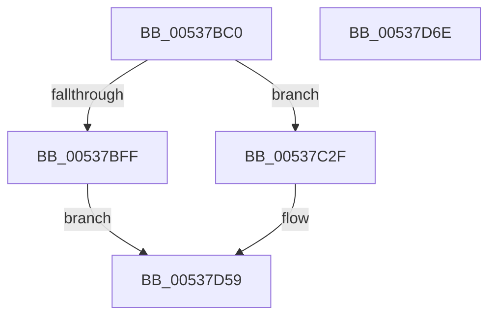

# SymCryptShortWeierstrassAdd

- RVA: `0x00537BC0`–`0x00537D6F` (길이 `431` bytes)
- VA: `0x0000000140537BC0`
- 실행 섹션: `.text`
- PDB 이름 있음: `예`; PDB Function 태그: `아니요`
- unwind 정보 RVA: `0x000BD6A0`
- 디코드: `113`개 명령, `431/431` bytes 표시
- 미해석 바이트: `0` (있으면 어셈블리에 `.byte`로 보존)

> 이 문서는 커널 이미지의 기계어와 PDB 기호를 분석해 생성했습니다. 4번과 5번은 함수 원형과 자료형을 바이너리 사용 방식에서 추정한 C 해석이며 원본 소스 복구 결과는 아닙니다.

## 1. Dependencies

- 직접 호출 지점: **13**; 고유 호출 대상: **9**
- 직접 호출자로 확인된 함수: **0**
- RIP 상대 이미지 참조: **0**

### Outgoing calls
- `0x00537BEE` → [SymCryptSizeofEcpointFromCurve](../52/SymCryptSizeofEcpointFromCurve_function_0052CEF0.md) (function, `0x0052CEF0`)
- `0x00537C25` → [SymCryptShortWeierstrassAddSideChannelUnsafe](SymCryptShortWeierstrassAddSideChannelUnsafe_function_00538188.md) (function, `0x00538188`)
- `0x00537C40` → [SymCryptEcpointCreate](../52/SymCryptEcpointCreate_function_0052C5A0.md) (function, `0x0052C5A0`)
- `0x00537C54` → [SymCryptEcpointCreate](../52/SymCryptEcpointCreate_function_0052C5A0.md) (function, `0x0052C5A0`)
- `0x00537C86` → [SymCryptModElementIsZero](../52/SymCryptModElementIsZero_function_00525964.md) (function, `0x00525964`)
- `0x00537CA1` → [SymCryptModElementIsZero](../52/SymCryptModElementIsZero_function_00525964.md) (function, `0x00525964`)
- `0x00537CC6` → [SymCryptShortWeierstrassIsEqual](SymCryptShortWeierstrassIsEqual_function_005390D0.md) (function, `0x005390D0`)
- `0x00537CEA` → [SymCryptShortWeierstrassAddDiffNonZero](SymCryptShortWeierstrassAddDiffNonZero_function_00537D80.md) (function, `0x00537D80`)
- `0x00537D07` → [SymCryptEcpointDouble](../52/SymCryptEcpointDouble_function_0052CFA8.md) (function, `0x0052CFA8`)
- `0x00537D18` → [SymCryptEcpointMaskedCopy](../52/SymCryptEcpointMaskedCopy_function_0052C7A8.md) (function, `0x0052C7A8`)
- `0x00537D2B` → [SymCryptEcpointMaskedCopy](../52/SymCryptEcpointMaskedCopy_function_0052C7A8.md) (function, `0x0052C7A8`)
- `0x00537D41` → [SymCryptEcpointMaskedCopy](../52/SymCryptEcpointMaskedCopy_function_0052C7A8.md) (function, `0x0052C7A8`)
- `0x00537D54` → [SymCryptEcpointCopy](../52/SymCryptEcpointCopy_function_0052C564.md) (function, `0x0052C564`)

### Direct callers
- 이 함수 시작 RVA로 연결되는 직접 call은 확인되지 않았습니다. 간접 호출은 완전히 역산할 수 없습니다.

### Static image references
- 디코드된 RIP-relative 메모리 참조가 없습니다.

## 2. Other-region calls and transfers

- 다른 실행 섹션으로 향하는 call: **0**
- 별도 외부 분기/꼬리 이동을 확인하지 못했습니다.

## 3. Assembly (complete function range)

```asm
00537BC0  48 8B C4                        mov rax, rsp
00537BC3  48 89 58 08                     mov qword ptr [rax + 8], rbx
00537BC7  4C 89 48 20                     mov qword ptr [rax + 0x20], r9
00537BCB  4C 89 40 18                     mov qword ptr [rax + 0x18], r8
00537BCF  48 89 50 10                     mov qword ptr [rax + 0x10], rdx
00537BD3  55                              push rbp
00537BD4  56                              push rsi
00537BD5  57                              push rdi
00537BD6  41 54                           push r12
00537BD8  41 55                           push r13
00537BDA  41 56                           push r14
00537BDC  41 57                           push r15
00537BDE  48 83 EC 30                     sub rsp, 0x30
00537BE2  49 8B F1                        mov rsi, r9
00537BE5  49 8B F8                        mov rdi, r8
00537BE8  48 8B DA                        mov rbx, rdx
00537BEB  4C 8B E9                        mov r13, rcx
00537BEE  E8 FD 52 FF FF                  call 0x14052cef0
00537BF3  F6 84 24 90 00 00 00 01         test byte ptr [rsp + 0x90], 1
00537BFB  8B E8                           mov ebp, eax
00537BFD  74 30                           je 0x140537c2f
00537BFF  48 8B 84 24 A0 00 00 00         mov rax, qword ptr [rsp + 0xa0]
00537C07  4C 8B CE                        mov r9, rsi
00537C0A  48 89 44 24 28                  mov qword ptr [rsp + 0x28], rax
00537C0F  4C 8B C7                        mov r8, rdi
00537C12  48 8B 84 24 98 00 00 00         mov rax, qword ptr [rsp + 0x98]
00537C1A  48 8B D3                        mov rdx, rbx
00537C1D  49 8B CD                        mov rcx, r13
00537C20  48 89 44 24 20                  mov qword ptr [rsp + 0x20], rax
00537C25  E8 5E 05 00 00                  call 0x140538188
00537C2A  E9 2A 01 00 00                  jmp 0x140537d59
00537C2F  4C 8B BC 24 98 00 00 00         mov r15, qword ptr [rsp + 0x98]
00537C37  4D 8B C5                        mov r8, r13
00537C3A  49 8B CF                        mov rcx, r15
00537C3D  48 8B D5                        mov rdx, rbp
00537C40  E8 5B 49 FF FF                  call 0x14052c5a0
00537C45  4C 03 FD                        add r15, rbp
00537C48  4D 8B C5                        mov r8, r13
00537C4B  49 8B CF                        mov rcx, r15
00537C4E  48 8B D5                        mov rdx, rbp
00537C51  4C 8B E0                        mov r12, rax
00537C54  E8 47 49 FF FF                  call 0x14052c5a0
00537C59  41 8B 55 24                     mov edx, dword ptr [r13 + 0x24]
00537C5D  48 8D 0C 6D 00 00 00 00         lea rcx, [rbp*2]
00537C65  48 8B B4 24 A0 00 00 00         mov rsi, qword ptr [rsp + 0xa0]
00537C6D  03 D2                           add edx, edx
00537C6F  48 83 C2 20                     add rdx, 0x20
00537C73  48 2B F1                        sub rsi, rcx
00537C76  49 8B 8D 68 02 00 00            mov rcx, qword ptr [r13 + 0x268]
00537C7D  48 03 D3                        add rdx, rbx
00537C80  4C 8B F0                        mov r14, rax
00537C83  4C 03 FD                        add r15, rbp
00537C86  E8 D9 DC FE FF                  call 0x140525964
00537C8B  41 8B 55 24                     mov edx, dword ptr [r13 + 0x24]
00537C8F  8B E8                           mov ebp, eax
00537C91  49 8B 8D 68 02 00 00            mov rcx, qword ptr [r13 + 0x268]
00537C98  03 D2                           add edx, edx
00537C9A  48 83 C2 20                     add rdx, 0x20
00537C9E  48 03 D7                        add rdx, rdi
00537CA1  E8 BE DC FE FF                  call 0x140525964
00537CA6  4C 8B 84 24 80 00 00 00         mov r8, qword ptr [rsp + 0x80]
00537CAE  41 B9 01 00 00 00               mov r9d, 1
00537CB4  48 8B D3                        mov rdx, rbx
00537CB7  48 89 74 24 28                  mov qword ptr [rsp + 0x28], rsi
00537CBC  49 8B CD                        mov rcx, r13
00537CBF  4C 89 7C 24 20                  mov qword ptr [rsp + 0x20], r15
00537CC4  8B F8                           mov edi, eax
00537CC6  E8 05 14 00 00                  call 0x1405390d0
00537CCB  4C 8B 84 24 80 00 00 00         mov r8, qword ptr [rsp + 0x80]
00537CD3  4D 8B CC                        mov r9, r12
00537CD6  48 8B 54 24 78                  mov rdx, qword ptr [rsp + 0x78]
00537CDB  49 8B CD                        mov rcx, r13
00537CDE  48 89 74 24 28                  mov qword ptr [rsp + 0x28], rsi
00537CE3  8B D8                           mov ebx, eax
00537CE5  4C 89 7C 24 20                  mov qword ptr [rsp + 0x20], r15
00537CEA  E8 91 00 00 00                  call 0x140537d80
00537CEF  48 8B 54 24 78                  mov rdx, qword ptr [rsp + 0x78]
00537CF4  45 33 C9                        xor r9d, r9d
00537CF7  4D 8B C6                        mov r8, r14
00537CFA  48 89 74 24 28                  mov qword ptr [rsp + 0x28], rsi
00537CFF  49 8B CD                        mov rcx, r13
00537D02  4C 89 7C 24 20                  mov qword ptr [rsp + 0x20], r15
00537D07  E8 9C 52 FF FF                  call 0x14052cfa8
00537D0C  44 8B CB                        mov r9d, ebx
00537D0F  4D 8B C4                        mov r8, r12
00537D12  49 8B D6                        mov rdx, r14
00537D15  49 8B CD                        mov rcx, r13
00537D18  E8 8B 4A FF FF                  call 0x14052c7a8
00537D1D  48 8B 54 24 78                  mov rdx, qword ptr [rsp + 0x78]
00537D22  44 8B CF                        mov r9d, edi
00537D25  4D 8B C4                        mov r8, r12
00537D28  49 8B CD                        mov rcx, r13
00537D2B  E8 78 4A FF FF                  call 0x14052c7a8
00537D30  48 8B 94 24 80 00 00 00         mov rdx, qword ptr [rsp + 0x80]
00537D38  44 8B CD                        mov r9d, ebp
00537D3B  4D 8B C4                        mov r8, r12
00537D3E  49 8B CD                        mov rcx, r13
00537D41  E8 62 4A FF FF                  call 0x14052c7a8
00537D46  4C 8B 84 24 88 00 00 00         mov r8, qword ptr [rsp + 0x88]
00537D4E  49 8B D4                        mov rdx, r12
00537D51  49 8B CD                        mov rcx, r13
00537D54  E8 0B 48 FF FF                  call 0x14052c564
00537D59  48 8B 5C 24 70                  mov rbx, qword ptr [rsp + 0x70]
00537D5E  48 83 C4 30                     add rsp, 0x30
00537D62  41 5F                           pop r15
00537D64  41 5E                           pop r14
00537D66  41 5D                           pop r13
00537D68  41 5C                           pop r12
00537D6A  5F                              pop rdi
00537D6B  5E                              pop rsi
00537D6C  5D                              pop rbp
00537D6D  C3                              ret
00537D6E  CC                              int3
```

## 4. C-style interpretation (structured pseudocode)

```c
__int64 __fastcall SymCryptShortWeierstrassAdd(__int64 a1, __int64 a2, __int64 a3, __int64 a4, unsigned __int8 a5, __int64 a6, __int64 a7)
{
    __int64 result;
    __int64 v_r15;
    __int64 v_rsi;
    __int64 v_rsp;
    unsigned __int64 v_stack_m40;
    unsigned __int64 v_stack_m48;
    unsigned __int64 v_stack_p10;
    unsigned __int64 v_stack_p18;
    unsigned __int64 v_stack_p20;
    unsigned __int64 v_stack_p8;

    *(unsigned __int64 *)(v_rsp + 8) = v_rbx;
    *(unsigned __int64 *)(v_rsp + 32) = a4;
    *(unsigned __int64 *)(v_rsp + 24) = a3;
    *(unsigned __int64 *)(v_rsp + 16) = a2;
    v_rsp = (v_rsp) - (48);
    result = SymCryptSizeofEcpointFromCurve(a1, a2, a3, a4);
    if (((a5) & (1)) == 0) goto loc_00537C2F;
    v_stack_m40 = a7;
    v_stack_m48 = a6;
    result = SymCryptShortWeierstrassAddSideChannelUnsafe(a1, a2, a3, a4);
    goto loc_00537D59;
loc_00537C2F:
    result = SymCryptEcpointCreate(a6, (unsigned int)((unsigned int)(result)), a1, a4);
    v_r15 = (a6) + ((unsigned int)((unsigned int)(result)));
    result = SymCryptEcpointCreate(v_r15, (unsigned int)((unsigned int)(result)), a1, a4);
    a2 = (unsigned int)(((unsigned int)(*(unsigned int *)(a1 + 36))) + ((unsigned int)((unsigned int)(*(unsigned int *)(a1 + 36)))));
    a2 = (a2) + (32);
    v_rsi = (a7) - ((unsigned int)((unsigned int)(result)) * 2);
    a2 = (a2) + (a2);
    v_r15 = (v_r15) + ((unsigned int)((unsigned int)(result)));
    result = SymCryptModElementIsZero(*(unsigned __int64 *)(a1 + 616), a2, a1, a4);
    a2 = (unsigned int)(((unsigned int)(*(unsigned int *)(a1 + 36))) + ((unsigned int)((unsigned int)(*(unsigned int *)(a1 + 36)))));
    a2 = (a2) + (32);
    a2 = (a2) + (a3);
    result = SymCryptModElementIsZero(*(unsigned __int64 *)(a1 + 616), a2, a1, a4);
    v_stack_m40 = v_rsi;
    v_stack_m48 = v_r15;
    result = SymCryptShortWeierstrassIsEqual(a1, a2, v_stack_p18, 1);
    v_stack_m40 = v_rsi;
    v_stack_m48 = v_r15;
    result = SymCryptShortWeierstrassAddDiffNonZero(a1, v_stack_p10, v_stack_p18, result);
    a4 = 0;
    v_stack_m40 = v_rsi;
    v_stack_m48 = v_r15;
    result = SymCryptEcpointDouble(a1, v_stack_p10, result, a4);
    result = SymCryptEcpointMaskedCopy(a1, result, result, (unsigned int)((unsigned int)((unsigned int)((unsigned int)(result)))));
    result = SymCryptEcpointMaskedCopy(a1, v_stack_p10, result, (unsigned int)((unsigned int)((unsigned int)((unsigned int)(result)))));
    result = SymCryptEcpointMaskedCopy(a1, v_stack_p18, result, (unsigned int)((unsigned int)((unsigned int)((unsigned int)(result)))));
    result = SymCryptEcpointCopy(a1, result, v_stack_p20, (unsigned int)((unsigned int)((unsigned int)((unsigned int)(result)))));
loc_00537D59:
    v_rsp = (v_rsp) + (48);
    return result;
}
```

## 5. (Beta) C Style

```c
int64_t SymCryptShortWeierstrassAdd(void *Arg1, int64_t Arg2, int64_t Arg3, int64_t Arg4, uint8_t Arg5, int64_t Arg6, int64_t Arg7)
{
    uint8_t *arg1 = (uint8_t *)Arg1;

    int64_t result;
    int64_t local_r15;
    int64_t local_rsi;
    int64_t local_rsp;
    uint64_t v_stack_m40;
    uint64_t v_stack_m48;
    uint64_t v_stack_p10;
    uint64_t v_stack_p18;
    uint64_t v_stack_p20;
    uint64_t v_stack_p8;

    *(uint64_t *)(local_rsp + 0x8) = local_rbx;
    *(uint64_t *)(local_rsp + 0x20) = Arg4;
    *(uint64_t *)(local_rsp + 0x18) = Arg3;
    *(uint64_t *)(local_rsp + 0x10) = Arg2;
    local_rsp = (local_rsp) - (48);
    result = SymCryptSizeofEcpointFromCurve(Arg1, Arg2, Arg3, Arg4);
    if (((Arg5) & (1)) == 0) goto loc_00537C2F;
    v_stack_m40 = Arg7;
    v_stack_m48 = Arg6;
    result = SymCryptShortWeierstrassAddSideChannelUnsafe(Arg1, Arg2, Arg3, Arg4);
    goto loc_00537D59;
loc_00537C2F:
    result = SymCryptEcpointCreate(Arg6, (uint32_t)((uint32_t)(result)), Arg1, Arg4);
    local_r15 = (Arg6) + ((uint32_t)((uint32_t)(result)));
    result = SymCryptEcpointCreate(local_r15, (uint32_t)((uint32_t)(result)), Arg1, Arg4);
    Arg2 = (uint32_t)(((uint32_t)(*(uint32_t *)(arg1 + 0x24))) + ((uint32_t)((uint32_t)(*(uint32_t *)(arg1 + 0x24)))));
    Arg2 = (Arg2) + (32);
    local_rsi = (Arg7) - ((uint32_t)((uint32_t)(result)) * 2);
    Arg2 = (Arg2) + (Arg2);
    local_r15 = (local_r15) + ((uint32_t)((uint32_t)(result)));
    result = SymCryptModElementIsZero(*(uint64_t *)(arg1 + 0x268), Arg2, Arg1, Arg4);
    Arg2 = (uint32_t)(((uint32_t)(*(uint32_t *)(arg1 + 0x24))) + ((uint32_t)((uint32_t)(*(uint32_t *)(arg1 + 0x24)))));
    Arg2 = (Arg2) + (32);
    Arg2 = (Arg2) + (Arg3);
    result = SymCryptModElementIsZero(*(uint64_t *)(arg1 + 0x268), Arg2, Arg1, Arg4);
    v_stack_m40 = local_rsi;
    v_stack_m48 = local_r15;
    result = SymCryptShortWeierstrassIsEqual(Arg1, Arg2, v_stack_p18, 1);
    v_stack_m40 = local_rsi;
    v_stack_m48 = local_r15;
    result = SymCryptShortWeierstrassAddDiffNonZero(Arg1, v_stack_p10, v_stack_p18, result);
    Arg4 = 0;
    v_stack_m40 = local_rsi;
    v_stack_m48 = local_r15;
    result = SymCryptEcpointDouble(Arg1, v_stack_p10, result, Arg4);
    result = SymCryptEcpointMaskedCopy(Arg1, result, result, (uint32_t)((uint32_t)((uint32_t)((uint32_t)(result)))));
    result = SymCryptEcpointMaskedCopy(Arg1, v_stack_p10, result, (uint32_t)((uint32_t)((uint32_t)((uint32_t)(result)))));
    result = SymCryptEcpointMaskedCopy(Arg1, v_stack_p18, result, (uint32_t)((uint32_t)((uint32_t)((uint32_t)(result)))));
    result = SymCryptEcpointCopy(Arg1, result, v_stack_p20, (uint32_t)((uint32_t)((uint32_t)((uint32_t)(result)))));
loc_00537D59:
    local_rsp = (local_rsp) + (48);
    return result;
}
```

### 관측된 메모리 오프셋

구조체 형식이 확인되지 않은 접근은 인자 기준의 오프셋으로만 기록했습니다.

| 기준 인자 | 오프셋 표현 | 폭 (bit) | 접근 |
|---|---:|---:|---|
| `Arg1` | `+ 0x24` | `32` | `R` |
| `Arg1` | `+ 0x268` | `64` | `R` |

## 6. Execution-region graph

[열기: 2D/3D 그래프와 함수 탐색 컨트롤 패널](../../../control-panel.html?section=text&rva=0x00537BC0&view=graph)

- 2D 그래프는 위에서 아래로 흐르고, 3D 그래프는 빈 공간을 드래그해 회전합니다. Shift+드래그는 이동, 휠은 확대·축소, 함수 노드 선택은 대상 보고서 이동입니다.

### Static fallback


