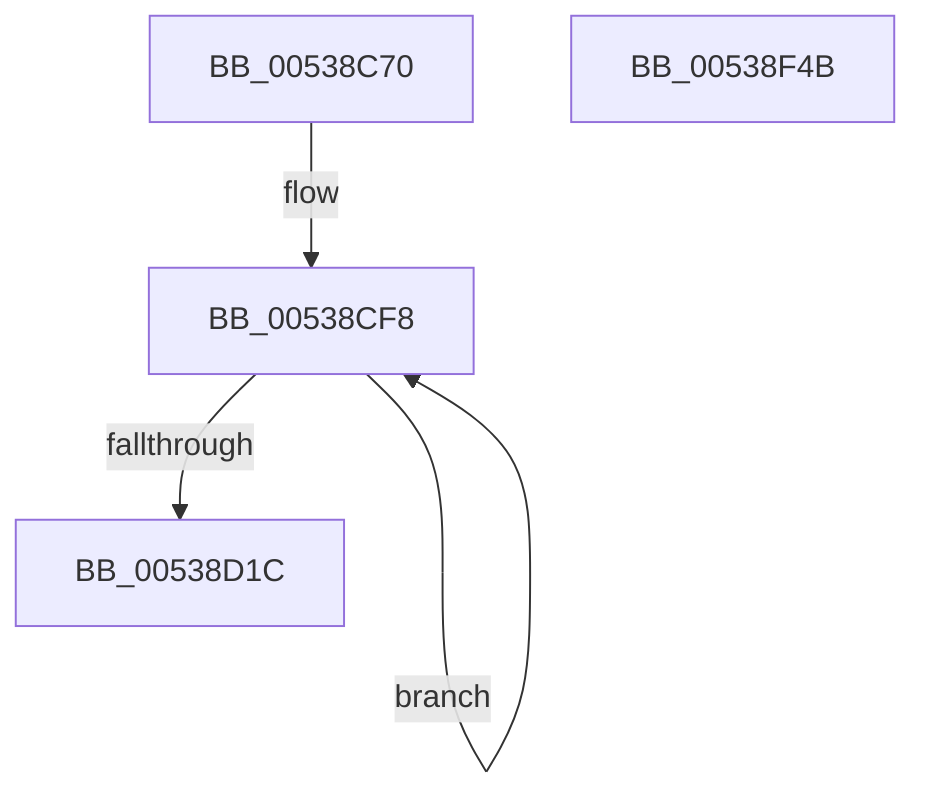

# SymCryptShortWeierstrassDoubleSpecializedAm3

- RVA: `0x00538C70`–`0x00538F4C` (길이 `732` bytes)
- VA: `0x0000000140538C70`
- 실행 섹션: `.text`
- PDB 이름 있음: `예`; PDB Function 태그: `아니요`
- unwind 정보 RVA: `0x000C35D8`
- 디코드: `191`개 명령, `732/732` bytes 표시
- 미해석 바이트: `0` (있으면 어셈블리에 `.byte`로 보존)

> 이 문서는 커널 이미지의 기계어와 PDB 기호를 분석해 생성했습니다. 4번과 5번은 함수 원형과 자료형을 바이너리 사용 방식에서 추정한 C 해석이며 원본 소스 복구 결과는 아닙니다.

## 1. Dependencies

- 직접 호출 지점: **20**; 고유 호출 대상: **6**
- 직접 호출자로 확인된 함수: **0**
- RIP 상대 이미지 참조: **1**

### Outgoing calls
- `0x00538D01` → [SymCryptModElementCreate](../52/SymCryptModElementCreate_function_00525900.md) (function, `0x00525900`)
- `0x00538D4A` → [SymCryptModAdd](../52/SymCryptModAdd_function_00525868.md) (function, `0x00525868`)
- `0x00538D67` → [SymCryptModSquare](../52/SymCryptModSquare_function_00525C84.md) (function, `0x00525C84`)
- `0x00538D82` → [SymCryptModMul](../52/SymCryptModMul_function_00525BA8.md) (function, `0x00525BA8`)
- `0x00538DA1` → [SymCryptModMul](../52/SymCryptModMul_function_00525BA8.md) (function, `0x00525BA8`)
- `0x00538DBC` → [SymCryptModAdd](../52/SymCryptModAdd_function_00525868.md) (function, `0x00525868`)
- `0x00538DDE` → [SymCryptModAdd](../52/SymCryptModAdd_function_00525868.md) (function, `0x00525868`)
- `0x00538DF9` → [SymCryptModMul](../52/SymCryptModMul_function_00525BA8.md) (function, `0x00525BA8`)
- `0x00538E16` → [SymCryptModSub](../52/SymCryptModSub_function_00525CB8.md) (function, `0x00525CB8`)
- `0x00538E33` → [SymCryptModMul](../52/SymCryptModMul_function_00525BA8.md) (function, `0x00525BA8`)
- `0x00538E4E` → [SymCryptModMul](../52/SymCryptModMul_function_00525BA8.md) (function, `0x00525BA8`)
- `0x00538E69` → [SymCryptModAdd](../52/SymCryptModAdd_function_00525868.md) (function, `0x00525868`)
- `0x00538E84` → [SymCryptModAdd](../52/SymCryptModAdd_function_00525868.md) (function, `0x00525868`)
- `0x00538E9F` → [SymCryptModAdd](../52/SymCryptModAdd_function_00525868.md) (function, `0x00525868`)
- `0x00538EB5` → [SymCryptModSquare](../52/SymCryptModSquare_function_00525C84.md) (function, `0x00525C84`)
- `0x00538ED0` → [SymCryptModSub](../52/SymCryptModSub_function_00525CB8.md) (function, `0x00525CB8`)
- `0x00538EEB` → [SymCryptModSub](../52/SymCryptModSub_function_00525CB8.md) (function, `0x00525CB8`)
- `0x00538F06` → [SymCryptModMul](../52/SymCryptModMul_function_00525BA8.md) (function, `0x00525BA8`)
- `0x00538F21` → [SymCryptModSub](../52/SymCryptModSub_function_00525CB8.md) (function, `0x00525CB8`)
- `0x00538F2E` → [_security_check_cookie](../6A/_security_check_cookie_function_006AC640.md) (function, `0x006AC640`)

### Direct callers
- 이 함수 시작 RVA로 연결되는 직접 call은 확인되지 않았습니다. 간접 호출은 완전히 역산할 수 없습니다.

### Static image references
- `0x00538C84` → RVA `0x00E0A740` (`.data`; read)

## 2. Other-region calls and transfers

- 다른 실행 섹션으로 향하는 call: **0**
- 별도 외부 분기/꼬리 이동을 확인하지 못했습니다.

## 3. Assembly (complete function range)

```asm
00538C70  48 89 5C 24 20                  mov qword ptr [rsp + 0x20], rbx
00538C75  55                              push rbp
00538C76  56                              push rsi
00538C77  57                              push rdi
00538C78  41 54                           push r12
00538C7A  41 55                           push r13
00538C7C  41 56                           push r14
00538C7E  41 57                           push r15
00538C80  48 83 EC 70                     sub rsp, 0x70
00538C84  48 8B 05 B5 1A 8D 00            mov rax, qword ptr [rip + 0x8d1ab5]
00538C8B  48 33 C4                        xor rax, rsp
00538C8E  48 89 44 24 68                  mov qword ptr [rsp + 0x68], rax
00538C93  44 8B 49 24                     mov r9d, dword ptr [rcx + 0x24]
00538C97  48 8D 42 20                     lea rax, [rdx + 0x20]
00538C9B  4C 8B B9 68 02 00 00            mov r15, qword ptr [rcx + 0x268]
00538CA2  4D 8D 60 20                     lea r12, [r8 + 0x20]
00538CA6  4C 8B B4 24 D0 00 00 00         mov r14, qword ptr [rsp + 0xd0]
00538CAE  4D 8D 68 20                     lea r13, [r8 + 0x20]
00538CB2  48 89 44 24 30                  mov qword ptr [rsp + 0x30], rax
00538CB7  48 8D 5C 24 50                  lea rbx, [rsp + 0x50]
00538CBC  48 8D 42 20                     lea rax, [rdx + 0x20]
00538CC0  48 8B F9                        mov rdi, rcx
00538CC3  49 03 C1                        add rax, r9
00538CC6  43 8D 0C 09                     lea ecx, [r9 + r9]
00538CCA  48 89 44 24 40                  mov qword ptr [rsp + 0x40], rax
00538CCF  4D 03 E1                        add r12, r9
00538CD2  48 8D 42 20                     lea rax, [rdx + 0x20]
00538CD6  0F 57 C0                        xorps xmm0, xmm0
00538CD9  48 03 C1                        add rax, rcx
00538CDC  BE 03 00 00 00                  mov esi, 3
00538CE1  48 89 44 24 38                  mov qword ptr [rsp + 0x38], rax
00538CE6  49 8D 40 20                     lea rax, [r8 + 0x20]
00538CEA  48 03 C1                        add rax, rcx
00538CED  48 89 44 24 48                  mov qword ptr [rsp + 0x48], rax
00538CF2  F3 0F 7F 44 24 58               movdqu xmmword ptr [rsp + 0x58], xmm0
00538CF8  41 8B D1                        mov edx, r9d
00538CFB  4D 8B C7                        mov r8, r15
00538CFE  49 8B CE                        mov rcx, r14
00538D01  E8 FA CB FE FF                  call 0x140525900
00538D06  48 89 03                        mov qword ptr [rbx], rax
00538D09  48 8D 5B 08                     lea rbx, [rbx + 8]
00538D0D  8B 47 24                        mov eax, dword ptr [rdi + 0x24]
00538D10  4C 03 F0                        add r14, rax
00538D13  44 8B C8                        mov r9d, eax
00538D16  48 83 EE 01                     sub rsi, 1
00538D1A  75 DC                           jne 0x140538cf8
00538D1C  48 8B 5C 24 40                  mov rbx, qword ptr [rsp + 0x40]
00538D21  8D 0C 40                        lea ecx, [rax + rax*2]
00538D24  48 8B B4 24 D8 00 00 00         mov rsi, qword ptr [rsp + 0xd8]
00538D2C  4C 8B C3                        mov r8, rbx
00538D2F  48 8B 6C 24 50                  mov rbp, qword ptr [rsp + 0x50]
00538D34  48 2B F1                        sub rsi, rcx
00538D37  48 89 74 24 28                  mov qword ptr [rsp + 0x28], rsi
00538D3C  4C 8B CD                        mov r9, rbp
00538D3F  48 8B D3                        mov rdx, rbx
00538D42  4C 89 74 24 20                  mov qword ptr [rsp + 0x20], r14
00538D47  49 8B CF                        mov rcx, r15
00538D4A  E8 19 CB FE FF                  call 0x140525868
00538D4F  48 8B 7C 24 58                  mov rdi, qword ptr [rsp + 0x58]
00538D54  4D 8B CE                        mov r9, r14
00538D57  48 8B 54 24 38                  mov rdx, qword ptr [rsp + 0x38]
00538D5C  4C 8B C7                        mov r8, rdi
00538D5F  49 8B CF                        mov rcx, r15
00538D62  48 89 74 24 20                  mov qword ptr [rsp + 0x20], rsi
00538D67  E8 18 CF FE FF                  call 0x140525c84
00538D6C  4D 8B CC                        mov r9, r12
00538D6F  48 89 74 24 28                  mov qword ptr [rsp + 0x28], rsi
00538D74  4C 8B C5                        mov r8, rbp
00538D77  4C 89 74 24 20                  mov qword ptr [rsp + 0x20], r14
00538D7C  48 8B D3                        mov rdx, rbx
00538D7F  49 8B CF                        mov rcx, r15
00538D82  E8 21 CE FE FF                  call 0x140525ba8
00538D87  4C 8B 4C 24 48                  mov r9, qword ptr [rsp + 0x48]
00538D8C  48 8B D5                        mov rdx, rbp
00538D8F  4C 8B 44 24 38                  mov r8, qword ptr [rsp + 0x38]
00538D94  49 8B CF                        mov rcx, r15
00538D97  48 89 74 24 28                  mov qword ptr [rsp + 0x28], rsi
00538D9C  4C 89 74 24 20                  mov qword ptr [rsp + 0x20], r14
00538DA1  E8 02 CE FE FF                  call 0x140525ba8
00538DA6  4C 8B CD                        mov r9, rbp
00538DA9  48 89 74 24 28                  mov qword ptr [rsp + 0x28], rsi
00538DAE  4D 8B C4                        mov r8, r12
00538DB1  4C 89 74 24 20                  mov qword ptr [rsp + 0x20], r14
00538DB6  49 8B D4                        mov rdx, r12
00538DB9  49 8B CF                        mov rcx, r15
00538DBC  E8 A7 CA FE FF                  call 0x140525868
00538DC1  48 8B 5C 24 60                  mov rbx, qword ptr [rsp + 0x60]
00538DC6  4C 8B C7                        mov r8, rdi
00538DC9  48 8B 54 24 30                  mov rdx, qword ptr [rsp + 0x30]
00538DCE  4C 8B CB                        mov r9, rbx
00538DD1  48 89 74 24 28                  mov qword ptr [rsp + 0x28], rsi
00538DD6  49 8B CF                        mov rcx, r15
00538DD9  4C 89 74 24 20                  mov qword ptr [rsp + 0x20], r14
00538DDE  E8 85 CA FE FF                  call 0x140525868
00538DE3  4D 8B CC                        mov r9, r12
00538DE6  48 89 74 24 28                  mov qword ptr [rsp + 0x28], rsi
00538DEB  4D 8B C4                        mov r8, r12
00538DEE  4C 89 74 24 20                  mov qword ptr [rsp + 0x20], r14
00538DF3  48 8B D5                        mov rdx, rbp
00538DF6  49 8B CF                        mov rcx, r15
00538DF9  E8 AA CD FE FF                  call 0x140525ba8
00538DFE  48 8B 54 24 30                  mov rdx, qword ptr [rsp + 0x30]
00538E03  4C 8B CF                        mov r9, rdi
00538E06  4C 8B C7                        mov r8, rdi
00538E09  48 89 74 24 28                  mov qword ptr [rsp + 0x28], rsi
00538E0E  49 8B CF                        mov rcx, r15
00538E11  4C 89 74 24 20                  mov qword ptr [rsp + 0x20], r14
00538E16  E8 9D CE FE FF                  call 0x140525cb8
00538E1B  4C 8B 44 24 30                  mov r8, qword ptr [rsp + 0x30]
00538E20  4C 8B CD                        mov r9, rbp
00538E23  48 8B D5                        mov rdx, rbp
00538E26  48 89 74 24 28                  mov qword ptr [rsp + 0x28], rsi
00538E2B  49 8B CF                        mov rcx, r15
00538E2E  4C 89 74 24 20                  mov qword ptr [rsp + 0x20], r14
00538E33  E8 70 CD FE FF                  call 0x140525ba8
00538E38  4C 8B CB                        mov r9, rbx
00538E3B  48 89 74 24 28                  mov qword ptr [rsp + 0x28], rsi
00538E40  4C 8B C7                        mov r8, rdi
00538E43  4C 89 74 24 20                  mov qword ptr [rsp + 0x20], r14
00538E48  48 8B D3                        mov rdx, rbx
00538E4B  49 8B CF                        mov rcx, r15
00538E4E  E8 55 CD FE FF                  call 0x140525ba8
00538E53  48 89 74 24 28                  mov qword ptr [rsp + 0x28], rsi
00538E58  4C 8B CF                        mov r9, rdi
00538E5B  4C 89 74 24 20                  mov qword ptr [rsp + 0x20], r14
00538E60  4C 8B C3                        mov r8, rbx
00538E63  48 8B D3                        mov rdx, rbx
00538E66  49 8B CF                        mov rcx, r15
00538E69  E8 FA C9 FE FF                  call 0x140525868
00538E6E  4D 8B CD                        mov r9, r13
00538E71  48 89 74 24 28                  mov qword ptr [rsp + 0x28], rsi
00538E76  4C 8B C5                        mov r8, rbp
00538E79  4C 89 74 24 20                  mov qword ptr [rsp + 0x20], r14
00538E7E  48 8B D5                        mov rdx, rbp
00538E81  49 8B CF                        mov rcx, r15
00538E84  E8 DF C9 FE FF                  call 0x140525868
00538E89  4C 8B CF                        mov r9, rdi
00538E8C  48 89 74 24 28                  mov qword ptr [rsp + 0x28], rsi
00538E91  4C 8B C3                        mov r8, rbx
00538E94  4C 89 74 24 20                  mov qword ptr [rsp + 0x20], r14
00538E99  48 8B D7                        mov rdx, rdi
00538E9C  49 8B CF                        mov rcx, r15
00538E9F  E8 C4 C9 FE FF                  call 0x140525868
00538EA4  4D 8B CE                        mov r9, r14
00538EA7  48 89 74 24 20                  mov qword ptr [rsp + 0x20], rsi
00538EAC  4C 8B C3                        mov r8, rbx
00538EAF  48 8B D7                        mov rdx, rdi
00538EB2  49 8B CF                        mov rcx, r15
00538EB5  E8 CA CD FE FF                  call 0x140525c84
00538EBA  4D 8B CD                        mov r9, r13
00538EBD  48 89 74 24 28                  mov qword ptr [rsp + 0x28], rsi
00538EC2  4D 8B C5                        mov r8, r13
00538EC5  4C 89 74 24 20                  mov qword ptr [rsp + 0x20], r14
00538ECA  48 8B D3                        mov rdx, rbx
00538ECD  49 8B CF                        mov rcx, r15
00538ED0  E8 E3 CD FE FF                  call 0x140525cb8
00538ED5  4C 8B CD                        mov r9, rbp
00538ED8  48 89 74 24 28                  mov qword ptr [rsp + 0x28], rsi
00538EDD  4D 8B C5                        mov r8, r13
00538EE0  4C 89 74 24 20                  mov qword ptr [rsp + 0x20], r14
00538EE5  48 8B D5                        mov rdx, rbp
00538EE8  49 8B CF                        mov rcx, r15
00538EEB  E8 C8 CD FE FF                  call 0x140525cb8
00538EF0  4C 8B CD                        mov r9, rbp
00538EF3  48 89 74 24 28                  mov qword ptr [rsp + 0x28], rsi
00538EF8  4C 8B C5                        mov r8, rbp
00538EFB  4C 89 74 24 20                  mov qword ptr [rsp + 0x20], r14
00538F00  48 8B D7                        mov rdx, rdi
00538F03  49 8B CF                        mov rcx, r15
00538F06  E8 9D CC FE FF                  call 0x140525ba8
00538F0B  4D 8B CC                        mov r9, r12
00538F0E  48 89 74 24 28                  mov qword ptr [rsp + 0x28], rsi
00538F13  4D 8B C4                        mov r8, r12
00538F16  4C 89 74 24 20                  mov qword ptr [rsp + 0x20], r14
00538F1B  48 8B D5                        mov rdx, rbp
00538F1E  49 8B CF                        mov rcx, r15
00538F21  E8 92 CD FE FF                  call 0x140525cb8
00538F26  48 8B 4C 24 68                  mov rcx, qword ptr [rsp + 0x68]
00538F2B  48 33 CC                        xor rcx, rsp
00538F2E  E8 0D 37 17 00                  call 0x1406ac640
00538F33  48 8B 9C 24 C8 00 00 00         mov rbx, qword ptr [rsp + 0xc8]
00538F3B  48 83 C4 70                     add rsp, 0x70
00538F3F  41 5F                           pop r15
00538F41  41 5E                           pop r14
00538F43  41 5D                           pop r13
00538F45  41 5C                           pop r12
00538F47  5F                              pop rdi
00538F48  5E                              pop rsi
00538F49  5D                              pop rbp
00538F4A  C3                              ret
00538F4B  CC                              int3
```

## 4. C-style interpretation (structured pseudocode)

```c
__int64 __fastcall SymCryptShortWeierstrassDoubleSpecializedAm3(__int64 a1, __int64 a2, __int64 a3, __int64 a4, __int64 a5, __int64 a6)
{
    __int64 result;
    __int64 v_r12;
    __int64 v_r14;
    __int64 v_rsi;
    __int64 v_rsp;
    unsigned __int64 v_stack_m40;
    unsigned __int64 v_stack_m48;
    unsigned __int64 v_stack_m50;
    unsigned __int64 v_stack_m58;
    unsigned __int64 v_stack_m60;
    unsigned __int64 v_stack_m68;
    unsigned __int64 v_stack_m70;
    unsigned __int64 v_stack_m78;
    unsigned __int64 v_stack_m80;
    unsigned __int64 v_stack_m88;
    unsigned __int64 v_stack_p20;

    v_stack_p20 = v_rbx;
    v_rsp = (v_rsp) - (112);
    result = (*(unsigned __int64 *)(v_rip + 9247413)) ^ (v_rsp);
    v_stack_m40 = result;
    v_stack_m78 = a2 + 32;
    result = (a2 + 32) + ((unsigned int)(*(unsigned int *)(a1 + 36)));
    v_stack_m68 = result;
    v_r12 = (a3 + 32) + ((unsigned int)(*(unsigned int *)(a1 + 36)));
    result = (a2 + 32) + ((unsigned int)(*(unsigned int *)(a1 + 36)) + (unsigned int)(*(unsigned int *)(a1 + 36)) * 1);
    v_stack_m70 = result;
    result = (a3 + 32) + ((unsigned int)(*(unsigned int *)(a1 + 36)) + (unsigned int)(*(unsigned int *)(a1 + 36)) * 1);
    v_stack_m60 = result;
    v_stack_m50 = v_xmm0;
loc_00538CF8:
    result = SymCryptModElementCreate(a5, (unsigned int)((unsigned int)((unsigned int)(*(unsigned int *)(a1 + 36)))), *(unsigned __int64 *)(a1 + 616), (unsigned int)(*(unsigned int *)(a1 + 36)));
    *(unsigned __int64 *)(v_stack_m58) = result;
    v_r14 = (a5) + ((unsigned int)(*(unsigned int *)(a1 + 36)));
    v_rsi = (3) - (1);
    if (condition_is_not_equal) goto loc_00538CF8;
    v_rsi = (a6) - ((unsigned int)(*(unsigned int *)(a1 + 36)) + (unsigned int)(*(unsigned int *)(a1 + 36)) * 2);
    v_stack_m80 = v_rsi;
    v_stack_m88 = v_r14;
    result = SymCryptModAdd(*(unsigned __int64 *)(a1 + 616), v_stack_m68, v_stack_m68, v_stack_m58);
    v_stack_m88 = v_rsi;
    result = SymCryptModSquare(*(unsigned __int64 *)(a1 + 616), v_stack_m70, v_stack_m50, v_r14);
    v_stack_m80 = v_rsi;
    v_stack_m88 = v_r14;
    result = SymCryptModMul(*(unsigned __int64 *)(a1 + 616), v_stack_m68, v_stack_m58, v_r12);
    v_stack_m80 = v_rsi;
    v_stack_m88 = v_r14;
    result = SymCryptModMul(*(unsigned __int64 *)(a1 + 616), v_stack_m58, v_stack_m70, v_stack_m60);
    v_stack_m80 = v_rsi;
    v_stack_m88 = v_r14;
    result = SymCryptModAdd(*(unsigned __int64 *)(a1 + 616), v_r12, v_r12, v_stack_m58);
    v_stack_m80 = v_rsi;
    v_stack_m88 = v_r14;
    result = SymCryptModAdd(*(unsigned __int64 *)(a1 + 616), v_stack_m78, v_stack_m50, v_stack_m48);
    v_stack_m80 = v_rsi;
    v_stack_m88 = v_r14;
    result = SymCryptModMul(*(unsigned __int64 *)(a1 + 616), v_stack_m58, v_r12, v_r12);
    v_stack_m80 = v_rsi;
    v_stack_m88 = v_r14;
    result = SymCryptModSub(*(unsigned __int64 *)(a1 + 616), v_stack_m78, v_stack_m50, v_stack_m50);
    v_stack_m80 = v_rsi;
    v_stack_m88 = v_r14;
    result = SymCryptModMul(*(unsigned __int64 *)(a1 + 616), v_stack_m58, v_stack_m78, v_stack_m58);
    v_stack_m80 = v_rsi;
    v_stack_m88 = v_r14;
    result = SymCryptModMul(*(unsigned __int64 *)(a1 + 616), v_stack_m48, v_stack_m50, v_stack_m48);
    v_stack_m80 = v_rsi;
    v_stack_m88 = v_r14;
    result = SymCryptModAdd(*(unsigned __int64 *)(a1 + 616), v_stack_m48, v_stack_m48, v_stack_m50);
    v_stack_m80 = v_rsi;
    v_stack_m88 = v_r14;
    result = SymCryptModAdd(*(unsigned __int64 *)(a1 + 616), v_stack_m58, v_stack_m58, a3 + 32);
    v_stack_m80 = v_rsi;
    v_stack_m88 = v_r14;
    result = SymCryptModAdd(*(unsigned __int64 *)(a1 + 616), v_stack_m50, v_stack_m48, v_stack_m50);
    v_stack_m88 = v_rsi;
    result = SymCryptModSquare(*(unsigned __int64 *)(a1 + 616), v_stack_m50, v_stack_m48, v_r14);
    v_stack_m80 = v_rsi;
    v_stack_m88 = v_r14;
    result = SymCryptModSub(*(unsigned __int64 *)(a1 + 616), v_stack_m48, a3 + 32, a3 + 32);
    v_stack_m80 = v_rsi;
    v_stack_m88 = v_r14;
    result = SymCryptModSub(*(unsigned __int64 *)(a1 + 616), v_stack_m58, a3 + 32, v_stack_m58);
    v_stack_m80 = v_rsi;
    v_stack_m88 = v_r14;
    result = SymCryptModMul(*(unsigned __int64 *)(a1 + 616), v_stack_m50, v_stack_m58, v_stack_m58);
    v_stack_m80 = v_rsi;
    v_stack_m88 = v_r14;
    result = SymCryptModSub(*(unsigned __int64 *)(a1 + 616), v_stack_m58, v_r12, v_r12);
    a1 = (v_stack_m40) ^ (v_rsp);
    result = _security_check_cookie(a1, v_stack_m58, v_r12, v_r12);
    v_rsp = (v_rsp) + (112);
    return result;
}
```

## 5. (Beta) C Style

```c
int64_t SymCryptShortWeierstrassDoubleSpecializedAm3(void *Arg1, void *Arg2, void *Arg3, int64_t Arg4, int64_t Arg5, int64_t Arg6)
{
    uint8_t *arg1 = (uint8_t *)Arg1;
    uint8_t *arg2 = (uint8_t *)Arg2;
    uint8_t *arg3 = (uint8_t *)Arg3;

    int64_t result;
    int64_t local_r12;
    int64_t local_r14;
    int64_t local_rsi;
    int64_t local_rsp;
    uint64_t v_stack_m40;
    uint64_t v_stack_m48;
    uint64_t v_stack_m50;
    uint64_t v_stack_m58;
    uint64_t v_stack_m60;
    uint64_t v_stack_m68;
    uint64_t v_stack_m70;
    uint64_t v_stack_m78;
    uint64_t v_stack_m80;
    uint64_t v_stack_m88;
    uint64_t v_stack_p20;

    v_stack_p20 = local_rbx;
    local_rsp = (local_rsp) - (112);
    result = (*(uint64_t *)(v_rip + 0x8D1AB5)) ^ (local_rsp);
    v_stack_m40 = result;
    v_stack_m78 = Arg2 + 32;
    result = (Arg2 + 32) + ((uint32_t)(*(uint32_t *)(arg1 + 0x24)));
    v_stack_m68 = result;
    local_r12 = (Arg3 + 32) + ((uint32_t)(*(uint32_t *)(arg1 + 0x24)));
    result = (Arg2 + 32) + ((uint32_t)(*(uint32_t *)(arg1 + 0x24)) + (uint32_t)(*(uint32_t *)(arg1 + 0x24)) * 1);
    v_stack_m70 = result;
    result = (Arg3 + 32) + ((uint32_t)(*(uint32_t *)(arg1 + 0x24)) + (uint32_t)(*(uint32_t *)(arg1 + 0x24)) * 1);
    v_stack_m60 = result;
    v_stack_m50 = v_xmm0;
loc_00538CF8:
    result = SymCryptModElementCreate(Arg5, (uint32_t)((uint32_t)((uint32_t)(*(uint32_t *)(arg1 + 0x24)))), *(uint64_t *)(arg1 + 0x268), (uint32_t)(*(uint32_t *)(arg1 + 0x24)));
    *(uint64_t *)(v_stack_m58) = result;
    local_r14 = (Arg5) + ((uint32_t)(*(uint32_t *)(arg1 + 0x24)));
    local_rsi = (3) - (1);
    if (condition_is_not_equal) goto loc_00538CF8;
    local_rsi = (Arg6) - ((uint32_t)(*(uint32_t *)(arg1 + 0x24)) + (uint32_t)(*(uint32_t *)(arg1 + 0x24)) * 2);
    v_stack_m80 = local_rsi;
    v_stack_m88 = local_r14;
    result = SymCryptModAdd(*(uint64_t *)(arg1 + 0x268), v_stack_m68, v_stack_m68, v_stack_m58);
    v_stack_m88 = local_rsi;
    result = SymCryptModSquare(*(uint64_t *)(arg1 + 0x268), v_stack_m70, v_stack_m50, local_r14);
    v_stack_m80 = local_rsi;
    v_stack_m88 = local_r14;
    result = SymCryptModMul(*(uint64_t *)(arg1 + 0x268), v_stack_m68, v_stack_m58, local_r12);
    v_stack_m80 = local_rsi;
    v_stack_m88 = local_r14;
    result = SymCryptModMul(*(uint64_t *)(arg1 + 0x268), v_stack_m58, v_stack_m70, v_stack_m60);
    v_stack_m80 = local_rsi;
    v_stack_m88 = local_r14;
    result = SymCryptModAdd(*(uint64_t *)(arg1 + 0x268), local_r12, local_r12, v_stack_m58);
    v_stack_m80 = local_rsi;
    v_stack_m88 = local_r14;
    result = SymCryptModAdd(*(uint64_t *)(arg1 + 0x268), v_stack_m78, v_stack_m50, v_stack_m48);
    v_stack_m80 = local_rsi;
    v_stack_m88 = local_r14;
    result = SymCryptModMul(*(uint64_t *)(arg1 + 0x268), v_stack_m58, local_r12, local_r12);
    v_stack_m80 = local_rsi;
    v_stack_m88 = local_r14;
    result = SymCryptModSub(*(uint64_t *)(arg1 + 0x268), v_stack_m78, v_stack_m50, v_stack_m50);
    v_stack_m80 = local_rsi;
    v_stack_m88 = local_r14;
    result = SymCryptModMul(*(uint64_t *)(arg1 + 0x268), v_stack_m58, v_stack_m78, v_stack_m58);
    v_stack_m80 = local_rsi;
    v_stack_m88 = local_r14;
    result = SymCryptModMul(*(uint64_t *)(arg1 + 0x268), v_stack_m48, v_stack_m50, v_stack_m48);
    v_stack_m80 = local_rsi;
    v_stack_m88 = local_r14;
    result = SymCryptModAdd(*(uint64_t *)(arg1 + 0x268), v_stack_m48, v_stack_m48, v_stack_m50);
    v_stack_m80 = local_rsi;
    v_stack_m88 = local_r14;
    result = SymCryptModAdd(*(uint64_t *)(arg1 + 0x268), v_stack_m58, v_stack_m58, Arg3 + 32);
    v_stack_m80 = local_rsi;
    v_stack_m88 = local_r14;
    result = SymCryptModAdd(*(uint64_t *)(arg1 + 0x268), v_stack_m50, v_stack_m48, v_stack_m50);
    v_stack_m88 = local_rsi;
    result = SymCryptModSquare(*(uint64_t *)(arg1 + 0x268), v_stack_m50, v_stack_m48, local_r14);
    v_stack_m80 = local_rsi;
    v_stack_m88 = local_r14;
    result = SymCryptModSub(*(uint64_t *)(arg1 + 0x268), v_stack_m48, Arg3 + 32, Arg3 + 32);
    v_stack_m80 = local_rsi;
    v_stack_m88 = local_r14;
    result = SymCryptModSub(*(uint64_t *)(arg1 + 0x268), v_stack_m58, Arg3 + 32, v_stack_m58);
    v_stack_m80 = local_rsi;
    v_stack_m88 = local_r14;
    result = SymCryptModMul(*(uint64_t *)(arg1 + 0x268), v_stack_m50, v_stack_m58, v_stack_m58);
    v_stack_m80 = local_rsi;
    v_stack_m88 = local_r14;
    result = SymCryptModSub(*(uint64_t *)(arg1 + 0x268), v_stack_m58, local_r12, local_r12);
    Arg1 = (v_stack_m40) ^ (local_rsp);
    result = _security_check_cookie(Arg1, v_stack_m58, local_r12, local_r12);
    local_rsp = (local_rsp) + (112);
    return result;
}
```

### 관측된 메모리 오프셋

구조체 형식이 확인되지 않은 접근은 인자 기준의 오프셋으로만 기록했습니다.

| 기준 인자 | 오프셋 표현 | 폭 (bit) | 접근 |
|---|---:|---:|---|
| `Arg1` | `+ 0x24` | `32` | `R` |
| `Arg1` | `+ 0x268` | `64` | `R` |
| `Arg2` | `+ 0x20` | `64` | `R` |
| `Arg3` | `+ 0x20` | `64` | `R` |

## 6. Execution-region graph

[열기: 2D/3D 그래프와 함수 탐색 컨트롤 패널](../../../control-panel.html?section=text&rva=0x00538C70&view=graph)

- 2D 그래프는 위에서 아래로 흐르고, 3D 그래프는 빈 공간을 드래그해 회전합니다. Shift+드래그는 이동, 휠은 확대·축소, 함수 노드 선택은 대상 보고서 이동입니다.

### Static fallback


