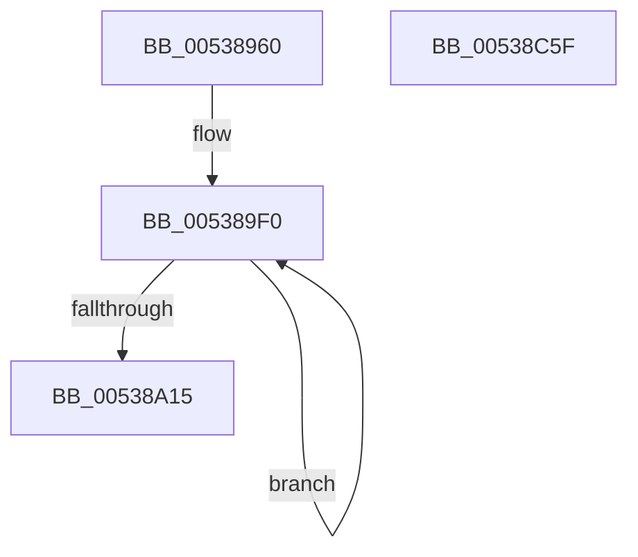

# SymCryptShortWeierstrassDouble

- RVA: `0x00538960`–`0x00538C60` (길이 `768` bytes)
- VA: `0x0000000140538960`
- 실행 섹션: `.text`
- PDB 이름 있음: `예`; PDB Function 태그: `아니요`
- unwind 정보 RVA: `0x000C5124`
- 디코드: `198`개 명령, `768/768` bytes 표시
- 미해석 바이트: `0` (있으면 어셈블리에 `.byte`로 보존)

> 이 문서는 커널 이미지의 기계어와 PDB 기호를 분석해 생성했습니다. 4번과 5번은 함수 원형과 자료형을 바이너리 사용 방식에서 추정한 C 해석이며 원본 소스 복구 결과는 아닙니다.

## 1. Dependencies

- 직접 호출 지점: **21**; 고유 호출 대상: **6**
- 직접 호출자로 확인된 함수: **0**
- RIP 상대 이미지 참조: **1**

### Outgoing calls
- `0x005389F9` → [SymCryptModElementCreate](../52/SymCryptModElementCreate_function_00525900.md) (function, `0x00525900`)
- `0x00538A43` → [SymCryptModAdd](../52/SymCryptModAdd_function_00525868.md) (function, `0x00525868`)
- `0x00538A60` → [SymCryptModSquare](../52/SymCryptModSquare_function_00525C84.md) (function, `0x00525C84`)
- `0x00538A7F` → [SymCryptModMul](../52/SymCryptModMul_function_00525BA8.md) (function, `0x00525BA8`)
- `0x00538A9A` → [SymCryptModMul](../52/SymCryptModMul_function_00525BA8.md) (function, `0x00525BA8`)
- `0x00538AB5` → [SymCryptModAdd](../52/SymCryptModAdd_function_00525868.md) (function, `0x00525868`)
- `0x00538AD0` → [SymCryptModMul](../52/SymCryptModMul_function_00525BA8.md) (function, `0x00525BA8`)
- `0x00538AED` → [SymCryptModMul](../52/SymCryptModMul_function_00525BA8.md) (function, `0x00525BA8`)
- `0x00538B03` → [SymCryptModSquare](../52/SymCryptModSquare_function_00525C84.md) (function, `0x00525C84`)
- `0x00538B20` → [SymCryptModSquare](../52/SymCryptModSquare_function_00525C84.md) (function, `0x00525C84`)
- `0x00538B3F` → [SymCryptModMul](../52/SymCryptModMul_function_00525BA8.md) (function, `0x00525BA8`)
- `0x00538B5A` → [SymCryptModAdd](../52/SymCryptModAdd_function_00525868.md) (function, `0x00525868`)
- `0x00538B75` → [SymCryptModAdd](../52/SymCryptModAdd_function_00525868.md) (function, `0x00525868`)
- `0x00538B95` → [SymCryptModAdd](../52/SymCryptModAdd_function_00525868.md) (function, `0x00525868`)
- `0x00538BB0` → [SymCryptModAdd](../52/SymCryptModAdd_function_00525868.md) (function, `0x00525868`)
- `0x00538BC6` → [SymCryptModSquare](../52/SymCryptModSquare_function_00525C84.md) (function, `0x00525C84`)
- `0x00538BE1` → [SymCryptModSub](../52/SymCryptModSub_function_00525CB8.md) (function, `0x00525CB8`)
- `0x00538BFC` → [SymCryptModSub](../52/SymCryptModSub_function_00525CB8.md) (function, `0x00525CB8`)
- `0x00538C17` → [SymCryptModMul](../52/SymCryptModMul_function_00525BA8.md) (function, `0x00525BA8`)
- `0x00538C32` → [SymCryptModSub](../52/SymCryptModSub_function_00525CB8.md) (function, `0x00525CB8`)
- `0x00538C3F` → [_security_check_cookie](../6A/_security_check_cookie_function_006AC640.md) (function, `0x006AC640`)

### Direct callers
- 이 함수 시작 RVA로 연결되는 직접 call은 확인되지 않았습니다. 간접 호출은 완전히 역산할 수 없습니다.

### Static image references
- `0x00538977` → RVA `0x00E0A740` (`.data`; read)

## 2. Other-region calls and transfers

- 다른 실행 섹션으로 향하는 call: **0**
- 별도 외부 분기/꼬리 이동을 확인하지 못했습니다.

## 3. Assembly (complete function range)

```asm
00538960  48 89 5C 24 20                  mov qword ptr [rsp + 0x20], rbx
00538965  55                              push rbp
00538966  56                              push rsi
00538967  57                              push rdi
00538968  41 54                           push r12
0053896A  41 55                           push r13
0053896C  41 56                           push r14
0053896E  41 57                           push r15
00538970  48 81 EC 80 00 00 00            sub rsp, 0x80
00538977  48 8B 05 C2 1D 8D 00            mov rax, qword ptr [rip + 0x8d1dc2]
0053897E  48 33 C4                        xor rax, rsp
00538981  48 89 44 24 70                  mov qword ptr [rsp + 0x70], rax
00538986  44 8B 49 24                     mov r9d, dword ptr [rcx + 0x24]
0053898A  48 8D 42 20                     lea rax, [rdx + 0x20]
0053898E  4C 8B A1 68 02 00 00            mov r12, qword ptr [rcx + 0x268]
00538995  4D 8D 68 20                     lea r13, [r8 + 0x20]
00538999  4C 8B B4 24 E0 00 00 00         mov r14, qword ptr [rsp + 0xe0]
005389A1  48 8D 5C 24 58                  lea rbx, [rsp + 0x58]
005389A6  48 89 44 24 38                  mov qword ptr [rsp + 0x38], rax
005389AB  4C 8B F9                        mov r15, rcx
005389AE  43 8D 0C 09                     lea ecx, [r9 + r9]
005389B2  4D 03 E9                        add r13, r9
005389B5  48 8D 42 20                     lea rax, [rdx + 0x20]
005389B9  0F 57 C0                        xorps xmm0, xmm0
005389BC  49 03 C1                        add rax, r9
005389BF  BF 03 00 00 00                  mov edi, 3
005389C4  48 89 44 24 40                  mov qword ptr [rsp + 0x40], rax
005389C9  48 8D 42 20                     lea rax, [rdx + 0x20]
005389CD  48 03 C1                        add rax, rcx
005389D0  48 89 44 24 30                  mov qword ptr [rsp + 0x30], rax
005389D5  49 8D 40 20                     lea rax, [r8 + 0x20]
005389D9  48 89 44 24 50                  mov qword ptr [rsp + 0x50], rax
005389DE  49 8D 40 20                     lea rax, [r8 + 0x20]
005389E2  48 03 C1                        add rax, rcx
005389E5  48 89 44 24 48                  mov qword ptr [rsp + 0x48], rax
005389EA  F3 0F 7F 44 24 60               movdqu xmmword ptr [rsp + 0x60], xmm0
005389F0  41 8B D1                        mov edx, r9d
005389F3  4D 8B C4                        mov r8, r12
005389F6  49 8B CE                        mov rcx, r14
005389F9  E8 02 CF FE FF                  call 0x140525900
005389FE  48 89 03                        mov qword ptr [rbx], rax
00538A01  48 8D 5B 08                     lea rbx, [rbx + 8]
00538A05  41 8B 47 24                     mov eax, dword ptr [r15 + 0x24]
00538A09  4C 03 F0                        add r14, rax
00538A0C  44 8B C8                        mov r9d, eax
00538A0F  48 83 EF 01                     sub rdi, 1
00538A13  75 DB                           jne 0x1405389f0
00538A15  48 8B 5C 24 40                  mov rbx, qword ptr [rsp + 0x40]
00538A1A  8D 0C 40                        lea ecx, [rax + rax*2]
00538A1D  48 8B B4 24 E8 00 00 00         mov rsi, qword ptr [rsp + 0xe8]
00538A25  4C 8B C3                        mov r8, rbx
00538A28  48 8B 6C 24 58                  mov rbp, qword ptr [rsp + 0x58]
00538A2D  48 2B F1                        sub rsi, rcx
00538A30  48 89 74 24 28                  mov qword ptr [rsp + 0x28], rsi
00538A35  4C 8B CD                        mov r9, rbp
00538A38  48 8B D3                        mov rdx, rbx
00538A3B  4C 89 74 24 20                  mov qword ptr [rsp + 0x20], r14
00538A40  49 8B CC                        mov rcx, r12
00538A43  E8 20 CE FE FF                  call 0x140525868
00538A48  48 8B 7C 24 60                  mov rdi, qword ptr [rsp + 0x60]
00538A4D  4D 8B CE                        mov r9, r14
00538A50  48 8B 54 24 30                  mov rdx, qword ptr [rsp + 0x30]
00538A55  4C 8B C7                        mov r8, rdi
00538A58  49 8B CC                        mov rcx, r12
00538A5B  48 89 74 24 20                  mov qword ptr [rsp + 0x20], rsi
00538A60  E8 1F D2 FE FF                  call 0x140525c84
00538A65  4C 8B 4C 24 48                  mov r9, qword ptr [rsp + 0x48]
00538A6A  48 8B D5                        mov rdx, rbp
00538A6D  4C 8B 44 24 30                  mov r8, qword ptr [rsp + 0x30]
00538A72  49 8B CC                        mov rcx, r12
00538A75  48 89 74 24 28                  mov qword ptr [rsp + 0x28], rsi
00538A7A  4C 89 74 24 20                  mov qword ptr [rsp + 0x20], r14
00538A7F  E8 24 D1 FE FF                  call 0x140525ba8
00538A84  4D 8B CD                        mov r9, r13
00538A87  48 89 74 24 28                  mov qword ptr [rsp + 0x28], rsi
00538A8C  4C 8B C5                        mov r8, rbp
00538A8F  4C 89 74 24 20                  mov qword ptr [rsp + 0x20], r14
00538A94  48 8B D3                        mov rdx, rbx
00538A97  49 8B CC                        mov rcx, r12
00538A9A  E8 09 D1 FE FF                  call 0x140525ba8
00538A9F  4C 8B CD                        mov r9, rbp
00538AA2  48 89 74 24 28                  mov qword ptr [rsp + 0x28], rsi
00538AA7  4D 8B C5                        mov r8, r13
00538AAA  4C 89 74 24 20                  mov qword ptr [rsp + 0x20], r14
00538AAF  49 8B D5                        mov rdx, r13
00538AB2  49 8B CC                        mov rcx, r12
00538AB5  E8 AE CD FE FF                  call 0x140525868
00538ABA  4D 8B CD                        mov r9, r13
00538ABD  48 89 74 24 28                  mov qword ptr [rsp + 0x28], rsi
00538AC2  4D 8B C5                        mov r8, r13
00538AC5  4C 89 74 24 20                  mov qword ptr [rsp + 0x20], r14
00538ACA  48 8B D5                        mov rdx, rbp
00538ACD  49 8B CC                        mov rcx, r12
00538AD0  E8 D3 D0 FE FF                  call 0x140525ba8
00538AD5  4C 8B 44 24 38                  mov r8, qword ptr [rsp + 0x38]
00538ADA  4C 8B CD                        mov r9, rbp
00538ADD  48 8B D5                        mov rdx, rbp
00538AE0  48 89 74 24 28                  mov qword ptr [rsp + 0x28], rsi
00538AE5  49 8B CC                        mov rcx, r12
00538AE8  4C 89 74 24 20                  mov qword ptr [rsp + 0x20], r14
00538AED  E8 B6 D0 FE FF                  call 0x140525ba8
00538AF2  4D 8B CE                        mov r9, r14
00538AF5  48 89 74 24 20                  mov qword ptr [rsp + 0x20], rsi
00538AFA  4C 8B C7                        mov r8, rdi
00538AFD  48 8B D7                        mov rdx, rdi
00538B00  49 8B CC                        mov rcx, r12
00538B03  E8 7C D1 FE FF                  call 0x140525c84
00538B08  48 8B 5C 24 68                  mov rbx, qword ptr [rsp + 0x68]
00538B0D  4D 8B CE                        mov r9, r14
00538B10  48 8B 54 24 38                  mov rdx, qword ptr [rsp + 0x38]
00538B15  4C 8B C3                        mov r8, rbx
00538B18  49 8B CC                        mov rcx, r12
00538B1B  48 89 74 24 20                  mov qword ptr [rsp + 0x20], rsi
00538B20  E8 5F D1 FE FF                  call 0x140525c84
00538B25  4D 8B 87 78 02 00 00            mov r8, qword ptr [r15 + 0x278]
00538B2C  4C 8B CF                        mov r9, rdi
00538B2F  48 8B D7                        mov rdx, rdi
00538B32  48 89 74 24 28                  mov qword ptr [rsp + 0x28], rsi
00538B37  49 8B CC                        mov rcx, r12
00538B3A  4C 89 74 24 20                  mov qword ptr [rsp + 0x20], r14
00538B3F  E8 64 D0 FE FF                  call 0x140525ba8
00538B44  4C 8B CF                        mov r9, rdi
00538B47  48 89 74 24 28                  mov qword ptr [rsp + 0x28], rsi
00538B4C  4C 8B C7                        mov r8, rdi
00538B4F  4C 89 74 24 20                  mov qword ptr [rsp + 0x20], r14
00538B54  48 8B D3                        mov rdx, rbx
00538B57  49 8B CC                        mov rcx, r12
00538B5A  E8 09 CD FE FF                  call 0x140525868
00538B5F  48 89 74 24 28                  mov qword ptr [rsp + 0x28], rsi
00538B64  4C 8B CB                        mov r9, rbx
00538B67  4C 8B C3                        mov r8, rbx
00538B6A  4C 89 74 24 20                  mov qword ptr [rsp + 0x20], r14
00538B6F  48 8B D3                        mov rdx, rbx
00538B72  49 8B CC                        mov rcx, r12
00538B75  E8 EE CC FE FF                  call 0x140525868
00538B7A  4C 8B 7C 24 50                  mov r15, qword ptr [rsp + 0x50]
00538B7F  4C 8B C5                        mov r8, rbp
00538B82  4D 8B CF                        mov r9, r15
00538B85  48 89 74 24 28                  mov qword ptr [rsp + 0x28], rsi
00538B8A  48 8B D5                        mov rdx, rbp
00538B8D  4C 89 74 24 20                  mov qword ptr [rsp + 0x20], r14
00538B92  49 8B CC                        mov rcx, r12
00538B95  E8 CE CC FE FF                  call 0x140525868
00538B9A  4C 8B CF                        mov r9, rdi
00538B9D  48 89 74 24 28                  mov qword ptr [rsp + 0x28], rsi
00538BA2  4C 8B C7                        mov r8, rdi
00538BA5  4C 89 74 24 20                  mov qword ptr [rsp + 0x20], r14
00538BAA  48 8B D3                        mov rdx, rbx
00538BAD  49 8B CC                        mov rcx, r12
00538BB0  E8 B3 CC FE FF                  call 0x140525868
00538BB5  4D 8B CE                        mov r9, r14
00538BB8  48 89 74 24 20                  mov qword ptr [rsp + 0x20], rsi
00538BBD  4C 8B C3                        mov r8, rbx
00538BC0  48 8B D7                        mov rdx, rdi
00538BC3  49 8B CC                        mov rcx, r12
00538BC6  E8 B9 D0 FE FF                  call 0x140525c84
00538BCB  4D 8B CF                        mov r9, r15
00538BCE  48 89 74 24 28                  mov qword ptr [rsp + 0x28], rsi
00538BD3  4D 8B C7                        mov r8, r15
00538BD6  4C 89 74 24 20                  mov qword ptr [rsp + 0x20], r14
00538BDB  48 8B D3                        mov rdx, rbx
00538BDE  49 8B CC                        mov rcx, r12
00538BE1  E8 D2 D0 FE FF                  call 0x140525cb8
00538BE6  4C 8B CD                        mov r9, rbp
00538BE9  48 89 74 24 28                  mov qword ptr [rsp + 0x28], rsi
00538BEE  4D 8B C7                        mov r8, r15
00538BF1  4C 89 74 24 20                  mov qword ptr [rsp + 0x20], r14
00538BF6  48 8B D5                        mov rdx, rbp
00538BF9  49 8B CC                        mov rcx, r12
00538BFC  E8 B7 D0 FE FF                  call 0x140525cb8
00538C01  4C 8B CD                        mov r9, rbp
00538C04  48 89 74 24 28                  mov qword ptr [rsp + 0x28], rsi
00538C09  4C 8B C5                        mov r8, rbp
00538C0C  4C 89 74 24 20                  mov qword ptr [rsp + 0x20], r14
00538C11  48 8B D7                        mov rdx, rdi
00538C14  49 8B CC                        mov rcx, r12
00538C17  E8 8C CF FE FF                  call 0x140525ba8
00538C1C  4D 8B CD                        mov r9, r13
00538C1F  48 89 74 24 28                  mov qword ptr [rsp + 0x28], rsi
00538C24  4D 8B C5                        mov r8, r13
00538C27  4C 89 74 24 20                  mov qword ptr [rsp + 0x20], r14
00538C2C  48 8B D5                        mov rdx, rbp
00538C2F  49 8B CC                        mov rcx, r12
00538C32  E8 81 D0 FE FF                  call 0x140525cb8
00538C37  48 8B 4C 24 70                  mov rcx, qword ptr [rsp + 0x70]
00538C3C  48 33 CC                        xor rcx, rsp
00538C3F  E8 FC 39 17 00                  call 0x1406ac640
00538C44  48 8B 9C 24 D8 00 00 00         mov rbx, qword ptr [rsp + 0xd8]
00538C4C  48 81 C4 80 00 00 00            add rsp, 0x80
00538C53  41 5F                           pop r15
00538C55  41 5E                           pop r14
00538C57  41 5D                           pop r13
00538C59  41 5C                           pop r12
00538C5B  5F                              pop rdi
00538C5C  5E                              pop rsi
00538C5D  5D                              pop rbp
00538C5E  C3                              ret
00538C5F  CC                              int3
```

## 4. C-style interpretation (structured pseudocode)

```c
__int64 __fastcall SymCryptShortWeierstrassDouble(__int64 a1, __int64 a2, __int64 a3, __int64 a4, __int64 a5, __int64 a6)
{
    __int64 result;
    __int64 v_r13;
    __int64 v_r14;
    __int64 v_rdi;
    __int64 v_rsi;
    __int64 v_rsp;
    unsigned __int64 v_stack_m48;
    unsigned __int64 v_stack_m50;
    unsigned __int64 v_stack_m58;
    unsigned __int64 v_stack_m60;
    unsigned __int64 v_stack_m68;
    unsigned __int64 v_stack_m70;
    unsigned __int64 v_stack_m78;
    unsigned __int64 v_stack_m80;
    unsigned __int64 v_stack_m88;
    unsigned __int64 v_stack_m90;
    unsigned __int64 v_stack_m98;
    unsigned __int64 v_stack_p20;

    v_stack_p20 = v_rbx;
    v_rsp = (v_rsp) - (128);
    result = (*(unsigned __int64 *)(v_rip + 9248194)) ^ (v_rsp);
    v_stack_m48 = result;
    v_stack_m80 = a2 + 32;
    v_r13 = (a3 + 32) + ((unsigned int)(*(unsigned int *)(a1 + 36)));
    result = (a2 + 32) + ((unsigned int)(*(unsigned int *)(a1 + 36)));
    v_stack_m78 = result;
    result = (a2 + 32) + ((unsigned int)(*(unsigned int *)(a1 + 36)) + (unsigned int)(*(unsigned int *)(a1 + 36)) * 1);
    v_stack_m88 = result;
    v_stack_m68 = a3 + 32;
    result = (a3 + 32) + ((unsigned int)(*(unsigned int *)(a1 + 36)) + (unsigned int)(*(unsigned int *)(a1 + 36)) * 1);
    v_stack_m70 = result;
    v_stack_m58 = v_xmm0;
loc_005389F0:
    result = SymCryptModElementCreate(a5, (unsigned int)((unsigned int)((unsigned int)(*(unsigned int *)(a1 + 36)))), *(unsigned __int64 *)(a1 + 616), (unsigned int)(*(unsigned int *)(a1 + 36)));
    *(unsigned __int64 *)(v_stack_m60) = result;
    v_r14 = (a5) + ((unsigned int)(*(unsigned int *)(a1 + 36)));
    v_rdi = (3) - (1);
    if (condition_is_not_equal) goto loc_005389F0;
    v_rsi = (a6) - ((unsigned int)(*(unsigned int *)(a1 + 36)) + (unsigned int)(*(unsigned int *)(a1 + 36)) * 2);
    v_stack_m90 = v_rsi;
    v_stack_m98 = v_r14;
    result = SymCryptModAdd(*(unsigned __int64 *)(a1 + 616), v_stack_m78, v_stack_m78, v_stack_m60);
    v_stack_m98 = v_rsi;
    result = SymCryptModSquare(*(unsigned __int64 *)(a1 + 616), v_stack_m88, v_stack_m58, v_r14);
    v_stack_m90 = v_rsi;
    v_stack_m98 = v_r14;
    result = SymCryptModMul(*(unsigned __int64 *)(a1 + 616), v_stack_m60, v_stack_m88, v_stack_m70);
    v_stack_m90 = v_rsi;
    v_stack_m98 = v_r14;
    result = SymCryptModMul(*(unsigned __int64 *)(a1 + 616), v_stack_m78, v_stack_m60, v_r13);
    v_stack_m90 = v_rsi;
    v_stack_m98 = v_r14;
    result = SymCryptModAdd(*(unsigned __int64 *)(a1 + 616), v_r13, v_r13, v_stack_m60);
    v_stack_m90 = v_rsi;
    v_stack_m98 = v_r14;
    result = SymCryptModMul(*(unsigned __int64 *)(a1 + 616), v_stack_m60, v_r13, v_r13);
    v_stack_m90 = v_rsi;
    v_stack_m98 = v_r14;
    result = SymCryptModMul(*(unsigned __int64 *)(a1 + 616), v_stack_m60, v_stack_m80, v_stack_m60);
    v_stack_m98 = v_rsi;
    result = SymCryptModSquare(*(unsigned __int64 *)(a1 + 616), v_stack_m58, v_stack_m58, v_r14);
    v_stack_m98 = v_rsi;
    result = SymCryptModSquare(*(unsigned __int64 *)(a1 + 616), v_stack_m80, v_stack_m50, v_r14);
    v_stack_m90 = v_rsi;
    v_stack_m98 = v_r14;
    result = SymCryptModMul(*(unsigned __int64 *)(a1 + 616), v_stack_m58, *(unsigned __int64 *)(a1 + 632), v_stack_m58);
    v_stack_m90 = v_rsi;
    v_stack_m98 = v_r14;
    result = SymCryptModAdd(*(unsigned __int64 *)(a1 + 616), v_stack_m50, v_stack_m58, v_stack_m58);
    v_stack_m90 = v_rsi;
    v_stack_m98 = v_r14;
    result = SymCryptModAdd(*(unsigned __int64 *)(a1 + 616), v_stack_m50, v_stack_m50, v_stack_m50);
    v_stack_m90 = v_rsi;
    v_stack_m98 = v_r14;
    result = SymCryptModAdd(*(unsigned __int64 *)(a1 + 616), v_stack_m60, v_stack_m60, v_stack_m68);
    v_stack_m90 = v_rsi;
    v_stack_m98 = v_r14;
    result = SymCryptModAdd(*(unsigned __int64 *)(a1 + 616), v_stack_m50, v_stack_m58, v_stack_m58);
    v_stack_m98 = v_rsi;
    result = SymCryptModSquare(*(unsigned __int64 *)(a1 + 616), v_stack_m58, v_stack_m50, v_r14);
    v_stack_m90 = v_rsi;
    v_stack_m98 = v_r14;
    result = SymCryptModSub(*(unsigned __int64 *)(a1 + 616), v_stack_m50, v_stack_m68, v_stack_m68);
    v_stack_m90 = v_rsi;
    v_stack_m98 = v_r14;
    result = SymCryptModSub(*(unsigned __int64 *)(a1 + 616), v_stack_m60, v_stack_m68, v_stack_m60);
    v_stack_m90 = v_rsi;
    v_stack_m98 = v_r14;
    result = SymCryptModMul(*(unsigned __int64 *)(a1 + 616), v_stack_m58, v_stack_m60, v_stack_m60);
    v_stack_m90 = v_rsi;
    v_stack_m98 = v_r14;
    result = SymCryptModSub(*(unsigned __int64 *)(a1 + 616), v_stack_m60, v_r13, v_r13);
    a1 = (v_stack_m48) ^ (v_rsp);
    result = _security_check_cookie(a1, v_stack_m60, v_r13, v_r13);
    v_rsp = (v_rsp) + (128);
    return result;
}
```

## 5. (Beta) C Style

```c
int64_t SymCryptShortWeierstrassDouble(void *Arg1, void *Arg2, void *Arg3, int64_t Arg4, int64_t Arg5, int64_t Arg6)
{
    uint8_t *arg1 = (uint8_t *)Arg1;
    uint8_t *arg2 = (uint8_t *)Arg2;
    uint8_t *arg3 = (uint8_t *)Arg3;

    int64_t result;
    int64_t local_r13;
    int64_t local_r14;
    int64_t local_rdi;
    int64_t local_rsi;
    int64_t local_rsp;
    uint64_t v_stack_m48;
    uint64_t v_stack_m50;
    uint64_t v_stack_m58;
    uint64_t v_stack_m60;
    uint64_t v_stack_m68;
    uint64_t v_stack_m70;
    uint64_t v_stack_m78;
    uint64_t v_stack_m80;
    uint64_t v_stack_m88;
    uint64_t v_stack_m90;
    uint64_t v_stack_m98;
    uint64_t v_stack_p20;

    v_stack_p20 = local_rbx;
    local_rsp = (local_rsp) - (128);
    result = (*(uint64_t *)(v_rip + 0x8D1DC2)) ^ (local_rsp);
    v_stack_m48 = result;
    v_stack_m80 = Arg2 + 32;
    local_r13 = (Arg3 + 32) + ((uint32_t)(*(uint32_t *)(arg1 + 0x24)));
    result = (Arg2 + 32) + ((uint32_t)(*(uint32_t *)(arg1 + 0x24)));
    v_stack_m78 = result;
    result = (Arg2 + 32) + ((uint32_t)(*(uint32_t *)(arg1 + 0x24)) + (uint32_t)(*(uint32_t *)(arg1 + 0x24)) * 1);
    v_stack_m88 = result;
    v_stack_m68 = Arg3 + 32;
    result = (Arg3 + 32) + ((uint32_t)(*(uint32_t *)(arg1 + 0x24)) + (uint32_t)(*(uint32_t *)(arg1 + 0x24)) * 1);
    v_stack_m70 = result;
    v_stack_m58 = v_xmm0;
loc_005389F0:
    result = SymCryptModElementCreate(Arg5, (uint32_t)((uint32_t)((uint32_t)(*(uint32_t *)(arg1 + 0x24)))), *(uint64_t *)(arg1 + 0x268), (uint32_t)(*(uint32_t *)(arg1 + 0x24)));
    *(uint64_t *)(v_stack_m60) = result;
    local_r14 = (Arg5) + ((uint32_t)(*(uint32_t *)(arg1 + 0x24)));
    local_rdi = (3) - (1);
    if (condition_is_not_equal) goto loc_005389F0;
    local_rsi = (Arg6) - ((uint32_t)(*(uint32_t *)(arg1 + 0x24)) + (uint32_t)(*(uint32_t *)(arg1 + 0x24)) * 2);
    v_stack_m90 = local_rsi;
    v_stack_m98 = local_r14;
    result = SymCryptModAdd(*(uint64_t *)(arg1 + 0x268), v_stack_m78, v_stack_m78, v_stack_m60);
    v_stack_m98 = local_rsi;
    result = SymCryptModSquare(*(uint64_t *)(arg1 + 0x268), v_stack_m88, v_stack_m58, local_r14);
    v_stack_m90 = local_rsi;
    v_stack_m98 = local_r14;
    result = SymCryptModMul(*(uint64_t *)(arg1 + 0x268), v_stack_m60, v_stack_m88, v_stack_m70);
    v_stack_m90 = local_rsi;
    v_stack_m98 = local_r14;
    result = SymCryptModMul(*(uint64_t *)(arg1 + 0x268), v_stack_m78, v_stack_m60, local_r13);
    v_stack_m90 = local_rsi;
    v_stack_m98 = local_r14;
    result = SymCryptModAdd(*(uint64_t *)(arg1 + 0x268), local_r13, local_r13, v_stack_m60);
    v_stack_m90 = local_rsi;
    v_stack_m98 = local_r14;
    result = SymCryptModMul(*(uint64_t *)(arg1 + 0x268), v_stack_m60, local_r13, local_r13);
    v_stack_m90 = local_rsi;
    v_stack_m98 = local_r14;
    result = SymCryptModMul(*(uint64_t *)(arg1 + 0x268), v_stack_m60, v_stack_m80, v_stack_m60);
    v_stack_m98 = local_rsi;
    result = SymCryptModSquare(*(uint64_t *)(arg1 + 0x268), v_stack_m58, v_stack_m58, local_r14);
    v_stack_m98 = local_rsi;
    result = SymCryptModSquare(*(uint64_t *)(arg1 + 0x268), v_stack_m80, v_stack_m50, local_r14);
    v_stack_m90 = local_rsi;
    v_stack_m98 = local_r14;
    result = SymCryptModMul(*(uint64_t *)(arg1 + 0x268), v_stack_m58, *(uint64_t *)(arg1 + 0x278), v_stack_m58);
    v_stack_m90 = local_rsi;
    v_stack_m98 = local_r14;
    result = SymCryptModAdd(*(uint64_t *)(arg1 + 0x268), v_stack_m50, v_stack_m58, v_stack_m58);
    v_stack_m90 = local_rsi;
    v_stack_m98 = local_r14;
    result = SymCryptModAdd(*(uint64_t *)(arg1 + 0x268), v_stack_m50, v_stack_m50, v_stack_m50);
    v_stack_m90 = local_rsi;
    v_stack_m98 = local_r14;
    result = SymCryptModAdd(*(uint64_t *)(arg1 + 0x268), v_stack_m60, v_stack_m60, v_stack_m68);
    v_stack_m90 = local_rsi;
    v_stack_m98 = local_r14;
    result = SymCryptModAdd(*(uint64_t *)(arg1 + 0x268), v_stack_m50, v_stack_m58, v_stack_m58);
    v_stack_m98 = local_rsi;
    result = SymCryptModSquare(*(uint64_t *)(arg1 + 0x268), v_stack_m58, v_stack_m50, local_r14);
    v_stack_m90 = local_rsi;
    v_stack_m98 = local_r14;
    result = SymCryptModSub(*(uint64_t *)(arg1 + 0x268), v_stack_m50, v_stack_m68, v_stack_m68);
    v_stack_m90 = local_rsi;
    v_stack_m98 = local_r14;
    result = SymCryptModSub(*(uint64_t *)(arg1 + 0x268), v_stack_m60, v_stack_m68, v_stack_m60);
    v_stack_m90 = local_rsi;
    v_stack_m98 = local_r14;
    result = SymCryptModMul(*(uint64_t *)(arg1 + 0x268), v_stack_m58, v_stack_m60, v_stack_m60);
    v_stack_m90 = local_rsi;
    v_stack_m98 = local_r14;
    result = SymCryptModSub(*(uint64_t *)(arg1 + 0x268), v_stack_m60, local_r13, local_r13);
    Arg1 = (v_stack_m48) ^ (local_rsp);
    result = _security_check_cookie(Arg1, v_stack_m60, local_r13, local_r13);
    local_rsp = (local_rsp) + (128);
    return result;
}
```

### 관측된 메모리 오프셋

구조체 형식이 확인되지 않은 접근은 인자 기준의 오프셋으로만 기록했습니다.

| 기준 인자 | 오프셋 표현 | 폭 (bit) | 접근 |
|---|---:|---:|---|
| `Arg1` | `+ 0x24` | `32` | `R` |
| `Arg1` | `+ 0x268` | `64` | `R` |
| `Arg1` | `+ 0x278` | `64` | `R` |
| `Arg2` | `+ 0x20` | `64` | `R` |
| `Arg3` | `+ 0x20` | `64` | `R` |

## 6. Execution-region graph

[열기: 2D/3D 그래프와 함수 탐색 컨트롤 패널](../../../control-panel.html?section=text&rva=0x00538960&view=graph)

- 2D 그래프는 위에서 아래로 흐르고, 3D 그래프는 빈 공간을 드래그해 회전합니다. Shift+드래그는 이동, 휠은 확대·축소, 함수 노드 선택은 대상 보고서 이동입니다.

### Static fallback


