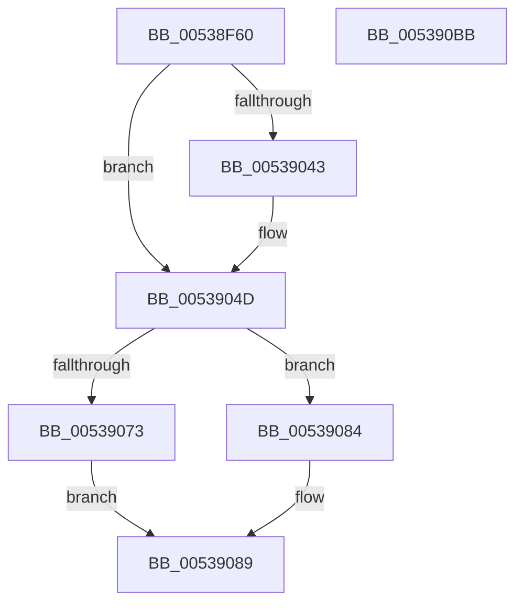

# SymCryptShortWeierstrassFillScratchSpaces

- RVA: `0x00538F60`–`0x005390BC` (길이 `348` bytes)
- VA: `0x0000000140538F60`
- 실행 섹션: `.text`
- PDB 이름 있음: `예`; PDB Function 태그: `아니요`
- unwind 정보 RVA: `0x00060300`
- 디코드: `107`개 명령, `348/348` bytes 표시
- 미해석 바이트: `0` (있으면 어셈블리에 `.byte`로 보존)

> 이 문서는 커널 이미지의 기계어와 PDB 기호를 분석해 생성했습니다. 4번과 5번은 함수 원형과 자료형을 바이너리 사용 방식에서 추정한 C 해석이며 원본 소스 복구 결과는 아닙니다.

## 1. Dependencies

- 직접 호출 지점: **14**; 고유 호출 대상: **5**
- 직접 호출자로 확인된 함수: **0**
- RIP 상대 이미지 참조: **0**

### Outgoing calls
- `0x00538F7E` → [SymCryptDigitsFromBits](../52/SymCryptDigitsFromBits_function_0052544C.md) (function, `0x0052544C`)
- `0x00538F89` → [SymCryptSizeofEcpointFromCurve](../52/SymCryptSizeofEcpointFromCurve_function_0052CEF0.md) (function, `0x0052CEF0`)
- `0x00538FAD` → [SymCryptSizeofIntFromDigits](../52/SymCryptSizeofIntFromDigits_function_00525D24.md) (function, `0x00525D24`)
- `0x00538FB7` → [SymCryptSizeofEcpointFromCurve](../52/SymCryptSizeofEcpointFromCurve_function_0052CEF0.md) (function, `0x0052CEF0`)
- `0x00538FD9` → [SymCryptSizeofEcpointFromCurve](../52/SymCryptSizeofEcpointFromCurve_function_0052CEF0.md) (function, `0x0052CEF0`)
- `0x0053901F` → [SymCryptSizeofEcpointEx](../52/SymCryptSizeofEcpointEx_function_0052CED4.md) (function, `0x0052CED4`)
- `0x0053903A` → [SymCryptSizeofIntFromDigits](../52/SymCryptSizeofIntFromDigits_function_00525D24.md) (function, `0x00525D24`)
- `0x00539046` → [SymCryptSizeofIntFromDigits](../52/SymCryptSizeofIntFromDigits_function_00525D24.md) (function, `0x00525D24`)
- `0x00539053` → [SymCryptEcurveDigitsofScalarMultiplier](../52/SymCryptEcurveDigitsofScalarMultiplier_function_0052415C.md) (function, `0x0052415C`)
- `0x0053905A` → [SymCryptSizeofIntFromDigits](../52/SymCryptSizeofIntFromDigits_function_00525D24.md) (function, `0x00525D24`)
- `0x00539067` → [SymCryptSizeofEcpointFromCurve](../52/SymCryptSizeofEcpointFromCurve_function_0052CEF0.md) (function, `0x0052CEF0`)
- `0x00539073` → [SymCryptEcurveDigitsofScalarMultiplier](../52/SymCryptEcurveDigitsofScalarMultiplier_function_0052415C.md) (function, `0x0052415C`)
- `0x0053907A` → [SymCryptSizeofIntFromDigits](../52/SymCryptSizeofIntFromDigits_function_00525D24.md) (function, `0x00525D24`)
- `0x00539084` → [SymCryptSizeofEcpointFromCurve](../52/SymCryptSizeofEcpointFromCurve_function_0052CEF0.md) (function, `0x0052CEF0`)

### Direct callers
- 이 함수 시작 RVA로 연결되는 직접 call은 확인되지 않았습니다. 간접 호출은 완전히 역산할 수 없습니다.

### Static image references
- 디코드된 RIP-relative 메모리 참조가 없습니다.

## 2. Other-region calls and transfers

- 다른 실행 섹션으로 향하는 call: **0**
- 별도 외부 분기/꼬리 이동을 확인하지 못했습니다.

## 3. Assembly (complete function range)

```asm
00538F60  48 89 5C 24 08                  mov qword ptr [rsp + 8], rbx
00538F65  48 89 6C 24 10                  mov qword ptr [rsp + 0x10], rbp
00538F6A  48 89 74 24 18                  mov qword ptr [rsp + 0x18], rsi
00538F6F  57                              push rdi
00538F70  41 56                           push r14
00538F72  41 57                           push r15
00538F74  48 83 EC 20                     sub rsp, 0x20
00538F78  48 8B E9                        mov rbp, rcx
00538F7B  8B 49 0C                        mov ecx, dword ptr [rcx + 0xc]
00538F7E  E8 C9 C4 FE FF                  call 0x14052544c
00538F83  48 8B CD                        mov rcx, rbp
00538F86  44 8B F8                        mov r15d, eax
00538F89  E8 62 3F FF FF                  call 0x14052cef0
00538F8E  8B 55 10                        mov edx, dword ptr [rbp + 0x10]
00538F91  C1 E2 05                        shl edx, 5
00538F94  03 55 24                        add edx, dword ptr [rbp + 0x24]
00538F97  8D 0C 90                        lea ecx, [rax + rdx*4]
00538F9A  44 8D 34 09                     lea r14d, [rcx + rcx]
00538F9E  8B 4D 1C                        mov ecx, dword ptr [rbp + 0x1c]
00538FA1  8B F9                           mov edi, ecx
00538FA3  41 8D 76 40                     lea esi, [r14 + 0x40]
00538FA7  89 75 2C                        mov dword ptr [rbp + 0x2c], esi
00538FAA  C1 E7 08                        shl edi, 8
00538FAD  E8 72 CD FE FF                  call 0x140525d24
00538FB2  48 8B CD                        mov rcx, rbp
00538FB5  8B D8                           mov ebx, eax
00538FB7  E8 34 3F FF FF                  call 0x14052cef0
00538FBC  03 C3                           add eax, ebx
00538FBE  8D 4F 40                        lea ecx, [rdi + 0x40]
00538FC1  3B F1                           cmp esi, ecx
00538FC3  44 0F 46 F7                     cmovbe r14d, edi
00538FC7  41 8D 0C 46                     lea ecx, [r14 + rax*2]
00538FCB  8B 45 24                        mov eax, dword ptr [rbp + 0x24]
00538FCE  83 C0 40                        add eax, 0x40
00538FD1  03 C8                           add ecx, eax
00538FD3  89 4D 30                        mov dword ptr [rbp + 0x30], ecx
00538FD6  48 8B CD                        mov rcx, rbp
00538FD9  E8 12 3F FF FF                  call 0x14052cef0
00538FDE  0F AF 45 5C                     imul eax, dword ptr [rbp + 0x5c]
00538FE2  BA 04 00 00 00                  mov edx, 4
00538FE7  8B 4D 60                        mov ecx, dword ptr [rbp + 0x60]
00538FEA  03 C9                           add ecx, ecx
00538FEC  48 8D 0C 8D 1F 00 00 00         lea rcx, [rcx*4 + 0x1f]
00538FF4  83 E1 E0                        and ecx, 0xffffffe0
00538FF7  03 C8                           add ecx, eax
00538FF9  89 4D 34                        mov dword ptr [rbp + 0x34], ecx
00538FFC  8B 4D 10                        mov ecx, dword ptr [rbp + 0x10]
00538FFF  8B C1                           mov eax, ecx
00539001  C1 E0 08                        shl eax, 8
00539004  8B F8                           mov edi, eax
00539006  83 C0 40                        add eax, 0x40
00539009  C1 E1 06                        shl ecx, 6
0053900C  48 83 C1 40                     add rcx, 0x40
00539010  8B D8                           mov ebx, eax
00539012  48 03 C1                        add rax, rcx
00539015  48 8D 04 48                     lea rax, [rax + rcx*2]
00539019  8B 4D 24                        mov ecx, dword ptr [rbp + 0x24]
0053901C  48 03 F8                        add rdi, rax
0053901F  E8 B0 3E FF FF                  call 0x14052ced4
00539024  8B 4D 24                        mov ecx, dword ptr [rbp + 0x24]
00539027  48 3B DF                        cmp rbx, rdi
0053902A  0F 46 DF                        cmovbe ebx, edi
0053902D  03 C3                           add eax, ebx
0053902F  8D 04 48                        lea eax, [rax + rcx*2]
00539032  41 8B CF                        mov ecx, r15d
00539035  89 45 38                        mov dword ptr [rbp + 0x38], eax
00539038  8B D8                           mov ebx, eax
0053903A  E8 E5 CC FE FF                  call 0x140525d24
0053903F  3B D8                           cmp ebx, eax
00539041  77 0A                           ja 0x14053904d
00539043  41 8B CF                        mov ecx, r15d
00539046  E8 D9 CC FE FF                  call 0x140525d24
0053904B  8B D8                           mov ebx, eax
0053904D  48 8B CD                        mov rcx, rbp
00539050  89 5D 38                        mov dword ptr [rbp + 0x38], ebx
00539053  E8 04 B1 FE FF                  call 0x14052415c
00539058  8B C8                           mov ecx, eax
0053905A  E8 C5 CC FE FF                  call 0x140525d24
0053905F  8B D8                           mov ebx, eax
00539061  48 8B CD                        mov rcx, rbp
00539064  03 5D 24                        add ebx, dword ptr [rbp + 0x24]
00539067  E8 84 3E FF FF                  call 0x14052cef0
0053906C  48 8B CD                        mov rcx, rbp
0053906F  3B D8                           cmp ebx, eax
00539071  76 11                           jbe 0x140539084
00539073  E8 E4 B0 FE FF                  call 0x14052415c
00539078  8B C8                           mov ecx, eax
0053907A  E8 A5 CC FE FF                  call 0x140525d24
0053907F  03 45 24                        add eax, dword ptr [rbp + 0x24]
00539082  EB 05                           jmp 0x140539089
00539084  E8 67 3E FF FF                  call 0x14052cef0
00539089  8B 4D 38                        mov ecx, dword ptr [rbp + 0x38]
0053908C  44 8B 45 34                     mov r8d, dword ptr [rbp + 0x34]
00539090  44 03 45 30                     add r8d, dword ptr [rbp + 0x30]
00539094  48 8B 5C 24 40                  mov rbx, qword ptr [rsp + 0x40]
00539099  44 3B C1                        cmp r8d, ecx
0053909C  48 8B 74 24 50                  mov rsi, qword ptr [rsp + 0x50]
005390A1  44 0F 46 C1                     cmovbe r8d, ecx
005390A5  44 03 C0                        add r8d, eax
005390A8  44 89 45 3C                     mov dword ptr [rbp + 0x3c], r8d
005390AC  48 8B 6C 24 48                  mov rbp, qword ptr [rsp + 0x48]
005390B1  48 83 C4 20                     add rsp, 0x20
005390B5  41 5F                           pop r15
005390B7  41 5E                           pop r14
005390B9  5F                              pop rdi
005390BA  C3                              ret
005390BB  CC                              int3
```

## 4. C-style interpretation (structured pseudocode)

```c
__int64 __fastcall SymCryptShortWeierstrassFillScratchSpaces(__int64 a1)
{
    __int64 result;
    __int64 v_r14;
    __int64 v_rbx;
    __int64 v_rdi;
    __int64 v_rsp;
    unsigned __int64 v_stack_p10;
    unsigned __int64 v_stack_p18;
    unsigned __int64 v_stack_p8;

    v_stack_p8 = v_rbx;
    v_stack_p10 = v_rbp;
    v_stack_p18 = v_rsi;
    v_rsp = (v_rsp) - (32);
    result = SymCryptDigitsFromBits((unsigned int)(*(unsigned int *)(a1 + 12)), a2, a3, a4);
    result = SymCryptSizeofEcpointFromCurve(a1, a2, a3, a4);
    a2 = (unsigned int)(((unsigned int)(*(unsigned int *)(a1 + 16))) << (5));
    a2 = (unsigned int)((a2) + (*(unsigned int *)(a1 + 36)));
    *(unsigned int *)(a1 + 44) = (unsigned int)(result + a2 * 4 + result + a2 * 4 * 1 + 64);
    v_rdi = (unsigned int)(((unsigned int)((unsigned int)((unsigned int)(*(unsigned int *)(a1 + 28))))) << (8));
    result = SymCryptSizeofIntFromDigits((unsigned int)(*(unsigned int *)(a1 + 28)), a2, a3, a4);
    result = SymCryptSizeofEcpointFromCurve(a1, a2, a3, a4);
    result = (unsigned int)((result) + ((unsigned int)((unsigned int)((unsigned int)(result)))));
    v_r14 = result + a2 * 4 + result + a2 * 4 * 1;
    if (((unsigned int)(result + a2 * 4 + result + a2 * 4 * 1 + 64)) <= ((unsigned int)(v_rdi + 64))) { v_r14 = (unsigned int)(v_rdi); }
    result = (unsigned int)(((unsigned int)(*(unsigned int *)(a1 + 36))) + (64));
    a1 = (unsigned int)((v_r14 + result * 2) + ((unsigned int)(result)));
    *(unsigned int *)(a1 + 48) = (unsigned int)(a1);
    result = SymCryptSizeofEcpointFromCurve(a1, a2, a3, a4);
    result = (unsigned int)((result) * (*(unsigned int *)(a1 + 92)));
    a1 = (unsigned int)(((unsigned int)(*(unsigned int *)(a1 + 96))) + ((unsigned int)((unsigned int)(*(unsigned int *)(a1 + 96)))));
    a1 = (unsigned int)((a1 * 4 + 31) & (0xFFFFFFE0ULL));
    a1 = (unsigned int)((a1) + ((unsigned int)(result)));
    *(unsigned int *)(a1 + 52) = (unsigned int)(a1);
    result = (unsigned int)(((unsigned int)((unsigned int)((unsigned int)(*(unsigned int *)(a1 + 16))))) << (8));
    result = (unsigned int)((result) + (64));
    a1 = (unsigned int)(((unsigned int)(*(unsigned int *)(a1 + 16))) << (6));
    a1 = (a1) + (64);
    result = (result) + (a1);
    v_rdi = ((unsigned int)((unsigned int)(result))) + (result + a1 * 2);
    result = SymCryptSizeofEcpointEx((unsigned int)(*(unsigned int *)(a1 + 36)), 4, a3, a4);
    v_rbx = (unsigned int)((unsigned int)(result));
    if (((unsigned int)((unsigned int)(result))) <= v_rdi) { v_rbx = (unsigned int)(v_rdi); }
    result = (unsigned int)((result) + ((unsigned int)(v_rbx)));
    *(unsigned int *)(a1 + 56) = (unsigned int)(result + (unsigned int)(*(unsigned int *)(a1 + 36)) * 2);
    result = SymCryptSizeofIntFromDigits((unsigned int)((unsigned int)((unsigned int)((unsigned int)(result)))), 4, a3, a4);
    v_rbx = (unsigned int)((unsigned int)(result + (unsigned int)(*(unsigned int *)(a1 + 36)) * 2));
    if (((unsigned int)((unsigned int)((unsigned int)(result + (unsigned int)(*(unsigned int *)(a1 + 36)) * 2)))) <= ((unsigned int)(result))) {
        a1 = (unsigned int)((unsigned int)((unsigned int)(result)));
        result = SymCryptSizeofIntFromDigits(a1, 4, a3, a4);
        v_rbx = (unsigned int)(result);
    }
    *(unsigned int *)(a1 + 56) = (unsigned int)(v_rbx);
    result = SymCryptEcurveDigitsofScalarMultiplier(a1, 4, a3, a4);
    result = SymCryptSizeofIntFromDigits((unsigned int)((unsigned int)(result)), 4, a3, a4);
    v_rbx = (unsigned int)(((unsigned int)((unsigned int)(result))) + (*(unsigned int *)(a1 + 36)));
    result = SymCryptSizeofEcpointFromCurve(a1, 4, a3, a4);
    if (((unsigned int)(v_rbx)) <= ((unsigned int)(result))) goto loc_00539084;
    result = SymCryptEcurveDigitsofScalarMultiplier(a1, 4, a3, a4);
    result = SymCryptSizeofIntFromDigits((unsigned int)((unsigned int)(result)), 4, a3, a4);
    result = (unsigned int)((result) + (*(unsigned int *)(a1 + 36)));
    goto loc_00539089;
loc_00539084:
    result = SymCryptSizeofEcpointFromCurve((unsigned int)((unsigned int)(result)), 4, a3, a4);
loc_00539089:
    a3 = (unsigned int)(((unsigned int)(*(unsigned int *)(a1 + 52))) + (*(unsigned int *)(a1 + 48)));
    if (((unsigned int)(a3)) <= ((unsigned int)((unsigned int)(*(unsigned int *)(a1 + 56))))) { a3 = (unsigned int)((unsigned int)(*(unsigned int *)(a1 + 56))); }
    a3 = (unsigned int)((a3) + ((unsigned int)(result)));
    *(unsigned int *)(a1 + 60) = (unsigned int)(a3);
    v_rsp = (v_rsp) + (32);
    return result;
}
```

## 5. (Beta) C Style

```c
int64_t SymCryptShortWeierstrassFillScratchSpaces(void *Arg1)
{
    uint8_t *arg1 = (uint8_t *)Arg1;

    int64_t result;
    int64_t local_r14;
    int64_t local_rbx;
    int64_t local_rdi;
    int64_t local_rsp;
    uint64_t v_stack_p10;
    uint64_t v_stack_p18;
    uint64_t v_stack_p8;

    v_stack_p8 = local_rbx;
    v_stack_p10 = local_rbp;
    v_stack_p18 = local_rsi;
    local_rsp = (local_rsp) - (32);
    result = SymCryptDigitsFromBits((uint32_t)(*(uint32_t *)(arg1 + 0xC)), a2, a3, a4);
    result = SymCryptSizeofEcpointFromCurve(Arg1, a2, a3, a4);
    a2 = (uint32_t)(((uint32_t)(*(uint32_t *)(arg1 + 0x10))) << (5));
    a2 = (uint32_t)((a2) + (*(uint32_t *)(arg1 + 0x24)));
    *(uint32_t *)(arg1 + 0x2C) = (uint32_t)(result + a2 * 4 + result + a2 * 4 * 1 + 64);
    local_rdi = (uint32_t)(((uint32_t)((uint32_t)((uint32_t)(*(uint32_t *)(arg1 + 0x1C))))) << (8));
    result = SymCryptSizeofIntFromDigits((uint32_t)(*(uint32_t *)(arg1 + 0x1C)), a2, a3, a4);
    result = SymCryptSizeofEcpointFromCurve(Arg1, a2, a3, a4);
    result = (uint32_t)((result) + ((uint32_t)((uint32_t)((uint32_t)(result)))));
    local_r14 = result + a2 * 4 + result + a2 * 4 * 1;
    if (((uint32_t)(result + a2 * 4 + result + a2 * 4 * 1 + 64)) <= ((uint32_t)(local_rdi + 64))) { local_r14 = (uint32_t)(local_rdi); }
    result = (uint32_t)(((uint32_t)(*(uint32_t *)(arg1 + 0x24))) + (64));
    Arg1 = (uint32_t)((local_r14 + result * 2) + ((uint32_t)(result)));
    *(uint32_t *)(arg1 + 0x30) = (uint32_t)(Arg1);
    result = SymCryptSizeofEcpointFromCurve(Arg1, a2, a3, a4);
    result = (uint32_t)((result) * (*(uint32_t *)(arg1 + 0x5C)));
    Arg1 = (uint32_t)(((uint32_t)(*(uint32_t *)(arg1 + 0x60))) + ((uint32_t)((uint32_t)(*(uint32_t *)(arg1 + 0x60)))));
    Arg1 = (uint32_t)((Arg1 * 4 + 31) & (0xFFFFFFE0ULL));
    Arg1 = (uint32_t)((Arg1) + ((uint32_t)(result)));
    *(uint32_t *)(arg1 + 0x34) = (uint32_t)(Arg1);
    result = (uint32_t)(((uint32_t)((uint32_t)((uint32_t)(*(uint32_t *)(arg1 + 0x10))))) << (8));
    result = (uint32_t)((result) + (64));
    Arg1 = (uint32_t)(((uint32_t)(*(uint32_t *)(arg1 + 0x10))) << (6));
    Arg1 = (Arg1) + (64);
    result = (result) + (Arg1);
    local_rdi = ((uint32_t)((uint32_t)(result))) + (result + Arg1 * 2);
    result = SymCryptSizeofEcpointEx((uint32_t)(*(uint32_t *)(arg1 + 0x24)), 4, a3, a4);
    local_rbx = (uint32_t)((uint32_t)(result));
    if (((uint32_t)((uint32_t)(result))) <= local_rdi) { local_rbx = (uint32_t)(local_rdi); }
    result = (uint32_t)((result) + ((uint32_t)(local_rbx)));
    *(uint32_t *)(arg1 + 0x38) = (uint32_t)(result + (uint32_t)(*(uint32_t *)(arg1 + 0x24)) * 2);
    result = SymCryptSizeofIntFromDigits((uint32_t)((uint32_t)((uint32_t)((uint32_t)(result)))), 4, a3, a4);
    local_rbx = (uint32_t)((uint32_t)(result + (uint32_t)(*(uint32_t *)(arg1 + 0x24)) * 2));
    if (((uint32_t)((uint32_t)((uint32_t)(result + (uint32_t)(*(uint32_t *)(arg1 + 0x24)) * 2)))) <= ((uint32_t)(result))) {
        Arg1 = (uint32_t)((uint32_t)((uint32_t)(result)));
        result = SymCryptSizeofIntFromDigits(Arg1, 4, a3, a4);
        local_rbx = (uint32_t)(result);
    }
    *(uint32_t *)(arg1 + 0x38) = (uint32_t)(local_rbx);
    result = SymCryptEcurveDigitsofScalarMultiplier(Arg1, 4, a3, a4);
    result = SymCryptSizeofIntFromDigits((uint32_t)((uint32_t)(result)), 4, a3, a4);
    local_rbx = (uint32_t)(((uint32_t)((uint32_t)(result))) + (*(uint32_t *)(arg1 + 0x24)));
    result = SymCryptSizeofEcpointFromCurve(Arg1, 4, a3, a4);
    if (((uint32_t)(local_rbx)) <= ((uint32_t)(result))) goto loc_00539084;
    result = SymCryptEcurveDigitsofScalarMultiplier(Arg1, 4, a3, a4);
    result = SymCryptSizeofIntFromDigits((uint32_t)((uint32_t)(result)), 4, a3, a4);
    result = (uint32_t)((result) + (*(uint32_t *)(arg1 + 0x24)));
    goto loc_00539089;
loc_00539084:
    result = SymCryptSizeofEcpointFromCurve((uint32_t)((uint32_t)(result)), 4, a3, a4);
loc_00539089:
    a3 = (uint32_t)(((uint32_t)(*(uint32_t *)(arg1 + 0x34))) + (*(uint32_t *)(arg1 + 0x30)));
    if (((uint32_t)(a3)) <= ((uint32_t)((uint32_t)(*(uint32_t *)(arg1 + 0x38))))) { a3 = (uint32_t)((uint32_t)(*(uint32_t *)(arg1 + 0x38))); }
    a3 = (uint32_t)((a3) + ((uint32_t)(result)));
    *(uint32_t *)(arg1 + 0x3C) = (uint32_t)(a3);
    local_rsp = (local_rsp) + (32);
    return result;
}
```

### 관측된 메모리 오프셋

구조체 형식이 확인되지 않은 접근은 인자 기준의 오프셋으로만 기록했습니다.

| 기준 인자 | 오프셋 표현 | 폭 (bit) | 접근 |
|---|---:|---:|---|
| `Arg1` | `+ 0xC` | `32` | `R` |
| `Arg1` | `+ 0x10` | `32` | `R` |
| `Arg1` | `+ 0x1C` | `32` | `R` |
| `Arg1` | `+ 0x24` | `32` | `R` |
| `Arg1` | `+ 0x2C` | `32` | `W` |
| `Arg1` | `+ 0x30` | `32` | `R` |
| `Arg1` | `+ 0x30` | `32` | `W` |
| `Arg1` | `+ 0x34` | `32` | `R` |
| `Arg1` | `+ 0x34` | `32` | `W` |
| `Arg1` | `+ 0x38` | `32` | `R` |
| `Arg1` | `+ 0x38` | `32` | `W` |
| `Arg1` | `+ 0x3C` | `32` | `W` |
| `Arg1` | `+ 0x5C` | `32` | `R` |
| `Arg1` | `+ 0x60` | `32` | `R` |

## 6. Execution-region graph

[열기: 2D/3D 그래프와 함수 탐색 컨트롤 패널](../../../control-panel.html?section=text&rva=0x00538F60&view=graph)

- 2D 그래프는 위에서 아래로 흐르고, 3D 그래프는 빈 공간을 드래그해 회전합니다. Shift+드래그는 이동, 휠은 확대·축소, 함수 노드 선택은 대상 보고서 이동입니다.

### Static fallback


