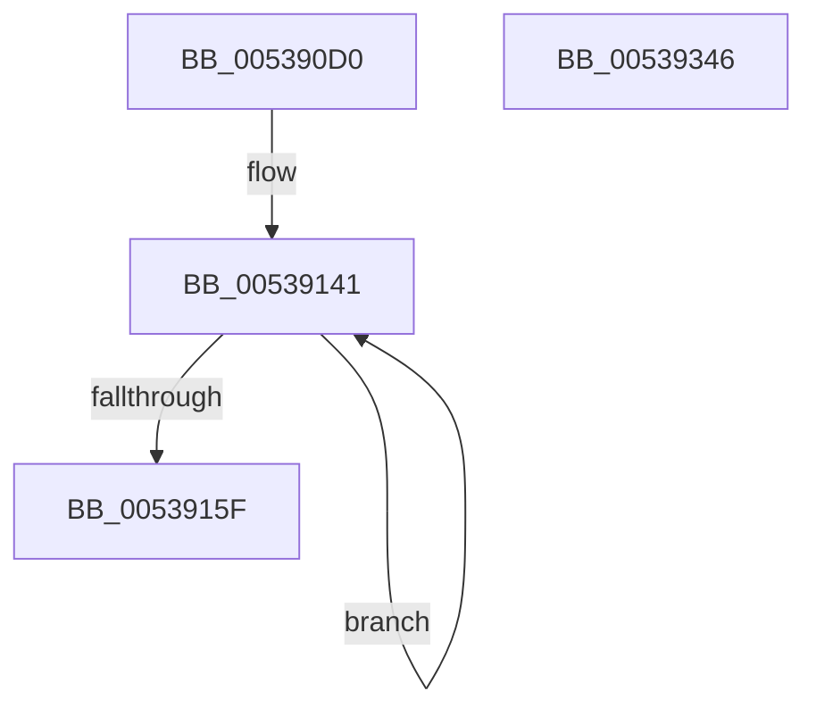

# SymCryptShortWeierstrassIsEqual

- RVA: `0x005390D0`–`0x00539347` (길이 `631` bytes)
- VA: `0x00000001405390D0`
- 실행 섹션: `.text`
- PDB 이름 있음: `예`; PDB Function 태그: `아니요`
- unwind 정보 RVA: `0x000CE3D4`
- 디코드: `163`개 명령, `631/631` bytes 표시
- 미해석 바이트: `0` (있으면 어셈블리에 `.byte`로 보존)

> 이 문서는 커널 이미지의 기계어와 PDB 기호를 분석해 생성했습니다. 4번과 5번은 함수 원형과 자료형을 바이너리 사용 방식에서 추정한 C 해석이며 원본 소스 복구 결과는 아닙니다.

## 1. Dependencies

- 직접 호출 지점: **14**; 고유 호출 대상: **6**
- 직접 호출자로 확인된 함수: **1**
- RIP 상대 이미지 참조: **1**

### Outgoing calls
- `0x00539147` → [SymCryptModElementCreate](../52/SymCryptModElementCreate_function_00525900.md) (function, `0x00525900`)
- `0x0053919D` → [SymCryptModSquare](../52/SymCryptModSquare_function_00525C84.md) (function, `0x00525C84`)
- `0x005391B9` → [SymCryptModSquare](../52/SymCryptModSquare_function_00525C84.md) (function, `0x00525C84`)
- `0x005391DA` → [SymCryptModMul](../52/SymCryptModMul_function_00525BA8.md) (function, `0x00525BA8`)
- `0x00539200` → [SymCryptModMul](../52/SymCryptModMul_function_00525BA8.md) (function, `0x00525BA8`)
- `0x0053920E` → [SymCryptModElementIsEqual](../52/SymCryptModElementIsEqual_function_0052594C.md) (function, `0x0052594C`)
- `0x00539234` → [SymCryptModMul](../52/SymCryptModMul_function_00525BA8.md) (function, `0x00525BA8`)
- `0x00539257` → [SymCryptModMul](../52/SymCryptModMul_function_00525BA8.md) (function, `0x00525BA8`)
- `0x00539282` → [SymCryptModMul](../52/SymCryptModMul_function_00525BA8.md) (function, `0x00525BA8`)
- `0x005392AB` → [SymCryptModMul](../52/SymCryptModMul_function_00525BA8.md) (function, `0x00525BA8`)
- `0x005392B9` → [SymCryptModElementIsEqual](../52/SymCryptModElementIsEqual_function_0052594C.md) (function, `0x0052594C`)
- `0x005392D1` → [SymCryptModNeg](../52/SymCryptModNeg_function_00525BE4.md) (function, `0x00525BE4`)
- `0x005392F6` → [SymCryptModElementIsEqual](../52/SymCryptModElementIsEqual_function_0052594C.md) (function, `0x0052594C`)
- `0x00539326` → [_security_check_cookie](../6A/_security_check_cookie_function_006AC640.md) (function, `0x006AC640`)

### Direct callers
- [SymCryptShortWeierstrassAdd](SymCryptShortWeierstrassAdd_function_00537BC0.md) at `0x00537CC6`

### Static image references
- `0x005390E7` → RVA `0x00E0A740` (`.data`; read)

## 2. Other-region calls and transfers

- 다른 실행 섹션으로 향하는 call: **0**
- 별도 외부 분기/꼬리 이동을 확인하지 못했습니다.

## 3. Assembly (complete function range)

```asm
005390D0  48 89 5C 24 20                  mov qword ptr [rsp + 0x20], rbx
005390D5  55                              push rbp
005390D6  56                              push rsi
005390D7  57                              push rdi
005390D8  41 54                           push r12
005390DA  41 55                           push r13
005390DC  41 56                           push r14
005390DE  41 57                           push r15
005390E0  48 81 EC 90 00 00 00            sub rsp, 0x90
005390E7  48 8B 05 52 16 8D 00            mov rax, qword ptr [rip + 0x8d1652]
005390EE  48 33 C4                        xor rax, rsp
005390F1  48 89 84 24 80 00 00 00         mov qword ptr [rsp + 0x80], rax
005390F9  4C 8B A9 68 02 00 00            mov r13, qword ptr [rcx + 0x268]
00539100  48 8D 5C 24 60                  lea rbx, [rsp + 0x60]
00539105  4C 8B B4 24 F0 00 00 00         mov r14, qword ptr [rsp + 0xf0]
0053910D  0F 57 C0                        xorps xmm0, xmm0
00539110  48 83 64 24 78 00               and qword ptr [rsp + 0x78], 0
00539116  4C 8B FA                        mov r15, rdx
00539119  48 89 54 24 58                  mov qword ptr [rsp + 0x58], rdx
0053911E  49 8B E8                        mov rbp, r8
00539121  8B 51 24                        mov edx, dword ptr [rcx + 0x24]
00539124  48 8B F9                        mov rdi, rcx
00539127  4C 89 6C 24 30                  mov qword ptr [rsp + 0x30], r13
0053912C  BE 04 00 00 00                  mov esi, 4
00539131  F3 0F 7F 44 24 68               movdqu xmmword ptr [rsp + 0x68], xmm0
00539137  44 89 4C 24 38                  mov dword ptr [rsp + 0x38], r9d
0053913C  4C 89 44 24 48                  mov qword ptr [rsp + 0x48], r8
00539141  4D 8B C5                        mov r8, r13
00539144  49 8B CE                        mov rcx, r14
00539147  E8 B4 C7 FE FF                  call 0x140525900
0053914C  8B 57 24                        mov edx, dword ptr [rdi + 0x24]
0053914F  4C 03 F2                        add r14, rdx
00539152  48 89 03                        mov qword ptr [rbx], rax
00539155  48 8D 5B 08                     lea rbx, [rbx + 8]
00539159  48 83 EE 01                     sub rsi, 1
0053915D  75 E2                           jne 0x140539141
0053915F  4C 8B A4 24 F8 00 00 00         mov r12, qword ptr [rsp + 0xf8]
00539167  8D 04 12                        lea eax, [rdx + rdx]
0053916A  8D 0C 95 00 00 00 00            lea ecx, [rdx*4]
00539171  48 89 54 24 50                  mov qword ptr [rsp + 0x50], rdx
00539176  4C 2B E1                        sub r12, rcx
00539179  4C 89 74 24 40                  mov qword ptr [rsp + 0x40], r14
0053917E  48 8D 34 28                     lea rsi, [rax + rbp]
00539182  4C 89 64 24 20                  mov qword ptr [rsp + 0x20], r12
00539187  48 8B 6C 24 60                  mov rbp, qword ptr [rsp + 0x60]
0053918C  4A 8D 1C 38                     lea rbx, [rax + r15]
00539190  4C 8B C5                        mov r8, rbp
00539193  48 8D 53 20                     lea rdx, [rbx + 0x20]
00539197  4D 8B CE                        mov r9, r14
0053919A  49 8B CD                        mov rcx, r13
0053919D  E8 E2 CA FE FF                  call 0x140525c84
005391A2  48 8B 7C 24 68                  mov rdi, qword ptr [rsp + 0x68]
005391A7  48 8D 56 20                     lea rdx, [rsi + 0x20]
005391AB  4C 8B C7                        mov r8, rdi
005391AE  4C 89 64 24 20                  mov qword ptr [rsp + 0x20], r12
005391B3  4D 8B CE                        mov r9, r14
005391B6  49 8B CD                        mov rcx, r13
005391B9  E8 C6 CA FE FF                  call 0x140525c84
005391BE  49 8D 57 20                     lea rdx, [r15 + 0x20]
005391C2  4C 89 64 24 28                  mov qword ptr [rsp + 0x28], r12
005391C7  4C 8B 7C 24 70                  mov r15, qword ptr [rsp + 0x70]
005391CC  4C 8B C7                        mov r8, rdi
005391CF  4D 8B CF                        mov r9, r15
005391D2  4C 89 74 24 20                  mov qword ptr [rsp + 0x20], r14
005391D7  49 8B CD                        mov rcx, r13
005391DA  E8 C9 C9 FE FF                  call 0x140525ba8
005391DF  48 8B 54 24 48                  mov rdx, qword ptr [rsp + 0x48]
005391E4  4C 8B C5                        mov r8, rbp
005391E7  4C 89 64 24 28                  mov qword ptr [rsp + 0x28], r12
005391EC  48 83 C2 20                     add rdx, 0x20
005391F0  4C 89 74 24 20                  mov qword ptr [rsp + 0x20], r14
005391F5  49 8B CD                        mov rcx, r13
005391F8  4C 8B 74 24 78                  mov r14, qword ptr [rsp + 0x78]
005391FD  4D 8B CE                        mov r9, r14
00539200  E8 A3 C9 FE FF                  call 0x140525ba8
00539205  4D 8B C6                        mov r8, r14
00539208  49 8B D7                        mov rdx, r15
0053920B  49 8B CD                        mov rcx, r13
0053920E  E8 39 C7 FE FF                  call 0x14052594c
00539213  48 8B 4C 24 30                  mov rcx, qword ptr [rsp + 0x30]
00539218  48 8D 53 20                     lea rdx, [rbx + 0x20]
0053921C  44 8B E8                        mov r13d, eax
0053921F  4C 89 64 24 28                  mov qword ptr [rsp + 0x28], r12
00539224  48 8B 44 24 40                  mov rax, qword ptr [rsp + 0x40]
00539229  4C 8B CD                        mov r9, rbp
0053922C  4C 8B C5                        mov r8, rbp
0053922F  48 89 44 24 20                  mov qword ptr [rsp + 0x20], rax
00539234  E8 6F C9 FE FF                  call 0x140525ba8
00539239  48 8B 5C 24 40                  mov rbx, qword ptr [rsp + 0x40]
0053923E  48 8D 56 20                     lea rdx, [rsi + 0x20]
00539242  48 8B 4C 24 30                  mov rcx, qword ptr [rsp + 0x30]
00539247  4C 8B CF                        mov r9, rdi
0053924A  4C 8B C7                        mov r8, rdi
0053924D  4C 89 64 24 28                  mov qword ptr [rsp + 0x28], r12
00539252  48 89 5C 24 20                  mov qword ptr [rsp + 0x20], rbx
00539257  E8 4C C9 FE FF                  call 0x140525ba8
0053925C  48 8B 54 24 58                  mov rdx, qword ptr [rsp + 0x58]
00539261  4D 8B CF                        mov r9, r15
00539264  48 8B 74 24 50                  mov rsi, qword ptr [rsp + 0x50]
00539269  48 83 C2 20                     add rdx, 0x20
0053926D  48 8B 4C 24 30                  mov rcx, qword ptr [rsp + 0x30]
00539272  48 03 D6                        add rdx, rsi
00539275  4C 89 64 24 28                  mov qword ptr [rsp + 0x28], r12
0053927A  4C 8B C7                        mov r8, rdi
0053927D  48 89 5C 24 20                  mov qword ptr [rsp + 0x20], rbx
00539282  E8 21 C9 FE FF                  call 0x140525ba8
00539287  48 8B 54 24 48                  mov rdx, qword ptr [rsp + 0x48]
0053928C  48 83 C6 20                     add rsi, 0x20
00539290  48 03 D6                        add rdx, rsi
00539293  4C 89 64 24 28                  mov qword ptr [rsp + 0x28], r12
00539298  48 8B 74 24 30                  mov rsi, qword ptr [rsp + 0x30]
0053929D  4D 8B CE                        mov r9, r14
005392A0  48 8B CE                        mov rcx, rsi
005392A3  48 89 5C 24 20                  mov qword ptr [rsp + 0x20], rbx
005392A8  4C 8B C5                        mov r8, rbp
005392AB  E8 F8 C8 FE FF                  call 0x140525ba8
005392B0  4D 8B C6                        mov r8, r14
005392B3  49 8B D7                        mov rdx, r15
005392B6  48 8B CE                        mov rcx, rsi
005392B9  E8 8E C6 FE FF                  call 0x14052594c
005392BE  4C 8B CB                        mov r9, rbx
005392C1  4C 89 64 24 20                  mov qword ptr [rsp + 0x20], r12
005392C6  4D 8B C6                        mov r8, r14
005392C9  49 8B D6                        mov rdx, r14
005392CC  48 8B CE                        mov rcx, rsi
005392CF  8B F8                           mov edi, eax
005392D1  E8 0E C9 FE FF                  call 0x140525be4
005392D6  44 8B 54 24 38                  mov r10d, dword ptr [rsp + 0x38]
005392DB  4D 8B C6                        mov r8, r14
005392DE  41 8B DA                        mov ebx, r10d
005392E1  49 8B D7                        mov rdx, r15
005392E4  48 F7 DB                        neg rbx
005392E7  48 8B CE                        mov rcx, rsi
005392EA  48 C1 EB 20                     shr rbx, 0x20
005392EE  F7 D3                           not ebx
005392F0  83 E3 01                        and ebx, 1
005392F3  49 0B DA                        or rbx, r10
005392F6  E8 51 C6 FE FF                  call 0x14052594c
005392FB  48 8B CB                        mov rcx, rbx
005392FE  83 E3 01                        and ebx, 1
00539301  83 E1 02                        and ecx, 2
00539304  48 F7 DB                        neg rbx
00539307  48 F7 D9                        neg rcx
0053930A  48 C1 EB 20                     shr rbx, 0x20
0053930E  48 C1 E9 20                     shr rcx, 0x20
00539312  23 DF                           and ebx, edi
00539314  23 C1                           and eax, ecx
00539316  0B C3                           or eax, ebx
00539318  41 23 C5                        and eax, r13d
0053931B  48 8B 8C 24 80 00 00 00         mov rcx, qword ptr [rsp + 0x80]
00539323  48 33 CC                        xor rcx, rsp
00539326  E8 15 33 17 00                  call 0x1406ac640
0053932B  48 8B 9C 24 E8 00 00 00         mov rbx, qword ptr [rsp + 0xe8]
00539333  48 81 C4 90 00 00 00            add rsp, 0x90
0053933A  41 5F                           pop r15
0053933C  41 5E                           pop r14
0053933E  41 5D                           pop r13
00539340  41 5C                           pop r12
00539342  5F                              pop rdi
00539343  5E                              pop rsi
00539344  5D                              pop rbp
00539345  C3                              ret
00539346  CC                              int3
```

## 4. C-style interpretation (structured pseudocode)

```c
__int64 __fastcall SymCryptShortWeierstrassIsEqual(__int64 a1, __int64 a2, __int64 a3, int a4, __int64 a5, __int64 a6)
{
    __int64 result;
    __int64 v_r12;
    __int64 v_r14;
    __int64 v_rbx;
    __int64 v_rsi;
    __int64 v_rsp;
    unsigned __int64 v_stack_m48;
    unsigned __int64 v_stack_m50;
    unsigned __int64 v_stack_m58;
    unsigned __int64 v_stack_m60;
    unsigned __int64 v_stack_m68;
    unsigned __int64 v_stack_m70;
    unsigned __int64 v_stack_m78;
    unsigned __int64 v_stack_m80;
    unsigned __int64 v_stack_m88;
    unsigned int v_stack_m90;
    unsigned __int64 v_stack_m98;
    unsigned __int64 v_stack_mA0;
    unsigned __int64 v_stack_mA8;
    unsigned __int64 v_stack_p20;

    v_stack_p20 = v_rbx;
    v_rsp = (v_rsp) - (144);
    result = (*(unsigned __int64 *)(v_rip + 9246290)) ^ (v_rsp);
    v_stack_m48 = result;
    v_stack_m70 = a2;
    v_stack_m98 = *(unsigned __int64 *)(a1 + 616);
    v_stack_m60 = v_xmm0;
    v_stack_m90 = a4;
    v_stack_m80 = a3;
loc_00539141:
    result = SymCryptModElementCreate(a5, (unsigned int)(*(unsigned int *)(a1 + 36)), *(unsigned __int64 *)(a1 + 616), a4);
    v_r14 = (a5) + ((unsigned int)(*(unsigned int *)(a1 + 36)));
    *(unsigned __int64 *)(v_stack_m68) = result;
    v_rsi = (4) - (1);
    if (condition_is_not_equal) goto loc_00539141;
    v_stack_m78 = (unsigned int)(*(unsigned int *)(a1 + 36));
    v_r12 = (a6) - ((unsigned int)(*(unsigned int *)(a1 + 36)) * 4);
    v_stack_m88 = v_r14;
    v_stack_mA8 = v_r12;
    result = SymCryptModSquare(*(unsigned __int64 *)(a1 + 616), (unsigned int)(*(unsigned int *)(a1 + 36)) + (unsigned int)(*(unsigned int *)(a1 + 36)) * 1 + a2 * 1 + 32, v_stack_m68, v_r14);
    v_stack_mA8 = v_r12;
    result = SymCryptModSquare(*(unsigned __int64 *)(a1 + 616), (unsigned int)(*(unsigned int *)(a1 + 36)) + (unsigned int)(*(unsigned int *)(a1 + 36)) * 1 + a3 * 1 + 32, v_stack_m60, v_r14);
    v_stack_mA0 = v_r12;
    v_stack_mA8 = v_r14;
    result = SymCryptModMul(*(unsigned __int64 *)(a1 + 616), a2 + 32, v_stack_m60, v_stack_m58);
    v_stack_mA0 = v_r12;
    a2 = (v_stack_m80) + (32);
    v_stack_mA8 = v_r14;
    result = SymCryptModMul(*(unsigned __int64 *)(a1 + 616), a2, v_stack_m68, v_stack_m50);
    result = SymCryptModElementIsEqual(*(unsigned __int64 *)(a1 + 616), v_stack_m58, v_stack_m50, v_stack_m50);
    v_stack_mA0 = v_r12;
    v_stack_mA8 = v_stack_m88;
    result = SymCryptModMul(v_stack_m98, (unsigned int)(*(unsigned int *)(a1 + 36)) + (unsigned int)(*(unsigned int *)(a1 + 36)) * 1 + a2 * 1 + 32, v_stack_m68, v_stack_m68);
    v_stack_mA0 = v_r12;
    v_stack_mA8 = v_stack_m88;
    result = SymCryptModMul(v_stack_m98, (unsigned int)(*(unsigned int *)(a1 + 36)) + (unsigned int)(*(unsigned int *)(a1 + 36)) * 1 + a3 * 1 + 32, v_stack_m60, v_stack_m60);
    a2 = (v_stack_m70) + (32);
    a2 = (a2) + (v_stack_m78);
    v_stack_mA0 = v_r12;
    v_stack_mA8 = v_stack_m88;
    result = SymCryptModMul(v_stack_m98, a2, v_stack_m60, v_stack_m58);
    v_rsi = (v_stack_m78) + (32);
    a2 = (v_stack_m80) + (v_rsi);
    v_stack_mA0 = v_r12;
    v_stack_mA8 = v_stack_m88;
    result = SymCryptModMul(v_stack_m98, a2, v_stack_m68, v_stack_m50);
    result = SymCryptModElementIsEqual(v_stack_m98, v_stack_m58, v_stack_m50, v_stack_m50);
    v_stack_mA8 = v_r12;
    result = SymCryptModNeg(v_stack_m98, v_stack_m50, v_stack_m50, v_stack_m88);
    v_rbx = -((unsigned int)((unsigned int)((unsigned int)(v_stack_m90))));
    v_rbx = (v_rbx) >> (32);
    v_rbx = (unsigned int)(~(v_rbx));
    v_rbx = (unsigned int)((v_rbx) & (1));
    v_rbx = (v_rbx) | ((unsigned int)(v_stack_m90));
    result = SymCryptModElementIsEqual(v_stack_m98, v_stack_m58, v_stack_m50, v_stack_m88);
    v_rbx = (unsigned int)((v_rbx) & (1));
    a1 = (unsigned int)((v_rbx) & (2));
    v_rbx = -(v_rbx);
    a1 = -(a1);
    v_rbx = (v_rbx) >> (32);
    a1 = (a1) >> (32);
    v_rbx = (unsigned int)((v_rbx) & ((unsigned int)((unsigned int)((unsigned int)(result)))));
    result = (unsigned int)((result) & ((unsigned int)(a1)));
    result = (unsigned int)((result) | ((unsigned int)(v_rbx)));
    result = (unsigned int)((result) & ((unsigned int)((unsigned int)((unsigned int)(result)))));
    a1 = (v_stack_m48) ^ (v_rsp);
    result = _security_check_cookie(a1, v_stack_m58, v_stack_m50, v_stack_m88);
    v_rsp = (v_rsp) + (144);
    return result;
}
```

## 5. (Beta) C Style

```c
int64_t SymCryptShortWeierstrassIsEqual(void *Arg1, void *Arg2, int64_t Arg3, int32_t Arg4, int64_t Arg5, int64_t Arg6)
{
    uint8_t *arg1 = (uint8_t *)Arg1;
    uint8_t *arg2 = (uint8_t *)Arg2;

    int64_t result;
    int64_t local_r12;
    int64_t local_r14;
    int64_t local_rbx;
    int64_t local_rsi;
    int64_t local_rsp;
    uint64_t v_stack_m48;
    uint64_t v_stack_m50;
    uint64_t v_stack_m58;
    uint64_t v_stack_m60;
    uint64_t v_stack_m68;
    uint64_t v_stack_m70;
    uint64_t v_stack_m78;
    uint64_t v_stack_m80;
    uint64_t v_stack_m88;
    uint32_t v_stack_m90;
    uint64_t v_stack_m98;
    uint64_t v_stack_mA0;
    uint64_t v_stack_mA8;
    uint64_t v_stack_p20;

    v_stack_p20 = local_rbx;
    local_rsp = (local_rsp) - (144);
    result = (*(uint64_t *)(v_rip + 0x8D1652)) ^ (local_rsp);
    v_stack_m48 = result;
    v_stack_m70 = Arg2;
    v_stack_m98 = *(uint64_t *)(arg1 + 0x268);
    v_stack_m60 = v_xmm0;
    v_stack_m90 = Arg4;
    v_stack_m80 = Arg3;
loc_00539141:
    result = SymCryptModElementCreate(Arg5, (uint32_t)(*(uint32_t *)(arg1 + 0x24)), *(uint64_t *)(arg1 + 0x268), Arg4);
    local_r14 = (Arg5) + ((uint32_t)(*(uint32_t *)(arg1 + 0x24)));
    *(uint64_t *)(v_stack_m68) = result;
    local_rsi = (4) - (1);
    if (condition_is_not_equal) goto loc_00539141;
    v_stack_m78 = (uint32_t)(*(uint32_t *)(arg1 + 0x24));
    local_r12 = (Arg6) - ((uint32_t)(*(uint32_t *)(arg1 + 0x24)) * 4);
    v_stack_m88 = local_r14;
    v_stack_mA8 = local_r12;
    result = SymCryptModSquare(*(uint64_t *)(arg1 + 0x268), (uint32_t)(*(uint32_t *)(arg1 + 0x24)) + (uint32_t)(*(uint32_t *)(arg1 + 0x24)) * 1 + Arg2 * 1 + 32, v_stack_m68, local_r14);
    v_stack_mA8 = local_r12;
    result = SymCryptModSquare(*(uint64_t *)(arg1 + 0x268), (uint32_t)(*(uint32_t *)(arg1 + 0x24)) + (uint32_t)(*(uint32_t *)(arg1 + 0x24)) * 1 + Arg3 * 1 + 32, v_stack_m60, local_r14);
    v_stack_mA0 = local_r12;
    v_stack_mA8 = local_r14;
    result = SymCryptModMul(*(uint64_t *)(arg1 + 0x268), Arg2 + 32, v_stack_m60, v_stack_m58);
    v_stack_mA0 = local_r12;
    Arg2 = (v_stack_m80) + (32);
    v_stack_mA8 = local_r14;
    result = SymCryptModMul(*(uint64_t *)(arg1 + 0x268), Arg2, v_stack_m68, v_stack_m50);
    result = SymCryptModElementIsEqual(*(uint64_t *)(arg1 + 0x268), v_stack_m58, v_stack_m50, v_stack_m50);
    v_stack_mA0 = local_r12;
    v_stack_mA8 = v_stack_m88;
    result = SymCryptModMul(v_stack_m98, (uint32_t)(*(uint32_t *)(arg1 + 0x24)) + (uint32_t)(*(uint32_t *)(arg1 + 0x24)) * 1 + Arg2 * 1 + 32, v_stack_m68, v_stack_m68);
    v_stack_mA0 = local_r12;
    v_stack_mA8 = v_stack_m88;
    result = SymCryptModMul(v_stack_m98, (uint32_t)(*(uint32_t *)(arg1 + 0x24)) + (uint32_t)(*(uint32_t *)(arg1 + 0x24)) * 1 + Arg3 * 1 + 32, v_stack_m60, v_stack_m60);
    Arg2 = (v_stack_m70) + (32);
    Arg2 = (Arg2) + (v_stack_m78);
    v_stack_mA0 = local_r12;
    v_stack_mA8 = v_stack_m88;
    result = SymCryptModMul(v_stack_m98, Arg2, v_stack_m60, v_stack_m58);
    local_rsi = (v_stack_m78) + (32);
    Arg2 = (v_stack_m80) + (local_rsi);
    v_stack_mA0 = local_r12;
    v_stack_mA8 = v_stack_m88;
    result = SymCryptModMul(v_stack_m98, Arg2, v_stack_m68, v_stack_m50);
    result = SymCryptModElementIsEqual(v_stack_m98, v_stack_m58, v_stack_m50, v_stack_m50);
    v_stack_mA8 = local_r12;
    result = SymCryptModNeg(v_stack_m98, v_stack_m50, v_stack_m50, v_stack_m88);
    local_rbx = -((uint32_t)((uint32_t)((uint32_t)(v_stack_m90))));
    local_rbx = (local_rbx) >> (32);
    local_rbx = (uint32_t)(~(local_rbx));
    local_rbx = (uint32_t)((local_rbx) & (1));
    local_rbx = (local_rbx) | ((uint32_t)(v_stack_m90));
    result = SymCryptModElementIsEqual(v_stack_m98, v_stack_m58, v_stack_m50, v_stack_m88);
    local_rbx = (uint32_t)((local_rbx) & (1));
    Arg1 = (uint32_t)((local_rbx) & (2));
    local_rbx = -(local_rbx);
    Arg1 = -(Arg1);
    local_rbx = (local_rbx) >> (32);
    Arg1 = (Arg1) >> (32);
    local_rbx = (uint32_t)((local_rbx) & ((uint32_t)((uint32_t)((uint32_t)(result)))));
    result = (uint32_t)((result) & ((uint32_t)(Arg1)));
    result = (uint32_t)((result) | ((uint32_t)(local_rbx)));
    result = (uint32_t)((result) & ((uint32_t)((uint32_t)((uint32_t)(result)))));
    Arg1 = (v_stack_m48) ^ (local_rsp);
    result = _security_check_cookie(Arg1, v_stack_m58, v_stack_m50, v_stack_m88);
    local_rsp = (local_rsp) + (144);
    return result;
}
```

### 관측된 메모리 오프셋

구조체 형식이 확인되지 않은 접근은 인자 기준의 오프셋으로만 기록했습니다.

| 기준 인자 | 오프셋 표현 | 폭 (bit) | 접근 |
|---|---:|---:|---|
| `Arg1` | `+ 0x24` | `32` | `R` |
| `Arg1` | `+ 0x268` | `64` | `R` |
| `Arg2` | `+ 0x20` | `64` | `R` |

## 6. Execution-region graph

[열기: 2D/3D 그래프와 함수 탐색 컨트롤 패널](../../../control-panel.html?section=text&rva=0x005390D0&view=graph)

- 2D 그래프는 위에서 아래로 흐르고, 3D 그래프는 빈 공간을 드래그해 회전합니다. Shift+드래그는 이동, 휠은 확대·축소, 함수 노드 선택은 대상 보고서 이동입니다.

### Static fallback


