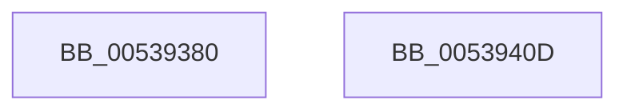

# SymCryptShortWeierstrassNegate

- RVA: `0x00539380`–`0x0053940E` (길이 `142` bytes)
- VA: `0x0000000140539380`
- 실행 섹션: `.text`
- PDB 이름 있음: `예`; PDB Function 태그: `아니요`
- unwind 정보 RVA: `0x00084C9C`
- 디코드: `41`개 명령, `142/142` bytes 표시
- 미해석 바이트: `0` (있으면 어셈블리에 `.byte`로 보존)

> 이 문서는 커널 이미지의 기계어와 PDB 기호를 분석해 생성했습니다. 4번과 5번은 함수 원형과 자료형을 바이너리 사용 방식에서 추정한 C 해석이며 원본 소스 복구 결과는 아닙니다.

## 1. Dependencies

- 직접 호출 지점: **3**; 고유 호출 대상: **3**
- 직접 호출자로 확인된 함수: **0**
- RIP 상대 이미지 참조: **0**

### Outgoing calls
- `0x005393B7` → [SymCryptModElementCreate](../52/SymCryptModElementCreate_function_00525900.md) (function, `0x00525900`)
- `0x005393DD` → [SymCryptModNeg](../52/SymCryptModNeg_function_00525BE4.md) (function, `0x00525BE4`)
- `0x005393EF` → [SymCryptModElementMaskedCopy](../52/SymCryptModElementMaskedCopy_function_0052597C.md) (function, `0x0052597C`)

### Direct callers
- 이 함수 시작 RVA로 연결되는 직접 call은 확인되지 않았습니다. 간접 호출은 완전히 역산할 수 없습니다.

### Static image references
- 디코드된 RIP-relative 메모리 참조가 없습니다.

## 2. Other-region calls and transfers

- 다른 실행 섹션으로 향하는 call: **0**
- 별도 외부 분기/꼬리 이동을 확인하지 못했습니다.

## 3. Assembly (complete function range)

```asm
00539380  48 89 5C 24 08                  mov qword ptr [rsp + 8], rbx
00539385  48 89 6C 24 10                  mov qword ptr [rsp + 0x10], rbp
0053938A  48 89 74 24 18                  mov qword ptr [rsp + 0x18], rsi
0053938F  57                              push rdi
00539390  41 56                           push r14
00539392  41 57                           push r15
00539394  48 83 EC 30                     sub rsp, 0x30
00539398  4C 8B B1 68 02 00 00            mov r14, qword ptr [rcx + 0x268]
0053939F  48 8B F2                        mov rsi, rdx
005393A2  8B 51 24                        mov edx, dword ptr [rcx + 0x24]
005393A5  45 8B F8                        mov r15d, r8d
005393A8  48 8B D9                        mov rbx, rcx
005393AB  4D 8B C6                        mov r8, r14
005393AE  49 8B C9                        mov rcx, r9
005393B1  48 03 F2                        add rsi, rdx
005393B4  49 8B E9                        mov rbp, r9
005393B7  E8 44 C5 FE FF                  call 0x140525900
005393BC  8B 53 24                        mov edx, dword ptr [rbx + 0x24]
005393BF  4C 8B C0                        mov r8, rax
005393C2  4C 8B 54 24 70                  mov r10, qword ptr [rsp + 0x70]
005393C7  49 8B CE                        mov rcx, r14
005393CA  4C 2B D2                        sub r10, rdx
005393CD  48 8B F8                        mov rdi, rax
005393D0  4C 89 54 24 20                  mov qword ptr [rsp + 0x20], r10
005393D5  4C 8D 0C 2A                     lea r9, [rdx + rbp]
005393D9  48 8D 56 20                     lea rdx, [rsi + 0x20]
005393DD  E8 02 C8 FE FF                  call 0x140525be4
005393E2  45 8B CF                        mov r9d, r15d
005393E5  4C 8D 46 20                     lea r8, [rsi + 0x20]
005393E9  48 8B D7                        mov rdx, rdi
005393EC  49 8B CE                        mov rcx, r14
005393EF  E8 88 C5 FE FF                  call 0x14052597c
005393F4  48 8B 5C 24 50                  mov rbx, qword ptr [rsp + 0x50]
005393F9  48 8B 6C 24 58                  mov rbp, qword ptr [rsp + 0x58]
005393FE  48 8B 74 24 60                  mov rsi, qword ptr [rsp + 0x60]
00539403  48 83 C4 30                     add rsp, 0x30
00539407  41 5F                           pop r15
00539409  41 5E                           pop r14
0053940B  5F                              pop rdi
0053940C  C3                              ret
0053940D  CC                              int3
```

## 4. C-style interpretation (structured pseudocode)

```c
__int64 __fastcall SymCryptShortWeierstrassNegate(__int64 a1, __int64 a2, int a3, __int64 a4, __int64 a5)
{
    __int64 result;
    __int64 v_r10;
    __int64 v_rsi;
    __int64 v_rsp;
    unsigned __int64 v_stack_m28;
    unsigned __int64 v_stack_p10;
    unsigned __int64 v_stack_p18;
    unsigned __int64 v_stack_p8;

    v_stack_p8 = v_rbx;
    v_stack_p10 = v_rbp;
    v_stack_p18 = v_rsi;
    v_rsp = (v_rsp) - (48);
    v_rsi = (a2) + ((unsigned int)(*(unsigned int *)(a1 + 36)));
    result = SymCryptModElementCreate(a4, (unsigned int)(*(unsigned int *)(a1 + 36)), *(unsigned __int64 *)(a1 + 616), a4);
    v_r10 = (a5) - ((unsigned int)(*(unsigned int *)(a1 + 36)));
    v_stack_m28 = v_r10;
    result = SymCryptModNeg(*(unsigned __int64 *)(a1 + 616), v_rsi + 32, result, (unsigned int)(*(unsigned int *)(a1 + 36)) + a4 * 1);
    result = SymCryptModElementMaskedCopy(*(unsigned __int64 *)(a1 + 616), result, v_rsi + 32, (unsigned int)((unsigned int)((unsigned int)(a3))));
    v_rsp = (v_rsp) + (48);
    return result;
}
```

## 5. (Beta) C Style

```c
int64_t SymCryptShortWeierstrassNegate(void *Arg1, void *Arg2, int32_t Arg3, int64_t Arg4, int64_t Arg5)
{
    uint8_t *arg1 = (uint8_t *)Arg1;
    uint8_t *arg2 = (uint8_t *)Arg2;

    int64_t result;
    int64_t local_r10;
    int64_t local_rsi;
    int64_t local_rsp;
    uint64_t v_stack_m28;
    uint64_t v_stack_p10;
    uint64_t v_stack_p18;
    uint64_t v_stack_p8;

    v_stack_p8 = local_rbx;
    v_stack_p10 = local_rbp;
    v_stack_p18 = local_rsi;
    local_rsp = (local_rsp) - (48);
    local_rsi = (Arg2) + ((uint32_t)(*(uint32_t *)(arg1 + 0x24)));
    result = SymCryptModElementCreate(Arg4, (uint32_t)(*(uint32_t *)(arg1 + 0x24)), *(uint64_t *)(arg1 + 0x268), Arg4);
    local_r10 = (Arg5) - ((uint32_t)(*(uint32_t *)(arg1 + 0x24)));
    v_stack_m28 = local_r10;
    result = SymCryptModNeg(*(uint64_t *)(arg1 + 0x268), local_rsi + 32, result, (uint32_t)(*(uint32_t *)(arg1 + 0x24)) + Arg4 * 1);
    result = SymCryptModElementMaskedCopy(*(uint64_t *)(arg1 + 0x268), result, local_rsi + 32, (uint32_t)((uint32_t)((uint32_t)(Arg3))));
    local_rsp = (local_rsp) + (48);
    return result;
}
```

### 관측된 메모리 오프셋

구조체 형식이 확인되지 않은 접근은 인자 기준의 오프셋으로만 기록했습니다.

| 기준 인자 | 오프셋 표현 | 폭 (bit) | 접근 |
|---|---:|---:|---|
| `Arg1` | `+ 0x24` | `32` | `R` |
| `Arg1` | `+ 0x268` | `64` | `R` |
| `Arg2` | `+ 0x20` | `64` | `R` |

## 6. Execution-region graph

[열기: 2D/3D 그래프와 함수 탐색 컨트롤 패널](../../../control-panel.html?section=text&rva=0x00539380&view=graph)

- 2D 그래프는 위에서 아래로 흐르고, 3D 그래프는 빈 공간을 드래그해 회전합니다. Shift+드래그는 이동, 휠은 확대·축소, 함수 노드 선택은 대상 보고서 이동입니다.

### Static fallback


