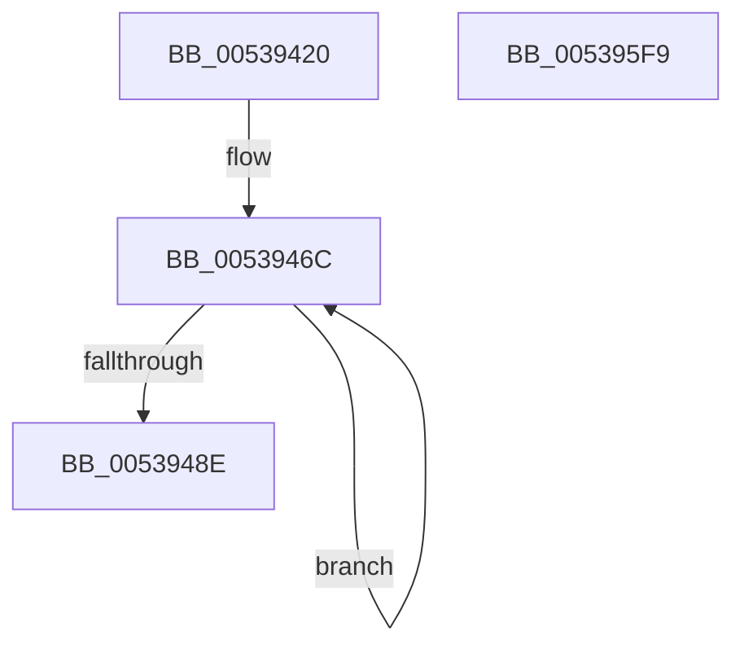

# SymCryptShortWeierstrassOnCurve

- RVA: `0x00539420`–`0x005395FA` (길이 `474` bytes)
- VA: `0x0000000140539420`
- 실행 섹션: `.text`
- PDB 이름 있음: `예`; PDB Function 태그: `아니요`
- unwind 정보 RVA: `0x000C5BD0`
- 디코드: `131`개 명령, `474/474` bytes 표시
- 미해석 바이트: `0` (있으면 어셈블리에 `.byte`로 보존)

> 이 문서는 커널 이미지의 기계어와 PDB 기호를 분석해 생성했습니다. 4번과 5번은 함수 원형과 자료형을 바이너리 사용 방식에서 추정한 C 해석이며 원본 소스 복구 결과는 아닙니다.

## 1. Dependencies

- 직접 호출 지점: **14**; 고유 호출 대상: **6**
- 직접 호출자로 확인된 함수: **0**
- RIP 상대 이미지 참조: **1**

### Outgoing calls
- `0x00539475` → [SymCryptModElementCreate](../52/SymCryptModElementCreate_function_00525900.md) (function, `0x00525900`)
- `0x005394B3` → [SymCryptModSquare](../52/SymCryptModSquare_function_00525C84.md) (function, `0x00525C84`)
- `0x005394CE` → [SymCryptModSquare](../52/SymCryptModSquare_function_00525C84.md) (function, `0x00525C84`)
- `0x005394E9` → [SymCryptModMul](../52/SymCryptModMul_function_00525BA8.md) (function, `0x00525BA8`)
- `0x00539508` → [SymCryptModMul](../52/SymCryptModMul_function_00525BA8.md) (function, `0x00525BA8`)
- `0x00539523` → [SymCryptModMul](../52/SymCryptModMul_function_00525BA8.md) (function, `0x00525BA8`)
- `0x00539542` → [SymCryptModMul](../52/SymCryptModMul_function_00525BA8.md) (function, `0x00525BA8`)
- `0x0053955D` → [SymCryptModAdd](../52/SymCryptModAdd_function_00525868.md) (function, `0x00525868`)
- `0x00539573` → [SymCryptModSquare](../52/SymCryptModSquare_function_00525C84.md) (function, `0x00525C84`)
- `0x0053958E` → [SymCryptModMul](../52/SymCryptModMul_function_00525BA8.md) (function, `0x00525BA8`)
- `0x005395A9` → [SymCryptModAdd](../52/SymCryptModAdd_function_00525868.md) (function, `0x00525868`)
- `0x005395C8` → [SymCryptModSquare](../52/SymCryptModSquare_function_00525C84.md) (function, `0x00525C84`)
- `0x005395D6` → [SymCryptModElementIsEqual](../52/SymCryptModElementIsEqual_function_0052594C.md) (function, `0x0052594C`)
- `0x005395E3` → [_security_check_cookie](../6A/_security_check_cookie_function_006AC640.md) (function, `0x006AC640`)

### Direct callers
- 이 함수 시작 RVA로 연결되는 직접 call은 확인되지 않았습니다. 간접 호출은 완전히 역산할 수 없습니다.

### Static image references
- `0x00539431` → RVA `0x00E0A740` (`.data`; read)

## 2. Other-region calls and transfers

- 다른 실행 섹션으로 향하는 call: **0**
- 별도 외부 분기/꼬리 이동을 확인하지 못했습니다.

## 3. Assembly (complete function range)

```asm
00539420  40 53                           push rbx
00539422  55                              push rbp
00539423  56                              push rsi
00539424  57                              push rdi
00539425  41 54                           push r12
00539427  41 55                           push r13
00539429  41 56                           push r14
0053942B  41 57                           push r15
0053942D  48 83 EC 58                     sub rsp, 0x58
00539431  48 8B 05 08 13 8D 00            mov rax, qword ptr [rip + 0x8d1308]
00539438  48 33 C4                        xor rax, rsp
0053943B  48 89 44 24 48                  mov qword ptr [rsp + 0x48], rax
00539440  4C 8B A1 68 02 00 00            mov r12, qword ptr [rcx + 0x268]
00539447  48 8D 5C 24 38                  lea rbx, [rsp + 0x38]
0053944C  48 83 64 24 40 00               and qword ptr [rsp + 0x40], 0
00539452  4D 8B E9                        mov r13, r9
00539455  44 8B 79 24                     mov r15d, dword ptr [rcx + 0x24]
00539459  49 8B E8                        mov rbp, r8
0053945C  48 8B F2                        mov rsi, rdx
0053945F  48 89 54 24 30                  mov qword ptr [rsp + 0x30], rdx
00539464  4C 8B F1                        mov r14, rcx
00539467  BF 02 00 00 00                  mov edi, 2
0053946C  4D 8B C4                        mov r8, r12
0053946F  49 8B D7                        mov rdx, r15
00539472  48 8B CD                        mov rcx, rbp
00539475  E8 86 C4 FE FF                  call 0x140525900
0053947A  45 8B 7E 24                     mov r15d, dword ptr [r14 + 0x24]
0053947E  49 03 EF                        add rbp, r15
00539481  48 89 03                        mov qword ptr [rbx], rax
00539484  48 8D 5B 08                     lea rbx, [rbx + 8]
00539488  48 83 EF 01                     sub rdi, 1
0053948C  75 DE                           jne 0x14053946c
0053948E  43 8D 0C 3F                     lea ecx, [r15 + r15]
00539492  4C 8B CD                        mov r9, rbp
00539495  4C 2B E9                        sub r13, rcx
00539498  48 8D 56 20                     lea rdx, [rsi + 0x20]
0053949C  48 03 D1                        add rdx, rcx
0053949F  4C 89 6C 24 20                  mov qword ptr [rsp + 0x20], r13
005394A4  48 8D 5E 20                     lea rbx, [rsi + 0x20]
005394A8  49 8B CC                        mov rcx, r12
005394AB  48 8B 74 24 38                  mov rsi, qword ptr [rsp + 0x38]
005394B0  4C 8B C6                        mov r8, rsi
005394B3  E8 CC C7 FE FF                  call 0x140525c84
005394B8  48 8B 7C 24 40                  mov rdi, qword ptr [rsp + 0x40]
005394BD  4C 8B CD                        mov r9, rbp
005394C0  4C 8B C7                        mov r8, rdi
005394C3  4C 89 6C 24 20                  mov qword ptr [rsp + 0x20], r13
005394C8  48 8B D6                        mov rdx, rsi
005394CB  49 8B CC                        mov rcx, r12
005394CE  E8 B1 C7 FE FF                  call 0x140525c84
005394D3  4C 8B CE                        mov r9, rsi
005394D6  4C 89 6C 24 28                  mov qword ptr [rsp + 0x28], r13
005394DB  4C 8B C7                        mov r8, rdi
005394DE  48 89 6C 24 20                  mov qword ptr [rsp + 0x20], rbp
005394E3  48 8B D6                        mov rdx, rsi
005394E6  49 8B CC                        mov rcx, r12
005394E9  E8 BA C6 FE FF                  call 0x140525ba8
005394EE  4D 8B 86 80 02 00 00            mov r8, qword ptr [r14 + 0x280]
005394F5  4C 8B CE                        mov r9, rsi
005394F8  48 8B D6                        mov rdx, rsi
005394FB  4C 89 6C 24 28                  mov qword ptr [rsp + 0x28], r13
00539500  49 8B CC                        mov rcx, r12
00539503  48 89 6C 24 20                  mov qword ptr [rsp + 0x20], rbp
00539508  E8 9B C6 FE FF                  call 0x140525ba8
0053950D  4C 8B CF                        mov r9, rdi
00539510  4C 89 6C 24 28                  mov qword ptr [rsp + 0x28], r13
00539515  4C 8B C3                        mov r8, rbx
00539518  48 89 6C 24 20                  mov qword ptr [rsp + 0x20], rbp
0053951D  48 8B D7                        mov rdx, rdi
00539520  49 8B CC                        mov rcx, r12
00539523  E8 80 C6 FE FF                  call 0x140525ba8
00539528  4D 8B 86 78 02 00 00            mov r8, qword ptr [r14 + 0x278]
0053952F  4C 8B CF                        mov r9, rdi
00539532  48 8B D7                        mov rdx, rdi
00539535  4C 89 6C 24 28                  mov qword ptr [rsp + 0x28], r13
0053953A  49 8B CC                        mov rcx, r12
0053953D  48 89 6C 24 20                  mov qword ptr [rsp + 0x20], rbp
00539542  E8 61 C6 FE FF                  call 0x140525ba8
00539547  4C 8B CF                        mov r9, rdi
0053954A  4C 89 6C 24 28                  mov qword ptr [rsp + 0x28], r13
0053954F  4C 8B C7                        mov r8, rdi
00539552  48 89 6C 24 20                  mov qword ptr [rsp + 0x20], rbp
00539557  48 8B D6                        mov rdx, rsi
0053955A  49 8B CC                        mov rcx, r12
0053955D  E8 06 C3 FE FF                  call 0x140525868
00539562  4C 8B CD                        mov r9, rbp
00539565  4C 89 6C 24 20                  mov qword ptr [rsp + 0x20], r13
0053956A  4C 8B C6                        mov r8, rsi
0053956D  48 8B D3                        mov rdx, rbx
00539570  49 8B CC                        mov rcx, r12
00539573  E8 0C C7 FE FF                  call 0x140525c84
00539578  4C 8B CE                        mov r9, rsi
0053957B  4C 89 6C 24 28                  mov qword ptr [rsp + 0x28], r13
00539580  4C 8B C3                        mov r8, rbx
00539583  48 89 6C 24 20                  mov qword ptr [rsp + 0x20], rbp
00539588  48 8B D6                        mov rdx, rsi
0053958B  49 8B CC                        mov rcx, r12
0053958E  E8 15 C6 FE FF                  call 0x140525ba8
00539593  4C 8B CF                        mov r9, rdi
00539596  4C 89 6C 24 28                  mov qword ptr [rsp + 0x28], r13
0053959B  4C 8B C7                        mov r8, rdi
0053959E  48 89 6C 24 20                  mov qword ptr [rsp + 0x20], rbp
005395A3  48 8B D6                        mov rdx, rsi
005395A6  49 8B CC                        mov rcx, r12
005395A9  E8 BA C2 FE FF                  call 0x140525868
005395AE  48 8B 54 24 30                  mov rdx, qword ptr [rsp + 0x30]
005395B3  4C 8B CD                        mov r9, rbp
005395B6  48 83 C2 20                     add rdx, 0x20
005395BA  4C 89 6C 24 20                  mov qword ptr [rsp + 0x20], r13
005395BF  49 03 D7                        add rdx, r15
005395C2  4C 8B C6                        mov r8, rsi
005395C5  49 8B CC                        mov rcx, r12
005395C8  E8 B7 C6 FE FF                  call 0x140525c84
005395CD  4C 8B C7                        mov r8, rdi
005395D0  48 8B D6                        mov rdx, rsi
005395D3  49 8B CC                        mov rcx, r12
005395D6  E8 71 C3 FE FF                  call 0x14052594c
005395DB  48 8B 4C 24 48                  mov rcx, qword ptr [rsp + 0x48]
005395E0  48 33 CC                        xor rcx, rsp
005395E3  E8 58 30 17 00                  call 0x1406ac640
005395E8  48 83 C4 58                     add rsp, 0x58
005395EC  41 5F                           pop r15
005395EE  41 5E                           pop r14
005395F0  41 5D                           pop r13
005395F2  41 5C                           pop r12
005395F4  5F                              pop rdi
005395F5  5E                              pop rsi
005395F6  5D                              pop rbp
005395F7  5B                              pop rbx
005395F8  C3                              ret
005395F9  CC                              int3
```

## 4. C-style interpretation (structured pseudocode)

```c
__int64 __fastcall SymCryptShortWeierstrassOnCurve(__int64 a1, __int64 a2, __int64 a3, __int64 a4)
{
    __int64 result;
    __int64 v_r13;
    __int64 v_rbp;
    __int64 v_rdi;
    __int64 v_rsp;
    unsigned __int64 v_stack_m50;
    unsigned __int64 v_stack_m58;
    unsigned __int64 v_stack_m60;
    unsigned __int64 v_stack_m68;
    unsigned __int64 v_stack_m70;
    unsigned __int64 v_stack_m78;

    v_rsp = (v_rsp) - (88);
    result = (*(unsigned __int64 *)(v_rip + 9245448)) ^ (v_rsp);
    v_stack_m50 = result;
    v_stack_m68 = a2;
loc_0053946C:
    result = SymCryptModElementCreate(a3, (unsigned int)(*(unsigned int *)(a1 + 36)), *(unsigned __int64 *)(a1 + 616), a4);
    v_rbp = (a3) + ((unsigned int)(*(unsigned int *)(a1 + 36)));
    *(unsigned __int64 *)(v_stack_m60) = result;
    v_rdi = (2) - (1);
    if (condition_is_not_equal) goto loc_0053946C;
    v_r13 = (a4) - ((unsigned int)(*(unsigned int *)(a1 + 36)) + (unsigned int)(*(unsigned int *)(a1 + 36)) * 1);
    a2 = (a2 + 32) + ((unsigned int)(*(unsigned int *)(a1 + 36)) + (unsigned int)(*(unsigned int *)(a1 + 36)) * 1);
    v_stack_m78 = v_r13;
    result = SymCryptModSquare(*(unsigned __int64 *)(a1 + 616), a2, v_stack_m60, v_rbp);
    v_stack_m78 = v_r13;
    result = SymCryptModSquare(*(unsigned __int64 *)(a1 + 616), v_stack_m60, v_stack_m58, v_rbp);
    v_stack_m70 = v_r13;
    v_stack_m78 = v_rbp;
    result = SymCryptModMul(*(unsigned __int64 *)(a1 + 616), v_stack_m60, v_stack_m58, v_stack_m60);
    v_stack_m70 = v_r13;
    v_stack_m78 = v_rbp;
    result = SymCryptModMul(*(unsigned __int64 *)(a1 + 616), v_stack_m60, *(unsigned __int64 *)(a1 + 640), v_stack_m60);
    v_stack_m70 = v_r13;
    v_stack_m78 = v_rbp;
    result = SymCryptModMul(*(unsigned __int64 *)(a1 + 616), v_stack_m58, a2 + 32, v_stack_m58);
    v_stack_m70 = v_r13;
    v_stack_m78 = v_rbp;
    result = SymCryptModMul(*(unsigned __int64 *)(a1 + 616), v_stack_m58, *(unsigned __int64 *)(a1 + 632), v_stack_m58);
    v_stack_m70 = v_r13;
    v_stack_m78 = v_rbp;
    result = SymCryptModAdd(*(unsigned __int64 *)(a1 + 616), v_stack_m60, v_stack_m58, v_stack_m58);
    v_stack_m78 = v_r13;
    result = SymCryptModSquare(*(unsigned __int64 *)(a1 + 616), a2 + 32, v_stack_m60, v_rbp);
    v_stack_m70 = v_r13;
    v_stack_m78 = v_rbp;
    result = SymCryptModMul(*(unsigned __int64 *)(a1 + 616), v_stack_m60, a2 + 32, v_stack_m60);
    v_stack_m70 = v_r13;
    v_stack_m78 = v_rbp;
    result = SymCryptModAdd(*(unsigned __int64 *)(a1 + 616), v_stack_m60, v_stack_m58, v_stack_m58);
    a2 = (v_stack_m68) + (32);
    v_stack_m78 = v_r13;
    a2 = (a2) + ((unsigned int)(*(unsigned int *)(a1 + 36)));
    result = SymCryptModSquare(*(unsigned __int64 *)(a1 + 616), a2, v_stack_m60, v_rbp);
    result = SymCryptModElementIsEqual(*(unsigned __int64 *)(a1 + 616), v_stack_m60, v_stack_m58, v_rbp);
    a1 = (v_stack_m50) ^ (v_rsp);
    result = _security_check_cookie(a1, v_stack_m60, v_stack_m58, v_rbp);
    v_rsp = (v_rsp) + (88);
    return result;
}
```

## 5. (Beta) C Style

```c
int64_t SymCryptShortWeierstrassOnCurve(void *Arg1, void *Arg2, int64_t Arg3, int64_t Arg4)
{
    uint8_t *arg1 = (uint8_t *)Arg1;
    uint8_t *arg2 = (uint8_t *)Arg2;

    int64_t result;
    int64_t local_r13;
    int64_t local_rbp;
    int64_t local_rdi;
    int64_t local_rsp;
    uint64_t v_stack_m50;
    uint64_t v_stack_m58;
    uint64_t v_stack_m60;
    uint64_t v_stack_m68;
    uint64_t v_stack_m70;
    uint64_t v_stack_m78;

    local_rsp = (local_rsp) - (88);
    result = (*(uint64_t *)(v_rip + 0x8D1308)) ^ (local_rsp);
    v_stack_m50 = result;
    v_stack_m68 = Arg2;
loc_0053946C:
    result = SymCryptModElementCreate(Arg3, (uint32_t)(*(uint32_t *)(arg1 + 0x24)), *(uint64_t *)(arg1 + 0x268), Arg4);
    local_rbp = (Arg3) + ((uint32_t)(*(uint32_t *)(arg1 + 0x24)));
    *(uint64_t *)(v_stack_m60) = result;
    local_rdi = (2) - (1);
    if (condition_is_not_equal) goto loc_0053946C;
    local_r13 = (Arg4) - ((uint32_t)(*(uint32_t *)(arg1 + 0x24)) + (uint32_t)(*(uint32_t *)(arg1 + 0x24)) * 1);
    Arg2 = (Arg2 + 32) + ((uint32_t)(*(uint32_t *)(arg1 + 0x24)) + (uint32_t)(*(uint32_t *)(arg1 + 0x24)) * 1);
    v_stack_m78 = local_r13;
    result = SymCryptModSquare(*(uint64_t *)(arg1 + 0x268), Arg2, v_stack_m60, local_rbp);
    v_stack_m78 = local_r13;
    result = SymCryptModSquare(*(uint64_t *)(arg1 + 0x268), v_stack_m60, v_stack_m58, local_rbp);
    v_stack_m70 = local_r13;
    v_stack_m78 = local_rbp;
    result = SymCryptModMul(*(uint64_t *)(arg1 + 0x268), v_stack_m60, v_stack_m58, v_stack_m60);
    v_stack_m70 = local_r13;
    v_stack_m78 = local_rbp;
    result = SymCryptModMul(*(uint64_t *)(arg1 + 0x268), v_stack_m60, *(uint64_t *)(arg1 + 0x280), v_stack_m60);
    v_stack_m70 = local_r13;
    v_stack_m78 = local_rbp;
    result = SymCryptModMul(*(uint64_t *)(arg1 + 0x268), v_stack_m58, Arg2 + 32, v_stack_m58);
    v_stack_m70 = local_r13;
    v_stack_m78 = local_rbp;
    result = SymCryptModMul(*(uint64_t *)(arg1 + 0x268), v_stack_m58, *(uint64_t *)(arg1 + 0x278), v_stack_m58);
    v_stack_m70 = local_r13;
    v_stack_m78 = local_rbp;
    result = SymCryptModAdd(*(uint64_t *)(arg1 + 0x268), v_stack_m60, v_stack_m58, v_stack_m58);
    v_stack_m78 = local_r13;
    result = SymCryptModSquare(*(uint64_t *)(arg1 + 0x268), Arg2 + 32, v_stack_m60, local_rbp);
    v_stack_m70 = local_r13;
    v_stack_m78 = local_rbp;
    result = SymCryptModMul(*(uint64_t *)(arg1 + 0x268), v_stack_m60, Arg2 + 32, v_stack_m60);
    v_stack_m70 = local_r13;
    v_stack_m78 = local_rbp;
    result = SymCryptModAdd(*(uint64_t *)(arg1 + 0x268), v_stack_m60, v_stack_m58, v_stack_m58);
    Arg2 = (v_stack_m68) + (32);
    v_stack_m78 = local_r13;
    Arg2 = (Arg2) + ((uint32_t)(*(uint32_t *)(arg1 + 0x24)));
    result = SymCryptModSquare(*(uint64_t *)(arg1 + 0x268), Arg2, v_stack_m60, local_rbp);
    result = SymCryptModElementIsEqual(*(uint64_t *)(arg1 + 0x268), v_stack_m60, v_stack_m58, local_rbp);
    Arg1 = (v_stack_m50) ^ (local_rsp);
    result = _security_check_cookie(Arg1, v_stack_m60, v_stack_m58, local_rbp);
    local_rsp = (local_rsp) + (88);
    return result;
}
```

### 관측된 메모리 오프셋

구조체 형식이 확인되지 않은 접근은 인자 기준의 오프셋으로만 기록했습니다.

| 기준 인자 | 오프셋 표현 | 폭 (bit) | 접근 |
|---|---:|---:|---|
| `Arg1` | `+ 0x24` | `32` | `R` |
| `Arg1` | `+ 0x268` | `64` | `R` |
| `Arg1` | `+ 0x278` | `64` | `R` |
| `Arg1` | `+ 0x280` | `64` | `R` |
| `Arg2` | `+ 0x20` | `64` | `R` |

## 6. Execution-region graph

[열기: 2D/3D 그래프와 함수 탐색 컨트롤 패널](../../../control-panel.html?section=text&rva=0x00539420&view=graph)

- 2D 그래프는 위에서 아래로 흐르고, 3D 그래프는 빈 공간을 드래그해 회전합니다. Shift+드래그는 이동, 휠은 확대·축소, 함수 노드 선택은 대상 보고서 이동입니다.

### Static fallback


