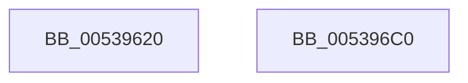

# SymCryptShortWeierstrassSetZero

- RVA: `0x00539620`–`0x005396C1` (길이 `161` bytes)
- VA: `0x0000000140539620`
- 실행 섹션: `.text`
- PDB 이름 있음: `예`; PDB Function 태그: `아니요`
- unwind 정보 RVA: `0x0005D7BC`
- 디코드: `43`개 명령, `161/161` bytes 표시
- 미해석 바이트: `0` (있으면 어셈블리에 `.byte`로 보존)

> 이 문서는 커널 이미지의 기계어와 PDB 기호를 분석해 생성했습니다. 4번과 5번은 함수 원형과 자료형을 바이너리 사용 방식에서 추정한 C 해석이며 원본 소스 복구 결과는 아닙니다.

## 1. Dependencies

- 직접 호출 지점: **3**; 고유 호출 대상: **1**
- 직접 호출자로 확인된 함수: **0**
- RIP 상대 이미지 참조: **0**

### Outgoing calls
- `0x0053965F` → [SymCryptModElementSetValueUint32](../52/SymCryptModElementSetValueUint32_function_00525A40.md) (function, `0x00525A40`)
- `0x0053967E` → [SymCryptModElementSetValueUint32](../52/SymCryptModElementSetValueUint32_function_00525A40.md) (function, `0x00525A40`)
- `0x005396A0` → [SymCryptModElementSetValueUint32](../52/SymCryptModElementSetValueUint32_function_00525A40.md) (function, `0x00525A40`)

### Direct callers
- 이 함수 시작 RVA로 연결되는 직접 call은 확인되지 않았습니다. 간접 호출은 완전히 역산할 수 없습니다.

### Static image references
- 디코드된 RIP-relative 메모리 참조가 없습니다.

## 2. Other-region calls and transfers

- 다른 실행 섹션으로 향하는 call: **0**
- 별도 외부 분기/꼬리 이동을 확인하지 못했습니다.

## 3. Assembly (complete function range)

```asm
00539620  48 8B C4                        mov rax, rsp
00539623  48 89 58 08                     mov qword ptr [rax + 8], rbx
00539627  48 89 68 10                     mov qword ptr [rax + 0x10], rbp
0053962B  48 89 70 18                     mov qword ptr [rax + 0x18], rsi
0053962F  48 89 78 20                     mov qword ptr [rax + 0x20], rdi
00539633  41 56                           push r14
00539635  48 83 EC 30                     sub rsp, 0x30
00539639  48 8B 99 68 02 00 00            mov rbx, qword ptr [rcx + 0x268]
00539640  4D 8B F0                        mov r14, r8
00539643  4C 8D 42 20                     lea r8, [rdx + 0x20]
00539647  4C 89 48 E8                     mov qword ptr [rax - 0x18], r9
0053964B  49 8B E9                        mov rbp, r9
0053964E  48 8B FA                        mov rdi, rdx
00539651  48 8B F1                        mov rsi, rcx
00539654  4D 8B CE                        mov r9, r14
00539657  48 8B D3                        mov rdx, rbx
0053965A  B9 01 00 00 00                  mov ecx, 1
0053965F  E8 DC C3 FE FF                  call 0x140525a40
00539664  8B 46 24                        mov eax, dword ptr [rsi + 0x24]
00539667  4C 8D 47 20                     lea r8, [rdi + 0x20]
0053966B  4C 03 C0                        add r8, rax
0053966E  48 89 6C 24 20                  mov qword ptr [rsp + 0x20], rbp
00539673  4D 8B CE                        mov r9, r14
00539676  48 8B D3                        mov rdx, rbx
00539679  B9 01 00 00 00                  mov ecx, 1
0053967E  E8 BD C3 FE FF                  call 0x140525a40
00539683  8B 46 24                        mov eax, dword ptr [rsi + 0x24]
00539686  4C 8D 47 20                     lea r8, [rdi + 0x20]
0053968A  48 8B 96 68 02 00 00            mov rdx, qword ptr [rsi + 0x268]
00539691  03 C0                           add eax, eax
00539693  4C 03 C0                        add r8, rax
00539696  48 89 6C 24 20                  mov qword ptr [rsp + 0x20], rbp
0053969B  4D 8B CE                        mov r9, r14
0053969E  33 C9                           xor ecx, ecx
005396A0  E8 9B C3 FE FF                  call 0x140525a40
005396A5  48 8B 5C 24 40                  mov rbx, qword ptr [rsp + 0x40]
005396AA  48 8B 6C 24 48                  mov rbp, qword ptr [rsp + 0x48]
005396AF  48 8B 74 24 50                  mov rsi, qword ptr [rsp + 0x50]
005396B4  48 8B 7C 24 58                  mov rdi, qword ptr [rsp + 0x58]
005396B9  48 83 C4 30                     add rsp, 0x30
005396BD  41 5E                           pop r14
005396BF  C3                              ret
005396C0  CC                              int3
```

## 4. C-style interpretation (structured pseudocode)

```c
__int64 __fastcall SymCryptShortWeierstrassSetZero(__int64 a1, __int64 a2, __int64 a3, __int64 a4)
{
    __int64 result;
    __int64 v_rsp;
    unsigned __int64 v_stack_m18;
    unsigned __int64 v_stack_p10;
    unsigned __int64 v_stack_p18;
    unsigned __int64 v_stack_p20;
    unsigned __int64 v_stack_p8;

    *(unsigned __int64 *)(v_rsp + 8) = v_rbx;
    *(unsigned __int64 *)(v_rsp + 16) = v_rbp;
    *(unsigned __int64 *)(v_rsp + 24) = v_rsi;
    *(unsigned __int64 *)(v_rsp + 32) = v_rdi;
    v_rsp = (v_rsp) - (48);
    *(unsigned __int64 *)(v_rsp - 24) = a4;
    result = SymCryptModElementSetValueUint32(1, *(unsigned __int64 *)(a1 + 616), a2 + 32, a3);
    a3 = (a2 + 32) + ((unsigned int)(*(unsigned int *)(a1 + 36)));
    v_stack_m18 = a4;
    result = SymCryptModElementSetValueUint32(1, *(unsigned __int64 *)(a1 + 616), a3, a3);
    result = (unsigned int)(((unsigned int)(*(unsigned int *)(a1 + 36))) + ((unsigned int)((unsigned int)(*(unsigned int *)(a1 + 36)))));
    a3 = (a2 + 32) + (result);
    v_stack_m18 = a4;
    a1 = 0;
    result = SymCryptModElementSetValueUint32(a1, *(unsigned __int64 *)(a1 + 616), a3, a3);
    v_rsp = (v_rsp) + (48);
    return result;
}
```

## 5. (Beta) C Style

```c
int64_t SymCryptShortWeierstrassSetZero(void *Arg1, void *Arg2, int64_t Arg3, int64_t Arg4)
{
    uint8_t *arg1 = (uint8_t *)Arg1;
    uint8_t *arg2 = (uint8_t *)Arg2;

    int64_t result;
    int64_t local_rsp;
    uint64_t v_stack_m18;
    uint64_t v_stack_p10;
    uint64_t v_stack_p18;
    uint64_t v_stack_p20;
    uint64_t v_stack_p8;

    *(uint64_t *)(local_rsp + 0x8) = local_rbx;
    *(uint64_t *)(local_rsp + 0x10) = local_rbp;
    *(uint64_t *)(local_rsp + 0x18) = local_rsi;
    *(uint64_t *)(local_rsp + 0x20) = local_rdi;
    local_rsp = (local_rsp) - (48);
    *(uint64_t *)(local_rsp - 0x18) = Arg4;
    result = SymCryptModElementSetValueUint32(1, *(uint64_t *)(arg1 + 0x268), Arg2 + 32, Arg3);
    Arg3 = (Arg2 + 32) + ((uint32_t)(*(uint32_t *)(arg1 + 0x24)));
    v_stack_m18 = Arg4;
    result = SymCryptModElementSetValueUint32(1, *(uint64_t *)(arg1 + 0x268), Arg3, Arg3);
    result = (uint32_t)(((uint32_t)(*(uint32_t *)(arg1 + 0x24))) + ((uint32_t)((uint32_t)(*(uint32_t *)(arg1 + 0x24)))));
    Arg3 = (Arg2 + 32) + (result);
    v_stack_m18 = Arg4;
    Arg1 = 0;
    result = SymCryptModElementSetValueUint32(Arg1, *(uint64_t *)(arg1 + 0x268), Arg3, Arg3);
    local_rsp = (local_rsp) + (48);
    return result;
}
```

### 관측된 메모리 오프셋

구조체 형식이 확인되지 않은 접근은 인자 기준의 오프셋으로만 기록했습니다.

| 기준 인자 | 오프셋 표현 | 폭 (bit) | 접근 |
|---|---:|---:|---|
| `Arg1` | `+ 0x24` | `32` | `R` |
| `Arg1` | `+ 0x268` | `64` | `R` |
| `Arg2` | `+ 0x20` | `64` | `R` |

## 6. Execution-region graph

[열기: 2D/3D 그래프와 함수 탐색 컨트롤 패널](../../../control-panel.html?section=text&rva=0x00539620&view=graph)

- 2D 그래프는 위에서 아래로 흐르고, 3D 그래프는 빈 공간을 드래그해 회전합니다. Shift+드래그는 이동, 휠은 확대·축소, 함수 노드 선택은 대상 보고서 이동입니다.

### Static fallback


