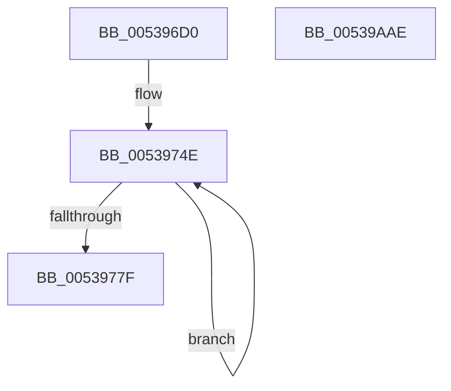

# SymCryptTwistedEdwardsAdd

- RVA: `0x005396D0`–`0x00539AAF` (길이 `991` bytes)
- VA: `0x00000001405396D0`
- 실행 섹션: `.text`
- PDB 이름 있음: `예`; PDB Function 태그: `아니요`
- unwind 정보 RVA: `0x000C35FC`
- 디코드: `228`개 명령, `991/991` bytes 표시
- 미해석 바이트: `0` (있으면 어셈블리에 `.byte`로 보존)

> 이 문서는 커널 이미지의 기계어와 PDB 기호를 분석해 생성했습니다. 4번과 5번은 함수 원형과 자료형을 바이너리 사용 방식에서 추정한 C 해석이며 원본 소스 복구 결과는 아닙니다.

## 1. Dependencies

- 직접 호출 지점: **22**; 고유 호출 대상: **7**
- 직접 호출자로 확인된 함수: **1**
- RIP 상대 이미지 참조: **1**

### Outgoing calls
- `0x00539726` → [memset](../6C/memset_function_006C6C40.md) (function, `0x006C6C40`)
- `0x0053973A` → [SymCryptSizeofModElementFromModulus](../52/SymCryptSizeofModElementFromModulus_function_00525D3C.md) (function, `0x00525D3C`)
- `0x00539757` → [SymCryptModElementCreate](../52/SymCryptModElementCreate_function_00525900.md) (function, `0x00525900`)
- `0x005397D3` → [SymCryptModMul](../52/SymCryptModMul_function_00525BA8.md) (function, `0x00525BA8`)
- `0x005397FF` → [SymCryptModMul](../52/SymCryptModMul_function_00525BA8.md) (function, `0x00525BA8`)
- `0x0053983E` → [SymCryptModMul](../52/SymCryptModMul_function_00525BA8.md) (function, `0x00525BA8`)
- `0x00539869` → [SymCryptModMul](../52/SymCryptModMul_function_00525BA8.md) (function, `0x00525BA8`)
- `0x005398A8` → [SymCryptModMul](../52/SymCryptModMul_function_00525BA8.md) (function, `0x00525BA8`)
- `0x005398D3` → [SymCryptModAdd](../52/SymCryptModAdd_function_00525868.md) (function, `0x00525868`)
- `0x00539909` → [SymCryptModAdd](../52/SymCryptModAdd_function_00525868.md) (function, `0x00525868`)
- `0x00539929` → [SymCryptModMul](../52/SymCryptModMul_function_00525BA8.md) (function, `0x00525BA8`)
- `0x00539944` → [SymCryptModSub](../52/SymCryptModSub_function_00525CB8.md) (function, `0x00525CB8`)
- `0x00539964` → [SymCryptModSub](../52/SymCryptModSub_function_00525CB8.md) (function, `0x00525CB8`)
- `0x0053997F` → [SymCryptModSub](../52/SymCryptModSub_function_00525CB8.md) (function, `0x00525CB8`)
- `0x005399A7` → [SymCryptModAdd](../52/SymCryptModAdd_function_00525868.md) (function, `0x00525868`)
- `0x005399D3` → [SymCryptModMul](../52/SymCryptModMul_function_00525BA8.md) (function, `0x00525BA8`)
- `0x005399FB` → [SymCryptModSub](../52/SymCryptModSub_function_00525CB8.md) (function, `0x00525CB8`)
- `0x00539A1C` → [SymCryptModMul](../52/SymCryptModMul_function_00525BA8.md) (function, `0x00525BA8`)
- `0x00539A40` → [SymCryptModMul](../52/SymCryptModMul_function_00525BA8.md) (function, `0x00525BA8`)
- `0x00539A64` → [SymCryptModMul](../52/SymCryptModMul_function_00525BA8.md) (function, `0x00525BA8`)
- `0x00539A85` → [SymCryptModMul](../52/SymCryptModMul_function_00525BA8.md) (function, `0x00525BA8`)
- `0x00539A95` → [_security_check_cookie](../6A/_security_check_cookie_function_006AC640.md) (function, `0x006AC640`)

### Direct callers
- [SymCryptTwistedEdwardsAddDiffNonZero](SymCryptTwistedEdwardsAddDiffNonZero_function_00539AC0.md) at `0x00539ADD`

### Static image references
- `0x005396E4` → RVA `0x00E0A740` (`.data`; read)

## 2. Other-region calls and transfers

- 다른 실행 섹션으로 향하는 call: **0**
- 별도 외부 분기/꼬리 이동을 확인하지 못했습니다.

## 3. Assembly (complete function range)

```asm
005396D0  40 53                           push rbx
005396D2  55                              push rbp
005396D3  56                              push rsi
005396D4  57                              push rdi
005396D5  41 54                           push r12
005396D7  41 55                           push r13
005396D9  41 56                           push r14
005396DB  41 57                           push r15
005396DD  48 81 EC D8 00 00 00            sub rsp, 0xd8
005396E4  48 8B 05 55 10 8D 00            mov rax, qword ptr [rip + 0x8d1055]
005396EB  48 33 C4                        xor rax, rsp
005396EE  48 89 84 24 C0 00 00 00         mov qword ptr [rsp + 0xc0], rax
005396F6  4C 8B BC 24 48 01 00 00         mov r15, qword ptr [rsp + 0x148]
005396FE  4C 8B EA                        mov r13, rdx
00539701  48 89 54 24 48                  mov qword ptr [rsp + 0x48], rdx
00539706  4C 8B F1                        mov r14, rcx
00539709  33 D2                           xor edx, edx
0053970B  4C 89 44 24 40                  mov qword ptr [rsp + 0x40], r8
00539710  48 89 4C 24 50                  mov qword ptr [rsp + 0x50], rcx
00539715  48 8D 8C 24 80 00 00 00         lea rcx, [rsp + 0x80]
0053971D  4C 89 4C 24 58                  mov qword ptr [rsp + 0x58], r9
00539722  44 8D 42 40                     lea r8d, [rdx + 0x40]
00539726  E8 15 D5 18 00                  call 0x1406c6c40
0053972B  49 8B B6 68 02 00 00            mov rsi, qword ptr [r14 + 0x268]
00539732  48 8B CE                        mov rcx, rsi
00539735  48 89 74 24 30                  mov qword ptr [rsp + 0x30], rsi
0053973A  E8 FD C5 FE FF                  call 0x140525d3c
0053973F  8B D8                           mov ebx, eax
00539741  48 8D BC 24 80 00 00 00         lea rdi, [rsp + 0x80]
00539749  BD 08 00 00 00                  mov ebp, 8
0053974E  4C 8B C6                        mov r8, rsi
00539751  48 8B D3                        mov rdx, rbx
00539754  49 8B CF                        mov rcx, r15
00539757  E8 A4 C1 FE FF                  call 0x140525900
0053975C  48 8B 94 24 50 01 00 00         mov rdx, qword ptr [rsp + 0x150]
00539764  4C 03 FB                        add r15, rbx
00539767  48 2B D3                        sub rdx, rbx
0053976A  48 89 07                        mov qword ptr [rdi], rax
0053976D  48 89 94 24 50 01 00 00         mov qword ptr [rsp + 0x150], rdx
00539775  48 8D 7F 08                     lea rdi, [rdi + 8]
00539779  48 83 ED 01                     sub rbp, 1
0053977D  75 CF                           jne 0x14053974e
0053977F  41 8B 4E 24                     mov ecx, dword ptr [r14 + 0x24]
00539783  49 8D 6D 20                     lea rbp, [r13 + 0x20]
00539787  48 8B 44 24 40                  mov rax, qword ptr [rsp + 0x40]
0053978C  48 89 54 24 28                  mov qword ptr [rsp + 0x28], rdx
00539791  48 8B D5                        mov rdx, rbp
00539794  48 89 4C 24 60                  mov qword ptr [rsp + 0x60], rcx
00539799  4A 8D 1C 29                     lea rbx, [rcx + r13]
0053979D  4C 89 7C 24 38                  mov qword ptr [rsp + 0x38], r15
005397A2  4C 8B AC 24 80 00 00 00         mov r13, qword ptr [rsp + 0x80]
005397AA  44 8D 24 09                     lea r12d, [rcx + rcx]
005397AE  8D 34 49                        lea esi, [rcx + rcx*2]
005397B1  4C 89 64 24 70                  mov qword ptr [rsp + 0x70], r12
005397B6  4C 8D 70 20                     lea r14, [rax + 0x20]
005397BA  48 89 74 24 68                  mov qword ptr [rsp + 0x68], rsi
005397BF  48 8D 3C 01                     lea rdi, [rcx + rax]
005397C3  4C 89 7C 24 20                  mov qword ptr [rsp + 0x20], r15
005397C8  48 8B 4C 24 30                  mov rcx, qword ptr [rsp + 0x30]
005397CD  4D 8B CD                        mov r9, r13
005397D0  4D 8B C6                        mov r8, r14
005397D3  E8 D0 C3 FE FF                  call 0x140525ba8
005397D8  48 8B 84 24 50 01 00 00         mov rax, qword ptr [rsp + 0x150]
005397E0  4C 8D 47 20                     lea r8, [rdi + 0x20]
005397E4  4C 8B 8C 24 88 00 00 00         mov r9, qword ptr [rsp + 0x88]
005397EC  48 8D 53 20                     lea rdx, [rbx + 0x20]
005397F0  48 8B 4C 24 30                  mov rcx, qword ptr [rsp + 0x30]
005397F5  48 89 44 24 28                  mov qword ptr [rsp + 0x28], rax
005397FA  4C 89 7C 24 20                  mov qword ptr [rsp + 0x20], r15
005397FF  E8 A4 C3 FE FF                  call 0x140525ba8
00539804  4C 8B 44 24 40                  mov r8, qword ptr [rsp + 0x40]
00539809  48 8B 54 24 48                  mov rdx, qword ptr [rsp + 0x48]
0053980E  49 83 C0 20                     add r8, 0x20
00539812  48 8B 4C 24 30                  mov rcx, qword ptr [rsp + 0x30]
00539817  48 83 C2 20                     add rdx, 0x20
0053981B  4C 03 C6                        add r8, rsi
0053981E  48 03 D6                        add rdx, rsi
00539821  48 8B B4 24 50 01 00 00         mov rsi, qword ptr [rsp + 0x150]
00539829  48 89 74 24 28                  mov qword ptr [rsp + 0x28], rsi
0053982E  4C 89 7C 24 20                  mov qword ptr [rsp + 0x20], r15
00539833  4C 8B BC 24 90 00 00 00         mov r15, qword ptr [rsp + 0x90]
0053983B  4D 8B CF                        mov r9, r15
0053983E  E8 65 C3 FE FF                  call 0x140525ba8
00539843  48 8B 54 24 50                  mov rdx, qword ptr [rsp + 0x50]
00539848  4D 8B CF                        mov r9, r15
0053984B  48 8B 4C 24 30                  mov rcx, qword ptr [rsp + 0x30]
00539850  4D 8B C7                        mov r8, r15
00539853  48 89 74 24 28                  mov qword ptr [rsp + 0x28], rsi
00539858  48 8B 74 24 38                  mov rsi, qword ptr [rsp + 0x38]
0053985D  48 8B 92 80 02 00 00            mov rdx, qword ptr [rdx + 0x280]
00539864  48 89 74 24 20                  mov qword ptr [rsp + 0x20], rsi
00539869  E8 3A C3 FE FF                  call 0x140525ba8
0053986E  4C 8B 44 24 40                  mov r8, qword ptr [rsp + 0x40]
00539873  48 8B 54 24 48                  mov rdx, qword ptr [rsp + 0x48]
00539878  49 83 C0 20                     add r8, 0x20
0053987C  48 8B 4C 24 30                  mov rcx, qword ptr [rsp + 0x30]
00539881  48 83 C2 20                     add rdx, 0x20
00539885  4D 03 C4                        add r8, r12
00539888  49 03 D4                        add rdx, r12
0053988B  4C 8B A4 24 50 01 00 00         mov r12, qword ptr [rsp + 0x150]
00539893  4C 89 64 24 28                  mov qword ptr [rsp + 0x28], r12
00539898  48 89 74 24 20                  mov qword ptr [rsp + 0x20], rsi
0053989D  48 8B B4 24 98 00 00 00         mov rsi, qword ptr [rsp + 0x98]
005398A5  4C 8B CE                        mov r9, rsi
005398A8  E8 FB C2 FE FF                  call 0x140525ba8
005398AD  48 8B 44 24 38                  mov rax, qword ptr [rsp + 0x38]
005398B2  4C 8D 43 20                     lea r8, [rbx + 0x20]
005398B6  48 8B 4C 24 30                  mov rcx, qword ptr [rsp + 0x30]
005398BB  48 8B D5                        mov rdx, rbp
005398BE  4C 89 64 24 28                  mov qword ptr [rsp + 0x28], r12
005398C3  4C 8B A4 24 A0 00 00 00         mov r12, qword ptr [rsp + 0xa0]
005398CB  4D 8B CC                        mov r9, r12
005398CE  48 89 44 24 20                  mov qword ptr [rsp + 0x20], rax
005398D3  E8 90 BF FE FF                  call 0x140525868
005398D8  48 8B 9C 24 50 01 00 00         mov rbx, qword ptr [rsp + 0x150]
005398E0  4C 8D 47 20                     lea r8, [rdi + 0x20]
005398E4  48 8B 44 24 38                  mov rax, qword ptr [rsp + 0x38]
005398E9  49 8B D6                        mov rdx, r14
005398EC  48 8B AC 24 A8 00 00 00         mov rbp, qword ptr [rsp + 0xa8]
005398F4  48 8B 7C 24 30                  mov rdi, qword ptr [rsp + 0x30]
005398F9  4C 8B CD                        mov r9, rbp
005398FC  48 89 5C 24 28                  mov qword ptr [rsp + 0x28], rbx
00539901  48 89 44 24 20                  mov qword ptr [rsp + 0x20], rax
00539906  48 8B CF                        mov rcx, rdi
00539909  E8 5A BF FE FF                  call 0x140525868
0053990E  4C 8B 74 24 38                  mov r14, qword ptr [rsp + 0x38]
00539913  4D 8B CC                        mov r9, r12
00539916  4C 8B C5                        mov r8, rbp
00539919  48 89 5C 24 28                  mov qword ptr [rsp + 0x28], rbx
0053991E  49 8B D4                        mov rdx, r12
00539921  4C 89 74 24 20                  mov qword ptr [rsp + 0x20], r14
00539926  48 8B CF                        mov rcx, rdi
00539929  E8 7A C2 FE FF                  call 0x140525ba8
0053992E  4D 8B CC                        mov r9, r12
00539931  48 89 5C 24 28                  mov qword ptr [rsp + 0x28], rbx
00539936  4D 8B C5                        mov r8, r13
00539939  4C 89 74 24 20                  mov qword ptr [rsp + 0x20], r14
0053993E  49 8B D4                        mov rdx, r12
00539941  48 8B CF                        mov rcx, rdi
00539944  E8 6F C3 FE FF                  call 0x140525cb8
00539949  4C 8B 84 24 88 00 00 00         mov r8, qword ptr [rsp + 0x88]
00539951  4D 8B CC                        mov r9, r12
00539954  49 8B D4                        mov rdx, r12
00539957  48 89 5C 24 28                  mov qword ptr [rsp + 0x28], rbx
0053995C  48 8B CF                        mov rcx, rdi
0053995F  4C 89 74 24 20                  mov qword ptr [rsp + 0x20], r14
00539964  E8 4F C3 FE FF                  call 0x140525cb8
00539969  4C 8B CD                        mov r9, rbp
0053996C  48 89 5C 24 28                  mov qword ptr [rsp + 0x28], rbx
00539971  4D 8B C7                        mov r8, r15
00539974  4C 89 74 24 20                  mov qword ptr [rsp + 0x20], r14
00539979  48 8B D6                        mov rdx, rsi
0053997C  48 8B CF                        mov rcx, rdi
0053997F  E8 34 C3 FE FF                  call 0x140525cb8
00539984  48 8B BC 24 B0 00 00 00         mov rdi, qword ptr [rsp + 0xb0]
0053998C  4D 8B C7                        mov r8, r15
0053998F  4C 8B 7C 24 30                  mov r15, qword ptr [rsp + 0x30]
00539994  4C 8B CF                        mov r9, rdi
00539997  49 8B CF                        mov rcx, r15
0053999A  48 89 5C 24 28                  mov qword ptr [rsp + 0x28], rbx
0053999F  48 8B D6                        mov rdx, rsi
005399A2  4C 89 74 24 20                  mov qword ptr [rsp + 0x20], r14
005399A7  E8 BC BE FE FF                  call 0x140525868
005399AC  48 8B 44 24 50                  mov rax, qword ptr [rsp + 0x50]
005399B1  4D 8B C5                        mov r8, r13
005399B4  48 89 5C 24 28                  mov qword ptr [rsp + 0x28], rbx
005399B9  49 8B CF                        mov rcx, r15
005399BC  48 8B 9C 24 B8 00 00 00         mov rbx, qword ptr [rsp + 0xb8]
005399C4  4C 8B CB                        mov r9, rbx
005399C7  4C 89 74 24 20                  mov qword ptr [rsp + 0x20], r14
005399CC  48 8B 90 78 02 00 00            mov rdx, qword ptr [rax + 0x278]
005399D3  E8 D0 C1 FE FF                  call 0x140525ba8
005399D8  48 8B B4 24 50 01 00 00         mov rsi, qword ptr [rsp + 0x150]
005399E0  4C 8B CB                        mov r9, rbx
005399E3  48 8B 94 24 88 00 00 00         mov rdx, qword ptr [rsp + 0x88]
005399EB  4C 8B C3                        mov r8, rbx
005399EE  48 89 74 24 28                  mov qword ptr [rsp + 0x28], rsi
005399F3  49 8B CF                        mov rcx, r15
005399F6  4C 89 74 24 20                  mov qword ptr [rsp + 0x20], r14
005399FB  E8 B8 C2 FE FF                  call 0x140525cb8
00539A00  4C 8B 6C 24 58                  mov r13, qword ptr [rsp + 0x58]
00539A05  4C 8B C5                        mov r8, rbp
00539A08  48 89 74 24 28                  mov qword ptr [rsp + 0x28], rsi
00539A0D  49 8B D4                        mov rdx, r12
00539A10  49 8B CF                        mov rcx, r15
00539A13  4C 89 74 24 20                  mov qword ptr [rsp + 0x20], r14
00539A18  4D 8D 4D 20                     lea r9, [r13 + 0x20]
00539A1C  E8 87 C1 FE FF                  call 0x140525ba8
00539A21  4C 8B 4C 24 60                  mov r9, qword ptr [rsp + 0x60]
00539A26  4C 8B C3                        mov r8, rbx
00539A29  49 83 C1 20                     add r9, 0x20
00539A2D  48 89 74 24 28                  mov qword ptr [rsp + 0x28], rsi
00539A32  4D 03 CD                        add r9, r13
00539A35  4C 89 74 24 20                  mov qword ptr [rsp + 0x20], r14
00539A3A  48 8B D7                        mov rdx, rdi
00539A3D  49 8B CF                        mov rcx, r15
00539A40  E8 63 C1 FE FF                  call 0x140525ba8
00539A45  4C 8B 4C 24 68                  mov r9, qword ptr [rsp + 0x68]
00539A4A  4C 8B C3                        mov r8, rbx
00539A4D  49 83 C1 20                     add r9, 0x20
00539A51  48 89 74 24 28                  mov qword ptr [rsp + 0x28], rsi
00539A56  4D 03 CD                        add r9, r13
00539A59  4C 89 74 24 20                  mov qword ptr [rsp + 0x20], r14
00539A5E  49 8B D4                        mov rdx, r12
00539A61  49 8B CF                        mov rcx, r15
00539A64  E8 3F C1 FE FF                  call 0x140525ba8
00539A69  4D 8D 4D 20                     lea r9, [r13 + 0x20]
00539A6D  48 89 74 24 28                  mov qword ptr [rsp + 0x28], rsi
00539A72  4C 03 4C 24 70                  add r9, qword ptr [rsp + 0x70]
00539A77  4C 8B C7                        mov r8, rdi
00539A7A  48 8B D5                        mov rdx, rbp
00539A7D  4C 89 74 24 20                  mov qword ptr [rsp + 0x20], r14
00539A82  49 8B CF                        mov rcx, r15
00539A85  E8 1E C1 FE FF                  call 0x140525ba8
00539A8A  48 8B 8C 24 C0 00 00 00         mov rcx, qword ptr [rsp + 0xc0]
00539A92  48 33 CC                        xor rcx, rsp
00539A95  E8 A6 2B 17 00                  call 0x1406ac640
00539A9A  48 81 C4 D8 00 00 00            add rsp, 0xd8
00539AA1  41 5F                           pop r15
00539AA3  41 5E                           pop r14
00539AA5  41 5D                           pop r13
00539AA7  41 5C                           pop r12
00539AA9  5F                              pop rdi
00539AAA  5E                              pop rsi
00539AAB  5D                              pop rbp
00539AAC  5B                              pop rbx
00539AAD  C3                              ret
00539AAE  CC                              int3
```

## 4. C-style interpretation (structured pseudocode)

```c
__int64 __fastcall SymCryptTwistedEdwardsAdd(__int64 a1, __int64 a2, __int64 a3, __int64 a4, __int64 a5, __int64 a6, __int64 a7)
{
    __int64 result;
    __int64 v_r15;
    __int64 v_rbp;
    __int64 v_rsp;
    unsigned __int64 v_stack_m58;
    unsigned __int64 v_stack_m60;
    unsigned __int64 v_stack_m68;
    unsigned __int64 v_stack_m70;
    unsigned __int64 v_stack_m78;
    unsigned __int64 v_stack_m80;
    unsigned __int64 v_stack_m88;
    unsigned __int64 v_stack_m90;
    unsigned __int64 v_stack_m98;
    unsigned __int64 v_stack_mA8;
    unsigned __int64 v_stack_mB0;
    unsigned __int64 v_stack_mB8;
    unsigned __int64 v_stack_mC0;
    unsigned __int64 v_stack_mC8;
    unsigned __int64 v_stack_mD0;
    unsigned __int64 v_stack_mD8;
    unsigned __int64 v_stack_mE0;
    unsigned __int64 v_stack_mE8;
    unsigned __int64 v_stack_mF0;
    unsigned __int64 v_stack_mF8;
    unsigned __int64 v_stack_p38;

    v_rsp = (v_rsp) - (216);
    result = (*(unsigned __int64 *)(v_rip + 9244757)) ^ (v_rsp);
    v_stack_m58 = result;
    v_stack_mD0 = a2;
    a2 = 0;
    v_stack_mD8 = a3;
    v_stack_mC8 = a1;
    v_stack_mC0 = a4;
    result = memset(v_stack_m98, a2, a2 + 64, a4);
    v_stack_mE8 = *(unsigned __int64 *)(a1 + 616);
    result = SymCryptSizeofModElementFromModulus(*(unsigned __int64 *)(a1 + 616), a2, a2 + 64, a4);
loc_0053974E:
    result = SymCryptModElementCreate(a6, (unsigned int)((unsigned int)(result)), *(unsigned __int64 *)(a1 + 616), a4);
    v_r15 = (a6) + ((unsigned int)((unsigned int)(result)));
    a2 = (a7) - ((unsigned int)((unsigned int)(result)));
    *(unsigned __int64 *)(v_stack_m98) = result;
    v_stack_p38 = a2;
    v_rbp = (8) - (1);
    if (condition_is_not_equal) goto loc_0053974E;
    v_stack_mF0 = a2;
    v_stack_mB8 = (unsigned int)(*(unsigned int *)(a1 + 36));
    v_stack_mE0 = v_r15;
    v_stack_mA8 = (unsigned int)(*(unsigned int *)(a1 + 36)) + (unsigned int)(*(unsigned int *)(a1 + 36)) * 1;
    v_stack_mB0 = (unsigned int)(*(unsigned int *)(a1 + 36)) + (unsigned int)(*(unsigned int *)(a1 + 36)) * 2;
    v_stack_mF8 = v_r15;
    result = SymCryptModMul(v_stack_mE8, a2 + 32, v_stack_mD8 + 32, v_stack_m98);
    v_stack_mF0 = a7;
    v_stack_mF8 = v_r15;
    result = SymCryptModMul(v_stack_mE8, (unsigned int)(*(unsigned int *)(a1 + 36)) + a2 * 1 + 32, (unsigned int)(*(unsigned int *)(a1 + 36)) + v_stack_mD8 * 1 + 32, v_stack_m90);
    a3 = (v_stack_mD8) + (32);
    a2 = (v_stack_mD0) + (32);
    a3 = (a3) + ((unsigned int)(*(unsigned int *)(a1 + 36)) + (unsigned int)(*(unsigned int *)(a1 + 36)) * 2);
    a2 = (a2) + ((unsigned int)(*(unsigned int *)(a1 + 36)) + (unsigned int)(*(unsigned int *)(a1 + 36)) * 2);
    v_stack_mF0 = a7;
    v_stack_mF8 = v_r15;
    result = SymCryptModMul(v_stack_mE8, a2, a3, v_stack_m88);
    v_stack_mF0 = a7;
    v_stack_mF8 = v_stack_mE0;
    result = SymCryptModMul(v_stack_mE8, *(unsigned __int64 *)(v_stack_mC8 + 640), v_stack_m88, v_stack_m88);
    a3 = (v_stack_mD8) + (32);
    a2 = (v_stack_mD0) + (32);
    a3 = (a3) + ((unsigned int)(*(unsigned int *)(a1 + 36)) + (unsigned int)(*(unsigned int *)(a1 + 36)) * 1);
    a2 = (a2) + ((unsigned int)(*(unsigned int *)(a1 + 36)) + (unsigned int)(*(unsigned int *)(a1 + 36)) * 1);
    v_stack_mF0 = a7;
    v_stack_mF8 = v_stack_mE0;
    result = SymCryptModMul(v_stack_mE8, a2, a3, v_stack_m80);
    v_stack_mF0 = a7;
    v_stack_mF8 = v_stack_mE0;
    result = SymCryptModAdd(v_stack_mE8, a2 + 32, (unsigned int)(*(unsigned int *)(a1 + 36)) + a2 * 1 + 32, v_stack_m78);
    v_stack_mF0 = a7;
    v_stack_mF8 = v_stack_mE0;
    result = SymCryptModAdd(v_stack_mE8, v_stack_mD8 + 32, (unsigned int)(*(unsigned int *)(a1 + 36)) + v_stack_mD8 * 1 + 32, v_stack_m70);
    v_stack_mF0 = a7;
    v_stack_mF8 = v_stack_mE0;
    result = SymCryptModMul(v_stack_mE8, v_stack_m78, v_stack_m70, v_stack_m78);
    v_stack_mF0 = a7;
    v_stack_mF8 = v_stack_mE0;
    result = SymCryptModSub(v_stack_mE8, v_stack_m78, v_stack_m98, v_stack_m78);
    v_stack_mF0 = a7;
    v_stack_mF8 = v_stack_mE0;
    result = SymCryptModSub(v_stack_mE8, v_stack_m78, v_stack_m90, v_stack_m78);
    v_stack_mF0 = a7;
    v_stack_mF8 = v_stack_mE0;
    result = SymCryptModSub(v_stack_mE8, v_stack_m80, v_stack_m88, v_stack_m70);
    v_stack_mF0 = a7;
    v_stack_mF8 = v_stack_mE0;
    result = SymCryptModAdd(v_stack_mE8, v_stack_m80, v_stack_m88, v_stack_m68);
    v_stack_mF0 = a7;
    v_stack_mF8 = v_stack_mE0;
    result = SymCryptModMul(v_stack_mE8, *(unsigned __int64 *)(v_stack_mC8 + 632), v_stack_m98, v_stack_m60);
    v_stack_mF0 = a7;
    v_stack_mF8 = v_stack_mE0;
    result = SymCryptModSub(v_stack_mE8, v_stack_m90, v_stack_m60, v_stack_m60);
    v_stack_mF0 = a7;
    v_stack_mF8 = v_stack_mE0;
    result = SymCryptModMul(v_stack_mE8, v_stack_m78, v_stack_m70, v_stack_mC0 + 32);
    a4 = (v_stack_mB8) + (32);
    v_stack_mF0 = a7;
    a4 = (a4) + (v_stack_mC0);
    v_stack_mF8 = v_stack_mE0;
    result = SymCryptModMul(v_stack_mE8, v_stack_m68, v_stack_m60, a4);
    a4 = (v_stack_mB0) + (32);
    v_stack_mF0 = a7;
    a4 = (a4) + (v_stack_mC0);
    v_stack_mF8 = v_stack_mE0;
    result = SymCryptModMul(v_stack_mE8, v_stack_m78, v_stack_m60, a4);
    v_stack_mF0 = a7;
    a4 = (v_stack_mC0 + 32) + (v_stack_mA8);
    v_stack_mF8 = v_stack_mE0;
    result = SymCryptModMul(v_stack_mE8, v_stack_m70, v_stack_m68, a4);
    a1 = (v_stack_m58) ^ (v_rsp);
    result = _security_check_cookie(a1, v_stack_m70, v_stack_m68, a4);
    v_rsp = (v_rsp) + (216);
    return result;
}
```

## 5. (Beta) C Style

```c
int64_t SymCryptTwistedEdwardsAdd(void *Arg1, void *Arg2, int64_t Arg3, int64_t Arg4, uint64_t Arg5, int64_t Arg6, int64_t Arg7)
{
    uint8_t *arg1 = (uint8_t *)Arg1;
    uint8_t *arg2 = (uint8_t *)Arg2;

    int64_t result;
    int64_t local_r15;
    int64_t local_rbp;
    int64_t local_rsp;
    uint64_t v_stack_m58;
    uint64_t v_stack_m60;
    uint64_t v_stack_m68;
    uint64_t v_stack_m70;
    uint64_t v_stack_m78;
    uint64_t v_stack_m80;
    uint64_t v_stack_m88;
    uint64_t v_stack_m90;
    uint64_t v_stack_m98;
    uint64_t v_stack_mA8;
    uint64_t v_stack_mB0;
    uint64_t v_stack_mB8;
    uint64_t v_stack_mC0;
    uint64_t v_stack_mC8;
    uint64_t v_stack_mD0;
    uint64_t v_stack_mD8;
    uint64_t v_stack_mE0;
    uint64_t v_stack_mE8;
    uint64_t v_stack_mF0;
    uint64_t v_stack_mF8;
    uint64_t v_stack_p38;

    local_rsp = (local_rsp) - (216);
    result = (*(uint64_t *)(v_rip + 0x8D1055)) ^ (local_rsp);
    v_stack_m58 = result;
    v_stack_mD0 = Arg2;
    Arg2 = 0;
    v_stack_mD8 = Arg3;
    v_stack_mC8 = Arg1;
    v_stack_mC0 = Arg4;
    result = memset(v_stack_m98, Arg2, Arg2 + 64, Arg4);
    v_stack_mE8 = *(uint64_t *)(arg1 + 0x268);
    result = SymCryptSizeofModElementFromModulus(*(uint64_t *)(arg1 + 0x268), Arg2, Arg2 + 64, Arg4);
loc_0053974E:
    result = SymCryptModElementCreate(Arg6, (uint32_t)((uint32_t)(result)), *(uint64_t *)(arg1 + 0x268), Arg4);
    local_r15 = (Arg6) + ((uint32_t)((uint32_t)(result)));
    Arg2 = (Arg7) - ((uint32_t)((uint32_t)(result)));
    *(uint64_t *)(v_stack_m98) = result;
    v_stack_p38 = Arg2;
    local_rbp = (8) - (1);
    if (condition_is_not_equal) goto loc_0053974E;
    v_stack_mF0 = Arg2;
    v_stack_mB8 = (uint32_t)(*(uint32_t *)(arg1 + 0x24));
    v_stack_mE0 = local_r15;
    v_stack_mA8 = (uint32_t)(*(uint32_t *)(arg1 + 0x24)) + (uint32_t)(*(uint32_t *)(arg1 + 0x24)) * 1;
    v_stack_mB0 = (uint32_t)(*(uint32_t *)(arg1 + 0x24)) + (uint32_t)(*(uint32_t *)(arg1 + 0x24)) * 2;
    v_stack_mF8 = local_r15;
    result = SymCryptModMul(v_stack_mE8, Arg2 + 32, v_stack_mD8 + 32, v_stack_m98);
    v_stack_mF0 = Arg7;
    v_stack_mF8 = local_r15;
    result = SymCryptModMul(v_stack_mE8, (uint32_t)(*(uint32_t *)(arg1 + 0x24)) + Arg2 * 1 + 32, (uint32_t)(*(uint32_t *)(arg1 + 0x24)) + v_stack_mD8 * 1 + 32, v_stack_m90);
    Arg3 = (v_stack_mD8) + (32);
    Arg2 = (v_stack_mD0) + (32);
    Arg3 = (Arg3) + ((uint32_t)(*(uint32_t *)(arg1 + 0x24)) + (uint32_t)(*(uint32_t *)(arg1 + 0x24)) * 2);
    Arg2 = (Arg2) + ((uint32_t)(*(uint32_t *)(arg1 + 0x24)) + (uint32_t)(*(uint32_t *)(arg1 + 0x24)) * 2);
    v_stack_mF0 = Arg7;
    v_stack_mF8 = local_r15;
    result = SymCryptModMul(v_stack_mE8, Arg2, Arg3, v_stack_m88);
    v_stack_mF0 = Arg7;
    v_stack_mF8 = v_stack_mE0;
    result = SymCryptModMul(v_stack_mE8, *(uint64_t *)(v_stack_mC8 + 0x280), v_stack_m88, v_stack_m88);
    Arg3 = (v_stack_mD8) + (32);
    Arg2 = (v_stack_mD0) + (32);
    Arg3 = (Arg3) + ((uint32_t)(*(uint32_t *)(arg1 + 0x24)) + (uint32_t)(*(uint32_t *)(arg1 + 0x24)) * 1);
    Arg2 = (Arg2) + ((uint32_t)(*(uint32_t *)(arg1 + 0x24)) + (uint32_t)(*(uint32_t *)(arg1 + 0x24)) * 1);
    v_stack_mF0 = Arg7;
    v_stack_mF8 = v_stack_mE0;
    result = SymCryptModMul(v_stack_mE8, Arg2, Arg3, v_stack_m80);
    v_stack_mF0 = Arg7;
    v_stack_mF8 = v_stack_mE0;
    result = SymCryptModAdd(v_stack_mE8, Arg2 + 32, (uint32_t)(*(uint32_t *)(arg1 + 0x24)) + Arg2 * 1 + 32, v_stack_m78);
    v_stack_mF0 = Arg7;
    v_stack_mF8 = v_stack_mE0;
    result = SymCryptModAdd(v_stack_mE8, v_stack_mD8 + 32, (uint32_t)(*(uint32_t *)(arg1 + 0x24)) + v_stack_mD8 * 1 + 32, v_stack_m70);
    v_stack_mF0 = Arg7;
    v_stack_mF8 = v_stack_mE0;
    result = SymCryptModMul(v_stack_mE8, v_stack_m78, v_stack_m70, v_stack_m78);
    v_stack_mF0 = Arg7;
    v_stack_mF8 = v_stack_mE0;
    result = SymCryptModSub(v_stack_mE8, v_stack_m78, v_stack_m98, v_stack_m78);
    v_stack_mF0 = Arg7;
    v_stack_mF8 = v_stack_mE0;
    result = SymCryptModSub(v_stack_mE8, v_stack_m78, v_stack_m90, v_stack_m78);
    v_stack_mF0 = Arg7;
    v_stack_mF8 = v_stack_mE0;
    result = SymCryptModSub(v_stack_mE8, v_stack_m80, v_stack_m88, v_stack_m70);
    v_stack_mF0 = Arg7;
    v_stack_mF8 = v_stack_mE0;
    result = SymCryptModAdd(v_stack_mE8, v_stack_m80, v_stack_m88, v_stack_m68);
    v_stack_mF0 = Arg7;
    v_stack_mF8 = v_stack_mE0;
    result = SymCryptModMul(v_stack_mE8, *(uint64_t *)(v_stack_mC8 + 0x278), v_stack_m98, v_stack_m60);
    v_stack_mF0 = Arg7;
    v_stack_mF8 = v_stack_mE0;
    result = SymCryptModSub(v_stack_mE8, v_stack_m90, v_stack_m60, v_stack_m60);
    v_stack_mF0 = Arg7;
    v_stack_mF8 = v_stack_mE0;
    result = SymCryptModMul(v_stack_mE8, v_stack_m78, v_stack_m70, v_stack_mC0 + 32);
    Arg4 = (v_stack_mB8) + (32);
    v_stack_mF0 = Arg7;
    Arg4 = (Arg4) + (v_stack_mC0);
    v_stack_mF8 = v_stack_mE0;
    result = SymCryptModMul(v_stack_mE8, v_stack_m68, v_stack_m60, Arg4);
    Arg4 = (v_stack_mB0) + (32);
    v_stack_mF0 = Arg7;
    Arg4 = (Arg4) + (v_stack_mC0);
    v_stack_mF8 = v_stack_mE0;
    result = SymCryptModMul(v_stack_mE8, v_stack_m78, v_stack_m60, Arg4);
    v_stack_mF0 = Arg7;
    Arg4 = (v_stack_mC0 + 32) + (v_stack_mA8);
    v_stack_mF8 = v_stack_mE0;
    result = SymCryptModMul(v_stack_mE8, v_stack_m70, v_stack_m68, Arg4);
    Arg1 = (v_stack_m58) ^ (local_rsp);
    result = _security_check_cookie(Arg1, v_stack_m70, v_stack_m68, Arg4);
    local_rsp = (local_rsp) + (216);
    return result;
}
```

### 관측된 메모리 오프셋

구조체 형식이 확인되지 않은 접근은 인자 기준의 오프셋으로만 기록했습니다.

| 기준 인자 | 오프셋 표현 | 폭 (bit) | 접근 |
|---|---:|---:|---|
| `Arg1` | `+ 0x24` | `32` | `R` |
| `Arg1` | `+ 0x268` | `64` | `R` |
| `Arg2` | `+ 0x20` | `64` | `R` |

## 6. Execution-region graph

[열기: 2D/3D 그래프와 함수 탐색 컨트롤 패널](../../../control-panel.html?section=text&rva=0x005396D0&view=graph)

- 2D 그래프는 위에서 아래로 흐르고, 3D 그래프는 빈 공간을 드래그해 회전합니다. Shift+드래그는 이동, 휠은 확대·축소, 함수 노드 선택은 대상 보고서 이동입니다.

### Static fallback


