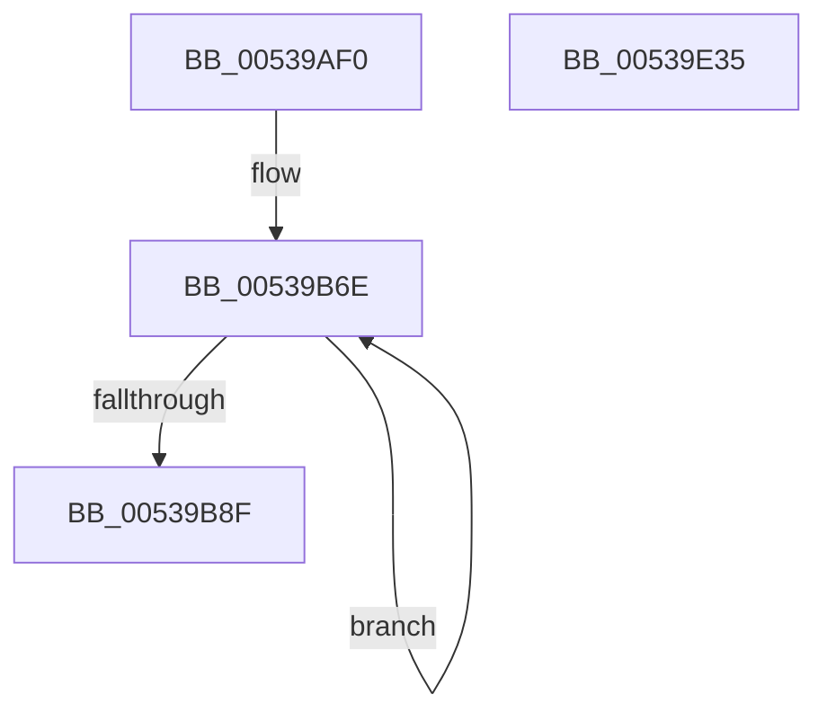

# SymCryptTwistedEdwardsDouble

- RVA: `0x00539AF0`–`0x00539E36` (길이 `838` bytes)
- VA: `0x0000000140539AF0`
- 실행 섹션: `.text`
- PDB 이름 있음: `예`; PDB Function 태그: `아니요`
- unwind 정보 RVA: `0x000C3620`
- 디코드: `197`개 명령, `838/838` bytes 표시
- 미해석 바이트: `0` (있으면 어셈블리에 `.byte`로 보존)

> 이 문서는 커널 이미지의 기계어와 PDB 기호를 분석해 생성했습니다. 4번과 5번은 함수 원형과 자료형을 바이너리 사용 방식에서 추정한 C 해석이며 원본 소스 복구 결과는 아닙니다.

## 1. Dependencies

- 직접 호출 지점: **20**; 고유 호출 대상: **8**
- 직접 호출자로 확인된 함수: **0**
- RIP 상대 이미지 참조: **1**

### Outgoing calls
- `0x00539B41` → [memset](../6C/memset_function_006C6C40.md) (function, `0x006C6C40`)
- `0x00539B55` → [SymCryptSizeofModElementFromModulus](../52/SymCryptSizeofModElementFromModulus_function_00525D3C.md) (function, `0x00525D3C`)
- `0x00539B77` → [SymCryptModElementCreate](../52/SymCryptModElementCreate_function_00525900.md) (function, `0x00525900`)
- `0x00539BCC` → [SymCryptModSquare](../52/SymCryptModSquare_function_00525C84.md) (function, `0x00525C84`)
- `0x00539BED` → [SymCryptModSquare](../52/SymCryptModSquare_function_00525C84.md) (function, `0x00525C84`)
- `0x00539C11` → [SymCryptModSquare](../52/SymCryptModSquare_function_00525C84.md) (function, `0x00525C84`)
- `0x00539C36` → [SymCryptModAdd](../52/SymCryptModAdd_function_00525868.md) (function, `0x00525868`)
- `0x00539C61` → [SymCryptModMul](../52/SymCryptModMul_function_00525BA8.md) (function, `0x00525BA8`)
- `0x00539C92` → [SymCryptModAdd](../52/SymCryptModAdd_function_00525868.md) (function, `0x00525868`)
- `0x00539CB7` → [SymCryptModSquare](../52/SymCryptModSquare_function_00525C84.md) (function, `0x00525C84`)
- `0x00539CD4` → [SymCryptModSub](../52/SymCryptModSub_function_00525CB8.md) (function, `0x00525CB8`)
- `0x00539CF1` → [SymCryptModSub](../52/SymCryptModSub_function_00525CB8.md) (function, `0x00525CB8`)
- `0x00539D16` → [SymCryptModAdd](../52/SymCryptModAdd_function_00525868.md) (function, `0x00525868`)
- `0x00539D3B` → [SymCryptModSub](../52/SymCryptModSub_function_00525CB8.md) (function, `0x00525CB8`)
- `0x00539D6B` → [SymCryptModSub](../52/SymCryptModSub_function_00525CB8.md) (function, `0x00525CB8`)
- `0x00539D91` → [SymCryptModMul](../52/SymCryptModMul_function_00525BA8.md) (function, `0x00525BA8`)
- `0x00539DB5` → [SymCryptModMul](../52/SymCryptModMul_function_00525BA8.md) (function, `0x00525BA8`)
- `0x00539DE4` → [SymCryptModMul](../52/SymCryptModMul_function_00525BA8.md) (function, `0x00525BA8`)
- `0x00539E05` → [SymCryptModMul](../52/SymCryptModMul_function_00525BA8.md) (function, `0x00525BA8`)
- `0x00539E15` → [_security_check_cookie](../6A/_security_check_cookie_function_006AC640.md) (function, `0x006AC640`)

### Direct callers
- 이 함수 시작 RVA로 연결되는 직접 call은 확인되지 않았습니다. 간접 호출은 완전히 역산할 수 없습니다.

### Static image references
- `0x00539B07` → RVA `0x00E0A740` (`.data`; read)

## 2. Other-region calls and transfers

- 다른 실행 섹션으로 향하는 call: **0**
- 별도 외부 분기/꼬리 이동을 확인하지 못했습니다.

## 3. Assembly (complete function range)

```asm
00539AF0  48 89 5C 24 20                  mov qword ptr [rsp + 0x20], rbx
00539AF5  55                              push rbp
00539AF6  56                              push rsi
00539AF7  57                              push rdi
00539AF8  41 54                           push r12
00539AFA  41 55                           push r13
00539AFC  41 56                           push r14
00539AFE  41 57                           push r15
00539B00  48 81 EC B0 00 00 00            sub rsp, 0xb0
00539B07  48 8B 05 32 0C 8D 00            mov rax, qword ptr [rip + 0x8d0c32]
00539B0E  48 33 C4                        xor rax, rsp
00539B11  48 89 84 24 A0 00 00 00         mov qword ptr [rsp + 0xa0], rax
00539B19  4C 8B BC 24 10 01 00 00         mov r15, qword ptr [rsp + 0x110]
00539B21  4C 8B EA                        mov r13, rdx
00539B24  48 89 54 24 40                  mov qword ptr [rsp + 0x40], rdx
00539B29  48 8B E9                        mov rbp, rcx
00539B2C  33 D2                           xor edx, edx
00539B2E  4C 89 44 24 38                  mov qword ptr [rsp + 0x38], r8
00539B33  48 89 4C 24 50                  mov qword ptr [rsp + 0x50], rcx
00539B38  48 8D 4C 24 60                  lea rcx, [rsp + 0x60]
00539B3D  44 8D 42 40                     lea r8d, [rdx + 0x40]
00539B41  E8 FA D0 18 00                  call 0x1406c6c40
00539B46  4C 8B A5 68 02 00 00            mov r12, qword ptr [rbp + 0x268]
00539B4D  49 8B CC                        mov rcx, r12
00539B50  4C 89 64 24 30                  mov qword ptr [rsp + 0x30], r12
00539B55  E8 E2 C1 FE FF                  call 0x140525d3c
00539B5A  4C 8B B4 24 18 01 00 00         mov r14, qword ptr [rsp + 0x118]
00539B62  48 8D 7C 24 60                  lea rdi, [rsp + 0x60]
00539B67  8B D8                           mov ebx, eax
00539B69  BE 08 00 00 00                  mov esi, 8
00539B6E  4D 8B C4                        mov r8, r12
00539B71  48 8B D3                        mov rdx, rbx
00539B74  49 8B CF                        mov rcx, r15
00539B77  E8 84 BD FE FF                  call 0x140525900
00539B7C  4C 03 FB                        add r15, rbx
00539B7F  48 89 07                        mov qword ptr [rdi], rax
00539B82  4C 2B F3                        sub r14, rbx
00539B85  48 8D 7F 08                     lea rdi, [rdi + 8]
00539B89  48 83 EE 01                     sub rsi, 1
00539B8D  75 DF                           jne 0x140539b6e
00539B8F  48 8B 74 24 60                  mov rsi, qword ptr [rsp + 0x60]
00539B94  49 8D 7D 20                     lea rdi, [r13 + 0x20]
00539B98  44 8B 6D 24                     mov r13d, dword ptr [rbp + 0x24]
00539B9C  4D 8B CF                        mov r9, r15
00539B9F  48 8B 5C 24 40                  mov rbx, qword ptr [rsp + 0x40]
00539BA4  4C 8B C6                        mov r8, rsi
00539BA7  48 8B D7                        mov rdx, rdi
00539BAA  4C 89 B4 24 18 01 00 00         mov qword ptr [rsp + 0x118], r14
00539BB2  49 8B CC                        mov rcx, r12
00539BB5  4C 89 7C 24 48                  mov qword ptr [rsp + 0x48], r15
00539BBA  42 8D 2C 6D 00 00 00 00         lea ebp, [r13*2]
00539BC2  4C 89 74 24 20                  mov qword ptr [rsp + 0x20], r14
00539BC7  48 89 6C 24 58                  mov qword ptr [rsp + 0x58], rbp
00539BCC  E8 B3 C0 FE FF                  call 0x140525c84
00539BD1  4C 8B 64 24 68                  mov r12, qword ptr [rsp + 0x68]
00539BD6  48 8D 53 20                     lea rdx, [rbx + 0x20]
00539BDA  48 8B 4C 24 30                  mov rcx, qword ptr [rsp + 0x30]
00539BDF  49 03 D5                        add rdx, r13
00539BE2  4D 8B CF                        mov r9, r15
00539BE5  4C 89 74 24 20                  mov qword ptr [rsp + 0x20], r14
00539BEA  4D 8B C4                        mov r8, r12
00539BED  E8 92 C0 FE FF                  call 0x140525c84
00539BF2  48 8B 4C 24 30                  mov rcx, qword ptr [rsp + 0x30]
00539BF7  48 8B D3                        mov rdx, rbx
00539BFA  48 83 C2 20                     add rdx, 0x20
00539BFE  4C 89 74 24 20                  mov qword ptr [rsp + 0x20], r14
00539C03  4C 8B 74 24 70                  mov r14, qword ptr [rsp + 0x70]
00539C08  48 03 D5                        add rdx, rbp
00539C0B  4D 8B CF                        mov r9, r15
00539C0E  4D 8B C6                        mov r8, r14
00539C11  E8 6E C0 FE FF                  call 0x140525c84
00539C16  48 8B AC 24 18 01 00 00         mov rbp, qword ptr [rsp + 0x118]
00539C1E  4D 8B CE                        mov r9, r14
00539C21  48 8B 4C 24 30                  mov rcx, qword ptr [rsp + 0x30]
00539C26  4D 8B C6                        mov r8, r14
00539C29  48 89 6C 24 28                  mov qword ptr [rsp + 0x28], rbp
00539C2E  49 8B D6                        mov rdx, r14
00539C31  4C 89 7C 24 20                  mov qword ptr [rsp + 0x20], r15
00539C36  E8 2D BC FE FF                  call 0x140525868
00539C3B  48 8B 54 24 50                  mov rdx, qword ptr [rsp + 0x50]
00539C40  4C 8B C6                        mov r8, rsi
00539C43  48 8B 4C 24 30                  mov rcx, qword ptr [rsp + 0x30]
00539C48  48 89 6C 24 28                  mov qword ptr [rsp + 0x28], rbp
00539C4D  48 8B 6C 24 78                  mov rbp, qword ptr [rsp + 0x78]
00539C52  48 8B 92 78 02 00 00            mov rdx, qword ptr [rdx + 0x278]
00539C59  4C 8B CD                        mov r9, rbp
00539C5C  4C 89 7C 24 20                  mov qword ptr [rsp + 0x20], r15
00539C61  E8 42 BF FE FF                  call 0x140525ba8
00539C66  48 8B 84 24 18 01 00 00         mov rax, qword ptr [rsp + 0x118]
00539C6E  4C 8D 43 20                     lea r8, [rbx + 0x20]
00539C72  48 8B 4C 24 30                  mov rcx, qword ptr [rsp + 0x30]
00539C77  4D 03 C5                        add r8, r13
00539C7A  48 89 44 24 28                  mov qword ptr [rsp + 0x28], rax
00539C7F  48 8B D7                        mov rdx, rdi
00539C82  4C 89 7C 24 20                  mov qword ptr [rsp + 0x20], r15
00539C87  4C 8B BC 24 80 00 00 00         mov r15, qword ptr [rsp + 0x80]
00539C8F  4D 8B CF                        mov r9, r15
00539C92  E8 D1 BB FE FF                  call 0x140525868
00539C97  48 8B 5C 24 48                  mov rbx, qword ptr [rsp + 0x48]
00539C9C  4D 8B C7                        mov r8, r15
00539C9F  48 8B BC 24 18 01 00 00         mov rdi, qword ptr [rsp + 0x118]
00539CA7  4C 8B CB                        mov r9, rbx
00539CAA  48 8B 4C 24 30                  mov rcx, qword ptr [rsp + 0x30]
00539CAF  49 8B D7                        mov rdx, r15
00539CB2  48 89 7C 24 20                  mov qword ptr [rsp + 0x20], rdi
00539CB7  E8 C8 BF FE FF                  call 0x140525c84
00539CBC  48 8B 4C 24 30                  mov rcx, qword ptr [rsp + 0x30]
00539CC1  4D 8B CF                        mov r9, r15
00539CC4  4C 8B C6                        mov r8, rsi
00539CC7  48 89 7C 24 28                  mov qword ptr [rsp + 0x28], rdi
00539CCC  49 8B D7                        mov rdx, r15
00539CCF  48 89 5C 24 20                  mov qword ptr [rsp + 0x20], rbx
00539CD4  E8 DF BF FE FF                  call 0x140525cb8
00539CD9  48 8B 4C 24 30                  mov rcx, qword ptr [rsp + 0x30]
00539CDE  4D 8B CF                        mov r9, r15
00539CE1  4D 8B C4                        mov r8, r12
00539CE4  48 89 7C 24 28                  mov qword ptr [rsp + 0x28], rdi
00539CE9  49 8B D7                        mov rdx, r15
00539CEC  48 89 5C 24 20                  mov qword ptr [rsp + 0x20], rbx
00539CF1  E8 C2 BF FE FF                  call 0x140525cb8
00539CF6  48 89 7C 24 28                  mov qword ptr [rsp + 0x28], rdi
00539CFB  48 8B B4 24 90 00 00 00         mov rsi, qword ptr [rsp + 0x90]
00539D03  4D 8B C4                        mov r8, r12
00539D06  48 8B 4C 24 30                  mov rcx, qword ptr [rsp + 0x30]
00539D0B  4C 8B CE                        mov r9, rsi
00539D0E  48 8B D5                        mov rdx, rbp
00539D11  48 89 5C 24 20                  mov qword ptr [rsp + 0x20], rbx
00539D16  E8 4D BB FE FF                  call 0x140525868
00539D1B  48 8B 4C 24 30                  mov rcx, qword ptr [rsp + 0x30]
00539D20  4D 8B C6                        mov r8, r14
00539D23  48 89 7C 24 28                  mov qword ptr [rsp + 0x28], rdi
00539D28  48 8B D6                        mov rdx, rsi
00539D2B  48 8B BC 24 88 00 00 00         mov rdi, qword ptr [rsp + 0x88]
00539D33  4C 8B CF                        mov r9, rdi
00539D36  48 89 5C 24 20                  mov qword ptr [rsp + 0x20], rbx
00539D3B  E8 78 BF FE FF                  call 0x140525cb8
00539D40  4C 8B B4 24 18 01 00 00         mov r14, qword ptr [rsp + 0x118]
00539D48  4D 8B C4                        mov r8, r12
00539D4B  4C 8B 64 24 30                  mov r12, qword ptr [rsp + 0x30]
00539D50  48 8B D5                        mov rdx, rbp
00539D53  4C 89 74 24 28                  mov qword ptr [rsp + 0x28], r14
00539D58  49 8B CC                        mov rcx, r12
00539D5B  48 89 5C 24 20                  mov qword ptr [rsp + 0x20], rbx
00539D60  48 8B 9C 24 98 00 00 00         mov rbx, qword ptr [rsp + 0x98]
00539D68  4C 8B CB                        mov r9, rbx
00539D6B  E8 48 BF FE FF                  call 0x140525cb8
00539D70  4C 8B 4C 24 38                  mov r9, qword ptr [rsp + 0x38]
00539D75  4C 8B C7                        mov r8, rdi
00539D78  48 8B 6C 24 48                  mov rbp, qword ptr [rsp + 0x48]
00539D7D  49 83 C1 20                     add r9, 0x20
00539D81  4C 89 74 24 28                  mov qword ptr [rsp + 0x28], r14
00539D86  49 8B D7                        mov rdx, r15
00539D89  49 8B CC                        mov rcx, r12
00539D8C  48 89 6C 24 20                  mov qword ptr [rsp + 0x20], rbp
00539D91  E8 12 BE FE FF                  call 0x140525ba8
00539D96  4C 8B 4C 24 38                  mov r9, qword ptr [rsp + 0x38]
00539D9B  4C 8B C3                        mov r8, rbx
00539D9E  49 83 C1 20                     add r9, 0x20
00539DA2  4C 89 74 24 28                  mov qword ptr [rsp + 0x28], r14
00539DA7  4D 03 CD                        add r9, r13
00539DAA  48 89 6C 24 20                  mov qword ptr [rsp + 0x20], rbp
00539DAF  48 8B D6                        mov rdx, rsi
00539DB2  49 8B CC                        mov rcx, r12
00539DB5  E8 EE BD FE FF                  call 0x140525ba8
00539DBA  46 8D 0C 6D 00 00 00 00         lea r9d, [r13*2]
00539DC2  4C 89 74 24 28                  mov qword ptr [rsp + 0x28], r14
00539DC7  45 03 CD                        add r9d, r13d
00539DCA  48 89 6C 24 20                  mov qword ptr [rsp + 0x20], rbp
00539DCF  4C 8B 6C 24 38                  mov r13, qword ptr [rsp + 0x38]
00539DD4  49 83 C1 20                     add r9, 0x20
00539DD8  4D 03 CD                        add r9, r13
00539DDB  4C 8B C3                        mov r8, rbx
00539DDE  49 8B D7                        mov rdx, r15
00539DE1  49 8B CC                        mov rcx, r12
00539DE4  E8 BF BD FE FF                  call 0x140525ba8
00539DE9  4D 8D 4D 20                     lea r9, [r13 + 0x20]
00539DED  4C 89 74 24 28                  mov qword ptr [rsp + 0x28], r14
00539DF2  4C 03 4C 24 58                  add r9, qword ptr [rsp + 0x58]
00539DF7  4C 8B C6                        mov r8, rsi
00539DFA  48 8B D7                        mov rdx, rdi
00539DFD  48 89 6C 24 20                  mov qword ptr [rsp + 0x20], rbp
00539E02  49 8B CC                        mov rcx, r12
00539E05  E8 9E BD FE FF                  call 0x140525ba8
00539E0A  48 8B 8C 24 A0 00 00 00         mov rcx, qword ptr [rsp + 0xa0]
00539E12  48 33 CC                        xor rcx, rsp
00539E15  E8 26 28 17 00                  call 0x1406ac640
00539E1A  48 8B 9C 24 08 01 00 00         mov rbx, qword ptr [rsp + 0x108]
00539E22  48 81 C4 B0 00 00 00            add rsp, 0xb0
00539E29  41 5F                           pop r15
00539E2B  41 5E                           pop r14
00539E2D  41 5D                           pop r13
00539E2F  41 5C                           pop r12
00539E31  5F                              pop rdi
00539E32  5E                              pop rsi
00539E33  5D                              pop rbp
00539E34  C3                              ret
00539E35  CC                              int3
```

## 4. C-style interpretation (structured pseudocode)

```c
__int64 __fastcall SymCryptTwistedEdwardsDouble(__int64 a1, __int64 a2, __int64 a3, __int64 a4, __int64 a5, __int64 a6)
{
    __int64 result;
    __int64 v_r14;
    __int64 v_r15;
    __int64 v_rsi;
    __int64 v_rsp;
    unsigned __int64 v_stack_m48;
    unsigned __int64 v_stack_m50;
    unsigned __int64 v_stack_m58;
    unsigned __int64 v_stack_m60;
    unsigned __int64 v_stack_m68;
    unsigned __int64 v_stack_m70;
    unsigned __int64 v_stack_m78;
    unsigned __int64 v_stack_m80;
    unsigned __int64 v_stack_m88;
    unsigned __int64 v_stack_m90;
    unsigned __int64 v_stack_m98;
    unsigned __int64 v_stack_mA0;
    unsigned __int64 v_stack_mA8;
    unsigned __int64 v_stack_mB0;
    unsigned __int64 v_stack_mB8;
    unsigned __int64 v_stack_mC0;
    unsigned __int64 v_stack_mC8;
    unsigned __int64 v_stack_p20;
    unsigned __int64 v_stack_p30;

    v_stack_p20 = v_rbx;
    v_rsp = (v_rsp) - (176);
    result = (*(unsigned __int64 *)(v_rip + 9243698)) ^ (v_rsp);
    v_stack_m48 = result;
    v_stack_mA8 = a2;
    a2 = 0;
    v_stack_mB0 = a3;
    v_stack_m98 = a1;
    result = memset(v_stack_m88, a2, a2 + 64, a4);
    v_stack_mB8 = *(unsigned __int64 *)(a1 + 616);
    result = SymCryptSizeofModElementFromModulus(*(unsigned __int64 *)(a1 + 616), a2, a2 + 64, a4);
loc_00539B6E:
    result = SymCryptModElementCreate(a5, (unsigned int)((unsigned int)(result)), *(unsigned __int64 *)(a1 + 616), a4);
    v_r15 = (a5) + ((unsigned int)((unsigned int)(result)));
    *(unsigned __int64 *)(v_stack_m88) = result;
    v_r14 = (a6) - ((unsigned int)((unsigned int)(result)));
    v_rsi = (8) - (1);
    if (condition_is_not_equal) goto loc_00539B6E;
    v_stack_p30 = v_r14;
    v_stack_mA0 = v_r15;
    v_stack_mC8 = v_r14;
    v_stack_m90 = (unsigned int)(*(unsigned int *)(a1 + 36)) * 2;
    result = SymCryptModSquare(*(unsigned __int64 *)(a1 + 616), a2 + 32, v_stack_m88, v_r15);
    a2 = (v_stack_mA8 + 32) + ((unsigned int)(*(unsigned int *)(a1 + 36)));
    v_stack_mC8 = v_r14;
    result = SymCryptModSquare(v_stack_mB8, a2, v_stack_m80, v_r15);
    a2 = (v_stack_mA8) + (32);
    v_stack_mC8 = v_r14;
    a2 = (a2) + ((unsigned int)(*(unsigned int *)(a1 + 36)) * 2);
    result = SymCryptModSquare(v_stack_mB8, a2, v_stack_m78, v_r15);
    v_stack_mC0 = a6;
    v_stack_mC8 = v_r15;
    result = SymCryptModAdd(v_stack_mB8, v_stack_m78, v_stack_m78, v_stack_m78);
    v_stack_mC0 = a6;
    v_stack_mC8 = v_r15;
    result = SymCryptModMul(v_stack_mB8, *(unsigned __int64 *)(v_stack_m98 + 632), v_stack_m88, v_stack_m70);
    a3 = (v_stack_mA8 + 32) + ((unsigned int)(*(unsigned int *)(a1 + 36)));
    v_stack_mC0 = a6;
    v_stack_mC8 = v_r15;
    result = SymCryptModAdd(v_stack_mB8, a2 + 32, a3, v_stack_m68);
    v_stack_mC8 = a6;
    result = SymCryptModSquare(v_stack_mB8, v_stack_m68, v_stack_m68, v_stack_mA0);
    v_stack_mC0 = a6;
    v_stack_mC8 = v_stack_mA0;
    result = SymCryptModSub(v_stack_mB8, v_stack_m68, v_stack_m88, v_stack_m68);
    v_stack_mC0 = a6;
    v_stack_mC8 = v_stack_mA0;
    result = SymCryptModSub(v_stack_mB8, v_stack_m68, v_stack_m80, v_stack_m68);
    v_stack_mC0 = a6;
    v_stack_mC8 = v_stack_mA0;
    result = SymCryptModAdd(v_stack_mB8, v_stack_m70, v_stack_m80, v_stack_m58);
    v_stack_mC0 = a6;
    v_stack_mC8 = v_stack_mA0;
    result = SymCryptModSub(v_stack_mB8, v_stack_m58, v_stack_m78, v_stack_m60);
    v_stack_mC0 = a6;
    v_stack_mC8 = v_stack_mA0;
    result = SymCryptModSub(v_stack_mB8, v_stack_m70, v_stack_m80, v_stack_m50);
    a4 = (v_stack_mB0) + (32);
    v_stack_mC0 = a6;
    v_stack_mC8 = v_stack_mA0;
    result = SymCryptModMul(v_stack_mB8, v_stack_m68, v_stack_m60, a4);
    a4 = (v_stack_mB0) + (32);
    v_stack_mC0 = a6;
    a4 = (a4) + ((unsigned int)(*(unsigned int *)(a1 + 36)));
    v_stack_mC8 = v_stack_mA0;
    result = SymCryptModMul(v_stack_mB8, v_stack_m58, v_stack_m50, a4);
    v_stack_mC0 = a6;
    a4 = (unsigned int)(((unsigned int)(*(unsigned int *)(a1 + 36)) * 2) + ((unsigned int)((unsigned int)(*(unsigned int *)(a1 + 36)))));
    v_stack_mC8 = v_stack_mA0;
    a4 = (a4) + (32);
    a4 = (a4) + (v_stack_mB0);
    result = SymCryptModMul(v_stack_mB8, v_stack_m68, v_stack_m50, a4);
    v_stack_mC0 = a6;
    a4 = (v_stack_mB0 + 32) + (v_stack_m90);
    v_stack_mC8 = v_stack_mA0;
    result = SymCryptModMul(v_stack_mB8, v_stack_m60, v_stack_m58, a4);
    a1 = (v_stack_m48) ^ (v_rsp);
    result = _security_check_cookie(a1, v_stack_m60, v_stack_m58, a4);
    v_rsp = (v_rsp) + (176);
    return result;
}
```

## 5. (Beta) C Style

```c
int64_t SymCryptTwistedEdwardsDouble(void *Arg1, void *Arg2, int64_t Arg3, int64_t Arg4, int64_t Arg5, int64_t Arg6)
{
    uint8_t *arg1 = (uint8_t *)Arg1;
    uint8_t *arg2 = (uint8_t *)Arg2;

    int64_t result;
    int64_t local_r14;
    int64_t local_r15;
    int64_t local_rsi;
    int64_t local_rsp;
    uint64_t v_stack_m48;
    uint64_t v_stack_m50;
    uint64_t v_stack_m58;
    uint64_t v_stack_m60;
    uint64_t v_stack_m68;
    uint64_t v_stack_m70;
    uint64_t v_stack_m78;
    uint64_t v_stack_m80;
    uint64_t v_stack_m88;
    uint64_t v_stack_m90;
    uint64_t v_stack_m98;
    uint64_t v_stack_mA0;
    uint64_t v_stack_mA8;
    uint64_t v_stack_mB0;
    uint64_t v_stack_mB8;
    uint64_t v_stack_mC0;
    uint64_t v_stack_mC8;
    uint64_t v_stack_p20;
    uint64_t v_stack_p30;

    v_stack_p20 = local_rbx;
    local_rsp = (local_rsp) - (176);
    result = (*(uint64_t *)(v_rip + 0x8D0C32)) ^ (local_rsp);
    v_stack_m48 = result;
    v_stack_mA8 = Arg2;
    Arg2 = 0;
    v_stack_mB0 = Arg3;
    v_stack_m98 = Arg1;
    result = memset(v_stack_m88, Arg2, Arg2 + 64, Arg4);
    v_stack_mB8 = *(uint64_t *)(arg1 + 0x268);
    result = SymCryptSizeofModElementFromModulus(*(uint64_t *)(arg1 + 0x268), Arg2, Arg2 + 64, Arg4);
loc_00539B6E:
    result = SymCryptModElementCreate(Arg5, (uint32_t)((uint32_t)(result)), *(uint64_t *)(arg1 + 0x268), Arg4);
    local_r15 = (Arg5) + ((uint32_t)((uint32_t)(result)));
    *(uint64_t *)(v_stack_m88) = result;
    local_r14 = (Arg6) - ((uint32_t)((uint32_t)(result)));
    local_rsi = (8) - (1);
    if (condition_is_not_equal) goto loc_00539B6E;
    v_stack_p30 = local_r14;
    v_stack_mA0 = local_r15;
    v_stack_mC8 = local_r14;
    v_stack_m90 = (uint32_t)(*(uint32_t *)(arg1 + 0x24)) * 2;
    result = SymCryptModSquare(*(uint64_t *)(arg1 + 0x268), Arg2 + 32, v_stack_m88, local_r15);
    Arg2 = (v_stack_mA8 + 32) + ((uint32_t)(*(uint32_t *)(arg1 + 0x24)));
    v_stack_mC8 = local_r14;
    result = SymCryptModSquare(v_stack_mB8, Arg2, v_stack_m80, local_r15);
    Arg2 = (v_stack_mA8) + (32);
    v_stack_mC8 = local_r14;
    Arg2 = (Arg2) + ((uint32_t)(*(uint32_t *)(arg1 + 0x24)) * 2);
    result = SymCryptModSquare(v_stack_mB8, Arg2, v_stack_m78, local_r15);
    v_stack_mC0 = Arg6;
    v_stack_mC8 = local_r15;
    result = SymCryptModAdd(v_stack_mB8, v_stack_m78, v_stack_m78, v_stack_m78);
    v_stack_mC0 = Arg6;
    v_stack_mC8 = local_r15;
    result = SymCryptModMul(v_stack_mB8, *(uint64_t *)(v_stack_m98 + 0x278), v_stack_m88, v_stack_m70);
    Arg3 = (v_stack_mA8 + 32) + ((uint32_t)(*(uint32_t *)(arg1 + 0x24)));
    v_stack_mC0 = Arg6;
    v_stack_mC8 = local_r15;
    result = SymCryptModAdd(v_stack_mB8, Arg2 + 32, Arg3, v_stack_m68);
    v_stack_mC8 = Arg6;
    result = SymCryptModSquare(v_stack_mB8, v_stack_m68, v_stack_m68, v_stack_mA0);
    v_stack_mC0 = Arg6;
    v_stack_mC8 = v_stack_mA0;
    result = SymCryptModSub(v_stack_mB8, v_stack_m68, v_stack_m88, v_stack_m68);
    v_stack_mC0 = Arg6;
    v_stack_mC8 = v_stack_mA0;
    result = SymCryptModSub(v_stack_mB8, v_stack_m68, v_stack_m80, v_stack_m68);
    v_stack_mC0 = Arg6;
    v_stack_mC8 = v_stack_mA0;
    result = SymCryptModAdd(v_stack_mB8, v_stack_m70, v_stack_m80, v_stack_m58);
    v_stack_mC0 = Arg6;
    v_stack_mC8 = v_stack_mA0;
    result = SymCryptModSub(v_stack_mB8, v_stack_m58, v_stack_m78, v_stack_m60);
    v_stack_mC0 = Arg6;
    v_stack_mC8 = v_stack_mA0;
    result = SymCryptModSub(v_stack_mB8, v_stack_m70, v_stack_m80, v_stack_m50);
    Arg4 = (v_stack_mB0) + (32);
    v_stack_mC0 = Arg6;
    v_stack_mC8 = v_stack_mA0;
    result = SymCryptModMul(v_stack_mB8, v_stack_m68, v_stack_m60, Arg4);
    Arg4 = (v_stack_mB0) + (32);
    v_stack_mC0 = Arg6;
    Arg4 = (Arg4) + ((uint32_t)(*(uint32_t *)(arg1 + 0x24)));
    v_stack_mC8 = v_stack_mA0;
    result = SymCryptModMul(v_stack_mB8, v_stack_m58, v_stack_m50, Arg4);
    v_stack_mC0 = Arg6;
    Arg4 = (uint32_t)(((uint32_t)(*(uint32_t *)(arg1 + 0x24)) * 2) + ((uint32_t)((uint32_t)(*(uint32_t *)(arg1 + 0x24)))));
    v_stack_mC8 = v_stack_mA0;
    Arg4 = (Arg4) + (32);
    Arg4 = (Arg4) + (v_stack_mB0);
    result = SymCryptModMul(v_stack_mB8, v_stack_m68, v_stack_m50, Arg4);
    v_stack_mC0 = Arg6;
    Arg4 = (v_stack_mB0 + 32) + (v_stack_m90);
    v_stack_mC8 = v_stack_mA0;
    result = SymCryptModMul(v_stack_mB8, v_stack_m60, v_stack_m58, Arg4);
    Arg1 = (v_stack_m48) ^ (local_rsp);
    result = _security_check_cookie(Arg1, v_stack_m60, v_stack_m58, Arg4);
    local_rsp = (local_rsp) + (176);
    return result;
}
```

### 관측된 메모리 오프셋

구조체 형식이 확인되지 않은 접근은 인자 기준의 오프셋으로만 기록했습니다.

| 기준 인자 | 오프셋 표현 | 폭 (bit) | 접근 |
|---|---:|---:|---|
| `Arg1` | `+ 0x24` | `32` | `R` |
| `Arg1` | `+ 0x268` | `64` | `R` |
| `Arg2` | `+ 0x20` | `64` | `R` |

## 6. Execution-region graph

[열기: 2D/3D 그래프와 함수 탐색 컨트롤 패널](../../../control-panel.html?section=text&rva=0x00539AF0&view=graph)

- 2D 그래프는 위에서 아래로 흐르고, 3D 그래프는 빈 공간을 드래그해 회전합니다. Shift+드래그는 이동, 휠은 확대·축소, 함수 노드 선택은 대상 보고서 이동입니다.

### Static fallback


