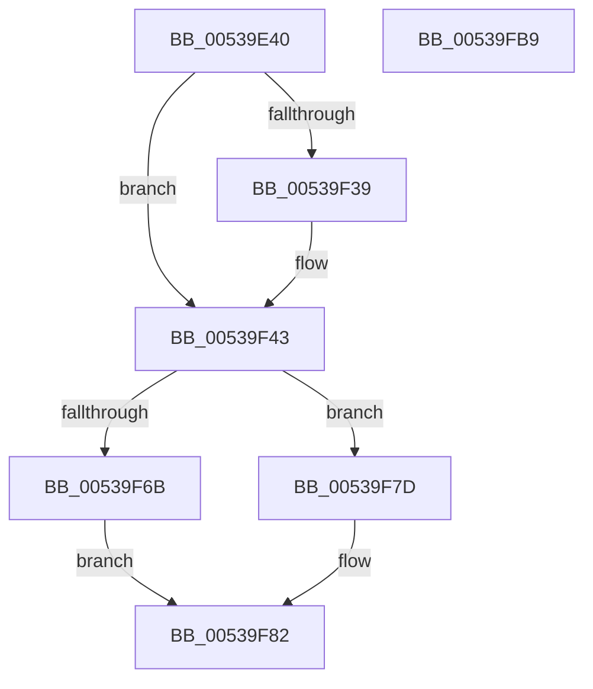

# SymCryptTwistedEdwardsFillScratchSpaces

- RVA: `0x00539E40`–`0x00539FBA` (길이 `378` bytes)
- VA: `0x0000000140539E40`
- 실행 섹션: `.text`
- PDB 이름 있음: `예`; PDB Function 태그: `아니요`
- unwind 정보 RVA: `0x00075C18`
- 디코드: `111`개 명령, `378/378` bytes 표시
- 미해석 바이트: `0` (있으면 어셈블리에 `.byte`로 보존)

> 이 문서는 커널 이미지의 기계어와 PDB 기호를 분석해 생성했습니다. 4번과 5번은 함수 원형과 자료형을 바이너리 사용 방식에서 추정한 C 해석이며 원본 소스 복구 결과는 아닙니다.

## 1. Dependencies

- 직접 호출 지점: **13**; 고유 호출 대상: **5**
- 직접 호출자로 확인된 함수: **0**
- RIP 상대 이미지 참조: **0**

### Outgoing calls
- `0x00539E62` → [SymCryptDigitsFromBits](../52/SymCryptDigitsFromBits_function_0052544C.md) (function, `0x0052544C`)
- `0x00539E93` → [SymCryptSizeofIntFromDigits](../52/SymCryptSizeofIntFromDigits_function_00525D24.md) (function, `0x00525D24`)
- `0x00539E9D` → [SymCryptSizeofEcpointFromCurve](../52/SymCryptSizeofEcpointFromCurve_function_0052CEF0.md) (function, `0x0052CEF0`)
- `0x00539EC1` → [SymCryptSizeofEcpointFromCurve](../52/SymCryptSizeofEcpointFromCurve_function_0052CEF0.md) (function, `0x0052CEF0`)
- `0x00539EF6` → [SymCryptSizeofEcpointEx](../52/SymCryptSizeofEcpointEx_function_0052CED4.md) (function, `0x0052CED4`)
- `0x00539F30` → [SymCryptSizeofIntFromDigits](../52/SymCryptSizeofIntFromDigits_function_00525D24.md) (function, `0x00525D24`)
- `0x00539F3C` → [SymCryptSizeofIntFromDigits](../52/SymCryptSizeofIntFromDigits_function_00525D24.md) (function, `0x00525D24`)
- `0x00539F4A` → [SymCryptEcurveDigitsofScalarMultiplier](../52/SymCryptEcurveDigitsofScalarMultiplier_function_0052415C.md) (function, `0x0052415C`)
- `0x00539F51` → [SymCryptSizeofIntFromDigits](../52/SymCryptSizeofIntFromDigits_function_00525D24.md) (function, `0x00525D24`)
- `0x00539F5F` → [SymCryptSizeofEcpointFromCurve](../52/SymCryptSizeofEcpointFromCurve_function_0052CEF0.md) (function, `0x0052CEF0`)
- `0x00539F6B` → [SymCryptEcurveDigitsofScalarMultiplier](../52/SymCryptEcurveDigitsofScalarMultiplier_function_0052415C.md) (function, `0x0052415C`)
- `0x00539F72` → [SymCryptSizeofIntFromDigits](../52/SymCryptSizeofIntFromDigits_function_00525D24.md) (function, `0x00525D24`)
- `0x00539F7D` → [SymCryptSizeofEcpointFromCurve](../52/SymCryptSizeofEcpointFromCurve_function_0052CEF0.md) (function, `0x0052CEF0`)

### Direct callers
- 이 함수 시작 RVA로 연결되는 직접 call은 확인되지 않았습니다. 간접 호출은 완전히 역산할 수 없습니다.

### Static image references
- 디코드된 RIP-relative 메모리 참조가 없습니다.

## 2. Other-region calls and transfers

- 다른 실행 섹션으로 향하는 call: **0**
- 별도 외부 분기/꼬리 이동을 확인하지 못했습니다.

## 3. Assembly (complete function range)

```asm
00539E40  48 89 5C 24 08                  mov qword ptr [rsp + 8], rbx
00539E45  48 89 6C 24 10                  mov qword ptr [rsp + 0x10], rbp
00539E4A  48 89 74 24 18                  mov qword ptr [rsp + 0x18], rsi
00539E4F  57                              push rdi
00539E50  41 54                           push r12
00539E52  41 55                           push r13
00539E54  41 56                           push r14
00539E56  41 57                           push r15
00539E58  48 83 EC 20                     sub rsp, 0x20
00539E5C  4C 8B E9                        mov r13, rcx
00539E5F  8B 49 0C                        mov ecx, dword ptr [rcx + 0xc]
00539E62  E8 E5 B5 FE FF                  call 0x14052544c
00539E67  45 8B 7D 24                     mov r15d, dword ptr [r13 + 0x24]
00539E6B  8B D0                           mov edx, eax
00539E6D  41 8B 4D 1C                     mov ecx, dword ptr [r13 + 0x1c]
00539E71  44 8B E0                        mov r12d, eax
00539E74  41 8B 6D 10                     mov ebp, dword ptr [r13 + 0x10]
00539E78  8B F9                           mov edi, ecx
00539E7A  C1 E2 05                        shl edx, 5
00539E7D  41 03 D7                        add edx, r15d
00539E80  C1 E7 08                        shl edi, 8
00539E83  44 8D 34 D5 00 00 00 00         lea r14d, [rdx*8]
00539E8B  41 8D 76 40                     lea esi, [r14 + 0x40]
00539E8F  41 89 75 2C                     mov dword ptr [r13 + 0x2c], esi
00539E93  E8 8C BE FE FF                  call 0x140525d24
00539E98  49 8B CD                        mov rcx, r13
00539E9B  8B D8                           mov ebx, eax
00539E9D  E8 4E 30 FF FF                  call 0x14052cef0
00539EA2  03 C3                           add eax, ebx
00539EA4  8D 4F 40                        lea ecx, [rdi + 0x40]
00539EA7  3B F1                           cmp esi, ecx
00539EA9  44 0F 46 F7                     cmovbe r14d, edi
00539EAD  41 8D 0C 46                     lea ecx, [r14 + rax*2]
00539EB1  41 8B 45 24                     mov eax, dword ptr [r13 + 0x24]
00539EB5  83 C0 40                        add eax, 0x40
00539EB8  03 C8                           add ecx, eax
00539EBA  41 89 4D 30                     mov dword ptr [r13 + 0x30], ecx
00539EBE  49 8B CD                        mov rcx, r13
00539EC1  E8 2A 30 FF FF                  call 0x14052cef0
00539EC6  41 0F AF 45 5C                  imul eax, dword ptr [r13 + 0x5c]
00539ECB  BA 04 00 00 00                  mov edx, 4
00539ED0  41 8B 4D 60                     mov ecx, dword ptr [r13 + 0x60]
00539ED4  03 C9                           add ecx, ecx
00539ED6  48 8D 0C 8D 1F 00 00 00         lea rcx, [rcx*4 + 0x1f]
00539EDE  83 E1 E0                        and ecx, 0xffffffe0
00539EE1  03 C8                           add ecx, eax
00539EE3  8B C5                           mov eax, ebp
00539EE5  C1 E0 08                        shl eax, 8
00539EE8  41 89 4D 34                     mov dword ptr [r13 + 0x34], ecx
00539EEC  41 8B CF                        mov ecx, r15d
00539EEF  8B F8                           mov edi, eax
00539EF1  8D 70 40                        lea esi, [rax + 0x40]
00539EF4  8B DE                           mov ebx, esi
00539EF6  E8 D9 2F FF FF                  call 0x14052ced4
00539EFB  8B D5                           mov edx, ebp
00539EFD  C1 E2 06                        shl edx, 6
00539F00  48 83 C2 40                     add rdx, 0x40
00539F04  48 8D 0C 16                     lea rcx, [rsi + rdx]
00539F08  48 8D 0C 51                     lea rcx, [rcx + rdx*2]
00539F0C  48 03 F9                        add rdi, rcx
00539F0F  69 CD C0 02 00 00               imul ecx, ebp, 0x2c0
00539F15  81 C1 00 01 00 00               add ecx, 0x100
00539F1B  48 3B DF                        cmp rbx, rdi
00539F1E  0F 47 CE                        cmova ecx, esi
00539F21  03 C1                           add eax, ecx
00539F23  41 8B CC                        mov ecx, r12d
00539F26  42 8D 04 78                     lea eax, [rax + r15*2]
00539F2A  41 89 45 38                     mov dword ptr [r13 + 0x38], eax
00539F2E  8B D8                           mov ebx, eax
00539F30  E8 EF BD FE FF                  call 0x140525d24
00539F35  3B D8                           cmp ebx, eax
00539F37  77 0A                           ja 0x140539f43
00539F39  41 8B CC                        mov ecx, r12d
00539F3C  E8 E3 BD FE FF                  call 0x140525d24
00539F41  8B D8                           mov ebx, eax
00539F43  49 8B CD                        mov rcx, r13
00539F46  41 89 5D 38                     mov dword ptr [r13 + 0x38], ebx
00539F4A  E8 0D A2 FE FF                  call 0x14052415c
00539F4F  8B C8                           mov ecx, eax
00539F51  E8 CE BD FE FF                  call 0x140525d24
00539F56  8B D8                           mov ebx, eax
00539F58  49 8B CD                        mov rcx, r13
00539F5B  41 03 5D 24                     add ebx, dword ptr [r13 + 0x24]
00539F5F  E8 8C 2F FF FF                  call 0x14052cef0
00539F64  49 8B CD                        mov rcx, r13
00539F67  3B D8                           cmp ebx, eax
00539F69  76 12                           jbe 0x140539f7d
00539F6B  E8 EC A1 FE FF                  call 0x14052415c
00539F70  8B C8                           mov ecx, eax
00539F72  E8 AD BD FE FF                  call 0x140525d24
00539F77  41 03 45 24                     add eax, dword ptr [r13 + 0x24]
00539F7B  EB 05                           jmp 0x140539f82
00539F7D  E8 6E 2F FF FF                  call 0x14052cef0
00539F82  41 8B 4D 38                     mov ecx, dword ptr [r13 + 0x38]
00539F86  45 8B 45 34                     mov r8d, dword ptr [r13 + 0x34]
00539F8A  45 03 45 30                     add r8d, dword ptr [r13 + 0x30]
00539F8E  48 8B 5C 24 50                  mov rbx, qword ptr [rsp + 0x50]
00539F93  44 3B C1                        cmp r8d, ecx
00539F96  48 8B 6C 24 58                  mov rbp, qword ptr [rsp + 0x58]
00539F9B  48 8B 74 24 60                  mov rsi, qword ptr [rsp + 0x60]
00539FA0  44 0F 46 C1                     cmovbe r8d, ecx
00539FA4  44 03 C0                        add r8d, eax
00539FA7  45 89 45 3C                     mov dword ptr [r13 + 0x3c], r8d
00539FAB  48 83 C4 20                     add rsp, 0x20
00539FAF  41 5F                           pop r15
00539FB1  41 5E                           pop r14
00539FB3  41 5D                           pop r13
00539FB5  41 5C                           pop r12
00539FB7  5F                              pop rdi
00539FB8  C3                              ret
00539FB9  CC                              int3
```

## 4. C-style interpretation (structured pseudocode)

```c
__int64 __fastcall SymCryptTwistedEdwardsFillScratchSpaces(__int64 a1)
{
    __int64 result;
    __int64 v_r14;
    __int64 v_rbx;
    __int64 v_rdi;
    __int64 v_rsp;
    unsigned __int64 v_stack_p10;
    unsigned __int64 v_stack_p18;
    unsigned __int64 v_stack_p8;

    v_stack_p8 = v_rbx;
    v_stack_p10 = v_rbp;
    v_stack_p18 = v_rsi;
    v_rsp = (v_rsp) - (32);
    result = SymCryptDigitsFromBits((unsigned int)(*(unsigned int *)(a1 + 12)), a2, a3, a4);
    a2 = (unsigned int)(((unsigned int)((unsigned int)(result))) << (5));
    a2 = (unsigned int)((a2) + ((unsigned int)((unsigned int)(*(unsigned int *)(a1 + 36)))));
    v_rdi = (unsigned int)(((unsigned int)((unsigned int)((unsigned int)(*(unsigned int *)(a1 + 28))))) << (8));
    *(unsigned int *)(a1 + 44) = (unsigned int)(a2 * 8 + 64);
    result = SymCryptSizeofIntFromDigits((unsigned int)(*(unsigned int *)(a1 + 28)), a2, a3, a4);
    result = SymCryptSizeofEcpointFromCurve(a1, a2, a3, a4);
    result = (unsigned int)((result) + ((unsigned int)((unsigned int)((unsigned int)(result)))));
    v_r14 = a2 * 8;
    if (((unsigned int)(a2 * 8 + 64)) <= ((unsigned int)(v_rdi + 64))) { v_r14 = (unsigned int)(v_rdi); }
    result = (unsigned int)(((unsigned int)(*(unsigned int *)(a1 + 36))) + (64));
    a1 = (unsigned int)((v_r14 + result * 2) + ((unsigned int)(result)));
    *(unsigned int *)(a1 + 48) = (unsigned int)(a1);
    result = SymCryptSizeofEcpointFromCurve(a1, a2, a3, a4);
    result = (unsigned int)((result) * (*(unsigned int *)(a1 + 92)));
    a1 = (unsigned int)(((unsigned int)(*(unsigned int *)(a1 + 96))) + ((unsigned int)((unsigned int)(*(unsigned int *)(a1 + 96)))));
    a1 = (unsigned int)((a1 * 4 + 31) & (0xFFFFFFE0ULL));
    a1 = (unsigned int)((a1) + ((unsigned int)(result)));
    result = (unsigned int)(((unsigned int)((unsigned int)((unsigned int)(*(unsigned int *)(a1 + 16))))) << (8));
    *(unsigned int *)(a1 + 52) = (unsigned int)(a1);
    result = SymCryptSizeofEcpointEx((unsigned int)((unsigned int)((unsigned int)(*(unsigned int *)(a1 + 36)))), 4, a3, a4);
    a2 = (unsigned int)(((unsigned int)((unsigned int)((unsigned int)(*(unsigned int *)(a1 + 16))))) << (6));
    a2 = (a2) + (64);
    v_rdi = ((unsigned int)((unsigned int)(result))) + (result + 64 + a2 * 1 + a2 * 2);
    a1 = (unsigned int)((result + 64 + a2 * 1 + a2 * 2) * ((unsigned int)((unsigned int)(*(unsigned int *)(a1 + 16)))));
    a1 = (unsigned int)((a1) + (256));
    if (((unsigned int)((unsigned int)(result + 64))) > v_rdi) { a1 = (unsigned int)(result + 64); }
    result = (unsigned int)((result) + ((unsigned int)(a1)));
    *(unsigned int *)(a1 + 56) = (unsigned int)(result + (unsigned int)(*(unsigned int *)(a1 + 36)) * 2);
    result = SymCryptSizeofIntFromDigits((unsigned int)((unsigned int)((unsigned int)((unsigned int)(result)))), a2, a3, a4);
    v_rbx = (unsigned int)((unsigned int)(result + (unsigned int)(*(unsigned int *)(a1 + 36)) * 2));
    if (((unsigned int)((unsigned int)((unsigned int)(result + (unsigned int)(*(unsigned int *)(a1 + 36)) * 2)))) <= ((unsigned int)(result))) {
        a1 = (unsigned int)((unsigned int)((unsigned int)(result)));
        result = SymCryptSizeofIntFromDigits(a1, a2, a3, a4);
        v_rbx = (unsigned int)(result);
    }
    *(unsigned int *)(a1 + 56) = (unsigned int)(v_rbx);
    result = SymCryptEcurveDigitsofScalarMultiplier(a1, a2, a3, a4);
    result = SymCryptSizeofIntFromDigits((unsigned int)((unsigned int)(result)), a2, a3, a4);
    v_rbx = (unsigned int)(((unsigned int)((unsigned int)(result))) + (*(unsigned int *)(a1 + 36)));
    result = SymCryptSizeofEcpointFromCurve(a1, a2, a3, a4);
    if (((unsigned int)(v_rbx)) <= ((unsigned int)(result))) goto loc_00539F7D;
    result = SymCryptEcurveDigitsofScalarMultiplier(a1, a2, a3, a4);
    result = SymCryptSizeofIntFromDigits((unsigned int)((unsigned int)(result)), a2, a3, a4);
    result = (unsigned int)((result) + (*(unsigned int *)(a1 + 36)));
    goto loc_00539F82;
loc_00539F7D:
    result = SymCryptSizeofEcpointFromCurve((unsigned int)((unsigned int)(result)), a2, a3, a4);
loc_00539F82:
    a3 = (unsigned int)(((unsigned int)(*(unsigned int *)(a1 + 52))) + (*(unsigned int *)(a1 + 48)));
    if (((unsigned int)(a3)) <= ((unsigned int)((unsigned int)(*(unsigned int *)(a1 + 56))))) { a3 = (unsigned int)((unsigned int)(*(unsigned int *)(a1 + 56))); }
    a3 = (unsigned int)((a3) + ((unsigned int)(result)));
    *(unsigned int *)(a1 + 60) = (unsigned int)(a3);
    v_rsp = (v_rsp) + (32);
    return result;
}
```

## 5. (Beta) C Style

```c
int64_t SymCryptTwistedEdwardsFillScratchSpaces(void *Arg1)
{
    uint8_t *arg1 = (uint8_t *)Arg1;

    int64_t result;
    int64_t local_r14;
    int64_t local_rbx;
    int64_t local_rdi;
    int64_t local_rsp;
    uint64_t v_stack_p10;
    uint64_t v_stack_p18;
    uint64_t v_stack_p8;

    v_stack_p8 = local_rbx;
    v_stack_p10 = local_rbp;
    v_stack_p18 = local_rsi;
    local_rsp = (local_rsp) - (32);
    result = SymCryptDigitsFromBits((uint32_t)(*(uint32_t *)(arg1 + 0xC)), a2, a3, a4);
    a2 = (uint32_t)(((uint32_t)((uint32_t)(result))) << (5));
    a2 = (uint32_t)((a2) + ((uint32_t)((uint32_t)(*(uint32_t *)(arg1 + 0x24)))));
    local_rdi = (uint32_t)(((uint32_t)((uint32_t)((uint32_t)(*(uint32_t *)(arg1 + 0x1C))))) << (8));
    *(uint32_t *)(arg1 + 0x2C) = (uint32_t)(a2 * 8 + 64);
    result = SymCryptSizeofIntFromDigits((uint32_t)(*(uint32_t *)(arg1 + 0x1C)), a2, a3, a4);
    result = SymCryptSizeofEcpointFromCurve(Arg1, a2, a3, a4);
    result = (uint32_t)((result) + ((uint32_t)((uint32_t)((uint32_t)(result)))));
    local_r14 = a2 * 8;
    if (((uint32_t)(a2 * 8 + 64)) <= ((uint32_t)(local_rdi + 64))) { local_r14 = (uint32_t)(local_rdi); }
    result = (uint32_t)(((uint32_t)(*(uint32_t *)(arg1 + 0x24))) + (64));
    Arg1 = (uint32_t)((local_r14 + result * 2) + ((uint32_t)(result)));
    *(uint32_t *)(arg1 + 0x30) = (uint32_t)(Arg1);
    result = SymCryptSizeofEcpointFromCurve(Arg1, a2, a3, a4);
    result = (uint32_t)((result) * (*(uint32_t *)(arg1 + 0x5C)));
    Arg1 = (uint32_t)(((uint32_t)(*(uint32_t *)(arg1 + 0x60))) + ((uint32_t)((uint32_t)(*(uint32_t *)(arg1 + 0x60)))));
    Arg1 = (uint32_t)((Arg1 * 4 + 31) & (0xFFFFFFE0ULL));
    Arg1 = (uint32_t)((Arg1) + ((uint32_t)(result)));
    result = (uint32_t)(((uint32_t)((uint32_t)((uint32_t)(*(uint32_t *)(arg1 + 0x10))))) << (8));
    *(uint32_t *)(arg1 + 0x34) = (uint32_t)(Arg1);
    result = SymCryptSizeofEcpointEx((uint32_t)((uint32_t)((uint32_t)(*(uint32_t *)(arg1 + 0x24)))), 4, a3, a4);
    a2 = (uint32_t)(((uint32_t)((uint32_t)((uint32_t)(*(uint32_t *)(arg1 + 0x10))))) << (6));
    a2 = (a2) + (64);
    local_rdi = ((uint32_t)((uint32_t)(result))) + (result + 64 + a2 * 1 + a2 * 2);
    Arg1 = (uint32_t)((result + 64 + a2 * 1 + a2 * 2) * ((uint32_t)((uint32_t)(*(uint32_t *)(arg1 + 0x10)))));
    Arg1 = (uint32_t)((Arg1) + (256));
    if (((uint32_t)((uint32_t)(result + 64))) > local_rdi) { Arg1 = (uint32_t)(result + 64); }
    result = (uint32_t)((result) + ((uint32_t)(Arg1)));
    *(uint32_t *)(arg1 + 0x38) = (uint32_t)(result + (uint32_t)(*(uint32_t *)(arg1 + 0x24)) * 2);
    result = SymCryptSizeofIntFromDigits((uint32_t)((uint32_t)((uint32_t)((uint32_t)(result)))), a2, a3, a4);
    local_rbx = (uint32_t)((uint32_t)(result + (uint32_t)(*(uint32_t *)(arg1 + 0x24)) * 2));
    if (((uint32_t)((uint32_t)((uint32_t)(result + (uint32_t)(*(uint32_t *)(arg1 + 0x24)) * 2)))) <= ((uint32_t)(result))) {
        Arg1 = (uint32_t)((uint32_t)((uint32_t)(result)));
        result = SymCryptSizeofIntFromDigits(Arg1, a2, a3, a4);
        local_rbx = (uint32_t)(result);
    }
    *(uint32_t *)(arg1 + 0x38) = (uint32_t)(local_rbx);
    result = SymCryptEcurveDigitsofScalarMultiplier(Arg1, a2, a3, a4);
    result = SymCryptSizeofIntFromDigits((uint32_t)((uint32_t)(result)), a2, a3, a4);
    local_rbx = (uint32_t)(((uint32_t)((uint32_t)(result))) + (*(uint32_t *)(arg1 + 0x24)));
    result = SymCryptSizeofEcpointFromCurve(Arg1, a2, a3, a4);
    if (((uint32_t)(local_rbx)) <= ((uint32_t)(result))) goto loc_00539F7D;
    result = SymCryptEcurveDigitsofScalarMultiplier(Arg1, a2, a3, a4);
    result = SymCryptSizeofIntFromDigits((uint32_t)((uint32_t)(result)), a2, a3, a4);
    result = (uint32_t)((result) + (*(uint32_t *)(arg1 + 0x24)));
    goto loc_00539F82;
loc_00539F7D:
    result = SymCryptSizeofEcpointFromCurve((uint32_t)((uint32_t)(result)), a2, a3, a4);
loc_00539F82:
    a3 = (uint32_t)(((uint32_t)(*(uint32_t *)(arg1 + 0x34))) + (*(uint32_t *)(arg1 + 0x30)));
    if (((uint32_t)(a3)) <= ((uint32_t)((uint32_t)(*(uint32_t *)(arg1 + 0x38))))) { a3 = (uint32_t)((uint32_t)(*(uint32_t *)(arg1 + 0x38))); }
    a3 = (uint32_t)((a3) + ((uint32_t)(result)));
    *(uint32_t *)(arg1 + 0x3C) = (uint32_t)(a3);
    local_rsp = (local_rsp) + (32);
    return result;
}
```

### 관측된 메모리 오프셋

구조체 형식이 확인되지 않은 접근은 인자 기준의 오프셋으로만 기록했습니다.

| 기준 인자 | 오프셋 표현 | 폭 (bit) | 접근 |
|---|---:|---:|---|
| `Arg1` | `+ 0xC` | `32` | `R` |
| `Arg1` | `+ 0x10` | `32` | `R` |
| `Arg1` | `+ 0x1C` | `32` | `R` |
| `Arg1` | `+ 0x24` | `32` | `R` |
| `Arg1` | `+ 0x2C` | `32` | `W` |
| `Arg1` | `+ 0x30` | `32` | `R` |
| `Arg1` | `+ 0x30` | `32` | `W` |
| `Arg1` | `+ 0x34` | `32` | `R` |
| `Arg1` | `+ 0x34` | `32` | `W` |
| `Arg1` | `+ 0x38` | `32` | `R` |
| `Arg1` | `+ 0x38` | `32` | `W` |
| `Arg1` | `+ 0x3C` | `32` | `W` |
| `Arg1` | `+ 0x5C` | `32` | `R` |
| `Arg1` | `+ 0x60` | `32` | `R` |

## 6. Execution-region graph

[열기: 2D/3D 그래프와 함수 탐색 컨트롤 패널](../../../control-panel.html?section=text&rva=0x00539E40&view=graph)

- 2D 그래프는 위에서 아래로 흐르고, 3D 그래프는 빈 공간을 드래그해 회전합니다. Shift+드래그는 이동, 휠은 확대·축소, 함수 노드 선택은 대상 보고서 이동입니다.

### Static fallback


