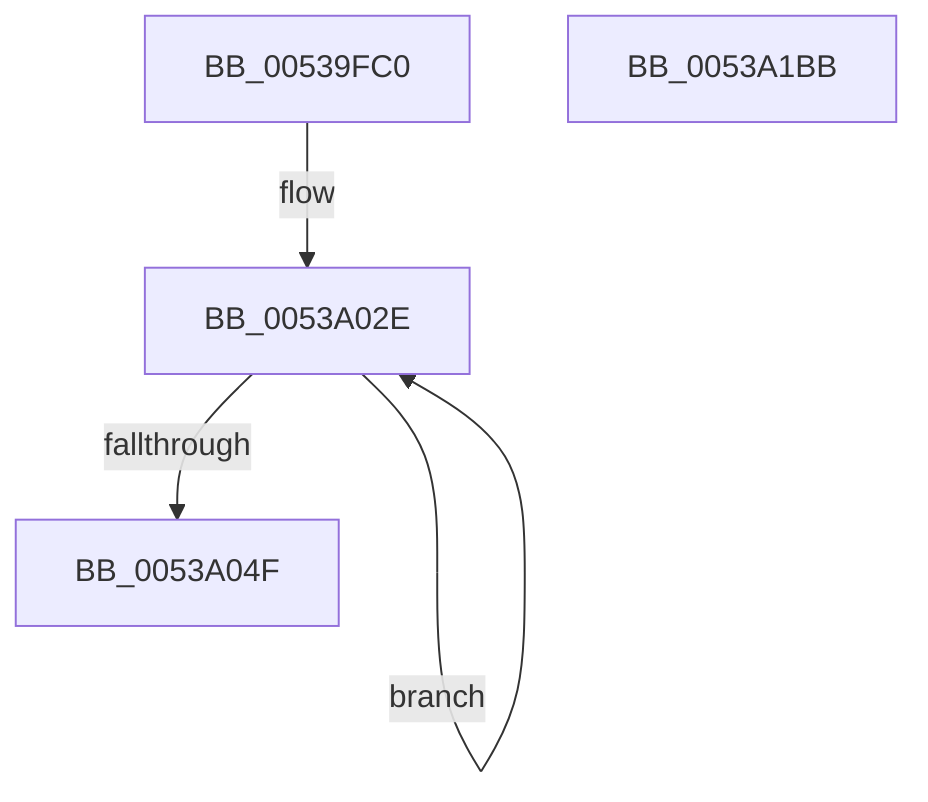

# SymCryptTwistedEdwardsIsEqual

- RVA: `0x00539FC0`–`0x0053A1BC` (길이 `508` bytes)
- VA: `0x0000000140539FC0`
- 실행 섹션: `.text`
- PDB 이름 있음: `예`; PDB Function 태그: `아니요`
- unwind 정보 RVA: `0x000C7BA4`
- 디코드: `132`개 명령, `508/508` bytes 표시
- 미해석 바이트: `0` (있으면 어셈블리에 `.byte`로 보존)

> 이 문서는 커널 이미지의 기계어와 PDB 기호를 분석해 생성했습니다. 4번과 5번은 함수 원형과 자료형을 바이너리 사용 방식에서 추정한 C 해석이며 원본 소스 복구 결과는 아닙니다.

## 1. Dependencies

- 직접 호출 지점: **11**; 고유 호출 대상: **6**
- 직접 호출자로 확인된 함수: **0**
- RIP 상대 이미지 참조: **1**

### Outgoing calls
- `0x0053A015` → [SymCryptSizeofModElementFromModulus](../52/SymCryptSizeofModElementFromModulus_function_00525D3C.md) (function, `0x00525D3C`)
- `0x0053A037` → [SymCryptModElementCreate](../52/SymCryptModElementCreate_function_00525900.md) (function, `0x00525900`)
- `0x0053A087` → [SymCryptModMul](../52/SymCryptModMul_function_00525BA8.md) (function, `0x00525BA8`)
- `0x0053A0A9` → [SymCryptModMul](../52/SymCryptModMul_function_00525BA8.md) (function, `0x00525BA8`)
- `0x0053A0B7` → [SymCryptModElementIsEqual](../52/SymCryptModElementIsEqual_function_0052594C.md) (function, `0x0052594C`)
- `0x0053A0DA` → [SymCryptModNeg](../52/SymCryptModNeg_function_00525BE4.md) (function, `0x00525BE4`)
- `0x0053A0EA` → [SymCryptModElementIsEqual](../52/SymCryptModElementIsEqual_function_0052594C.md) (function, `0x0052594C`)
- `0x0053A11B` → [SymCryptModMul](../52/SymCryptModMul_function_00525BA8.md) (function, `0x00525BA8`)
- `0x0053A14A` → [SymCryptModMul](../52/SymCryptModMul_function_00525BA8.md) (function, `0x00525BA8`)
- `0x0053A171` → [SymCryptModElementIsEqual](../52/SymCryptModElementIsEqual_function_0052594C.md) (function, `0x0052594C`)
- `0x0053A19E` → [_security_check_cookie](../6A/_security_check_cookie_function_006AC640.md) (function, `0x006AC640`)

### Direct callers
- 이 함수 시작 RVA로 연결되는 직접 call은 확인되지 않았습니다. 간접 호출은 완전히 역산할 수 없습니다.

### Static image references
- `0x00539FD4` → RVA `0x00E0A740` (`.data`; read)

## 2. Other-region calls and transfers

- 다른 실행 섹션으로 향하는 call: **0**
- 별도 외부 분기/꼬리 이동을 확인하지 못했습니다.

## 3. Assembly (complete function range)

```asm
00539FC0  48 89 5C 24 20                  mov qword ptr [rsp + 0x20], rbx
00539FC5  55                              push rbp
00539FC6  56                              push rsi
00539FC7  57                              push rdi
00539FC8  41 54                           push r12
00539FCA  41 55                           push r13
00539FCC  41 56                           push r14
00539FCE  41 57                           push r15
00539FD0  48 83 EC 70                     sub rsp, 0x70
00539FD4  48 8B 05 65 07 8D 00            mov rax, qword ptr [rip + 0x8d0765]
00539FDB  48 33 C4                        xor rax, rsp
00539FDE  48 89 44 24 60                  mov qword ptr [rsp + 0x60], rax
00539FE3  4C 8B A1 68 02 00 00            mov r12, qword ptr [rcx + 0x268]
00539FEA  48 8B E9                        mov rbp, rcx
00539FED  48 83 64 24 58 00               and qword ptr [rsp + 0x58], 0
00539FF3  49 8B CC                        mov rcx, r12
00539FF6  4C 8B AC 24 D0 00 00 00         mov r13, qword ptr [rsp + 0xd0]
00539FFE  4C 8B FA                        mov r15, rdx
0053A001  44 89 4C 24 30                  mov dword ptr [rsp + 0x30], r9d
0053A006  4C 89 44 24 40                  mov qword ptr [rsp + 0x40], r8
0053A00B  48 89 54 24 48                  mov qword ptr [rsp + 0x48], rdx
0053A010  4C 89 64 24 38                  mov qword ptr [rsp + 0x38], r12
0053A015  E8 22 BD FE FF                  call 0x140525d3c
0053A01A  4C 8B B4 24 D8 00 00 00         mov r14, qword ptr [rsp + 0xd8]
0053A022  48 8D 7C 24 50                  lea rdi, [rsp + 0x50]
0053A027  8B D8                           mov ebx, eax
0053A029  BE 02 00 00 00                  mov esi, 2
0053A02E  4D 8B C4                        mov r8, r12
0053A031  48 8B D3                        mov rdx, rbx
0053A034  49 8B CD                        mov rcx, r13
0053A037  E8 C4 B8 FE FF                  call 0x140525900
0053A03C  4C 03 EB                        add r13, rbx
0053A03F  48 89 07                        mov qword ptr [rdi], rax
0053A042  4C 2B F3                        sub r14, rbx
0053A045  48 8D 7F 08                     lea rdi, [rdi + 8]
0053A049  48 83 EE 01                     sub rsi, 1
0053A04D  75 DF                           jne 0x14053a02e
0053A04F  8B 75 24                        mov esi, dword ptr [rbp + 0x24]
0053A052  49 8D 57 20                     lea rdx, [r15 + 0x20]
0053A056  48 8B 7C 24 40                  mov rdi, qword ptr [rsp + 0x40]
0053A05B  49 8B CC                        mov rcx, r12
0053A05E  4C 89 74 24 28                  mov qword ptr [rsp + 0x28], r14
0053A063  4C 89 B4 24 D8 00 00 00         mov qword ptr [rsp + 0xd8], r14
0053A06B  8D 04 36                        lea eax, [rsi + rsi]
0053A06E  4C 89 6C 24 20                  mov qword ptr [rsp + 0x20], r13
0053A073  4A 8D 2C 38                     lea rbp, [rax + r15]
0053A077  4C 8B 7C 24 50                  mov r15, qword ptr [rsp + 0x50]
0053A07C  48 8D 1C 38                     lea rbx, [rax + rdi]
0053A080  4D 8B CF                        mov r9, r15
0053A083  4C 8D 43 20                     lea r8, [rbx + 0x20]
0053A087  E8 1C BB FE FF                  call 0x140525ba8
0053A08C  4C 89 74 24 28                  mov qword ptr [rsp + 0x28], r14
0053A091  48 8D 57 20                     lea rdx, [rdi + 0x20]
0053A095  4C 8B 74 24 58                  mov r14, qword ptr [rsp + 0x58]
0053A09A  4C 8D 45 20                     lea r8, [rbp + 0x20]
0053A09E  4D 8B CE                        mov r9, r14
0053A0A1  4C 89 6C 24 20                  mov qword ptr [rsp + 0x20], r13
0053A0A6  49 8B CC                        mov rcx, r12
0053A0A9  E8 FA BA FE FF                  call 0x140525ba8
0053A0AE  4D 8B C6                        mov r8, r14
0053A0B1  49 8B D7                        mov rdx, r15
0053A0B4  49 8B CC                        mov rcx, r12
0053A0B7  E8 90 B8 FE FF                  call 0x14052594c
0053A0BC  48 8B 4C 24 38                  mov rcx, qword ptr [rsp + 0x38]
0053A0C1  44 8B E0                        mov r12d, eax
0053A0C4  48 8B 84 24 D8 00 00 00         mov rax, qword ptr [rsp + 0xd8]
0053A0CC  4D 8B CD                        mov r9, r13
0053A0CF  4D 8B C6                        mov r8, r14
0053A0D2  48 89 44 24 20                  mov qword ptr [rsp + 0x20], rax
0053A0D7  49 8B D6                        mov rdx, r14
0053A0DA  E8 05 BB FE FF                  call 0x140525be4
0053A0DF  48 8B 4C 24 38                  mov rcx, qword ptr [rsp + 0x38]
0053A0E4  4D 8B C6                        mov r8, r14
0053A0E7  49 8B D7                        mov rdx, r15
0053A0EA  E8 5D B8 FE FF                  call 0x14052594c
0053A0EF  48 8B 54 24 48                  mov rdx, qword ptr [rsp + 0x48]
0053A0F4  4C 8D 43 20                     lea r8, [rbx + 0x20]
0053A0F8  48 8B 4C 24 38                  mov rcx, qword ptr [rsp + 0x38]
0053A0FD  8B F8                           mov edi, eax
0053A0FF  48 8B 84 24 D8 00 00 00         mov rax, qword ptr [rsp + 0xd8]
0053A107  48 83 C2 20                     add rdx, 0x20
0053A10B  48 89 44 24 28                  mov qword ptr [rsp + 0x28], rax
0053A110  48 03 D6                        add rdx, rsi
0053A113  4D 8B CF                        mov r9, r15
0053A116  4C 89 6C 24 20                  mov qword ptr [rsp + 0x20], r13
0053A11B  E8 88 BA FE FF                  call 0x140525ba8
0053A120  48 8B 84 24 D8 00 00 00         mov rax, qword ptr [rsp + 0xd8]
0053A128  4C 8D 45 20                     lea r8, [rbp + 0x20]
0053A12C  48 8B 54 24 40                  mov rdx, qword ptr [rsp + 0x40]
0053A131  4D 8B CE                        mov r9, r14
0053A134  48 8B 4C 24 38                  mov rcx, qword ptr [rsp + 0x38]
0053A139  48 83 C2 20                     add rdx, 0x20
0053A13D  48 89 44 24 28                  mov qword ptr [rsp + 0x28], rax
0053A142  48 03 D6                        add rdx, rsi
0053A145  4C 89 6C 24 20                  mov qword ptr [rsp + 0x20], r13
0053A14A  E8 59 BA FE FF                  call 0x140525ba8
0053A14F  44 8B 4C 24 30                  mov r9d, dword ptr [rsp + 0x30]
0053A154  4D 8B C6                        mov r8, r14
0053A157  48 8B 4C 24 38                  mov rcx, qword ptr [rsp + 0x38]
0053A15C  41 8B D9                        mov ebx, r9d
0053A15F  48 F7 DB                        neg rbx
0053A162  49 8B D7                        mov rdx, r15
0053A165  48 C1 EB 20                     shr rbx, 0x20
0053A169  F7 D3                           not ebx
0053A16B  83 E3 01                        and ebx, 1
0053A16E  49 0B D9                        or rbx, r9
0053A171  E8 D6 B7 FE FF                  call 0x14052594c
0053A176  48 8B CB                        mov rcx, rbx
0053A179  83 E3 01                        and ebx, 1
0053A17C  83 E1 02                        and ecx, 2
0053A17F  48 F7 DB                        neg rbx
0053A182  48 F7 D9                        neg rcx
0053A185  48 C1 EB 20                     shr rbx, 0x20
0053A189  48 C1 E9 20                     shr rcx, 0x20
0053A18D  41 23 DC                        and ebx, r12d
0053A190  23 CF                           and ecx, edi
0053A192  0B CB                           or ecx, ebx
0053A194  23 C1                           and eax, ecx
0053A196  48 8B 4C 24 60                  mov rcx, qword ptr [rsp + 0x60]
0053A19B  48 33 CC                        xor rcx, rsp
0053A19E  E8 9D 24 17 00                  call 0x1406ac640
0053A1A3  48 8B 9C 24 C8 00 00 00         mov rbx, qword ptr [rsp + 0xc8]
0053A1AB  48 83 C4 70                     add rsp, 0x70
0053A1AF  41 5F                           pop r15
0053A1B1  41 5E                           pop r14
0053A1B3  41 5D                           pop r13
0053A1B5  41 5C                           pop r12
0053A1B7  5F                              pop rdi
0053A1B8  5E                              pop rsi
0053A1B9  5D                              pop rbp
0053A1BA  C3                              ret
0053A1BB  CC                              int3
```

## 4. C-style interpretation (structured pseudocode)

```c
__int64 __fastcall SymCryptTwistedEdwardsIsEqual(__int64 a1, __int64 a2, __int64 a3, int a4, __int64 a5, __int64 a6)
{
    __int64 result;
    __int64 v_r13;
    __int64 v_r14;
    __int64 v_rbx;
    __int64 v_rsi;
    __int64 v_rsp;
    unsigned __int64 v_stack_m48;
    unsigned __int64 v_stack_m50;
    unsigned __int64 v_stack_m58;
    unsigned __int64 v_stack_m60;
    unsigned __int64 v_stack_m68;
    unsigned __int64 v_stack_m70;
    unsigned int v_stack_m78;
    unsigned __int64 v_stack_m80;
    unsigned __int64 v_stack_m88;
    unsigned __int64 v_stack_p20;
    unsigned __int64 v_stack_p30;

    v_stack_p20 = v_rbx;
    v_rsp = (v_rsp) - (112);
    result = (*(unsigned __int64 *)(v_rip + 9242469)) ^ (v_rsp);
    v_stack_m48 = result;
    v_stack_m78 = a4;
    v_stack_m68 = a3;
    v_stack_m60 = a2;
    v_stack_m70 = *(unsigned __int64 *)(a1 + 616);
    result = SymCryptSizeofModElementFromModulus(*(unsigned __int64 *)(a1 + 616), a2, a3, a4);
loc_0053A02E:
    result = SymCryptModElementCreate(a5, (unsigned int)((unsigned int)(result)), *(unsigned __int64 *)(a1 + 616), a4);
    v_r13 = (a5) + ((unsigned int)((unsigned int)(result)));
    *(unsigned __int64 *)(v_stack_m58) = result;
    v_r14 = (a6) - ((unsigned int)((unsigned int)(result)));
    v_rsi = (2) - (1);
    if (condition_is_not_equal) goto loc_0053A02E;
    v_stack_m80 = v_r14;
    v_stack_p30 = v_r14;
    v_stack_m88 = v_r13;
    result = SymCryptModMul(*(unsigned __int64 *)(a1 + 616), a2 + 32, (unsigned int)(*(unsigned int *)(a1 + 36)) + (unsigned int)(*(unsigned int *)(a1 + 36)) * 1 + v_stack_m68 * 1 + 32, v_stack_m58);
    v_stack_m80 = v_r14;
    v_stack_m88 = v_r13;
    result = SymCryptModMul(*(unsigned __int64 *)(a1 + 616), v_stack_m68 + 32, (unsigned int)(*(unsigned int *)(a1 + 36)) + (unsigned int)(*(unsigned int *)(a1 + 36)) * 1 + a2 * 1 + 32, v_stack_m50);
    result = SymCryptModElementIsEqual(*(unsigned __int64 *)(a1 + 616), v_stack_m58, v_stack_m50, v_stack_m50);
    v_stack_m88 = a6;
    result = SymCryptModNeg(v_stack_m70, v_stack_m50, v_stack_m50, v_r13);
    result = SymCryptModElementIsEqual(v_stack_m70, v_stack_m58, v_stack_m50, v_r13);
    a2 = (v_stack_m60) + (32);
    v_stack_m80 = a6;
    a2 = (a2) + ((unsigned int)(*(unsigned int *)(a1 + 36)));
    v_stack_m88 = v_r13;
    result = SymCryptModMul(v_stack_m70, a2, (unsigned int)(*(unsigned int *)(a1 + 36)) + (unsigned int)(*(unsigned int *)(a1 + 36)) * 1 + v_stack_m68 * 1 + 32, v_stack_m58);
    a2 = (v_stack_m68) + (32);
    v_stack_m80 = a6;
    a2 = (a2) + ((unsigned int)(*(unsigned int *)(a1 + 36)));
    v_stack_m88 = v_r13;
    result = SymCryptModMul(v_stack_m70, a2, (unsigned int)(*(unsigned int *)(a1 + 36)) + (unsigned int)(*(unsigned int *)(a1 + 36)) * 1 + a2 * 1 + 32, v_stack_m50);
    v_rbx = -((unsigned int)((unsigned int)((unsigned int)(v_stack_m78))));
    v_rbx = (v_rbx) >> (32);
    v_rbx = (unsigned int)(~(v_rbx));
    v_rbx = (unsigned int)((v_rbx) & (1));
    v_rbx = (v_rbx) | ((unsigned int)(v_stack_m78));
    result = SymCryptModElementIsEqual(v_stack_m70, v_stack_m58, v_stack_m50, (unsigned int)(v_stack_m78));
    v_rbx = (unsigned int)((v_rbx) & (1));
    a1 = (unsigned int)((v_rbx) & (2));
    v_rbx = -(v_rbx);
    a1 = -(a1);
    v_rbx = (v_rbx) >> (32);
    a1 = (a1) >> (32);
    v_rbx = (unsigned int)((v_rbx) & ((unsigned int)((unsigned int)((unsigned int)(result)))));
    a1 = (unsigned int)((a1) & ((unsigned int)((unsigned int)((unsigned int)(result)))));
    a1 = (unsigned int)((a1) | ((unsigned int)(v_rbx)));
    result = (unsigned int)((result) & ((unsigned int)(a1)));
    a1 = (v_stack_m48) ^ (v_rsp);
    result = _security_check_cookie(a1, v_stack_m58, v_stack_m50, (unsigned int)(v_stack_m78));
    v_rsp = (v_rsp) + (112);
    return result;
}
```

## 5. (Beta) C Style

```c
int64_t SymCryptTwistedEdwardsIsEqual(void *Arg1, void *Arg2, int64_t Arg3, int32_t Arg4, int64_t Arg5, int64_t Arg6)
{
    uint8_t *arg1 = (uint8_t *)Arg1;
    uint8_t *arg2 = (uint8_t *)Arg2;

    int64_t result;
    int64_t local_r13;
    int64_t local_r14;
    int64_t local_rbx;
    int64_t local_rsi;
    int64_t local_rsp;
    uint64_t v_stack_m48;
    uint64_t v_stack_m50;
    uint64_t v_stack_m58;
    uint64_t v_stack_m60;
    uint64_t v_stack_m68;
    uint64_t v_stack_m70;
    uint32_t v_stack_m78;
    uint64_t v_stack_m80;
    uint64_t v_stack_m88;
    uint64_t v_stack_p20;
    uint64_t v_stack_p30;

    v_stack_p20 = local_rbx;
    local_rsp = (local_rsp) - (112);
    result = (*(uint64_t *)(v_rip + 0x8D0765)) ^ (local_rsp);
    v_stack_m48 = result;
    v_stack_m78 = Arg4;
    v_stack_m68 = Arg3;
    v_stack_m60 = Arg2;
    v_stack_m70 = *(uint64_t *)(arg1 + 0x268);
    result = SymCryptSizeofModElementFromModulus(*(uint64_t *)(arg1 + 0x268), Arg2, Arg3, Arg4);
loc_0053A02E:
    result = SymCryptModElementCreate(Arg5, (uint32_t)((uint32_t)(result)), *(uint64_t *)(arg1 + 0x268), Arg4);
    local_r13 = (Arg5) + ((uint32_t)((uint32_t)(result)));
    *(uint64_t *)(v_stack_m58) = result;
    local_r14 = (Arg6) - ((uint32_t)((uint32_t)(result)));
    local_rsi = (2) - (1);
    if (condition_is_not_equal) goto loc_0053A02E;
    v_stack_m80 = local_r14;
    v_stack_p30 = local_r14;
    v_stack_m88 = local_r13;
    result = SymCryptModMul(*(uint64_t *)(arg1 + 0x268), Arg2 + 32, (uint32_t)(*(uint32_t *)(arg1 + 0x24)) + (uint32_t)(*(uint32_t *)(arg1 + 0x24)) * 1 + v_stack_m68 * 1 + 32, v_stack_m58);
    v_stack_m80 = local_r14;
    v_stack_m88 = local_r13;
    result = SymCryptModMul(*(uint64_t *)(arg1 + 0x268), v_stack_m68 + 32, (uint32_t)(*(uint32_t *)(arg1 + 0x24)) + (uint32_t)(*(uint32_t *)(arg1 + 0x24)) * 1 + Arg2 * 1 + 32, v_stack_m50);
    result = SymCryptModElementIsEqual(*(uint64_t *)(arg1 + 0x268), v_stack_m58, v_stack_m50, v_stack_m50);
    v_stack_m88 = Arg6;
    result = SymCryptModNeg(v_stack_m70, v_stack_m50, v_stack_m50, local_r13);
    result = SymCryptModElementIsEqual(v_stack_m70, v_stack_m58, v_stack_m50, local_r13);
    Arg2 = (v_stack_m60) + (32);
    v_stack_m80 = Arg6;
    Arg2 = (Arg2) + ((uint32_t)(*(uint32_t *)(arg1 + 0x24)));
    v_stack_m88 = local_r13;
    result = SymCryptModMul(v_stack_m70, Arg2, (uint32_t)(*(uint32_t *)(arg1 + 0x24)) + (uint32_t)(*(uint32_t *)(arg1 + 0x24)) * 1 + v_stack_m68 * 1 + 32, v_stack_m58);
    Arg2 = (v_stack_m68) + (32);
    v_stack_m80 = Arg6;
    Arg2 = (Arg2) + ((uint32_t)(*(uint32_t *)(arg1 + 0x24)));
    v_stack_m88 = local_r13;
    result = SymCryptModMul(v_stack_m70, Arg2, (uint32_t)(*(uint32_t *)(arg1 + 0x24)) + (uint32_t)(*(uint32_t *)(arg1 + 0x24)) * 1 + Arg2 * 1 + 32, v_stack_m50);
    local_rbx = -((uint32_t)((uint32_t)((uint32_t)(v_stack_m78))));
    local_rbx = (local_rbx) >> (32);
    local_rbx = (uint32_t)(~(local_rbx));
    local_rbx = (uint32_t)((local_rbx) & (1));
    local_rbx = (local_rbx) | ((uint32_t)(v_stack_m78));
    result = SymCryptModElementIsEqual(v_stack_m70, v_stack_m58, v_stack_m50, (uint32_t)(v_stack_m78));
    local_rbx = (uint32_t)((local_rbx) & (1));
    Arg1 = (uint32_t)((local_rbx) & (2));
    local_rbx = -(local_rbx);
    Arg1 = -(Arg1);
    local_rbx = (local_rbx) >> (32);
    Arg1 = (Arg1) >> (32);
    local_rbx = (uint32_t)((local_rbx) & ((uint32_t)((uint32_t)((uint32_t)(result)))));
    Arg1 = (uint32_t)((Arg1) & ((uint32_t)((uint32_t)((uint32_t)(result)))));
    Arg1 = (uint32_t)((Arg1) | ((uint32_t)(local_rbx)));
    result = (uint32_t)((result) & ((uint32_t)(Arg1)));
    Arg1 = (v_stack_m48) ^ (local_rsp);
    result = _security_check_cookie(Arg1, v_stack_m58, v_stack_m50, (uint32_t)(v_stack_m78));
    local_rsp = (local_rsp) + (112);
    return result;
}
```

### 관측된 메모리 오프셋

구조체 형식이 확인되지 않은 접근은 인자 기준의 오프셋으로만 기록했습니다.

| 기준 인자 | 오프셋 표현 | 폭 (bit) | 접근 |
|---|---:|---:|---|
| `Arg1` | `+ 0x24` | `32` | `R` |
| `Arg1` | `+ 0x268` | `64` | `R` |
| `Arg2` | `+ 0x20` | `64` | `R` |

## 6. Execution-region graph

[열기: 2D/3D 그래프와 함수 탐색 컨트롤 패널](../../../control-panel.html?section=text&rva=0x00539FC0&view=graph)

- 2D 그래프는 위에서 아래로 흐르고, 3D 그래프는 빈 공간을 드래그해 회전합니다. Shift+드래그는 이동, 휠은 확대·축소, 함수 노드 선택은 대상 보고서 이동입니다.

### Static fallback


