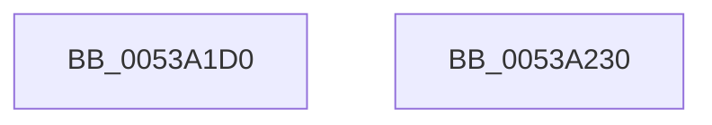

# SymCryptTwistedEdwardsIsZero

- RVA: `0x0053A1D0`–`0x0053A231` (길이 `97` bytes)
- VA: `0x000000014053A1D0`
- 실행 섹션: `.text`
- PDB 이름 있음: `예`; PDB Function 태그: `아니요`
- unwind 정보 RVA: `0x0005C954`
- 디코드: `27`개 명령, `97/97` bytes 표시
- 미해석 바이트: `0` (있으면 어셈블리에 `.byte`로 보존)

> 이 문서는 커널 이미지의 기계어와 PDB 기호를 분석해 생성했습니다. 4번과 5번은 함수 원형과 자료형을 바이너리 사용 방식에서 추정한 C 해석이며 원본 소스 복구 결과는 아닙니다.

## 1. Dependencies

- 직접 호출 지점: **2**; 고유 호출 대상: **2**
- 직접 호출자로 확인된 함수: **0**
- RIP 상대 이미지 참조: **0**

### Outgoing calls
- `0x0053A1F8` → [SymCryptModElementIsZero](../52/SymCryptModElementIsZero_function_00525964.md) (function, `0x00525964`)
- `0x0053A214` → [SymCryptModElementIsEqual](../52/SymCryptModElementIsEqual_function_0052594C.md) (function, `0x0052594C`)

### Direct callers
- 이 함수 시작 RVA로 연결되는 직접 call은 확인되지 않았습니다. 간접 호출은 완전히 역산할 수 없습니다.

### Static image references
- 디코드된 RIP-relative 메모리 참조가 없습니다.

## 2. Other-region calls and transfers

- 다른 실행 섹션으로 향하는 call: **0**
- 별도 외부 분기/꼬리 이동을 확인하지 못했습니다.

## 3. Assembly (complete function range)

```asm
0053A1D0  48 89 5C 24 08                  mov qword ptr [rsp + 8], rbx
0053A1D5  48 89 6C 24 10                  mov qword ptr [rsp + 0x10], rbp
0053A1DA  48 89 74 24 18                  mov qword ptr [rsp + 0x18], rsi
0053A1DF  57                              push rdi
0053A1E0  48 83 EC 20                     sub rsp, 0x20
0053A1E4  48 8B B1 68 02 00 00            mov rsi, qword ptr [rcx + 0x268]
0053A1EB  48 8B EA                        mov rbp, rdx
0053A1EE  8B 59 24                        mov ebx, dword ptr [rcx + 0x24]
0053A1F1  48 83 C2 20                     add rdx, 0x20
0053A1F5  48 8B CE                        mov rcx, rsi
0053A1F8  E8 67 B7 FE FF                  call 0x140525964
0053A1FD  44 8D 0C 1B                     lea r9d, [rbx + rbx]
0053A201  48 8B CE                        mov rcx, rsi
0053A204  4C 8D 45 20                     lea r8, [rbp + 0x20]
0053A208  8B F8                           mov edi, eax
0053A20A  48 8D 55 20                     lea rdx, [rbp + 0x20]
0053A20E  4D 03 C1                        add r8, r9
0053A211  48 03 D3                        add rdx, rbx
0053A214  E8 33 B7 FE FF                  call 0x14052594c
0053A219  48 8B 5C 24 30                  mov rbx, qword ptr [rsp + 0x30]
0053A21E  23 C7                           and eax, edi
0053A220  48 8B 6C 24 38                  mov rbp, qword ptr [rsp + 0x38]
0053A225  48 8B 74 24 40                  mov rsi, qword ptr [rsp + 0x40]
0053A22A  48 83 C4 20                     add rsp, 0x20
0053A22E  5F                              pop rdi
0053A22F  C3                              ret
0053A230  CC                              int3
```

## 4. C-style interpretation (structured pseudocode)

```c
__int64 __fastcall SymCryptTwistedEdwardsIsZero(__int64 a1, __int64 a2)
{
    __int64 result;
    __int64 v_rsp;
    unsigned __int64 v_stack_p10;
    unsigned __int64 v_stack_p18;
    unsigned __int64 v_stack_p8;

    v_stack_p8 = v_rbx;
    v_stack_p10 = v_rbp;
    v_stack_p18 = v_rsi;
    v_rsp = (v_rsp) - (32);
    a2 = (a2) + (32);
    result = SymCryptModElementIsZero(*(unsigned __int64 *)(a1 + 616), a2, a3, a4);
    a3 = (a2 + 32) + ((unsigned int)(*(unsigned int *)(a1 + 36)) + (unsigned int)(*(unsigned int *)(a1 + 36)) * 1);
    a2 = (a2 + 32) + ((unsigned int)(*(unsigned int *)(a1 + 36)));
    result = SymCryptModElementIsEqual(*(unsigned __int64 *)(a1 + 616), a2, a3, (unsigned int)(*(unsigned int *)(a1 + 36)) + (unsigned int)(*(unsigned int *)(a1 + 36)) * 1);
    result = (unsigned int)((result) & ((unsigned int)((unsigned int)((unsigned int)(result)))));
    v_rsp = (v_rsp) + (32);
    return result;
}
```

## 5. (Beta) C Style

```c
int64_t SymCryptTwistedEdwardsIsZero(void *Arg1, void *Arg2)
{
    uint8_t *arg1 = (uint8_t *)Arg1;
    uint8_t *arg2 = (uint8_t *)Arg2;

    int64_t result;
    int64_t local_rsp;
    uint64_t v_stack_p10;
    uint64_t v_stack_p18;
    uint64_t v_stack_p8;

    v_stack_p8 = local_rbx;
    v_stack_p10 = local_rbp;
    v_stack_p18 = local_rsi;
    local_rsp = (local_rsp) - (32);
    Arg2 = (Arg2) + (32);
    result = SymCryptModElementIsZero(*(uint64_t *)(arg1 + 0x268), Arg2, a3, a4);
    a3 = (Arg2 + 32) + ((uint32_t)(*(uint32_t *)(arg1 + 0x24)) + (uint32_t)(*(uint32_t *)(arg1 + 0x24)) * 1);
    Arg2 = (Arg2 + 32) + ((uint32_t)(*(uint32_t *)(arg1 + 0x24)));
    result = SymCryptModElementIsEqual(*(uint64_t *)(arg1 + 0x268), Arg2, a3, (uint32_t)(*(uint32_t *)(arg1 + 0x24)) + (uint32_t)(*(uint32_t *)(arg1 + 0x24)) * 1);
    result = (uint32_t)((result) & ((uint32_t)((uint32_t)((uint32_t)(result)))));
    local_rsp = (local_rsp) + (32);
    return result;
}
```

### 관측된 메모리 오프셋

구조체 형식이 확인되지 않은 접근은 인자 기준의 오프셋으로만 기록했습니다.

| 기준 인자 | 오프셋 표현 | 폭 (bit) | 접근 |
|---|---:|---:|---|
| `Arg1` | `+ 0x24` | `32` | `R` |
| `Arg1` | `+ 0x268` | `64` | `R` |
| `Arg2` | `+ 0x20` | `64` | `R` |

## 6. Execution-region graph

[열기: 2D/3D 그래프와 함수 탐색 컨트롤 패널](../../../control-panel.html?section=text&rva=0x0053A1D0&view=graph)

- 2D 그래프는 위에서 아래로 흐르고, 3D 그래프는 빈 공간을 드래그해 회전합니다. Shift+드래그는 이동, 휠은 확대·축소, 함수 노드 선택은 대상 보고서 이동입니다.

### Static fallback


