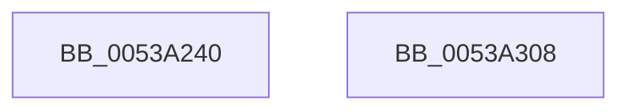

# SymCryptTwistedEdwardsNegate

- RVA: `0x0053A240`–`0x0053A309` (길이 `201` bytes)
- VA: `0x000000014053A240`
- 실행 섹션: `.text`
- PDB 이름 있음: `예`; PDB Function 태그: `아니요`
- unwind 정보 RVA: `0x000847EC`
- 디코드: `58`개 명령, `201/201` bytes 표시
- 미해석 바이트: `0` (있으면 어셈블리에 `.byte`로 보존)

> 이 문서는 커널 이미지의 기계어와 PDB 기호를 분석해 생성했습니다. 4번과 5번은 함수 원형과 자료형을 바이너리 사용 방식에서 추정한 C 해석이며 원본 소스 복구 결과는 아닙니다.

## 1. Dependencies

- 직접 호출 지점: **5**; 고유 호출 대상: **3**
- 직접 호출자로 확인된 함수: **0**
- RIP 상대 이미지 참조: **0**

### Outgoing calls
- `0x0053A283` → [SymCryptModElementCreate](../52/SymCryptModElementCreate_function_00525900.md) (function, `0x00525900`)
- `0x0053A2AA` → [SymCryptModNeg](../52/SymCryptModNeg_function_00525BE4.md) (function, `0x00525BE4`)
- `0x0053A2BB` → [SymCryptModElementMaskedCopy](../52/SymCryptModElementMaskedCopy_function_0052597C.md) (function, `0x0052597C`)
- `0x0053A2D2` → [SymCryptModNeg](../52/SymCryptModNeg_function_00525BE4.md) (function, `0x00525BE4`)
- `0x0053A2E4` → [SymCryptModElementMaskedCopy](../52/SymCryptModElementMaskedCopy_function_0052597C.md) (function, `0x0052597C`)

### Direct callers
- 이 함수 시작 RVA로 연결되는 직접 call은 확인되지 않았습니다. 간접 호출은 완전히 역산할 수 없습니다.

### Static image references
- 디코드된 RIP-relative 메모리 참조가 없습니다.

## 2. Other-region calls and transfers

- 다른 실행 섹션으로 향하는 call: **0**
- 별도 외부 분기/꼬리 이동을 확인하지 못했습니다.

## 3. Assembly (complete function range)

```asm
0053A240  48 8B C4                        mov rax, rsp
0053A243  48 89 58 08                     mov qword ptr [rax + 8], rbx
0053A247  48 89 68 10                     mov qword ptr [rax + 0x10], rbp
0053A24B  48 89 70 18                     mov qword ptr [rax + 0x18], rsi
0053A24F  48 89 78 20                     mov qword ptr [rax + 0x20], rdi
0053A253  41 54                           push r12
0053A255  41 56                           push r14
0053A257  41 57                           push r15
0053A259  48 83 EC 30                     sub rsp, 0x30
0053A25D  4C 8B B9 68 02 00 00            mov r15, qword ptr [rcx + 0x268]
0053A264  48 8D 7A 20                     lea rdi, [rdx + 0x20]
0053A268  4C 8B DA                        mov r11, rdx
0053A26B  45 8B E0                        mov r12d, r8d
0053A26E  8B 51 24                        mov edx, dword ptr [rcx + 0x24]
0053A271  48 8B D9                        mov rbx, rcx
0053A274  4D 8B C7                        mov r8, r15
0053A277  49 8B C9                        mov rcx, r9
0053A27A  4D 8B F1                        mov r14, r9
0053A27D  8D 2C 52                        lea ebp, [rdx + rdx*2]
0053A280  49 03 EB                        add rbp, r11
0053A283  E8 78 B6 FE FF                  call 0x140525900
0053A288  8B 4B 24                        mov ecx, dword ptr [rbx + 0x24]
0053A28B  4C 8B C0                        mov r8, rax
0053A28E  48 8B 5C 24 70                  mov rbx, qword ptr [rsp + 0x70]
0053A293  4C 03 F1                        add r14, rcx
0053A296  48 2B D9                        sub rbx, rcx
0053A299  4D 8B CE                        mov r9, r14
0053A29C  49 8B CF                        mov rcx, r15
0053A29F  48 89 5C 24 20                  mov qword ptr [rsp + 0x20], rbx
0053A2A4  48 8B D7                        mov rdx, rdi
0053A2A7  48 8B F0                        mov rsi, rax
0053A2AA  E8 35 B9 FE FF                  call 0x140525be4
0053A2AF  45 8B CC                        mov r9d, r12d
0053A2B2  4C 8B C7                        mov r8, rdi
0053A2B5  48 8B D6                        mov rdx, rsi
0053A2B8  49 8B CF                        mov rcx, r15
0053A2BB  E8 BC B6 FE FF                  call 0x14052597c
0053A2C0  4D 8B CE                        mov r9, r14
0053A2C3  48 89 5C 24 20                  mov qword ptr [rsp + 0x20], rbx
0053A2C8  4C 8B C6                        mov r8, rsi
0053A2CB  48 8D 55 20                     lea rdx, [rbp + 0x20]
0053A2CF  49 8B CF                        mov rcx, r15
0053A2D2  E8 0D B9 FE FF                  call 0x140525be4
0053A2D7  45 8B CC                        mov r9d, r12d
0053A2DA  4C 8D 45 20                     lea r8, [rbp + 0x20]
0053A2DE  48 8B D6                        mov rdx, rsi
0053A2E1  49 8B CF                        mov rcx, r15
0053A2E4  E8 93 B6 FE FF                  call 0x14052597c
0053A2E9  48 8B 5C 24 50                  mov rbx, qword ptr [rsp + 0x50]
0053A2EE  48 8B 6C 24 58                  mov rbp, qword ptr [rsp + 0x58]
0053A2F3  48 8B 74 24 60                  mov rsi, qword ptr [rsp + 0x60]
0053A2F8  48 8B 7C 24 68                  mov rdi, qword ptr [rsp + 0x68]
0053A2FD  48 83 C4 30                     add rsp, 0x30
0053A301  41 5F                           pop r15
0053A303  41 5E                           pop r14
0053A305  41 5C                           pop r12
0053A307  C3                              ret
0053A308  CC                              int3
```

## 4. C-style interpretation (structured pseudocode)

```c
__int64 __fastcall SymCryptTwistedEdwardsNegate(__int64 a1, __int64 a2, int a3, __int64 a4, __int64 a5)
{
    __int64 result;
    __int64 v_r14;
    __int64 v_rbp;
    __int64 v_rbx;
    __int64 v_rsp;
    unsigned __int64 v_stack_m28;
    unsigned __int64 v_stack_p10;
    unsigned __int64 v_stack_p18;
    unsigned __int64 v_stack_p20;
    unsigned __int64 v_stack_p8;

    *(unsigned __int64 *)(v_rsp + 8) = v_rbx;
    *(unsigned __int64 *)(v_rsp + 16) = v_rbp;
    *(unsigned __int64 *)(v_rsp + 24) = v_rsi;
    *(unsigned __int64 *)(v_rsp + 32) = v_rdi;
    v_rsp = (v_rsp) - (48);
    v_rbp = ((unsigned int)(*(unsigned int *)(a1 + 36)) + (unsigned int)(*(unsigned int *)(a1 + 36)) * 2) + (a2);
    result = SymCryptModElementCreate(a4, (unsigned int)(*(unsigned int *)(a1 + 36)), *(unsigned __int64 *)(a1 + 616), a4);
    v_r14 = (a4) + ((unsigned int)(*(unsigned int *)(a1 + 36)));
    v_rbx = (a5) - ((unsigned int)(*(unsigned int *)(a1 + 36)));
    v_stack_m28 = v_rbx;
    result = SymCryptModNeg(*(unsigned __int64 *)(a1 + 616), a2 + 32, result, v_r14);
    result = SymCryptModElementMaskedCopy(*(unsigned __int64 *)(a1 + 616), result, a2 + 32, (unsigned int)((unsigned int)((unsigned int)(a3))));
    v_stack_m28 = v_rbx;
    result = SymCryptModNeg(*(unsigned __int64 *)(a1 + 616), v_rbp + 32, result, v_r14);
    result = SymCryptModElementMaskedCopy(*(unsigned __int64 *)(a1 + 616), result, v_rbp + 32, (unsigned int)((unsigned int)((unsigned int)(a3))));
    v_rsp = (v_rsp) + (48);
    return result;
}
```

## 5. (Beta) C Style

```c
int64_t SymCryptTwistedEdwardsNegate(void *Arg1, void *Arg2, int32_t Arg3, int64_t Arg4, int64_t Arg5)
{
    uint8_t *arg1 = (uint8_t *)Arg1;
    uint8_t *arg2 = (uint8_t *)Arg2;

    int64_t result;
    int64_t local_r14;
    int64_t local_rbp;
    int64_t local_rbx;
    int64_t local_rsp;
    uint64_t v_stack_m28;
    uint64_t v_stack_p10;
    uint64_t v_stack_p18;
    uint64_t v_stack_p20;
    uint64_t v_stack_p8;

    *(uint64_t *)(local_rsp + 0x8) = local_rbx;
    *(uint64_t *)(local_rsp + 0x10) = local_rbp;
    *(uint64_t *)(local_rsp + 0x18) = local_rsi;
    *(uint64_t *)(local_rsp + 0x20) = local_rdi;
    local_rsp = (local_rsp) - (48);
    local_rbp = ((uint32_t)(*(uint32_t *)(arg1 + 0x24)) + (uint32_t)(*(uint32_t *)(arg1 + 0x24)) * 2) + (Arg2);
    result = SymCryptModElementCreate(Arg4, (uint32_t)(*(uint32_t *)(arg1 + 0x24)), *(uint64_t *)(arg1 + 0x268), Arg4);
    local_r14 = (Arg4) + ((uint32_t)(*(uint32_t *)(arg1 + 0x24)));
    local_rbx = (Arg5) - ((uint32_t)(*(uint32_t *)(arg1 + 0x24)));
    v_stack_m28 = local_rbx;
    result = SymCryptModNeg(*(uint64_t *)(arg1 + 0x268), Arg2 + 32, result, local_r14);
    result = SymCryptModElementMaskedCopy(*(uint64_t *)(arg1 + 0x268), result, Arg2 + 32, (uint32_t)((uint32_t)((uint32_t)(Arg3))));
    v_stack_m28 = local_rbx;
    result = SymCryptModNeg(*(uint64_t *)(arg1 + 0x268), local_rbp + 32, result, local_r14);
    result = SymCryptModElementMaskedCopy(*(uint64_t *)(arg1 + 0x268), result, local_rbp + 32, (uint32_t)((uint32_t)((uint32_t)(Arg3))));
    local_rsp = (local_rsp) + (48);
    return result;
}
```

### 관측된 메모리 오프셋

구조체 형식이 확인되지 않은 접근은 인자 기준의 오프셋으로만 기록했습니다.

| 기준 인자 | 오프셋 표현 | 폭 (bit) | 접근 |
|---|---:|---:|---|
| `Arg1` | `+ 0x24` | `32` | `R` |
| `Arg1` | `+ 0x268` | `64` | `R` |
| `Arg2` | `+ 0x20` | `64` | `R` |

## 6. Execution-region graph

[열기: 2D/3D 그래프와 함수 탐색 컨트롤 패널](../../../control-panel.html?section=text&rva=0x0053A240&view=graph)

- 2D 그래프는 위에서 아래로 흐르고, 3D 그래프는 빈 공간을 드래그해 회전합니다. Shift+드래그는 이동, 휠은 확대·축소, 함수 노드 선택은 대상 보고서 이동입니다.

### Static fallback


