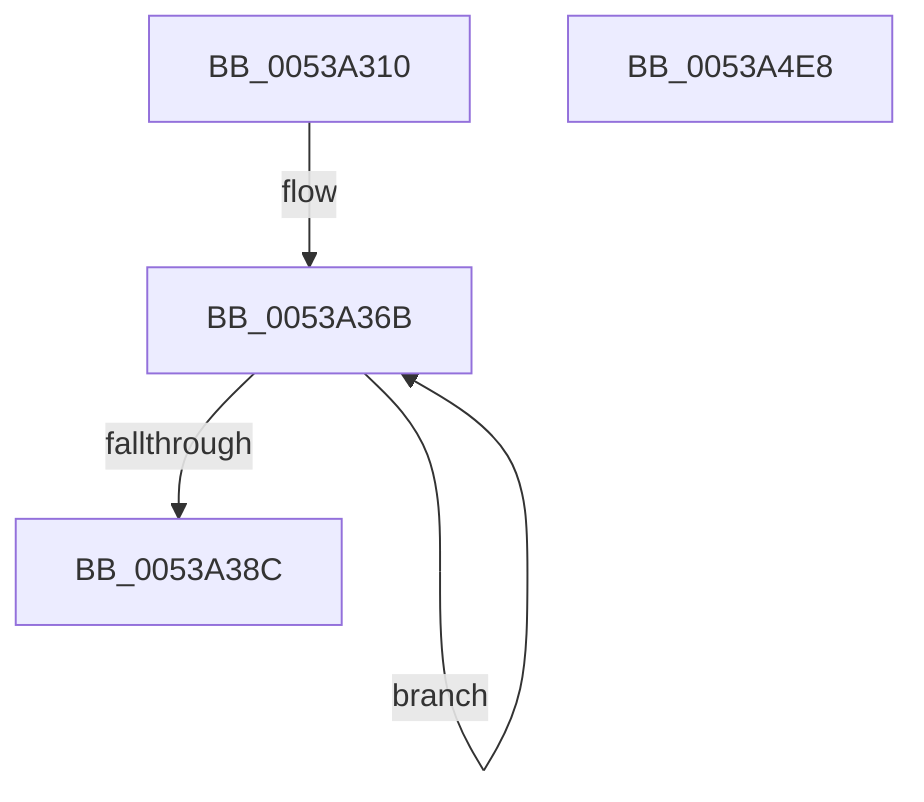

# SymCryptTwistedEdwardsOnCurve

- RVA: `0x0053A310`–`0x0053A4E9` (길이 `473` bytes)
- VA: `0x000000014053A310`
- 실행 섹션: `.text`
- PDB 이름 있음: `예`; PDB Function 태그: `아니요`
- unwind 정보 RVA: `0x000C3648`
- 디코드: `130`개 명령, `473/473` bytes 표시
- 미해석 바이트: `0` (있으면 어셈블리에 `.byte`로 보존)

> 이 문서는 커널 이미지의 기계어와 PDB 기호를 분석해 생성했습니다. 4번과 5번은 함수 원형과 자료형을 바이너리 사용 방식에서 추정한 C 해석이며 원본 소스 복구 결과는 아닙니다.

## 1. Dependencies

- 직접 호출 지점: **14**; 고유 호출 대상: **7**
- 직접 호출자로 확인된 함수: **0**
- RIP 상대 이미지 참조: **1**

### Outgoing calls
- `0x0053A35A` → [SymCryptSizeofModElementFromModulus](../52/SymCryptSizeofModElementFromModulus_function_00525D3C.md) (function, `0x00525D3C`)
- `0x0053A374` → [SymCryptModElementCreate](../52/SymCryptModElementCreate_function_00525900.md) (function, `0x00525900`)
- `0x0053A3A7` → [SymCryptModSquare](../52/SymCryptModSquare_function_00525C84.md) (function, `0x00525C84`)
- `0x0053A3C6` → [SymCryptModSquare](../52/SymCryptModSquare_function_00525C84.md) (function, `0x00525C84`)
- `0x0053A3ED` → [SymCryptModSquare](../52/SymCryptModSquare_function_00525C84.md) (function, `0x00525C84`)
- `0x0053A411` → [SymCryptModMul](../52/SymCryptModMul_function_00525BA8.md) (function, `0x00525BA8`)
- `0x0053A42C` → [SymCryptModAdd](../52/SymCryptModAdd_function_00525868.md) (function, `0x00525868`)
- `0x0053A447` → [SymCryptModMul](../52/SymCryptModMul_function_00525BA8.md) (function, `0x00525BA8`)
- `0x0053A462` → [SymCryptModMul](../52/SymCryptModMul_function_00525BA8.md) (function, `0x00525BA8`)
- `0x0053A481` → [SymCryptModMul](../52/SymCryptModMul_function_00525BA8.md) (function, `0x00525BA8`)
- `0x0053A49C` → [SymCryptModMul](../52/SymCryptModMul_function_00525BA8.md) (function, `0x00525BA8`)
- `0x0053A4B7` → [SymCryptModAdd](../52/SymCryptModAdd_function_00525868.md) (function, `0x00525868`)
- `0x0053A4C5` → [SymCryptModElementIsEqual](../52/SymCryptModElementIsEqual_function_0052594C.md) (function, `0x0052594C`)
- `0x0053A4D2` → [_security_check_cookie](../6A/_security_check_cookie_function_006AC640.md) (function, `0x006AC640`)

### Direct callers
- 이 함수 시작 RVA로 연결되는 직접 call은 확인되지 않았습니다. 간접 호출은 완전히 역산할 수 없습니다.

### Static image references
- `0x0053A321` → RVA `0x00E0A740` (`.data`; read)

## 2. Other-region calls and transfers

- 다른 실행 섹션으로 향하는 call: **0**
- 별도 외부 분기/꼬리 이동을 확인하지 못했습니다.

## 3. Assembly (complete function range)

```asm
0053A310  40 53                           push rbx
0053A312  55                              push rbp
0053A313  56                              push rsi
0053A314  57                              push rdi
0053A315  41 54                           push r12
0053A317  41 55                           push r13
0053A319  41 56                           push r14
0053A31B  41 57                           push r15
0053A31D  48 83 EC 68                     sub rsp, 0x68
0053A321  48 8B 05 18 04 8D 00            mov rax, qword ptr [rip + 0x8d0418]
0053A328  48 33 C4                        xor rax, rsp
0053A32B  48 89 44 24 58                  mov qword ptr [rsp + 0x58], rax
0053A330  4C 8B A1 68 02 00 00            mov r12, qword ptr [rcx + 0x268]
0053A337  4C 8B E9                        mov r13, rcx
0053A33A  48 83 64 24 50 00               and qword ptr [rsp + 0x50], 0
0053A340  0F 57 C0                        xorps xmm0, xmm0
0053A343  49 8B CC                        mov rcx, r12
0053A346  48 89 54 24 30                  mov qword ptr [rsp + 0x30], rdx
0053A34B  4D 8B F9                        mov r15, r9
0053A34E  4D 8B F0                        mov r14, r8
0053A351  48 8B EA                        mov rbp, rdx
0053A354  F3 0F 7F 44 24 40               movdqu xmmword ptr [rsp + 0x40], xmm0
0053A35A  E8 DD B9 FE FF                  call 0x140525d3c
0053A35F  8B D8                           mov ebx, eax
0053A361  48 8D 7C 24 38                  lea rdi, [rsp + 0x38]
0053A366  BE 04 00 00 00                  mov esi, 4
0053A36B  4D 8B C4                        mov r8, r12
0053A36E  48 8B D3                        mov rdx, rbx
0053A371  49 8B CE                        mov rcx, r14
0053A374  E8 87 B5 FE FF                  call 0x140525900
0053A379  4C 03 F3                        add r14, rbx
0053A37C  48 89 07                        mov qword ptr [rdi], rax
0053A37F  4C 2B FB                        sub r15, rbx
0053A382  48 8D 7F 08                     lea rdi, [rdi + 8]
0053A386  48 83 EE 01                     sub rsi, 1
0053A38A  75 DF                           jne 0x14053a36b
0053A38C  48 8B 7C 24 38                  mov rdi, qword ptr [rsp + 0x38]
0053A391  48 8D 55 20                     lea rdx, [rbp + 0x20]
0053A395  41 8B 5D 24                     mov ebx, dword ptr [r13 + 0x24]
0053A399  4C 8B C7                        mov r8, rdi
0053A39C  4D 8B CE                        mov r9, r14
0053A39F  4C 89 7C 24 20                  mov qword ptr [rsp + 0x20], r15
0053A3A4  49 8B CC                        mov rcx, r12
0053A3A7  E8 D8 B8 FE FF                  call 0x140525c84
0053A3AC  48 8D 55 20                     lea rdx, [rbp + 0x20]
0053A3B0  4C 89 7C 24 20                  mov qword ptr [rsp + 0x20], r15
0053A3B5  48 8B 6C 24 40                  mov rbp, qword ptr [rsp + 0x40]
0053A3BA  48 03 D3                        add rdx, rbx
0053A3BD  4C 8B C5                        mov r8, rbp
0053A3C0  4D 8B CE                        mov r9, r14
0053A3C3  49 8B CC                        mov rcx, r12
0053A3C6  E8 B9 B8 FE FF                  call 0x140525c84
0053A3CB  48 8B 54 24 30                  mov rdx, qword ptr [rsp + 0x30]
0053A3D0  8D 0C 1B                        lea ecx, [rbx + rbx]
0053A3D3  48 8B 74 24 48                  mov rsi, qword ptr [rsp + 0x48]
0053A3D8  48 83 C2 20                     add rdx, 0x20
0053A3DC  48 03 D1                        add rdx, rcx
0053A3DF  4C 89 7C 24 20                  mov qword ptr [rsp + 0x20], r15
0053A3E4  49 8B CC                        mov rcx, r12
0053A3E7  4D 8B CE                        mov r9, r14
0053A3EA  4C 8B C6                        mov r8, rsi
0053A3ED  E8 92 B8 FE FF                  call 0x140525c84
0053A3F2  48 8B 5C 24 50                  mov rbx, qword ptr [rsp + 0x50]
0053A3F7  4C 8B C7                        mov r8, rdi
0053A3FA  49 8B 95 78 02 00 00            mov rdx, qword ptr [r13 + 0x278]
0053A401  4C 8B CB                        mov r9, rbx
0053A404  4C 89 7C 24 28                  mov qword ptr [rsp + 0x28], r15
0053A409  49 8B CC                        mov rcx, r12
0053A40C  4C 89 74 24 20                  mov qword ptr [rsp + 0x20], r14
0053A411  E8 92 B7 FE FF                  call 0x140525ba8
0053A416  4C 8B CB                        mov r9, rbx
0053A419  4C 89 7C 24 28                  mov qword ptr [rsp + 0x28], r15
0053A41E  4C 8B C5                        mov r8, rbp
0053A421  4C 89 74 24 20                  mov qword ptr [rsp + 0x20], r14
0053A426  48 8B D3                        mov rdx, rbx
0053A429  49 8B CC                        mov rcx, r12
0053A42C  E8 37 B4 FE FF                  call 0x140525868
0053A431  4C 8B CB                        mov r9, rbx
0053A434  4C 89 7C 24 28                  mov qword ptr [rsp + 0x28], r15
0053A439  4C 8B C6                        mov r8, rsi
0053A43C  4C 89 74 24 20                  mov qword ptr [rsp + 0x20], r14
0053A441  48 8B D3                        mov rdx, rbx
0053A444  49 8B CC                        mov rcx, r12
0053A447  E8 5C B7 FE FF                  call 0x140525ba8
0053A44C  4C 8B CD                        mov r9, rbp
0053A44F  4C 89 7C 24 28                  mov qword ptr [rsp + 0x28], r15
0053A454  4C 8B C5                        mov r8, rbp
0053A457  4C 89 74 24 20                  mov qword ptr [rsp + 0x20], r14
0053A45C  48 8B D7                        mov rdx, rdi
0053A45F  49 8B CC                        mov rcx, r12
0053A462  E8 41 B7 FE FF                  call 0x140525ba8
0053A467  49 8B 95 80 02 00 00            mov rdx, qword ptr [r13 + 0x280]
0053A46E  4C 8B CD                        mov r9, rbp
0053A471  4C 8B C5                        mov r8, rbp
0053A474  4C 89 7C 24 28                  mov qword ptr [rsp + 0x28], r15
0053A479  49 8B CC                        mov rcx, r12
0053A47C  4C 89 74 24 20                  mov qword ptr [rsp + 0x20], r14
0053A481  E8 22 B7 FE FF                  call 0x140525ba8
0053A486  4C 8B CE                        mov r9, rsi
0053A489  4C 89 7C 24 28                  mov qword ptr [rsp + 0x28], r15
0053A48E  4C 8B C6                        mov r8, rsi
0053A491  4C 89 74 24 20                  mov qword ptr [rsp + 0x20], r14
0053A496  48 8B D6                        mov rdx, rsi
0053A499  49 8B CC                        mov rcx, r12
0053A49C  E8 07 B7 FE FF                  call 0x140525ba8
0053A4A1  4C 8B CD                        mov r9, rbp
0053A4A4  4C 89 7C 24 28                  mov qword ptr [rsp + 0x28], r15
0053A4A9  4C 8B C5                        mov r8, rbp
0053A4AC  4C 89 74 24 20                  mov qword ptr [rsp + 0x20], r14
0053A4B1  48 8B D6                        mov rdx, rsi
0053A4B4  49 8B CC                        mov rcx, r12
0053A4B7  E8 AC B3 FE FF                  call 0x140525868
0053A4BC  4C 8B C3                        mov r8, rbx
0053A4BF  48 8B D5                        mov rdx, rbp
0053A4C2  49 8B CC                        mov rcx, r12
0053A4C5  E8 82 B4 FE FF                  call 0x14052594c
0053A4CA  48 8B 4C 24 58                  mov rcx, qword ptr [rsp + 0x58]
0053A4CF  48 33 CC                        xor rcx, rsp
0053A4D2  E8 69 21 17 00                  call 0x1406ac640
0053A4D7  48 83 C4 68                     add rsp, 0x68
0053A4DB  41 5F                           pop r15
0053A4DD  41 5E                           pop r14
0053A4DF  41 5D                           pop r13
0053A4E1  41 5C                           pop r12
0053A4E3  5F                              pop rdi
0053A4E4  5E                              pop rsi
0053A4E5  5D                              pop rbp
0053A4E6  5B                              pop rbx
0053A4E7  C3                              ret
0053A4E8  CC                              int3
```

## 4. C-style interpretation (structured pseudocode)

```c
__int64 __fastcall SymCryptTwistedEdwardsOnCurve(__int64 a1, __int64 a2, __int64 a3, __int64 a4)
{
    __int64 result;
    __int64 v_r14;
    __int64 v_r15;
    __int64 v_rsi;
    __int64 v_rsp;
    unsigned __int64 v_stack_m50;
    unsigned __int64 v_stack_m58;
    unsigned __int64 v_stack_m60;
    unsigned __int64 v_stack_m68;
    unsigned __int64 v_stack_m70;
    unsigned __int64 v_stack_m78;
    unsigned __int64 v_stack_m80;
    unsigned __int64 v_stack_m88;

    v_rsp = (v_rsp) - (104);
    result = (*(unsigned __int64 *)(v_rip + 9241624)) ^ (v_rsp);
    v_stack_m50 = result;
    v_stack_m78 = a2;
    v_stack_m68 = v_xmm0;
    result = SymCryptSizeofModElementFromModulus(*(unsigned __int64 *)(a1 + 616), a2, a3, a4);
loc_0053A36B:
    result = SymCryptModElementCreate(a3, (unsigned int)((unsigned int)(result)), *(unsigned __int64 *)(a1 + 616), a4);
    v_r14 = (a3) + ((unsigned int)((unsigned int)(result)));
    *(unsigned __int64 *)(v_stack_m70) = result;
    v_r15 = (a4) - ((unsigned int)((unsigned int)(result)));
    v_rsi = (4) - (1);
    if (condition_is_not_equal) goto loc_0053A36B;
    v_stack_m88 = v_r15;
    result = SymCryptModSquare(*(unsigned __int64 *)(a1 + 616), a2 + 32, v_stack_m70, v_r14);
    v_stack_m88 = v_r15;
    a2 = (a2 + 32) + ((unsigned int)(*(unsigned int *)(a1 + 36)));
    result = SymCryptModSquare(*(unsigned __int64 *)(a1 + 616), a2, v_stack_m68, v_r14);
    a2 = (v_stack_m78) + (32);
    a2 = (a2) + ((unsigned int)(*(unsigned int *)(a1 + 36)) + (unsigned int)(*(unsigned int *)(a1 + 36)) * 1);
    v_stack_m88 = v_r15;
    result = SymCryptModSquare(*(unsigned __int64 *)(a1 + 616), a2, v_stack_m60, v_r14);
    v_stack_m80 = v_r15;
    v_stack_m88 = v_r14;
    result = SymCryptModMul(*(unsigned __int64 *)(a1 + 616), *(unsigned __int64 *)(a1 + 632), v_stack_m70, v_stack_m58);
    v_stack_m80 = v_r15;
    v_stack_m88 = v_r14;
    result = SymCryptModAdd(*(unsigned __int64 *)(a1 + 616), v_stack_m58, v_stack_m68, v_stack_m58);
    v_stack_m80 = v_r15;
    v_stack_m88 = v_r14;
    result = SymCryptModMul(*(unsigned __int64 *)(a1 + 616), v_stack_m58, v_stack_m60, v_stack_m58);
    v_stack_m80 = v_r15;
    v_stack_m88 = v_r14;
    result = SymCryptModMul(*(unsigned __int64 *)(a1 + 616), v_stack_m70, v_stack_m68, v_stack_m68);
    v_stack_m80 = v_r15;
    v_stack_m88 = v_r14;
    result = SymCryptModMul(*(unsigned __int64 *)(a1 + 616), *(unsigned __int64 *)(a1 + 640), v_stack_m68, v_stack_m68);
    v_stack_m80 = v_r15;
    v_stack_m88 = v_r14;
    result = SymCryptModMul(*(unsigned __int64 *)(a1 + 616), v_stack_m60, v_stack_m60, v_stack_m60);
    v_stack_m80 = v_r15;
    v_stack_m88 = v_r14;
    result = SymCryptModAdd(*(unsigned __int64 *)(a1 + 616), v_stack_m60, v_stack_m68, v_stack_m68);
    result = SymCryptModElementIsEqual(*(unsigned __int64 *)(a1 + 616), v_stack_m68, v_stack_m58, v_stack_m68);
    a1 = (v_stack_m50) ^ (v_rsp);
    result = _security_check_cookie(a1, v_stack_m68, v_stack_m58, v_stack_m68);
    v_rsp = (v_rsp) + (104);
    return result;
}
```

## 5. (Beta) C Style

```c
int64_t SymCryptTwistedEdwardsOnCurve(void *Arg1, void *Arg2, int64_t Arg3, int64_t Arg4)
{
    uint8_t *arg1 = (uint8_t *)Arg1;
    uint8_t *arg2 = (uint8_t *)Arg2;

    int64_t result;
    int64_t local_r14;
    int64_t local_r15;
    int64_t local_rsi;
    int64_t local_rsp;
    uint64_t v_stack_m50;
    uint64_t v_stack_m58;
    uint64_t v_stack_m60;
    uint64_t v_stack_m68;
    uint64_t v_stack_m70;
    uint64_t v_stack_m78;
    uint64_t v_stack_m80;
    uint64_t v_stack_m88;

    local_rsp = (local_rsp) - (104);
    result = (*(uint64_t *)(v_rip + 0x8D0418)) ^ (local_rsp);
    v_stack_m50 = result;
    v_stack_m78 = Arg2;
    v_stack_m68 = v_xmm0;
    result = SymCryptSizeofModElementFromModulus(*(uint64_t *)(arg1 + 0x268), Arg2, Arg3, Arg4);
loc_0053A36B:
    result = SymCryptModElementCreate(Arg3, (uint32_t)((uint32_t)(result)), *(uint64_t *)(arg1 + 0x268), Arg4);
    local_r14 = (Arg3) + ((uint32_t)((uint32_t)(result)));
    *(uint64_t *)(v_stack_m70) = result;
    local_r15 = (Arg4) - ((uint32_t)((uint32_t)(result)));
    local_rsi = (4) - (1);
    if (condition_is_not_equal) goto loc_0053A36B;
    v_stack_m88 = local_r15;
    result = SymCryptModSquare(*(uint64_t *)(arg1 + 0x268), Arg2 + 32, v_stack_m70, local_r14);
    v_stack_m88 = local_r15;
    Arg2 = (Arg2 + 32) + ((uint32_t)(*(uint32_t *)(arg1 + 0x24)));
    result = SymCryptModSquare(*(uint64_t *)(arg1 + 0x268), Arg2, v_stack_m68, local_r14);
    Arg2 = (v_stack_m78) + (32);
    Arg2 = (Arg2) + ((uint32_t)(*(uint32_t *)(arg1 + 0x24)) + (uint32_t)(*(uint32_t *)(arg1 + 0x24)) * 1);
    v_stack_m88 = local_r15;
    result = SymCryptModSquare(*(uint64_t *)(arg1 + 0x268), Arg2, v_stack_m60, local_r14);
    v_stack_m80 = local_r15;
    v_stack_m88 = local_r14;
    result = SymCryptModMul(*(uint64_t *)(arg1 + 0x268), *(uint64_t *)(arg1 + 0x278), v_stack_m70, v_stack_m58);
    v_stack_m80 = local_r15;
    v_stack_m88 = local_r14;
    result = SymCryptModAdd(*(uint64_t *)(arg1 + 0x268), v_stack_m58, v_stack_m68, v_stack_m58);
    v_stack_m80 = local_r15;
    v_stack_m88 = local_r14;
    result = SymCryptModMul(*(uint64_t *)(arg1 + 0x268), v_stack_m58, v_stack_m60, v_stack_m58);
    v_stack_m80 = local_r15;
    v_stack_m88 = local_r14;
    result = SymCryptModMul(*(uint64_t *)(arg1 + 0x268), v_stack_m70, v_stack_m68, v_stack_m68);
    v_stack_m80 = local_r15;
    v_stack_m88 = local_r14;
    result = SymCryptModMul(*(uint64_t *)(arg1 + 0x268), *(uint64_t *)(arg1 + 0x280), v_stack_m68, v_stack_m68);
    v_stack_m80 = local_r15;
    v_stack_m88 = local_r14;
    result = SymCryptModMul(*(uint64_t *)(arg1 + 0x268), v_stack_m60, v_stack_m60, v_stack_m60);
    v_stack_m80 = local_r15;
    v_stack_m88 = local_r14;
    result = SymCryptModAdd(*(uint64_t *)(arg1 + 0x268), v_stack_m60, v_stack_m68, v_stack_m68);
    result = SymCryptModElementIsEqual(*(uint64_t *)(arg1 + 0x268), v_stack_m68, v_stack_m58, v_stack_m68);
    Arg1 = (v_stack_m50) ^ (local_rsp);
    result = _security_check_cookie(Arg1, v_stack_m68, v_stack_m58, v_stack_m68);
    local_rsp = (local_rsp) + (104);
    return result;
}
```

### 관측된 메모리 오프셋

구조체 형식이 확인되지 않은 접근은 인자 기준의 오프셋으로만 기록했습니다.

| 기준 인자 | 오프셋 표현 | 폭 (bit) | 접근 |
|---|---:|---:|---|
| `Arg1` | `+ 0x24` | `32` | `R` |
| `Arg1` | `+ 0x268` | `64` | `R` |
| `Arg1` | `+ 0x278` | `64` | `R` |
| `Arg1` | `+ 0x280` | `64` | `R` |
| `Arg2` | `+ 0x20` | `64` | `R` |

## 6. Execution-region graph

[열기: 2D/3D 그래프와 함수 탐색 컨트롤 패널](../../../control-panel.html?section=text&rva=0x0053A310&view=graph)

- 2D 그래프는 위에서 아래로 흐르고, 3D 그래프는 빈 공간을 드래그해 회전합니다. Shift+드래그는 이동, 휠은 확대·축소, 함수 노드 선택은 대상 보고서 이동입니다.

### Static fallback


