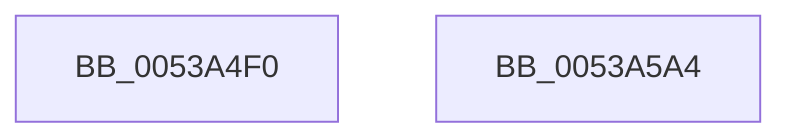

# SymCryptTwistedEdwardsSetZero

- RVA: `0x0053A4F0`–`0x0053A5A5` (길이 `181` bytes)
- VA: `0x000000014053A4F0`
- 실행 섹션: `.text`
- PDB 이름 있음: `예`; PDB Function 태그: `아니요`
- unwind 정보 RVA: `0x0005D7BC`
- 디코드: `49`개 명령, `181/181` bytes 표시
- 미해석 바이트: `0` (있으면 어셈블리에 `.byte`로 보존)

> 이 문서는 커널 이미지의 기계어와 PDB 기호를 분석해 생성했습니다. 4번과 5번은 함수 원형과 자료형을 바이너리 사용 방식에서 추정한 C 해석이며 원본 소스 복구 결과는 아닙니다.

## 1. Dependencies

- 직접 호출 지점: **4**; 고유 호출 대상: **1**
- 직접 호출자로 확인된 함수: **0**
- RIP 상대 이미지 참조: **0**

### Outgoing calls
- `0x0053A52C` → [SymCryptModElementSetValueUint32](../52/SymCryptModElementSetValueUint32_function_00525A40.md) (function, `0x00525A40`)
- `0x0053A548` → [SymCryptModElementSetValueUint32](../52/SymCryptModElementSetValueUint32_function_00525A40.md) (function, `0x00525A40`)
- `0x0053A568` → [SymCryptModElementSetValueUint32](../52/SymCryptModElementSetValueUint32_function_00525A40.md) (function, `0x00525A40`)
- `0x0053A584` → [SymCryptModElementSetValueUint32](../52/SymCryptModElementSetValueUint32_function_00525A40.md) (function, `0x00525A40`)

### Direct callers
- 이 함수 시작 RVA로 연결되는 직접 call은 확인되지 않았습니다. 간접 호출은 완전히 역산할 수 없습니다.

### Static image references
- 디코드된 RIP-relative 메모리 참조가 없습니다.

## 2. Other-region calls and transfers

- 다른 실행 섹션으로 향하는 call: **0**
- 별도 외부 분기/꼬리 이동을 확인하지 못했습니다.

## 3. Assembly (complete function range)

```asm
0053A4F0  48 8B C4                        mov rax, rsp
0053A4F3  48 89 58 08                     mov qword ptr [rax + 8], rbx
0053A4F7  48 89 68 10                     mov qword ptr [rax + 0x10], rbp
0053A4FB  48 89 70 18                     mov qword ptr [rax + 0x18], rsi
0053A4FF  48 89 78 20                     mov qword ptr [rax + 0x20], rdi
0053A503  41 56                           push r14
0053A505  48 83 EC 30                     sub rsp, 0x30
0053A509  48 8B B1 68 02 00 00            mov rsi, qword ptr [rcx + 0x268]
0053A510  4D 8B F0                        mov r14, r8
0053A513  8B 59 24                        mov ebx, dword ptr [rcx + 0x24]
0053A516  4C 8D 42 20                     lea r8, [rdx + 0x20]
0053A51A  49 8B E9                        mov rbp, r9
0053A51D  4C 89 48 E8                     mov qword ptr [rax - 0x18], r9
0053A521  48 8B FA                        mov rdi, rdx
0053A524  4D 8B CE                        mov r9, r14
0053A527  48 8B D6                        mov rdx, rsi
0053A52A  33 C9                           xor ecx, ecx
0053A52C  E8 0F B5 FE FF                  call 0x140525a40
0053A531  4C 8D 47 20                     lea r8, [rdi + 0x20]
0053A535  48 89 6C 24 20                  mov qword ptr [rsp + 0x20], rbp
0053A53A  4C 03 C3                        add r8, rbx
0053A53D  4D 8B CE                        mov r9, r14
0053A540  48 8B D6                        mov rdx, rsi
0053A543  B9 01 00 00 00                  mov ecx, 1
0053A548  E8 F3 B4 FE FF                  call 0x140525a40
0053A54D  44 8D 04 1B                     lea r8d, [rbx + rbx]
0053A551  48 89 6C 24 20                  mov qword ptr [rsp + 0x20], rbp
0053A556  49 83 C0 20                     add r8, 0x20
0053A55A  4D 8B CE                        mov r9, r14
0053A55D  4C 03 C7                        add r8, rdi
0053A560  48 8B D6                        mov rdx, rsi
0053A563  B9 01 00 00 00                  mov ecx, 1
0053A568  E8 D3 B4 FE FF                  call 0x140525a40
0053A56D  8D 0C 5B                        lea ecx, [rbx + rbx*2]
0053A570  48 89 6C 24 20                  mov qword ptr [rsp + 0x20], rbp
0053A575  4C 8D 47 20                     lea r8, [rdi + 0x20]
0053A579  4D 8B CE                        mov r9, r14
0053A57C  4C 03 C1                        add r8, rcx
0053A57F  48 8B D6                        mov rdx, rsi
0053A582  33 C9                           xor ecx, ecx
0053A584  E8 B7 B4 FE FF                  call 0x140525a40
0053A589  48 8B 5C 24 40                  mov rbx, qword ptr [rsp + 0x40]
0053A58E  48 8B 6C 24 48                  mov rbp, qword ptr [rsp + 0x48]
0053A593  48 8B 74 24 50                  mov rsi, qword ptr [rsp + 0x50]
0053A598  48 8B 7C 24 58                  mov rdi, qword ptr [rsp + 0x58]
0053A59D  48 83 C4 30                     add rsp, 0x30
0053A5A1  41 5E                           pop r14
0053A5A3  C3                              ret
0053A5A4  CC                              int3
```

## 4. C-style interpretation (structured pseudocode)

```c
__int64 __fastcall SymCryptTwistedEdwardsSetZero(__int64 a1, __int64 a2, __int64 a3, __int64 a4)
{
    __int64 result;
    __int64 v_rsp;
    unsigned __int64 v_stack_m18;
    unsigned __int64 v_stack_p10;
    unsigned __int64 v_stack_p18;
    unsigned __int64 v_stack_p20;
    unsigned __int64 v_stack_p8;

    *(unsigned __int64 *)(v_rsp + 8) = v_rbx;
    *(unsigned __int64 *)(v_rsp + 16) = v_rbp;
    *(unsigned __int64 *)(v_rsp + 24) = v_rsi;
    *(unsigned __int64 *)(v_rsp + 32) = v_rdi;
    v_rsp = (v_rsp) - (48);
    *(unsigned __int64 *)(v_rsp - 24) = a4;
    a1 = 0;
    result = SymCryptModElementSetValueUint32(a1, *(unsigned __int64 *)(a1 + 616), a2 + 32, a3);
    v_stack_m18 = a4;
    a3 = (a2 + 32) + ((unsigned int)(*(unsigned int *)(a1 + 36)));
    result = SymCryptModElementSetValueUint32(1, *(unsigned __int64 *)(a1 + 616), a3, a3);
    v_stack_m18 = a4;
    a3 = ((unsigned int)(*(unsigned int *)(a1 + 36)) + (unsigned int)(*(unsigned int *)(a1 + 36)) * 1) + (32);
    a3 = (a3) + (a2);
    result = SymCryptModElementSetValueUint32(1, *(unsigned __int64 *)(a1 + 616), a3, a3);
    v_stack_m18 = a4;
    a3 = (a2 + 32) + ((unsigned int)(*(unsigned int *)(a1 + 36)) + (unsigned int)(*(unsigned int *)(a1 + 36)) * 2);
    a1 = 0;
    result = SymCryptModElementSetValueUint32(a1, *(unsigned __int64 *)(a1 + 616), a3, a3);
    v_rsp = (v_rsp) + (48);
    return result;
}
```

## 5. (Beta) C Style

```c
int64_t SymCryptTwistedEdwardsSetZero(void *Arg1, void *Arg2, int64_t Arg3, int64_t Arg4)
{
    uint8_t *arg1 = (uint8_t *)Arg1;
    uint8_t *arg2 = (uint8_t *)Arg2;

    int64_t result;
    int64_t local_rsp;
    uint64_t v_stack_m18;
    uint64_t v_stack_p10;
    uint64_t v_stack_p18;
    uint64_t v_stack_p20;
    uint64_t v_stack_p8;

    *(uint64_t *)(local_rsp + 0x8) = local_rbx;
    *(uint64_t *)(local_rsp + 0x10) = local_rbp;
    *(uint64_t *)(local_rsp + 0x18) = local_rsi;
    *(uint64_t *)(local_rsp + 0x20) = local_rdi;
    local_rsp = (local_rsp) - (48);
    *(uint64_t *)(local_rsp - 0x18) = Arg4;
    Arg1 = 0;
    result = SymCryptModElementSetValueUint32(Arg1, *(uint64_t *)(arg1 + 0x268), Arg2 + 32, Arg3);
    v_stack_m18 = Arg4;
    Arg3 = (Arg2 + 32) + ((uint32_t)(*(uint32_t *)(arg1 + 0x24)));
    result = SymCryptModElementSetValueUint32(1, *(uint64_t *)(arg1 + 0x268), Arg3, Arg3);
    v_stack_m18 = Arg4;
    Arg3 = ((uint32_t)(*(uint32_t *)(arg1 + 0x24)) + (uint32_t)(*(uint32_t *)(arg1 + 0x24)) * 1) + (32);
    Arg3 = (Arg3) + (Arg2);
    result = SymCryptModElementSetValueUint32(1, *(uint64_t *)(arg1 + 0x268), Arg3, Arg3);
    v_stack_m18 = Arg4;
    Arg3 = (Arg2 + 32) + ((uint32_t)(*(uint32_t *)(arg1 + 0x24)) + (uint32_t)(*(uint32_t *)(arg1 + 0x24)) * 2);
    Arg1 = 0;
    result = SymCryptModElementSetValueUint32(Arg1, *(uint64_t *)(arg1 + 0x268), Arg3, Arg3);
    local_rsp = (local_rsp) + (48);
    return result;
}
```

### 관측된 메모리 오프셋

구조체 형식이 확인되지 않은 접근은 인자 기준의 오프셋으로만 기록했습니다.

| 기준 인자 | 오프셋 표현 | 폭 (bit) | 접근 |
|---|---:|---:|---|
| `Arg1` | `+ 0x24` | `32` | `R` |
| `Arg1` | `+ 0x268` | `64` | `R` |
| `Arg2` | `+ 0x20` | `64` | `R` |

## 6. Execution-region graph

[열기: 2D/3D 그래프와 함수 탐색 컨트롤 패널](../../../control-panel.html?section=text&rva=0x0053A4F0&view=graph)

- 2D 그래프는 위에서 아래로 흐르고, 3D 그래프는 빈 공간을 드래그해 회전합니다. Shift+드래그는 이동, 휠은 확대·축소, 함수 노드 선택은 대상 보고서 이동입니다.

### Static fallback


