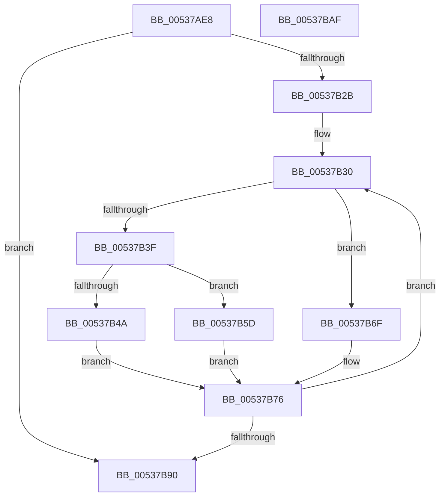

# SymCryptWidthNafRecoding

- RVA: `0x00537AE8`–`0x00537BB0` (길이 `200` bytes)
- VA: `0x0000000140537AE8`
- 실행 섹션: `.text`
- PDB 이름 있음: `예`; PDB Function 태그: `아니요`
- unwind 정보 RVA: `0x0005FEF8`
- 디코드: `62`개 명령, `200/200` bytes 표시
- 미해석 바이트: `0` (있으면 어셈블리에 `.byte`로 보존)

> 이 문서는 커널 이미지의 기계어와 PDB 기호를 분석해 생성했습니다. 4번과 5번은 함수 원형과 자료형을 바이너리 사용 방식에서 추정한 C 해석이며 원본 소스 복구 결과는 아닙니다.

## 1. Dependencies

- 직접 호출 지점: **4**; 고유 호출 대상: **4**
- 직접 호출자로 확인된 함수: **1**
- RIP 상대 이미지 참조: **0**

### Outgoing calls
- `0x00537B33` → [SymCryptIntGetValueLsbits32](../52/SymCryptIntGetValueLsbits32_function_00525668.md) (function, `0x00525668`)
- `0x00537B56` → [SymCryptIntAddUint32](../52/SymCryptIntAddUint32_function_005254AC.md) (function, `0x005254AC`)
- `0x00537B68` → [SymCryptIntSubUint32](../52/SymCryptIntSubUint32_function_005257C0.md) (function, `0x005257C0`)
- `0x00537B81` → [SymCryptIntDivPow2](../52/SymCryptIntDivPow2_function_005255B0.md) (function, `0x005255B0`)

### Direct callers
- [SymCryptEcpointMultiScalarMulWnafWithInterleaving](../52/SymCryptEcpointMultiScalarMulWnafWithInterleaving_function_0052B920.md) at `0x0052BBFD`

### Static image references
- 디코드된 RIP-relative 메모리 참조가 없습니다.

## 2. Other-region calls and transfers

- 다른 실행 섹션으로 향하는 call: **0**
- 별도 외부 분기/꼬리 이동을 확인하지 못했습니다.

## 3. Assembly (complete function range)

```asm
00537AE8  48 8B C4                        mov rax, rsp
00537AEB  48 89 58 08                     mov qword ptr [rax + 8], rbx
00537AEF  48 89 68 10                     mov qword ptr [rax + 0x10], rbp
00537AF3  48 89 70 18                     mov qword ptr [rax + 0x18], rsi
00537AF7  48 89 78 20                     mov qword ptr [rax + 0x20], rdi
00537AFB  41 54                           push r12
00537AFD  41 56                           push r14
00537AFF  41 57                           push r15
00537B01  48 83 EC 20                     sub rsp, 0x20
00537B05  8B 44 24 60                     mov eax, dword ptr [rsp + 0x60]
00537B09  41 83 CE FF                     or r14d, 0xffffffff
00537B0D  41 D3 E6                        shl r14d, cl
00537B10  41 BF 01 00 00 00               mov r15d, 1
00537B16  FF C9                           dec ecx
00537B18  49 8B D9                        mov rbx, r9
00537B1B  41 D3 E7                        shl r15d, cl
00537B1E  49 8B F0                        mov rsi, r8
00537B21  48 8B FA                        mov rdi, rdx
00537B24  41 F7 D6                        not r14d
00537B27  85 C0                           test eax, eax
00537B29  74 65                           je 0x140537b90
00537B2B  48 2B F3                        sub rsi, rbx
00537B2E  8B E8                           mov ebp, eax
00537B30  48 8B CF                        mov rcx, rdi
00537B33  E8 30 DB FE FF                  call 0x140525668
00537B38  41 23 C6                        and eax, r14d
00537B3B  A8 01                           test al, 1
00537B3D  74 30                           je 0x140537b6f
00537B3F  4C 8B C7                        mov r8, rdi
00537B42  48 8B CF                        mov rcx, rdi
00537B45  41 3B C7                        cmp eax, r15d
00537B48  76 13                           jbe 0x140537b5d
00537B4A  83 0B FF                        or dword ptr [rbx], 0xffffffff
00537B4D  41 8D 56 01                     lea edx, [r14 + 1]
00537B51  2B D0                           sub edx, eax
00537B53  89 14 33                        mov dword ptr [rbx + rsi], edx
00537B56  E8 51 D9 FE FF                  call 0x1405254ac
00537B5B  EB 19                           jmp 0x140537b76
00537B5D  C7 03 01 00 00 00               mov dword ptr [rbx], 1
00537B63  8B D0                           mov edx, eax
00537B65  89 04 33                        mov dword ptr [rbx + rsi], eax
00537B68  E8 53 DC FE FF                  call 0x1405257c0
00537B6D  EB 07                           jmp 0x140537b76
00537B6F  83 24 33 00                     and dword ptr [rbx + rsi], 0
00537B73  83 23 00                        and dword ptr [rbx], 0
00537B76  4C 8B C7                        mov r8, rdi
00537B79  BA 01 00 00 00                  mov edx, 1
00537B7E  48 8B CF                        mov rcx, rdi
00537B81  E8 2A DA FE FF                  call 0x1405255b0
00537B86  48 83 C3 04                     add rbx, 4
00537B8A  48 83 ED 01                     sub rbp, 1
00537B8E  75 A0                           jne 0x140537b30
00537B90  48 8B 5C 24 40                  mov rbx, qword ptr [rsp + 0x40]
00537B95  48 8B 6C 24 48                  mov rbp, qword ptr [rsp + 0x48]
00537B9A  48 8B 74 24 50                  mov rsi, qword ptr [rsp + 0x50]
00537B9F  48 8B 7C 24 58                  mov rdi, qword ptr [rsp + 0x58]
00537BA4  48 83 C4 20                     add rsp, 0x20
00537BA8  41 5F                           pop r15
00537BAA  41 5E                           pop r14
00537BAC  41 5C                           pop r12
00537BAE  C3                              ret
00537BAF  CC                              int3
```

## 4. C-style interpretation (structured pseudocode)

```c
__int64 __fastcall SymCryptWidthNafRecoding(int a1, __int64 a2, __int64 a3, __int64 a4, unsigned int a5)
{
    __int64 result;
    __int64 v_r14;
    __int64 v_r15;
    __int64 v_rbp;
    __int64 v_rbx;
    __int64 v_rsi;
    __int64 v_rsp;
    unsigned __int64 v_stack_p10;
    unsigned __int64 v_stack_p18;
    unsigned __int64 v_stack_p20;
    unsigned __int64 v_stack_p8;

    *(unsigned __int64 *)(v_rsp + 8) = v_rbx;
    *(unsigned __int64 *)(v_rsp + 16) = v_rbp;
    *(unsigned __int64 *)(v_rsp + 24) = v_rsi;
    *(unsigned __int64 *)(v_rsp + 32) = v_rdi;
    v_rsp = (v_rsp) - (32);
    v_r14 = (unsigned int)((v_r14) | (0xFFFFFFFFULL));
    v_r14 = (unsigned int)((v_r14) << ((unsigned __int8)(a1)));
    a1 = (unsigned int)((a1) - 1);
    v_r15 = (unsigned int)((1) << ((unsigned __int8)(a1)));
    v_r14 = (unsigned int)(~(v_r14));
    if ((unsigned int)((unsigned int)(a5)) == 0) goto loc_00537B90;
    v_rsi = (a3) - (a4);
loc_00537B30:
    result = SymCryptIntGetValueLsbits32(a2, a2, a3, a4);
    result = (unsigned int)((result) & ((unsigned int)(v_r14)));
    if ((((unsigned __int8)(result)) & (1)) == 0) goto loc_00537B6F;
    if (((unsigned int)(result)) <= ((unsigned int)(v_r15))) goto loc_00537B5D;
    a2 = (unsigned int)((v_r14 + 1) - ((unsigned int)(result)));
    *(unsigned int *)(a4 + v_rsi * 1) = (unsigned int)(a2);
    result = SymCryptIntAddUint32(a2, a2, a2, a4);
    goto loc_00537B76;
loc_00537B5D:
    *(unsigned int *)(a4) = 1;
    *(unsigned int *)(a4 + v_rsi * 1) = (unsigned int)(result);
    result = SymCryptIntSubUint32(a2, (unsigned int)((unsigned int)(result)), a2, a4);
    goto loc_00537B76;
loc_00537B6F:
loc_00537B76:
    result = SymCryptIntDivPow2(a2, 1, a2, a4);
    v_rbx = (a4) + (4);
    v_rbp = ((unsigned int)((unsigned int)((unsigned int)(a5)))) - (1);
    if (condition_is_not_equal) goto loc_00537B30;
loc_00537B90:
    v_rsp = (v_rsp) + (32);
    return result;
}
```

## 5. (Beta) C Style

```c
int64_t SymCryptWidthNafRecoding(int32_t Arg1, int64_t Arg2, int64_t Arg3, void *Arg4, uint32_t Arg5)
{
    uint8_t *arg4 = (uint8_t *)Arg4;

    int64_t result;
    int64_t local_r14;
    int64_t local_r15;
    int64_t local_rbp;
    int64_t local_rbx;
    int64_t local_rsi;
    int64_t local_rsp;
    uint64_t v_stack_p10;
    uint64_t v_stack_p18;
    uint64_t v_stack_p20;
    uint64_t v_stack_p8;

    *(uint64_t *)(local_rsp + 0x8) = local_rbx;
    *(uint64_t *)(local_rsp + 0x10) = local_rbp;
    *(uint64_t *)(local_rsp + 0x18) = local_rsi;
    *(uint64_t *)(local_rsp + 0x20) = local_rdi;
    local_rsp = (local_rsp) - (32);
    local_r14 = (uint32_t)((local_r14) | (0xFFFFFFFFULL));
    local_r14 = (uint32_t)((local_r14) << ((uint8_t)(Arg1)));
    Arg1 = (uint32_t)((Arg1) - 1);
    local_r15 = (uint32_t)((1) << ((uint8_t)(Arg1)));
    local_r14 = (uint32_t)(~(local_r14));
    if ((uint32_t)((uint32_t)(Arg5)) == 0) goto loc_00537B90;
    local_rsi = (Arg3) - (Arg4);
loc_00537B30:
    result = SymCryptIntGetValueLsbits32(Arg2, Arg2, Arg3, Arg4);
    result = (uint32_t)((result) & ((uint32_t)(local_r14)));
    if ((((uint8_t)(result)) & (1)) == 0) goto loc_00537B6F;
    if (((uint32_t)(result)) <= ((uint32_t)(local_r15))) goto loc_00537B5D;
    Arg2 = (uint32_t)((local_r14 + 1) - ((uint32_t)(result)));
    *(uint32_t *)(arg4 + local_rsi * 1) = (uint32_t)(Arg2);
    result = SymCryptIntAddUint32(Arg2, Arg2, Arg2, Arg4);
    goto loc_00537B76;
loc_00537B5D:
    *(uint32_t *)(arg4) = 1;
    *(uint32_t *)(arg4 + local_rsi * 1) = (uint32_t)(result);
    result = SymCryptIntSubUint32(Arg2, (uint32_t)((uint32_t)(result)), Arg2, Arg4);
    goto loc_00537B76;
loc_00537B6F:
loc_00537B76:
    result = SymCryptIntDivPow2(Arg2, 1, Arg2, Arg4);
    local_rbx = (Arg4) + (4);
    local_rbp = ((uint32_t)((uint32_t)((uint32_t)(Arg5)))) - (1);
    if (condition_is_not_equal) goto loc_00537B30;
loc_00537B90:
    local_rsp = (local_rsp) + (32);
    return result;
}
```

### 관측된 메모리 오프셋

구조체 형식이 확인되지 않은 접근은 인자 기준의 오프셋으로만 기록했습니다.

| 기준 인자 | 오프셋 표현 | 폭 (bit) | 접근 |
|---|---:|---:|---|
| `Arg4` | `+ 0x0` | `32` | `R/W` |
| `Arg4` | `+ 0x0` | `32` | `W` |
| `Arg4` | `+ 0x0 + rsi*1` | `32` | `R/W` |
| `Arg4` | `+ 0x0 + rsi*1` | `32` | `W` |

## 6. Execution-region graph

[열기: 2D/3D 그래프와 함수 탐색 컨트롤 패널](../../../control-panel.html?section=text&rva=0x00537AE8&view=graph)

- 2D 그래프는 위에서 아래로 흐르고, 3D 그래프는 빈 공간을 드래그해 회전합니다. Shift+드래그는 이동, 휠은 확대·축소, 함수 노드 선택은 대상 보고서 이동입니다.

### Static fallback


