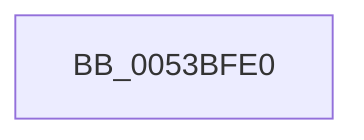

# _report_gsfailure

- RVA: `0x0053BFE0`–`0x0053C006` (길이 `38` bytes)
- VA: `0x000000014053BFE0`
- 실행 섹션: `.text`
- PDB 이름 있음: `예`; PDB Function 태그: `아니요`
- unwind 정보 RVA: `0x000622F0`
- 디코드: `8`개 명령, `38/38` bytes 표시
- 미해석 바이트: `0` (있으면 어셈블리에 `.byte`로 보존)

> 이 문서는 커널 이미지의 기계어와 PDB 기호를 분석해 생성했습니다. 4번과 5번은 함수 원형과 자료형을 바이너리 사용 방식에서 추정한 C 해석이며 원본 소스 복구 결과는 아닙니다.

## 1. Dependencies

- 직접 호출 지점: **1**; 고유 호출 대상: **1**
- 직접 호출자로 확인된 함수: **0**
- RIP 상대 이미지 참조: **2**

### Outgoing calls
- `0x0053C000` → [KeBugCheckEx](../4F/KeBugCheckEx_function_004FD660.md) (function, `0x004FD660`)

### Direct callers
- 이 함수 시작 RVA로 연결되는 직접 call은 확인되지 않았습니다. 간접 호출은 완전히 역산할 수 없습니다.

### Static image references
- `0x0053BFED` → RVA `0x00E0A750` (`.data`; read)
- `0x0053BFF9` → RVA `0x00E0A740` (`.data`; read)

## 2. Other-region calls and transfers

- 다른 실행 섹션으로 향하는 call: **0**
- 별도 외부 분기/꼬리 이동을 확인하지 못했습니다.

## 3. Assembly (complete function range)

```asm
0053BFE0  48 83 EC 38                     sub rsp, 0x38
0053BFE4  48 83 64 24 20 00               and qword ptr [rsp + 0x20], 0
0053BFEA  48 8B D1                        mov rdx, rcx
0053BFED  4C 8B 0D 5C E7 8C 00            mov r9, qword ptr [rip + 0x8ce75c]
0053BFF4  B9 F7 00 00 00                  mov ecx, 0xf7
0053BFF9  4C 8B 05 40 E7 8C 00            mov r8, qword ptr [rip + 0x8ce740]
0053C000  E8 5B 16 FC FF                  call 0x1404fd660
0053C005  CC                              int3
```

## 4. C-style interpretation (structured pseudocode)

```c
__int64 __fastcall _report_gsfailure(__int64 a1)
{
    __int64 result;
    __int64 v_rsp;
    unsigned __int64 v_stack_m18;

    v_rsp = (v_rsp) - (56);
    result = KeBugCheckEx(247, a1, *(unsigned __int64 *)(v_rip + 9234240), *(unsigned __int64 *)(v_rip + 9234268));
    return result;
}
```

## 5. (Beta) C Style

```c
int64_t _report_gsfailure(int64_t Arg1)
{
    int64_t result;
    int64_t local_rsp;
    uint64_t v_stack_m18;

    local_rsp = (local_rsp) - (56);
    result = KeBugCheckEx(247, Arg1, *(uint64_t *)(v_rip + 0x8CE740), *(uint64_t *)(v_rip + 0x8CE75C));
    return result;
}
```

## 6. Execution-region graph

[열기: 2D/3D 그래프와 함수 탐색 컨트롤 패널](../../../control-panel.html?section=text&rva=0x0053BFE0&view=graph)

- 2D 그래프는 위에서 아래로 흐르고, 3D 그래프는 빈 공간을 드래그해 회전합니다. Shift+드래그는 이동, 휠은 확대·축소, 함수 노드 선택은 대상 보고서 이동입니다.

### Static fallback


