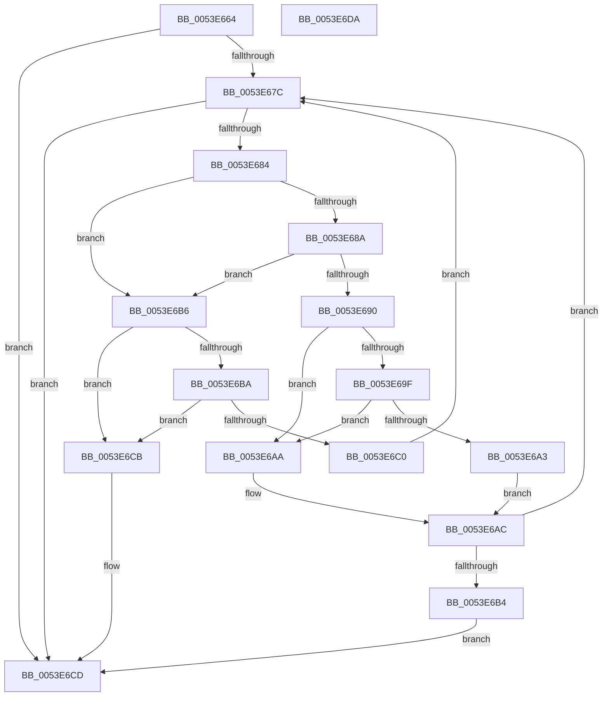

# wil_details_AreDependenciesEnabled

- RVA: `0x0053E664`–`0x0053E6DB` (길이 `119` bytes)
- VA: `0x000000014053E664`
- 실행 섹션: `.text`
- PDB 이름 있음: `예`; PDB Function 태그: `아니요`
- unwind 정보 RVA: `0x00068D5C`
- 디코드: `42`개 명령, `119/119` bytes 표시
- 미해석 바이트: `0` (있으면 어셈블리에 `.byte`로 보존)

> 이 문서는 커널 이미지의 기계어와 PDB 기호를 분석해 생성했습니다. 4번과 5번은 함수 원형과 자료형을 바이너리 사용 방식에서 추정한 C 해석이며 원본 소스 복구 결과는 아닙니다.

## 1. Dependencies

- 직접 호출 지점: **1**; 고유 호출 대상: **1**
- 직접 호출자로 확인된 함수: **1**
- RIP 상대 이미지 참조: **0**

### Outgoing calls
- `0x0053E696` → [wil_details_FeatureStateCache_GetCachedFeatureEnabledState](../3F/wil_details_FeatureStateCache_GetCachedFeatureEnabledState_function_003FE950.md) (function, `0x003FE950`)

### Direct callers
- [wil_details_GetCurrentFeatureEnabledState](../3F/wil_details_GetCurrentFeatureEnabledState_function_003FEA98.md) at `0x003FEB65`

### Static image references
- 디코드된 RIP-relative 메모리 참조가 없습니다.

## 2. Other-region calls and transfers

- 다른 실행 섹션으로 향하는 call: **0**
- 별도 외부 분기/꼬리 이동을 확인하지 못했습니다.

## 3. Assembly (complete function range)

```asm
0053E664  48 89 5C 24 10                  mov qword ptr [rsp + 0x10], rbx
0053E669  57                              push rdi
0053E66A  48 83 EC 20                     sub rsp, 0x20
0053E66E  48 8B 79 20                     mov rdi, qword ptr [rcx + 0x20]
0053E672  BB 01 00 00 00                  mov ebx, 1
0053E677  48 85 FF                        test rdi, rdi
0053E67A  74 51                           je 0x14053e6cd
0053E67C  48 8B 07                        mov rax, qword ptr [rdi]
0053E67F  48 85 C0                        test rax, rax
0053E682  74 49                           je 0x14053e6cd
0053E684  80 78 1E 00                     cmp byte ptr [rax + 0x1e], 0
0053E688  75 2C                           jne 0x14053e6b6
0053E68A  80 78 1D 00                     cmp byte ptr [rax + 0x1d], 0
0053E68E  75 26                           jne 0x14053e6b6
0053E690  48 8B 08                        mov rcx, qword ptr [rax]
0053E693  48 8B D0                        mov rdx, rax
0053E696  E8 B5 02 EC FF                  call 0x1403fe950
0053E69B  85 DB                           test ebx, ebx
0053E69D  74 0B                           je 0x14053e6aa
0053E69F  A8 01                           test al, 1
0053E6A1  74 07                           je 0x14053e6aa
0053E6A3  BB 01 00 00 00                  mov ebx, 1
0053E6A8  EB 02                           jmp 0x14053e6ac
0053E6AA  33 DB                           xor ebx, ebx
0053E6AC  48 83 C7 08                     add rdi, 8
0053E6B0  85 DB                           test ebx, ebx
0053E6B2  75 C8                           jne 0x14053e67c
0053E6B4  EB 17                           jmp 0x14053e6cd
0053E6B6  85 DB                           test ebx, ebx
0053E6B8  74 11                           je 0x14053e6cb
0053E6BA  80 78 1F 00                     cmp byte ptr [rax + 0x1f], 0
0053E6BE  74 0B                           je 0x14053e6cb
0053E6C0  BB 01 00 00 00                  mov ebx, 1
0053E6C5  48 83 C7 08                     add rdi, 8
0053E6C9  EB B1                           jmp 0x14053e67c
0053E6CB  33 DB                           xor ebx, ebx
0053E6CD  8B C3                           mov eax, ebx
0053E6CF  48 8B 5C 24 38                  mov rbx, qword ptr [rsp + 0x38]
0053E6D4  48 83 C4 20                     add rsp, 0x20
0053E6D8  5F                              pop rdi
0053E6D9  C3                              ret
0053E6DA  CC                              int3
```

## 4. C-style interpretation (structured pseudocode)

```c
__int64 __fastcall wil_details_AreDependenciesEnabled(__int64 a1)
{
    __int64 result;
    __int64 v_rbx;
    __int64 v_rdi;
    __int64 v_rsp;
    unsigned __int64 v_stack_p10;

    v_stack_p10 = v_rbx;
    v_rsp = (v_rsp) - (32);
    if (*(unsigned __int64 *)(a1 + 32) == 0) goto loc_0053E6CD;
loc_0053E67C:
    if (*(unsigned __int64 *)(*(unsigned __int64 *)(a1 + 32)) == 0) goto loc_0053E6CD;
    if ((*(unsigned __int8 *)(*(unsigned __int64 *)(*(unsigned __int64 *)(a1 + 32)) + 30)) != 0) goto loc_0053E6B6;
    if ((*(unsigned __int8 *)(*(unsigned __int64 *)(*(unsigned __int64 *)(a1 + 32)) + 29)) != 0) goto loc_0053E6B6;
    result = wil_details_FeatureStateCache_GetCachedFeatureEnabledState(*(unsigned __int64 *)(*(unsigned __int64 *)(*(unsigned __int64 *)(a1 + 32))), *(unsigned __int64 *)(*(unsigned __int64 *)(a1 + 32)), a3, a4);
    if (1 == 0) goto loc_0053E6AA;
    if ((((unsigned __int8)(result)) & (1)) == 0) goto loc_0053E6AA;
    goto loc_0053E6AC;
loc_0053E6AA:
    v_rbx = 0;
loc_0053E6AC:
    v_rdi = (*(unsigned __int64 *)(a1 + 32)) + (8);
    if (0 != 0) goto loc_0053E67C;
    goto loc_0053E6CD;
loc_0053E6B6:
    if (0 == 0) goto loc_0053E6CB;
    if ((*(unsigned __int8 *)(result + 31)) == 0) goto loc_0053E6CB;
    v_rdi = (v_rdi) + (8);
    goto loc_0053E67C;
loc_0053E6CB:
    v_rbx = 0;
loc_0053E6CD:
    v_rsp = (v_rsp) + (32);
    return 0;
}
```

## 5. (Beta) C Style

```c
int64_t wil_details_AreDependenciesEnabled(void *Arg1)
{
    uint8_t *arg1 = (uint8_t *)Arg1;

    int64_t result;
    int64_t local_rbx;
    int64_t local_rdi;
    int64_t local_rsp;
    uint64_t v_stack_p10;

    v_stack_p10 = local_rbx;
    local_rsp = (local_rsp) - (32);
    if (*(uint64_t *)(arg1 + 0x20) == 0) goto loc_0053E6CD;
loc_0053E67C:
    if (*(uint64_t *)(*(uint64_t *)(arg1 + 0x20)) == 0) goto loc_0053E6CD;
    if ((*(uint8_t *)(*(uint64_t *)(*(uint64_t *)(arg1 + 0x20)) + 0x1E)) != 0) goto loc_0053E6B6;
    if ((*(uint8_t *)(*(uint64_t *)(*(uint64_t *)(arg1 + 0x20)) + 0x1D)) != 0) goto loc_0053E6B6;
    result = wil_details_FeatureStateCache_GetCachedFeatureEnabledState(*(uint64_t *)(*(uint64_t *)(*(uint64_t *)(arg1 + 0x20))), *(uint64_t *)(*(uint64_t *)(arg1 + 0x20)), a3, a4);
    if (1 == 0) goto loc_0053E6AA;
    if ((((uint8_t)(result)) & (1)) == 0) goto loc_0053E6AA;
    goto loc_0053E6AC;
loc_0053E6AA:
    local_rbx = 0;
loc_0053E6AC:
    local_rdi = (*(uint64_t *)(arg1 + 0x20)) + (8);
    if (0 != 0) goto loc_0053E67C;
    goto loc_0053E6CD;
loc_0053E6B6:
    if (0 == 0) goto loc_0053E6CB;
    if ((*(uint8_t *)(result + 0x1F)) == 0) goto loc_0053E6CB;
    local_rdi = (local_rdi) + (8);
    goto loc_0053E67C;
loc_0053E6CB:
    local_rbx = 0;
loc_0053E6CD:
    local_rsp = (local_rsp) + (32);
    return 0;
}
```

### 관측된 메모리 오프셋

구조체 형식이 확인되지 않은 접근은 인자 기준의 오프셋으로만 기록했습니다.

| 기준 인자 | 오프셋 표현 | 폭 (bit) | 접근 |
|---|---:|---:|---|
| `Arg1` | `+ 0x20` | `64` | `R` |

## 6. Execution-region graph

[열기: 2D/3D 그래프와 함수 탐색 컨트롤 패널](../../../control-panel.html?section=text&rva=0x0053E664&view=graph)

- 2D 그래프는 위에서 아래로 흐르고, 3D 그래프는 빈 공간을 드래그해 회전합니다. Shift+드래그는 이동, 휠은 확대·축소, 함수 노드 선택은 대상 보고서 이동입니다.

### Static fallback


