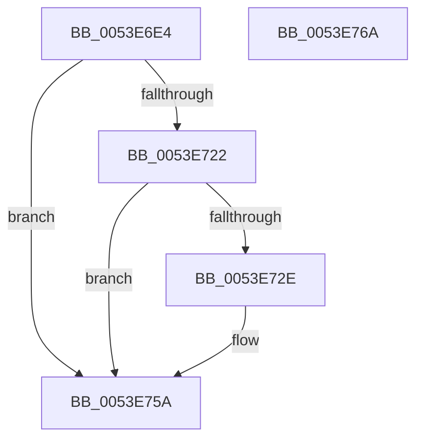

# wil_details_FeatureReporting_ReportUsageToService

- RVA: `0x0053E6E4`–`0x0053E76B` (길이 `135` bytes)
- VA: `0x000000014053E6E4`
- 실행 섹션: `.text`
- PDB 이름 있음: `예`; PDB Function 태그: `아니요`
- unwind 정보 RVA: `0x000C3968`
- 디코드: `38`개 명령, `135/135` bytes 표시
- 미해석 바이트: `0` (있으면 어셈블리에 `.byte`로 보존)

> 이 문서는 커널 이미지의 기계어와 PDB 기호를 분석해 생성했습니다. 4번과 5번은 함수 원형과 자료형을 바이너리 사용 방식에서 추정한 C 해석이며 원본 소스 복구 결과는 아닙니다.

## 1. Dependencies

- 직접 호출 지점: **3**; 고유 호출 대상: **3**
- 직접 호출자로 확인된 함수: **107**
- RIP 상대 이미지 참조: **1**

### Outgoing calls
- `0x0053E70B` → [wil_details_MapReportingKind](../48/wil_details_MapReportingKind_function_0048E740.md) (function, `0x0048E740`)
- `0x0053E719` → [wil_details_FeatureReporting_ReportUsageToServiceDirect](../37/wil_details_FeatureReporting_ReportUsageToServiceDirect_function_003783A0.md) (function, `0x003783A0`)
- `0x0053E755` → [guard_dispatch_icall](../6B/guard_dispatch_icall_function_006BAAD0.md) (function, `0x006BAAD0`)

### Direct callers
- [Feature_NewWpsAssignmentAlgorithm__private_IsEnabledPreCheck](../40/Feature_NewWpsAssignmentAlgorithm__private_IsEnabledPreCheck_function_0040B634.md) at `0x0040B67F`
- [KeConfigureHeteroProcessors](../42/KeConfigureHeteroProcessors_function_00427338.md) at `0x004273E9`
- [Feature_ID51912085__private_IsEnabledPreCheck](../46/Feature_ID51912085__private_IsEnabledPreCheck_function_00467684.md) at `0x004676CF`
- [Feature_OpocksAndMappedSections__private_ReportDeviceUsage](../46/Feature_OpocksAndMappedSections__private_ReportDeviceUsage_function_0046BC88.md) at `0x0046BCCE`
- [Feature_IoInvalidateDeviceState_Unconditional__private_ReportDeviceUsage](../47/Feature_IoInvalidateDeviceState_Unconditional__private_ReportDeviceUsage_function_00478C84.md) at `0x00478CCA`
- [Feature_PreventInterfaceChangeConcurrentNotify__private_ReportDeviceUsage](../48/Feature_PreventInterfaceChangeConcurrentNotify__private_ReportDeviceUsage_function_00487ED0.md) at `0x00487F16`
- [Feature_PdcClientPnpActionQueue__private_ReportDeviceUsage](../49/Feature_PdcClientPnpActionQueue__private_ReportDeviceUsage_function_0049E454.md) at `0x0049E494`
- [Feature_UpperThresholdInheritance__private_ReportDeviceUsage](../4A/Feature_UpperThresholdInheritance__private_ReportDeviceUsage_function_004AEE8C.md) at `0x004AEED2`
- [wil_details_IsEnabledFallback](../4D/wil_details_IsEnabledFallback_function_004DAEFC.md) at `0x004DAF59`
- [Feature_MachineHiveCache__private_ReportDeviceUsage](../4F/Feature_MachineHiveCache__private_ReportDeviceUsage_function_004F6E38.md) at `0x004F6E78`
- [Feature_HaltOnAddress_QueuedSpinLock__private_ReportDeviceUsage](../4F/Feature_HaltOnAddress_QueuedSpinLock__private_ReportDeviceUsage_function_004F7228.md) at `0x004F7268`
- [Feature_HaltOnAddress_Barrier__private_ReportDeviceUsage](../4F/Feature_HaltOnAddress_Barrier__private_ReportDeviceUsage_function_004F7290.md) at `0x004F72D0`
- [Feature_ShortThreadQuantum__private_ReportDeviceUsage](../4F/Feature_ShortThreadQuantum__private_ReportDeviceUsage_function_004F72F8.md) at `0x004F7338`
- [Feature_AggressiveInputSuppression__private_IsEnabledPreCheck](../4F/Feature_AggressiveInputSuppression__private_IsEnabledPreCheck_function_004FAD78.md) at `0x004FADB8`
- [Feature_SleepStudySlimControlEtl__private_ReportDeviceUsage](../4F/Feature_SleepStudySlimControlEtl__private_ReportDeviceUsage_function_004FC658.md) at `0x004FC698`
- [IopAddBugcheckDirectedTransitionTriageData](../5A/IopAddBugcheckDirectedTransitionTriageData_function_005A0518.md) at `0x005A056E`
- [Feature_Servicing_IdealProcessorEventOutsideLocks__private_ReportUsageFallback](../5C/Feature_Servicing_IdealProcessorEventOutsideLocks__private_ReportUsageFallback_function_005C087C.md) at `0x005C08A2`
- [Feature_Servicing_DeadlineQosReschedule__private_ReportUsageFallback](../5C/Feature_Servicing_DeadlineQosReschedule__private_ReportUsageFallback_function_005C350C.md) at `0x005C3532`
- [Feature_Sx_PEP_Notification_Synchronization__private_ReportUsageFallback](../5C/Feature_Sx_PEP_Notification_Synchronization__private_ReportUsageFallback_function_005CF074.md) at `0x005CF0B4`
- [Feature_Servicing_AutoBoostEtwEventingFixes__private_IsEnabledOtherReporting](../65/Feature_Servicing_AutoBoostEtwEventingFixes__private_IsEnabledOtherReporting_function_0065137C.md) at `0x006513AC`
- [ExpPrepareNewAtsDevice](../65/ExpPrepareNewAtsDevice_function_00659FB0.md) at `0x0065A1B0`
- [WheaResumedFromHibernate](../65/WheaResumedFromHibernate_function_0065DC30.md) at `0x0065DC70`
- [Feature_CFR_Child_KM_C__private_ReportUsageFallback](../66/Feature_CFR_Child_KM_C__private_ReportUsageFallback_function_0066B5AC.md) at `0x0066B5EC`
- [Feature_CFR_Parent_KM_C__private_ReportUsageFallback](../66/Feature_CFR_Parent_KM_C__private_ReportUsageFallback_function_0066B61C.md) at `0x0066B65C`
- [Feature_VelTest_KM_ControlledByProxy_DBD_1__private_ReportUsageFallback](../66/Feature_VelTest_KM_ControlledByProxy_DBD_1__private_ReportUsageFallback_function_0066B6E0.md) at `0x0066B720`
- [Feature_ConfAccImp__private_IsEnabledOtherReporting](../66/Feature_ConfAccImp__private_IsEnabledOtherReporting_function_0066BD3C.md) at `0x0066BD6C`
- [Feature_ExpToc__private_IsEnabledOtherReporting](../66/Feature_ExpToc__private_IsEnabledOtherReporting_function_0066BEAC.md) at `0x0066BEDC`
- [Feature_GatePerf_IsEnabledWithReporting](../66/Feature_GatePerf_IsEnabledWithReporting_function_0066BF10.md) at `0x0066BF46`
- [Feature_GatePerf__private_ReportUsageFallback](../66/Feature_GatePerf__private_ReportUsageFallback_function_0066BF94.md) at `0x0066BFBA`
- [Feature_ImplVal_IsEnabledWithReporting](../66/Feature_ImplVal_IsEnabledWithReporting_function_0066BFF0.md) at `0x0066C026`
- [Feature_ImplVal__private_ReportUsageFallback](../66/Feature_ImplVal__private_ReportUsageFallback_function_0066C074.md) at `0x0066C09A`
- [Feature_LocPerfVal__private_IsEnabledOtherReporting](../66/Feature_LocPerfVal__private_IsEnabledOtherReporting_function_0066C1DC.md) at `0x0066C20C`
- [Feature_NiwTest_IsEnabledWithReporting](../66/Feature_NiwTest_IsEnabledWithReporting_function_0066C240.md) at `0x0066C276`
- [Feature_NiwTest__private_ReportUsageFallback](../66/Feature_NiwTest__private_ReportUsageFallback_function_0066C2C4.md) at `0x0066C2EA`
- [Feature_PerfImpTest_IsEnabledWithReporting](../66/Feature_PerfImpTest_IsEnabledWithReporting_function_0066C320.md) at `0x0066C356`
- [Feature_PerfImpTest__private_ReportUsageFallback](../66/Feature_PerfImpTest__private_ReportUsageFallback_function_0066C3A4.md) at `0x0066C3CA`
- [Feature_PerfTestCen2_IsEnabledWithReporting](../66/Feature_PerfTestCen2_IsEnabledWithReporting_function_0066C400.md) at `0x0066C436`
- [Feature_PerfTestCen2__private_ReportUsageFallback](../66/Feature_PerfTestCen2__private_ReportUsageFallback_function_0066C484.md) at `0x0066C4AA`
- [Feature_SettingsDel_IsEnabledWithReporting](../66/Feature_SettingsDel_IsEnabledWithReporting_function_0066C4E0.md) at `0x0066C516`
- [Feature_SettingsDel__private_ReportUsageFallback](../66/Feature_SettingsDel__private_ReportUsageFallback_function_0066C564.md) at `0x0066C58A`
- [Feature_Ten2Loc_IsEnabledWithReporting](../66/Feature_Ten2Loc_IsEnabledWithReporting_function_0066C5C0.md) at `0x0066C5F6`
- [Feature_Ten2Loc__private_ReportUsageFallback](../66/Feature_Ten2Loc__private_ReportUsageFallback_function_0066C644.md) at `0x0066C66A`
- [Feature_TestAccPerf_IsEnabledWithReporting](../66/Feature_TestAccPerf_IsEnabledWithReporting_function_0066C6A0.md) at `0x0066C6D6`
- [Feature_TestAccPerf__private_ReportUsageFallback](../66/Feature_TestAccPerf__private_ReportUsageFallback_function_0066C724.md) at `0x0066C74A`
- [Feature_TestConfNum_IsEnabledWithReporting](../66/Feature_TestConfNum_IsEnabledWithReporting_function_0066C780.md) at `0x0066C7B6`
- [Feature_TestConfNum__private_ReportUsageFallback](../66/Feature_TestConfNum__private_ReportUsageFallback_function_0066C804.md) at `0x0066C82A`
- [Feature_TestConfVar_IsEnabledWithReporting](../66/Feature_TestConfVar_IsEnabledWithReporting_function_0066C860.md) at `0x0066C896`
- [Feature_TestConfVar__private_ReportUsageFallback](../66/Feature_TestConfVar__private_ReportUsageFallback_function_0066C8E4.md) at `0x0066C90A`
- [Feature_TestGateImp_IsEnabledWithReporting](../66/Feature_TestGateImp_IsEnabledWithReporting_function_0066C990.md) at `0x0066C9C6`
- [Feature_TestGateImp__private_ReportUsageFallback](../66/Feature_TestGateImp__private_ReportUsageFallback_function_0066CA14.md) at `0x0066CA3A`
- [Feature_TestLabVal_IsEnabledWithReporting](../66/Feature_TestLabVal_IsEnabledWithReporting_function_0066CA70.md) at `0x0066CAA6`
- [Feature_TestLabVal__private_ReportUsageFallback](../66/Feature_TestLabVal__private_ReportUsageFallback_function_0066CAF4.md) at `0x0066CB1A`
- [Feature_TestLoc02_IsEnabledWithReporting](../66/Feature_TestLoc02_IsEnabledWithReporting_function_0066CB50.md) at `0x0066CB86`
- [Feature_TestLoc02__private_ReportUsageFallback](../66/Feature_TestLoc02__private_ReportUsageFallback_function_0066CBD4.md) at `0x0066CBFA`
- [Feature_TestLoc03_IsEnabledWithReporting](../66/Feature_TestLoc03_IsEnabledWithReporting_function_0066CC30.md) at `0x0066CC66`
- [Feature_TestLoc03__private_ReportUsageFallback](../66/Feature_TestLoc03__private_ReportUsageFallback_function_0066CCB4.md) at `0x0066CCDA`
- [Feature_TestLoc1Perf_IsEnabledWithReporting](../66/Feature_TestLoc1Perf_IsEnabledWithReporting_function_0066CD10.md) at `0x0066CD46`
- [Feature_TestLoc1Perf__private_ReportUsageFallback](../66/Feature_TestLoc1Perf__private_ReportUsageFallback_function_0066CD94.md) at `0x0066CDBA`
- [Feature_TestUex12_IsEnabledWithReporting](../66/Feature_TestUex12_IsEnabledWithReporting_function_0066CE40.md) at `0x0066CE76`
- [Feature_TestUex12__private_ReportUsageFallback](../66/Feature_TestUex12__private_ReportUsageFallback_function_0066CEC4.md) at `0x0066CEEA`
- [Feature_TestUx32_IsEnabledWithReporting](../66/Feature_TestUx32_IsEnabledWithReporting_function_0066CF20.md) at `0x0066CF56`
- [Feature_TestUx32__private_ReportUsageFallback](../66/Feature_TestUx32__private_ReportUsageFallback_function_0066CFA4.md) at `0x0066CFCA`
- [Feature_TestUxGate__private_IsEnabledOtherReporting](../66/Feature_TestUxGate__private_IsEnabledOtherReporting_function_0066D10C.md) at `0x0066D13C`
- [Feature_TestValidate_IsEnabledWithReporting](../66/Feature_TestValidate_IsEnabledWithReporting_function_0066D170.md) at `0x0066D1A6`
- [Feature_TestValidate__private_ReportUsageFallback](../66/Feature_TestValidate__private_ReportUsageFallback_function_0066D1F4.md) at `0x0066D21A`
- [Feature_UexTest7_IsEnabledWithReporting](../66/Feature_UexTest7_IsEnabledWithReporting_function_0066D250.md) at `0x0066D286`
- [Feature_UexTest7__private_ReportUsageFallback](../66/Feature_UexTest7__private_ReportUsageFallback_function_0066D2D4.md) at `0x0066D2FA`
- [Feature_UxAccOptimization__private_IsEnabledOtherReporting](../66/Feature_UxAccOptimization__private_IsEnabledOtherReporting_function_0066D43C.md) at `0x0066D46C`
- [Feature_UxConfTest_IsEnabledWithReporting](../66/Feature_UxConfTest_IsEnabledWithReporting_function_0066D4A0.md) at `0x0066D4D6`
- [Feature_UxConfTest__private_ReportUsageFallback](../66/Feature_UxConfTest__private_ReportUsageFallback_function_0066D524.md) at `0x0066D54A`
- [Feature_UxLabTest_IsEnabledWithReporting](../66/Feature_UxLabTest_IsEnabledWithReporting_function_0066D580.md) at `0x0066D5B6`
- [Feature_UxLabTest__private_ReportUsageFallback](../66/Feature_UxLabTest__private_ReportUsageFallback_function_0066D604.md) at `0x0066D62A`
- [Feature_UxPerfImp_IsEnabledWithReporting](../66/Feature_UxPerfImp_IsEnabledWithReporting_function_0066D660.md) at `0x0066D696`
- [Feature_UxPerfImp__private_ReportUsageFallback](../66/Feature_UxPerfImp__private_ReportUsageFallback_function_0066D6E4.md) at `0x0066D70A`
- [Feature_UxSettingTest_IsEnabledWithReporting](../66/Feature_UxSettingTest_IsEnabledWithReporting_function_0066D740.md) at `0x0066D776`
- [Feature_UxSettingTest__private_ReportUsageFallback](../66/Feature_UxSettingTest__private_ReportUsageFallback_function_0066D7C4.md) at `0x0066D7EA`
- [Feature_ValAccTest_IsEnabledWithReporting](../66/Feature_ValAccTest_IsEnabledWithReporting_function_0066D820.md) at `0x0066D856`
- [Feature_ValAccTest__private_ReportUsageFallback](../66/Feature_ValAccTest__private_ReportUsageFallback_function_0066D8A4.md) at `0x0066D8CA`
- [Feature_ValConf_IsEnabledWithReporting](../66/Feature_ValConf_IsEnabledWithReporting_function_0066D900.md) at `0x0066D936`
- [Feature_ValConf__private_ReportUsageFallback](../66/Feature_ValConf__private_ReportUsageFallback_function_0066D984.md) at `0x0066D9AA`
- [Feature_ValLabTest_IsEnabledWithReporting](../66/Feature_ValLabTest_IsEnabledWithReporting_function_0066D9E0.md) at `0x0066DA16`
- [Feature_ValLabTest__private_ReportUsageFallback](../66/Feature_ValLabTest__private_ReportUsageFallback_function_0066DA64.md) at `0x0066DA8A`
- [Feature_ValUxPerf2__private_IsEnabledOtherReporting](../66/Feature_ValUxPerf2__private_IsEnabledOtherReporting_function_0066DBCC.md) at `0x0066DBFC`
- [SdbpCheckApplicationTypeAttributes](../69/SdbpCheckApplicationTypeAttributes_function_0069C93C.md) at `0x0069C9AB`
- [PopMonitorInvocation](../../page/76/PopMonitorInvocation_function_00769710.md) at `0x00769770`
- [SshSessionManagerFlushBuffers](../../page/77/SshSessionManagerFlushBuffers_function_007736D8.md) at `0x007737CD`
- [SshSessionManagerFlushBuffers](../../page/77/SshSessionManagerFlushBuffers_function_007736D8.md) at `0x00773889`
- [SshSessionManagerFlushBuffers](../../page/77/SshSessionManagerFlushBuffers_function_007736D8.md) at `0x007738F3`
- [SshpAlpcProcessAlpcMessage](../../page/77/SshpAlpcProcessAlpcMessage_function_0077506C.md) at `0x00775203`
- [SshpAlpcProcessMessage](../../page/77/SshpAlpcProcessMessage_function_007752C8.md) at `0x00775324`
- [SshpAlpcProcessMessage](../../page/77/SshpAlpcProcessMessage_function_007752C8.md) at `0x007753B1`
- [SepSetSystemPaths](../../page/79/SepSetSystemPaths_function_0079C040.md) at `0x0079C0B5`
- [SepSetSystemPaths](../../page/79/SepSetSystemPaths_function_0079C040.md) at `0x0079C1AB`
- [CmpLoadHiveThread](../../page/7D/CmpLoadHiveThread_function_007DB040.md) at `0x007DB197`
- [CmpLoadHiveThread](../../page/7D/CmpLoadHiveThread_function_007DB040.md) at `0x007DB25B`
- [CmpLoadHiveThread](../../page/7D/CmpLoadHiveThread_function_007DB040.md) at `0x007DB3C3`
- [SdbpCheckBackupApplicationAttributes](../../page/81/SdbpCheckBackupApplicationAttributes_function_00813C90.md) at `0x00813CE2`
- [SdbpCheckPackageAttributes](../../page/81/SdbpCheckPackageAttributes_function_00815380.md) at `0x00815403`
- [SdbpFreeAppAttributes](../../page/81/SdbpFreeAppAttributes_function_0081587C.md) at `0x00815916`
- [SdbpCheckAttribute](../../page/81/SdbpCheckAttribute_function_00818A84.md) at `0x00818C87`
- [SdbpCheckAttribute](../../page/81/SdbpCheckAttribute_function_00818A84.md) at `0x00818CFE`
- [SdbpCheckFromStringVersion](../../page/81/SdbpCheckFromStringVersion_function_00818D84.md) at `0x00818DDD`
- [SdbpCheckUptoStringVersion](../../page/81/SdbpCheckUptoStringVersion_function_00818F5C.md) at `0x00818FB5`
- [PnpActivatePdcForDeviceEvent](../../page/95/PnpActivatePdcForDeviceEvent_function_00953A9C.md) at `0x00953B74`
- [PspSchedulerSharedDataRegionCreate](../../page/98/PspSchedulerSharedDataRegionCreate_function_009825DC.md) at `0x009828B9`
- [PspThreadOpen](../../page/A0/PspThreadOpen_function_00A0FED0.md) at `0x00A10014`
- [SeQuerySigningPolicy](../../page/A1/SeQuerySigningPolicy_function_00A12F44.md) at `0x00A130E7`
- [PspValidateCreateProcessProtection](../../page/AA/PspValidateCreateProcessProtection_function_00AA2AD8.md) at `0x00AA2B7A`
- [PnpEarlyLaunchImageNotificationPostProcess](../../init/C3/PnpEarlyLaunchImageNotificationPostProcess_function_00C32C40.md) at `0x00C32CD8`
- [PopEvaluateInputSuppressionRequired](../../init/C4/PopEvaluateInputSuppressionRequired_function_00C40A1C.md) at `0x00C40A8B`
- [PopPowerButtonSuppressionInit](../../init/C4/PopPowerButtonSuppressionInit_function_00C40B00.md) at `0x00C40B70`
- [ExpTimerInitialization](../../init/C5/ExpTimerInitialization_function_00C5372C.md) at `0x00C5386A`
- [MiProtectSharedUserPage](../../init/C6/MiProtectSharedUserPage_function_00C60F44.md) at `0x00C60FBF`
- [KeInitializeClock](../../init/C7/KeInitializeClock_function_00C70C30.md) at `0x00C70D50`
- [KeInitializeClock](../../init/C7/KeInitializeClock_function_00C70C30.md) at `0x00C70DB8`

### Static image references
- `0x0053E722` → RVA `0x00E0F560` (`.data`; read)

## 2. Other-region calls and transfers

- 다른 실행 섹션으로 향하는 call: **0**
- 별도 외부 분기/꼬리 이동을 확인하지 못했습니다.

## 3. Assembly (complete function range)

```asm
0053E6E4  48 89 5C 24 08                  mov qword ptr [rsp + 8], rbx
0053E6E9  48 89 74 24 10                  mov qword ptr [rsp + 0x10], rsi
0053E6EE  44 89 44 24 18                  mov dword ptr [rsp + 0x18], r8d
0053E6F3  57                              push rdi
0053E6F4  48 83 EC 50                     sub rsp, 0x50
0053E6F8  8B FA                           mov edi, edx
0053E6FA  4C 8B D2                        mov r10, rdx
0053E6FD  48 8B D9                        mov rbx, rcx
0053E700  83 E7 01                        and edi, 1
0053E703  8B D7                           mov edx, edi
0053E705  41 8B C8                        mov ecx, r8d
0053E708  49 8B F1                        mov rsi, r9
0053E70B  E8 30 00 F5 FF                  call 0x14048e740
0053E710  44 8B C0                        mov r8d, eax
0053E713  49 8B D2                        mov rdx, r10
0053E716  48 8B CB                        mov rcx, rbx
0053E719  E8 82 9C E3 FF                  call 0x1403783a0
0053E71E  85 C0                           test eax, eax
0053E720  74 38                           je 0x14053e75a
0053E722  48 8B 05 37 0E 8D 00            mov rax, qword ptr [rip + 0x8d0e37]
0053E729  48 85 C0                        test rax, rax
0053E72C  74 2C                           je 0x14053e75a
0053E72E  48 8B 53 10                     mov rdx, qword ptr [rbx + 0x10]
0053E732  48 8D 4C 24 70                  lea rcx, [rsp + 0x70]
0053E737  48 89 74 24 38                  mov qword ptr [rsp + 0x38], rsi
0053E73C  44 8B CF                        mov r9d, edi
0053E73F  C6 44 24 30 00                  mov byte ptr [rsp + 0x30], 0
0053E744  45 33 C0                        xor r8d, r8d
0053E747  48 83 64 24 28 00               and qword ptr [rsp + 0x28], 0
0053E74D  48 89 4C 24 20                  mov qword ptr [rsp + 0x20], rcx
0053E752  8B 4B 18                        mov ecx, dword ptr [rbx + 0x18]
0053E755  E8 76 C3 17 00                  call 0x1406baad0
0053E75A  48 8B 5C 24 60                  mov rbx, qword ptr [rsp + 0x60]
0053E75F  48 8B 74 24 68                  mov rsi, qword ptr [rsp + 0x68]
0053E764  48 83 C4 50                     add rsp, 0x50
0053E768  5F                              pop rdi
0053E769  C3                              ret
0053E76A  CC                              int3
```

## 4. C-style interpretation (structured pseudocode)

```c
__int64 __fastcall wil_details_FeatureReporting_ReportUsageToService(__int64 a1, __int64 a2, int a3, __int64 a4)
{
    __int64 result;
    __int64 v_rdi;
    __int64 v_rsp;
    unsigned __int64 v_stack_m20;
    unsigned __int8 v_stack_m28;
    unsigned __int64 v_stack_m30;
    unsigned __int64 v_stack_m38;
    unsigned __int64 v_stack_p10;
    unsigned int v_stack_p18;
    unsigned __int64 v_stack_p8;

    v_stack_p8 = v_rbx;
    v_stack_p10 = v_rsi;
    v_stack_p18 = a3;
    v_rsp = (v_rsp) - (80);
    v_rdi = (unsigned int)(((unsigned int)((unsigned int)(a2))) & (1));
    result = wil_details_MapReportingKind((unsigned int)(a3), (unsigned int)((unsigned int)(v_rdi)), a3, a4);
    result = wil_details_FeatureReporting_ReportUsageToServiceDirect(a1, a2, (unsigned int)((unsigned int)(result)), a4);
    if ((unsigned int)(result) == 0) goto loc_0053E75A;
    result = *(unsigned __int64 *)(v_rip + 9244215);
    if (*(unsigned __int64 *)(v_rip + 9244215) != 0) {
        a2 = *(unsigned __int64 *)(a1 + 16);
        a1 = v_stack_p18;
        v_stack_m20 = a4;
        a4 = (unsigned int)(v_rdi);
        v_stack_m28 = 0;
        a3 = 0;
        v_stack_m38 = a1;
        a1 = *(unsigned int *)(a1 + 24);
        result = guard_dispatch_icall(a1, a2, a3, a4);
    }
    v_rsp = (v_rsp) + (80);
    return result;
}
```

## 5. (Beta) C Style

```c
int64_t wil_details_FeatureReporting_ReportUsageToService(void *Arg1, int64_t Arg2, int32_t Arg3, int64_t Arg4)
{
    uint8_t *arg1 = (uint8_t *)Arg1;

    int64_t result;
    int64_t local_rdi;
    int64_t local_rsp;
    uint64_t v_stack_m20;
    uint8_t v_stack_m28;
    uint64_t v_stack_m30;
    uint64_t v_stack_m38;
    uint64_t v_stack_p10;
    uint32_t v_stack_p18;
    uint64_t v_stack_p8;

    v_stack_p8 = local_rbx;
    v_stack_p10 = local_rsi;
    v_stack_p18 = Arg3;
    local_rsp = (local_rsp) - (80);
    local_rdi = (uint32_t)(((uint32_t)((uint32_t)(Arg2))) & (1));
    result = wil_details_MapReportingKind((uint32_t)(Arg3), (uint32_t)((uint32_t)(local_rdi)), Arg3, Arg4);
    result = wil_details_FeatureReporting_ReportUsageToServiceDirect(Arg1, Arg2, (uint32_t)((uint32_t)(result)), Arg4);
    if ((uint32_t)(result) == 0) goto loc_0053E75A;
    result = *(uint64_t *)(v_rip + 0x8D0E37);
    if (*(uint64_t *)(v_rip + 0x8D0E37) != 0) {
        Arg2 = *(uint64_t *)(arg1 + 0x10);
        Arg1 = v_stack_p18;
        v_stack_m20 = Arg4;
        Arg4 = (uint32_t)(local_rdi);
        v_stack_m28 = 0;
        Arg3 = 0;
        v_stack_m38 = Arg1;
        Arg1 = *(uint32_t *)(arg1 + 0x18);
        result = guard_dispatch_icall(Arg1, Arg2, Arg3, Arg4);
    }
    local_rsp = (local_rsp) + (80);
    return result;
}
```

### 관측된 메모리 오프셋

구조체 형식이 확인되지 않은 접근은 인자 기준의 오프셋으로만 기록했습니다.

| 기준 인자 | 오프셋 표현 | 폭 (bit) | 접근 |
|---|---:|---:|---|
| `Arg1` | `+ 0x10` | `64` | `R` |
| `Arg1` | `+ 0x18` | `32` | `R` |

## 6. Execution-region graph

[열기: 2D/3D 그래프와 함수 탐색 컨트롤 패널](../../../control-panel.html?section=text&rva=0x0053E6E4&view=graph)

- 2D 그래프는 위에서 아래로 흐르고, 3D 그래프는 빈 공간을 드래그해 회전합니다. Shift+드래그는 이동, 휠은 확대·축소, 함수 노드 선택은 대상 보고서 이동입니다.

### Static fallback


