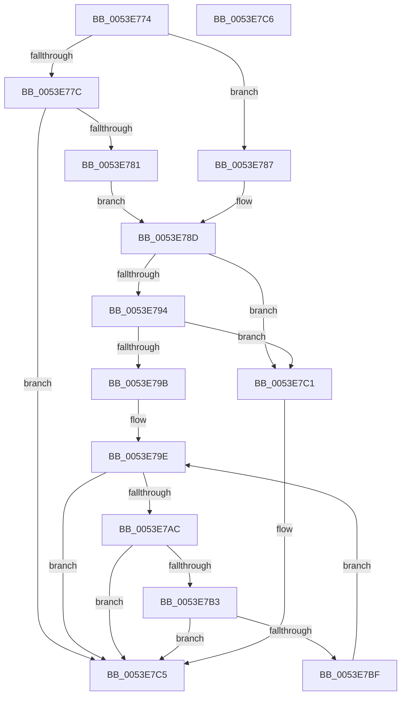

# wil_details_FeatureStateCache_TryEnableDeviceUsageFastPath

- RVA: `0x0053E774`–`0x0053E7C7` (길이 `83` bytes)
- VA: `0x000000014053E774`
- 실행 섹션: `.text`
- PDB 이름 있음: `예`; PDB Function 태그: `아니요`
- unwind 정보 RVA: `0x000DB714`
- 디코드: `29`개 명령, `83/83` bytes 표시
- 미해석 바이트: `0` (있으면 어셈블리에 `.byte`로 보존)

> 이 문서는 커널 이미지의 기계어와 PDB 기호를 분석해 생성했습니다. 4번과 5번은 함수 원형과 자료형을 바이너리 사용 방식에서 추정한 C 해석이며 원본 소스 복구 결과는 아닙니다.

## 1. Dependencies

- 직접 호출 지점: **0**; 고유 호출 대상: **0**
- 직접 호출자로 확인된 함수: **74**
- RIP 상대 이미지 참조: **0**

### Outgoing calls
- 직접 디코드된 call 명령이 없습니다.

### Direct callers
- [Feature_NewWpsAssignmentAlgorithm__private_IsEnabledPreCheck](../40/Feature_NewWpsAssignmentAlgorithm__private_IsEnabledPreCheck_function_0040B634.md) at `0x0040B695`
- [KeConfigureHeteroProcessors](../42/KeConfigureHeteroProcessors_function_00427338.md) at `0x004273FD`
- [Feature_ID51912085__private_IsEnabledPreCheck](../46/Feature_ID51912085__private_IsEnabledPreCheck_function_00467684.md) at `0x004676E5`
- [Feature_OpocksAndMappedSections__private_ReportDeviceUsage](../46/Feature_OpocksAndMappedSections__private_ReportDeviceUsage_function_0046BC88.md) at `0x0046BCE4`
- [Feature_IoInvalidateDeviceState_Unconditional__private_ReportDeviceUsage](../47/Feature_IoInvalidateDeviceState_Unconditional__private_ReportDeviceUsage_function_00478C84.md) at `0x00478CE0`
- [Feature_PreventInterfaceChangeConcurrentNotify__private_ReportDeviceUsage](../48/Feature_PreventInterfaceChangeConcurrentNotify__private_ReportDeviceUsage_function_00487ED0.md) at `0x00487F2C`
- [Feature_PdcClientPnpActionQueue__private_ReportDeviceUsage](../49/Feature_PdcClientPnpActionQueue__private_ReportDeviceUsage_function_0049E454.md) at `0x0049E4AA`
- [Feature_UpperThresholdInheritance__private_ReportDeviceUsage](../4A/Feature_UpperThresholdInheritance__private_ReportDeviceUsage_function_004AEE8C.md) at `0x004AEEE8`
- [wil_details_IsEnabledFallback](../4D/wil_details_IsEnabledFallback_function_004DAEFC.md) at `0x004DAF6E`
- [Feature_MachineHiveCache__private_ReportDeviceUsage](../4F/Feature_MachineHiveCache__private_ReportDeviceUsage_function_004F6E38.md) at `0x004F6E8E`
- [Feature_HaltOnAddress_QueuedSpinLock__private_ReportDeviceUsage](../4F/Feature_HaltOnAddress_QueuedSpinLock__private_ReportDeviceUsage_function_004F7228.md) at `0x004F727E`
- [Feature_HaltOnAddress_Barrier__private_ReportDeviceUsage](../4F/Feature_HaltOnAddress_Barrier__private_ReportDeviceUsage_function_004F7290.md) at `0x004F72E6`
- [Feature_ShortThreadQuantum__private_ReportDeviceUsage](../4F/Feature_ShortThreadQuantum__private_ReportDeviceUsage_function_004F72F8.md) at `0x004F734E`
- [Feature_AggressiveInputSuppression__private_IsEnabledPreCheck](../4F/Feature_AggressiveInputSuppression__private_IsEnabledPreCheck_function_004FAD78.md) at `0x004FADCE`
- [Feature_SleepStudySlimControlEtl__private_ReportDeviceUsage](../4F/Feature_SleepStudySlimControlEtl__private_ReportDeviceUsage_function_004FC658.md) at `0x004FC6AE`
- [IopAddBugcheckDirectedTransitionTriageData](../5A/IopAddBugcheckDirectedTransitionTriageData_function_005A0518.md) at `0x005A0584`
- [Feature_Servicing_IdealProcessorEventOutsideLocks__private_ReportUsageFallback](../5C/Feature_Servicing_IdealProcessorEventOutsideLocks__private_ReportUsageFallback_function_005C087C.md) at `0x005C08BD`
- [Feature_Servicing_DeadlineQosReschedule__private_ReportUsageFallback](../5C/Feature_Servicing_DeadlineQosReschedule__private_ReportUsageFallback_function_005C350C.md) at `0x005C354D`
- [Feature_Sx_PEP_Notification_Synchronization__private_ReportUsageFallback](../5C/Feature_Sx_PEP_Notification_Synchronization__private_ReportUsageFallback_function_005CF074.md) at `0x005CF0CD`
- [ExpPrepareNewAtsDevice](../65/ExpPrepareNewAtsDevice_function_00659FB0.md) at `0x0065A1C5`
- [WheaResumedFromHibernate](../65/WheaResumedFromHibernate_function_0065DC30.md) at `0x0065DC86`
- [Feature_CFR_Child_KM_C__private_ReportUsageFallback](../66/Feature_CFR_Child_KM_C__private_ReportUsageFallback_function_0066B5AC.md) at `0x0066B605`
- [Feature_CFR_Parent_KM_C__private_ReportUsageFallback](../66/Feature_CFR_Parent_KM_C__private_ReportUsageFallback_function_0066B61C.md) at `0x0066B675`
- [Feature_VelTest_KM_ControlledByProxy_DBD_1__private_ReportUsageFallback](../66/Feature_VelTest_KM_ControlledByProxy_DBD_1__private_ReportUsageFallback_function_0066B6E0.md) at `0x0066B739`
- [Feature_GatePerf__private_ReportUsageFallback](../66/Feature_GatePerf__private_ReportUsageFallback_function_0066BF94.md) at `0x0066BFD5`
- [Feature_ImplVal__private_ReportUsageFallback](../66/Feature_ImplVal__private_ReportUsageFallback_function_0066C074.md) at `0x0066C0B5`
- [Feature_NiwTest__private_ReportUsageFallback](../66/Feature_NiwTest__private_ReportUsageFallback_function_0066C2C4.md) at `0x0066C305`
- [Feature_PerfImpTest__private_ReportUsageFallback](../66/Feature_PerfImpTest__private_ReportUsageFallback_function_0066C3A4.md) at `0x0066C3E5`
- [Feature_PerfTestCen2__private_ReportUsageFallback](../66/Feature_PerfTestCen2__private_ReportUsageFallback_function_0066C484.md) at `0x0066C4C5`
- [Feature_SettingsDel__private_ReportUsageFallback](../66/Feature_SettingsDel__private_ReportUsageFallback_function_0066C564.md) at `0x0066C5A5`
- [Feature_Ten2Loc__private_ReportUsageFallback](../66/Feature_Ten2Loc__private_ReportUsageFallback_function_0066C644.md) at `0x0066C685`
- [Feature_TestAccPerf__private_ReportUsageFallback](../66/Feature_TestAccPerf__private_ReportUsageFallback_function_0066C724.md) at `0x0066C765`
- [Feature_TestConfNum__private_ReportUsageFallback](../66/Feature_TestConfNum__private_ReportUsageFallback_function_0066C804.md) at `0x0066C845`
- [Feature_TestConfVar__private_ReportUsageFallback](../66/Feature_TestConfVar__private_ReportUsageFallback_function_0066C8E4.md) at `0x0066C925`
- [Feature_TestGateImp__private_ReportUsageFallback](../66/Feature_TestGateImp__private_ReportUsageFallback_function_0066CA14.md) at `0x0066CA55`
- [Feature_TestLabVal__private_ReportUsageFallback](../66/Feature_TestLabVal__private_ReportUsageFallback_function_0066CAF4.md) at `0x0066CB35`
- [Feature_TestLoc02__private_ReportUsageFallback](../66/Feature_TestLoc02__private_ReportUsageFallback_function_0066CBD4.md) at `0x0066CC15`
- [Feature_TestLoc03__private_ReportUsageFallback](../66/Feature_TestLoc03__private_ReportUsageFallback_function_0066CCB4.md) at `0x0066CCF5`
- [Feature_TestLoc1Perf__private_ReportUsageFallback](../66/Feature_TestLoc1Perf__private_ReportUsageFallback_function_0066CD94.md) at `0x0066CDD5`
- [Feature_TestUex12__private_ReportUsageFallback](../66/Feature_TestUex12__private_ReportUsageFallback_function_0066CEC4.md) at `0x0066CF05`
- [Feature_TestUx32__private_ReportUsageFallback](../66/Feature_TestUx32__private_ReportUsageFallback_function_0066CFA4.md) at `0x0066CFE5`
- [Feature_TestValidate__private_ReportUsageFallback](../66/Feature_TestValidate__private_ReportUsageFallback_function_0066D1F4.md) at `0x0066D235`
- [Feature_UexTest7__private_ReportUsageFallback](../66/Feature_UexTest7__private_ReportUsageFallback_function_0066D2D4.md) at `0x0066D315`
- [Feature_UxConfTest__private_ReportUsageFallback](../66/Feature_UxConfTest__private_ReportUsageFallback_function_0066D524.md) at `0x0066D565`
- [Feature_UxLabTest__private_ReportUsageFallback](../66/Feature_UxLabTest__private_ReportUsageFallback_function_0066D604.md) at `0x0066D645`
- [Feature_UxPerfImp__private_ReportUsageFallback](../66/Feature_UxPerfImp__private_ReportUsageFallback_function_0066D6E4.md) at `0x0066D725`
- [Feature_UxSettingTest__private_ReportUsageFallback](../66/Feature_UxSettingTest__private_ReportUsageFallback_function_0066D7C4.md) at `0x0066D805`
- [Feature_ValAccTest__private_ReportUsageFallback](../66/Feature_ValAccTest__private_ReportUsageFallback_function_0066D8A4.md) at `0x0066D8E5`
- [Feature_ValConf__private_ReportUsageFallback](../66/Feature_ValConf__private_ReportUsageFallback_function_0066D984.md) at `0x0066D9C5`
- [Feature_ValLabTest__private_ReportUsageFallback](../66/Feature_ValLabTest__private_ReportUsageFallback_function_0066DA64.md) at `0x0066DAA5`
- [SdbpCheckApplicationTypeAttributes](../69/SdbpCheckApplicationTypeAttributes_function_0069C93C.md) at `0x0069C9BE`
- [PopMonitorInvocation](../../page/76/PopMonitorInvocation_function_00769710.md) at `0x00769783`
- [SshSessionManagerFlushBuffers](../../page/77/SshSessionManagerFlushBuffers_function_007736D8.md) at `0x007737DD`
- [SshSessionManagerFlushBuffers](../../page/77/SshSessionManagerFlushBuffers_function_007736D8.md) at `0x00773899`
- [SshSessionManagerFlushBuffers](../../page/77/SshSessionManagerFlushBuffers_function_007736D8.md) at `0x00773903`
- [SshpAlpcProcessAlpcMessage](../../page/77/SshpAlpcProcessAlpcMessage_function_0077506C.md) at `0x00775215`
- [SshpAlpcProcessMessage](../../page/77/SshpAlpcProcessMessage_function_007752C8.md) at `0x00775338`
- [SshpAlpcProcessMessage](../../page/77/SshpAlpcProcessMessage_function_007752C8.md) at `0x007753C7`
- [SepSetSystemPaths](../../page/79/SepSetSystemPaths_function_0079C040.md) at `0x0079C0C8`
- [SepSetSystemPaths](../../page/79/SepSetSystemPaths_function_0079C040.md) at `0x0079C1BF`
- [CmpLoadHiveThread](../../page/7D/CmpLoadHiveThread_function_007DB040.md) at `0x007DB1AB`
- [CmpLoadHiveThread](../../page/7D/CmpLoadHiveThread_function_007DB040.md) at `0x007DB26F`
- [CmpLoadHiveThread](../../page/7D/CmpLoadHiveThread_function_007DB040.md) at `0x007DB3D7`
- [SdbpCheckBackupApplicationAttributes](../../page/81/SdbpCheckBackupApplicationAttributes_function_00813C90.md) at `0x00813CF6`
- [SdbpCheckPackageAttributes](../../page/81/SdbpCheckPackageAttributes_function_00815380.md) at `0x00815419`
- [SdbpFreeAppAttributes](../../page/81/SdbpFreeAppAttributes_function_0081587C.md) at `0x0081592C`
- [SdbpCheckAttribute](../../page/81/SdbpCheckAttribute_function_00818A84.md) at `0x00818C9D`
- [SdbpCheckAttribute](../../page/81/SdbpCheckAttribute_function_00818A84.md) at `0x00818D14`
- [SdbpCheckFromStringVersion](../../page/81/SdbpCheckFromStringVersion_function_00818D84.md) at `0x00818DF0`
- [SdbpCheckUptoStringVersion](../../page/81/SdbpCheckUptoStringVersion_function_00818F5C.md) at `0x00818FC9`
- [PnpActivatePdcForDeviceEvent](../../page/95/PnpActivatePdcForDeviceEvent_function_00953A9C.md) at `0x00953B8A`
- [PspSchedulerSharedDataRegionCreate](../../page/98/PspSchedulerSharedDataRegionCreate_function_009825DC.md) at `0x009828CB`
- [PspThreadOpen](../../page/A0/PspThreadOpen_function_00A0FED0.md) at `0x00A1002A`
- [SeQuerySigningPolicy](../../page/A1/SeQuerySigningPolicy_function_00A12F44.md) at `0x00A130FD`
- [PspValidateCreateProcessProtection](../../page/AA/PspValidateCreateProcessProtection_function_00AA2AD8.md) at `0x00AA2B90`
- [PnpEarlyLaunchImageNotificationPostProcess](../../init/C3/PnpEarlyLaunchImageNotificationPostProcess_function_00C32C40.md) at `0x00C32CEB`
- [PopEvaluateInputSuppressionRequired](../../init/C4/PopEvaluateInputSuppressionRequired_function_00C40A1C.md) at `0x00C40AA1`
- [PopPowerButtonSuppressionInit](../../init/C4/PopPowerButtonSuppressionInit_function_00C40B00.md) at `0x00C40B83`
- [ExpTimerInitialization](../../init/C5/ExpTimerInitialization_function_00C5372C.md) at `0x00C5387D`
- [MiProtectSharedUserPage](../../init/C6/MiProtectSharedUserPage_function_00C60F44.md) at `0x00C60FD2`
- [KeInitializeClock](../../init/C7/KeInitializeClock_function_00C70C30.md) at `0x00C70D65`
- [KeInitializeClock](../../init/C7/KeInitializeClock_function_00C70C30.md) at `0x00C70DCD`

### Static image references
- 디코드된 RIP-relative 메모리 참조가 없습니다.

## 2. Other-region calls and transfers

- 다른 실행 섹션으로 향하는 call: **0**
- 별도 외부 분기/꼬리 이동을 확인하지 못했습니다.

## 3. Assembly (complete function range)

```asm
0053E774  4D 8B 08                        mov r9, qword ptr [r8]
0053E777  83 EA 03                        sub edx, 3
0053E77A  74 0B                           je 0x14053e787
0053E77C  83 FA 01                        cmp edx, 1
0053E77F  75 44                           jne 0x14053e7c5
0053E781  44 8D 52 1F                     lea r10d, [rdx + 0x1f]
0053E785  EB 06                           jmp 0x14053e78d
0053E787  41 BA 10 00 00 00               mov r10d, 0x10
0053E78D  41 80 78 1E 00                  cmp byte ptr [r8 + 0x1e], 0
0053E792  75 2D                           jne 0x14053e7c1
0053E794  41 80 78 1D 00                  cmp byte ptr [r8 + 0x1d], 0
0053E799  75 26                           jne 0x14053e7c1
0053E79B  41 8B 01                        mov eax, dword ptr [r9]
0053E79E  44 8B C0                        mov r8d, eax
0053E7A1  44 8B D8                        mov r11d, eax
0053E7A4  8B D0                           mov edx, eax
0053E7A6  41 F6 C0 02                     test r8b, 2
0053E7AA  74 19                           je 0x14053e7c5
0053E7AC  33 D1                           xor edx, ecx
0053E7AE  F6 C2 01                        test dl, 1
0053E7B1  75 12                           jne 0x14053e7c5
0053E7B3  41 8B D2                        mov edx, r10d
0053E7B6  0B D0                           or edx, eax
0053E7B8  F0 41 0F B1 11                  lock cmpxchg dword ptr [r9], edx
0053E7BD  74 06                           je 0x14053e7c5
0053E7BF  EB DD                           jmp 0x14053e79e
0053E7C1  F0 45 09 11                     lock or dword ptr [r9], r10d
0053E7C5  C3                              ret
0053E7C6  CC                              int3
```

## 4. C-style interpretation (structured pseudocode)

```c
__int64 __fastcall wil_details_FeatureStateCache_TryEnableDeviceUsageFastPath(int a1, int a2, __int64 a3)
{
    a2 = (unsigned int)((a2) - (3));
    if (condition_is_equal) goto loc_0053E787;
    if (a2 != 1) goto loc_0053E7C5;
    goto loc_0053E78D;
loc_0053E787:
loc_0053E78D:
    if ((*(unsigned __int8 *)(a3 + 30)) != 0) goto loc_0053E7C1;
    if ((*(unsigned __int8 *)(a3 + 29)) != 0) goto loc_0053E7C1;
loc_0053E79E:
    if ((((unsigned __int8)((unsigned int)((unsigned int)((unsigned int)(*(unsigned int *)(*(unsigned __int64 *)(a3))))))) & (2)) == 0) goto loc_0053E7C5;
    a2 = (unsigned int)(((unsigned int)((unsigned int)((unsigned int)(*(unsigned int *)(*(unsigned __int64 *)(a3)))))) ^ (a1));
    if ((((unsigned __int8)(a2)) & (1)) != 0) goto loc_0053E7C5;
    a2 = (unsigned int)((16) | ((unsigned int)((unsigned int)(*(unsigned int *)(*(unsigned __int64 *)(a3))))));
    if (condition_is_equal) goto loc_0053E7C5;
    goto loc_0053E79E;
loc_0053E7C1:
loc_0053E7C5:
    return (unsigned int)(*(unsigned int *)(*(unsigned __int64 *)(a3)));
}
```

## 5. (Beta) C Style

```c
int64_t wil_details_FeatureStateCache_TryEnableDeviceUsageFastPath(int32_t Arg1, int32_t Arg2, void *Arg3)
{
    uint8_t *arg3 = (uint8_t *)Arg3;

    Arg2 = (uint32_t)((Arg2) - (3));
    if (condition_is_equal) goto loc_0053E787;
    if (Arg2 != 1) goto loc_0053E7C5;
    goto loc_0053E78D;
loc_0053E787:
loc_0053E78D:
    if ((*(uint8_t *)(arg3 + 0x1E)) != 0) goto loc_0053E7C1;
    if ((*(uint8_t *)(arg3 + 0x1D)) != 0) goto loc_0053E7C1;
loc_0053E79E:
    if ((((uint8_t)((uint32_t)((uint32_t)((uint32_t)(*(uint32_t *)(*(uint64_t *)(arg3))))))) & (2)) == 0) goto loc_0053E7C5;
    Arg2 = (uint32_t)(((uint32_t)((uint32_t)((uint32_t)(*(uint32_t *)(*(uint64_t *)(arg3)))))) ^ (Arg1));
    if ((((uint8_t)(Arg2)) & (1)) != 0) goto loc_0053E7C5;
    Arg2 = (uint32_t)((16) | ((uint32_t)((uint32_t)(*(uint32_t *)(*(uint64_t *)(arg3))))));
    if (condition_is_equal) goto loc_0053E7C5;
    goto loc_0053E79E;
loc_0053E7C1:
loc_0053E7C5:
    return (uint32_t)(*(uint32_t *)(*(uint64_t *)(arg3)));
}
```

### 관측된 메모리 오프셋

구조체 형식이 확인되지 않은 접근은 인자 기준의 오프셋으로만 기록했습니다.

| 기준 인자 | 오프셋 표현 | 폭 (bit) | 접근 |
|---|---:|---:|---|
| `Arg3` | `+ 0x0` | `64` | `R` |
| `Arg3` | `+ 0x1D` | `8` | `R` |
| `Arg3` | `+ 0x1E` | `8` | `R` |

## 6. Execution-region graph

[열기: 2D/3D 그래프와 함수 탐색 컨트롤 패널](../../../control-panel.html?section=text&rva=0x0053E774&view=graph)

- 2D 그래프는 위에서 아래로 흐르고, 3D 그래프는 빈 공간을 드래그해 회전합니다. Shift+드래그는 이동, 휠은 확대·축소, 함수 노드 선택은 대상 보고서 이동입니다.

### Static fallback


