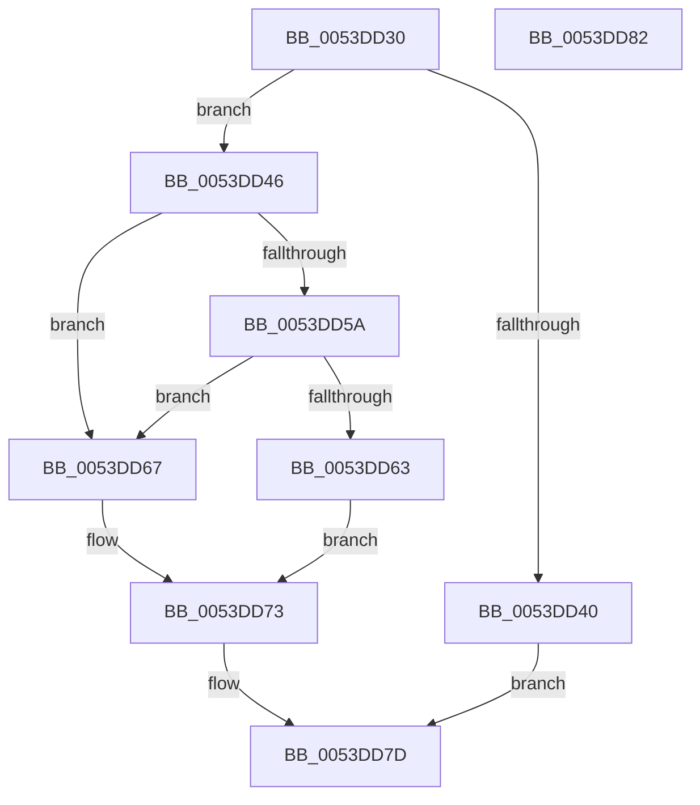

# x86BiosCall

- RVA: `0x0053DD30`–`0x0053DD83` (길이 `83` bytes)
- VA: `0x000000014053DD30`
- 실행 섹션: `.text`
- PDB 이름 있음: `예`; PDB Function 태그: `아니요`
- unwind 정보 RVA: `0x0005D2F4`
- 디코드: `24`개 명령, `83/83` bytes 표시
- 미해석 바이트: `0` (있으면 어셈블리에 `.byte`로 보존)

> 이 문서는 커널 이미지의 기계어와 PDB 기호를 분석해 생성했습니다. 4번과 5번은 함수 원형과 자료형을 바이너리 사용 방식에서 추정한 C 해석이며 원본 소스 복구 결과는 아닙니다.

## 1. Dependencies

- 직접 호출 지점: **1**; 고유 호출 대상: **1**
- 직접 호출자로 확인된 함수: **1**
- RIP 상대 이미지 참조: **3**

### Outgoing calls
- `0x0053DD67` → [x86BiosExecuteInterruptShadowed](../54/x86BiosExecuteInterruptShadowed_function_00547BA8.md) (function, `0x00547BA8`)

### Direct callers
- [HalpBiosDisplayReset](HalpBiosDisplayReset_function_0053DCC0.md) at `0x0053DCF2`

### Static image references
- `0x0053DD37` → RVA `0x00E0F598` (`.data`; read)
- `0x0053DD4B` → RVA `0x00FC3F7C` (`.data`; read/write)
- `0x0053DD5A` → RVA `0x00FC1C49` (`.data`; read)

## 2. Other-region calls and transfers

- 다른 실행 섹션으로 향하는 call: **0**
- 별도 외부 분기/꼬리 이동을 확인하지 못했습니다.

## 3. Assembly (complete function range)

```asm
0053DD30  48 83 EC 38                     sub rsp, 0x38
0053DD34  45 32 C0                        xor r8b, r8b
0053DD37  44 38 05 5A 18 8D 00            cmp byte ptr [rip + 0x8d185a], r8b
0053DD3E  75 06                           jne 0x14053dd46
0053DD40  CD 2C                           int 0x2c
0053DD42  32 C0                           xor al, al
0053DD44  EB 37                           jmp 0x14053dd7d
0053DD46  B8 01 00 00 00                  mov eax, 1
0053DD4B  F0 0F C1 05 29 62 A8 00         lock xadd dword ptr [rip + 0xa86229], eax
0053DD53  FF C0                           inc eax
0053DD55  83 F8 01                        cmp eax, 1
0053DD58  74 0D                           je 0x14053dd67
0053DD5A  44 38 05 E8 3E A8 00            cmp byte ptr [rip + 0xa83ee8], r8b
0053DD61  75 04                           jne 0x14053dd67
0053DD63  CD 2C                           int 0x2c
0053DD65  EB 0C                           jmp 0x14053dd73
0053DD67  E8 3C 9E 00 00                  call 0x140547ba8
0053DD6C  83 F8 01                        cmp eax, 1
0053DD6F  41 0F 94 C0                     sete r8b
0053DD73  F0 FF 0D 02 62 A8 00            lock dec dword ptr [rip + 0xa86202]
0053DD7A  41 8A C0                        mov al, r8b
0053DD7D  48 83 C4 38                     add rsp, 0x38
0053DD81  C3                              ret
0053DD82  CC                              int3
```

## 4. C-style interpretation (structured pseudocode)

```c
__int64 __fastcall x86BiosCall(__int64 a1, __int64 a2, unsigned __int8 a3)
{
    __int64 result;
    __int64 v_rsp;

    v_rsp = (v_rsp) - (56);
    a3 = 0;
    if ((*(unsigned __int8 *)(v_rip + 9246810)) != 0) goto loc_0053DD46;
    result = 0;
    goto loc_0053DD7D;
loc_0053DD46:
    result = (unsigned int)((1) + 1);
    if (((unsigned int)(result)) == 1) goto loc_0053DD67;
    if ((*(unsigned __int8 *)(v_rip + 11026152)) != 0) goto loc_0053DD67;
    goto loc_0053DD73;
loc_0053DD67:
    result = x86BiosExecuteInterruptShadowed(a1, a2, a3, a4);
    a3 = (((unsigned int)(result)) == 1) ? 1 : 0;
loc_0053DD73:
loc_0053DD7D:
    v_rsp = (v_rsp) + (56);
    return a3;
}
```

## 5. (Beta) C Style

```c
int64_t x86BiosCall(int64_t Arg1, int64_t Arg2, uint8_t Arg3)
{
    int64_t result;
    int64_t local_rsp;

    local_rsp = (local_rsp) - (56);
    Arg3 = 0;
    if ((*(uint8_t *)(v_rip + 0x8D185A)) != 0) goto loc_0053DD46;
    result = 0;
    goto loc_0053DD7D;
loc_0053DD46:
    result = (uint32_t)((1) + 1);
    if (((uint32_t)(result)) == 1) goto loc_0053DD67;
    if ((*(uint8_t *)(v_rip + 0xA83EE8)) != 0) goto loc_0053DD67;
    goto loc_0053DD73;
loc_0053DD67:
    result = x86BiosExecuteInterruptShadowed(Arg1, Arg2, Arg3, a4);
    Arg3 = (((uint32_t)(result)) == 1) ? 1 : 0;
loc_0053DD73:
loc_0053DD7D:
    local_rsp = (local_rsp) + (56);
    return Arg3;
}
```

## 6. Execution-region graph

[열기: 2D/3D 그래프와 함수 탐색 컨트롤 패널](../../../control-panel.html?section=text&rva=0x0053DD30&view=graph)

- 2D 그래프는 위에서 아래로 흐르고, 3D 그래프는 빈 공간을 드래그해 회전합니다. Shift+드래그는 이동, 휠은 확대·축소, 함수 노드 선택은 대상 보고서 이동입니다.

### Static fallback


