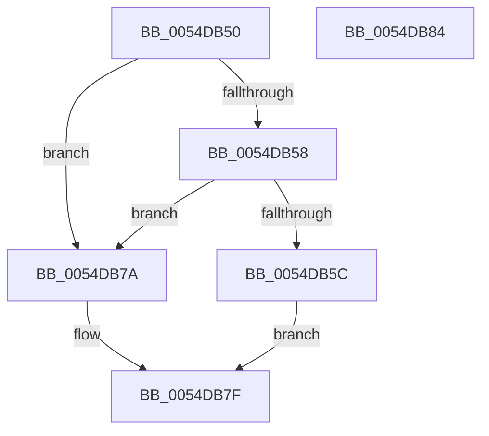

# DefaultEnableMonitoring

- RVA: `0x0054DB50`–`0x0054DB85` (길이 `53` bytes)
- VA: `0x000000014054DB50`
- 실행 섹션: `.text`
- PDB 이름 있음: `예`; PDB Function 태그: `아니요`
- unwind 정보 RVA: `0x0005C788`
- 디코드: `18`개 명령, `53/53` bytes 표시
- 미해석 바이트: `0` (있으면 어셈블리에 `.byte`로 보존)

> 이 문서는 커널 이미지의 기계어와 PDB 기호를 분석해 생성했습니다. 4번과 5번은 함수 원형과 자료형을 바이너리 사용 방식에서 추정한 C 해석이며 원본 소스 복구 결과는 아닙니다.

## 1. Dependencies

- 직접 호출 지점: **1**; 고유 호출 대상: **1**
- 직접 호출자로 확인된 함수: **0**
- RIP 상대 이미지 참조: **0**

### Outgoing calls
- `0x0054DB73` → [HalpTimerStartProfileInterrupt](HalpTimerStartProfileInterrupt_function_0054B80C.md) (function, `0x0054B80C`)

### Direct callers
- 이 함수 시작 RVA로 연결되는 직접 call은 확인되지 않았습니다. 간접 호출은 완전히 역산할 수 없습니다.

### Static image references
- 디코드된 RIP-relative 메모리 참조가 없습니다.

## 2. Other-region calls and transfers

- 다른 실행 섹션으로 향하는 call: **0**
- 별도 외부 분기/꼬리 이동을 확인하지 못했습니다.

## 3. Assembly (complete function range)

```asm
0054DB50  48 83 EC 28                     sub rsp, 0x28
0054DB54  85 C9                           test ecx, ecx
0054DB56  75 22                           jne 0x14054db7a
0054DB58  85 D2                           test edx, edx
0054DB5A  75 1E                           jne 0x14054db7a
0054DB5C  41 21 11                        and dword ptr [r9], edx
0054DB5F  8D 4A 01                        lea ecx, [rdx + 1]
0054DB62  48 8B 44 24 50                  mov rax, qword ptr [rsp + 0x50]
0054DB67  21 10                           and dword ptr [rax], edx
0054DB69  48 8B 44 24 58                  mov rax, qword ptr [rsp + 0x58]
0054DB6E  41 89 08                        mov dword ptr [r8], ecx
0054DB71  89 08                           mov dword ptr [rax], ecx
0054DB73  E8 94 DC FF FF                  call 0x14054b80c
0054DB78  EB 05                           jmp 0x14054db7f
0054DB7A  B8 BB 00 00 C0                  mov eax, 0xc00000bb
0054DB7F  48 83 C4 28                     add rsp, 0x28
0054DB83  C3                              ret
0054DB84  CC                              int3
```

## 4. C-style interpretation (structured pseudocode)

```c
__int64 __fastcall DefaultEnableMonitoring(int a1, __int64 a2, __int64 a3, __int64 a4, __int64 a5, __int64 a6)
{
    __int64 result;
    __int64 v_rsp;

    v_rsp = (v_rsp) - (40);
    if (a1 != 0) goto loc_0054DB7A;
    if ((unsigned int)(a2) != 0) goto loc_0054DB7A;
    *(unsigned int *)(a3) = (unsigned int)(a2 + 1);
    *(unsigned int *)(a6) = (unsigned int)(a2 + 1);
    result = HalpTimerStartProfileInterrupt(a2 + 1, a2, a3, a4);
    goto loc_0054DB7F;
loc_0054DB7A:
loc_0054DB7F:
    v_rsp = (v_rsp) + (40);
    return (unsigned int)(0xC00000BBULL);
}
```

## 5. (Beta) C Style

```c
int64_t DefaultEnableMonitoring(int32_t Arg1, int64_t Arg2, void *Arg3, void *Arg4, void *Arg5, void *Arg6)
{
    uint8_t *arg3 = (uint8_t *)Arg3;
    uint8_t *arg4 = (uint8_t *)Arg4;
    uint8_t *arg5 = (uint8_t *)Arg5;
    uint8_t *arg6 = (uint8_t *)Arg6;

    int64_t result;
    int64_t local_rsp;

    local_rsp = (local_rsp) - (40);
    if (Arg1 != 0) goto loc_0054DB7A;
    if ((uint32_t)(Arg2) != 0) goto loc_0054DB7A;
    *(uint32_t *)(arg3) = (uint32_t)(Arg2 + 1);
    *(uint32_t *)(arg6) = (uint32_t)(Arg2 + 1);
    result = HalpTimerStartProfileInterrupt(Arg2 + 1, Arg2, Arg3, Arg4);
    goto loc_0054DB7F;
loc_0054DB7A:
loc_0054DB7F:
    local_rsp = (local_rsp) + (40);
    return (uint32_t)(0xC00000BBULL);
}
```

### 관측된 메모리 오프셋

구조체 형식이 확인되지 않은 접근은 인자 기준의 오프셋으로만 기록했습니다.

| 기준 인자 | 오프셋 표현 | 폭 (bit) | 접근 |
|---|---:|---:|---|
| `Arg3` | `+ 0x0` | `32` | `W` |
| `Arg4` | `+ 0x0` | `32` | `R/W` |
| `Arg5` | `+ 0x0` | `32` | `R/W` |
| `Arg6` | `+ 0x0` | `32` | `W` |

## 6. Execution-region graph

[열기: 2D/3D 그래프와 함수 탐색 컨트롤 패널](../../../control-panel.html?section=text&rva=0x0054DB50&view=graph)

- 2D 그래프는 위에서 아래로 흐르고, 3D 그래프는 빈 공간을 드래그해 회전합니다. Shift+드래그는 이동, 휠은 확대·축소, 함수 노드 선택은 대상 보고서 이동입니다.

### Static fallback


