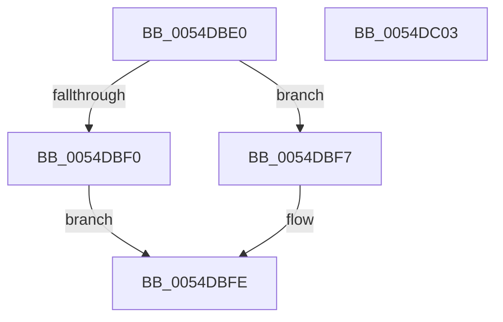

# DefaultOverflowHandler

- RVA: `0x0054DBE0`–`0x0054DC04` (길이 `36` bytes)
- VA: `0x000000014054DBE0`
- 실행 섹션: `.text`
- PDB 이름 있음: `예`; PDB Function 태그: `아니요`
- unwind 정보 RVA: `0x0005C788`
- 디코드: `11`개 명령, `36/36` bytes 표시
- 미해석 바이트: `0` (있으면 어셈블리에 `.byte`로 보존)

> 이 문서는 커널 이미지의 기계어와 PDB 기호를 분석해 생성했습니다. 4번과 5번은 함수 원형과 자료형을 바이너리 사용 방식에서 추정한 C 해석이며 원본 소스 복구 결과는 아닙니다.

## 1. Dependencies

- 직접 호출 지점: **2**; 고유 호출 대상: **2**
- 직접 호출자로 확인된 함수: **0**
- RIP 상대 이미지 참조: **1**

### Outgoing calls
- `0x0054DBF0` → [guard_dispatch_icall](../6B/guard_dispatch_icall_function_006BAAD0.md) (function, `0x006BAAD0`)
- `0x0054DBF9` → [KeProfileInterruptWithSource](../4A/KeProfileInterruptWithSource_function_004A34D0.md) (function, `0x004A34D0`)

### Direct callers
- 이 함수 시작 RVA로 연결되는 직접 call은 확인되지 않았습니다. 간접 호출은 완전히 역산할 수 없습니다.

### Static image references
- `0x0054DBE4` → RVA `0x00E10360` (`.data`; read)

## 2. Other-region calls and transfers

- 다른 실행 섹션으로 향하는 call: **0**
- 별도 외부 분기/꼬리 이동을 확인하지 못했습니다.

## 3. Assembly (complete function range)

```asm
0054DBE0  48 83 EC 28                     sub rsp, 0x28
0054DBE4  48 8B 05 75 27 8C 00            mov rax, qword ptr [rip + 0x8c2775]
0054DBEB  48 85 C0                        test rax, rax
0054DBEE  74 07                           je 0x14054dbf7
0054DBF0  E8 DB CE 16 00                  call 0x1406baad0
0054DBF5  EB 07                           jmp 0x14054dbfe
0054DBF7  33 D2                           xor edx, edx
0054DBF9  E8 D2 58 F5 FF                  call 0x1404a34d0
0054DBFE  48 83 C4 28                     add rsp, 0x28
0054DC02  C3                              ret
0054DC03  CC                              int3
```

## 4. C-style interpretation (structured pseudocode)

```c
__int64 __fastcall DefaultOverflowHandler(__int64 a1, int a2)
{
    __int64 result;
    __int64 v_rsp;

    v_rsp = (v_rsp) - (40);
    if (*(unsigned __int64 *)(v_rip + 9185141) == 0) goto loc_0054DBF7;
    result = guard_dispatch_icall(a1, a2, a3, a4);
    goto loc_0054DBFE;
loc_0054DBF7:
    a2 = 0;
    result = KeProfileInterruptWithSource(a1, a2, a3, a4);
loc_0054DBFE:
    v_rsp = (v_rsp) + (40);
    return result;
}
```

## 5. (Beta) C Style

```c
int64_t DefaultOverflowHandler(int64_t Arg1, int32_t Arg2)
{
    int64_t result;
    int64_t local_rsp;

    local_rsp = (local_rsp) - (40);
    if (*(uint64_t *)(v_rip + 0x8C2775) == 0) goto loc_0054DBF7;
    result = guard_dispatch_icall(Arg1, Arg2, a3, a4);
    goto loc_0054DBFE;
loc_0054DBF7:
    Arg2 = 0;
    result = KeProfileInterruptWithSource(Arg1, Arg2, a3, a4);
loc_0054DBFE:
    local_rsp = (local_rsp) + (40);
    return result;
}
```

## 6. Execution-region graph

[열기: 2D/3D 그래프와 함수 탐색 컨트롤 패널](../../../control-panel.html?section=text&rva=0x0054DBE0&view=graph)

- 2D 그래프는 위에서 아래로 흐르고, 3D 그래프는 빈 공간을 드래그해 회전합니다. Shift+드래그는 이동, 휠은 확대·축소, 함수 노드 선택은 대상 보고서 이동입니다.

### Static fallback


