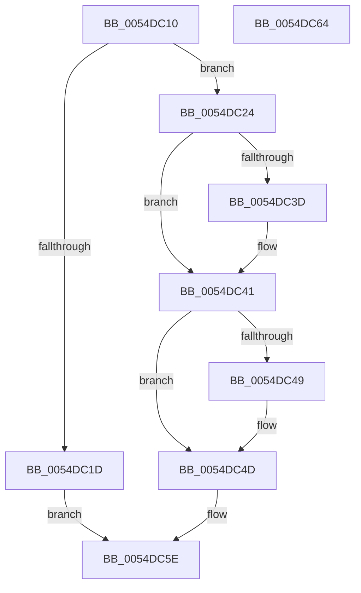

# DefaultSetInterval

- RVA: `0x0054DC10`–`0x0054DC65` (길이 `85` bytes)
- VA: `0x000000014054DC10`
- 실행 섹션: `.text`
- PDB 이름 있음: `예`; PDB Function 태그: `아니요`
- unwind 정보 RVA: `0x0005CF00`
- 디코드: `29`개 명령, `85/85` bytes 표시
- 미해석 바이트: `0` (있으면 어셈블리에 `.byte`로 보존)

> 이 문서는 커널 이미지의 기계어와 PDB 기호를 분석해 생성했습니다. 4번과 5번은 함수 원형과 자료형을 바이너리 사용 방식에서 추정한 C 해석이며 원본 소스 복구 결과는 아닙니다.

## 1. Dependencies

- 직접 호출 지점: **1**; 고유 호출 대상: **1**
- 직접 호출자로 확인된 함수: **0**
- RIP 상대 이미지 참조: **3**

### Outgoing calls
- `0x0054DC4F` → [HalpTimerSetTimerBackedProfileInterval](HalpTimerSetTimerBackedProfileInterval_function_0054B774.md) (function, `0x0054B774`)

### Direct callers
- 이 함수 시작 RVA로 연결되는 직접 call은 확인되지 않았습니다. 간접 호출은 완전히 역산할 수 없습니다.

### Static image references
- `0x0054DC24` → RVA `0x00E03B7C` (`.data`; read)
- `0x0054DC2B` → RVA `0x00023F40` (`.rdata`; read)
- `0x0054DC56` → RVA `0x00E03B78` (`.data`; write)

## 2. Other-region calls and transfers

- 다른 실행 섹션으로 향하는 call: **0**
- 별도 외부 분기/꼬리 이동을 확인하지 못했습니다.

## 3. Assembly (complete function range)

```asm
0054DC10  40 53                           push rbx
0054DC12  48 83 EC 20                     sub rsp, 0x20
0054DC16  48 8B DA                        mov rbx, rdx
0054DC19  85 C9                           test ecx, ecx
0054DC1B  74 07                           je 0x14054dc24
0054DC1D  B8 BB 00 00 C0                  mov eax, 0xc00000bb
0054DC22  EB 3A                           jmp 0x14054dc5e
0054DC24  0F B6 15 51 5F 8B 00            movzx edx, byte ptr [rip + 0x8b5f51]
0054DC2B  4C 8D 05 0E 63 AD FF            lea r8, [rip - 0x529cf2]
0054DC32  8B 03                           mov eax, dword ptr [rbx]
0054DC34  41 8B 4C D0 04                  mov ecx, dword ptr [r8 + rdx*8 + 4]
0054DC39  3B C1                           cmp eax, ecx
0054DC3B  73 04                           jae 0x14054dc41
0054DC3D  89 0B                           mov dword ptr [rbx], ecx
0054DC3F  8B C1                           mov eax, ecx
0054DC41  41 8B 0C D0                     mov ecx, dword ptr [r8 + rdx*8]
0054DC45  3B C1                           cmp eax, ecx
0054DC47  76 04                           jbe 0x14054dc4d
0054DC49  89 0B                           mov dword ptr [rbx], ecx
0054DC4B  8B C1                           mov eax, ecx
0054DC4D  8B C8                           mov ecx, eax
0054DC4F  E8 20 DB FF FF                  call 0x14054b774
0054DC54  89 03                           mov dword ptr [rbx], eax
0054DC56  89 05 1C 5F 8B 00               mov dword ptr [rip + 0x8b5f1c], eax
0054DC5C  33 C0                           xor eax, eax
0054DC5E  48 83 C4 20                     add rsp, 0x20
0054DC62  5B                              pop rbx
0054DC63  C3                              ret
0054DC64  CC                              int3
```

## 4. C-style interpretation (structured pseudocode)

```c
__int64 __fastcall DefaultSetInterval(int a1, __int64 a2)
{
    __int64 result;
    __int64 v_rsp;

    v_rsp = (v_rsp) - (32);
    if (a1 == 0) goto loc_0054DC24;
    goto loc_0054DC5E;
loc_0054DC24:
    result = (unsigned int)(*(unsigned int *)(a2));
    if (((unsigned int)((unsigned int)(*(unsigned int *)(a2)))) < ((unsigned int)((unsigned int)(*(unsigned int *)(v_rip - 5414130 + *(unsigned __int8 *)(v_rip + 9133905) * 8 + 4))))) {
        *(unsigned int *)(a2) = (unsigned int)((unsigned int)(*(unsigned int *)(v_rip - 5414130 + *(unsigned __int8 *)(v_rip + 9133905) * 8 + 4)));
        result = (unsigned int)((unsigned int)(*(unsigned int *)(v_rip - 5414130 + *(unsigned __int8 *)(v_rip + 9133905) * 8 + 4)));
    }
    if (((unsigned int)(result)) >= = ((unsigned int)((unsigned int)(*(unsigned int *)(v_rip - 5414130 + *(unsigned __int8 *)(v_rip + 9133905) * 8))))) {
        *(unsigned int *)(a2) = (unsigned int)((unsigned int)(*(unsigned int *)(v_rip - 5414130 + *(unsigned __int8 *)(v_rip + 9133905) * 8)));
        result = (unsigned int)((unsigned int)(*(unsigned int *)(v_rip - 5414130 + *(unsigned __int8 *)(v_rip + 9133905) * 8)));
    }
    result = HalpTimerSetTimerBackedProfileInterval((unsigned int)((unsigned int)(result)), *(unsigned __int8 *)(v_rip + 9133905), v_rip - 5414130, a4);
    *(unsigned int *)(a2) = (unsigned int)(result);
    *(unsigned int *)(v_rip + 9133852) = (unsigned int)(result);
    result = 0;
loc_0054DC5E:
    v_rsp = (v_rsp) + (32);
    return result;
}
```

## 5. (Beta) C Style

```c
int64_t DefaultSetInterval(int32_t Arg1, void *Arg2)
{
    uint8_t *arg2 = (uint8_t *)Arg2;

    int64_t result;
    int64_t local_rsp;

    local_rsp = (local_rsp) - (32);
    if (Arg1 == 0) goto loc_0054DC24;
    goto loc_0054DC5E;
loc_0054DC24:
    result = (uint32_t)(*(uint32_t *)(arg2));
    if (((uint32_t)((uint32_t)(*(uint32_t *)(arg2)))) < ((uint32_t)((uint32_t)(*(uint32_t *)(v_rip - 0x529CF2 + *(uint8_t *)(v_rip + 0x8B5F51) * 8 + 0x4))))) {
        *(uint32_t *)(arg2) = (uint32_t)((uint32_t)(*(uint32_t *)(v_rip - 0x529CF2 + *(uint8_t *)(v_rip + 0x8B5F51) * 8 + 0x4)));
        result = (uint32_t)((uint32_t)(*(uint32_t *)(v_rip - 0x529CF2 + *(uint8_t *)(v_rip + 0x8B5F51) * 8 + 0x4)));
    }
    if (((uint32_t)(result)) >= = ((uint32_t)((uint32_t)(*(uint32_t *)(v_rip - 0x529CF2 + *(uint8_t *)(v_rip + 0x8B5F51) * 8))))) {
        *(uint32_t *)(arg2) = (uint32_t)((uint32_t)(*(uint32_t *)(v_rip - 0x529CF2 + *(uint8_t *)(v_rip + 0x8B5F51) * 8)));
        result = (uint32_t)((uint32_t)(*(uint32_t *)(v_rip - 0x529CF2 + *(uint8_t *)(v_rip + 0x8B5F51) * 8)));
    }
    result = HalpTimerSetTimerBackedProfileInterval((uint32_t)((uint32_t)(result)), *(uint8_t *)(v_rip + 0x8B5F51), v_rip - 5414130, a4);
    *(uint32_t *)(arg2) = (uint32_t)(result);
    *(uint32_t *)(v_rip + 0x8B5F1C) = (uint32_t)(result);
    result = 0;
loc_0054DC5E:
    local_rsp = (local_rsp) + (32);
    return result;
}
```

### 관측된 메모리 오프셋

구조체 형식이 확인되지 않은 접근은 인자 기준의 오프셋으로만 기록했습니다.

| 기준 인자 | 오프셋 표현 | 폭 (bit) | 접근 |
|---|---:|---:|---|
| `Arg2` | `+ 0x0` | `32` | `R` |
| `Arg2` | `+ 0x0` | `32` | `W` |

## 6. Execution-region graph

[열기: 2D/3D 그래프와 함수 탐색 컨트롤 패널](../../../control-panel.html?section=text&rva=0x0054DC10&view=graph)

- 2D 그래프는 위에서 아래로 흐르고, 3D 그래프는 빈 공간을 드래그해 회전합니다. Shift+드래그는 이동, 휠은 확대·축소, 함수 노드 선택은 대상 보고서 이동입니다.

### Static fallback


