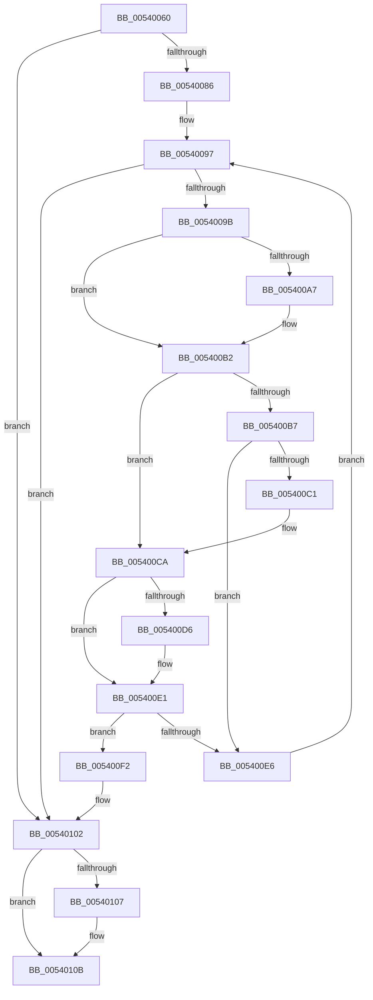

# HalBugCheckSystem

- RVA: `0x00540060`–`0x00540121` (길이 `193` bytes)
- VA: `0x0000000140540060`
- 실행 섹션: `.text`
- PDB 이름 있음: `예`; PDB Function 태그: `아니요`
- unwind 정보 RVA: `0x000BB168`
- 디코드: `54`개 명령, `193/193` bytes 표시
- 미해석 바이트: `0` (있으면 어셈블리에 `.byte`로 보존)

> 이 문서는 커널 이미지의 기계어와 PDB 기호를 분석해 생성했습니다. 4번과 5번은 함수 원형과 자료형을 바이너리 사용 방식에서 추정한 C 해석이며 원본 소스 복구 결과는 아닙니다.

## 1. Dependencies

- 직접 호출 지점: **2**; 고유 호출 대상: **2**
- 직접 호출자로 확인된 함수: **0**
- RIP 상대 이미지 참조: **4**

### Outgoing calls
- `0x005400C4` → [HalpNMIHalt](HalpNMIHalt_function_00545B44.md) (function, `0x00545B44`)
- `0x0054011B` → [KeBugCheckEx](../4F/KeBugCheckEx_function_004FD660.md) (function, `0x004FD660`)

### Direct callers
- 이 함수 시작 RVA로 연결되는 직접 call은 확인되지 않았습니다. 간접 호출은 완전히 역산할 수 없습니다.

### Static image references
- `0x0054009E` → RVA `0x00024DE8` (`.rdata`; read)
- `0x005400AB` → RVA `0x00024DF0` (`.rdata`; read)
- `0x005400CD` → RVA `0x00024DA8` (`.rdata`; read)
- `0x005400DA` → RVA `0x00024DB0` (`.rdata`; read)

## 2. Other-region calls and transfers

- 다른 실행 섹션으로 향하는 call: **0**
- 별도 외부 분기/꼬리 이동을 확인하지 못했습니다.

## 3. Assembly (complete function range)

```asm
00540060  48 89 5C 24 08                  mov qword ptr [rsp + 8], rbx
00540065  48 89 6C 24 10                  mov qword ptr [rsp + 0x10], rbp
0054006A  48 89 74 24 18                  mov qword ptr [rsp + 0x18], rsi
0054006F  57                              push rdi
00540070  48 83 EC 30                     sub rsp, 0x30
00540074  45 33 C9                        xor r9d, r9d
00540077  33 FF                           xor edi, edi
00540079  4C 8B D9                        mov r11, rcx
0054007C  BB FF 00 00 00                  mov ebx, 0xff
00540081  48 85 D2                        test rdx, rdx
00540084  74 7C                           je 0x140540102
00540086  0F B7 6A 0A                     movzx ebp, word ptr [rdx + 0xa]
0054008A  4C 8D 92 80 00 00 00            lea r10, [rdx + 0x80]
00540091  4D 8D 42 10                     lea r8, [r10 + 0x10]
00540095  33 F6                           xor esi, esi
00540097  3B F5                           cmp esi, ebp
00540099  73 67                           jae 0x140540102
0054009B  49 8B 00                        mov rax, qword ptr [r8]
0054009E  48 2B 05 43 4D AE FF            sub rax, qword ptr [rip - 0x51b2bd]
005400A5  75 0B                           jne 0x1405400b2
005400A7  49 8B 40 08                     mov rax, qword ptr [r8 + 8]
005400AB  48 2B 05 3E 4D AE FF            sub rax, qword ptr [rip - 0x51b2c2]
005400B2  48 85 C0                        test rax, rax
005400B5  75 13                           jne 0x1405400ca
005400B7  41 8B 0A                        mov ecx, dword ptr [r10]
005400BA  F6 44 11 08 01                  test byte ptr [rcx + rdx + 8], 1
005400BF  75 25                           jne 0x1405400e6
005400C1  8A 0C 11                        mov cl, byte ptr [rcx + rdx]
005400C4  E8 7B 5A 00 00                  call 0x140545b44
005400C9  CC                              int3
005400CA  49 8B 00                        mov rax, qword ptr [r8]
005400CD  48 2B 05 D4 4C AE FF            sub rax, qword ptr [rip - 0x51b32c]
005400D4  75 0B                           jne 0x1405400e1
005400D6  49 8B 40 08                     mov rax, qword ptr [r8 + 8]
005400DA  48 2B 05 CF 4C AE FF            sub rax, qword ptr [rip - 0x51b331]
005400E1  48 85 C0                        test rax, rax
005400E4  74 0C                           je 0x1405400f2
005400E6  49 83 C2 48                     add r10, 0x48
005400EA  49 83 C0 48                     add r8, 0x48
005400EE  FF C6                           inc esi
005400F0  EB A5                           jmp 0x140540097
005400F2  41 8B 02                        mov eax, dword ptr [r10]
005400F5  4C 8B 4C 10 28                  mov r9, qword ptr [rax + rdx + 0x28]
005400FA  8B 7C 10 28                     mov edi, dword ptr [rax + rdx + 0x28]
005400FE  49 C1 E9 20                     shr r9, 0x20
00540102  4D 85 DB                        test r11, r11
00540105  74 04                           je 0x14054010b
00540107  49 63 5B 08                     movsxd rbx, dword ptr [r11 + 8]
0054010B  4C 8B C2                        mov r8, rdx
0054010E  48 89 7C 24 20                  mov qword ptr [rsp + 0x20], rdi
00540113  48 8B D3                        mov rdx, rbx
00540116  B9 24 01 00 00                  mov ecx, 0x124
0054011B  E8 40 D5 FB FF                  call 0x1404fd660
00540120  CC                              int3
```

## 4. C-style interpretation (structured pseudocode)

```c
__int64 __fastcall HalBugCheckSystem(__int64 a1, __int64 a2, __int64 a3, int a4)
{
    __int64 result;
    __int64 v_r10;
    __int64 v_rbx;
    __int64 v_rdi;
    __int64 v_rsi;
    __int64 v_rsp;
    unsigned __int64 v_stack_m18;
    unsigned __int64 v_stack_p10;
    unsigned __int64 v_stack_p18;
    unsigned __int64 v_stack_p8;

    v_stack_p8 = v_rbx;
    v_stack_p10 = v_rbp;
    v_stack_p18 = v_rsi;
    v_rsp = (v_rsp) - (48);
    a4 = 0;
    v_rdi = 0;
    if (a2 == 0) goto loc_00540102;
    v_rsi = 0;
loc_00540097:
    if (0 >= ((unsigned int)(*(unsigned __int16 *)(a2 + 10)))) goto loc_00540102;
    result = (*(unsigned __int64 *)(a2 + 128 + 16)) - (*(unsigned __int64 *)(v_rip - 5354173));
    if (!(condition_is_not_equal)) {
        result = *(unsigned __int64 *)(a2 + 128 + 16 + 8);
        result = (result) - (*(unsigned __int64 *)(v_rip - 5354178));
    }
    if (result != 0) goto loc_005400CA;
    if (((*(unsigned __int8 *)((unsigned int)(*(unsigned int *)(a2 + 128)) + a2 * 1 + 8)) & (1)) != 0) goto loc_005400E6;
    result = HalpNMIHalt(*(unsigned __int8 *)((unsigned int)(*(unsigned int *)(a2 + 128)) + a2 * 1), a2, a2 + 128 + 16, a4);
loc_005400CA:
    result = (*(unsigned __int64 *)(a2 + 128 + 16)) - (*(unsigned __int64 *)(v_rip - 5354284));
    if (!(condition_is_not_equal)) {
        result = *(unsigned __int64 *)(a2 + 128 + 16 + 8);
        result = (result) - (*(unsigned __int64 *)(v_rip - 5354289));
    }
    if (result == 0) goto loc_005400F2;
loc_005400E6:
    v_r10 = (a2 + 128) + (72);
    a3 = (a2 + 128 + 16) + (72);
    v_rsi = (unsigned int)((v_rsi) + 1);
    goto loc_00540097;
loc_005400F2:
    a4 = (*(unsigned __int64 *)((unsigned int)(*(unsigned int *)(v_r10)) + a2 * 1 + 40)) >> (32);
loc_00540102:
    v_rbx = 255;
    if (a1 != 0) {
        v_rbx = (int)(*(unsigned int *)(a1 + 8));
    }
    v_stack_m18 = (unsigned int)(*(unsigned int *)((unsigned int)(*(unsigned int *)(v_r10)) + a2 * 1 + 40));
    result = KeBugCheckEx(292, v_rbx, a2, a4);
    return result;
}
```

## 5. (Beta) C Style

```c
int64_t HalBugCheckSystem(int64_t Arg1, int64_t Arg2, int64_t Arg3, int32_t Arg4)
{
    int64_t result;
    int64_t local_r10;
    int64_t local_rbx;
    int64_t local_rdi;
    int64_t local_rsi;
    int64_t local_rsp;
    uint64_t v_stack_m18;
    uint64_t v_stack_p10;
    uint64_t v_stack_p18;
    uint64_t v_stack_p8;

    v_stack_p8 = local_rbx;
    v_stack_p10 = local_rbp;
    v_stack_p18 = local_rsi;
    local_rsp = (local_rsp) - (48);
    Arg4 = 0;
    local_rdi = 0;
    if (Arg2 == 0) goto loc_00540102;
    local_rsi = 0;
loc_00540097:
    if (0 >= ((uint32_t)(*(uint16_t *)(Arg2 + 0xA)))) goto loc_00540102;
    result = (*(uint64_t *)(Arg2 + 0x80 + 0x10)) - (*(uint64_t *)(v_rip - 0x51B2BD));
    if (!(condition_is_not_equal)) {
        result = *(uint64_t *)(Arg2 + 0x80 + 0x10 + 0x8);
        result = (result) - (*(uint64_t *)(v_rip - 0x51B2C2));
    }
    if (result != 0) goto loc_005400CA;
    if (((*(uint8_t *)((uint32_t)(*(uint32_t *)(Arg2 + 0x80)) + Arg2 * 1 + 0x8)) & (1)) != 0) goto loc_005400E6;
    result = HalpNMIHalt(*(uint8_t *)((uint32_t)(*(uint32_t *)(Arg2 + 0x80)) + Arg2 * 1), Arg2, Arg2 + 128 + 16, Arg4);
loc_005400CA:
    result = (*(uint64_t *)(Arg2 + 0x80 + 0x10)) - (*(uint64_t *)(v_rip - 0x51B32C));
    if (!(condition_is_not_equal)) {
        result = *(uint64_t *)(Arg2 + 0x80 + 0x10 + 0x8);
        result = (result) - (*(uint64_t *)(v_rip - 0x51B331));
    }
    if (result == 0) goto loc_005400F2;
loc_005400E6:
    local_r10 = (Arg2 + 128) + (72);
    Arg3 = (Arg2 + 128 + 16) + (72);
    local_rsi = (uint32_t)((local_rsi) + 1);
    goto loc_00540097;
loc_005400F2:
    Arg4 = (*(uint64_t *)((uint32_t)(*(uint32_t *)(local_r10)) + Arg2 * 1 + 0x28)) >> (32);
loc_00540102:
    local_rbx = 255;
    if (Arg1 != 0) {
        local_rbx = (int32_t)(*(uint32_t *)(Arg1 + 0x8));
    }
    v_stack_m18 = (uint32_t)(*(uint32_t *)((uint32_t)(*(uint32_t *)(local_r10)) + Arg2 * 1 + 0x28));
    result = KeBugCheckEx(292, local_rbx, Arg2, Arg4);
    return result;
}
```

## 6. Execution-region graph

[열기: 2D/3D 그래프와 함수 탐색 컨트롤 패널](../../../control-panel.html?section=text&rva=0x00540060&view=graph)

- 2D 그래프는 위에서 아래로 흐르고, 3D 그래프는 빈 공간을 드래그해 회전합니다. Shift+드래그는 이동, 휠은 확대·축소, 함수 노드 선택은 대상 보고서 이동입니다.

### Static fallback


