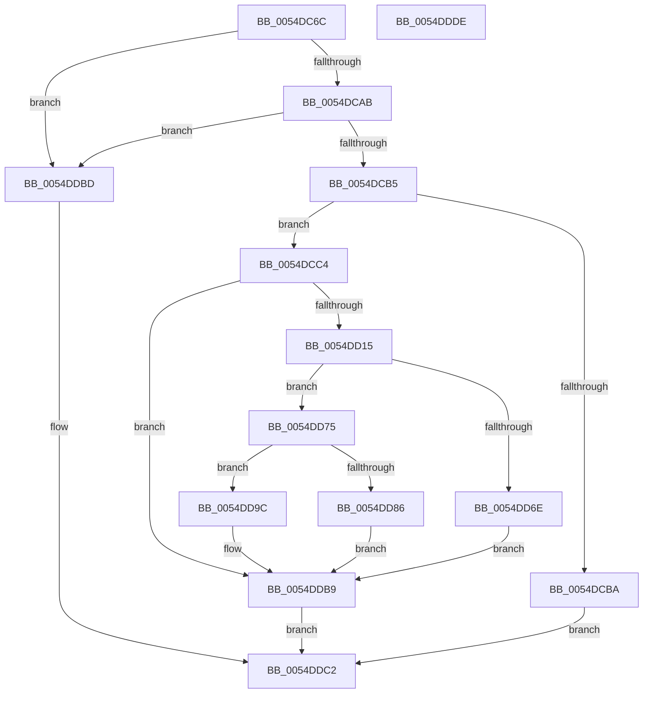

# HalEfiGetTime

- RVA: `0x0054DC6C`–`0x0054DDDF` (길이 `371` bytes)
- VA: `0x000000014054DC6C`
- 실행 섹션: `.text`
- PDB 이름 있음: `예`; PDB Function 태그: `아니요`
- unwind 정보 RVA: `0x000C40C4`
- 디코드: `90`개 명령, `371/371` bytes 표시
- 미해석 바이트: `0` (있으면 어셈블리에 `.byte`로 보존)

> 이 문서는 커널 이미지의 기계어와 PDB 기호를 분석해 생성했습니다. 4번과 5번은 함수 원형과 자료형을 바이너리 사용 방식에서 추정한 C 해석이며 원본 소스 복구 결과는 아닙니다.

## 1. Dependencies

- 직접 호출 지점: **8**; 고유 호출 대상: **8**
- 직접 호출자로 확인된 함수: **1**
- RIP 상대 이미지 참조: **3**

### Outgoing calls
- `0x0054DCCB` → [HalpEfiIncrementEfiCall](../46/HalpEfiIncrementEfiCall_function_00467738.md) (function, `0x00467738`)
- `0x0054DCD5` → [HalpEfiStartRuntimeCode](../44/HalpEfiStartRuntimeCode_function_00449714.md) (function, `0x00449714`)
- `0x0054DCDE` → [HalpCallEfiGetTime](HalpCallEfiGetTime_function_0054E164.md) (function, `0x0054E164`)
- `0x0054DCFE` → [HalpEfiDecrementEfiCall](../49/HalpEfiDecrementEfiCall_function_00491DC0.md) (function, `0x00491DC0`)
- `0x0054DD06` → [HalpConvertEfiToNtStatus](../44/HalpConvertEfiToNtStatus_function_0044976C.md) (function, `0x0044976C`)
- `0x0054DD65` → [RtlpTimeFieldsToTime](../42/RtlpTimeFieldsToTime_function_0042E6C8.md) (function, `0x0042E6C8`)
- `0x0054DD9C` → [PsGetCurrentServerSiloGlobals](../2F/PsGetCurrentServerSiloGlobals_function_002FE1F0.md) (function, `0x002FE1F0`)
- `0x0054DDC9` → [_security_check_cookie](../6A/_security_check_cookie_function_006AC640.md) (function, `0x006AC640`)

### Direct callers
- [sub_006EE4C2](../6E/Unknown_function_006EE4C2.md) at `0x006EE528`
- [sub_006EE4C2](../6E/Unknown_function_006EE4C2.md) at `0x006EE552`

### Static image references
- `0x0054DC7E` → RVA `0x00E0A740` (`.data`; read)
- `0x0054DC94` → RVA `0x01200010` (`CFGRO`; read)
- `0x0054DCC4` → RVA `0x00FC1C28` (`.data`; read)

## 2. Other-region calls and transfers

- 다른 실행 섹션으로 향하는 call: **0**
- 별도 외부 분기/꼬리 이동을 확인하지 못했습니다.

## 3. Assembly (complete function range)

```asm
0054DC6C  48 89 5C 24 10                  mov qword ptr [rsp + 0x10], rbx
0054DC71  48 89 7C 24 18                  mov qword ptr [rsp + 0x18], rdi
0054DC76  55                              push rbp
0054DC77  48 8B EC                        mov rbp, rsp
0054DC7A  48 83 EC 50                     sub rsp, 0x50
0054DC7E  48 8B 05 BB CA 8B 00            mov rax, qword ptr [rip + 0x8bcabb]
0054DC85  48 33 C4                        xor rax, rsp
0054DC88  48 89 45 F8                     mov qword ptr [rbp - 8], rax
0054DC8C  48 83 65 E0 00                  and qword ptr [rbp - 0x20], 0
0054DC91  0F 57 C0                        xorps xmm0, xmm0
0054DC94  48 8B 05 75 23 CB 00            mov rax, qword ptr [rip + 0xcb2375]
0054DC9B  48 8B D9                        mov rbx, rcx
0054DC9E  0F 11 45 E8                     movups xmmword ptr [rbp - 0x18], xmm0
0054DCA2  48 85 C0                        test rax, rax
0054DCA5  0F 84 12 01 00 00               je 0x14054ddbd
0054DCAB  48 83 38 00                     cmp qword ptr [rax], 0
0054DCAF  0F 84 08 01 00 00               je 0x14054ddbd
0054DCB5  48 85 C9                        test rcx, rcx
0054DCB8  75 0A                           jne 0x14054dcc4
0054DCBA  B8 0D 00 00 C0                  mov eax, 0xc000000d
0054DCBF  E9 FE 00 00 00                  jmp 0x14054ddc2
0054DCC4  48 8D 0D 5D 3F A7 00            lea rcx, [rip + 0xa73f5d]
0054DCCB  E8 68 9A F1 FF                  call 0x140467738
0054DCD0  B9 01 00 00 00                  mov ecx, 1
0054DCD5  E8 3A BA EF FF                  call 0x140449714
0054DCDA  48 8D 4D E8                     lea rcx, [rbp - 0x18]
0054DCDE  E8 81 04 00 00                  call 0x14054e164
0054DCE3  65 48 8B 14 25 18 00 00 00      mov rdx, qword ptr gs:[0x18]
0054DCEC  4C 8B C0                        mov r8, rax
0054DCEF  F0 83 A2 E0 00 00 00 FE         lock and dword ptr [rdx + 0xe0], 0xfffffffe
0054DCF7  48 8D 0D 2A 3F A7 00            lea rcx, [rip + 0xa73f2a]
0054DCFE  E8 BD 40 F4 FF                  call 0x140491dc0
0054DD03  49 8B C8                        mov rcx, r8
0054DD06  E8 61 BA EF FF                  call 0x14044976c
0054DD0B  8B F8                           mov edi, eax
0054DD0D  85 C0                           test eax, eax
0054DD0F  0F 88 A4 00 00 00               js 0x14054ddb9
0054DD15  0F B7 4D E8                     movzx ecx, word ptr [rbp - 0x18]
0054DD19  B8 83 DE 1B 43                  mov eax, 0x431bde83
0054DD1E  F7 65 F0                        mul dword ptr [rbp - 0x10]
0054DD21  66 89 4D D0                     mov word ptr [rbp - 0x30], cx
0054DD25  B8 07 00 00 00                  mov eax, 7
0054DD2A  0F B6 4D EA                     movzx ecx, byte ptr [rbp - 0x16]
0054DD2E  66 89 4D D2                     mov word ptr [rbp - 0x2e], cx
0054DD32  0F B6 4D EB                     movzx ecx, byte ptr [rbp - 0x15]
0054DD36  66 89 4D D4                     mov word ptr [rbp - 0x2c], cx
0054DD3A  0F B6 4D EC                     movzx ecx, byte ptr [rbp - 0x14]
0054DD3E  66 89 4D D6                     mov word ptr [rbp - 0x2a], cx
0054DD42  0F B6 4D ED                     movzx ecx, byte ptr [rbp - 0x13]
0054DD46  66 89 4D D8                     mov word ptr [rbp - 0x28], cx
0054DD4A  0F B6 4D EE                     movzx ecx, byte ptr [rbp - 0x12]
0054DD4E  C1 EA 12                        shr edx, 0x12
0054DD51  66 89 4D DA                     mov word ptr [rbp - 0x26], cx
0054DD55  48 8D 4D D0                     lea rcx, [rbp - 0x30]
0054DD59  66 89 55 DC                     mov word ptr [rbp - 0x24], dx
0054DD5D  48 8D 55 E0                     lea rdx, [rbp - 0x20]
0054DD61  66 89 45 DE                     mov word ptr [rbp - 0x22], ax
0054DD65  E8 5E 09 EE FF                  call 0x14042e6c8
0054DD6A  84 C0                           test al, al
0054DD6C  75 07                           jne 0x14054dd75
0054DD6E  BF 01 00 00 C0                  mov edi, 0xc0000001
0054DD73  EB 44                           jmp 0x14054ddb9
0054DD75  0F BF 4D F4                     movsx ecx, word ptr [rbp - 0xc]
0054DD79  8D 81 A0 05 00 00               lea eax, [rcx + 0x5a0]
0054DD7F  3D 40 0B 00 00                  cmp eax, 0xb40
0054DD84  77 16                           ja 0x14054dd9c
0054DD86  6B C1 3C                        imul eax, ecx, 0x3c
0054DD89  48 63 C8                        movsxd rcx, eax
0054DD8C  48 69 C1 80 96 98 00            imul rax, rcx, 0x989680
0054DD93  48 03 45 E0                     add rax, qword ptr [rbp - 0x20]
0054DD97  48 89 03                        mov qword ptr [rbx], rax
0054DD9A  EB 1D                           jmp 0x14054ddb9
0054DD9C  E8 4F 04 DB FF                  call 0x1402fe1f0
0054DDA1  48 8B 88 C8 04 00 00            mov rcx, qword ptr [rax + 0x4c8]
0054DDA8  48 8B 91 B8 01 00 00            mov rdx, qword ptr [rcx + 0x1b8]
0054DDAF  48 8B 4D E0                     mov rcx, qword ptr [rbp - 0x20]
0054DDB3  48 03 CA                        add rcx, rdx
0054DDB6  48 89 0B                        mov qword ptr [rbx], rcx
0054DDB9  8B C7                           mov eax, edi
0054DDBB  EB 05                           jmp 0x14054ddc2
0054DDBD  B8 02 00 00 C0                  mov eax, 0xc0000002
0054DDC2  48 8B 4D F8                     mov rcx, qword ptr [rbp - 8]
0054DDC6  48 33 CC                        xor rcx, rsp
0054DDC9  E8 72 E8 15 00                  call 0x1406ac640
0054DDCE  48 8B 5C 24 68                  mov rbx, qword ptr [rsp + 0x68]
0054DDD3  48 8B 7C 24 70                  mov rdi, qword ptr [rsp + 0x70]
0054DDD8  48 83 C4 50                     add rsp, 0x50
0054DDDC  5D                              pop rbp
0054DDDD  C3                              ret
0054DDDE  CC                              int3
```

## 4. C-style interpretation (structured pseudocode)

```c
__int64 __fastcall HalEfiGetTime(__int64 a1)
{
    __int64 result;
    __int64 v_rsp;
    unsigned __int64 v_stack_m10;
    unsigned __int16 v_stack_m14;
    unsigned int v_stack_m18;
    unsigned __int8 v_stack_m1A;
    unsigned __int8 v_stack_m1B;
    unsigned __int8 v_stack_m1C;
    unsigned __int8 v_stack_m1D;
    unsigned __int8 v_stack_m1E;
    unsigned __int64 v_stack_m20;
    unsigned __int64 v_stack_m28;
    unsigned __int16 v_stack_m2A;
    unsigned __int16 v_stack_m2C;
    unsigned __int16 v_stack_m2E;
    unsigned __int16 v_stack_m30;
    unsigned __int16 v_stack_m32;
    unsigned __int16 v_stack_m34;
    unsigned __int16 v_stack_m36;
    unsigned __int16 v_stack_m38;
    unsigned __int64 v_stack_p10;
    unsigned __int64 v_stack_p18;

    v_stack_p10 = v_rbx;
    v_stack_p18 = v_rdi;
    v_rsp = (v_rsp) - (80);
    result = (*(unsigned __int64 *)(v_rip + 9161403)) ^ (v_rsp);
    v_stack_m10 = result;
    v_stack_m20 = v_xmm0;
    if (*(unsigned __int64 *)(v_rip + 13312885) == 0) goto loc_0054DDBD;
    if ((*(unsigned __int64 *)(*(unsigned __int64 *)(v_rip + 13312885))) == 0) goto loc_0054DDBD;
    if (a1 != 0) goto loc_0054DCC4;
    goto loc_0054DDC2;
loc_0054DCC4:
    result = HalpEfiIncrementEfiCall(v_rip + 10960733, a2, a3, a4);
    result = HalpEfiStartRuntimeCode(1, a2, a3, a4);
    result = HalpCallEfiGetTime(v_stack_m20, a2, a3, a4);
    result = HalpEfiDecrementEfiCall(v_rip + 10960682, *(unsigned __int64 *)(gs_base + (0 + 24)), result, a4);
    result = HalpConvertEfiToNtStatus(result, *(unsigned __int64 *)(gs_base + (0 + 24)), result, a4);
    if (sign_flag) goto loc_0054DDB9;
    v_stack_m38 = (unsigned __int16)(v_stack_m20);
    v_stack_m36 = (unsigned __int16)(v_stack_m1E);
    v_stack_m34 = (unsigned __int16)(v_stack_m1D);
    v_stack_m32 = (unsigned __int16)(v_stack_m1C);
    v_stack_m30 = (unsigned __int16)(v_stack_m1B);
    a2 = (unsigned int)((*(unsigned __int64 *)(gs_base + (0 + 24))) >> (18));
    v_stack_m2E = (unsigned __int16)(v_stack_m1A);
    v_stack_m2C = (unsigned __int16)(a2);
    v_stack_m2A = 7;
    result = RtlpTimeFieldsToTime(v_stack_m38, v_stack_m28, result, a4);
    if ((unsigned __int8)(result) != 0) goto loc_0054DD75;
    goto loc_0054DDB9;
loc_0054DD75:
    if (((unsigned int)((__int16)(v_stack_m14) + 1440)) > 0xB40ULL) goto loc_0054DD9C;
    result = (unsigned int)(((__int16)(v_stack_m14) + 1440) * ((unsigned int)((__int16)(v_stack_m14))));
    result = (result) * ((int)((unsigned int)(result)));
    result = (result) + (v_stack_m28);
    *(unsigned __int64 *)(a1) = result;
    goto loc_0054DDB9;
loc_0054DD9C:
    result = PsGetCurrentServerSiloGlobals((int)((unsigned int)(result)), v_stack_m28, result, a4);
    a1 = (v_stack_m28) + (*(unsigned __int64 *)(*(unsigned __int64 *)(result + 1224) + 440));
    *(unsigned __int64 *)(a1) = a1;
loc_0054DDB9:
    goto loc_0054DDC2;
loc_0054DDBD:
loc_0054DDC2:
    a1 = (v_stack_m10) ^ (v_rsp);
    result = _security_check_cookie(a1, *(unsigned __int64 *)(*(unsigned __int64 *)(result + 1224) + 440), result, a4);
    v_rsp = (v_rsp) + (80);
    return result;
}
```

## 5. (Beta) C Style

```c
int64_t HalEfiGetTime(void *Arg1)
{
    uint8_t *arg1 = (uint8_t *)Arg1;

    int64_t result;
    int64_t local_rsp;
    uint64_t v_stack_m10;
    uint16_t v_stack_m14;
    uint32_t v_stack_m18;
    uint8_t v_stack_m1A;
    uint8_t v_stack_m1B;
    uint8_t v_stack_m1C;
    uint8_t v_stack_m1D;
    uint8_t v_stack_m1E;
    uint64_t v_stack_m20;
    uint64_t v_stack_m28;
    uint16_t v_stack_m2A;
    uint16_t v_stack_m2C;
    uint16_t v_stack_m2E;
    uint16_t v_stack_m30;
    uint16_t v_stack_m32;
    uint16_t v_stack_m34;
    uint16_t v_stack_m36;
    uint16_t v_stack_m38;
    uint64_t v_stack_p10;
    uint64_t v_stack_p18;

    v_stack_p10 = local_rbx;
    v_stack_p18 = local_rdi;
    local_rsp = (local_rsp) - (80);
    result = (*(uint64_t *)(v_rip + 0x8BCABB)) ^ (local_rsp);
    v_stack_m10 = result;
    v_stack_m20 = v_xmm0;
    if (*(uint64_t *)(v_rip + 0xCB2375) == 0) goto loc_0054DDBD;
    if ((*(uint64_t *)(*(uint64_t *)(v_rip + 0xCB2375))) == 0) goto loc_0054DDBD;
    if (Arg1 != NULL) goto loc_0054DCC4;
    goto loc_0054DDC2;
loc_0054DCC4:
    result = HalpEfiIncrementEfiCall(v_rip + 10960733, a2, a3, a4);
    result = HalpEfiStartRuntimeCode(1, a2, a3, a4);
    result = HalpCallEfiGetTime(v_stack_m20, a2, a3, a4);
    result = HalpEfiDecrementEfiCall(v_rip + 10960682, *(uint64_t *)(gs_base + (0 + 0x18)), result, a4);
    result = HalpConvertEfiToNtStatus(result, *(uint64_t *)(gs_base + (0 + 0x18)), result, a4);
    if (sign_flag) goto loc_0054DDB9;
    v_stack_m38 = (uint16_t)(v_stack_m20);
    v_stack_m36 = (uint16_t)(v_stack_m1E);
    v_stack_m34 = (uint16_t)(v_stack_m1D);
    v_stack_m32 = (uint16_t)(v_stack_m1C);
    v_stack_m30 = (uint16_t)(v_stack_m1B);
    a2 = (uint32_t)((*(uint64_t *)(gs_base + (0 + 0x18))) >> (18));
    v_stack_m2E = (uint16_t)(v_stack_m1A);
    v_stack_m2C = (uint16_t)(a2);
    v_stack_m2A = 7;
    result = RtlpTimeFieldsToTime(v_stack_m38, v_stack_m28, result, a4);
    if ((uint8_t)(result) != 0) goto loc_0054DD75;
    goto loc_0054DDB9;
loc_0054DD75:
    if (((uint32_t)((int16_t)(v_stack_m14) + 1440)) > 0xB40ULL) goto loc_0054DD9C;
    result = (uint32_t)(((int16_t)(v_stack_m14) + 1440) * ((uint32_t)((int16_t)(v_stack_m14))));
    result = (result) * ((int32_t)((uint32_t)(result)));
    result = (result) + (v_stack_m28);
    *(uint64_t *)(arg1) = result;
    goto loc_0054DDB9;
loc_0054DD9C:
    result = PsGetCurrentServerSiloGlobals((int32_t)((uint32_t)(result)), v_stack_m28, result, a4);
    Arg1 = (v_stack_m28) + (*(uint64_t *)(*(uint64_t *)(result + 0x4C8) + 0x1B8));
    *(void **)(arg1) = Arg1;
loc_0054DDB9:
    goto loc_0054DDC2;
loc_0054DDBD:
loc_0054DDC2:
    Arg1 = (v_stack_m10) ^ (local_rsp);
    result = _security_check_cookie(Arg1, *(uint64_t *)(*(uint64_t *)(result + 0x4C8) + 0x1B8), result, a4);
    local_rsp = (local_rsp) + (80);
    return result;
}
```

### 관측된 메모리 오프셋

구조체 형식이 확인되지 않은 접근은 인자 기준의 오프셋으로만 기록했습니다.

| 기준 인자 | 오프셋 표현 | 폭 (bit) | 접근 |
|---|---:|---:|---|
| `Arg1` | `+ 0x0` | `64` | `W` |

## 6. Execution-region graph

[열기: 2D/3D 그래프와 함수 탐색 컨트롤 패널](../../../control-panel.html?section=text&rva=0x0054DC6C&view=graph)

- 2D 그래프는 위에서 아래로 흐르고, 3D 그래프는 빈 공간을 드래그해 회전합니다. Shift+드래그는 이동, 휠은 확대·축소, 함수 노드 선택은 대상 보고서 이동입니다.

### Static fallback


