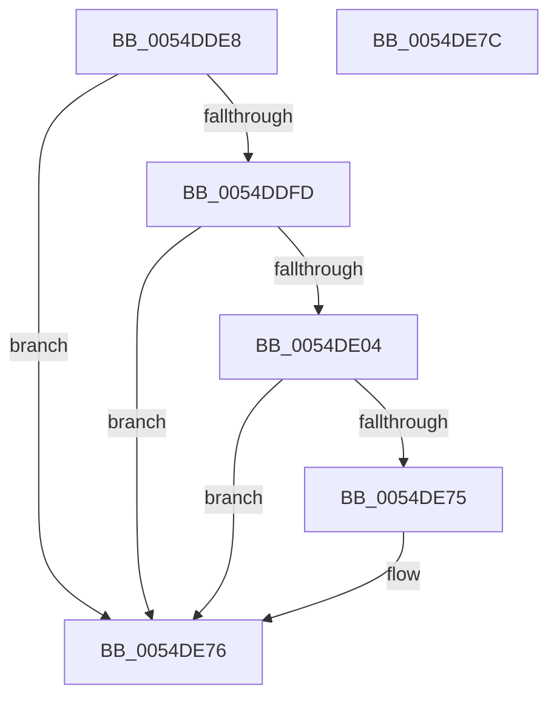

# HalEfiResetSystem

- RVA: `0x0054DDE8`–`0x0054DE7D` (길이 `149` bytes)
- VA: `0x000000014054DDE8`
- 실행 섹션: `.text`
- PDB 이름 있음: `예`; PDB Function 태그: `아니요`
- unwind 정보 RVA: `0x0005CF00`
- 디코드: `37`개 명령, `149/149` bytes 표시
- 미해석 바이트: `0` (있으면 어셈블리에 `.byte`로 보존)

> 이 문서는 커널 이미지의 기계어와 PDB 기호를 분석해 생성했습니다. 4번과 5번은 함수 원형과 자료형을 바이너리 사용 방식에서 추정한 C 해석이며 원본 소스 복구 결과는 아닙니다.

## 1. Dependencies

- 직접 호출 지점: **7**; 고유 호출 대상: **5**
- 직접 호출자로 확인된 함수: **2**
- RIP 상대 이미지 참조: **3**

### Outgoing calls
- `0x0054DE04` → [HalpDisableInterrupts](../25/HalpDisableInterrupts_function_002521A0.md) (function, `0x002521A0`)
- `0x0054DE12` → [HalpEfiIncrementEfiCall](../46/HalpEfiIncrementEfiCall_function_00467738.md) (function, `0x00467738`)
- `0x0054DE1E` → [HalpEfiIncrementEfiCall](../46/HalpEfiIncrementEfiCall_function_00467738.md) (function, `0x00467738`)
- `0x0054DE28` → [HalpEfiStartRuntimeCode](../44/HalpEfiStartRuntimeCode_function_00449714.md) (function, `0x00449714`)
- `0x0054DE43` → `indirect target` (indirect, 간접 대상)
- `0x0054DE60` → [HalpEfiDecrementEfiCall](../49/HalpEfiDecrementEfiCall_function_00491DC0.md) (function, `0x00491DC0`)
- `0x0054DE6C` → [HalpEfiDecrementEfiCall](../49/HalpEfiDecrementEfiCall_function_00491DC0.md) (function, `0x00491DC0`)

### Direct callers
- [HalpPowerWriteResetCommand](HalpPowerWriteResetCommand_function_00546744.md) at `0x00546850`
- [HalpPowerWriteResetCommand](HalpPowerWriteResetCommand_function_00546744.md) at `0x00546857`
- [HalpShutdown](HalpShutdown_function_005469AC.md) at `0x00546B79`

### Static image references
- `0x0054DDEE` → RVA `0x01200010` (`CFGRO`; read)
- `0x0054DE09` → RVA `0x00FC1C38` (`.data`; read)
- `0x0054DE17` → RVA `0x00FC1C24` (`.data`; read)

## 2. Other-region calls and transfers

- 다른 실행 섹션으로 향하는 call: **0**
- 별도 외부 분기/꼬리 이동을 확인하지 못했습니다.

## 3. Assembly (complete function range)

```asm
0054DDE8  40 53                           push rbx
0054DDEA  48 83 EC 20                     sub rsp, 0x20
0054DDEE  48 8B 05 1B 22 CB 00            mov rax, qword ptr [rip + 0xcb221b]
0054DDF5  44 8B D1                        mov r10d, ecx
0054DDF8  48 85 C0                        test rax, rax
0054DDFB  74 79                           je 0x14054de76
0054DDFD  48 83 78 10 00                  cmp qword ptr [rax + 0x10], 0
0054DE02  74 72                           je 0x14054de76
0054DE04  E8 97 43 D0 FF                  call 0x1402521a0
0054DE09  48 8D 0D 28 3E A7 00            lea rcx, [rip + 0xa73e28]
0054DE10  8A D8                           mov bl, al
0054DE12  E8 21 99 F1 FF                  call 0x140467738
0054DE17  48 8D 0D 06 3E A7 00            lea rcx, [rip + 0xa73e06]
0054DE1E  E8 15 99 F1 FF                  call 0x140467738
0054DE23  B9 04 00 00 00                  mov ecx, 4
0054DE28  E8 E7 B8 EF FF                  call 0x140449714
0054DE2D  48 8B 05 DC 21 CB 00            mov rax, qword ptr [rip + 0xcb21dc]
0054DE34  45 33 C9                        xor r9d, r9d
0054DE37  45 33 C0                        xor r8d, r8d
0054DE3A  33 D2                           xor edx, edx
0054DE3C  41 8B CA                        mov ecx, r10d
0054DE3F  48 8B 40 10                     mov rax, qword ptr [rax + 0x10]
0054DE43  FF D0                           call rax
0054DE45  0F 1F 00                        nop dword ptr [rax]
0054DE48  65 48 8B 04 25 18 00 00 00      mov rax, qword ptr gs:[0x18]
0054DE51  F0 83 A0 E0 00 00 00 FB         lock and dword ptr [rax + 0xe0], 0xfffffffb
0054DE59  48 8D 0D C4 3D A7 00            lea rcx, [rip + 0xa73dc4]
0054DE60  E8 5B 3F F4 FF                  call 0x140491dc0
0054DE65  48 8D 0D CC 3D A7 00            lea rcx, [rip + 0xa73dcc]
0054DE6C  E8 4F 3F F4 FF                  call 0x140491dc0
0054DE71  84 DB                           test bl, bl
0054DE73  74 01                           je 0x14054de76
0054DE75  FB                              sti
0054DE76  48 83 C4 20                     add rsp, 0x20
0054DE7A  5B                              pop rbx
0054DE7B  C3                              ret
0054DE7C  CC                              int3
```

## 4. C-style interpretation (structured pseudocode)

```c
__int64 __fastcall HalEfiResetSystem(int a1, int a2, int a3, int a4)
{
    __int64 result;
    __int64 v_rsp;

    v_rsp = (v_rsp) - (32);
    if (*(unsigned __int64 *)(v_rip + 13312539) == 0) goto loc_0054DE76;
    if ((*(unsigned __int64 *)(*(unsigned __int64 *)(v_rip + 13312539) + 16)) == 0) goto loc_0054DE76;
    result = HalpDisableInterrupts(a1, a2, a3, a4);
    result = HalpEfiIncrementEfiCall(v_rip + 10960424, a2, a3, a4);
    result = HalpEfiIncrementEfiCall(v_rip + 10960390, a2, a3, a4);
    result = HalpEfiStartRuntimeCode(4, a2, a3, a4);
    a4 = 0;
    a3 = 0;
    a2 = 0;
    result = kernel_indirect_call((unsigned int)((unsigned int)((unsigned int)(a1))), a2, a3, a4);
    result = HalpEfiDecrementEfiCall(v_rip + 10960324, a2, a3, a4);
    result = HalpEfiDecrementEfiCall(v_rip + 10960332, a2, a3, a4);
    if ((unsigned __int8)((unsigned __int8)(result)) != 0) {
    }
    v_rsp = (v_rsp) + (32);
    return result;
}
```

## 5. (Beta) C Style

```c
int64_t HalEfiResetSystem(int32_t Arg1, int32_t Arg2, int32_t Arg3, int32_t Arg4)
{
    int64_t result;
    int64_t local_rsp;

    local_rsp = (local_rsp) - (32);
    if (*(uint64_t *)(v_rip + 0xCB221B) == 0) goto loc_0054DE76;
    if ((*(uint64_t *)(*(uint64_t *)(v_rip + 0xCB221B) + 0x10)) == 0) goto loc_0054DE76;
    result = HalpDisableInterrupts(Arg1, Arg2, Arg3, Arg4);
    result = HalpEfiIncrementEfiCall(v_rip + 10960424, Arg2, Arg3, Arg4);
    result = HalpEfiIncrementEfiCall(v_rip + 10960390, Arg2, Arg3, Arg4);
    result = HalpEfiStartRuntimeCode(4, Arg2, Arg3, Arg4);
    Arg4 = 0;
    Arg3 = 0;
    Arg2 = 0;
    result = kernel_indirect_call((uint32_t)((uint32_t)((uint32_t)(Arg1))), Arg2, Arg3, Arg4);
    result = HalpEfiDecrementEfiCall(v_rip + 10960324, Arg2, Arg3, Arg4);
    result = HalpEfiDecrementEfiCall(v_rip + 10960332, Arg2, Arg3, Arg4);
    if ((uint8_t)((uint8_t)(result)) != 0) {
    }
    local_rsp = (local_rsp) + (32);
    return result;
}
```

## 6. Execution-region graph

[열기: 2D/3D 그래프와 함수 탐색 컨트롤 패널](../../../control-panel.html?section=text&rva=0x0054DDE8&view=graph)

- 2D 그래프는 위에서 아래로 흐르고, 3D 그래프는 빈 공간을 드래그해 회전합니다. Shift+드래그는 이동, 휠은 확대·축소, 함수 노드 선택은 대상 보고서 이동입니다.

### Static fallback


