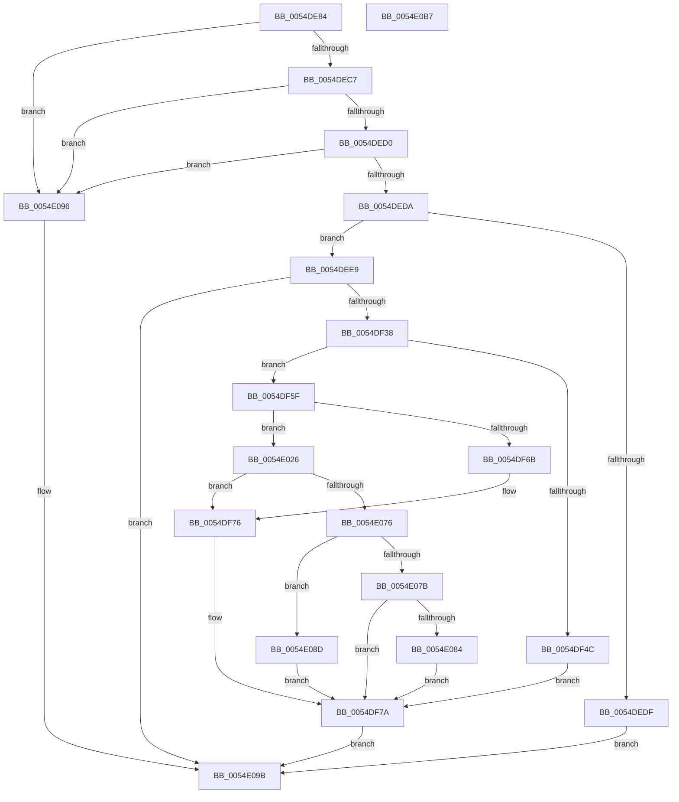

# HalEfiSetTime

- RVA: `0x0054DE84`–`0x0054E0B8` (길이 `564` bytes)
- VA: `0x000000014054DE84`
- 실행 섹션: `.text`
- PDB 이름 있음: `예`; PDB Function 태그: `아니요`
- unwind 정보 RVA: `0x000C40C4`
- 디코드: `127`개 명령, `564/564` bytes 표시
- 미해석 바이트: `0` (있으면 어셈블리에 `.byte`로 보존)

> 이 문서는 커널 이미지의 기계어와 PDB 기호를 분석해 생성했습니다. 4번과 5번은 함수 원형과 자료형을 바이너리 사용 방식에서 추정한 C 해석이며 원본 소스 복구 결과는 아닙니다.

## 1. Dependencies

- 직접 호출 지점: **15**; 고유 호출 대상: **9**
- 직접 호출자로 확인된 함수: **1**
- RIP 상대 이미지 참조: **5**

### Outgoing calls
- `0x0054DEF0` → [HalpEfiIncrementEfiCall](../46/HalpEfiIncrementEfiCall_function_00467738.md) (function, `0x00467738`)
- `0x0054DEFA` → [HalpEfiStartRuntimeCode](../44/HalpEfiStartRuntimeCode_function_00449714.md) (function, `0x00449714`)
- `0x0054DF03` → [HalpCallEfiGetTime](HalpCallEfiGetTime_function_0054E164.md) (function, `0x0054E164`)
- `0x0054DF23` → [HalpEfiDecrementEfiCall](../49/HalpEfiDecrementEfiCall_function_00491DC0.md) (function, `0x00491DC0`)
- `0x0054DF2B` → [HalpConvertEfiToNtStatus](../44/HalpConvertEfiToNtStatus_function_0044976C.md) (function, `0x0044976C`)
- `0x0054DF82` → [RtlpTimeToTimeFields](../42/RtlpTimeToTimeFields_function_0042E110.md) (function, `0x0042E110`)
- `0x0054DFC1` → [HalpEfiIncrementEfiCall](../46/HalpEfiIncrementEfiCall_function_00467738.md) (function, `0x00467738`)
- `0x0054DFCD` → [HalpEfiIncrementEfiCall](../46/HalpEfiIncrementEfiCall_function_00467738.md) (function, `0x00467738`)
- `0x0054DFD7` → [HalpEfiStartRuntimeCode](../44/HalpEfiStartRuntimeCode_function_00449714.md) (function, `0x00449714`)
- `0x0054DFEB` → `indirect target` (indirect, 간접 대상)
- `0x0054E00B` → [HalpEfiDecrementEfiCall](../49/HalpEfiDecrementEfiCall_function_00491DC0.md) (function, `0x00491DC0`)
- `0x0054E017` → [HalpEfiDecrementEfiCall](../49/HalpEfiDecrementEfiCall_function_00491DC0.md) (function, `0x00491DC0`)
- `0x0054E01F` → [HalpConvertEfiToNtStatus](../44/HalpConvertEfiToNtStatus_function_0044976C.md) (function, `0x0044976C`)
- `0x0054E048` → [PsGetCurrentServerSiloGlobals](../2F/PsGetCurrentServerSiloGlobals_function_002FE1F0.md) (function, `0x002FE1F0`)
- `0x0054E0A2` → [_security_check_cookie](../6A/_security_check_cookie_function_006AC640.md) (function, `0x006AC640`)

### Direct callers
- [HalSetRealTimeClock](../42/HalSetRealTimeClock_function_0042D310.md) at `0x0042D3F6`

### Static image references
- `0x0054DE96` → RVA `0x00E0A740` (`.data`; read)
- `0x0054DEA4` → RVA `0x01200010` (`CFGRO`; read)
- `0x0054DEE9` → RVA `0x00FC1C28` (`.data`; read)
- `0x0054DF5F` → RVA `0x00E68570` (`.data`; read)
- `0x0054DFC6` → RVA `0x00FC1C38` (`.data`; read)

## 2. Other-region calls and transfers

- 다른 실행 섹션으로 향하는 call: **0**
- 별도 외부 분기/꼬리 이동을 확인하지 못했습니다.

## 3. Assembly (complete function range)

```asm
0054DE84  48 89 5C 24 10                  mov qword ptr [rsp + 0x10], rbx
0054DE89  48 89 7C 24 18                  mov qword ptr [rsp + 0x18], rdi
0054DE8E  55                              push rbp
0054DE8F  48 8B EC                        mov rbp, rsp
0054DE92  48 83 EC 50                     sub rsp, 0x50
0054DE96  48 8B 05 A3 C8 8B 00            mov rax, qword ptr [rip + 0x8bc8a3]
0054DE9D  48 33 C4                        xor rax, rsp
0054DEA0  48 89 45 F8                     mov qword ptr [rbp - 8], rax
0054DEA4  48 8B 05 65 21 CB 00            mov rax, qword ptr [rip + 0xcb2165]
0054DEAB  33 FF                           xor edi, edi
0054DEAD  0F 57 C0                        xorps xmm0, xmm0
0054DEB0  0F 57 C9                        xorps xmm1, xmm1
0054DEB3  48 8B D9                        mov rbx, rcx
0054DEB6  0F 11 45 E8                     movups xmmword ptr [rbp - 0x18], xmm0
0054DEBA  0F 11 4D D0                     movups xmmword ptr [rbp - 0x30], xmm1
0054DEBE  48 85 C0                        test rax, rax
0054DEC1  0F 84 CF 01 00 00               je 0x14054e096
0054DEC7  48 39 38                        cmp qword ptr [rax], rdi
0054DECA  0F 84 C6 01 00 00               je 0x14054e096
0054DED0  48 39 78 08                     cmp qword ptr [rax + 8], rdi
0054DED4  0F 84 BC 01 00 00               je 0x14054e096
0054DEDA  48 85 C9                        test rcx, rcx
0054DEDD  75 0A                           jne 0x14054dee9
0054DEDF  B8 0D 00 00 C0                  mov eax, 0xc000000d
0054DEE4  E9 B2 01 00 00                  jmp 0x14054e09b
0054DEE9  48 8D 0D 38 3D A7 00            lea rcx, [rip + 0xa73d38]
0054DEF0  E8 43 98 F1 FF                  call 0x140467738
0054DEF5  B9 01 00 00 00                  mov ecx, 1
0054DEFA  E8 15 B8 EF FF                  call 0x140449714
0054DEFF  48 8D 4D E8                     lea rcx, [rbp - 0x18]
0054DF03  E8 5C 02 00 00                  call 0x14054e164
0054DF08  65 48 8B 0C 25 18 00 00 00      mov rcx, qword ptr gs:[0x18]
0054DF11  4C 8B C0                        mov r8, rax
0054DF14  F0 83 A1 E0 00 00 00 FE         lock and dword ptr [rcx + 0xe0], 0xfffffffe
0054DF1C  48 8D 0D 05 3D A7 00            lea rcx, [rip + 0xa73d05]
0054DF23  E8 98 3E F4 FF                  call 0x140491dc0
0054DF28  49 8B C8                        mov rcx, r8
0054DF2B  E8 3C B8 EF FF                  call 0x14044976c
0054DF30  85 C0                           test eax, eax
0054DF32  0F 88 63 01 00 00               js 0x14054e09b
0054DF38  48 0F BF 4D F4                  movsx rcx, word ptr [rbp - 0xc]
0054DF3D  48 8D 81 A0 05 00 00            lea rax, [rcx + 0x5a0]
0054DF44  48 3D 40 0B 00 00               cmp rax, 0xb40
0054DF4A  77 13                           ja 0x14054df5f
0054DF4C  48 69 C1 00 46 C3 23            imul rax, rcx, 0x23c34600
0054DF53  48 8B 0B                        mov rcx, qword ptr [rbx]
0054DF56  48 2B C8                        sub rcx, rax
0054DF59  48 89 4D E0                     mov qword ptr [rbp - 0x20], rcx
0054DF5D  EB 1B                           jmp 0x14054df7a
0054DF5F  39 3D 0B A6 91 00               cmp dword ptr [rip + 0x91a60b], edi
0054DF65  0F 84 BB 00 00 00               je 0x14054e026
0054DF6B  48 8B 03                        mov rax, qword ptr [rbx]
0054DF6E  48 89 45 E0                     mov qword ptr [rbp - 0x20], rax
0054DF72  66 89 7D F4                     mov word ptr [rbp - 0xc], di
0054DF76  40 88 7D F6                     mov byte ptr [rbp - 0xa], dil
0054DF7A  48 8D 55 D0                     lea rdx, [rbp - 0x30]
0054DF7E  48 8D 4D E0                     lea rcx, [rbp - 0x20]
0054DF82  E8 89 01 EE FF                  call 0x14042e110
0054DF87  0F B7 45 D0                     movzx eax, word ptr [rbp - 0x30]
0054DF8B  66 89 45 E8                     mov word ptr [rbp - 0x18], ax
0054DF8F  8A 45 D2                        mov al, byte ptr [rbp - 0x2e]
0054DF92  88 45 EA                        mov byte ptr [rbp - 0x16], al
0054DF95  8A 45 D4                        mov al, byte ptr [rbp - 0x2c]
0054DF98  88 45 EB                        mov byte ptr [rbp - 0x15], al
0054DF9B  8A 45 D6                        mov al, byte ptr [rbp - 0x2a]
0054DF9E  88 45 EC                        mov byte ptr [rbp - 0x14], al
0054DFA1  8A 45 D8                        mov al, byte ptr [rbp - 0x28]
0054DFA4  88 45 ED                        mov byte ptr [rbp - 0x13], al
0054DFA7  8A 45 DA                        mov al, byte ptr [rbp - 0x26]
0054DFAA  88 45 EE                        mov byte ptr [rbp - 0x12], al
0054DFAD  0F BF 45 DC                     movsx eax, word ptr [rbp - 0x24]
0054DFB1  69 C8 40 42 0F 00               imul ecx, eax, 0xf4240
0054DFB7  89 4D F0                        mov dword ptr [rbp - 0x10], ecx
0054DFBA  48 8D 0D 67 3C A7 00            lea rcx, [rip + 0xa73c67]
0054DFC1  E8 72 97 F1 FF                  call 0x140467738
0054DFC6  48 8D 0D 6B 3C A7 00            lea rcx, [rip + 0xa73c6b]
0054DFCD  E8 66 97 F1 FF                  call 0x140467738
0054DFD2  B9 02 00 00 00                  mov ecx, 2
0054DFD7  E8 38 B7 EF FF                  call 0x140449714
0054DFDC  48 8B 05 2D 20 CB 00            mov rax, qword ptr [rip + 0xcb202d]
0054DFE3  48 8D 4D E8                     lea rcx, [rbp - 0x18]
0054DFE7  48 8B 40 08                     mov rax, qword ptr [rax + 8]
0054DFEB  FF D0                           call rax
0054DFED  0F 1F 00                        nop dword ptr [rax]
0054DFF0  65 48 8B 14 25 18 00 00 00      mov rdx, qword ptr gs:[0x18]
0054DFF9  4C 8B C0                        mov r8, rax
0054DFFC  F0 83 A2 E0 00 00 00 FD         lock and dword ptr [rdx + 0xe0], 0xfffffffd
0054E004  48 8D 0D 2D 3C A7 00            lea rcx, [rip + 0xa73c2d]
0054E00B  E8 B0 3D F4 FF                  call 0x140491dc0
0054E010  48 8D 0D 11 3C A7 00            lea rcx, [rip + 0xa73c11]
0054E017  E8 A4 3D F4 FF                  call 0x140491dc0
0054E01C  49 8B C8                        mov rcx, r8
0054E01F  E8 48 B7 EF FF                  call 0x14044976c
0054E024  EB 75                           jmp 0x14054e09b
0054E026  48 B9 20 00 00 00 80 F7 FF FF   movabs rcx, 0xfffff78000000020
0054E030  48 B8 A7 BE D7 05 C2 9E 10 E5   movabs rax, 0xe5109ec205d7bea7
0054E03A  48 8B 09                        mov rcx, qword ptr [rcx]
0054E03D  48 F7 E1                        mul rcx
0054E040  48 C1 EA 1D                     shr rdx, 0x1d
0054E044  66 89 55 F4                     mov word ptr [rbp - 0xc], dx
0054E048  E8 A3 01 DB FF                  call 0x1402fe1f0
0054E04D  48 8B 0B                        mov rcx, qword ptr [rbx]
0054E050  48 8B 80 C8 04 00 00            mov rax, qword ptr [rax + 0x4c8]
0054E057  48 2B 88 B8 01 00 00            sub rcx, qword ptr [rax + 0x1b8]
0054E05E  48 89 4D E0                     mov qword ptr [rbp - 0x20], rcx
0054E062  48 B9 40 02 00 00 80 F7 FF FF   movabs rcx, 0xfffff78000000240
0054E06C  8B 09                           mov ecx, dword ptr [rcx]
0054E06E  85 C9                           test ecx, ecx
0054E070  0F 84 00 FF FF FF               je 0x14054df76
0054E076  83 E9 01                        sub ecx, 1
0054E079  74 12                           je 0x14054e08d
0054E07B  83 F9 01                        cmp ecx, 1
0054E07E  0F 85 F6 FE FF FF               jne 0x14054df7a
0054E084  C6 45 F6 03                     mov byte ptr [rbp - 0xa], 3
0054E088  E9 ED FE FF FF                  jmp 0x14054df7a
0054E08D  C6 45 F6 01                     mov byte ptr [rbp - 0xa], 1
0054E091  E9 E4 FE FF FF                  jmp 0x14054df7a
0054E096  B8 02 00 00 C0                  mov eax, 0xc0000002
0054E09B  48 8B 4D F8                     mov rcx, qword ptr [rbp - 8]
0054E09F  48 33 CC                        xor rcx, rsp
0054E0A2  E8 99 E5 15 00                  call 0x1406ac640
0054E0A7  48 8B 5C 24 68                  mov rbx, qword ptr [rsp + 0x68]
0054E0AC  48 8B 7C 24 70                  mov rdi, qword ptr [rsp + 0x70]
0054E0B1  48 83 C4 50                     add rsp, 0x50
0054E0B5  5D                              pop rbp
0054E0B6  C3                              ret
0054E0B7  CC                              int3
```

## 4. C-style interpretation (structured pseudocode)

```c
__int64 __fastcall HalEfiSetTime(__int64 a1)
{
    __int64 result;
    __int64 v_rdi;
    __int64 v_rsp;
    unsigned __int64 v_stack_m10;
    unsigned __int8 v_stack_m12;
    unsigned __int16 v_stack_m14;
    unsigned int v_stack_m18;
    unsigned __int8 v_stack_m1A;
    unsigned __int8 v_stack_m1B;
    unsigned __int8 v_stack_m1C;
    unsigned __int8 v_stack_m1D;
    unsigned __int8 v_stack_m1E;
    unsigned __int64 v_stack_m20;
    unsigned __int64 v_stack_m28;
    unsigned __int16 v_stack_m2C;
    unsigned __int8 v_stack_m2E;
    unsigned __int8 v_stack_m30;
    unsigned __int8 v_stack_m32;
    unsigned __int8 v_stack_m34;
    unsigned __int8 v_stack_m36;
    unsigned __int64 v_stack_m38;
    unsigned __int64 v_stack_p10;
    unsigned __int64 v_stack_p18;

    v_stack_p10 = v_rbx;
    v_stack_p18 = v_rdi;
    v_rsp = (v_rsp) - (80);
    result = (*(unsigned __int64 *)(v_rip + 9160867)) ^ (v_rsp);
    v_stack_m10 = result;
    v_rdi = 0;
    v_stack_m20 = v_xmm0;
    v_stack_m38 = v_xmm1;
    if (*(unsigned __int64 *)(v_rip + 13312357) == 0) goto loc_0054E096;
    if ((*(unsigned __int64 *)(*(unsigned __int64 *)(v_rip + 13312357))) == 0) goto loc_0054E096;
    if ((*(unsigned __int64 *)(*(unsigned __int64 *)(v_rip + 13312357) + 8)) == 0) goto loc_0054E096;
    if (a1 != 0) goto loc_0054DEE9;
    goto loc_0054E09B;
loc_0054DEE9:
    result = HalpEfiIncrementEfiCall(v_rip + 10960184, a2, a3, a4);
    result = HalpEfiStartRuntimeCode(1, a2, a3, a4);
    result = HalpCallEfiGetTime(v_stack_m20, a2, a3, a4);
    result = HalpEfiDecrementEfiCall(v_rip + 10960133, a2, result, a4);
    result = HalpConvertEfiToNtStatus(result, a2, result, a4);
    if (sign_flag) goto loc_0054E09B;
    if (((__int16)(v_stack_m14) + 1440) > 0xB40ULL) goto loc_0054DF5F;
    result = ((__int16)(v_stack_m14) + 1440) * ((__int16)(v_stack_m14));
    a1 = (*(unsigned __int64 *)(a1)) - (result);
    v_stack_m28 = a1;
    goto loc_0054DF7A;
loc_0054DF5F:
    if ((*(unsigned int *)(v_rip + 9545227)) == 0) goto loc_0054E026;
    v_stack_m28 = *(unsigned __int64 *)(a1);
    v_stack_m14 = 0;
loc_0054DF76:
    v_stack_m12 = 0;
loc_0054DF7A:
    result = RtlpTimeToTimeFields(v_stack_m28, v_stack_m38, result, a4);
    v_stack_m20 = (unsigned __int16)(v_stack_m38);
    v_stack_m1E = (unsigned __int8)(v_stack_m36);
    v_stack_m1D = (unsigned __int8)(v_stack_m34);
    v_stack_m1C = (unsigned __int8)(v_stack_m32);
    v_stack_m1B = (unsigned __int8)(v_stack_m30);
    v_stack_m1A = (unsigned __int8)(v_stack_m2E);
    a1 = (unsigned int)((v_stack_m28) * ((unsigned int)((__int16)(v_stack_m2C))));
    v_stack_m18 = (unsigned int)(a1);
    result = HalpEfiIncrementEfiCall(v_rip + 10959975, v_stack_m38, result, a4);
    result = HalpEfiIncrementEfiCall(v_rip + 10959979, v_stack_m38, result, a4);
    result = HalpEfiStartRuntimeCode(2, v_stack_m38, result, a4);
    result = kernel_indirect_call(v_stack_m20, v_stack_m38, result, a4);
    result = HalpEfiDecrementEfiCall(v_rip + 10959917, *(unsigned __int64 *)(gs_base + (0 + 24)), result, a4);
    result = HalpEfiDecrementEfiCall(v_rip + 10959889, *(unsigned __int64 *)(gs_base + (0 + 24)), result, a4);
    result = HalpConvertEfiToNtStatus(result, *(unsigned __int64 *)(gs_base + (0 + 24)), result, a4);
    goto loc_0054E09B;
loc_0054E026:
    a2 = (*(unsigned __int64 *)(gs_base + (0 + 24))) >> (29);
    v_stack_m14 = (unsigned __int16)(a2);
    result = PsGetCurrentServerSiloGlobals(*(unsigned __int64 *)(result), a2, result, a4);
    a1 = (*(unsigned __int64 *)(a1)) - (*(unsigned __int64 *)(*(unsigned __int64 *)(result + 1224) + 440));
    v_stack_m28 = a1;
    if ((unsigned int)((unsigned int)(*(unsigned int *)(a1))) == 0) goto loc_0054DF76;
    a1 = (unsigned int)(((unsigned int)(*(unsigned int *)(a1))) - (1));
    if (condition_is_equal) goto loc_0054E08D;
    if (((unsigned int)(a1)) != 1) goto loc_0054DF7A;
    v_stack_m12 = 3;
    goto loc_0054DF7A;
loc_0054E08D:
    v_stack_m12 = 1;
    goto loc_0054DF7A;
loc_0054E096:
loc_0054E09B:
    a1 = (v_stack_m10) ^ (v_rsp);
    result = _security_check_cookie(a1, a2, result, a4);
    v_rsp = (v_rsp) + (80);
    return result;
}
```

## 5. (Beta) C Style

```c
int64_t HalEfiSetTime(void *Arg1)
{
    uint8_t *arg1 = (uint8_t *)Arg1;

    int64_t result;
    int64_t local_rdi;
    int64_t local_rsp;
    uint64_t v_stack_m10;
    uint8_t v_stack_m12;
    uint16_t v_stack_m14;
    uint32_t v_stack_m18;
    uint8_t v_stack_m1A;
    uint8_t v_stack_m1B;
    uint8_t v_stack_m1C;
    uint8_t v_stack_m1D;
    uint8_t v_stack_m1E;
    uint64_t v_stack_m20;
    uint64_t v_stack_m28;
    uint16_t v_stack_m2C;
    uint8_t v_stack_m2E;
    uint8_t v_stack_m30;
    uint8_t v_stack_m32;
    uint8_t v_stack_m34;
    uint8_t v_stack_m36;
    uint64_t v_stack_m38;
    uint64_t v_stack_p10;
    uint64_t v_stack_p18;

    v_stack_p10 = local_rbx;
    v_stack_p18 = local_rdi;
    local_rsp = (local_rsp) - (80);
    result = (*(uint64_t *)(v_rip + 0x8BC8A3)) ^ (local_rsp);
    v_stack_m10 = result;
    local_rdi = 0;
    v_stack_m20 = v_xmm0;
    v_stack_m38 = v_xmm1;
    if (*(uint64_t *)(v_rip + 0xCB2165) == 0) goto loc_0054E096;
    if ((*(uint64_t *)(*(uint64_t *)(v_rip + 0xCB2165))) == 0) goto loc_0054E096;
    if ((*(uint64_t *)(*(uint64_t *)(v_rip + 0xCB2165) + 0x8)) == 0) goto loc_0054E096;
    if (Arg1 != NULL) goto loc_0054DEE9;
    goto loc_0054E09B;
loc_0054DEE9:
    result = HalpEfiIncrementEfiCall(v_rip + 10960184, a2, a3, a4);
    result = HalpEfiStartRuntimeCode(1, a2, a3, a4);
    result = HalpCallEfiGetTime(v_stack_m20, a2, a3, a4);
    result = HalpEfiDecrementEfiCall(v_rip + 10960133, a2, result, a4);
    result = HalpConvertEfiToNtStatus(result, a2, result, a4);
    if (sign_flag) goto loc_0054E09B;
    if (((int16_t)(v_stack_m14) + 1440) > 0xB40ULL) goto loc_0054DF5F;
    result = ((int16_t)(v_stack_m14) + 1440) * ((int16_t)(v_stack_m14));
    Arg1 = (*(uint64_t *)(arg1)) - (result);
    v_stack_m28 = Arg1;
    goto loc_0054DF7A;
loc_0054DF5F:
    if ((*(uint32_t *)(v_rip + 0x91A60B)) == 0) goto loc_0054E026;
    v_stack_m28 = *(uint64_t *)(arg1);
    v_stack_m14 = 0;
loc_0054DF76:
    v_stack_m12 = 0;
loc_0054DF7A:
    result = RtlpTimeToTimeFields(v_stack_m28, v_stack_m38, result, a4);
    v_stack_m20 = (uint16_t)(v_stack_m38);
    v_stack_m1E = (uint8_t)(v_stack_m36);
    v_stack_m1D = (uint8_t)(v_stack_m34);
    v_stack_m1C = (uint8_t)(v_stack_m32);
    v_stack_m1B = (uint8_t)(v_stack_m30);
    v_stack_m1A = (uint8_t)(v_stack_m2E);
    Arg1 = (uint32_t)((v_stack_m28) * ((uint32_t)((int16_t)(v_stack_m2C))));
    v_stack_m18 = (uint32_t)(Arg1);
    result = HalpEfiIncrementEfiCall(v_rip + 10959975, v_stack_m38, result, a4);
    result = HalpEfiIncrementEfiCall(v_rip + 10959979, v_stack_m38, result, a4);
    result = HalpEfiStartRuntimeCode(2, v_stack_m38, result, a4);
    result = kernel_indirect_call(v_stack_m20, v_stack_m38, result, a4);
    result = HalpEfiDecrementEfiCall(v_rip + 10959917, *(uint64_t *)(gs_base + (0 + 0x18)), result, a4);
    result = HalpEfiDecrementEfiCall(v_rip + 10959889, *(uint64_t *)(gs_base + (0 + 0x18)), result, a4);
    result = HalpConvertEfiToNtStatus(result, *(uint64_t *)(gs_base + (0 + 0x18)), result, a4);
    goto loc_0054E09B;
loc_0054E026:
    a2 = (*(uint64_t *)(gs_base + (0 + 0x18))) >> (29);
    v_stack_m14 = (uint16_t)(a2);
    result = PsGetCurrentServerSiloGlobals(*(uint64_t *)(result), a2, result, a4);
    Arg1 = (*(uint64_t *)(arg1)) - (*(uint64_t *)(*(uint64_t *)(result + 0x4C8) + 0x1B8));
    v_stack_m28 = Arg1;
    if ((uint32_t)((uint32_t)(*(uint32_t *)(arg1))) == 0) goto loc_0054DF76;
    Arg1 = (uint32_t)(((uint32_t)(*(uint32_t *)(arg1))) - (1));
    if (condition_is_equal) goto loc_0054E08D;
    if (((uint32_t)(Arg1)) != 1) goto loc_0054DF7A;
    v_stack_m12 = 3;
    goto loc_0054DF7A;
loc_0054E08D:
    v_stack_m12 = 1;
    goto loc_0054DF7A;
loc_0054E096:
loc_0054E09B:
    Arg1 = (v_stack_m10) ^ (local_rsp);
    result = _security_check_cookie(Arg1, a2, result, a4);
    local_rsp = (local_rsp) + (80);
    return result;
}
```

### 관측된 메모리 오프셋

구조체 형식이 확인되지 않은 접근은 인자 기준의 오프셋으로만 기록했습니다.

| 기준 인자 | 오프셋 표현 | 폭 (bit) | 접근 |
|---|---:|---:|---|
| `Arg1` | `+ 0x0` | `64` | `R` |

## 6. Execution-region graph

[열기: 2D/3D 그래프와 함수 탐색 컨트롤 패널](../../../control-panel.html?section=text&rva=0x0054DE84&view=graph)

- 2D 그래프는 위에서 아래로 흐르고, 3D 그래프는 빈 공간을 드래그해 회전합니다. Shift+드래그는 이동, 휠은 확대·축소, 함수 노드 선택은 대상 보고서 이동입니다.

### Static fallback


