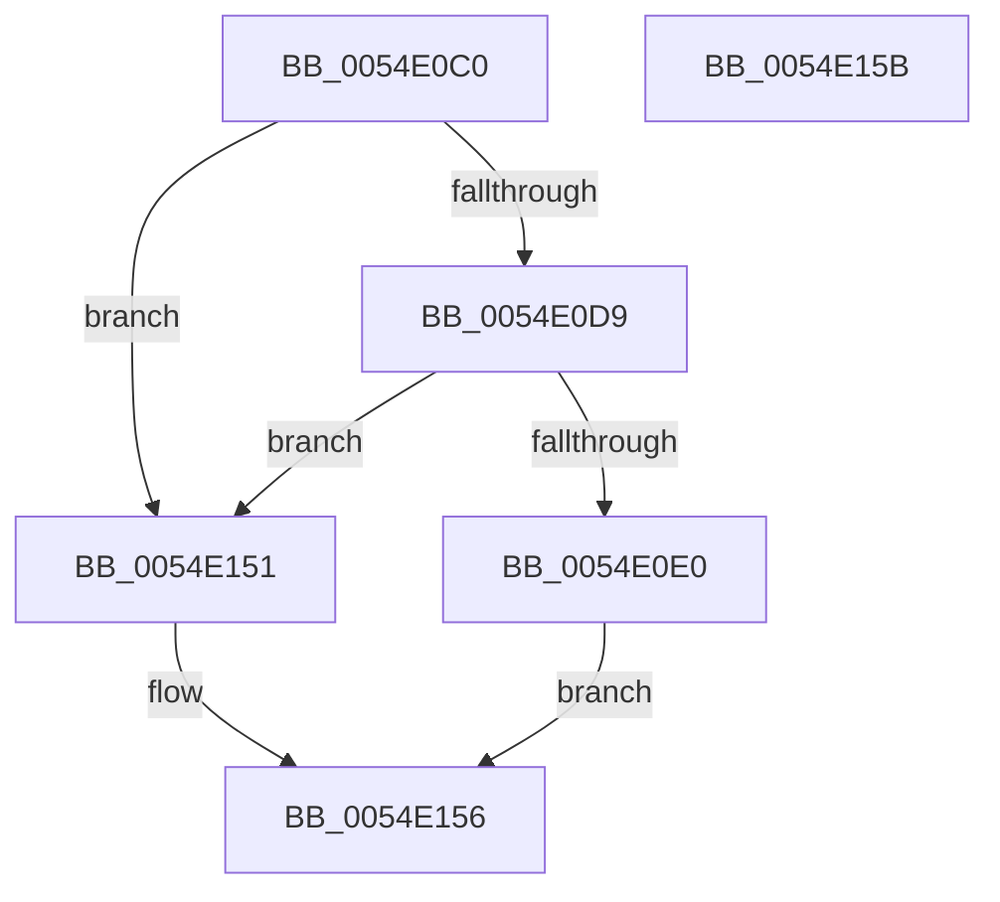

# HalEfiUpdateCapsule

- RVA: `0x0054E0C0`–`0x0054E15C` (길이 `156` bytes)
- VA: `0x000000014054E0C0`
- 실행 섹션: `.text`
- PDB 이름 있음: `예`; PDB Function 태그: `아니요`
- unwind 정보 RVA: `0x0005C788`
- 디코드: `36`개 명령, `156/156` bytes 표시
- 미해석 바이트: `0` (있으면 어셈블리에 `.byte`로 보존)

> 이 문서는 커널 이미지의 기계어와 PDB 기호를 분석해 생성했습니다. 4번과 5번은 함수 원형과 자료형을 바이너리 사용 방식에서 추정한 C 해석이며 원본 소스 복구 결과는 아닙니다.

## 1. Dependencies

- 직접 호출 지점: **7**; 고유 호출 대상: **5**
- 직접 호출자로 확인된 함수: **1**
- RIP 상대 이미지 참조: **3**

### Outgoing calls
- `0x0054E0E7` → [HalpEfiIncrementEfiCall](../46/HalpEfiIncrementEfiCall_function_00467738.md) (function, `0x00467738`)
- `0x0054E0F3` → [HalpEfiIncrementEfiCall](../46/HalpEfiIncrementEfiCall_function_00467738.md) (function, `0x00467738`)
- `0x0054E0FD` → [HalpEfiStartRuntimeCode](../44/HalpEfiStartRuntimeCode_function_00449714.md) (function, `0x00449714`)
- `0x0054E116` → `indirect target` (indirect, 간접 대상)
- `0x0054E136` → [HalpEfiDecrementEfiCall](../49/HalpEfiDecrementEfiCall_function_00491DC0.md) (function, `0x00491DC0`)
- `0x0054E142` → [HalpEfiDecrementEfiCall](../49/HalpEfiDecrementEfiCall_function_00491DC0.md) (function, `0x00491DC0`)
- `0x0054E14A` → [HalpConvertEfiToNtStatus](../44/HalpConvertEfiToNtStatus_function_0044976C.md) (function, `0x0044976C`)

### Direct callers
- [HalpUpdateCapsule](../56/HalpUpdateCapsule_function_00563E30.md) at `0x00563ED3`

### Static image references
- `0x0054E0C4` → RVA `0x01200010` (`CFGRO`; read)
- `0x0054E0E0` → RVA `0x00FC1C34` (`.data`; read)
- `0x0054E0EC` → RVA `0x00FC1C2C` (`.data`; read)

## 2. Other-region calls and transfers

- 다른 실행 섹션으로 향하는 call: **0**
- 별도 외부 분기/꼬리 이동을 확인하지 못했습니다.

## 3. Assembly (complete function range)

```asm
0054E0C0  48 83 EC 28                     sub rsp, 0x28
0054E0C4  48 8B 05 45 1F CB 00            mov rax, qword ptr [rip + 0xcb1f45]
0054E0CB  4D 8B C8                        mov r9, r8
0054E0CE  4C 8B D2                        mov r10, rdx
0054E0D1  4C 8B D9                        mov r11, rcx
0054E0D4  48 85 C0                        test rax, rax
0054E0D7  74 78                           je 0x14054e151
0054E0D9  48 83 78 30 00                  cmp qword ptr [rax + 0x30], 0
0054E0DE  74 71                           je 0x14054e151
0054E0E0  48 8D 0D 4D 3B A7 00            lea rcx, [rip + 0xa73b4d]
0054E0E7  E8 4C 96 F1 FF                  call 0x140467738
0054E0EC  48 8D 0D 39 3B A7 00            lea rcx, [rip + 0xa73b39]
0054E0F3  E8 40 96 F1 FF                  call 0x140467738
0054E0F8  B9 40 00 00 00                  mov ecx, 0x40
0054E0FD  E8 12 B6 EF FF                  call 0x140449714
0054E102  48 8B 05 07 1F CB 00            mov rax, qword ptr [rip + 0xcb1f07]
0054E109  4D 8B C1                        mov r8, r9
0054E10C  49 8B D2                        mov rdx, r10
0054E10F  49 8B CB                        mov rcx, r11
0054E112  48 8B 40 30                     mov rax, qword ptr [rax + 0x30]
0054E116  FF D0                           call rax
0054E118  0F 1F 00                        nop dword ptr [rax]
0054E11B  65 48 8B 14 25 18 00 00 00      mov rdx, qword ptr gs:[0x18]
0054E124  4C 8B C0                        mov r8, rax
0054E127  F0 83 A2 E0 00 00 00 BF         lock and dword ptr [rdx + 0xe0], 0xffffffbf
0054E12F  48 8D 0D F6 3A A7 00            lea rcx, [rip + 0xa73af6]
0054E136  E8 85 3C F4 FF                  call 0x140491dc0
0054E13B  48 8D 0D F2 3A A7 00            lea rcx, [rip + 0xa73af2]
0054E142  E8 79 3C F4 FF                  call 0x140491dc0
0054E147  49 8B C8                        mov rcx, r8
0054E14A  E8 1D B6 EF FF                  call 0x14044976c
0054E14F  EB 05                           jmp 0x14054e156
0054E151  B8 02 00 00 C0                  mov eax, 0xc0000002
0054E156  48 83 C4 28                     add rsp, 0x28
0054E15A  C3                              ret
0054E15B  CC                              int3
```

## 4. C-style interpretation (structured pseudocode)

```c
__int64 __fastcall HalEfiUpdateCapsule(__int64 a1, __int64 a2, __int64 a3)
{
    __int64 result;
    __int64 v_rsp;

    v_rsp = (v_rsp) - (40);
    if (*(unsigned __int64 *)(v_rip + 13311813) == 0) goto loc_0054E151;
    if ((*(unsigned __int64 *)(*(unsigned __int64 *)(v_rip + 13311813) + 48)) == 0) goto loc_0054E151;
    result = HalpEfiIncrementEfiCall(v_rip + 10959693, a2, a3, a3);
    result = HalpEfiIncrementEfiCall(v_rip + 10959673, a2, a3, a3);
    result = HalpEfiStartRuntimeCode(64, a2, a3, a3);
    result = kernel_indirect_call(a1, a2, a3, a3);
    result = HalpEfiDecrementEfiCall(v_rip + 10959606, *(unsigned __int64 *)(gs_base + (0 + 24)), result, a3);
    result = HalpEfiDecrementEfiCall(v_rip + 10959602, *(unsigned __int64 *)(gs_base + (0 + 24)), result, a3);
    result = HalpConvertEfiToNtStatus(result, *(unsigned __int64 *)(gs_base + (0 + 24)), result, a3);
    goto loc_0054E156;
loc_0054E151:
loc_0054E156:
    v_rsp = (v_rsp) + (40);
    return (unsigned int)(0xC0000002ULL);
}
```

## 5. (Beta) C Style

```c
int64_t HalEfiUpdateCapsule(int64_t Arg1, int64_t Arg2, int64_t Arg3)
{
    int64_t result;
    int64_t local_rsp;

    local_rsp = (local_rsp) - (40);
    if (*(uint64_t *)(v_rip + 0xCB1F45) == 0) goto loc_0054E151;
    if ((*(uint64_t *)(*(uint64_t *)(v_rip + 0xCB1F45) + 0x30)) == 0) goto loc_0054E151;
    result = HalpEfiIncrementEfiCall(v_rip + 10959693, Arg2, Arg3, Arg3);
    result = HalpEfiIncrementEfiCall(v_rip + 10959673, Arg2, Arg3, Arg3);
    result = HalpEfiStartRuntimeCode(64, Arg2, Arg3, Arg3);
    result = kernel_indirect_call(Arg1, Arg2, Arg3, Arg3);
    result = HalpEfiDecrementEfiCall(v_rip + 10959606, *(uint64_t *)(gs_base + (0 + 0x18)), result, Arg3);
    result = HalpEfiDecrementEfiCall(v_rip + 10959602, *(uint64_t *)(gs_base + (0 + 0x18)), result, Arg3);
    result = HalpConvertEfiToNtStatus(result, *(uint64_t *)(gs_base + (0 + 0x18)), result, Arg3);
    goto loc_0054E156;
loc_0054E151:
loc_0054E156:
    local_rsp = (local_rsp) + (40);
    return (uint32_t)(0xC0000002ULL);
}
```

## 6. Execution-region graph

[열기: 2D/3D 그래프와 함수 탐색 컨트롤 패널](../../../control-panel.html?section=text&rva=0x0054E0C0&view=graph)

- 2D 그래프는 위에서 아래로 흐르고, 3D 그래프는 빈 공간을 드래그해 회전합니다. Shift+드래그는 이동, 휠은 확대·축소, 함수 노드 선택은 대상 보고서 이동입니다.

### Static fallback


