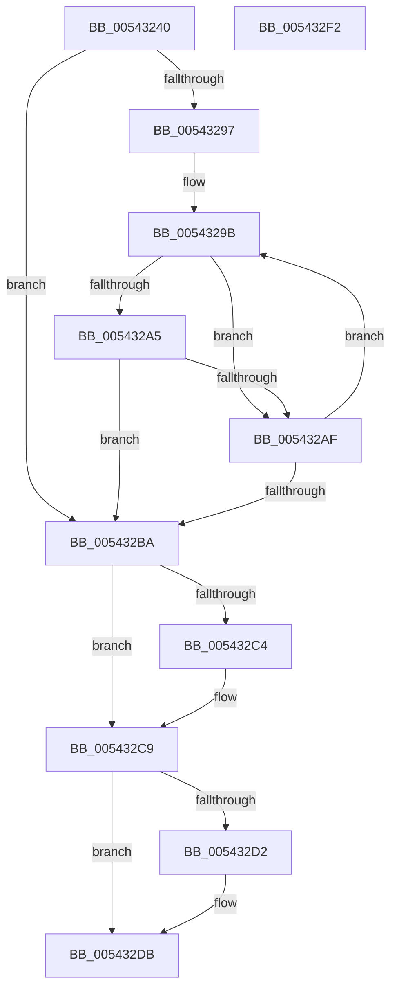

# HalEnumerateProcessors

- RVA: `0x00543240`–`0x005432F3` (길이 `179` bytes)
- VA: `0x0000000140543240`
- 실행 섹션: `.text`
- PDB 이름 있음: `예`; PDB Function 태그: `아니요`
- unwind 정보 RVA: `0x0005CAAC`
- 디코드: `52`개 명령, `179/179` bytes 표시
- 미해석 바이트: `0` (있으면 어셈블리에 `.byte`로 보존)

> 이 문서는 커널 이미지의 기계어와 PDB 기호를 분석해 생성했습니다. 4번과 5번은 함수 원형과 자료형을 바이너리 사용 방식에서 추정한 C 해석이며 원본 소스 복구 결과는 아닙니다.

## 1. Dependencies

- 직접 호출 지점: **2**; 고유 호출 대상: **2**
- 직접 호출자로 확인된 함수: **2**
- RIP 상대 이미지 참조: **3**

### Outgoing calls
- `0x005432C9` → [HalpInterruptModel](../4A/HalpInterruptModel_function_004ACA38.md) (function, `0x004ACA38`)
- `0x005432DB` → [HalpQueryMaximumRegisteredProcessorCount](HalpQueryMaximumRegisteredProcessorCount_function_00543BE8.md) (function, `0x00543BE8`)

### Direct callers
- [HvlpSelectLpSet](../58/HvlpSelectLpSet_function_00585D30.md) at `0x00585E45`
- [KiComputeEstimatedMaximumProcessors](../5B/KiComputeEstimatedMaximumProcessors_function_005B7800.md) at `0x005B7824`

### Static image references
- `0x00543264` → RVA `0x00FC3E30` (`.data`; read)
- `0x0054326D` → RVA `0x00E10200` (`.data`; read)
- `0x005432BA` → RVA `0x00E10208` (`.data`; read)

## 2. Other-region calls and transfers

- 다른 실행 섹션으로 향하는 call: **0**
- 별도 외부 분기/꼬리 이동을 확인하지 못했습니다.

## 3. Assembly (complete function range)

```asm
00543240  48 89 5C 24 08                  mov qword ptr [rsp + 8], rbx
00543245  57                              push rdi
00543246  48 83 EC 20                     sub rsp, 0x20
0054324A  65 48 8B 14 25 20 00 00 00      mov rdx, qword ptr gs:[0x20]
00543253  BF 01 00 00 00                  mov edi, 1
00543258  65 48 8B 04 25 20 00 00 00      mov rax, qword ptr gs:[0x20]
00543261  44 8B D9                        mov r11d, ecx
00543264  48 8B 0D C5 0B A8 00            mov rcx, qword ptr [rip + 0xa80bc5]
0054326B  8B DF                           mov ebx, edi
0054326D  44 8B 15 8C CF 8C 00            mov r10d, dword ptr [rip + 0x8ccf8c]
00543274  44 8B 80 A0 00 00 00            mov r8d, dword ptr [rax + 0xa0]
0054327B  44 0F AF 82 A4 00 00 00         imul r8d, dword ptr [rdx + 0xa4]
00543283  8B D7                           mov edx, edi
00543285  44 8B 49 08                     mov r9d, dword ptr [rcx + 8]
00543289  44 2B C7                        sub r8d, edi
0054328C  41 F7 D0                        not r8d
0054328F  45 23 C8                        and r9d, r8d
00543292  44 3B D7                        cmp r10d, edi
00543295  76 23                           jbe 0x1405432ba
00543297  48 83 C1 48                     add rcx, 0x48
0054329B  8B 01                           mov eax, dword ptr [rcx]
0054329D  41 23 C0                        and eax, r8d
005432A0  44 3B C8                        cmp r9d, eax
005432A3  74 0A                           je 0x1405432af
005432A5  03 D7                           add edx, edi
005432A7  44 8B C8                        mov r9d, eax
005432AA  41 3B D3                        cmp edx, r11d
005432AD  77 0B                           ja 0x1405432ba
005432AF  03 DF                           add ebx, edi
005432B1  48 83 C1 40                     add rcx, 0x40
005432B5  41 3B DA                        cmp ebx, r10d
005432B8  72 E1                           jb 0x14054329b
005432BA  8B 05 48 CF 8C 00               mov eax, dword ptr [rip + 0x8ccf48]
005432C0  85 C0                           test eax, eax
005432C2  74 05                           je 0x1405432c9
005432C4  3B C3                           cmp eax, ebx
005432C6  0F 42 D8                        cmovb ebx, eax
005432C9  E8 6A 97 F6 FF                  call 0x1404aca38
005432CE  3B C7                           cmp eax, edi
005432D0  74 09                           je 0x1405432db
005432D2  8D 48 FE                        lea ecx, [rax - 2]
005432D5  83 F9 02                        cmp ecx, 2
005432D8  0F 47 DF                        cmova ebx, edi
005432DB  E8 08 09 00 00                  call 0x140543be8
005432E0  3B D8                           cmp ebx, eax
005432E2  0F 43 D8                        cmovae ebx, eax
005432E5  8B C3                           mov eax, ebx
005432E7  48 8B 5C 24 30                  mov rbx, qword ptr [rsp + 0x30]
005432EC  48 83 C4 20                     add rsp, 0x20
005432F0  5F                              pop rdi
005432F1  C3                              ret
005432F2  CC                              int3
```

## 4. C-style interpretation (structured pseudocode)

```c
__int64 __fastcall HalEnumerateProcessors(int a1)
{
    __int64 result;
    __int64 v_rbx;
    __int64 v_rsp;
    unsigned __int64 v_stack_p8;

    v_stack_p8 = v_rbx;
    v_rsp = (v_rsp) - (32);
    a3 = (unsigned int)(((unsigned int)(*(unsigned int *)(*(unsigned __int64 *)(gs_base + (0 + 32)) + 160))) * (*(unsigned int *)(*(unsigned __int64 *)(gs_base + (0 + 32)) + 164)));
    a3 = (unsigned int)((a3) - (1));
    a3 = (unsigned int)(~(a3));
    a4 = (unsigned int)(((unsigned int)(*(unsigned int *)(*(unsigned __int64 *)(v_rip + 11013061) + 8))) & ((unsigned int)(a3)));
    if (((unsigned int)((unsigned int)(*(unsigned int *)(v_rip + 9228172)))) <= 1) goto loc_005432BA;
    a1 = (*(unsigned __int64 *)(v_rip + 11013061)) + (72);
loc_0054329B:
    result = (unsigned int)(((unsigned int)(*(unsigned int *)(a1))) & ((unsigned int)(a3)));
    if (((unsigned int)(a4)) == ((unsigned int)(result))) goto loc_005432AF;
    a2 = (unsigned int)((1) + (1));
    if (((unsigned int)(a2)) > ((unsigned int)((unsigned int)(a1)))) goto loc_005432BA;
loc_005432AF:
    v_rbx = (unsigned int)((1) + (1));
    a1 = (a1) + (64);
    if (((unsigned int)(v_rbx)) < ((unsigned int)((unsigned int)(*(unsigned int *)(v_rip + 9228172))))) goto loc_0054329B;
loc_005432BA:
    if ((unsigned int)((unsigned int)(*(unsigned int *)(v_rip + 9228104))) != 0) {
        if (((unsigned int)((unsigned int)(*(unsigned int *)(v_rip + 9228104)))) < ((unsigned int)(v_rbx))) { v_rbx = (unsigned int)((unsigned int)(*(unsigned int *)(v_rip + 9228104))); }
    }
    result = HalpInterruptModel(a1, a2, a3, (unsigned int)((unsigned int)(result)));
    if (((unsigned int)(result)) != 1) {
        a1 = result - 2;
        if (a1 > 2) { v_rbx = 1; }
    }
    result = HalpQueryMaximumRegisteredProcessorCount(a1, a2, a3, (unsigned int)((unsigned int)(result)));
    if (((unsigned int)(v_rbx)) >= ((unsigned int)(result))) { v_rbx = (unsigned int)(result); }
    v_rsp = (v_rsp) + (32);
    return (unsigned int)((unsigned int)(v_rbx));
}
```

## 5. (Beta) C Style

```c
int64_t HalEnumerateProcessors(int32_t Arg1)
{
    int64_t result;
    int64_t local_rbx;
    int64_t local_rsp;
    uint64_t v_stack_p8;

    v_stack_p8 = local_rbx;
    local_rsp = (local_rsp) - (32);
    a3 = (uint32_t)(((uint32_t)(*(uint32_t *)(*(uint64_t *)(gs_base + (0 + 0x20)) + 0xA0))) * (*(uint32_t *)(*(uint64_t *)(gs_base + (0 + 0x20)) + 0xA4)));
    a3 = (uint32_t)((a3) - (1));
    a3 = (uint32_t)(~(a3));
    a4 = (uint32_t)(((uint32_t)(*(uint32_t *)(*(uint64_t *)(v_rip + 0xA80BC5) + 0x8))) & ((uint32_t)(a3)));
    if (((uint32_t)((uint32_t)(*(uint32_t *)(v_rip + 0x8CCF8C)))) <= 1) goto loc_005432BA;
    Arg1 = (*(uint64_t *)(v_rip + 0xA80BC5)) + (72);
loc_0054329B:
    result = (uint32_t)(((uint32_t)(*(uint32_t *)(Arg1))) & ((uint32_t)(a3)));
    if (((uint32_t)(a4)) == ((uint32_t)(result))) goto loc_005432AF;
    a2 = (uint32_t)((1) + (1));
    if (((uint32_t)(a2)) > ((uint32_t)((uint32_t)(Arg1)))) goto loc_005432BA;
loc_005432AF:
    local_rbx = (uint32_t)((1) + (1));
    Arg1 = (Arg1) + (64);
    if (((uint32_t)(local_rbx)) < ((uint32_t)((uint32_t)(*(uint32_t *)(v_rip + 0x8CCF8C))))) goto loc_0054329B;
loc_005432BA:
    if ((uint32_t)((uint32_t)(*(uint32_t *)(v_rip + 0x8CCF48))) != 0) {
        if (((uint32_t)((uint32_t)(*(uint32_t *)(v_rip + 0x8CCF48)))) < ((uint32_t)(local_rbx))) { local_rbx = (uint32_t)((uint32_t)(*(uint32_t *)(v_rip + 0x8CCF48))); }
    }
    result = HalpInterruptModel(Arg1, a2, a3, (uint32_t)((uint32_t)(result)));
    if (((uint32_t)(result)) != 1) {
        Arg1 = result - 2;
        if (Arg1 > 2) { local_rbx = 1; }
    }
    result = HalpQueryMaximumRegisteredProcessorCount(Arg1, a2, a3, (uint32_t)((uint32_t)(result)));
    if (((uint32_t)(local_rbx)) >= ((uint32_t)(result))) { local_rbx = (uint32_t)(result); }
    local_rsp = (local_rsp) + (32);
    return (uint32_t)((uint32_t)(local_rbx));
}
```

## 6. Execution-region graph

[열기: 2D/3D 그래프와 함수 탐색 컨트롤 패널](../../../control-panel.html?section=text&rva=0x00543240&view=graph)

- 2D 그래프는 위에서 아래로 흐르고, 3D 그래프는 빈 공간을 드래그해 회전합니다. Shift+드래그는 이동, 휠은 확대·축소, 함수 노드 선택은 대상 보고서 이동입니다.

### Static fallback


