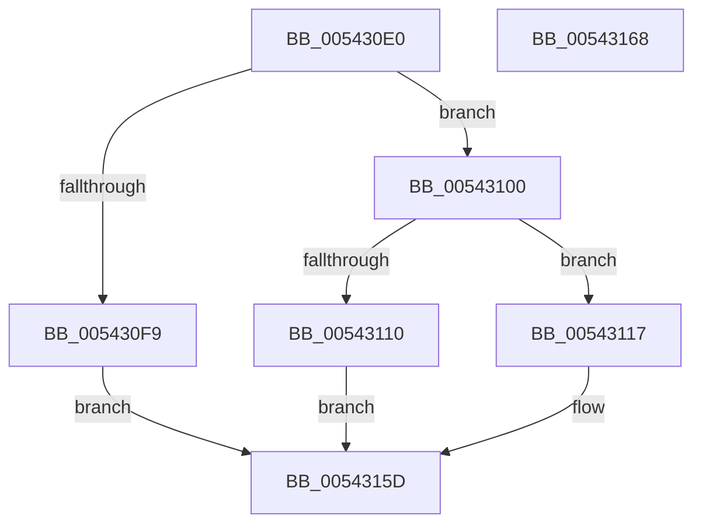

# HalGetEnvironmentVariable

- RVA: `0x005430E0`–`0x00543169` (길이 `137` bytes)
- VA: `0x00000001405430E0`
- 실행 섹션: `.text`
- PDB 이름 있음: `예`; PDB Function 태그: `아니요`
- unwind 정보 RVA: `0x0005CAAC`
- 디코드: `41`개 명령, `137/137` bytes 표시
- 미해석 바이트: `0` (있으면 어셈블리에 `.byte`로 보존)

> 이 문서는 커널 이미지의 기계어와 PDB 기호를 분석해 생성했습니다. 4번과 5번은 함수 원형과 자료형을 바이너리 사용 방식에서 추정한 C 해석이며 원본 소스 복구 결과는 아닙니다.

## 1. Dependencies

- 직접 호출 지점: **4**; 고유 호출 대상: **4**
- 직접 호출자로 확인된 함수: **1**
- RIP 상대 이미지 참조: **4**

### Outgoing calls
- `0x00543107` → [stricmp](../4F/stricmp_function_004FFD80.md) (function, `0x004FFD80`)
- `0x00543117` → [HalpAcquireCmosSpinLock](../42/HalpAcquireCmosSpinLock_function_0042DEE8.md) (function, `0x0042DEE8`)
- `0x00543131` → [HalpReleaseCmosSpinLock](../42/HalpReleaseCmosSpinLock_function_0042DE04.md) (function, `0x0042DE04`)
- `0x00543156` → [strncpy_s](../50/strncpy_s_function_00506140.md) (function, `0x00506140`)

### Direct callers
- [NtQuerySystemEnvironmentValue](../../page/7C/NtQuerySystemEnvironmentValue_function_007CDFB0.md) at `0x007CE1D5`

### Static image references
- `0x005430EA` → RVA `0x00FC1A28` (`.data`; read)
- `0x00543100` → RVA `0x00023AD0` (`.rdata`; read)
- `0x0054313A` → RVA `0x00023ABC` (`.rdata`; read)
- `0x00543141` → RVA `0x00023AC4` (`.rdata`; read)

## 2. Other-region calls and transfers

- 다른 실행 섹션으로 향하는 call: **0**
- 별도 외부 분기/꼬리 이동을 확인하지 못했습니다.

## 3. Assembly (complete function range)

```asm
005430E0  48 89 5C 24 08                  mov qword ptr [rsp + 8], rbx
005430E5  57                              push rdi
005430E6  48 83 EC 20                     sub rsp, 0x20
005430EA  80 3D 37 E9 A7 00 00            cmp byte ptr [rip + 0xa7e937], 0
005430F1  49 8B D8                        mov rbx, r8
005430F4  0F B7 FA                        movzx edi, dx
005430F7  74 07                           je 0x140543100
005430F9  B8 07 00 00 00                  mov eax, 7
005430FE  EB 5D                           jmp 0x14054315d
00543100  48 8D 15 C9 09 AE FF            lea rdx, [rip - 0x51f637]
00543107  E8 74 CC FB FF                  call 0x1404ffd80
0054310C  85 C0                           test eax, eax
0054310E  74 07                           je 0x140543117
00543110  B8 0E 00 00 00                  mov eax, 0xe
00543115  EB 46                           jmp 0x14054315d
00543117  E8 CC AD EE FF                  call 0x14042dee8
0054311C  90                              nop
0054311D  B0 0B                           mov al, 0xb
0054311F  BA 70 00 00 00                  mov edx, 0x70
00543124  EE                              out dx, al
00543125  90                              nop
00543126  BA 71 00 00 00                  mov edx, 0x71
0054312B  90                              nop
0054312C  EC                              in al, dx
0054312D  44 8A C0                        mov r8b, al
00543130  90                              nop
00543131  E8 CE AC EE FF                  call 0x14042de04
00543136  41 F6 C0 01                     test r8b, 1
0054313A  48 8D 05 7B 09 AE FF            lea rax, [rip - 0x51f685]
00543141  4C 8D 05 7C 09 AE FF            lea r8, [rip - 0x51f684]
00543148  48 8B D7                        mov rdx, rdi
0054314B  4C 0F 44 C0                     cmove r8, rax
0054314F  4C 8D 4F FF                     lea r9, [rdi - 1]
00543153  48 8B CB                        mov rcx, rbx
00543156  E8 E5 2F FC FF                  call 0x140506140
0054315B  33 C0                           xor eax, eax
0054315D  48 8B 5C 24 30                  mov rbx, qword ptr [rsp + 0x30]
00543162  48 83 C4 20                     add rsp, 0x20
00543166  5F                              pop rdi
00543167  C3                              ret
00543168  CC                              int3
```

## 4. C-style interpretation (structured pseudocode)

```c
__int64 __fastcall HalGetEnvironmentVariable(__int64 a1, unsigned __int16 a2, __int64 a3)
{
    __int64 result;
    __int64 v_rsp;
    unsigned __int64 v_stack_p8;

    v_stack_p8 = v_rbx;
    v_rsp = (v_rsp) - (32);
    if ((*(unsigned __int8 *)(v_rip + 11004215)) == 0) goto loc_00543100;
    goto loc_0054315D;
loc_00543100:
    result = stricmp(a1, v_rip - 5371447, a3, a4);
    if ((unsigned int)(result) == 0) goto loc_00543117;
    goto loc_0054315D;
loc_00543117:
    result = HalpAcquireCmosSpinLock(a1, v_rip - 5371447, a3, a4);
    result = HalpReleaseCmosSpinLock(a1, 113, 11, a4);
    a3 = v_rip - 5371524;
    if (((11) & (1)) == 0) { a3 = v_rip - 5371525; }
    result = strncpy_s(a3, a2, a3, a2 - 1);
    result = 0;
loc_0054315D:
    v_rsp = (v_rsp) + (32);
    return result;
}
```

## 5. (Beta) C Style

```c
int64_t HalGetEnvironmentVariable(int64_t Arg1, void *Arg2, int64_t Arg3)
{
    uint8_t *arg2 = (uint8_t *)Arg2;

    int64_t result;
    int64_t local_rsp;
    uint64_t v_stack_p8;

    v_stack_p8 = local_rbx;
    local_rsp = (local_rsp) - (32);
    if ((*(uint8_t *)(v_rip + 0xA7E937)) == 0) goto loc_00543100;
    goto loc_0054315D;
loc_00543100:
    result = stricmp(Arg1, v_rip - 5371447, Arg3, a4);
    if ((uint32_t)(result) == 0) goto loc_00543117;
    goto loc_0054315D;
loc_00543117:
    result = HalpAcquireCmosSpinLock(Arg1, v_rip - 5371447, Arg3, a4);
    result = HalpReleaseCmosSpinLock(Arg1, 113, 11, a4);
    Arg3 = v_rip - 5371524;
    if (((11) & (1)) == 0) { Arg3 = v_rip - 5371525; }
    result = strncpy_s(Arg3, Arg2, Arg3, Arg2 - 1);
    result = 0;
loc_0054315D:
    local_rsp = (local_rsp) + (32);
    return result;
}
```

### 관측된 메모리 오프셋

구조체 형식이 확인되지 않은 접근은 인자 기준의 오프셋으로만 기록했습니다.

| 기준 인자 | 오프셋 표현 | 폭 (bit) | 접근 |
|---|---:|---:|---|
| `Arg2` | `- 0x1` | `64` | `R` |

## 6. Execution-region graph

[열기: 2D/3D 그래프와 함수 탐색 컨트롤 패널](../../../control-panel.html?section=text&rva=0x005430E0&view=graph)

- 2D 그래프는 위에서 아래로 흐르고, 3D 그래프는 빈 공간을 드래그해 회전합니다. Shift+드래그는 이동, 휠은 확대·축소, 함수 노드 선택은 대상 보고서 이동입니다.

### Static fallback


