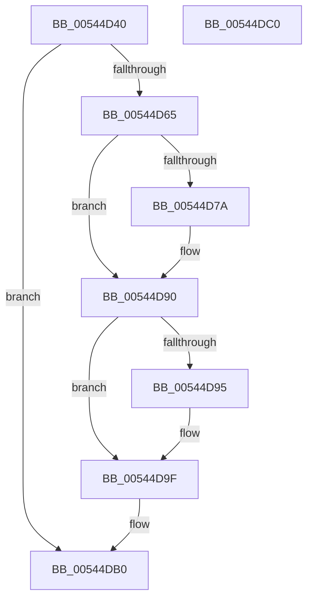

# HalHandleMcheck

- RVA: `0x00544D40`–`0x00544DC1` (길이 `129` bytes)
- VA: `0x0000000140544D40`
- 실행 섹션: `.text`
- PDB 이름 있음: `예`; PDB Function 태그: `아니요`
- unwind 정보 RVA: `0x00060BC4`
- 디코드: `35`개 명령, `129/129` bytes 표시
- 미해석 바이트: `0` (있으면 어셈블리에 `.byte`로 보존)

> 이 문서는 커널 이미지의 기계어와 PDB 기호를 분석해 생성했습니다. 4번과 5번은 함수 원형과 자료형을 바이너리 사용 방식에서 추정한 C 해석이며 원본 소스 복구 결과는 아닙니다.

## 1. Dependencies

- 직접 호출 지점: **2**; 고유 호출 대상: **2**
- 직접 호출자로 확인된 함수: **1**
- RIP 상대 이미지 참조: **1**

### Outgoing calls
- `0x00544D8B` → [HalpMcaReportError](HalpMcaReportError_function_00541D04.md) (function, `0x00541D04`)
- `0x00544DA6` → [HalpHandleMachineCheck](HalpHandleMachineCheck_function_005413C8.md) (function, `0x005413C8`)

### Direct callers
- [KiHandleMcheck](../5B/KiHandleMcheck_function_005B88F0.md) at `0x005B88F4`

### Static image references
- `0x00544D58` → RVA `0x00E0A769` (`.data`; read)

## 2. Other-region calls and transfers

- 다른 실행 섹션으로 향하는 call: **0**
- 별도 외부 분기/꼬리 이동을 확인하지 못했습니다.

## 3. Assembly (complete function range)

```asm
00544D40  48 89 5C 24 08                  mov qword ptr [rsp + 8], rbx
00544D45  48 89 74 24 10                  mov qword ptr [rsp + 0x10], rsi
00544D4A  57                              push rdi
00544D4B  48 83 EC 20                     sub rsp, 0x20
00544D4F  48 83 64 24 48 00               and qword ptr [rsp + 0x48], 0
00544D55  49 8B D8                        mov rbx, r8
00544D58  8A 05 0B 5A 8C 00               mov al, byte ptr [rip + 0x8c5a0b]
00544D5E  48 8B F1                        mov rsi, rcx
00544D61  84 C0                           test al, al
00544D63  74 4B                           je 0x140544db0
00544D65  65 48 8B 04 25 18 00 00 00      mov rax, qword ptr gs:[0x18]
00544D6E  48 8B B8 D8 00 00 00            mov rdi, qword ptr [rax + 0xd8]
00544D75  48 85 FF                        test rdi, rdi
00544D78  75 16                           jne 0x140544d90
00544D7A  C7 44 24 48 03 00 00 80         mov dword ptr [rsp + 0x48], 0x80000003
00544D82  33 D2                           xor edx, edx
00544D84  4C 8B 44 24 48                  mov r8, qword ptr [rsp + 0x48]
00544D89  33 C9                           xor ecx, ecx
00544D8B  E8 74 CF FF FF                  call 0x140541d04
00544D90  48 85 DB                        test rbx, rbx
00544D93  74 0A                           je 0x140544d9f
00544D95  8B 03                           mov eax, dword ptr [rbx]
00544D97  0F 57 C0                        xorps xmm0, xmm0
00544D9A  0F 11 03                        movups xmmword ptr [rbx], xmm0
00544D9D  89 03                           mov dword ptr [rbx], eax
00544D9F  48 8B CE                        mov rcx, rsi
00544DA2  48 89 5F 20                     mov qword ptr [rdi + 0x20], rbx
00544DA6  E8 1D C6 FF FF                  call 0x1405413c8
00544DAB  48 83 67 20 00                  and qword ptr [rdi + 0x20], 0
00544DB0  48 8B 5C 24 30                  mov rbx, qword ptr [rsp + 0x30]
00544DB5  48 8B 74 24 38                  mov rsi, qword ptr [rsp + 0x38]
00544DBA  48 83 C4 20                     add rsp, 0x20
00544DBE  5F                              pop rdi
00544DBF  C3                              ret
00544DC0  CC                              int3
```

## 4. C-style interpretation (structured pseudocode)

```c
__int64 __fastcall HalHandleMcheck(__int64 a1, int a2, __int64 a3)
{
    __int64 result;
    __int64 v_rsp;
    unsigned __int64 v_stack_p10;
    unsigned __int64 v_stack_p20;
    unsigned __int64 v_stack_p8;

    v_stack_p8 = v_rbx;
    v_stack_p10 = v_rsi;
    v_rsp = (v_rsp) - (32);
    if ((unsigned __int8)(*(unsigned __int8 *)(v_rip + 9198091)) == 0) goto loc_00544DB0;
    result = *(unsigned __int64 *)(gs_base + (0 + 24));
    if (*(unsigned __int64 *)(*(unsigned __int64 *)(gs_base + (0 + 24)) + 216) == 0) {
        v_stack_p20 = 0x80000003ULL;
        a2 = 0;
        a3 = v_stack_p20;
        a1 = 0;
        result = HalpMcaReportError(a1, a2, a3, a4);
    }
    if (a3 != 0) {
        result = *(unsigned int *)(a3);
        *(unsigned __int64 *)(a3) = v_xmm0;
        *(unsigned int *)(a3) = (unsigned int)(result);
    }
    *(unsigned __int64 *)(*(unsigned __int64 *)(*(unsigned __int64 *)(gs_base + (0 + 24)) + 216) + 32) = a3;
    result = HalpHandleMachineCheck(0, a2, a3, a4);
loc_00544DB0:
    v_rsp = (v_rsp) + (32);
    return result;
}
```

## 5. (Beta) C Style

```c
int64_t HalHandleMcheck(int64_t Arg1, int32_t Arg2, int64_t Arg3)
{
    int64_t result;
    int64_t local_rsp;
    uint64_t v_stack_p10;
    uint64_t v_stack_p20;
    uint64_t v_stack_p8;

    v_stack_p8 = local_rbx;
    v_stack_p10 = local_rsi;
    local_rsp = (local_rsp) - (32);
    if ((uint8_t)(*(uint8_t *)(v_rip + 0x8C5A0B)) == 0) goto loc_00544DB0;
    result = *(uint64_t *)(gs_base + (0 + 0x18));
    if (*(uint64_t *)(*(uint64_t *)(gs_base + (0 + 0x18)) + 0xD8) == 0) {
        v_stack_p20 = 0x80000003ULL;
        Arg2 = 0;
        Arg3 = v_stack_p20;
        Arg1 = 0;
        result = HalpMcaReportError(Arg1, Arg2, Arg3, a4);
    }
    if (Arg3 != 0) {
        result = *(uint32_t *)(Arg3);
        *(uint64_t *)(Arg3) = v_xmm0;
        *(uint32_t *)(Arg3) = (uint32_t)(result);
    }
    *(uint64_t *)(*(uint64_t *)(*(uint64_t *)(gs_base + (0 + 0x18)) + 0xD8) + 0x20) = Arg3;
    result = HalpHandleMachineCheck(0, Arg2, Arg3, a4);
loc_00544DB0:
    local_rsp = (local_rsp) + (32);
    return result;
}
```

## 6. Execution-region graph

[열기: 2D/3D 그래프와 함수 탐색 컨트롤 패널](../../../control-panel.html?section=text&rva=0x00544D40&view=graph)

- 2D 그래프는 위에서 아래로 흐르고, 3D 그래프는 빈 공간을 드래그해 회전합니다. Shift+드래그는 이동, 휠은 확대·축소, 함수 노드 선택은 대상 보고서 이동입니다.

### Static fallback


