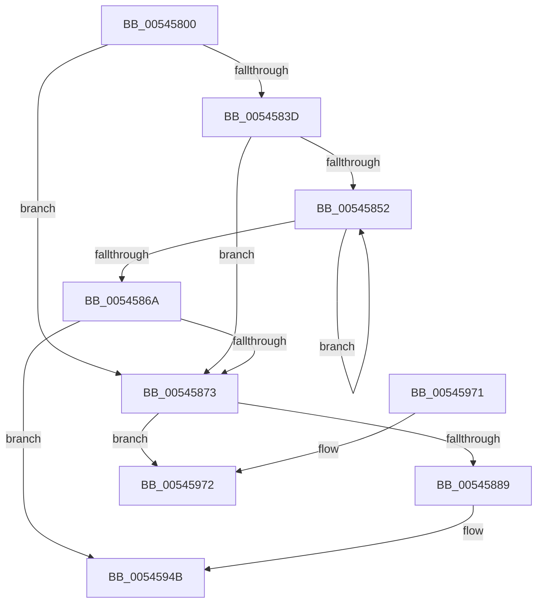

# HalHandleNMI

- RVA: `0x00545800`–`0x0054597A` (길이 `378` bytes)
- VA: `0x0000000140545800`
- 실행 섹션: `.text`
- PDB 이름 있음: `예`; PDB Function 태그: `아니요`
- unwind 정보 RVA: `0x000C3CC0`
- 디코드: `82`개 명령, `378/378` bytes 표시
- 미해석 바이트: `0` (있으면 어셈블리에 `.byte`로 보존)

> 이 문서는 커널 이미지의 기계어와 PDB 기호를 분석해 생성했습니다. 4번과 5번은 함수 원형과 자료형을 바이너리 사용 방식에서 추정한 C 해석이며 원본 소스 복구 결과는 아닙니다.

## 1. Dependencies

- 직접 호출 지점: **6**; 고유 호출 대상: **6**
- 직접 호출자로 확인된 함수: **1**
- RIP 상대 이미지 참조: **25**

### Outgoing calls
- `0x00545855` → [HalpCheckAndReportGhes](../4A/HalpCheckAndReportGhes_function_004A9CDC.md) (function, `0x004A9CDC`)
- `0x0054589B` → [memset](../6C/memset_function_006C6C40.md) (function, `0x006C6C40`)
- `0x00545922` → [WheapGetErrorSource](../49/WheapGetErrorSource_function_0049554C.md) (function, `0x0049554C`)
- `0x00545937` → `PSHED.dll!PshedRetrieveErrorInfo` (import, 간접 대상; import `PSHED.dll!PshedRetrieveErrorInfo`)
- `0x00545946` → [WheaReportHwError](../4E/WheaReportHwError_function_004ED200.md) (function, `0x004ED200`)
- `0x00545974` → [HalpNMIHalt](HalpNMIHalt_function_00545B44.md) (function, `0x00545B44`)

### Direct callers
- [KiProcessNMI](../5B/KiProcessNMI_function_005B8950.md) at `0x005B8A4A`

### Static image references
- `0x00545819` → RVA `0x00EEF050` (`.data`; read/write)
- `0x00545820` → RVA `0x00E10268` (`.data`; write)
- `0x0054582E` → RVA `0x00E1040C` (`.data`; read)
- `0x00545835` → RVA `0x00E0A788` (`.data`; write)
- `0x0054583D` → RVA `0x00FC1680` (`.data`; read)
- `0x0054587D` → RVA `0x00E10264` (`.data`; read)
- `0x0054588E` → RVA `0x00E10270` (`.data`; read)
- `0x005458A0` → RVA `0x00E10260` (`.data`; read)
- `0x005458A9` → RVA `0x00024D88` (`.rdata`; read)
- `0x005458B0` → RVA `0x00E10274` (`.data`; write)
- `0x005458B6` → RVA `0x00EEF018` (`.data`; read)
- `0x005458BD` → RVA `0x00E10280` (`.data`; write)
- `0x005458C3` → RVA `0x00E1028C` (`.data`; write)
- `0x005458C9` → RVA `0x00E1027C` (`.data`; read)
- `0x005458D4` → RVA `0x00E10270` (`.data`; write)
- `0x005458DE` → RVA `0x00E102C8` (`.data`; write)
- `0x005458E4` → RVA `0x00E10278` (`.data`; write)
- `0x005458EA` → RVA `0x00E10284` (`.data`; write)
- `0x005458F0` → RVA `0x00E10288` (`.data`; write)
- `0x005458F6` → RVA `0x00E10290` (`.data`; write)
- `0x005458FE` → RVA `0x00E102A8` (`.data`; write)
- `0x00545908` → RVA `0x00E102B0` (`.data`; write)
- `0x00545912` → RVA `0x00E102B4` (`.data`; write)
- `0x0054591C` → RVA `0x00E102C0` (`.data`; write)
- `0x00545937` → RVA `0x00151150` (`PSHED.dll!PshedRetrieveErrorInfo (IAT)`; read)

## 2. Other-region calls and transfers

- 다른 실행 섹션으로 향하는 call: **0**
- 별도 외부 분기/꼬리 이동을 확인하지 못했습니다.

## 3. Assembly (complete function range)

```asm
00545800  48 89 5C 24 08                  mov qword ptr [rsp + 8], rbx
00545805  48 89 6C 24 10                  mov qword ptr [rsp + 0x10], rbp
0054580A  48 89 74 24 18                  mov qword ptr [rsp + 0x18], rsi
0054580F  57                              push rdi
00545810  48 83 EC 20                     sub rsp, 0x20
00545814  BD 01 00 00 00                  mov ebp, 1
00545819  F0 01 2D 30 98 9A 00            lock add dword ptr [rip + 0x9a9830], ebp
00545820  89 2D 42 AA 8C 00               mov dword ptr [rip + 0x8caa42], ebp
00545826  65 8B 04 25 A4 01 00 00         mov eax, dword ptr gs:[0x1a4]
0054582E  83 3D D7 AB 8C 00 00            cmp dword ptr [rip + 0x8cabd7], 0
00545835  89 05 4D 4F 8C 00               mov dword ptr [rip + 0x8c4f4d], eax
0054583B  74 36                           je 0x140545873
0054583D  48 8B 3D 3C BE A7 00            mov rdi, qword ptr [rip + 0xa7be3c]
00545844  48 8D 35 35 BE A7 00            lea rsi, [rip + 0xa7be35]
0054584B  32 DB                           xor bl, bl
0054584D  48 3B FE                        cmp rdi, rsi
00545850  74 21                           je 0x140545873
00545852  48 8B CF                        mov rcx, rdi
00545855  E8 82 44 F6 FF                  call 0x1404a9cdc
0054585A  48 8B 3F                        mov rdi, qword ptr [rdi]
0054585D  84 C0                           test al, al
0054585F  0F B6 DB                        movzx ebx, bl
00545862  0F 45 DD                        cmovne ebx, ebp
00545865  48 3B FE                        cmp rdi, rsi
00545868  75 E8                           jne 0x140545852
0054586A  40 3A DD                        cmp bl, bpl
0054586D  0F 84 D8 00 00 00               je 0x14054594b
00545873  90                              nop
00545874  BA 61 00 00 00                  mov edx, 0x61
00545879  EC                              in al, dx
0054587A  90                              nop
0054587B  8A D8                           mov bl, al
0054587D  39 2D E1 A9 8C 00               cmp dword ptr [rip + 0x8ca9e1], ebp
00545883  0F 85 E9 00 00 00               jne 0x140545972
00545889  8D 7A FB                        lea edi, [rdx - 5]
0054588C  33 D2                           xor edx, edx
0054588E  48 8D 35 DB A9 8C 00            lea rsi, [rip + 0x8ca9db]
00545895  44 8B C7                        mov r8d, edi
00545898  48 8B CE                        mov rcx, rsi
0054589B  E8 A0 13 18 00                  call 0x1406c6c40
005458A0  8B 15 BA A9 8C 00               mov edx, dword ptr [rip + 0x8ca9ba]
005458A6  8D 47 A7                        lea eax, [rdi - 0x59]
005458A9  0F 10 05 D8 F4 AD FF            movups xmm0, xmmword ptr [rip - 0x520b28]
005458B0  89 05 BE A9 8C 00               mov dword ptr [rip + 0x8ca9be], eax
005458B6  48 8D 0D 5B 97 9A 00            lea rcx, [rip + 0x9a975b]
005458BD  89 05 BD A9 8C 00               mov dword ptr [rip + 0x8ca9bd], eax
005458C3  89 05 C3 A9 8C 00               mov dword ptr [rip + 0x8ca9c3], eax
005458C9  8B 05 AD A9 8C 00               mov eax, dword ptr [rip + 0x8ca9ad]
005458CF  C1 E8 02                        shr eax, 2
005458D2  23 C5                           and eax, ebp
005458D4  C7 05 92 A9 8C 00 57 48 45 41   mov dword ptr [rip + 0x8ca992], 0x41454857
005458DE  89 05 E4 A9 8C 00               mov dword ptr [rip + 0x8ca9e4], eax
005458E4  89 3D 8E A9 8C 00               mov dword ptr [rip + 0x8ca98e], edi
005458EA  89 2D 94 A9 8C 00               mov dword ptr [rip + 0x8ca994], ebp
005458F0  89 15 92 A9 8C 00               mov dword ptr [rip + 0x8ca992], edx
005458F6  F3 0F 7F 05 92 A9 8C 00         movdqu xmmword ptr [rip + 0x8ca992], xmm0
005458FE  C7 05 A0 A9 8C 00 04 00 00 00   mov dword ptr [rip + 0x8ca9a0], 4
00545908  C7 05 9E A9 8C 00 50 00 00 00   mov dword ptr [rip + 0x8ca99e], 0x50
00545912  C7 05 98 A9 8C 00 0C 00 00 00   mov dword ptr [rip + 0x8ca998], 0xc
0054591C  88 1D 9E A9 8C 00               mov byte ptr [rip + 0x8ca99e], bl
00545922  E8 25 FC F4 FF                  call 0x14049554c
00545927  48 8B CE                        mov rcx, rsi
0054592A  4C 8D 40 60                     lea r8, [rax + 0x60]
0054592E  48 F7 D8                        neg rax
00545931  48 1B D2                        sbb rdx, rdx
00545934  49 23 D0                        and rdx, r8
00545937  48 FF 15 12 B8 C0 FF            call qword ptr [rip - 0x3f47ee]
0054593E  0F 1F 44 00 00                  nop dword ptr [rax + rax]
00545943  48 8B CE                        mov rcx, rsi
00545946  E8 B5 78 FA FF                  call 0x1404ed200
0054594B  F0 FF 0D FE 96 9A 00            lock dec dword ptr [rip + 0x9a96fe]
00545952  48 8B 5C 24 30                  mov rbx, qword ptr [rsp + 0x30]
00545957  48 8B 6C 24 38                  mov rbp, qword ptr [rsp + 0x38]
0054595C  48 8B 74 24 40                  mov rsi, qword ptr [rsp + 0x40]
00545961  C7 05 1D 4E 8C 00 00 08 00 00   mov dword ptr [rip + 0x8c4e1d], 0x800
0054596B  48 83 C4 20                     add rsp, 0x20
0054596F  5F                              pop rdi
00545970  C3                              ret
00545971  CC                              int3
00545972  8A CB                           mov cl, bl
00545974  E8 CB 01 00 00                  call 0x140545b44
00545979  CC                              int3
```

## 4. C-style interpretation (structured pseudocode)

```c
__int64 __fastcall HalHandleNMI(void)
{
    __int64 result;
    __int64 v_rbx;
    __int64 v_rsp;
    unsigned __int64 v_stack_p10;
    unsigned __int64 v_stack_p18;
    unsigned __int64 v_stack_p8;

    v_stack_p8 = v_rbx;
    v_stack_p10 = v_rbp;
    v_stack_p18 = v_rsi;
    v_rsp = (v_rsp) - (32);
    *(unsigned int *)(v_rip + 9218626) = 1;
    *(unsigned int *)(v_rip + 9195341) = (unsigned int)((unsigned int)(*(unsigned int *)(gs_base + (0 + 420))));
    if ((*(unsigned int *)(v_rip + 9219031)) == 0) goto loc_00545873;
    v_rbx = 0;
    if ((*(unsigned __int64 *)(v_rip + 10993212)) == (v_rip + 10993205)) goto loc_00545873;
loc_00545852:
    result = HalpCheckAndReportGhes(*(unsigned __int64 *)(v_rip + 10993212), a2, a3, a4);
    v_rbx = 0;
    if ((unsigned __int8)(result) != 0) { v_rbx = 1; }
    if ((*(unsigned __int64 *)(*(unsigned __int64 *)(v_rip + 10993212))) != (v_rip + 10993205)) goto loc_00545852;
    if (((unsigned __int8)(v_rbx)) == 1) goto loc_0054594B;
loc_00545873:
    if ((*(unsigned int *)(v_rip + 9218529)) != 1) goto loc_00545972;
    a2 = 0;
    result = memset(v_rip + 9218523, a2, (unsigned int)((unsigned int)(97 - 5)), a4);
    *(unsigned int *)(v_rip + 9218494) = (unsigned int)(97 - 5 - 89);
    *(unsigned int *)(v_rip + 9218493) = (unsigned int)(97 - 5 - 89);
    *(unsigned int *)(v_rip + 9218499) = (unsigned int)(97 - 5 - 89);
    result = (unsigned int)(((unsigned int)(*(unsigned int *)(v_rip + 9218477))) >> (2));
    result = (unsigned int)((result) & (1));
    *(unsigned int *)(v_rip + 9218450) = 0x41454857ULL;
    *(unsigned int *)(v_rip + 9218532) = (unsigned int)(result);
    *(unsigned int *)(v_rip + 9218446) = (unsigned int)(97 - 5);
    *(unsigned int *)(v_rip + 9218452) = 1;
    *(unsigned int *)(v_rip + 9218450) = (unsigned int)((unsigned int)(*(unsigned int *)(v_rip + 9218490)));
    *(unsigned __int64 *)(v_rip + 9218450) = v_xmm0;
    *(unsigned int *)(v_rip + 9218464) = 4;
    *(unsigned int *)(v_rip + 9218462) = 80;
    *(unsigned int *)(v_rip + 9218456) = 12;
    *(unsigned __int8 *)(v_rip + 9218462) = (unsigned __int8)((unsigned __int8)(result));
    result = WheapGetErrorSource(v_rip + 10131291, (unsigned int)(*(unsigned int *)(v_rip + 9218490)), (unsigned int)((unsigned int)(97 - 5)), a4);
    result = -(result);
    a2 = ((unsigned int)(*(unsigned int *)(v_rip + 9218490))) & (result + 96);
    result = PSHED_dll_PshedRetrieveErrorInfo(v_rip + 9218523, a2, result + 96, a4);
    result = WheaReportHwError(v_rip + 9218523, a2, result + 96, a4);
loc_0054594B:
    *(unsigned int *)(v_rip + 9195037) = 0x800ULL;
    v_rsp = (v_rsp) + (32);
    return result;
loc_00545972:
    result = HalpNMIHalt((unsigned __int8)(v_stack_p8), a2, result + 96, a4);
    return result;
}
```

## 5. (Beta) C Style

```c
void HalHandleNMI(void)
{
    int64_t result;
    int64_t local_rbx;
    int64_t local_rsp;
    uint64_t v_stack_p10;
    uint64_t v_stack_p18;
    uint64_t v_stack_p8;

    v_stack_p8 = local_rbx;
    v_stack_p10 = local_rbp;
    v_stack_p18 = local_rsi;
    local_rsp = (local_rsp) - (32);
    *(uint32_t *)(v_rip + 0x8CAA42) = 1;
    *(uint32_t *)(v_rip + 0x8C4F4D) = (uint32_t)((uint32_t)(*(uint32_t *)(gs_base + (0 + 0x1A4))));
    if ((*(uint32_t *)(v_rip + 0x8CABD7)) == 0) goto loc_00545873;
    local_rbx = 0;
    if ((*(uint64_t *)(v_rip + 0xA7BE3C)) == (v_rip + 10993205)) goto loc_00545873;
loc_00545852:
    result = HalpCheckAndReportGhes(*(uint64_t *)(v_rip + 0xA7BE3C), a2, a3, a4);
    local_rbx = 0;
    if ((uint8_t)(result) != 0) { local_rbx = 1; }
    if ((*(uint64_t *)(*(uint64_t *)(v_rip + 0xA7BE3C))) != (v_rip + 10993205)) goto loc_00545852;
    if (((uint8_t)(local_rbx)) == 1) goto loc_0054594B;
loc_00545873:
    if ((*(uint32_t *)(v_rip + 0x8CA9E1)) != 1) goto loc_00545972;
    a2 = 0;
    result = memset(v_rip + 9218523, a2, (uint32_t)((uint32_t)(97 - 5)), a4);
    *(uint32_t *)(v_rip + 0x8CA9BE) = (uint32_t)(97 - 5 - 89);
    *(uint32_t *)(v_rip + 0x8CA9BD) = (uint32_t)(97 - 5 - 89);
    *(uint32_t *)(v_rip + 0x8CA9C3) = (uint32_t)(97 - 5 - 89);
    result = (uint32_t)(((uint32_t)(*(uint32_t *)(v_rip + 0x8CA9AD))) >> (2));
    result = (uint32_t)((result) & (1));
    *(uint32_t *)(v_rip + 0x8CA992) = 0x41454857ULL;
    *(uint32_t *)(v_rip + 0x8CA9E4) = (uint32_t)(result);
    *(uint32_t *)(v_rip + 0x8CA98E) = (uint32_t)(97 - 5);
    *(uint32_t *)(v_rip + 0x8CA994) = 1;
    *(uint32_t *)(v_rip + 0x8CA992) = (uint32_t)((uint32_t)(*(uint32_t *)(v_rip + 0x8CA9BA)));
    *(uint64_t *)(v_rip + 0x8CA992) = v_xmm0;
    *(uint32_t *)(v_rip + 0x8CA9A0) = 4;
    *(uint32_t *)(v_rip + 0x8CA99E) = 80;
    *(uint32_t *)(v_rip + 0x8CA998) = 12;
    *(uint8_t *)(v_rip + 0x8CA99E) = (uint8_t)((uint8_t)(result));
    result = WheapGetErrorSource(v_rip + 10131291, (uint32_t)(*(uint32_t *)(v_rip + 0x8CA9BA)), (uint32_t)((uint32_t)(97 - 5)), a4);
    result = -(result);
    a2 = ((uint32_t)(*(uint32_t *)(v_rip + 0x8CA9BA))) & (result + 96);
    result = kernel_indirect_call(v_rip + 9218523, a2, result + 96, a4);
    result = WheaReportHwError(v_rip + 9218523, a2, result + 96, a4);
loc_0054594B:
    *(uint32_t *)(v_rip + 0x8C4E1D) = 0x800ULL;
    local_rsp = (local_rsp) + (32);
    return result;
loc_00545972:
    result = HalpNMIHalt((uint8_t)(v_stack_p8), a2, result + 96, a4);
    return result;
}
```

## 6. Execution-region graph

[열기: 2D/3D 그래프와 함수 탐색 컨트롤 패널](../../../control-panel.html?section=text&rva=0x00545800&view=graph)

- 2D 그래프는 위에서 아래로 흐르고, 3D 그래프는 빈 공간을 드래그해 회전합니다. Shift+드래그는 이동, 휠은 확대·축소, 함수 노드 선택은 대상 보고서 이동입니다.

### Static fallback


