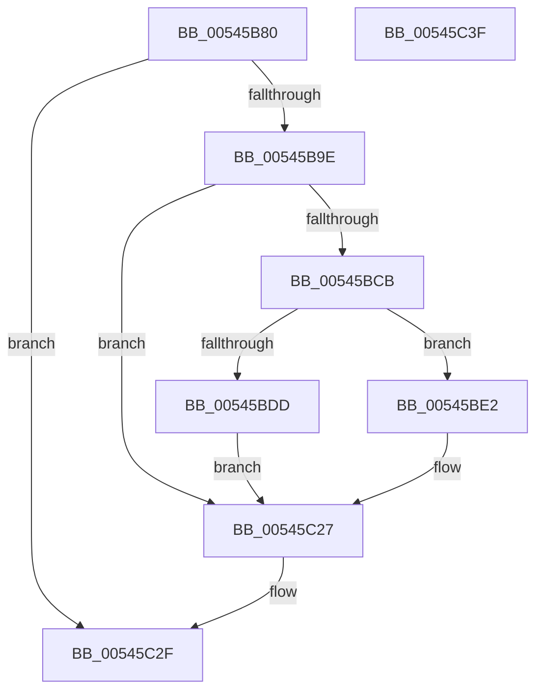

# HalMakeBeep

- RVA: `0x00545B80`–`0x00545C40` (길이 `192` bytes)
- VA: `0x0000000140545B80`
- 실행 섹션: `.text`
- PDB 이름 있음: `예`; PDB Function 태그: `아니요`
- unwind 정보 RVA: `0x00060BC4`
- 디코드: `65`개 명령, `192/192` bytes 표시
- 미해석 바이트: `0` (있으면 어셈블리에 `.byte`로 보존)

> 이 문서는 커널 이미지의 기계어와 PDB 기호를 분석해 생성했습니다. 4번과 5번은 함수 원형과 자료형을 바이너리 사용 방식에서 추정한 C 해석이며 원본 소스 복구 결과는 아닙니다.

## 1. Dependencies

- 직접 호출 지점: **10**; 고유 호출 대상: **5**
- 직접 호출자로 확인된 함수: **0**
- RIP 상대 이미지 참조: **0**

### Outgoing calls
- `0x00545B91` → [HalpMiscIsLegacyPcType](HalpMiscIsLegacyPcType_function_0054BFDC.md) (function, `0x0054BFDC`)
- `0x00545BA1` → [HalpAcquireCmosSpinLock](../42/HalpAcquireCmosSpinLock_function_0042DEE8.md) (function, `0x0042DEE8`)
- `0x00545BB0` → [HalpIoDelay](../6A/HalpIoDelay_function_006AC7E0.md) (function, `0x006AC7E0`)
- `0x00545BC2` → [HalpIoDelay](../6A/HalpIoDelay_function_006AC7E0.md) (function, `0x006AC7E0`)
- `0x00545BEC` → [HalpIoDelay](../6A/HalpIoDelay_function_006AC7E0.md) (function, `0x006AC7E0`)
- `0x00545BFC` → [WRITE_PORT_USHORT_PAIR](WRITE_PORT_USHORT_PAIR_function_00545C48.md) (function, `0x00545C48`)
- `0x00545C01` → [HalpIoDelay](../6A/HalpIoDelay_function_006AC7E0.md) (function, `0x006AC7E0`)
- `0x00545C10` → [HalpIoDelay](../6A/HalpIoDelay_function_006AC7E0.md) (function, `0x006AC7E0`)
- `0x00545C22` → [HalpIoDelay](../6A/HalpIoDelay_function_006AC7E0.md) (function, `0x006AC7E0`)
- `0x00545C27` → [HalpReleaseCmosSpinLock](../42/HalpReleaseCmosSpinLock_function_0042DE04.md) (function, `0x0042DE04`)

### Direct callers
- 이 함수 시작 RVA로 연결되는 직접 call은 확인되지 않았습니다. 간접 호출은 완전히 역산할 수 없습니다.

### Static image references
- 디코드된 RIP-relative 메모리 참조가 없습니다.

## 2. Other-region calls and transfers

- 다른 실행 섹션으로 향하는 call: **0**
- 별도 외부 분기/꼬리 이동을 확인하지 못했습니다.

## 3. Assembly (complete function range)

```asm
00545B80  48 89 5C 24 08                  mov qword ptr [rsp + 8], rbx
00545B85  48 89 74 24 10                  mov qword ptr [rsp + 0x10], rsi
00545B8A  57                              push rdi
00545B8B  48 83 EC 20                     sub rsp, 0x20
00545B8F  8B F1                           mov esi, ecx
00545B91  E8 46 64 00 00                  call 0x14054bfdc
00545B96  84 C0                           test al, al
00545B98  0F 84 91 00 00 00               je 0x140545c2f
00545B9E  40 B7 01                        mov dil, 1
00545BA1  E8 42 83 EE FF                  call 0x14042dee8
00545BA6  90                              nop
00545BA7  BA 61 00 00 00                  mov edx, 0x61
00545BAC  EC                              in al, dx
00545BAD  8A D8                           mov bl, al
00545BAF  90                              nop
00545BB0  E8 2B 6C 16 00                  call 0x1406ac7e0
00545BB5  90                              nop
00545BB6  BA 61 00 00 00                  mov edx, 0x61
00545BBB  80 E3 FC                        and bl, 0xfc
00545BBE  8A C3                           mov al, bl
00545BC0  EE                              out dx, al
00545BC1  90                              nop
00545BC2  E8 19 6C 16 00                  call 0x1406ac7e0
00545BC7  85 F6                           test esi, esi
00545BC9  74 5C                           je 0x140545c27
00545BCB  33 D2                           xor edx, edx
00545BCD  B8 CF 34 12 00                  mov eax, 0x1234cf
00545BD2  F7 F6                           div esi
00545BD4  8B D8                           mov ebx, eax
00545BD6  3D FF FF 00 00                  cmp eax, 0xffff
00545BDB  76 05                           jbe 0x140545be2
00545BDD  40 32 FF                        xor dil, dil
00545BE0  EB 45                           jmp 0x140545c27
00545BE2  90                              nop
00545BE3  BA 43 00 00 00                  mov edx, 0x43
00545BE8  B0 B6                           mov al, 0xb6
00545BEA  EE                              out dx, al
00545BEB  90                              nop
00545BEC  E8 EF 6B 16 00                  call 0x1406ac7e0
00545BF1  B9 42 00 00 00                  mov ecx, 0x42
00545BF6  44 0F B7 C3                     movzx r8d, bx
00545BFA  8B D1                           mov edx, ecx
00545BFC  E8 47 00 00 00                  call 0x140545c48
00545C01  E8 DA 6B 16 00                  call 0x1406ac7e0
00545C06  90                              nop
00545C07  BA 61 00 00 00                  mov edx, 0x61
00545C0C  EC                              in al, dx
00545C0D  8A D8                           mov bl, al
00545C0F  90                              nop
00545C10  E8 CB 6B 16 00                  call 0x1406ac7e0
00545C15  90                              nop
00545C16  80 CB 03                        or bl, 3
00545C19  8A C3                           mov al, bl
00545C1B  BA 61 00 00 00                  mov edx, 0x61
00545C20  EE                              out dx, al
00545C21  90                              nop
00545C22  E8 B9 6B 16 00                  call 0x1406ac7e0
00545C27  E8 D8 81 EE FF                  call 0x14042de04
00545C2C  40 8A C7                        mov al, dil
00545C2F  48 8B 5C 24 30                  mov rbx, qword ptr [rsp + 0x30]
00545C34  48 8B 74 24 38                  mov rsi, qword ptr [rsp + 0x38]
00545C39  48 83 C4 20                     add rsp, 0x20
00545C3D  5F                              pop rdi
00545C3E  C3                              ret
00545C3F  CC                              int3
```

## 4. C-style interpretation (structured pseudocode)

```c
__int64 __fastcall HalMakeBeep(int a1)
{
    __int64 result;
    __int64 v_rbx;
    __int64 v_rdi;
    __int64 v_rsp;
    unsigned __int64 v_stack_p10;
    unsigned __int64 v_stack_p8;

    v_stack_p8 = v_rbx;
    v_stack_p10 = v_rsi;
    v_rsp = (v_rsp) - (32);
    result = HalpMiscIsLegacyPcType(a1, a2, a3, a4);
    if ((unsigned __int8)(result) == 0) goto loc_00545C2F;
    result = HalpAcquireCmosSpinLock(a1, a2, a3, a4);
    result = HalpIoDelay(a1, 97, a3, a4);
    v_rbx = (unsigned __int8)(((unsigned __int8)(result)) & (252));
    result = HalpIoDelay(a1, 97, a3, a4);
    if ((unsigned int)((unsigned int)(a1)) == 0) goto loc_00545C27;
    a2 = 0;
    if (((unsigned int)((unsigned int)(0x1234CFULL))) <= 0xFFFFULL) goto loc_00545BE2;
    v_rdi = 0;
    goto loc_00545C27;
loc_00545BE2:
    result = HalpIoDelay(a1, 67, a3, a4);
    result = WRITE_PORT_USHORT_PAIR(66, 66, (unsigned __int16)((unsigned int)((unsigned int)((unsigned int)(0x1234CFULL)))), a4);
    result = HalpIoDelay(66, 66, (unsigned __int16)((unsigned int)((unsigned int)((unsigned int)(0x1234CFULL)))), a4);
    result = HalpIoDelay(66, 97, (unsigned __int16)((unsigned int)((unsigned int)((unsigned int)(0x1234CFULL)))), a4);
    v_rbx = (unsigned __int8)(((unsigned __int8)(result)) | (3));
    result = HalpIoDelay(66, 97, (unsigned __int16)((unsigned int)((unsigned int)((unsigned int)(0x1234CFULL)))), a4);
loc_00545C27:
    result = HalpReleaseCmosSpinLock(66, 97, (unsigned __int16)((unsigned int)((unsigned int)((unsigned int)(0x1234CFULL)))), a4);
loc_00545C2F:
    v_rsp = (v_rsp) + (32);
    return 0;
}
```

## 5. (Beta) C Style

```c
int64_t HalMakeBeep(int32_t Arg1)
{
    int64_t result;
    int64_t local_rbx;
    int64_t local_rdi;
    int64_t local_rsp;
    uint64_t v_stack_p10;
    uint64_t v_stack_p8;

    v_stack_p8 = local_rbx;
    v_stack_p10 = local_rsi;
    local_rsp = (local_rsp) - (32);
    result = HalpMiscIsLegacyPcType(Arg1, a2, a3, a4);
    if ((uint8_t)(result) == 0) goto loc_00545C2F;
    result = HalpAcquireCmosSpinLock(Arg1, a2, a3, a4);
    result = HalpIoDelay(Arg1, 97, a3, a4);
    local_rbx = (uint8_t)(((uint8_t)(result)) & (252));
    result = HalpIoDelay(Arg1, 97, a3, a4);
    if ((uint32_t)((uint32_t)(Arg1)) == 0) goto loc_00545C27;
    a2 = 0;
    if (((uint32_t)((uint32_t)(0x1234CFULL))) <= 0xFFFFULL) goto loc_00545BE2;
    local_rdi = 0;
    goto loc_00545C27;
loc_00545BE2:
    result = HalpIoDelay(Arg1, 67, a3, a4);
    result = WRITE_PORT_USHORT_PAIR(66, 66, (uint16_t)((uint32_t)((uint32_t)((uint32_t)(0x1234CFULL)))), a4);
    result = HalpIoDelay(66, 66, (uint16_t)((uint32_t)((uint32_t)((uint32_t)(0x1234CFULL)))), a4);
    result = HalpIoDelay(66, 97, (uint16_t)((uint32_t)((uint32_t)((uint32_t)(0x1234CFULL)))), a4);
    local_rbx = (uint8_t)(((uint8_t)(result)) | (3));
    result = HalpIoDelay(66, 97, (uint16_t)((uint32_t)((uint32_t)((uint32_t)(0x1234CFULL)))), a4);
loc_00545C27:
    result = HalpReleaseCmosSpinLock(66, 97, (uint16_t)((uint32_t)((uint32_t)((uint32_t)(0x1234CFULL)))), a4);
loc_00545C2F:
    local_rsp = (local_rsp) + (32);
    return 0;
}
```

## 6. Execution-region graph

[열기: 2D/3D 그래프와 함수 탐색 컨트롤 패널](../../../control-panel.html?section=text&rva=0x00545B80&view=graph)

- 2D 그래프는 위에서 아래로 흐르고, 3D 그래프는 빈 공간을 드래그해 회전합니다. Shift+드래그는 이동, 휠은 확대·축소, 함수 노드 선택은 대상 보고서 이동입니다.

### Static fallback


