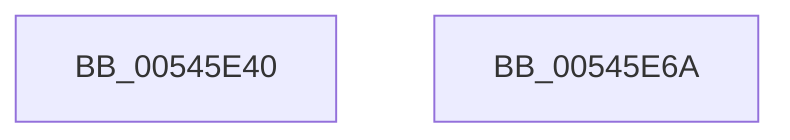

# HalRequestDeferredRecoveryServiceInterrupt

- RVA: `0x00545E40`–`0x00545E6B` (길이 `43` bytes)
- VA: `0x0000000140545E40`
- 실행 섹션: `.text`
- PDB 이름 있음: `예`; PDB Function 태그: `아니요`
- unwind 정보 RVA: `0x00063458`
- 디코드: `10`개 명령, `43/43` bytes 표시
- 미해석 바이트: `0` (있으면 어셈블리에 `.byte`로 보존)

> 이 문서는 커널 이미지의 기계어와 PDB 기호를 분석해 생성했습니다. 4번과 5번은 함수 원형과 자료형을 바이너리 사용 방식에서 추정한 C 해석이며 원본 소스 복구 결과는 아닙니다.

## 1. Dependencies

- 직접 호출 지점: **1**; 고유 호출 대상: **1**
- 직접 호출자로 확인된 함수: **1**
- RIP 상대 이미지 참조: **0**

### Outgoing calls
- `0x00545E60` → [HalpInterruptSendIpi](../25/HalpInterruptSendIpi_function_00252310.md) (function, `0x00252310`)

### Direct callers
- [WheaRequestDeferredRecovery](../66/WheaRequestDeferredRecovery_function_00660140.md) at `0x00660199`

### Static image references
- 디코드된 RIP-relative 메모리 참조가 없습니다.

## 2. Other-region calls and transfers

- 다른 실행 섹션으로 향하는 call: **0**
- 별도 외부 분기/꼬리 이동을 확인하지 못했습니다.

## 3. Assembly (complete function range)

```asm
00545E40  48 83 EC 48                     sub rsp, 0x48
00545E44  0F 57 C0                        xorps xmm0, xmm0
00545E47  48 C7 44 24 20 05 00 00 00      mov qword ptr [rsp + 0x20], 5
00545E50  BA E3 00 00 00                  mov edx, 0xe3
00545E55  48 8D 4C 24 20                  lea rcx, [rsp + 0x20]
00545E5A  F3 0F 7F 44 24 24               movdqu xmmword ptr [rsp + 0x24], xmm0
00545E60  E8 AB C4 D0 FF                  call 0x140252310
00545E65  48 83 C4 48                     add rsp, 0x48
00545E69  C3                              ret
00545E6A  CC                              int3
```

## 4. C-style interpretation (structured pseudocode)

```c
__int64 __fastcall HalRequestDeferredRecoveryServiceInterrupt(void)
{
    __int64 result;
    __int64 v_rsp;
    unsigned __int64 v_stack_m24;
    unsigned __int64 v_stack_m28;

    v_rsp = (v_rsp) - (72);
    v_stack_m28 = 5;
    v_stack_m24 = v_xmm0;
    result = HalpInterruptSendIpi(v_stack_m28, 227, a3, a4);
    v_rsp = (v_rsp) + (72);
    return result;
}
```

## 5. (Beta) C Style

```c
void HalRequestDeferredRecoveryServiceInterrupt(void)
{
    int64_t result;
    int64_t local_rsp;
    uint64_t v_stack_m24;
    uint64_t v_stack_m28;

    local_rsp = (local_rsp) - (72);
    v_stack_m28 = 5;
    v_stack_m24 = v_xmm0;
    result = HalpInterruptSendIpi(v_stack_m28, 227, a3, a4);
    local_rsp = (local_rsp) + (72);
    return result;
}
```

## 6. Execution-region graph

[열기: 2D/3D 그래프와 함수 탐색 컨트롤 패널](../../../control-panel.html?section=text&rva=0x00545E40&view=graph)

- 2D 그래프는 위에서 아래로 흐르고, 3D 그래프는 빈 공간을 드래그해 회전합니다. Shift+드래그는 이동, 휠은 확대·축소, 함수 노드 선택은 대상 보고서 이동입니다.

### Static fallback


