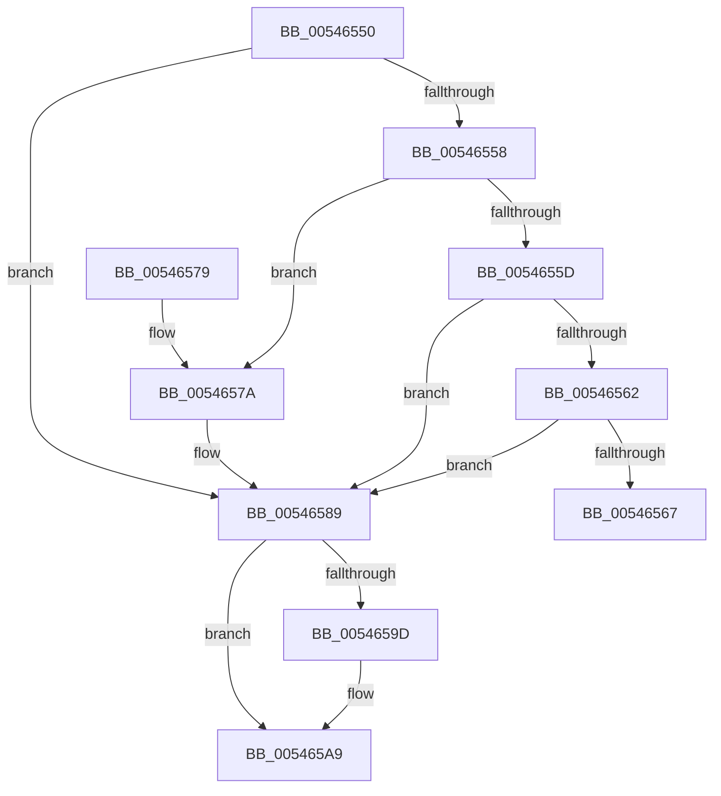

# HalReturnToFirmware

- RVA: `0x00546550`–`0x005465AF` (길이 `95` bytes)
- VA: `0x0000000140546550`
- 실행 섹션: `.text`
- PDB 이름 있음: `예`; PDB Function 태그: `아니요`
- unwind 정보 RVA: `0x000685EC`
- 디코드: `28`개 명령, `95/95` bytes 표시
- 미해석 바이트: `0` (있으면 어셈블리에 `.byte`로 보존)

> 이 문서는 커널 이미지의 기계어와 PDB 기호를 분석해 생성했습니다. 4번과 5번은 함수 원형과 자료형을 바이너리 사용 방식에서 추정한 C 해석이며 원본 소스 복구 결과는 아닙니다.

## 1. Dependencies

- 직접 호출 지점: **6**; 고유 호출 대상: **5**
- 직접 호출자로 확인된 함수: **10**
- RIP 상대 이미지 참조: **3**

### Outgoing calls
- `0x0054656E` → [DbgPrint](../35/DbgPrint_function_00358CB0.md) (function, `0x00358CB0`)
- `0x0054657F` → [KdPowerTransitionEx](../4D/KdPowerTransitionEx_function_004D9150.md) (function, `0x004D9150`)
- `0x00546584` → [HalpShutdown](HalpShutdown_function_005469AC.md) (function, `0x005469AC`)
- `0x0054658E` → [KdPowerTransitionEx](../4D/KdPowerTransitionEx_function_004D9150.md) (function, `0x004D9150`)
- `0x005465A4` → [guard_dispatch_icall](../6B/guard_dispatch_icall_function_006BAAD0.md) (function, `0x006BAAD0`)
- `0x005465A9` → [HalpReboot](HalpReboot_function_00546870.md) (function, `0x00546870`)

### Direct callers
- [HalpLegacyShutdown](HalpLegacyShutdown_function_00546710.md) at `0x00546719`
- [HalpShutdownReset](HalpShutdownReset_function_00546BA0.md) at `0x00546C02`
- [HaliAcpiSleep](../56/HaliAcpiSleep_function_0056AD60.md) at `0x0056B07E`
- [KeBugCheck2](../5B/KeBugCheck2_function_005B27D0.md) at `0x005B2C6F`
- [KeBugCheck2](../5B/KeBugCheck2_function_005B27D0.md) at `0x005B379E`
- [KiDeferredBugcheckRecoveryWorker](../5C/KiDeferredBugcheckRecoveryWorker_function_005C75A0.md) at `0x005C7765`
- [ExRebootSystemForRecovery](../65/ExRebootSystemForRecovery_function_00655924.md) at `0x006559D9`
- [PopSaveHiberContext](../../pagelk/B6/PopSaveHiberContext_function_00B6F050.md) at `0x00B6FA2C`
- [PopShutdownSystem](../../pagelk/B7/PopShutdownSystem_function_00B71784.md) at `0x00B71815`
- [PopShutdownSystem](../../pagelk/B7/PopShutdownSystem_function_00B71784.md) at `0x00B7181F`
- [KdpSendWaitContinue](../../pagekd/B8/KdpSendWaitContinue_function_00B8A32C.md) at `0x00B8A5E4`
- [HdlspBugCheckProcessing](../../pagehdls/BB/HdlspBugCheckProcessing_function_00BBD1F8.md) at `0x00BBD29D`

### Static image references
- `0x00546567` → RVA `0x00023D48` (`.rdata`; read)
- `0x00546593` → RVA `0x00E102F8` (`.data`; read)
- `0x0054659D` → RVA `0x00E00BB0` (`.data`; read)

## 2. Other-region calls and transfers

- 다른 실행 섹션으로 향하는 call: **0**
- 별도 외부 분기/꼬리 이동을 확인하지 못했습니다.

## 3. Assembly (complete function range)

```asm
00546550  48 83 EC 28                     sub rsp, 0x28
00546554  85 C9                           test ecx, ecx
00546556  74 31                           je 0x140546589
00546558  83 E9 01                        sub ecx, 1
0054655B  74 1D                           je 0x14054657a
0054655D  83 E9 01                        sub ecx, 1
00546560  74 27                           je 0x140546589
00546562  83 F9 01                        cmp ecx, 1
00546565  74 22                           je 0x140546589
00546567  48 8D 0D DA D7 AD FF            lea rcx, [rip - 0x522826]
0054656E  E8 3D 27 E1 FF                  call 0x140358cb0
00546573  CC                              int3
00546574  48 83 C4 28                     add rsp, 0x28
00546578  C3                              ret
00546579  CC                              int3
0054657A  33 D2                           xor edx, edx
0054657C  8D 4A 04                        lea ecx, [rdx + 4]
0054657F  E8 CC 2B F9 FF                  call 0x1404d9150
00546584  E8 23 04 00 00                  call 0x1405469ac
00546589  33 D2                           xor edx, edx
0054658B  8D 4A 04                        lea ecx, [rdx + 4]
0054658E  E8 BD 2B F9 FF                  call 0x1404d9150
00546593  48 83 3D 5D 9D 8C 00 00         cmp qword ptr [rip + 0x8c9d5d], 0
0054659B  74 0C                           je 0x1405465a9
0054659D  48 8B 05 0C A6 8B 00            mov rax, qword ptr [rip + 0x8ba60c]
005465A4  E8 27 45 17 00                  call 0x1406baad0
005465A9  E8 C2 02 00 00                  call 0x140546870
005465AE  CC                              int3
```

## 4. C-style interpretation (structured pseudocode)

```c
__int64 __fastcall HalReturnToFirmware(int a1, int a2)
{
    __int64 result;
    __int64 v_rsp;

    v_rsp = (v_rsp) - (40);
    if (a1 == 0) goto loc_00546589;
    a1 = (unsigned int)((a1) - (1));
    if (condition_is_equal) goto loc_0054657A;
    a1 = (unsigned int)((a1) - (1));
    if (condition_is_equal) goto loc_00546589;
    if (a1 == 1) goto loc_00546589;
    result = DbgPrint(v_rip - 5384230, a2, a3, a4);
    v_rsp = (v_rsp) + (40);
    return result;
loc_0054657A:
    a2 = 0;
    result = KdPowerTransitionEx(a2 + 4, a2, a3, a4);
    result = HalpShutdown(a2 + 4, a2, a3, a4);
loc_00546589:
    a2 = 0;
    result = KdPowerTransitionEx(a2 + 4, a2, a3, a4);
    if ((*(unsigned __int64 *)(v_rip + 9215325)) != 0) {
        result = *(unsigned __int64 *)(v_rip + 9152012);
        result = guard_dispatch_icall(a2 + 4, a2, a3, a4);
    }
    result = HalpReboot(a2 + 4, a2, a3, a4);
    return result;
}
```

## 5. (Beta) C Style

```c
int64_t HalReturnToFirmware(int32_t Arg1, int32_t Arg2)
{
    int64_t result;
    int64_t local_rsp;

    local_rsp = (local_rsp) - (40);
    if (Arg1 == 0) goto loc_00546589;
    Arg1 = (uint32_t)((Arg1) - (1));
    if (condition_is_equal) goto loc_0054657A;
    Arg1 = (uint32_t)((Arg1) - (1));
    if (condition_is_equal) goto loc_00546589;
    if (Arg1 == 1) goto loc_00546589;
    result = DbgPrint(v_rip - 5384230, Arg2, a3, a4);
    local_rsp = (local_rsp) + (40);
    return result;
loc_0054657A:
    Arg2 = 0;
    result = KdPowerTransitionEx(Arg2 + 4, Arg2, a3, a4);
    result = HalpShutdown(Arg2 + 4, Arg2, a3, a4);
loc_00546589:
    Arg2 = 0;
    result = KdPowerTransitionEx(Arg2 + 4, Arg2, a3, a4);
    if ((*(uint64_t *)(v_rip + 0x8C9D5D)) != 0) {
        result = *(uint64_t *)(v_rip + 0x8BA60C);
        result = guard_dispatch_icall(Arg2 + 4, Arg2, a3, a4);
    }
    result = HalpReboot(Arg2 + 4, Arg2, a3, a4);
    return result;
}
```

## 6. Execution-region graph

[열기: 2D/3D 그래프와 함수 탐색 컨트롤 패널](../../../control-panel.html?section=text&rva=0x00546550&view=graph)

- 2D 그래프는 위에서 아래로 흐르고, 3D 그래프는 빈 공간을 드래그해 회전합니다. Shift+드래그는 이동, 휠은 확대·축소, 함수 노드 선택은 대상 보고서 이동입니다.

### Static fallback


