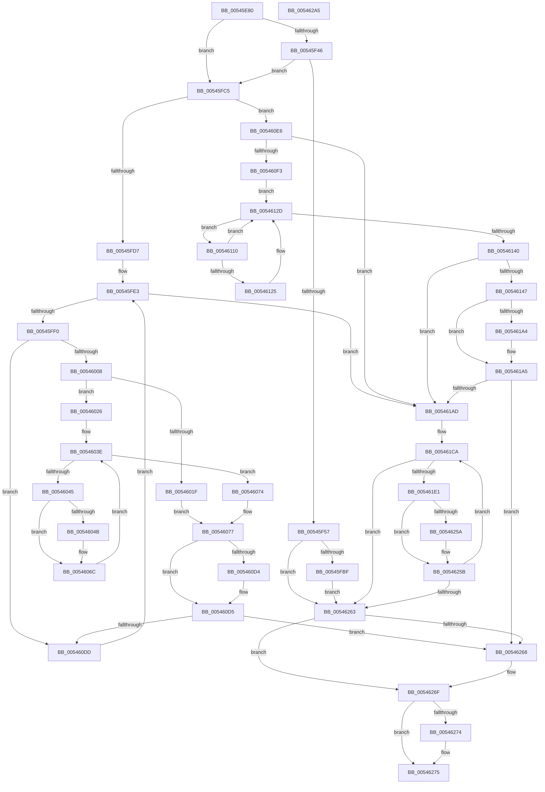

# HalSendNMI

- RVA: `0x00545E80`–`0x005462A6` (길이 `1,062` bytes)
- VA: `0x0000000140545E80`
- 실행 섹션: `.text`
- PDB 이름 있음: `예`; PDB Function 태그: `아니요`
- unwind 정보 RVA: `0x000C3CE4`
- 디코드: `257`개 명령, `1,062/1,062` bytes 표시
- 미해석 바이트: `0` (있으면 어셈블리에 `.byte`로 보존)

> 이 문서는 커널 이미지의 기계어와 PDB 기호를 분석해 생성했습니다. 4번과 5번은 함수 원형과 자료형을 바이너리 사용 방식에서 추정한 C 해석이며 원본 소스 복구 결과는 아닙니다.

## 1. Dependencies

- 직접 호출 지점: **18**; 고유 호출 대상: **9**
- 직접 호출자로 확인된 함수: **2**
- RIP 상대 이미지 참조: **12**

### Outgoing calls
- `0x00545EC7` → [HalpDisableInterrupts](../25/HalpDisableInterrupts_function_002521A0.md) (function, `0x002521A0`)
- `0x00545EFB` → [memset](../6C/memset_function_006C6C40.md) (function, `0x006C6C40`)
- `0x00545F25` → [memset](../6C/memset_function_006C6C40.md) (function, `0x006C6C40`)
- `0x00545F38` → [KeAndAffinityEx2](../3C/KeAndAffinityEx2_function_003C0740.md) (function, `0x003C0740`)
- `0x00545F4A` → [KeCountSetBitsAffinityEx](../2C/KeCountSetBitsAffinityEx_function_002CE6E0.md) (function, `0x002CE6E0`)
- `0x00545F84` → [HalpDisableInterrupts](../25/HalpDisableInterrupts_function_002521A0.md) (function, `0x002521A0`)
- `0x00545FAF` → [guard_dispatch_icall](../6B/guard_dispatch_icall_function_006BAAD0.md) (function, `0x006BAAD0`)
- `0x00545FFB` → [KeAndGroupAffinityEx](../2C/KeAndGroupAffinityEx_function_002CF6B0.md) (function, `0x002CF6B0`)
- `0x00546050` → [KeGetProcessorIndexFromNumber](../2D/KeGetProcessorIndexFromNumber_function_002DD2D0.md) (function, `0x002DD2D0`)
- `0x0054609B` → [HalpDisableInterrupts](../25/HalpDisableInterrupts_function_002521A0.md) (function, `0x002521A0`)
- `0x005460C7` → [guard_dispatch_icall](../6B/guard_dispatch_icall_function_006BAAD0.md) (function, `0x006BAAD0`)
- `0x00546137` → [KeEnumerateNextProcessor](../41/KeEnumerateNextProcessor_function_00415480.md) (function, `0x00415480`)
- `0x0054616B` → [HalpDisableInterrupts](../25/HalpDisableInterrupts_function_002521A0.md) (function, `0x002521A0`)
- `0x00546197` → [guard_dispatch_icall](../6B/guard_dispatch_icall_function_006BAAD0.md) (function, `0x006BAAD0`)
- `0x005461D4` → [KeEnumerateNextProcessor](../41/KeEnumerateNextProcessor_function_00415480.md) (function, `0x00415480`)
- `0x00546222` → [HalpDisableInterrupts](../25/HalpDisableInterrupts_function_002521A0.md) (function, `0x002521A0`)
- `0x0054624D` → [guard_dispatch_icall](../6B/guard_dispatch_icall_function_006BAAD0.md) (function, `0x006BAAD0`)
- `0x0054627F` → [_security_check_cookie](../6A/_security_check_cookie_function_006AC640.md) (function, `0x006AC640`)

### Direct callers
- [HalpNmiReboot](../55/HalpNmiReboot_function_0055B2D4.md) at `0x0055B390`
- [KiSendFreeze](../5C/KiSendFreeze_function_005C3364.md) at `0x005C3428`

### Static image references
- `0x00545EA6` → RVA `0x00E0A740` (`.data`; read)
- `0x00545F31` → RVA `0x00FC3900` (`.data`; read)
- `0x00545F3D` → RVA `0x00E0A790` (`.data`; read)
- `0x00545F4F` → RVA `0x00E0A78C` (`.data`; read)
- `0x00545F57` → RVA `0x00E102D8` (`.data`; read)
- `0x00545F75` → RVA `0x00E101F0` (`.data`; read)
- `0x00545FC5` → RVA `0x00F90698` (`.data`; read)
- `0x00545FD7` → RVA `0x00E102D0` (`.data`; read)
- `0x00545FE3` → RVA `0x00E102E0` (`.data`; read)
- `0x0054605B` → RVA `0x00E101E8` (`.data`; read)
- `0x005460E6` → RVA `0x00E10204` (`.data`; read)
- `0x00546268` → RVA `0x00E102E8` (`.data`; write)

## 2. Other-region calls and transfers

- 다른 실행 섹션으로 향하는 call: **0**
- 별도 외부 분기/꼬리 이동을 확인하지 못했습니다.

## 3. Assembly (complete function range)

```asm
00545E80  48 8B C4                        mov rax, rsp
00545E83  48 89 58 10                     mov qword ptr [rax + 0x10], rbx
00545E87  48 89 70 18                     mov qword ptr [rax + 0x18], rsi
00545E8B  48 89 78 20                     mov qword ptr [rax + 0x20], rdi
00545E8F  55                              push rbp
00545E90  41 54                           push r12
00545E92  41 55                           push r13
00545E94  41 56                           push r14
00545E96  41 57                           push r15
00545E98  48 8D A8 08 FF FF FF            lea rbp, [rax - 0xf8]
00545E9F  48 81 EC D0 01 00 00            sub rsp, 0x1d0
00545EA6  48 8B 05 93 48 8C 00            mov rax, qword ptr [rip + 0x8c4893]
00545EAD  48 33 C4                        xor rax, rsp
00545EB0  48 89 85 C0 00 00 00            mov qword ptr [rbp + 0xc0], rax
00545EB7  83 4C 24 38 FF                  or dword ptr [rsp + 0x38], 0xffffffff
00545EBC  4C 8B E9                        mov r13, rcx
00545EBF  C7 44 24 3C 02 00 00 00         mov dword ptr [rsp + 0x3c], 2
00545EC7  E8 D4 C2 D0 FF                  call 0x1402521a0
00545ECC  44 8A E0                        mov r12b, al
00545ECF  48 8D 4D B8                     lea rcx, [rbp - 0x48]
00545ED3  33 C0                           xor eax, eax
00545ED5  0F 57 C0                        xorps xmm0, xmm0
00545ED8  0F 57 C9                        xorps xmm1, xmm1
00545EDB  48 89 44 24 68                  mov qword ptr [rsp + 0x68], rax
00545EE0  BB 00 01 00 00                  mov ebx, 0x100
00545EE5  45 33 FF                        xor r15d, r15d
00545EE8  44 8B C3                        mov r8d, ebx
00545EEB  44 89 7C 24 30                  mov dword ptr [rsp + 0x30], r15d
00545EF0  33 D2                           xor edx, edx
00545EF2  0F 11 45 A0                     movups xmmword ptr [rbp - 0x60], xmm0
00545EF6  0F 11 4C 24 58                  movups xmmword ptr [rsp + 0x58], xmm1
00545EFB  E8 40 0D 18 00                  call 0x1406c6c40
00545F00  33 C0                           xor eax, eax
00545F02  48 C7 45 B0 01 00 20 00         mov qword ptr [rbp - 0x50], 0x200001
00545F0A  0F 57 C0                        xorps xmm0, xmm0
00545F0D  89 44 24 50                     mov dword ptr [rsp + 0x50], eax
00545F11  44 8B C3                        mov r8d, ebx
00545F14  48 8D 4D B8                     lea rcx, [rbp - 0x48]
00545F18  33 D2                           xor edx, edx
00545F1A  45 8B F7                        mov r14d, r15d
00545F1D  8D 78 01                        lea edi, [rax + 1]
00545F20  0F 11 44 24 40                  movups xmmword ptr [rsp + 0x40], xmm0
00545F25  E8 16 0D 18 00                  call 0x1406c6c40
00545F2A  4C 8D 45 B0                     lea r8, [rbp - 0x50]
00545F2E  49 8B D5                        mov rdx, r13
00545F31  48 8D 0D C8 D9 A7 00            lea rcx, [rip + 0xa7d9c8]
00545F38  E8 03 A8 E7 FF                  call 0x1403c0740
00545F3D  83 3D 4C 48 8C 00 03            cmp dword ptr [rip + 0x8c484c], 3
00545F44  75 7F                           jne 0x140545fc5
00545F46  48 8D 4D B0                     lea rcx, [rbp - 0x50]
00545F4A  E8 91 87 D8 FF                  call 0x1402ce6e0
00545F4F  3B 05 37 48 8C 00               cmp eax, dword ptr [rip + 0x8c4837]
00545F55  76 6E                           jbe 0x140545fc5
00545F57  48 8B 0D 7A A3 8C 00            mov rcx, qword ptr [rip + 0x8ca37a]
00545F5E  89 7C 24 40                     mov dword ptr [rsp + 0x40], edi
00545F62  8B 41 14                        mov eax, dword ptr [rcx + 0x14]
00545F65  89 44 24 74                     mov dword ptr [rsp + 0x74], eax
00545F69  8B 41 10                        mov eax, dword ptr [rcx + 0x10]
00545F6C  48 8B 4C 24 38                  mov rcx, qword ptr [rsp + 0x38]
00545F71  89 44 24 70                     mov dword ptr [rsp + 0x70], eax
00545F75  48 8B 05 74 A2 8C 00            mov rax, qword ptr [rip + 0x8ca274]
00545F7C  48 89 4D 88                     mov qword ptr [rbp - 0x78], rcx
00545F80  4C 8B 50 78                     mov r10, qword ptr [rax + 0x78]
00545F84  E8 17 C2 D0 FF                  call 0x1402521a0
00545F89  48 8B 0D 60 A2 8C 00            mov rcx, qword ptr [rip + 0x8ca260]
00545F90  4C 8D 44 24 40                  lea r8, [rsp + 0x40]
00545F95  8A D8                           mov bl, al
00545F97  48 8D 54 24 70                  lea rdx, [rsp + 0x70]
00545F9C  48 8D 45 88                     lea rax, [rbp - 0x78]
00545FA0  45 33 C9                        xor r9d, r9d
00545FA3  48 89 44 24 20                  mov qword ptr [rsp + 0x20], rax
00545FA8  49 8B C2                        mov rax, r10
00545FAB  48 8B 49 10                     mov rcx, qword ptr [rcx + 0x10]
00545FAF  E8 1C 4B 17 00                  call 0x1406baad0
00545FB4  44 8B F0                        mov r14d, eax
00545FB7  84 DB                           test bl, bl
00545FB9  0F 84 A4 02 00 00               je 0x140546263
00545FBF  FB                              sti
00545FC0  E9 9E 02 00 00                  jmp 0x140546263
00545FC5  44 38 3D CC A6 A4 00            cmp byte ptr [rip + 0xa4a6cc], r15b
00545FCC  48 8B 5C 24 38                  mov rbx, qword ptr [rsp + 0x38]
00545FD1  0F 84 0F 01 00 00               je 0x1405460e6
00545FD7  48 8B 35 F2 A2 8C 00            mov rsi, qword ptr [rip + 0x8ca2f2]
00545FDE  44 89 7C 24 30                  mov dword ptr [rsp + 0x30], r15d
00545FE3  48 3B 35 F6 A2 8C 00            cmp rsi, qword ptr [rip + 0x8ca2f6]
00545FEA  0F 83 BD 01 00 00               jae 0x1405461ad
00545FF0  48 8D 56 08                     lea rdx, [rsi + 8]
00545FF4  49 8B CD                        mov rcx, r13
00545FF7  4C 8D 45 A0                     lea r8, [rbp - 0x60]
00545FFB  E8 B0 96 D8 FF                  call 0x1402cf6b0
00546000  85 C0                           test eax, eax
00546002  0F 84 D5 00 00 00               je 0x1405460dd
00546008  83 3D 81 47 8C 00 02            cmp dword ptr [rip + 0x8c4781], 2
0054600F  C7 44 24 40 06 00 00 00         mov dword ptr [rsp + 0x40], 6
00546017  8B 06                           mov eax, dword ptr [rsi]
00546019  89 44 24 48                     mov dword ptr [rsp + 0x48], eax
0054601D  75 07                           jne 0x140546026
0054601F  83 4C 24 4C FF                  or dword ptr [rsp + 0x4c], 0xffffffff
00546024  EB 51                           jmp 0x140546077
00546026  48 8B 7D A0                     mov rdi, qword ptr [rbp - 0x60]
0054602A  45 32 F6                        xor r14b, r14b
0054602D  0F B7 45 A8                     movzx eax, word ptr [rbp - 0x58]
00546031  48 85 FF                        test rdi, rdi
00546034  66 89 44 24 30                  mov word ptr [rsp + 0x30], ax
00546039  44 89 7C 24 4C                  mov dword ptr [rsp + 0x4c], r15d
0054603E  44 88 74 24 32                  mov byte ptr [rsp + 0x32], r14b
00546043  74 2F                           je 0x140546074
00546045  40 F6 C7 01                     test dil, 1
00546049  74 21                           je 0x14054606c
0054604B  48 8D 4C 24 30                  lea rcx, [rsp + 0x30]
00546050  E8 7B 72 D9 FF                  call 0x1402dd2d0
00546055  8B C0                           mov eax, eax
00546057  48 8D 0C 40                     lea rcx, [rax + rax*2]
0054605B  48 8B 05 86 A1 8C 00            mov rax, qword ptr [rip + 0x8ca186]
00546062  44 0B 7C C8 0C                  or r15d, dword ptr [rax + rcx*8 + 0xc]
00546067  44 89 7C 24 4C                  mov dword ptr [rsp + 0x4c], r15d
0054606C  41 FE C6                        inc r14b
0054606F  48 D1 EF                        shr rdi, 1
00546072  EB CA                           jmp 0x14054603e
00546074  45 33 FF                        xor r15d, r15d
00546077  48 8B 0D 5A A2 8C 00            mov rcx, qword ptr [rip + 0x8ca25a]
0054607E  48 89 5D 90                     mov qword ptr [rbp - 0x70], rbx
00546082  8B 41 14                        mov eax, dword ptr [rcx + 0x14]
00546085  89 44 24 3C                     mov dword ptr [rsp + 0x3c], eax
00546089  8B 41 10                        mov eax, dword ptr [rcx + 0x10]
0054608C  89 44 24 38                     mov dword ptr [rsp + 0x38], eax
00546090  48 8B 05 59 A1 8C 00            mov rax, qword ptr [rip + 0x8ca159]
00546097  4C 8B 50 78                     mov r10, qword ptr [rax + 0x78]
0054609B  E8 00 C1 D0 FF                  call 0x1402521a0
005460A0  48 8B 0D 49 A1 8C 00            mov rcx, qword ptr [rip + 0x8ca149]
005460A7  4C 8D 44 24 40                  lea r8, [rsp + 0x40]
005460AC  40 8A F8                        mov dil, al
005460AF  48 8D 54 24 38                  lea rdx, [rsp + 0x38]
005460B4  48 8D 45 90                     lea rax, [rbp - 0x70]
005460B8  45 33 C9                        xor r9d, r9d
005460BB  48 89 44 24 20                  mov qword ptr [rsp + 0x20], rax
005460C0  49 8B C2                        mov rax, r10
005460C3  48 8B 49 10                     mov rcx, qword ptr [rcx + 0x10]
005460C7  E8 04 4A 17 00                  call 0x1406baad0
005460CC  44 8B F0                        mov r14d, eax
005460CF  40 84 FF                        test dil, dil
005460D2  74 01                           je 0x1405460d5
005460D4  FB                              sti
005460D5  85 C0                           test eax, eax
005460D7  0F 88 8B 01 00 00               js 0x140546268
005460DD  48 83 C6 18                     add rsi, 0x18
005460E1  E9 FD FE FF FF                  jmp 0x140545fe3
005460E6  44 38 3D 17 A1 8C 00            cmp byte ptr [rip + 0x8ca117], r15b
005460ED  0F 85 BA 00 00 00               jne 0x1405461ad
005460F3  49 8B 45 08                     mov rax, qword ptr [r13 + 8]
005460F7  48 89 44 24 60                  mov qword ptr [rsp + 0x60], rax
005460FC  C7 44 24 40 05 00 00 00         mov dword ptr [rsp + 0x40], 5
00546104  44 89 7C 24 48                  mov dword ptr [rsp + 0x48], r15d
00546109  4C 89 6C 24 58                  mov qword ptr [rsp + 0x58], r13
0054610E  EB 1D                           jmp 0x14054612d
00546110  8B 44 24 30                     mov eax, dword ptr [rsp + 0x30]
00546114  48 8B 0D CD A0 8C 00            mov rcx, qword ptr [rip + 0x8ca0cd]
0054611B  48 8D 04 40                     lea rax, [rax + rax*2]
0054611F  83 3C C1 05                     cmp dword ptr [rcx + rax*8], 5
00546123  75 08                           jne 0x14054612d
00546125  8B 44 C1 08                     mov eax, dword ptr [rcx + rax*8 + 8]
00546129  09 44 24 48                     or dword ptr [rsp + 0x48], eax
0054612D  48 8D 54 24 58                  lea rdx, [rsp + 0x58]
00546132  48 8D 4C 24 30                  lea rcx, [rsp + 0x30]
00546137  E8 44 F3 EC FF                  call 0x140415480
0054613C  85 C0                           test eax, eax
0054613E  74 D0                           je 0x140546110
00546140  44 39 7C 24 48                  cmp dword ptr [rsp + 0x48], r15d
00546145  74 66                           je 0x1405461ad
00546147  48 8B 0D 8A A1 8C 00            mov rcx, qword ptr [rip + 0x8ca18a]
0054614E  48 89 5D 98                     mov qword ptr [rbp - 0x68], rbx
00546152  8B 41 14                        mov eax, dword ptr [rcx + 0x14]
00546155  89 44 24 7C                     mov dword ptr [rsp + 0x7c], eax
00546159  8B 41 10                        mov eax, dword ptr [rcx + 0x10]
0054615C  89 44 24 78                     mov dword ptr [rsp + 0x78], eax
00546160  48 8B 05 89 A0 8C 00            mov rax, qword ptr [rip + 0x8ca089]
00546167  4C 8B 50 78                     mov r10, qword ptr [rax + 0x78]
0054616B  E8 30 C0 D0 FF                  call 0x1402521a0
00546170  48 8B 0D 79 A0 8C 00            mov rcx, qword ptr [rip + 0x8ca079]
00546177  4C 8D 44 24 40                  lea r8, [rsp + 0x40]
0054617C  40 8A F8                        mov dil, al
0054617F  48 8D 54 24 78                  lea rdx, [rsp + 0x78]
00546184  48 8D 45 98                     lea rax, [rbp - 0x68]
00546188  45 33 C9                        xor r9d, r9d
0054618B  48 89 44 24 20                  mov qword ptr [rsp + 0x20], rax
00546190  49 8B C2                        mov rax, r10
00546193  48 8B 49 10                     mov rcx, qword ptr [rcx + 0x10]
00546197  E8 34 49 17 00                  call 0x1406baad0
0054619C  44 8B F0                        mov r14d, eax
0054619F  40 84 FF                        test dil, dil
005461A2  74 01                           je 0x1405461a5
005461A4  FB                              sti
005461A5  85 C0                           test eax, eax
005461A7  0F 88 BB 00 00 00               js 0x140546268
005461AD  48 8B 45 B8                     mov rax, qword ptr [rbp - 0x48]
005461B1  48 89 44 24 60                  mov qword ptr [rsp + 0x60], rax
005461B6  48 8D 45 B0                     lea rax, [rbp - 0x50]
005461BA  48 89 44 24 58                  mov qword ptr [rsp + 0x58], rax
005461BF  44 89 7C 24 30                  mov dword ptr [rsp + 0x30], r15d
005461C4  66 44 89 7C 24 68               mov word ptr [rsp + 0x68], r15w
005461CA  48 8D 54 24 58                  lea rdx, [rsp + 0x58]
005461CF  48 8D 4C 24 30                  lea rcx, [rsp + 0x30]
005461D4  E8 A7 F2 EC FF                  call 0x140415480
005461D9  85 C0                           test eax, eax
005461DB  0F 85 82 00 00 00               jne 0x140546263
005461E1  8B 44 24 30                     mov eax, dword ptr [rsp + 0x30]
005461E5  C7 44 24 40 04 00 00 00         mov dword ptr [rsp + 0x40], 4
005461ED  48 89 5D A0                     mov qword ptr [rbp - 0x60], rbx
005461F1  48 8D 0C 40                     lea rcx, [rax + rax*2]
005461F5  48 8B 05 EC 9F 8C 00            mov rax, qword ptr [rip + 0x8c9fec]
005461FC  8B 4C C8 08                     mov ecx, dword ptr [rax + rcx*8 + 8]
00546200  89 4C 24 48                     mov dword ptr [rsp + 0x48], ecx
00546204  48 8B 0D CD A0 8C 00            mov rcx, qword ptr [rip + 0x8ca0cd]
0054620B  8B 41 14                        mov eax, dword ptr [rcx + 0x14]
0054620E  89 45 84                        mov dword ptr [rbp - 0x7c], eax
00546211  8B 41 10                        mov eax, dword ptr [rcx + 0x10]
00546214  89 45 80                        mov dword ptr [rbp - 0x80], eax
00546217  48 8B 05 D2 9F 8C 00            mov rax, qword ptr [rip + 0x8c9fd2]
0054621E  4C 8B 50 78                     mov r10, qword ptr [rax + 0x78]
00546222  E8 79 BF D0 FF                  call 0x1402521a0
00546227  48 8B 0D C2 9F 8C 00            mov rcx, qword ptr [rip + 0x8c9fc2]
0054622E  4C 8D 44 24 40                  lea r8, [rsp + 0x40]
00546233  40 8A F8                        mov dil, al
00546236  48 8D 55 80                     lea rdx, [rbp - 0x80]
0054623A  48 8D 45 A0                     lea rax, [rbp - 0x60]
0054623E  45 33 C9                        xor r9d, r9d
00546241  48 89 44 24 20                  mov qword ptr [rsp + 0x20], rax
00546246  49 8B C2                        mov rax, r10
00546249  48 8B 49 10                     mov rcx, qword ptr [rcx + 0x10]
0054624D  E8 7E 48 17 00                  call 0x1406baad0
00546252  44 8B F0                        mov r14d, eax
00546255  40 84 FF                        test dil, dil
00546258  74 01                           je 0x14054625b
0054625A  FB                              sti
0054625B  85 C0                           test eax, eax
0054625D  0F 89 67 FF FF FF               jns 0x1405461ca
00546263  45 85 F6                        test r14d, r14d
00546266  79 07                           jns 0x14054626f
00546268  C6 05 79 A0 8C 00 01            mov byte ptr [rip + 0x8ca079], 1
0054626F  45 84 E4                        test r12b, r12b
00546272  74 01                           je 0x140546275
00546274  FB                              sti
00546275  48 8B 8D C0 00 00 00            mov rcx, qword ptr [rbp + 0xc0]
0054627C  48 33 CC                        xor rcx, rsp
0054627F  E8 BC 63 16 00                  call 0x1406ac640
00546284  4C 8D 9C 24 D0 01 00 00         lea r11, [rsp + 0x1d0]
0054628C  49 8B 5B 38                     mov rbx, qword ptr [r11 + 0x38]
00546290  49 8B 73 40                     mov rsi, qword ptr [r11 + 0x40]
00546294  49 8B 7B 48                     mov rdi, qword ptr [r11 + 0x48]
00546298  49 8B E3                        mov rsp, r11
0054629B  41 5F                           pop r15
0054629D  41 5E                           pop r14
0054629F  41 5D                           pop r13
005462A1  41 5C                           pop r12
005462A3  5D                              pop rbp
005462A4  C3                              ret
005462A5  CC                              int3
```

## 4. C-style interpretation (structured pseudocode)

```c
__int64 __fastcall HalSendNMI(__int64 a1, int a2, __int64 a3, int a4)
{
    __int64 result;
    __int64 v_r14;
    __int64 v_r15;
    __int64 v_rdi;
    __int64 v_rsi;
    __int64 v_rsp;
    unsigned int v_stack_m17C;
    unsigned int v_stack_m180;
    unsigned int v_stack_m184;
    unsigned int v_stack_m188;
    unsigned __int64 v_stack_m190;
    unsigned __int64 v_stack_m198;
    unsigned __int64 v_stack_m1A0;
    unsigned int v_stack_m1A8;
    unsigned int v_stack_m1AC;
    unsigned int v_stack_m1B0;
    unsigned __int64 v_stack_m1B8;
    unsigned int v_stack_m1BC;
    unsigned int v_stack_m1C0;
    unsigned __int8 v_stack_m1C6;
    unsigned int v_stack_m1C8;
    unsigned __int64 v_stack_m1D8;
    unsigned __int64 v_stack_m28;

    *(unsigned __int64 *)(v_rsp + 16) = v_rbx;
    *(unsigned __int64 *)(v_rsp + 24) = v_rsi;
    *(unsigned __int64 *)(v_rsp + 32) = v_rdi;
    v_rsp = (v_rsp) - (464);
    result = (*(unsigned __int64 *)(v_rip + 9193619)) ^ (v_rsp);
    *(unsigned __int64 *)(v_rsp - 248 + 192) = result;
    v_stack_m1BC = 2;
    result = HalpDisableInterrupts(a1, a2, a3, a4);
    result = 0;
    v_stack_m190 = 0;
    v_r15 = 0;
    v_stack_m1C8 = 0;
    a2 = 0;
    *(unsigned __int64 *)(v_rsp - 248 - 96) = v_xmm0;
    v_stack_m1A0 = v_xmm1;
    result = memset(v_rsp - 248 - 72, a2, 256, a4);
    result = 0;
    *(unsigned __int64 *)(v_rsp - 248 - 80) = 0x200001ULL;
    v_stack_m1A8 = 0;
    a2 = 0;
    v_stack_m1B8 = v_xmm0;
    result = memset(v_rsp - 248 - 72, a2, 256, a4);
    result = KeAndAffinityEx2(v_rip + 11000264, a1, v_rsp - 248 - 80, a4);
    if ((*(unsigned int *)(v_rip + 9193548)) != 3) goto loc_00545FC5;
    result = KeCountSetBitsAffinityEx(v_rsp - 248 - 80, a1, v_rsp - 248 - 80, a4);
    if (((unsigned int)(result)) <= (*(unsigned int *)(v_rip + 9193527))) goto loc_00545FC5;
    v_stack_m1B8 = (unsigned int)(result + 1);
    v_stack_m184 = (unsigned int)((unsigned int)(*(unsigned int *)(*(unsigned __int64 *)(v_rip + 9216890) + 20)));
    v_stack_m188 = (unsigned int)((unsigned int)(*(unsigned int *)(*(unsigned __int64 *)(v_rip + 9216890) + 16)));
    *(unsigned __int64 *)(v_rsp - 248 - 120) = v_stack_m1C0;
    result = HalpDisableInterrupts(v_stack_m1C0, a1, v_rsp - 248 - 80, a4);
    a4 = 0;
    v_stack_m1D8 = v_rsp - 248 - 120;
    result = guard_dispatch_icall(*(unsigned __int64 *)(*(unsigned __int64 *)(v_rip + 9216608) + 16), v_stack_m188, v_stack_m1B8, a4);
    if ((unsigned __int8)((unsigned __int8)(result)) == 0) goto loc_00546263;
    goto loc_00546263;
loc_00545FC5:
    if ((*(unsigned __int8 *)(v_rip + 10790604)) == 0) goto loc_005460E6;
    v_stack_m1C8 = 0;
loc_00545FE3:
    if ((*(unsigned __int64 *)(v_rip + 9216754)) >= (*(unsigned __int64 *)(v_rip + 9216758))) goto loc_005461AD;
    result = KeAndGroupAffinityEx(a1, *(unsigned __int64 *)(v_rip + 9216754) + 8, v_rsp - 248 - 96, a4);
    if ((unsigned int)(result) == 0) goto loc_005460DD;
    v_stack_m1B8 = 6;
    v_stack_m1B0 = (unsigned int)((unsigned int)(*(unsigned int *)(*(unsigned __int64 *)(v_rip + 9216754))));
    if ((*(unsigned int *)(v_rip + 9193345)) != 2) goto loc_00546026;
    goto loc_00546077;
loc_00546026:
    v_r14 = 0;
    v_stack_m1C8 = (unsigned __int16)(*(unsigned __int16 *)(v_rsp - 248 - 88));
    v_stack_m1AC = 0;
loc_0054603E:
    v_stack_m1C6 = 0;
    if (*(unsigned __int64 *)(v_rsp - 248 - 96) == 0) goto loc_00546074;
    result = *(unsigned __int16 *)(v_rsp - 248 - 88);
    if ((((unsigned __int8)(*(unsigned __int64 *)(v_rsp - 248 - 96))) & (1)) != 0) {
        a1 = v_stack_m1C8;
        result = KeGetProcessorIndexFromNumber(a1, *(unsigned __int64 *)(v_rip + 9216754) + 8, v_rsp - 248 - 96, a4);
        result = (unsigned int)(result);
        a1 = result + result * 2;
        result = *(unsigned __int64 *)(v_rip + 9216390);
        v_r15 = (unsigned int)((v_r15) | (*(unsigned int *)(result + a1 * 8 + 12)));
        v_stack_m1AC = (unsigned int)(v_r15);
    }
    v_r14 = (unsigned __int8)((v_r14) + 1);
    v_rdi = (*(unsigned __int64 *)(v_rsp - 248 - 96)) >> (1);
    goto loc_0054603E;
loc_00546074:
    v_r15 = 0;
loc_00546077:
    *(unsigned __int64 *)(v_rsp - 248 - 112) = v_stack_m1C0;
    v_stack_m1BC = (unsigned int)((unsigned int)(*(unsigned int *)(*(unsigned __int64 *)(v_rip + 9216602) + 20)));
    v_stack_m1C0 = (unsigned int)((unsigned int)(*(unsigned int *)(*(unsigned __int64 *)(v_rip + 9216602) + 16)));
    result = HalpDisableInterrupts(*(unsigned __int64 *)(v_rip + 9216602), *(unsigned __int64 *)(v_rip + 9216754) + 8, v_rsp - 248 - 96, a4);
    a4 = 0;
    v_stack_m1D8 = v_rsp - 248 - 112;
    result = guard_dispatch_icall(*(unsigned __int64 *)(*(unsigned __int64 *)(v_rip + 9216329) + 16), v_stack_m1C0, v_stack_m1B8, a4);
    if ((unsigned __int8)((unsigned __int8)(result)) != 0) {
    }
    if (sign_flag) goto loc_00546268;
loc_005460DD:
    v_rsi = (*(unsigned __int64 *)(v_rip + 9216754)) + (24);
    goto loc_00545FE3;
loc_005460E6:
    if ((*(unsigned __int8 *)(v_rip + 9216279)) != 0) goto loc_005461AD;
    v_stack_m198 = *(unsigned __int64 *)(a1 + 8);
    v_stack_m1B8 = 5;
    v_stack_m1B0 = 0;
    v_stack_m1A0 = a1;
    goto loc_0054612D;
loc_00546110:
    result = (unsigned int)(v_stack_m1C8) + (unsigned int)(v_stack_m1C8) * 2;
    if ((*(unsigned int *)(*(unsigned __int64 *)(v_rip + 9216205) + (unsigned int)(v_stack_m1C8) + (unsigned int)(v_stack_m1C8) * 2 * 8)) == 5) {
        result = *(unsigned int *)(*(unsigned __int64 *)(v_rip + 9216205) + (unsigned int)(v_stack_m1C8) + (unsigned int)(v_stack_m1C8) * 2 * 8 + 8);
    }
    result = KeEnumerateNextProcessor(v_stack_m1C8, v_stack_m1A0, v_stack_m1B8, a4);
    if ((unsigned int)(result) == 0) goto loc_00546110;
    if (v_stack_m1B0 == 0) goto loc_005461AD;
    *(unsigned __int64 *)(v_rsp - 248 - 104) = v_stack_m1C0;
    v_stack_m17C = (unsigned int)((unsigned int)(*(unsigned int *)(*(unsigned __int64 *)(v_rip + 9216394) + 20)));
    v_stack_m180 = (unsigned int)((unsigned int)(*(unsigned int *)(*(unsigned __int64 *)(v_rip + 9216394) + 16)));
    result = HalpDisableInterrupts(*(unsigned __int64 *)(v_rip + 9216394), v_stack_m1A0, v_stack_m1B8, a4);
    a4 = 0;
    v_stack_m1D8 = v_rsp - 248 - 104;
    result = guard_dispatch_icall(*(unsigned __int64 *)(*(unsigned __int64 *)(v_rip + 9216121) + 16), v_stack_m180, v_stack_m1B8, a4);
    if ((unsigned __int8)((unsigned __int8)(result)) != 0) {
    }
    if (sign_flag) goto loc_00546268;
loc_005461AD:
    v_stack_m198 = *(unsigned __int64 *)(v_rsp - 248 - 72);
    v_stack_m1A0 = v_rsp - 248 - 80;
    v_stack_m1C8 = 0;
    v_stack_m190 = 0;
loc_005461CA:
    result = KeEnumerateNextProcessor(v_stack_m1C8, v_stack_m1A0, v_stack_m1B8, a4);
    if ((unsigned int)(result) != 0) goto loc_00546263;
    v_stack_m1B8 = 4;
    *(unsigned __int64 *)(v_rsp - 248 - 96) = v_stack_m1C0;
    v_stack_m1B0 = (unsigned int)((unsigned int)(*(unsigned int *)(*(unsigned __int64 *)(v_rip + 9215980) + (unsigned int)(v_stack_m1C8) + (unsigned int)(v_stack_m1C8) * 2 * 8 + 8)));
    *(unsigned int *)(v_rsp - 248 - 124) = (unsigned int)((unsigned int)(*(unsigned int *)(*(unsigned __int64 *)(v_rip + 9216205) + 20)));
    *(unsigned int *)(v_rsp - 248 - 128) = (unsigned int)((unsigned int)(*(unsigned int *)(*(unsigned __int64 *)(v_rip + 9216205) + 16)));
    result = HalpDisableInterrupts(*(unsigned __int64 *)(v_rip + 9216205), v_stack_m1A0, v_stack_m1B8, a4);
    a4 = 0;
    v_stack_m1D8 = v_rsp - 248 - 96;
    result = guard_dispatch_icall(*(unsigned __int64 *)(*(unsigned __int64 *)(v_rip + 9215938) + 16), v_rsp - 248 - 128, v_stack_m1B8, a4);
    if ((unsigned __int8)((unsigned __int8)(result)) != 0) {
    }
    if (!sign_flag) goto loc_005461CA;
loc_00546263:
    if (sign_flag) {
        *(unsigned __int8 *)(v_rip + 9216121) = 1;
    }
    if ((unsigned __int8)((unsigned __int8)(result)) != 0) {
    }
    a1 = (*(unsigned __int64 *)(v_rsp - 248 + 192)) ^ (v_rsp);
    result = _security_check_cookie(a1, v_rsp - 248 - 128, v_stack_m1B8, a4);
    return result;
}
```

## 5. (Beta) C Style

```c
int64_t HalSendNMI(void *Arg1, int32_t Arg2, int64_t Arg3, int32_t Arg4)
{
    uint8_t *arg1 = (uint8_t *)Arg1;

    int64_t result;
    int64_t local_r14;
    int64_t local_r15;
    int64_t local_rdi;
    int64_t local_rsi;
    int64_t local_rsp;
    uint32_t v_stack_m17C;
    uint32_t v_stack_m180;
    uint32_t v_stack_m184;
    uint32_t v_stack_m188;
    uint64_t v_stack_m190;
    uint64_t v_stack_m198;
    uint64_t v_stack_m1A0;
    uint32_t v_stack_m1A8;
    uint32_t v_stack_m1AC;
    uint32_t v_stack_m1B0;
    uint64_t v_stack_m1B8;
    uint32_t v_stack_m1BC;
    uint32_t v_stack_m1C0;
    uint8_t v_stack_m1C6;
    uint32_t v_stack_m1C8;
    uint64_t v_stack_m1D8;
    uint64_t v_stack_m28;

    *(uint64_t *)(local_rsp + 0x10) = local_rbx;
    *(uint64_t *)(local_rsp + 0x18) = local_rsi;
    *(uint64_t *)(local_rsp + 0x20) = local_rdi;
    local_rsp = (local_rsp) - (464);
    result = (*(uint64_t *)(v_rip + 0x8C4893)) ^ (local_rsp);
    *(uint64_t *)(local_rsp - 0xF8 + 0xC0) = result;
    v_stack_m1BC = 2;
    result = HalpDisableInterrupts(Arg1, Arg2, Arg3, Arg4);
    result = 0;
    v_stack_m190 = 0;
    local_r15 = 0;
    v_stack_m1C8 = 0;
    Arg2 = 0;
    *(uint64_t *)(local_rsp - 0xF8 - 0x60) = v_xmm0;
    v_stack_m1A0 = v_xmm1;
    result = memset(local_rsp - 248 - 72, Arg2, 256, Arg4);
    result = 0;
    *(uint64_t *)(local_rsp - 0xF8 - 0x50) = 0x200001ULL;
    v_stack_m1A8 = 0;
    Arg2 = 0;
    v_stack_m1B8 = v_xmm0;
    result = memset(local_rsp - 248 - 72, Arg2, 256, Arg4);
    result = KeAndAffinityEx2(v_rip + 11000264, Arg1, local_rsp - 248 - 80, Arg4);
    if ((*(uint32_t *)(v_rip + 0x8C484C)) != 3) goto loc_00545FC5;
    result = KeCountSetBitsAffinityEx(local_rsp - 248 - 80, Arg1, local_rsp - 248 - 80, Arg4);
    if (((uint32_t)(result)) <= (*(uint32_t *)(v_rip + 0x8C4837))) goto loc_00545FC5;
    v_stack_m1B8 = (uint32_t)(result + 1);
    v_stack_m184 = (uint32_t)((uint32_t)(*(uint32_t *)(*(uint64_t *)(v_rip + 0x8CA37A) + 0x14)));
    v_stack_m188 = (uint32_t)((uint32_t)(*(uint32_t *)(*(uint64_t *)(v_rip + 0x8CA37A) + 0x10)));
    *(uint64_t *)(local_rsp - 0xF8 - 0x78) = v_stack_m1C0;
    result = HalpDisableInterrupts(v_stack_m1C0, Arg1, local_rsp - 248 - 80, Arg4);
    Arg4 = 0;
    v_stack_m1D8 = local_rsp - 248 - 120;
    result = guard_dispatch_icall(*(uint64_t *)(*(uint64_t *)(v_rip + 0x8CA260) + 0x10), v_stack_m188, v_stack_m1B8, Arg4);
    if ((uint8_t)((uint8_t)(result)) == 0) goto loc_00546263;
    goto loc_00546263;
loc_00545FC5:
    if ((*(uint8_t *)(v_rip + 0xA4A6CC)) == 0) goto loc_005460E6;
    v_stack_m1C8 = 0;
loc_00545FE3:
    if ((*(uint64_t *)(v_rip + 0x8CA2F2)) >= (*(uint64_t *)(v_rip + 0x8CA2F6))) goto loc_005461AD;
    result = KeAndGroupAffinityEx(Arg1, *(uint64_t *)(v_rip + 0x8CA2F2) + 8, local_rsp - 248 - 96, Arg4);
    if ((uint32_t)(result) == 0) goto loc_005460DD;
    v_stack_m1B8 = 6;
    v_stack_m1B0 = (uint32_t)((uint32_t)(*(uint32_t *)(*(uint64_t *)(v_rip + 0x8CA2F2))));
    if ((*(uint32_t *)(v_rip + 0x8C4781)) != 2) goto loc_00546026;
    goto loc_00546077;
loc_00546026:
    local_r14 = 0;
    v_stack_m1C8 = (uint16_t)(*(uint16_t *)(local_rsp - 0xF8 - 0x58));
    v_stack_m1AC = 0;
loc_0054603E:
    v_stack_m1C6 = 0;
    if (*(uint64_t *)(local_rsp - 0xF8 - 0x60) == 0) goto loc_00546074;
    result = *(uint16_t *)(local_rsp - 0xF8 - 0x58);
    if ((((uint8_t)(*(uint64_t *)(local_rsp - 0xF8 - 0x60))) & (1)) != 0) {
        Arg1 = v_stack_m1C8;
        result = KeGetProcessorIndexFromNumber(Arg1, *(uint64_t *)(v_rip + 0x8CA2F2) + 8, local_rsp - 248 - 96, Arg4);
        result = (uint32_t)(result);
        Arg1 = result + result * 2;
        result = *(uint64_t *)(v_rip + 0x8CA186);
        local_r15 = (uint32_t)((local_r15) | (*(uint32_t *)(result + arg1 * 8 + 0xC)));
        v_stack_m1AC = (uint32_t)(local_r15);
    }
    local_r14 = (uint8_t)((local_r14) + 1);
    local_rdi = (*(uint64_t *)(local_rsp - 0xF8 - 0x60)) >> (1);
    goto loc_0054603E;
loc_00546074:
    local_r15 = 0;
loc_00546077:
    *(uint64_t *)(local_rsp - 0xF8 - 0x70) = v_stack_m1C0;
    v_stack_m1BC = (uint32_t)((uint32_t)(*(uint32_t *)(*(uint64_t *)(v_rip + 0x8CA25A) + 0x14)));
    v_stack_m1C0 = (uint32_t)((uint32_t)(*(uint32_t *)(*(uint64_t *)(v_rip + 0x8CA25A) + 0x10)));
    result = HalpDisableInterrupts(*(uint64_t *)(v_rip + 0x8CA25A), *(uint64_t *)(v_rip + 0x8CA2F2) + 8, local_rsp - 248 - 96, Arg4);
    Arg4 = 0;
    v_stack_m1D8 = local_rsp - 248 - 112;
    result = guard_dispatch_icall(*(uint64_t *)(*(uint64_t *)(v_rip + 0x8CA149) + 0x10), v_stack_m1C0, v_stack_m1B8, Arg4);
    if ((uint8_t)((uint8_t)(result)) != 0) {
    }
    if (sign_flag) goto loc_00546268;
loc_005460DD:
    local_rsi = (*(uint64_t *)(v_rip + 0x8CA2F2)) + (24);
    goto loc_00545FE3;
loc_005460E6:
    if ((*(uint8_t *)(v_rip + 0x8CA117)) != 0) goto loc_005461AD;
    v_stack_m198 = *(uint64_t *)(arg1 + 0x8);
    v_stack_m1B8 = 5;
    v_stack_m1B0 = 0;
    v_stack_m1A0 = Arg1;
    goto loc_0054612D;
loc_00546110:
    result = (uint32_t)(v_stack_m1C8) + (uint32_t)(v_stack_m1C8) * 2;
    if ((*(uint32_t *)(*(uint64_t *)(v_rip + 0x8CA0CD) + (uint32_t)(v_stack_m1C8) + (uint32_t)(v_stack_m1C8) * 2 * 8)) == 5) {
        result = *(uint32_t *)(*(uint64_t *)(v_rip + 0x8CA0CD) + (uint32_t)(v_stack_m1C8) + (uint32_t)(v_stack_m1C8) * 2 * 8 + 0x8);
    }
    result = KeEnumerateNextProcessor(v_stack_m1C8, v_stack_m1A0, v_stack_m1B8, Arg4);
    if ((uint32_t)(result) == 0) goto loc_00546110;
    if (v_stack_m1B0 == 0) goto loc_005461AD;
    *(uint64_t *)(local_rsp - 0xF8 - 0x68) = v_stack_m1C0;
    v_stack_m17C = (uint32_t)((uint32_t)(*(uint32_t *)(*(uint64_t *)(v_rip + 0x8CA18A) + 0x14)));
    v_stack_m180 = (uint32_t)((uint32_t)(*(uint32_t *)(*(uint64_t *)(v_rip + 0x8CA18A) + 0x10)));
    result = HalpDisableInterrupts(*(uint64_t *)(v_rip + 0x8CA18A), v_stack_m1A0, v_stack_m1B8, Arg4);
    Arg4 = 0;
    v_stack_m1D8 = local_rsp - 248 - 104;
    result = guard_dispatch_icall(*(uint64_t *)(*(uint64_t *)(v_rip + 0x8CA079) + 0x10), v_stack_m180, v_stack_m1B8, Arg4);
    if ((uint8_t)((uint8_t)(result)) != 0) {
    }
    if (sign_flag) goto loc_00546268;
loc_005461AD:
    v_stack_m198 = *(uint64_t *)(local_rsp - 0xF8 - 0x48);
    v_stack_m1A0 = local_rsp - 248 - 80;
    v_stack_m1C8 = 0;
    v_stack_m190 = 0;
loc_005461CA:
    result = KeEnumerateNextProcessor(v_stack_m1C8, v_stack_m1A0, v_stack_m1B8, Arg4);
    if ((uint32_t)(result) != 0) goto loc_00546263;
    v_stack_m1B8 = 4;
    *(uint64_t *)(local_rsp - 0xF8 - 0x60) = v_stack_m1C0;
    v_stack_m1B0 = (uint32_t)((uint32_t)(*(uint32_t *)(*(uint64_t *)(v_rip + 0x8C9FEC) + (uint32_t)(v_stack_m1C8) + (uint32_t)(v_stack_m1C8) * 2 * 8 + 0x8)));
    *(uint32_t *)(local_rsp - 0xF8 - 0x7C) = (uint32_t)((uint32_t)(*(uint32_t *)(*(uint64_t *)(v_rip + 0x8CA0CD) + 0x14)));
    *(uint32_t *)(local_rsp - 0xF8 - 0x80) = (uint32_t)((uint32_t)(*(uint32_t *)(*(uint64_t *)(v_rip + 0x8CA0CD) + 0x10)));
    result = HalpDisableInterrupts(*(uint64_t *)(v_rip + 0x8CA0CD), v_stack_m1A0, v_stack_m1B8, Arg4);
    Arg4 = 0;
    v_stack_m1D8 = local_rsp - 248 - 96;
    result = guard_dispatch_icall(*(uint64_t *)(*(uint64_t *)(v_rip + 0x8C9FC2) + 0x10), local_rsp - 248 - 128, v_stack_m1B8, Arg4);
    if ((uint8_t)((uint8_t)(result)) != 0) {
    }
    if (!sign_flag) goto loc_005461CA;
loc_00546263:
    if (sign_flag) {
        *(uint8_t *)(v_rip + 0x8CA079) = 1;
    }
    if ((uint8_t)((uint8_t)(result)) != 0) {
    }
    Arg1 = (*(uint64_t *)(local_rsp - 0xF8 + 0xC0)) ^ (local_rsp);
    result = _security_check_cookie(Arg1, local_rsp - 248 - 128, v_stack_m1B8, Arg4);
    return result;
}
```

### 관측된 메모리 오프셋

구조체 형식이 확인되지 않은 접근은 인자 기준의 오프셋으로만 기록했습니다.

| 기준 인자 | 오프셋 표현 | 폭 (bit) | 접근 |
|---|---:|---:|---|
| `Arg1` | `+ 0x8` | `64` | `R` |

## 6. Execution-region graph

[열기: 2D/3D 그래프와 함수 탐색 컨트롤 패널](../../../control-panel.html?section=text&rva=0x00545E80&view=graph)

- 2D 그래프는 위에서 아래로 흐르고, 3D 그래프는 빈 공간을 드래그해 회전합니다. Shift+드래그는 이동, 휠은 확대·축소, 함수 노드 선택은 대상 보고서 이동입니다.

### Static fallback


