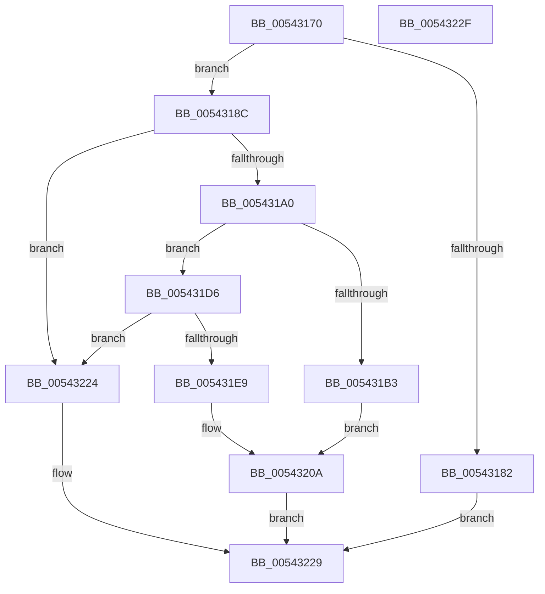

# HalSetEnvironmentVariable

- RVA: `0x00543170`–`0x00543230` (길이 `192` bytes)
- VA: `0x0000000140543170`
- 실행 섹션: `.text`
- PDB 이름 있음: `예`; PDB Function 태그: `아니요`
- unwind 정보 RVA: `0x0005CF00`
- 디코드: `67`개 명령, `192/192` bytes 표시
- 미해석 바이트: `0` (있으면 어셈블리에 `.byte`로 보존)

> 이 문서는 커널 이미지의 기계어와 PDB 기호를 분석해 생성했습니다. 4번과 5번은 함수 원형과 자료형을 바이너리 사용 방식에서 추정한 C 해석이며 원본 소스 복구 결과는 아닙니다.

## 1. Dependencies

- 직접 호출 지점: **6**; 고유 호출 대상: **3**
- 직접 호출자로 확인된 함수: **1**
- RIP 상대 이미지 참조: **4**

### Outgoing calls
- `0x00543193` → [stricmp](../4F/stricmp_function_004FFD80.md) (function, `0x004FFD80`)
- `0x005431AA` → [stricmp](../4F/stricmp_function_004FFD80.md) (function, `0x004FFD80`)
- `0x005431B3` → [HalpAcquireCmosSpinLock](../42/HalpAcquireCmosSpinLock_function_0042DEE8.md) (function, `0x0042DEE8`)
- `0x005431E0` → [stricmp](../4F/stricmp_function_004FFD80.md) (function, `0x004FFD80`)
- `0x005431E9` → [HalpAcquireCmosSpinLock](../42/HalpAcquireCmosSpinLock_function_0042DEE8.md) (function, `0x0042DEE8`)
- `0x0054321B` → [HalpReleaseCmosSpinLock](../42/HalpReleaseCmosSpinLock_function_0042DE04.md) (function, `0x0042DE04`)

### Direct callers
- [NtSetSystemEnvironmentValue](../../page/7C/NtSetSystemEnvironmentValue_function_007CE650.md) at `0x007CE90B`

### Static image references
- `0x00543176` → RVA `0x00FC1A28` (`.data`; read)
- `0x0054318C` → RVA `0x00023AD0` (`.rdata`; read)
- `0x005431A0` → RVA `0x00023AC4` (`.rdata`; read)
- `0x005431D6` → RVA `0x00023ABC` (`.rdata`; read)

## 2. Other-region calls and transfers

- 다른 실행 섹션으로 향하는 call: **0**
- 별도 외부 분기/꼬리 이동을 확인하지 못했습니다.

## 3. Assembly (complete function range)

```asm
00543170  40 53                           push rbx
00543172  48 83 EC 20                     sub rsp, 0x20
00543176  80 3D AB E8 A7 00 00            cmp byte ptr [rip + 0xa7e8ab], 0
0054317D  48 8B DA                        mov rbx, rdx
00543180  74 0A                           je 0x14054318c
00543182  B8 07 00 00 00                  mov eax, 7
00543187  E9 9D 00 00 00                  jmp 0x140543229
0054318C  48 8D 15 3D 09 AE FF            lea rdx, [rip - 0x51f6c3]
00543193  E8 E8 CB FB FF                  call 0x1404ffd80
00543198  85 C0                           test eax, eax
0054319A  0F 85 84 00 00 00               jne 0x140543224
005431A0  48 8D 15 1D 09 AE FF            lea rdx, [rip - 0x51f6e3]
005431A7  48 8B CB                        mov rcx, rbx
005431AA  E8 D1 CB FB FF                  call 0x1404ffd80
005431AF  85 C0                           test eax, eax
005431B1  75 23                           jne 0x1405431d6
005431B3  E8 30 AD EE FF                  call 0x14042dee8
005431B8  90                              nop
005431B9  41 B8 70 00 00 00               mov r8d, 0x70
005431BF  41 8B D0                        mov edx, r8d
005431C2  B0 0B                           mov al, 0xb
005431C4  EE                              out dx, al
005431C5  90                              nop
005431C6  90                              nop
005431C7  45 8D 48 01                     lea r9d, [r8 + 1]
005431CB  41 8B D1                        mov edx, r9d
005431CE  EC                              in al, dx
005431CF  8A C8                           mov cl, al
005431D1  80 C9 01                        or cl, 1
005431D4  EB 34                           jmp 0x14054320a
005431D6  48 8D 15 DF 08 AE FF            lea rdx, [rip - 0x51f721]
005431DD  48 8B CB                        mov rcx, rbx
005431E0  E8 9B CB FB FF                  call 0x1404ffd80
005431E5  85 C0                           test eax, eax
005431E7  75 3B                           jne 0x140543224
005431E9  E8 FA AC EE FF                  call 0x14042dee8
005431EE  90                              nop
005431EF  41 B8 70 00 00 00               mov r8d, 0x70
005431F5  41 8B D0                        mov edx, r8d
005431F8  B0 0B                           mov al, 0xb
005431FA  EE                              out dx, al
005431FB  90                              nop
005431FC  90                              nop
005431FD  45 8D 48 01                     lea r9d, [r8 + 1]
00543201  41 8B D1                        mov edx, r9d
00543204  EC                              in al, dx
00543205  8A C8                           mov cl, al
00543207  80 E1 FE                        and cl, 0xfe
0054320A  90                              nop
0054320B  B0 0B                           mov al, 0xb
0054320D  90                              nop
0054320E  41 8B D0                        mov edx, r8d
00543211  EE                              out dx, al
00543212  90                              nop
00543213  8A C1                           mov al, cl
00543215  90                              nop
00543216  41 8B D1                        mov edx, r9d
00543219  EE                              out dx, al
0054321A  90                              nop
0054321B  E8 E4 AB EE FF                  call 0x14042de04
00543220  33 C0                           xor eax, eax
00543222  EB 05                           jmp 0x140543229
00543224  B8 10 00 00 00                  mov eax, 0x10
00543229  48 83 C4 20                     add rsp, 0x20
0054322D  5B                              pop rbx
0054322E  C3                              ret
0054322F  CC                              int3
```

## 4. C-style interpretation (structured pseudocode)

```c
__int64 __fastcall HalSetEnvironmentVariable(__int64 a1, __int64 a2)
{
    __int64 result;
    __int64 v_rsp;

    v_rsp = (v_rsp) - (32);
    if ((*(unsigned __int8 *)(v_rip + 11004075)) == 0) goto loc_0054318C;
    goto loc_00543229;
loc_0054318C:
    result = stricmp(a1, v_rip - 5371587, a3, a4);
    if ((unsigned int)(result) != 0) goto loc_00543224;
    result = stricmp(a2, v_rip - 5371619, a3, a4);
    if ((unsigned int)(result) != 0) goto loc_005431D6;
    result = HalpAcquireCmosSpinLock(a2, v_rip - 5371619, a3, a4);
    a1 = (unsigned __int8)((11) | (1));
    goto loc_0054320A;
loc_005431D6:
    result = stricmp(a2, v_rip - 5371681, 112, 112 + 1);
    if ((unsigned int)(result) != 0) goto loc_00543224;
    result = HalpAcquireCmosSpinLock(a2, v_rip - 5371681, 112, 112 + 1);
    a1 = (unsigned __int8)((11) & (254));
loc_0054320A:
    result = HalpReleaseCmosSpinLock(a1, (unsigned int)((unsigned int)(112 + 1)), 112, 112 + 1);
    result = 0;
    goto loc_00543229;
loc_00543224:
loc_00543229:
    v_rsp = (v_rsp) + (32);
    return 16;
}
```

## 5. (Beta) C Style

```c
int64_t HalSetEnvironmentVariable(int64_t Arg1, int64_t Arg2)
{
    int64_t result;
    int64_t local_rsp;

    local_rsp = (local_rsp) - (32);
    if ((*(uint8_t *)(v_rip + 0xA7E8AB)) == 0) goto loc_0054318C;
    goto loc_00543229;
loc_0054318C:
    result = stricmp(Arg1, v_rip - 5371587, a3, a4);
    if ((uint32_t)(result) != 0) goto loc_00543224;
    result = stricmp(Arg2, v_rip - 5371619, a3, a4);
    if ((uint32_t)(result) != 0) goto loc_005431D6;
    result = HalpAcquireCmosSpinLock(Arg2, v_rip - 5371619, a3, a4);
    Arg1 = (uint8_t)((11) | (1));
    goto loc_0054320A;
loc_005431D6:
    result = stricmp(Arg2, v_rip - 5371681, 112, 112 + 1);
    if ((uint32_t)(result) != 0) goto loc_00543224;
    result = HalpAcquireCmosSpinLock(Arg2, v_rip - 5371681, 112, 112 + 1);
    Arg1 = (uint8_t)((11) & (254));
loc_0054320A:
    result = HalpReleaseCmosSpinLock(Arg1, (uint32_t)((uint32_t)(112 + 1)), 112, 112 + 1);
    result = 0;
    goto loc_00543229;
loc_00543224:
loc_00543229:
    local_rsp = (local_rsp) + (32);
    return 16;
}
```

## 6. Execution-region graph

[열기: 2D/3D 그래프와 함수 탐색 컨트롤 패널](../../../control-panel.html?section=text&rva=0x00543170&view=graph)

- 2D 그래프는 위에서 아래로 흐르고, 3D 그래프는 빈 공간을 드래그해 회전합니다. Shift+드래그는 이동, 휠은 확대·축소, 함수 노드 선택은 대상 보고서 이동입니다.

### Static fallback


