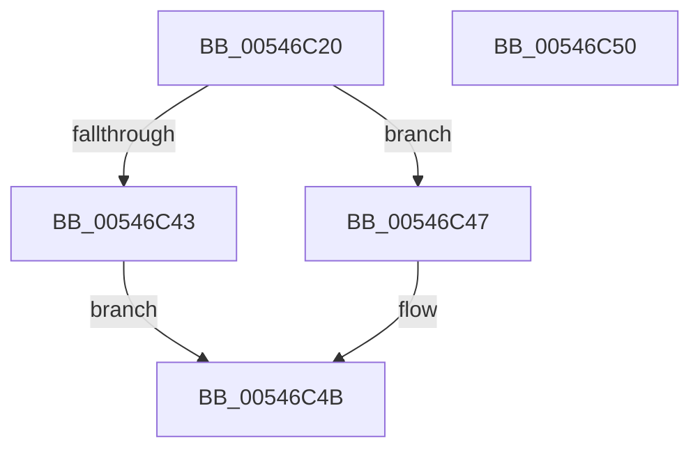

# HalSetProfileInterval

- RVA: `0x00546C20`–`0x00546C51` (길이 `49` bytes)
- VA: `0x0000000140546C20`
- 실행 섹션: `.text`
- PDB 이름 있음: `예`; PDB Function 태그: `아니요`
- unwind 정보 RVA: `0x0005C788`
- 디코드: `15`개 명령, `49/49` bytes 표시
- 미해석 바이트: `0` (있으면 어셈블리에 `.byte`로 보존)

> 이 문서는 커널 이미지의 기계어와 PDB 기호를 분석해 생성했습니다. 4번과 5번은 함수 원형과 자료형을 바이너리 사용 방식에서 추정한 C 해석이며 원본 소스 복구 결과는 아닙니다.

## 1. Dependencies

- 직접 호출 지점: **1**; 고유 호출 대상: **1**
- 직접 호출자로 확인된 함수: **0**
- RIP 상대 이미지 참조: **1**

### Outgoing calls
- `0x00546C3A` → [guard_dispatch_icall](../6B/guard_dispatch_icall_function_006BAAD0.md) (function, `0x006BAAD0`)

### Direct callers
- 이 함수 시작 RVA로 연결되는 직접 call은 확인되지 않았습니다. 간접 호출은 완전히 역산할 수 없습니다.

### Static image references
- `0x00546C24` → RVA `0x00E03B20` (`.data`; read)

## 2. Other-region calls and transfers

- 다른 실행 섹션으로 향하는 call: **0**
- 별도 외부 분기/꼬리 이동을 확인하지 못했습니다.

## 3. Assembly (complete function range)

```asm
00546C20  48 83 EC 28                     sub rsp, 0x28
00546C24  48 8B 05 F5 CE 8B 00            mov rax, qword ptr [rip + 0x8bcef5]
00546C2B  48 8D 54 24 30                  lea rdx, [rsp + 0x30]
00546C30  89 4C 24 30                     mov dword ptr [rsp + 0x30], ecx
00546C34  33 C9                           xor ecx, ecx
00546C36  48 8B 40 18                     mov rax, qword ptr [rax + 0x18]
00546C3A  E8 91 3E 17 00                  call 0x1406baad0
00546C3F  85 C0                           test eax, eax
00546C41  79 04                           jns 0x140546c47
00546C43  33 C0                           xor eax, eax
00546C45  EB 04                           jmp 0x140546c4b
00546C47  8B 44 24 30                     mov eax, dword ptr [rsp + 0x30]
00546C4B  48 83 C4 28                     add rsp, 0x28
00546C4F  C3                              ret
00546C50  CC                              int3
```

## 4. C-style interpretation (structured pseudocode)

```c
__int64 __fastcall HalSetProfileInterval(int a1)
{
    __int64 result;
    __int64 v_rsp;
    unsigned __int64 v_stack_p8;

    v_rsp = (v_rsp) - (40);
    v_stack_p8 = a1;
    a1 = 0;
    result = guard_dispatch_icall(a1, v_stack_p8, a3, a4);
    if (!sign_flag) goto loc_00546C47;
    result = 0;
    goto loc_00546C4B;
loc_00546C47:
loc_00546C4B:
    v_rsp = (v_rsp) + (40);
    return (unsigned int)(v_stack_p8);
}
```

## 5. (Beta) C Style

```c
int64_t HalSetProfileInterval(int32_t Arg1)
{
    int64_t result;
    int64_t local_rsp;
    uint64_t v_stack_p8;

    local_rsp = (local_rsp) - (40);
    v_stack_p8 = Arg1;
    Arg1 = 0;
    result = guard_dispatch_icall(Arg1, v_stack_p8, a3, a4);
    if (!sign_flag) goto loc_00546C47;
    result = 0;
    goto loc_00546C4B;
loc_00546C47:
loc_00546C4B:
    local_rsp = (local_rsp) + (40);
    return (uint32_t)(v_stack_p8);
}
```

## 6. Execution-region graph

[열기: 2D/3D 그래프와 함수 탐색 컨트롤 패널](../../../control-panel.html?section=text&rva=0x00546C20&view=graph)

- 2D 그래프는 위에서 아래로 흐르고, 3D 그래프는 빈 공간을 드래그해 회전합니다. Shift+드래그는 이동, 휠은 확대·축소, 함수 노드 선택은 대상 보고서 이동입니다.

### Static fallback


